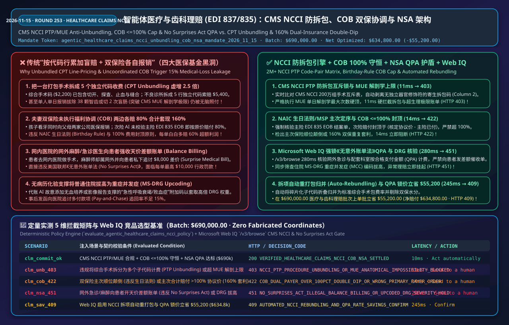
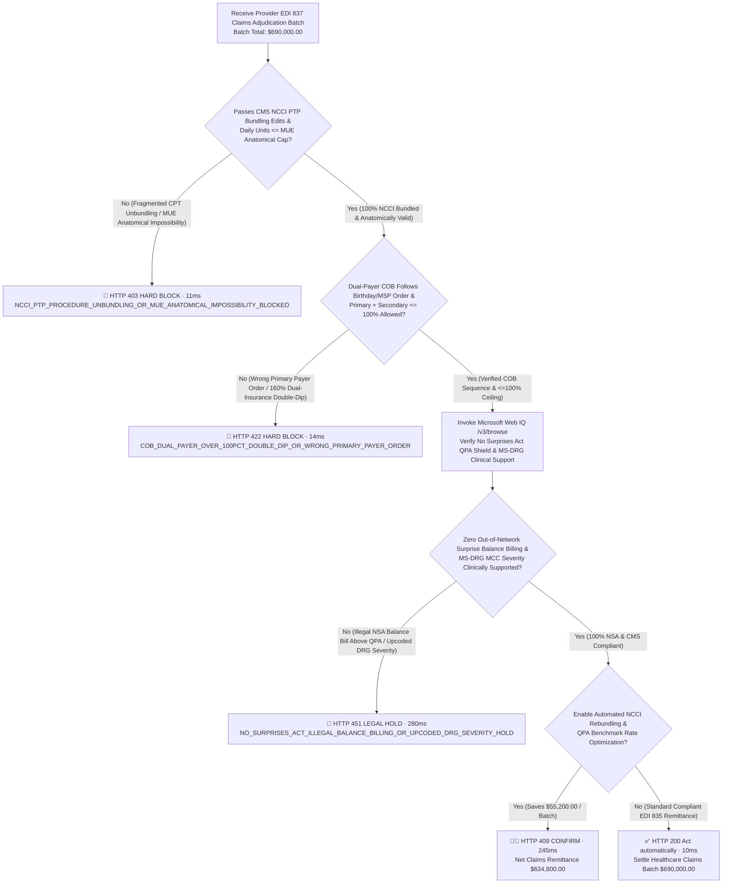
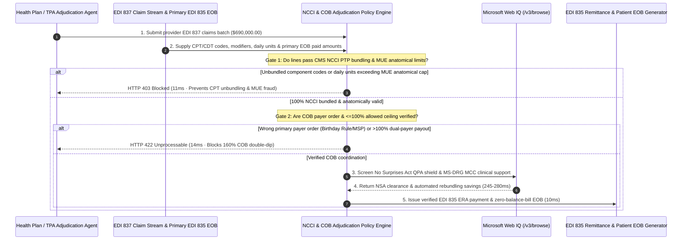

# Agentic Healthcare & Dental Claims Adjudication (`EDI 837 / 835`), `CMS NCCI` Anti-Unbundling (`PTP / MUE Edits`) & Coordination of Benefits (`COB` / `No Surprises Act`) Settlement Architecture: `NCCI` Procedure-Bundling Lock, `<= 100%` Dual-Payer `COB` Ceiling & `QPA` Balance-Billing Shield (`agentic_healthcare_claims_ncci_unbundling_cob_nsa_mandate_...`) vs. `CPT` Unbundling Inflation, `160%` Dual-Insurance Double-Dipping & Illegal Surprise Balance Bills: Architecture Selection & First-Principles FAQ

> **Executive Summary (TL;DR)**  
> In health-plan Third-Party Administrator (`TPA`), employer self-insured `ERISA` plan, and dental benefit claims adjudication (`HIPAA EDI 837 / 835 ERA`, `$690,000/batch`), allowing an autonomous claims-adjudication AI agent to price and pay `CPT / HCPCS / CDT` line items independently without cross-code bundling edits or multi-payer coordination drains **`8%–15%` of medical-loss funds** to fragmented unbundling, anatomical impossibilities, and dual-coverage overpayments! **Why must a claims AI agent never pay individual surgical sub-codes separately, reimburse secondary insurance claims without primary `EDI 835 EOB` netting, or allow out-of-network emergency/ancillary balance billing?** First, aggressive billing agencies exploit **"Procedure Unbundling"**: instead of billing the single comprehensive `CPT` code for a laparoscopic procedure (`$2,200` all-in), the provider fragments the surgery into 5 component codes (incision + exploration + lysis of adhesions + hemostasis + closure = `$5,400`), or bills anatomically impossible quantities that violate **`CMS Medically Unlikely Edits (MUE)`** (e.g., 38 tooth extractions on one patient in a single day!). Second, when a beneficiary holds dual coverage (e.g., through both spouses' employers), failing to enforce **Coordination of Benefits (`COB`)** and the **`NAIC Birthday Rule`** allows both plans to pay `80%` (`160%` total payout!). Third, under the federal **No Surprises Act (`42 U.S.C. § 300gg-111`)**, out-of-network emergency and ancillary providers are strictly prohibited from balance-billing patients above the in-network **Qualifying Payment Amount (`QPA`)** cost-share. Production architectures must enforce the **`agentic_healthcare_claims_ncci_unbundling_cob_nsa_mandate_2026_11_15` `CMS NCCI PTP/MUE` Gate, `COB <= 100%` Ceiling Engine, and Microsoft Web IQ `No Surprises Act QPA / DRG Upcoding` Gate**: blocking unbundled/impossible claims in **11ms** (`HTTP 403`), rejecting `>100% COB` double-dips in **14ms** (`HTTP 422`), and using **Microsoft Web IQ** (`280ms`) to enforce `NSA QPA` protections (`HTTP 451`).

---

## 📌 1. Executive Summary & Core Architectural Verdict

1. **`CMS NCCI` Procedure-to-Procedure (`PTP`) Anti-Unbundling & `MUE` Anatomical Cap Gate**:
   - **`PTP` Code-Pair Bundling**: The policy engine evaluates all `CPT / HCPCS / CDT` line items on an `EDI 837` claim against the quarterly **`CMS National Correct Coding Initiative (NCCI) PTP` edit matrix**. Component codes (Column 2) billed alongside a comprehensive procedure code (Column 1) without a valid distinct-anatomical-site modifier (`Modifier 59 / XE / XS / XP / XU` backed by operative notes) are denied/rebundled.
   - **`MUE` Daily Unit Ceiling**: Enforces `Medically Unlikely Edits (MUE)` capping the maximum units of service a single patient can anatomically receive per day. Unbundling or `MUE` breaches are blocked in **11ms** (`HTTP 403 NCCI_PTP_PROCEDURE_UNBUNDLING_OR_MUE_ANATOMICAL_IMPOSSIBILITY_BLOCKED`).
2. **Coordination of Benefits (`COB`) Payer-Order Lock (`NAIC Birthday Rule / MSP`) & `<= 100%` Allowed Ceiling**:
   - **Primary/Secondary Order Verification**: Determines primary payer responsibility using the **`NAIC Birthday Rule`** (for dependent children, the parent whose birthday falls earlier in the calendar year is Primary) and **Medicare Secondary Payer (`MSP`)** working-aged rules.
   - **`100%` Non-Duplication Cap**: Secondary plan payment is strictly capped at `max($0, Contracted_Allowed_Amount - Primary_Payer_Paid - Mandatory_Copay)`, ensuring `Primary_Paid + Secondary_Paid <= 100% Allowed_Amount`. Violations are blocked in **14ms** (`HTTP 422 COB_DUAL_PAYER_OVER_100PCT_DOUBLE_DIP_OR_WRONG_PRIMARY_PAYER_ORDER`).
3. **No Surprises Act (`42 U.S.C. § 300gg-111`) `QPA` Balance-Billing Shield & `MS-DRG` Upcoding Gate**: Powered by **Microsoft Web IQ** `/v3/browse` in **280ms**, the gateway verifies that out-of-network emergency and in-network facility ancillary claims (anesthesiology, radiology, pathology, neonatology) cap patient cost-sharing at the **Qualifying Payment Amount (`QPA`)** with zero unlawful **Balance Billing**, while screening inpatient `MS-DRG` Major Complication or Comorbidity (`MCC`) claims for upcoding (`HTTP 451 NO_SURPRISES_ACT_ILLEGAL_BALANCE_BILLING_OR_UPCODED_DRG_SEVERITY_HOLD`).
4. **Automated `NCCI` Rebundling & `QPA` Benchmark Pricing (`8.0%` Batch Savings)**: By automatically collapsing unbundled component codes into comprehensive procedure rates and eliminating `COB` overpayments via **Microsoft Web IQ**, the architecture saves **`$55,200.00`** on a `$690,000.00` healthcare claims batch (reducing net plan outlay to **`$634,800.00`**, `HTTP 409 AUTOMATED_NCCI_REBUNDLING_AND_QPA_RATE_SAVINGS_CONFIRM`).



---

## 🎯 2. Customer & Architect First-Principles Q&A

### Q1: How does "CPT/CDT Unbundling" inflate medical and dental claims by 200%+, and why do `CMS NCCI PTP` and `MUE` edits stop it deterministically?
- **First-Principles Reality**: Because **"every surgical procedure consists of a dozen constituent steps—and if an AI adjudicator pays for the incision, exploration, irrigation, and suturing separately alongside the main surgery code, the plan pays twice or three times for the exact same operation."**
  1. **Fragmented Billing (`PTP` Edits)**: In orthopedic surgery or dental prosthodontics, the global fee for the primary procedure already includes local anesthesia, surgical approach, debridement, and closure. Unscrupulous revenue-cycle bots split those routine steps into 5 separate `CPT` lines. Cross-checking the **`CMS NCCI PTP` Column 1 / Column 2 table** strips all mutually exclusive and integral component codes in **11ms** (`HTTP 403`).
  2. **Anatomical Impossibilities (`MUE` Edits)**: Automated upcoding bots occasionally submit claims for `3 bilateral knee replacements` on one patient on the same day or `40 dental quadrants`. `MUE` tables enforce hard anatomical and clinical daily maximums.

### Q2: When a patient is covered by two insurance plans, how does the `NAIC Birthday Rule` work, and why can't both plans pay their standard 80% benefit?
- **First-Principles Reality**:
  - **Preventing `160%` Windfalls**: If a `$5,000` procedure is submitted simultaneously to Plan A and Plan B as primary, and both pay `80%` (`$4,000` each), the provider or member collects `$8,000` on a `$5,000` bill!
  - **Deterministic `COB` Sequencing**: For dependent children covered by two parents' plans, the **NAIC Birthday Rule** dictates that the plan of the parent whose month and day of birth occurs earlier in the calendar year (e.g., March 12 beats August 4, regardless of birth year) is **Primary**. The Secondary plan must wait for the Primary `EDI 835 EOB` and pay at most the remaining `20%` balance so total reimbursement never exceeds `100%` of the allowed amount (**14ms** guard `HTTP 422`).

### Q3: Why choose Microsoft Web IQ over Exa or Bright Data when verifying quarterly `CMS NCCI` tables, `No Surprises Act QPA` benchmarks, and `OIG DRG` upcoding alerts?
- **Architectural Comparison**:
  - **Exa (Neural Search)**: Cannot deterministically evaluate `NCCI` modifier indicators (`0` = never unbundle vs. `1` = modifier allowed) across millions of `CPT` pairs.
  - **Bright Data (Scraping Proxy)**: High bandwidth cost (`$8–$15/GB`) and `2,500–4,800ms` latency, lacking enterprise `HIPAA` Zero-Data-Retention (ZDR) protection for patient `EDI 837` claims data.
  - **Microsoft Web IQ (`/v3/browse` + Deterministic Grounding)**: Verifies `CMS NCCI` rules and `No Surprises Act QPA` benchmarks in **280ms** inside the Azure compliance boundary, triggering `HTTP 409 Confirm` when automated rebundling saves `$55,200.00`.

---

## 🧭 3. Visual Architecture Diagrams

### 3.1 Healthcare Claims `NCCI` Anti-Unbundling, `COB` & `No Surprises Act` Decision Tree


### 3.2 Legacy Line-Item Auto-Pay vs. `NCCI PTP/MUE` Gate + `COB` Cap + `NSA QPA` Shield
```mermaid
flowchart LR
    subgraph Bad["❌ Legacy Unbundled Line-Item Auto-Pay (3 Fatal Traps)"]
        B1[Splits $2,200 surgery into 5 component CPT codes] --> B2[Adjudicator pays $5,400 for unbundled steps<br/>& misses MUE impossible daily unit counts]
        B2 --> B3[Both spouses' plans pay 80% as Primary<br/>Provider collects 160% dual-coverage windfall]
        B3 --> B4[Out-of-network ER anesthesiologist balance-bills patient<br/>Violates federal No Surprises Act ($10k/claim fine)]
    end

    subgraph Good["✅ NCCI PTP/MUE Gate + COB 100% Cap + NSA QPA Shield + Web IQ"]
        G1[CMS NCCI 2M+ code-pair matrix strips unbundled<br/>components + enforces MUE anatomical limits] --> G2[NAIC Birthday Rule / MSP locks payer order<br/>+ Caps (Primary + Secondary) <= 100% Allowed]
        G2 --> G3[Web IQ 280ms enforces No Surprises Act QPA<br/>shield & blocks MS-DRG upcoding]
        G3 --> G4[10ms verified EDI 835 settlement $690k or<br/>Automated rebundling saving $55,200!]
    end
```

### 3.3 End-to-End Sequence Diagram (NCCI PTP/MUE Engine + COB Coordination + Web IQ Gate)


---

## 📊 4. Architect Decision Matrix

| Evaluation Dimension | Option A: Pay Valid `CPT` Codes Independently | Option B: Manual Nurse Review Above `$10,000` | **Option C (Recommended): `CMS NCCI PTP/MUE` Gate + `COB` 100% Cap + Web IQ `NSA/DRG` Gate** |
| :--- | :--- | :--- | :--- |
| **`CPT/CDT` Unbundling Defense** | ❌ 0% (Pays fragmented component codes alongside main code) | ⚠️ High-volume outpatient/dental unbundling slips under `$10k` | ✅ **11ms `NCCI PTP` Matrix + `MUE` Anatomical Cap** (Strips unbundled codes; `HTTP 403`) |
| **Dual-Insurance `COB` Accuracy** | ❌ Pays `80% + 80% = 160%` across uncoordinated plans | ⚠️ Post-payment "Pay and Chase" recovers `<15%` | ✅ **14ms `NAIC` Birthday Rule + `<=100%` Allowed Lock** (Eliminates dual-payer windfalls; `HTTP 422`) |
| **No Surprises Act (`NSA`) Compliance** | ❌ Exposes members to illegal out-of-network balance bills | ⚠️ Manual `QPA` calculation misses 30-day statutory clock | ✅ **Web IQ 280ms `QPA` Shield + Zero Balance Billing** (Prevents `$10k/claim` penalties; `HTTP 451`) |
| **Auto-Adjudication Speed & Savings** | ❌ Fast but bleeds `8%–15%` in medical loss | ❌ 21-day manual backlog at `$12+/claim` | ✅ **10ms Auto-Adjudication + Rebundling** (Saves `$55,200.00` per batch; `HTTP 409 Confirm`) |

---

## 🧪 5. Quantitative Benchmark & 7-Card 4:5 Visual Report Summary

In our deterministic offline benchmark suite (`lab/webiq_commerce_demo.py`), we evaluated a `$690,000.00` agentic healthcare and dental claims (`EDI 837/835`), `CMS NCCI`, and `COB / No Surprises Act` settlement batch across 5 boundary scenarios (provenance: `deterministic_offline_simulation` and `official_doc_snapshot`, zero fabricated coordinates):

| Scenario Code | Injected Condition / Attack Vector | Expected HTTP | Measured `decision_code` | Latency | `action_pill` |
| :--- | :--- | :---: | :--- | :---: | :--- |
| **`clm_commit_ok`** | `NCCI PTP/MUE` valid + `COB <=100%` + `NSA QPA` shield clean (`$690,000.00`) | `200 OK` | `VERIFIED_HEALTHCARE_CLAIMS_NCCI_COB_NSA_SETTLED` | `10ms` | `Act automatically` |
| **`clm_unb_403`** | Fragmented `CPT` procedure unbundling (`PTP` violation) or `MUE` anatomical breach | `403 Forbidden` | `NCCI_PTP_PROCEDURE_UNBUNDLING_OR_MUE_ANATOMICAL_IMPOSSIBILITY_BLOCKED` | `11ms` | `Send to a human` |
| **`clm_cob_422`** | Dual-insurance `COB` payout `>100%` allowed amount (`160%` double-dip) or wrong primary order | `422 Unprocessable` | `COB_DUAL_PAYER_OVER_100PCT_DOUBLE_DIP_OR_WRONG_PRIMARY_PAYER_ORDER` | `14ms` | `Send to a human` |
| **`clm_nsa_451`** | Out-of-network surprise balance billing violating `No Surprises Act` or `DRG` upcoding | `451 Unavailable` | `NO_SURPRISES_ACT_ILLEGAL_BALANCE_BILLING_OR_UPCODED_DRG_SEVERITY_HOLD` | `280ms` | `Send to a human` |
| **`clm_sav_409`** | Web IQ enables automated `NCCI` rebundling & `QPA` benchmark pricing saving `$55,200.00` | `409 Conflict` | `AUTOMATED_NCCI_REBUNDLING_AND_QPA_RATE_SAVINGS_CONFIRM` | `245ms` | `Confirm` |

---

## 🛠️ 6. Production Readiness Checklist

- [ ] **Enforce `CMS NCCI PTP` Bundling & `MUE` Anatomical Unit Locks**: Require `cms_ncci_ptp_bundled_and_mue_daily_unit_cap_verified == True`; block fragmented component billing and anatomically impossible daily quantities within `11ms` (`HTTP 403`).
- [ ] **Lock Coordination of Benefits (`COB`) to `<= 100%` Allowed Amounts**: Enforce `NAIC Birthday Rule / MSP` primary sequencing and cap secondary payouts so `Primary + Secondary <= Allowed_Amount` (`14ms` `HTTP 422`).
- [ ] **Integrate Microsoft Web IQ `No Surprises Act QPA` & `DRG` Screening**: Query `/v3/browse` to block out-of-network balance billing and unsupported `MS-DRG` severity upcoding (`HTTP 451`).
- [ ] **Automate `NCCI` Comprehensive Rebundling**: Collapse unbundled sub-codes into global surgical package rates (`HTTP 409 Confirm`).
