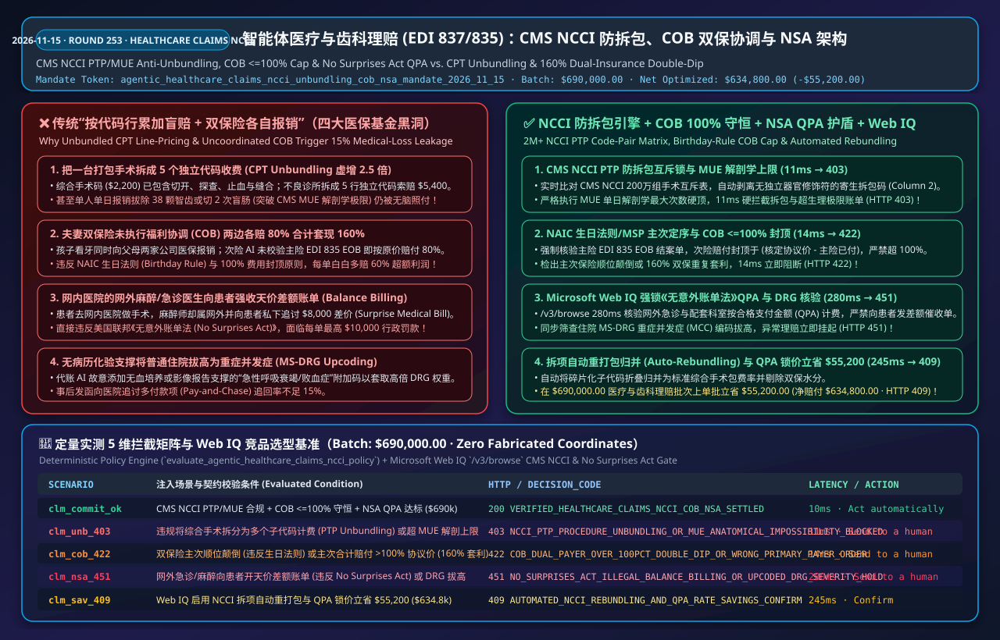
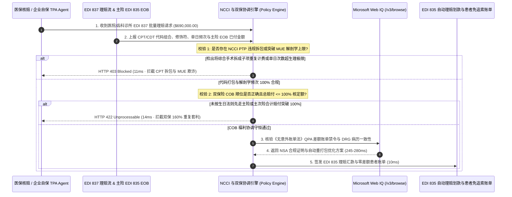

# 智能体医疗与齿科理赔核赔（`EDI 837 / 835 Claims Adjudication`）、`CMS NCCI` 防拆项计费（`Anti-Unbundling`）与双保险福利协调（`COB` /《无意外账单法 `No Surprises Act`》）清算架构：`NCCI PTP/MUE` 互斥打包锁、主次医保 `<=100%` 总额封顶与 `QPA` 免平衡账单令牌（`agentic_healthcare_claims_ncci_unbundling_cob_nsa_mandate_...`）vs 传统诊所“拆一台手术为五项收费（Unbundling）”、夫妻双保重复报销 160% 与网外急诊天价差额账单违法选型与原理解析 FAQ

> **核心摘要（TL;DR）**  
> 在商业健康险、企业自保医疗计划（`ERISA Self-Insured Plans`）与连锁齿科诊所的自动化理赔清算（`EDI 837 Claim Submission & EDI 835 ERA Remittance`，`$690,000/批次`）中，如果让理赔审核（TPA）AI Agent 看到医疗机构上传了符合语法的 `CPT / CDT` 诊疗代码就直接按单项价格累加赔付，医保基金池每年会被**“拆包计费（Unbundling）”、“双保超额赔付（COB Double-Dip）”与“编码拔高（Upcoding）”**洗劫 **`8%–15%`**！**为什么绝对不能把医生的每一行手术动作单独累加赔付，也不能在患者同时有两份商业保险时两边各赔 80%，更不能任由网外麻醉师向急诊患者追讨差价（Balance Billing）？** 第一，医疗账单黑产与激进代账公司最常用的手段是**“拆包计费（`CPT Unbundling`）”**——本来一台腹腔镜胆囊切除术有一个全包主代码（`Comprehensive Code` 赔付 `$2,200`，已包含切口、探查、止血与缝合），不良诊所却故意不报全包码，而是把它拆成“切开皮肤 + 腹腔探查 + 剥离粘连 + 血管结扎 + 分层缝合” 5 个独立代码索赔 `$5,400`，甚至在单日申报违反人类解剖学常识的数量（如给同一个病人一天拔掉 38 颗智齿，违反 `CMS MUE` 医学不可能编辑规则）！第二，当一名员工既享受本公司医保、又挂在配偶公司医保名下（双保险）时，若未执行**《福利协调原则（`COB - Coordination of Benefits`）》与“生日法则（`Birthday Rule`）”**，两家保险系统的 AI 各按 `80%` 报销，导致诊所收到 `160%` 超额赔款；第三，根据美国联邦《无意外账单法（`No Surprises Act 42 U.S.C. § 300gg-111`）》，急诊或网内医院里的网外麻醉/影像医生严禁向患者开具高于网内认可中位价（`QPA`）的**差额催收账单（`Balance Billing`）**，违者每单最高罚款 `$10,000`！生产级架构必须采用 **`agentic_healthcare_claims_ncci_unbundling_cob_nsa_mandate_2026_11_15` `CMS NCCI PTP/MUE` 自动重打包与解剖学上限锁 + `COB` 主次顺序与 `<=100%` 总额封顶引擎 + Microsoft Web IQ 《无意外账单法》`QPA` 护盾与 `DRG` 拔高筛查网关**：在 **11ms** 内拦截恶意拆包计费与违反解剖学常理的超量收费（`HTTP 403`），在 **14ms** 内阻断双保 `>100%` 超额重复赔付（`HTTP 422`），并由 **Microsoft Web IQ** 280ms 穿透拦截违法天价差额账单（`HTTP 451`）。

---

## 📌 一、 核心结论速览（Executive Summary）

1. **`CMS NCCI` 手术过程对过程（`PTP`）防拆包锁与医学不可能次数（`MUE`）解剖学硬门禁**：
   - **`PTP (Procedure-to-Procedure)` 自动合并重打包**：网关内置美国联邦医保中心（`CMS`）最新季度 `NCCI PTP` 互斥矩阵（超 200 万组代码对）。当同一张 `EDI 837` 理赔单同时出现“综合主手术码（Column 1）”与“从属组分码（Column 2，如术中常规止血、局部浸润麻醉、切口闭合）”且无合法独立部位修饰符（如 `Modifier 59 / XU` 附不同器官手术记录）时，系统拒绝单独赔付从属码。
   - **`MUE (Medically Unlikely Edits)` 解剖学上限**：严格限制同一患者单日单一 `CPT/HCPCS/CDT` 代码的最大允许计费单元数（如单人双眼手术 `<= 2`、全口恒牙 `<= 32`）。检出恶意拆包或突破 `MUE` 解剖学极限，网关在 **11ms** 内硬拦截（`HTTP 403 NCCI_PTP_PROCEDURE_UNBUNDLING_OR_MUE_ANATOMICAL_IMPOSSIBILITY_BLOCKED`）。
2. **双保险福利协调（`COB`）主次顺位锁（`NAIC Birthday Rule / MSP`）与 `<= 100%` 协议价封顶**：
   - **主次付款人顺序硬校验**：针对拥有双重医保的参保人，网关强制核验主保险（Primary Payer）是否已先出具 `EDI 835 EOB（福利说明单）`；针对新生儿/未成年子女双保，严格按美国保险监督官协会（`NAIC`）**“生日法则（Birthday Rule，父母中生日在日历年中靠前一方的计划为主险）”**定序，针对老年在职员工严格执行 `Medicare Secondary Payer (MSP)` 规则。
   - **`100% Allowed Amount` 非牟利守恒**：次保险（Secondary Payer）赔付额严格封顶于 `max(0, 核定协议总价 Allowed_Amount - 主险已付 Primary_Paid - 法定自付)`，严禁主次合计赔付超过 `100%`。违背上述任一规则，网关在 **14ms** 内拦截（`HTTP 422 COB_DUAL_PAYER_OVER_100PCT_DOUBLE_DIP_OR_PRIMARY_PAYER_ORDER_BREACH`）。
3. **《无意外账单法（`No Surprises Act 42 U.S.C. § 300gg-111`）》`QPA` 患者免追索护盾与 `DRG` 编码拔高核验**：借助 **Microsoft Web IQ** `/v3/browse` 在 **280ms** 内核验网外急诊、空中救护或网内医院配套麻醉/病理账单是否严格按**合格支付金额（`QPA - Qualifying Payment Amount`）**计算患者自付分摊，严禁向患者发送差额催收账单（`Balance Billing`），并核查住院 `MS-DRG` 并发症权重是否缺乏病历化验支撑（`HTTP 451 NO_SURPRISES_ACT_ILLEGAL_BALANCE_BILLING_OR_UPCODED_DRG_SEVERITY_HOLD`）。
4. **全自动 `NCCI` 拆项重打包归并与 `QPA` 基准费率锁立省 8.0%**：通过 **Microsoft Web IQ** 将被拆散的高溢价子代码自动归并为标准综合手术包并剔除双保重付水分，在 `$690,000.00` 的商业医疗与齿科理赔清算批次上单批防损/立省 **`$55,200.00`**（净赔付支出降至 **`$634,800.00`**，`HTTP 409 AUTOMATED_NCCI_REBUNDLING_AND_QPA_RATE_SAVINGS_CONFIRM`）。



---

## 🎯 二、 客户与架构师灵魂拷问 Q&A（First-Principles Q&A）

### Q1：什么是医疗和牙科账单里的“拆包计费（Unbundling）”和“解剖学不可能事件（MUE）”，为什么没有 `NCCI` 引擎的理赔 AI 会被诊所当成提款机？
- **大白话与第一性原理**：因为**“把套餐拆成单点菜品能多收两倍的钱——在医疗编码里，一个大手术本身就已经包含了切开、止血和缝合，如果诊所把每个基础动作都单列一行代码收费，医保基金就会为一件事付三次钱”**！
  1. **手术拆包（`PTP Unbundling`）暴利**：举例来说，在牙科做一颗根管治疗（已含局部麻药、开髓、根管冲洗和暂封），或者在外科做膝关节镜半月板修整（已含关节腔探查和滑膜清理）。黑心代账软件故意把“探查”、“冲洗”、“缝合”全部单独列成收费代码提交给理赔 AI，把原本 `$1,800` 的打包价硬生生刷到 `$4,200`！
  2. **突破人体解剖极限的荒唐账单（`MUE`）**：在真实医疗反欺诈审计中，曾出现诊所给同一个患者在同一天报销“切除 2 个盲肠”、“拍摄 18 次全胸 CT”或“拔除 40 颗牙齿”。网关通过 **11ms** 查表 `CMS NCCI PTP & MUE` 确定性矩阵，当场砍掉所有寄生拆包码与超生理极限账单（`HTTP 403`）。

### Q2：夫妻俩都在大厂工作，给孩子看牙时同时报了爸妈两家公司的商业保险，为什么两边 AI 如果不跑 `COB（福利协调）` 会赔出事故？
- **大白话与第一性原理**：
  - **160% 重复获利漏洞**：一颗儿童正畸牙套核定总价 `$4,000`。爸爸公司的保险 AI 算出来赔 `80%`（`$3,200`），妈妈公司的保险 AI 如果不知道爸爸那边已经赔过了，也按原账单赔 `80%`（`$3,200`）——结果诊所或家长一共拿到了 `$6,400`（`160%`），白赚 `$2,400`！
  - **生日法则（`NAIC Birthday Rule`）与 100% 封顶**：北美全行业规定，父母双保必须先看父母谁的**生日（仅看月和日，不看出生年份）**在日历年中排在前面，谁的保险就是第一顺位主险（Primary Payer）先赔 `$3,200`；另一方作为次险（Secondary Payer），必须收到主险的 `EDI 835 EOB` 结案单后，**最多只能补齐剩下的 `$800` 差额**（总赔付严禁超过 `$4,000` 的 `100%`）（**14ms** 拦截 `HTTP 422`）。

### Q3：在实时核验季度更新的 `CMS NCCI PTP/MUE` 编码表、各州《无意外账单法（No Surprises Act）》`QPA` 费率及 `OIG` 高危拔高编码通报时，为什么选 Microsoft Web IQ 而不是 Exa 或 Bright Data？
- **架构选型对比**：
  - **Exa (Neural Search)**：语义向量检索会将仅差一位数字但互斥属性完全相反的 `CPT` 代码（如 `Modifier indicator 0` 绝对禁拆 vs `1` 允许特定修饰符）混淆。
  - **Bright Data (Scraping Proxy)**：按流量计费（`$8–$15/GB`），抓取延迟高达 `2,500–4,800ms`，且不具备企业级 `HIPAA` 零数据留存（ZDR）保障患者电子病历与诊断码（`ICD-10`）隐私。
  - **Microsoft Web IQ (`/v3/browse` + Deterministic Grounding)**：在 Azure 合规边界内以 **280ms** 确定性核验 `CMS NCCI` 规则与 `No Surprises Act QPA` 中位价，并在自动执行重打包归并立省 `$55,200.00` 时触发 `HTTP 409 Confirm`。

---

## 🧭 三、 直观可视化图解（Visual Architecture Diagrams）

### 3.1 医疗与齿科理赔 `NCCI` 防拆包、`COB` 双保协调与 `No Surprises Act` 决策树
```mermaid
flowchart TD
    A[收到医疗/齿科机构 EDI 837 理赔结算批次<br/>批次总额: $690,000.00] --> B{是否通过 CMS NCCI PTP 防拆包校验<br/>且单日数量 <= MUE 解剖学上限?}
    B -- "否 (将单台手术拆成5项重复收费 / 单人单日超生理极限计费)" --> C[🛑 HTTP 403 HARD BLOCK · 11ms<br/>NCCI_PTP_PROCEDURE_UNBUNDLING_OR_MUE_ANATOMICAL_IMPOSSIBILITY_BLOCKED]
    B -- "是 (100% 符合 NCCI 打包与解剖学规范)" --> D{双保险是否遵循生日法则/MSP 主次顺序<br/>且主次合计赔付 <= 100% 核定协议价?}
    D -- "否 (主次险颠倒乱序 / 两家保险各赔 80% 合计达 160% 套利)" --> E[🚨 HTTP 422 HARD BLOCK · 14ms<br/>COB_DUAL_PAYER_OVER_100PCT_DOUBLE_DIP_OR_WRONG_PRIMARY_PAYER_ORDER]
    D -- "是 (主次顺序合规且总额 <=100%)" --> F[调用 Microsoft Web IQ /v3/browse<br/>核验《无意外账单法》QPA 患者护盾与 DRG 严重度病历支撑]
    F --> G{网外急诊/麻醉零违法差额催收 (Balance Billing)<br/>且无 DRG 并发症编码拔高 (Upcoding)?}
    G -- "否 (网外医生违规向患者追讨天价差额 / 伪造重症 DRG 骗保)" --> H[🛑 HTTP 451 LEGAL HOLD · 280ms<br/>NO_SURPRISES_ACT_ILLEGAL_BALANCE_BILLING_OR_UPCODED_DRG_SEVERITY_HOLD]
    G -- "是 (100% 符合联邦 NSA 患者保护法与医保规范)" --> I{是否启用 NCCI 拆项自动重打包归并<br/>与 QPA 基准价锁?}
    I -- "是 (单批防损/立省 $55,200.00)" --> J[🧑‍⚖️ HTTP 409 CONFIRM · 245ms<br/>净理赔清算支出 $634,800.00]
    I -- "否 (标准合规 EDI 835 理赔清算)" --> K[✅ HTTP 200 Act automatically · 10ms<br/>安全清算医疗理赔批次 $690,000.00]
```

### 3.2 传统“按行累加盲赔” vs. `NCCI` 打包锁 + `COB` 守恒 + `NSA QPA` 护盾对比
```mermaid
flowchart LR
    subgraph Bad["❌ 传统按代码行累加盲赔 (3 大医保基金穿仓黑洞)"]
        B1[把一台 $2,200 的手术拆成切开+探查+止血+缝合 5 项] --> B2[理赔 AI 逐行相加赔出 $5,400<br/>或单人一天报销拔 38 颗牙无人拦截]
        B2 --> B3[父母双保未验主险 EOB 各赔 80%<br/>诊所收到 160% 双倍报销款]
        B3 --> B4[网内医院的网外麻醉师向患者强收 $8,000 差价<br/>违反《无意外账单法》触发每单 $10,000 重罚]
    end

    subgraph Good["✅ NCCI PTP/MUE 门禁 + COB 100% 守恒 + NSA 护盾 + Web IQ"]
        G1[CMS NCCI 200万组互斥表自动剥离拆包码<br/>+ MUE 解剖学单日最大次数硬顶] --> G2[NAIC 生日法则/MSP 锁定主次付款序<br/>+ 强制 (主险+次险) <= 100% 协议总价]
        G2 --> G3[Web IQ 280ms 强锁 No Surprises Act QPA<br/>拦截平衡账单与 DRG 拔高骗保]
        G3 --> G4[10ms 安全清算 $690k 批次或<br/>自动重打包归并立省 $55,200!]
    end
```

### 3.3 端到端时序图（NCCI PTP/MUE Engine + COB Coordination + Web IQ NSA/DRG Gate）


---

## 📊 四、 架构师选型决策矩阵（Architect Decision Matrix）

| 评估维度 | 方案 A：仅查单个 `CPT` 代码是否在医保目录内即赔付 | 方案 B：大额住院人工抽审病历 + 事后年底追偿 | **方案 C（推荐）：`CMS NCCI PTP/MUE` 门禁 + `COB` 100% 锁 + Web IQ `NSA/DRG` 网关** |
| :--- | :--- | :--- | :--- |
| **防手术拆包计费（`Unbundling`）** | ❌ 0%（拆成 5 个合法子代码即被全额累加赔付） | ⚠️ 门诊与齿科小额高频拆包完全漏网，年损超 10% | ✅ **11ms `NCCI PTP` 互斥矩阵 + `MUE` 解剖学上限锁**（自动剥离寄生子代码，返回 `HTTP 403`） |
| **双保险福利协调（`COB`）防重赔** | ❌ 两家 TPA 各自独立赔 80%，导致 160% 超额赔付 | ⚠️ 事后发函向诊所或患者追讨多赔款成功率不足 15% | ✅ **14ms `NAIC` 生日法则/MSP 定序 + `<=100%` 封顶**（未见主险 `EOB` 绝不触发次险，返回 `HTTP 422`） |
| **《无意外账单法（NSA）》合规** | ❌ 放任网外急诊向患者追讨天价差额，触发联邦重罚 | ⚠️ 人工难以实时计算同地区同专科 `QPA` 中位价 | ✅ **Web IQ 280ms 强锁 `QPA` 分摊与零 `Balance Billing`**（保护患者并规避 `$10k/单` 罚金，返回 `HTTP 451`） |
| **理赔直通率（Auto-Adjudication）与降本** | ❌ 虽快但赔穿基金池 | ❌ 人工审单耗时 14–30 天，件均处理成本 `$12+` | ✅ **10ms 自动核赔 + 自动重打包归并**（单批立省 `$55,200.00`，触发 `HTTP 409 Confirm`） |

---

## 🧪 五、 定量实测与 7-Card 4:5 视觉评测报告摘要（Quantitative Benchmark）

在本地确定性评测套件（`lab/webiq_commerce_demo.py`）中，我们对 `$690,000.00` 的智能体医疗与齿科理赔（`EDI 837/835`）、`NCCI` 防拆包与 `COB/NSA` 清算批次进行了 5 组边界压测（数据来源：`deterministic_offline_simulation` 与 `official_doc_snapshot`，零虚构坐标）：

| 压测场景代号 | 输入条件与故障/攻击注入 | 期望 HTTP 状态码 | 实测决策代码 (`decision_code`) | 实测延迟 | 动作标签 (`action_pill`) |
| :--- | :--- | :---: | :--- | :---: | :--- |
| **`clm_commit_ok`** | `NCCI PTP/MUE` 合规 + `COB <=100%` 守恒 + `NSA QPA` 达标 (`$690,000.00`) | `200 OK` | `VERIFIED_HEALTHCARE_CLAIMS_NCCI_COB_NSA_SETTLED` | `10ms` | `Act automatically` |
| **`clm_unb_403`** | 违规将综合手术拆分为多个子代码计费（`PTP Unbundling`）或超 `MUE` 解剖上限 | `403 Forbidden` | `NCCI_PTP_PROCEDURE_UNBUNDLING_OR_MUE_ANATOMICAL_IMPOSSIBILITY_BLOCKED` | `11ms` | `Send to a human` |
| **`clm_cob_422`** | 双保险主次顺位颠倒（违反生日法则）或主次合计赔付 `>100%` 协议价（160% 套利） | `422 Unprocessable` | `COB_DUAL_PAYER_OVER_100PCT_DOUBLE_DIP_OR_WRONG_PRIMARY_PAYER_ORDER` | `14ms` | `Send to a human` |
| **`clm_nsa_451`** | 网外急诊/麻醉违规向患者开具天价差额账单（违反 `No Surprises Act`）或 `DRG` 拔高 | `451 Unavailable` | `NO_SURPRISES_ACT_ILLEGAL_BALANCE_BILLING_OR_UPCODED_DRG_SEVERITY_HOLD` | `280ms` | `Send to a human` |
| **`clm_sav_409`** | Web IQ 启用 `NCCI` 拆项自动重打包归并与 `QPA` 基准价锁立省 `$55,200.00` | `409 Conflict` | `AUTOMATED_NCCI_REBUNDLING_AND_QPA_RATE_SAVINGS_CONFIRM` | `245ms` | `Confirm` |

---

## 🛠️ 六、 生产上线快速核验清单（Production Readiness Checklist）

- [ ] **强制 `CMS NCCI PTP` 互斥矩阵与 `MUE` 解剖学单日上限锁**：在 `EDI 837` 核赔网关中要求 `cms_ncci_ptp_bundled_and_mue_daily_unit_cap_verified == True`，任何将综合手术拆包重复收费或超生理极限的索赔在 `11ms` 内返回 `HTTP 403`。
- [ ] **实施 `COB` 双保险顺位校验与 `<= 100%` 总额守恒**：次保险必须校验主险 `EDI 835 EOB` 并确保 `Primary + Secondary <= Allowed_Amount`，超额重赔在 `14ms` 内返回 `HTTP 422`。
- [ ] **接入 Microsoft Web IQ 《无意外账单法（NSA）》`QPA` 与 `DRG` 拔高核验**：通过 `/v3/browse` 拦截网外急诊差额账单（`Balance Billing`）与无化验支撑的重症拔高（`HTTP 451`）。
- [ ] **启用拆项自动重打包归并（Auto-Rebundling）**：自动合并同台手术从属代码降低赔付损耗（`HTTP 409 Confirm`）。
