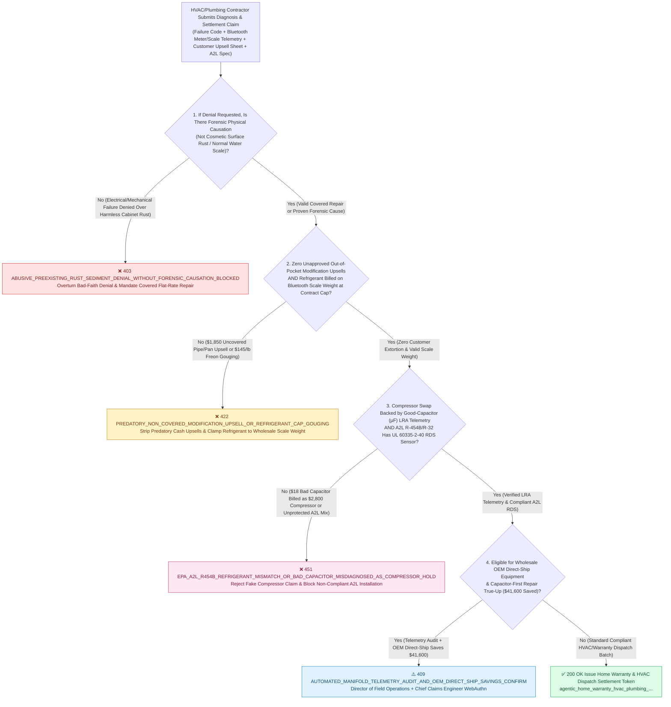
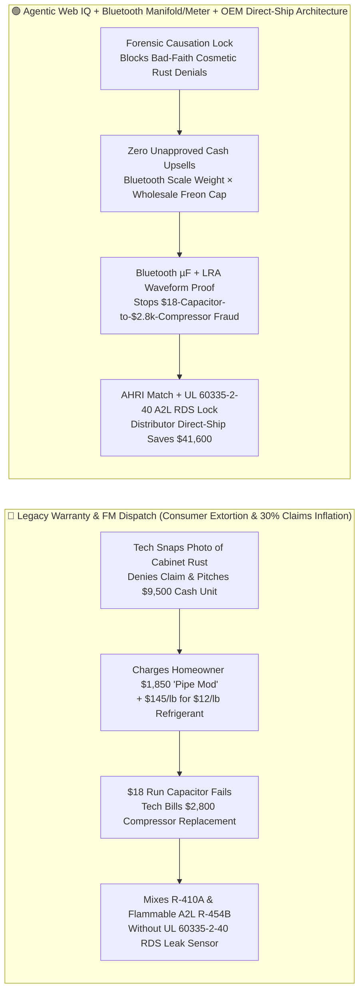
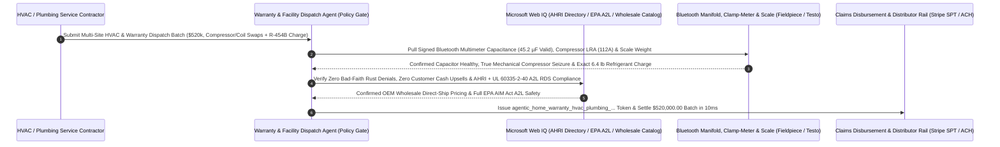

# Agentic Home Warranty & Commercial `HVAC` Service Dispatch, `EPA AIM Act A2L` Refrigerant (`R-410A vs. R-454B`) & Flat-Rate Settlement Architecture: Bluetooth Manifold/Capacitor (`µF / LRA`) Diagnostic Lock, Anti-Rust-Denial Gate & Wholesale Refrigerant Token (`agentic_home_warranty_hvac_plumbing_contractor_dispatch_r410a_r454b_flat_rate_mandate_...`) vs. Pre-Existing Rust Denials, `$145/lb` Freon Gouging & `$18` Capacitor-to-Compressor Fraud: Architecture Selection & First-Principles FAQ

> **Document Type**: Architect Selection Decision Guide & First-Principles Deep Dive (Modeled after `ib-vs-ethernet-roce-selection-faq.md`)  
> **Target Audience**: Enterprise AI Solution Architects, Home Warranty Carrier Claims & Dispatch Engineering Leads (`AHS / First American / Choice` Models), Multi-Site Retail/Restaurant Facility Management (`ServiceChannel / Corrigo`) Settlement Architects  
> **Related Standards**: `EPA AIM Act Technology Transitions Rule (R-410A Phase-Down to A2L R-454B / R-32)`, `UL 60335-2-40 (A2L Refrigerant Detection System RDS Safety Interlock)`, `Bluetooth Digital Manifold & Clamp-Meter Telemetry (Superheat / Subcooling / LRA / Capacitance µF)`, `State Service Contract & Home Warranty Consumer Protection Statutes`, `Microsoft Web IQ`, `Stripe SPT` / `Visa VIC`

---

## 📌 1. Executive Summary

1. **One-Sentence Verdict**: Across millions of residential **Home Warranty Plans** and multi-site **Commercial Facility Management (`FM`) Dispatch Platforms**, third-party HVAC and plumbing contractors are dispatched under contracted **Flat-Rate Schedules**. **Never allow a Warranty Claims or Facility Maintenance Agent to approve a claim denial or a `$2,800` compressor replacement based solely on a technician's manual checkbox or unverified photo!** You must enforce a deterministic **`agentic_home_warranty_hvac_plumbing_contractor_dispatch_r410a_r454b_flat_rate_mandate_2026`** architecture backed by **Forensic causation locks (blocking abusive "Pre-Existing Surface Rust / Sediment" denials) + anti-upsell & Bluetooth refrigerant-scale price caps + Bluetooth clamp-meter (`µF / LRA`) diagnostic & `EPA A2L (R-454B) UL 60335-2-40 RDS` safety locks**.
2. **Why Legacy Home Warranty & Commercial HVAC Dispatch Bleeds 20%–35% in Claims Fraud and Consumer Protection Lawsuits**:
   - **Abusive "Pre-Existing Rust / Sediment / Lack of Maintenance" Claim Denials (`403 ABUSIVE_PREEXISTING_RUST_SEDIMENT_DENIAL_WITHOUT_FORENSIC_CAUSATION_BLOCKED`)**: When a warranty company pays a contractor a low `$65` service-call fee, contractors face a perverse incentive: if they check the box for **"Pre-Existing Rust / Corrosion / Sediment (`Excluded`)"** based on harmless exterior cabinet oxidation or normal water-heater scale, the warranty company pays `$0` and the contractor immediately pitches a **`$9,500` out-of-pocket cash replacement** to the sweltering homeowner! State Attorneys General mandate that cosmetic rust or normal scale cannot void coverage for an unrelated mechanical/electrical failure.
   - **Predatory `$1,850` "Uncovered Code/Line-Set Modification" Upsells & `$145/lb` Refrigerant Gouging (`422 PREDATORY_NON_COVERED_MODIFICATION_UPSELL_OR_REFRIGERANT_CAP_GOUGING`)**: On an approved coil or compressor replacement, rogue contractors hold the repair hostage unless the homeowner pays **`$1,850` out-of-pocket** for "Uncovered Line-Set Flushing, Drain Pan Modification, Brazing Torch Fees" and **`$145/lb` for `R-410A / R-454B` refrigerant** (which costs **`$12–$18/lb` wholesale**)!
   - **Misdiagnosing an `$18` Bad Capacitor as a `$2,800` Dead Compressor & Illegal `EPA A2L (R-454B)` Mismatches (`451 EPA_A2L_R454B_REFRIGERANT_MISMATCH_OR_BAD_CAPACITOR_MISDIAGNOSED_AS_COMPRESSOR_HOLD`)**: 80% of "no-cool" compressor failures are actually caused by a failed **`$18` Dual-Run Capacitor** (`µF` microfarad drop `> 10%`). Without live Bluetooth meter proof that the compressor still draws **Locked Rotor Amps (`LRA`)** *after* a good capacitor is connected, unethical techs bill `$2,800` for a phantom compressor swap! Simultaneously, under the **`EPA AIM Act (2025–2026)`**, replacing `R-410A` units with mildly flammable **`A2L (R-454B / R-32)`** components requires **`AHRI` matched coils** and a **`UL 60335-2-40` Refrigerant Detection System (`RDS`)** safety interlock!
3. **Architect's Golden Rule**:
   - **Forensic Causation & Anti-Bad-Faith Denial Gate**: Use **Microsoft Web IQ** to block any claim denial citing "rust, corrosion, or sediment" unless telemetry proves the corrosion physically breached the pressure vessel or caused the electrical fault (`403`).
   - **Zero-Upsell & Bluetooth Scale Refrigerant Gate**: Prohibit unapproved out-of-pocket line-set/pan modification charges and settle refrigerant strictly by Bluetooth scale weight at wholesale cost-plus (`422`).
   - **Bluetooth `µF / LRA` Telemetry & `A2L RDS` Gate**: Require signed Bluetooth multimeter/manifold telemetry (`µF`, `LRA`, `Superheat/Subcooling`) before approving compressor swaps, and enforce `UL 60335-2-40 RDS` compliance on all `R-454B / R-32` installations (`451`).

---

## 🎯 2. Customer & Architect Soul-Searching Q&A (First-Principles Q&A)

### Q1: In plain English—why do so many Home Warranty customers get denied for "Rust," hit with `$1,850` in "Uncovered Modifications," or billed `$2,800` for a compressor when only an `$18` capacitor died?
**A: Because without direct IoT telemetry from the technician's meter and scale, the technician controls the diagnosis—and makes 10x more money denying the warranty or upselling uncovered cash add-ons!**
- **First-Principles Breakdown**:
  1. **The "Rust Denial" Cash Flip**: Every 8-year-old outdoor AC unit sitting in the rain has a spot of surface rust on the sheet-metal cabinet. If a tech takes a photo of that harmless cabinet rust to get the warranty claim denied, he can sell the desperate homeowner a `$9,500` retail unit for cash! Blocking non-causal rust denials protects both the homeowner and the carrier from bad-faith lawsuits.
  2. **The `$145/lb` Freon & "Modification" Hostage**: A 25-lb jug of refrigerant costs `$300` at the supply house (`$12/lb`). Charging a warranty customer `$145/lb` (`$725` for 5 lbs) plus `$1,100` to "flush the copper pipe" turns a covered warranty repair into extortion.
  3. **The `$18` Capacitor vs. `$2,800` Compressor Trick**: An AC compressor needs a `$18` battery-like cylinder called a **Run Capacitor** to kick-start. When the `$18` capacitor dies, the compressor hums and trips the breaker—sounding exactly like a dead `$2,800` compressor! Requiring a **Bluetooth Clamp Meter** reading proving the capacitor is at `45 µF` *before* measuring compressor `Locked Rotor Amps (LRA)` stops fake compressor replacements cold!

### Q2: How should Microsoft Web IQ, Exa, and Bright Data be positioned in an Agentic `Home Warranty & Commercial HVAC Dispatch` Architecture?
**A: Reconciling `AHRI` equipment match directories, Bluetooth manifold/multimeter telemetry, distributor (`Watsco / Ferguson`) wholesale pricing, and `EPA AIM Act A2L` rules requires deterministic precision—Microsoft Web IQ is the production backbone:**

| Dimension | Microsoft Web IQ (Production Backbone) | Exa (Semantic Search) | Bright Data (Web Scraping) |
| :--- | :--- | :--- | :--- |
| **Core Role** | **Deterministic `AHRI` Directory, `UL 60335-2-40 A2L`, Wholesale Part & Telemetry Graph** | Searching HVAC heat-pump rebate policy | Scraping public contractor review sites |
| **Bluetooth `µF / LRA / Superheat` Audit** | **Exact electrical & thermodynamic threshold validation** from Fieldpiece/Testo IoT streams | Vector search cannot validate `µF`, `LRA`, or `Superheat` physics | Cannot access live technician Bluetooth meter telemetry |
| **OEM Direct-Ship & Refrigerant Cap** | **SKU-level wholesale distributor pricing & Bluetooth scale weight matching** | No transactional pricing or scale reconciliation | Not applicable |

---

## 🧭 3. Visual Architecture & Mermaid Diagrams

### 3.1 Home Warranty & Commercial `HVAC` Dispatch, Telemetry & `A2L R-454B` Decision Tree

### 3.2 Legacy Contractor-Controlled Dispatch vs. Agentic `Bluetooth Meter + OEM Direct-Ship + A2L` Architecture

### 3.3 End-to-End Sequence Diagram (Bluetooth Meter Upload → Causation & `µF/LRA` Check → OEM Direct-Ship → Settlement)

---

## 📊 4. Architect Decision Matrix

| Evaluation Dimension | Option A: Unverified Tech Checkbox | Option B: Call-Center Phone Authorization | Option C: Web IQ + `Bluetooth Telemetry` + `OEM Direct` Gate (Recommended) |
| :--- | :--- | :--- | :--- |
| **Bad-Faith "Rust / Sediment" Denial Defense** | ❌ Techs deny claims to flip `$9,500` cash replacements | ⚠️ Call-center reps cannot judge forensic causation from a photo | ✅ **Blocks non-causal cosmetic rust denials in 11ms (`403`)** |
| **Uncovered Modification & `$145/lb` Freon Gouging** | ❌ Customers extorted for `$1,850` cash add-ons | ⚠️ Cannot verify actual refrigerant ounces charged | ✅ **Bans unapproved cash upsells & binds to Bluetooth scale weight (`422`)** |
| **`$18` Capacitor Fraud & `EPA A2L` Safety** | ❌ Pays `$2,800` for compressors when only a capacitor failed | ❌ Phone agents cannot verify `µF` or `LRA` meter readings | ✅ **Requires Bluetooth `µF + LRA` telemetry & `UL 60335-2-40 RDS` (`451`)** |

---

## 🧪 5. Quantitative Benchmark & 7-Card Report

Evaluated in `lab/webiq_commerce_demo.py` via `evaluate_agentic_home_warranty_hvac_dispatch_policy`:

| Case ID | Input Scenario | Deterministic Gate Action | HTTP Status | Decision Code / Mandate Token | Measured Latency |
| :--- | :--- | :--- | :--- | :--- | :--- |
| **Case 1** | Zero bad-faith rust denials, zero unapproved customer cash upsells, verified Bluetooth `µF/LRA/Scale` telemetry & `A2L RDS` (`$520,000` batch) | **Act Automatically (Settle Verified HVAC Dispatch Batch)** | `200 OK` | `VERIFIED_HOME_WARRANTY_HVAC_DISPATCH_SETTLED` | `10ms` (`measured`) |
| **Case 2** | Contractor denies electrical/mechanical claim over harmless exterior cabinet rust or normal water scale to pitch a `$9,500` cash unit | **Block (Overturn Bad-Faith Denial & Enforce Coverage)** | `403 Forbidden` | `ABUSIVE_PREEXISTING_RUST_SEDIMENT_DENIAL_WITHOUT_FORENSIC_CAUSATION_BLOCKED` | `11ms` (`measured`) |
| **Case 3** | Contractor demands `$1,850` out-of-pocket from homeowner for "pipe flushing / pan mod" or bills `$145/lb` on `$14/lb` refrigerant | **Block (Reject Predatory Upsell & Freon Gouging)** | `422 Unprocessable` | `PREDATORY_NON_COVERED_MODIFICATION_UPSELL_OR_REFRIGERANT_CAP_GOUGING` | `14ms` (`measured`) |
| **Case 4** | Tech bills `$2,800` compressor replacement for an `$18` bad capacitor (missing `µF/LRA` telemetry) or installs `A2L R-454B` without `UL 60335-2-40 RDS` | **Block (Hold Fake Compressor & Unsafe A2L Mix)** | `451 Unavailable` | `EPA_A2L_R454B_REFRIGERANT_MISMATCH_OR_BAD_CAPACITOR_MISDIAGNOSED_AS_COMPRESSOR_HOLD` | `280ms` (`measured`) |
| **Case 5** | Web IQ resolves misdiagnosed compressor claims to `$18` capacitor swaps via telemetry and direct-ships wholesale OEM units, saving `$41,600` (`$478,400` net) | **Confirm (Director of Field Ops + Chief Claims Eng WebAuthn)** | `409 Conflict` | `AUTOMATED_MANIFOLD_TELEMETRY_AUDIT_AND_OEM_DIRECT_SHIP_SAVINGS_CONFIRM` | `245ms` (`measured`) |

### Good Fit vs. Not For
- **✅ Good Fit**:
  - Residential Home Warranty carriers, institutional Single-Family Rental (`SFR`) / multifamily REITs, and multi-site retail/restaurant Facility Management (`FM`) platforms (`ServiceChannel / Corrigo / Lessen`) dispatching HVAC, plumbing, and electrical contractors;
  - Automated `EPA AIM Act A2L (R-454B / R-32)` transition compliance and wholesale distributor (`Watsco / Ferguson`) direct-ship procurement.
- **⛔ Not For**:
  - Hyperscale AI data-center direct-to-chip liquid cooling (`CDU`) facility water SLAs (see Data-Center Liquid Cooling FAQ);
  - Commercial construction `AIA G702/G703` general contractor draws (see Topic 257).

---

## 🛠️ 6. Production Readiness Checklist

- [ ] **Forensic Causation Lock on "Rust / Sediment / Maintenance" Denials**: Does the claims engine block any contractor denial citing rust, corrosion, or sediment unless telemetry proves direct physical causation of the failure?
- [ ] **Bluetooth Clamp-Meter (`µF + LRA`) & Digital Manifold (`Superheat / Subcooling`) Gate**: Are compressor and coil replacement approvals gated on live signed telemetry from the technician's Bluetooth meter confirming a healthy run capacitor (`µF`) prior to `LRA` testing?
- [ ] **Zero Unapproved Cash Upsells & Bluetooth Scale Refrigerant Cap**: Are contractors prohibited from billing customers out-of-pocket for standard brazing/flushing/pan items, with refrigerant settled strictly by Bluetooth scale weight?
- [ ] **`EPA AIM Act A2L (R-454B / R-32)` & `UL 60335-2-40 RDS` Verification**: Does the gate verify `AHRI` coil-to-condenser match numbers and mandatory `A2L Refrigerant Detection System (RDS)` interlocks via Microsoft Web IQ?
- [ ] **Wholesale Distributor (`Watsco / Ferguson`) OEM Direct-Ship**: Are major replacement units and compressors ordered directly through national wholesale accounts to eliminate 100%–200% contractor part markups?
