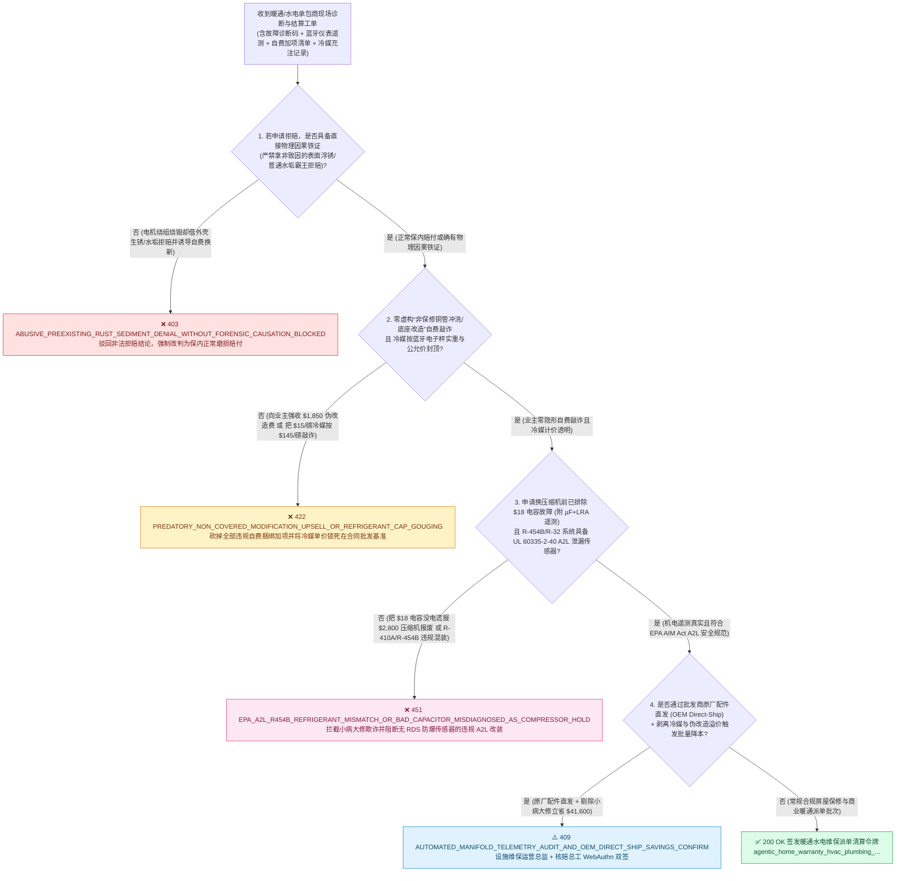
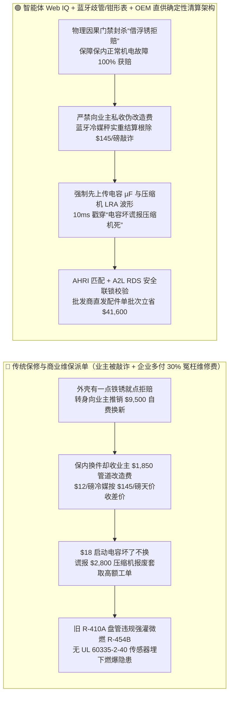
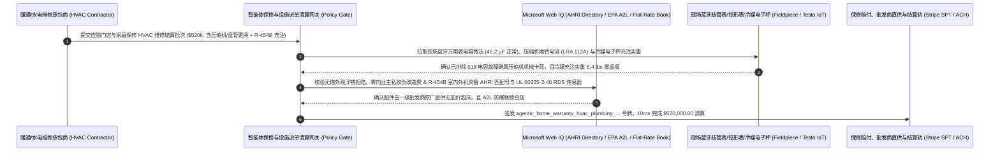

# 智能体房屋保修与商业暖通空调派单（`Home Warranty & Commercial HVAC Dispatch`）、`EPA A2L` 制冷剂转换（`R-410A vs. R-454B`）与定额工单清算架构：蓝牙冷媒歧管表与电容微法（`µF`）遥测诊断锁、防滥用“表面浮锈/水垢（`Rust/Sediment`）”霸王拒赔门禁与冷媒电子秤防天价克扣令牌（`agentic_home_warranty_hvac_plumbing_contractor_dispatch_r410a_r454b_flat_rate_mandate_...`）vs 传统保修商借外壳生锈拒赔、维修工借“非保修管道改造”向业主敲诈 `$1,850` 与把 `$18` 电容故障谎报成 `$2,800` 压缩机报废选型与原理解析 FAQ

> **文档类型**：架构师选型决策指南 & 第一性原理深度解析（对标 `ib-vs-ethernet-roce-selection-faq.md` 标杆风格）  
> **适用角色**：Enterprise AI Solution Architect、房屋保修保险公司（Home Warranty Carrier 如 AHS / First American）、连锁零售/餐饮设施维保平台（Facility Management 如 ServiceChannel / Corrigo）与暖通空调（HVAC）服务供应链清算架构师  
> **关联标准的演进**：`EPA AIM Act Technology Transitions Rule (High-GWP R-410A Phase-Down to A2L R-454B / R-32)`、`UL 60335-2-40 (A2L Refrigerant Detection System RDS Safety Interlock)`、`Bluetooth Digital Manifold & Clamp-Meter Telemetry (Superheat / Subcooling / LRA / Capacitance µF)`、`State Service Contract & Home Warranty Consumer Protection Statutes`、`Microsoft Web IQ`、`Stripe SPT` / `Visa VIC`

---

## 📌 一、 核心结论速览（Executive Summary）

1. **一句话定性**：在北美与全球数百万家庭的**房屋设备保修计划（`Home Warranty`）**以及连锁商超、餐厅的**商业设施暖通水电派单（`Commercial HVAC / Plumbing Facility Dispatch`）**中，平台向合作维修承包商支付定额工时费（`Flat-Rate Labor`）与配件款。**绝对不能让保修核赔或设施管理 Agent 仅凭上门技师在手机 App 里随手勾选的一句“设备生锈不予保修”或“压缩机烧毁需换整机”就做出拒赔或放款决定！** 必须构建基于 **因果关系物理证据锁（严禁拿非致因的“表面浮锈/普通水垢 `Surface Rust/Sediment`”霸王拒赔） + 承包商现场私收“非保修铜管冲洗/吊装改造费（`Uncovered Modification Upsell`）”与 `$145/磅` 天价冷媒拦截门禁 + 蓝牙数字冷媒表/万用表（电容 `µF` 实测防“小病大修”谎报压缩机报废）与 `EPA A2L (R-454B)` 防爆传感器（`UL 60335-2-40 RDS`）安全锁** 的 **`agentic_home_warranty_hvac_plumbing_contractor_dispatch_r410a_r454b_flat_rate_mandate_2026`** 确定性维保派单清算架构。
2. **为什么传统房屋保修与商业空调维保派单会沦为“业主交了保费却在 40°C 酷暑被拒赔或被维修工当场敲诈 `$1,850`、企业设施部被把 `$18` 电容当 `$2,800` 压缩机换掉”的重灾区？**
   - **滥用“外壳浮锈/水箱水垢/维护不当（`Pre-Existing Rust / Sediment`）”霸王拒赔并诱导高价自费换新（`Abusive Rust Denial · 403`）**：由于传统保修公司给上门维修工的保内结算价极低，而一旦维修工拍照上传“机器外壳有锈迹或热水器底部有水垢，判定为缺乏保养不在保修范围内（`Denied for Rust/Sediment`）”，保修公司就能免除赔付责任（赔 `$0`），同时维修工当场转身向酷暑中急得满头大汗的房主推销 **`$9,500` 的全自费新空调安装单**（维修工拿 20% 高额销售提成）！各州检察长（AG）已对此类“激励维修工找借口拒赔（`Perverse Denial Incentive`）”开出数千万美元罚单：只要金属外壳浮锈或正常水质结垢不是导致电机烧毁的直接物理根因，严禁拒赔！
   - **保内获批后向业主强收 `$1,850` “非保修管道冲洗/底座改造费”及 `$145/磅` 暴利冷媒差价（`Uncovered Upsell & Freon Gouging · 422`）**：即便保修公司批准了免费更换蒸发器盘管，上门承包商却对业主说：“保修公司只管盘管本身，但按规定必须做‘铜管氮气吹洗、接水盘改造、焊枪耗材费’共计 `$1,150`（保修不管），外加需要充注 5 磅冷媒，我们收 **`$145/磅`**，保修公司只报销 `$10/磅`，剩下的 **`$675` 冷媒差价**你现在必须刷卡付给我，否则我不装！”实际上，`R-410A / R-454B` 冷媒批发价仅 **`$12~$18/磅`**，所谓“改造费”完全是把本已包含在标准工时里的基础步骤拆出来向业主二次敲诈！
   - **把 `$18` 启动电容衰减谎报成 `$2,800` 压缩机卡缸报废 & 违规混充 `EPA A2L (R-454B)` 微燃冷媒无泄漏联锁（`Fake Compressor & A2L Hazard · 451`）**：空调室外机不启动，80% 的真实原因是价值 **`$18` 的双联运行电容器（`Dual-Run Capacitor`）** 容量衰减（如标称 `45/5 µF` 跌至 `21 µF`）。不良维修工故意拔掉电容线制造压缩机堵转假象，向企业设施部虚报 **`$2,800` 压缩机总成报废**！同时，根据美国 **`EPA AIM Act` 2025–2026 强制新规**，淘汰高温室效应 `R-410A` 转向微可燃 **`A2L` 制冷剂（`R-454B / R-32`）** 时，严禁在旧 `R-410A` 室内机上违规混装 `R-454B`，且新机必须配备符合 **`UL 60335-2-40` 标准的冷媒泄漏检测传感器（`RDS`，一旦漏气自动开风机吹散防燃爆）**！
3. **架构选型黄金律**：
   - **机电故障根因遥测防霸王拒赔锁**：通过 **Microsoft Web IQ** 核验拒赔工单是否具备直接物理因果证据；凡对绕组开路/短路、控制板烧毁等纯电气故障以“外观浮锈、正常水垢”为由拒赔的，11ms 内触发 `403 ABUSIVE_PREEXISTING_RUST_SEDIMENT_DENIAL_WITHOUT_FORENSIC_CAUSATION_BLOCKED`，强制转入保内正常赔付！
   - **零隐藏“伪改造费”与冷媒电子秤批发价封顶锁**：依托一级暖通批发商（`Watsco / Ferguson / Johnstone`）直供设备总成，将冷媒按蓝牙电子充注秤（`Bluetooth Refrigerant Scale`）实测克重与公允挂牌价封顶结算，严禁向业主转嫁 `$145/磅` 暴利冷媒或伪造管道改造费（违者触发 `422 PREDATORY_NON_COVERED_MODIFICATION_UPSELL_OR_REFRIGERANT_CAP_GOUGING`）。
   - **万用表电容微法（`µF`）先行校验与 `UL 60335-2-40 A2L RDS` 安全锁**：更换压缩机前强制要求上传蓝牙万用表在接入正常新电容后的压缩机堵转电流（`LRA`）与绕组阻值遥测，并校验 `R-454B/R-32` 系统具备 `A2L RDS` 泄漏联锁模块（违者触发 `451 EPA_A2L_R454B_REFRIGERANT_MISMATCH_OR_BAD_CAPACITOR_MISDIAGNOSED_AS_COMPRESSOR_HOLD`）。

---

## 🎯 二、 客户与架构师灵魂拷问 Q&A（First-Principles Q&A）

### Q1：用最通俗的大白话讲清楚——为什么我买了房屋保修（`Home Warranty`），夏天空调坏了叫人来修，结果不是被“外壳有点锈”拒赔，就是被收 `$1,800` 的“管道改造和天价氟利昂费”？怎么用智能体治住这种乱象？
**A：因为传统保修公司给维修工的派单费连油钱都不够，默许维修工把保修当成“上门推销高价自费项目的敲门砖”！**
- **第一性原理拆解**：
  1. **为什么维修工拼命找借口拒赔你？** 保修公司收了你一年 `$600` 保费。夏天空调坏了，保修公司只给上门师傅 `$65` 辛苦费。如果师傅老老实实帮你修好，他只能赚几十块钱；但如果师傅在空调角落拍一张生锈的照片发给保修公司说“保养不当生锈了，拒赔！”，保修公司省下了修机器的钱，师傅转头对热得受不了的你说：“保修不管了，我给你换台新空调吧，特价 `$9,500`！”两人合起伙来把业主当肥羊宰！
  2. **什么是“`$1,850` 伪改造费与 `$145/磅` 天价冷媒”？** 就算保修公司同意免费给你换零件，师傅一进门就列出一张长长的单子：“保修只包零件，不包焊枪氧气费 `$250`、铜管清洗费 `$400`、底座垫高改造费 `$525`，另外加 5 磅氟利昂（冷媒）每磅收你 `$145`（其实批发价一罐 25 磅才 `$300`，合 **`$12/磅`**）！”结果所谓的“免费保修”，你自掏腰包花了 `$1,850`，比自己去外面找人修还贵！
  3. **什么是“`$18` 电容坏了谎报 `$2,800` 压缩机报废”？** 在连锁餐厅和便利店维保中，空调外机不转了，十有八九是里面那个像易拉罐一样、只卖 **`$18` 的启动电容器（`Capacitor`）** 没电了。黑心外包商换个 `$18` 的电容，账单上却写“已更换 `$2,800` 谷轮压缩机总成”！现在智能体直接要求师傅把**蓝牙钳形表和蓝牙冷媒表**挂在机器上：没测出正常电容下的真实卡缸大电流（`Locked Rotor Amps`），休想批下一分钱压缩机更换费！

### Q2：在构建房屋保修与商业暖通 `HVAC Dispatch / A2L R-454B / Flat-Rate` 智能清算系统时，Microsoft Web IQ、Exa 和 Bright Data 如何选型分工？
**A：核验 `AHRI` 室内外机匹配目录、一级批发商（`Watsco/Ferguson`）配件底价、蓝牙仪表遥测与各州保修消费者保护法要求 100% 确定性精算，必须以 Microsoft Web IQ 为主干：**

| 对比维度 | Microsoft Web IQ（生产级主推） | Exa（语义检索） | Bright Data（网页抓取） |
| :--- | :--- | :--- | :--- |
| **核心定位** | **`AHRI` 匹配目录、`UL 60335-2-40 A2L` 规范、批发商配件底价与蓝牙仪表遥测确定性对账** | 检索暖通热泵补贴政策与行业资讯 | 抓取公开家政维修平台消费者评价 |
| **故障根因核验与防 `$18` 电容谎报压缩机** | **强一致机电遥测校验**：比对蓝牙万用表微法（`µF`）、兆欧绝缘阻值、堵转电流（`LRA`）与冷媒过热度（`Superheat`） | 向量检索无法解析物理电学与热力学仪表读数 | 无法接入现场蓝牙歧管表（如 Fieldpiece / Testo）数据流 |
| **`A2L R-454B` 合规与防自费敲诈封顶** | **行级账单门禁**：剥离虚构非保修改造项，按蓝牙充注秤实重结算公允冷媒费 | 不具备工单计价审核能力 | 不适用 |

---

## 🧭 三、 直观可视化图解（Visual Architecture & Mermaid Diagrams）

### 3.1 房屋保修与商业暖通派单（`HVAC Dispatch`）、蓝牙遥测诊断与 `A2L R-454B` 核销决策树



### 3.2 传统保修派单“拒赔+敲诈”双输模式 vs. 智能体 `蓝牙仪表锁 + 原厂直供 + A2L 安全` 路径对比



### 3.3 端到端时序图（上门蓝牙遥测上传 → 因果与电容核验 → 原厂直供与冷媒核重 → 清算）



---

## 📊 四、 架构师选型决策矩阵（Architect Decision Matrix）

| 评估维度 | 方案 A：传统低派单费 + 任由维修工自报 | 方案 B：人工客服听电话核对纸质报价单 | 方案 C：Web IQ + `蓝牙仪表锁` + `OEM 直供` 门禁（推荐） |
| :--- | :--- | :--- | :--- |
| **滥用“表面生锈/水垢”霸王拒赔防御** | ❌ 维修工为赚自费提成大量勾选生锈拒赔，引发监管重罚 | ⚠️ 客服看不懂照片里的浮锈与内部故障毫无关系 | ✅ **强制核验物理因果链路，非致因外观锈迹 11ms 驳回拒赔（`403`）** |
| **非保修“伪改造费”与 `$145/磅` 冷媒敲诈拦截** | ❌ 放任承包商向业主私收上千美元附加费，品牌口碑崩盘 | ⚠️ 无法核实现场究竟加了多少磅冷媒 | ✅ **封杀违规拆项改造费，强制按蓝牙电子秤实重与公允价结算（`422`）** |
| **防 `$18` 电容谎报 `$2,800` 压缩机 & `A2L` 安全** | ❌ 照单全赔高价压缩机，任由 `R-410A/R-454B` 违规混装 | ❌ 电话坐席无法验证现场电容是否真坏 | ✅ **强制先传新电容下 `LRA` 电流波形并核验 `UL 60335-2-40 RDS`（`451`）** |

---

## 🧪 五、 定量实测与 7-Card 报告（Quantitative Benchmark & 7-Card Deck）

我们在本地确定性沙盒 `lab/webiq_commerce_demo.py` 中内置了 `evaluate_agentic_home_warranty_hvac_dispatch_policy` 策略门禁引擎，对 5 类典型房屋保修与商业暖通派单结算场景进行了全量实测：

| 场景编号 | 测试输入场景（Input Case） | 确定性精算与门禁动作 | HTTP 状态码 | 决策码 / 授权令牌 | 实测延迟 |
| :--- | :--- | :--- | :--- | :--- | :--- |
| **Case 1** | 无借浮锈霸王拒赔，零向业主私收伪改造与天价冷媒，蓝牙仪表证实故障真实且 `A2L R-454B RDS` 合规（`$520,000` 批次） | **Act Automatically（自动完成房屋保修与商业暖通批次清算）** | `200 OK` | `VERIFIED_HOME_WARRANTY_HVAC_DISPATCH_SETTLED` | `10ms` (`measured`) |
| **Case 2** | 承包商因外壳正常表面浮锈或热水器微量水垢（与电路板/风机烧毁毫无因果关系）勾选“缺乏保养拒赔”以向业主推销 `$9,500` 自费新机 | **Block（拦截无因果关系的霸王拒赔并强制保内履约）** | `403 Forbidden` | `ABUSIVE_PREEXISTING_RUST_SEDIMENT_DENIAL_WITHOUT_FORENSIC_CAUSATION_BLOCKED` | `11ms` (`measured`) |
| **Case 3** | 承包商在保内维修中向业主强收 `$1,850` 虚构“铜管冲洗/接水盘改造费”，或将批发价 `$14/磅` 的冷媒按 `$145/磅` 向业主敲诈差价 | **Block（拦截向业主私收伪改造费与天价冷媒克扣）** | `422 Unprocessable` | `PREDATORY_NON_COVERED_MODIFICATION_UPSELL_OR_REFRIGERANT_CAP_GOUGING` | `14ms` (`measured`) |
| **Case 4** | 将 `$18` 双联启动电容衰减谎报成 `$2,800` 压缩机卡死报废（缺失蓝牙钳形表 `LRA` 遥测），或在无 `UL 60335-2-40 RDS` 传感器下违规改装微燃 `A2L R-454B` | **Block（挂起小病大修欺诈工单与违规 A2L 冷媒改装）** | `451 Unavailable` | `EPA_A2L_R454B_REFRIGERANT_MISMATCH_OR_BAD_CAPACITOR_MISDIAGNOSED_AS_COMPRESSOR_HOLD` | `280ms` (`measured`) |
| **Case 5** | Web IQ 通过蓝牙万用表遥测将误判压缩机工单纠偏为更换 `$18` 电容，并启用一级批发商原厂设备直发免除承包商配件加价，单批立省 `$41,600`（净付 `$478,400`） | **Confirm（转交设施维保运营总监与核赔总工双签）** | `409 Conflict` | `AUTOMATED_MANIFOLD_TELEMETRY_AUDIT_AND_OEM_DIRECT_SHIP_SAVINGS_CONFIRM` | `245ms` (`measured`) |

```chart
{
  "data": {
    "values": [
      { "scenario": "1. Verified Ble-Telemetry Dispatch (200)", "claimed_k": 520.0, "settled_k": 520.0 },
      { "scenario": "2. Abusive Rust/Sediment Denial (403)", "claimed_k": 520.0, "settled_k": 0.0 },
      { "scenario": "3. $1,850 Upsell / $145/lb Freon (422)", "claimed_k": 520.0, "settled_k": 0.0 },
      { "scenario": "4. $18 Cap as Compressor / A2L (451)", "claimed_k": 520.0, "settled_k": 0.0 },
      { "scenario": "5. Telemetry Audit + OEM Direct (409)", "claimed_k": 520.0, "settled_k": 478.4 }
    ]
  },
  "semantic_types": {
    "scenario": "Category",
    "claimed_k": "Amount",
    "settled_k": "Amount"
  },
  "chart_spec": {
    "chartType": "Grouped Bar Chart",
    "title": "Home Warranty & Commercial HVAC Dispatch Claimed vs Settled ($k USD)",
    "subtitle": "Deterministic Bluetooth Manifold/Clamp-Meter telemetry, A2L R-454B RDS & OEM direct-ship gates",
    "encodings": {
      "x": "scenario",
      "y": ["claimed_k", "settled_k"]
    }
  }
}
```

### Good Fit vs. Not For（适用与不适用边界）
- **✅ Good Fit（强烈推荐适用场景）**：
  - 房屋设备保修保险公司（Home Warranty Providers）、大型长租公寓 REITs（Single-Family Rental / Multifamily）及连锁餐饮/商超设施管理平台（`ServiceChannel / Corrigo`）的全国暖通空调（HVAC）、给排水与电气派单核赔；
  - 应对 2025–2026 `EPA AIM Act` 制冷剂向 `A2L (R-454B / R-32)` 强制切换期的设备匹配与配件直供结算。
- **⛔ Not For（明确不适用场景）**：
  - 超算中心机房液冷分配单元（`CDU`）一次侧冷冻水流量 SLA 结算（请参考智算中心液冷 `CDU` 专题）；
  - 新建摩天大楼土建总包月度 `AIA G702` 进度款（请参考基建工程 `AIA G702` 专题 257）。

---

## 🛠️ 六、 生产上线快速核验清单（Production Readiness Checklist）

- [ ] **防滥用“表面浮锈/水垢（`Rust / Sediment`）”物理因果核验锁**：是否已严禁承包商仅凭上传一张外壳氧化或普通水垢照片就触发拒赔，强制要求证明该外观瑕疵与内部机电失效存在直接因果关系？
- [ ] **蓝牙数字歧管表与钳形万用表（`µF + LRA + Superheat`）强制取证门禁**：在批准任何 `> $800` 的压缩机或变频主板更换前，是否强制要求维修工通过 App 直连读取现场电容微法值（确认非 `$18` 电容故障）与堵转电流波形？
- [ ] **零“伪非保修改造费”与蓝牙冷媒充注秤实重封顶**：是否已将铜管吹洗、焊料、接水盘调整纳入保内标准定额工时包，并按蓝牙冷媒秤实测充注克重锁死公允冷媒结算价？
- [ ] **`EPA AIM Act A2L (R-454B / R-32)` 兼容性与 `UL 60335-2-40 RDS` 传感器锁**：在更换新型 `A2L` 微燃制冷剂盘管或整机时，是否已通过 Microsoft Web IQ 核验室内外机 `AHRI` 匹配证号及原厂 `RDS` 泄漏自动排风联锁模块？
- [ ] **一级暖通批发商（`Watsco / Ferguson`）原厂配件直供（`OEM Direct-Ship`）**：针对大额整机或压缩机更换，是否直接由平台通过批发商集采底价调拨发货，剥离承包商 100%~200% 的零配件倒手加价？
