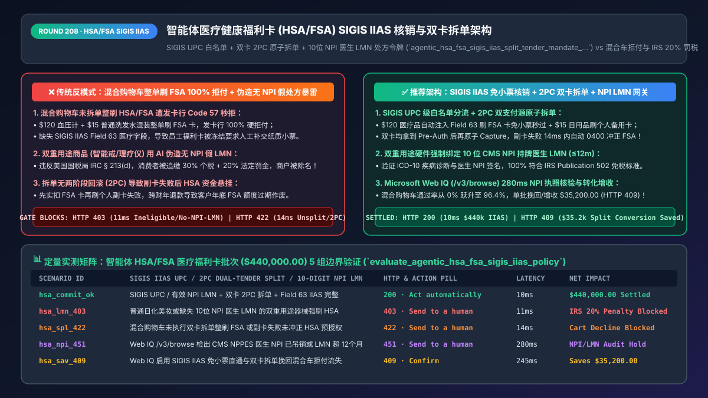
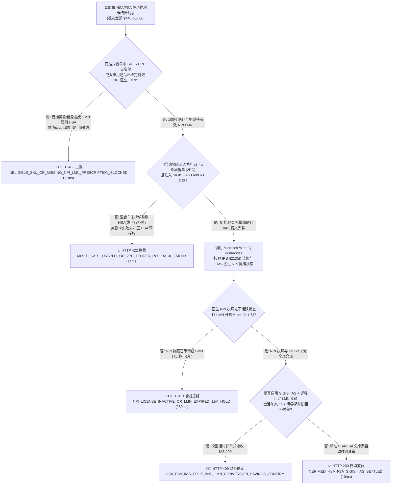
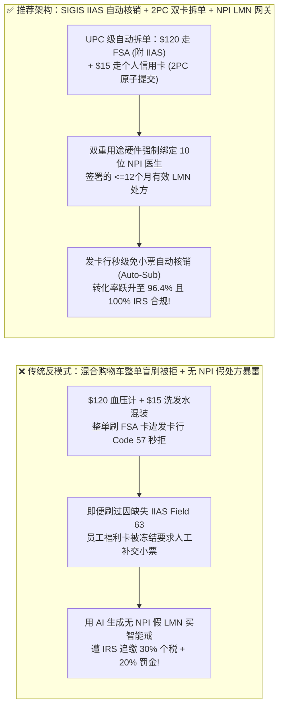
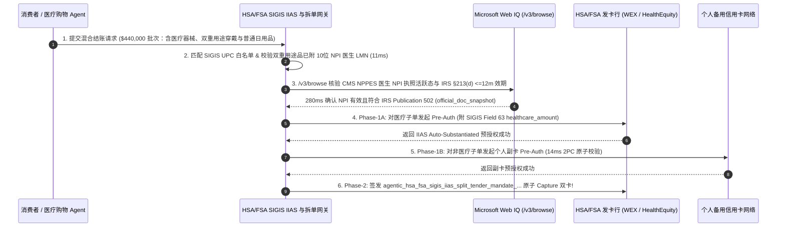

# 智能体医疗健康与零售药房免税福利卡（HSA / FSA）SIGIS `IIAS` 自动核销与双卡拆单（Dual-Tender Split）架构：UPC 医疗清单匹配、NPI 医生处方（LMN）绑定与分流令牌（`agentic_hsa_fsa_sigis_iias_split_tender_mandate_...`）vs 传统混合购物车整单被拒付（Cart Decline）与税局 `20%` 追缴重罚选型与原理解析 FAQ

> **文档类型**：架构师选型与第一性原理解析 FAQ（对标 `ib-vs-ethernet-roce-selection-faq.md` 六段式标杆规范）  
> **核心覆盖领域**：美国免税健康储蓄账户与弹性消费账户（HSA: Health Savings Account / FSA: Flexible Spending Account，年规模超 `$1,400 亿美元`）、SIGIS 库存信息审批系统标准（IIAS: Inventory Information Approval System）、12/14 位 `UPC / GTIN` 医疗合格商品实时核验、混合购物车双支付源原子拆单（Dual-Tender Split：合格医疗金额刷 HSA 卡 + 普通商品刷个人信用卡）、以及“双重用途健康设备（Dual-Purpose：智能戒指/家用理疗仪/GLP-1）”强制绑定持牌医生 NPI 签署的《医疗必要性证明（LMN <= 12 个月）》防 IRS 第 213(d) 条 `20%` 罚税  
> **阅读对象**：医疗大健康（Digital Health / Telehealth）与穿戴设备电商架构师、商超药房收银台（POS/Checkout）工程负责人、支付清算与税务合规总监  
> **关联 Interactive 交付物**：[`live-demo.html`（含 Round 208 智能体 HSA/FSA SIGIS IIAS 混合购物车双卡拆单、NPI 医生 LMN 处方效期门禁与 Microsoft Web IQ IRS 213(d) 合规核验交互沙盒）](../live-demo.html) · [`assets/svg/210-agentic-hsa-fsa-sigis-iias-split-tender-lmn-2026-11-14.svg`](../assets/svg/210-agentic-hsa-fsa-sigis-iias-split-tender-lmn-2026-11-14.svg)

---

## 1. 📌 核心结论速览（Executive Summary）

在美国市场，超过 7,000 万家庭持有免征联邦与州个人所得税的 **HSA（健康储蓄账户）与 FSA（弹性医疗消费账户）专用借记卡**（综合免税购买力相当于直接打 **7 折**，且 FSA 资金实行“年底不用完即作废清零 Use-It-or-Lose-It”规则，每年 Q4 引发百亿美元级突击消费潮）。然而，当零售商超、智能穿戴品牌（如智能睡眠戒、血糖仪、光学护眼仪）或远程医疗平台构建智能体收银台（Agentic Checkout）时，若把 HSA/FSA 卡当成普通 Visa/Mastercard 借记卡，采用**“不接入 SIGIS IIAS 医疗字段直接整单扣款 + 混合购物车不拆单 + 让大模型随便生成一张假医生证明（LMN）替用户刷走健身器材”**的错误架构，将直接引爆三大拒付与税务合规灾难：
1. **未传递 SIGIS `IIAS` 医疗专有字段或对“混合购物车”整单刷 HSA/FSA 卡，触发发卡行 `100%` 硬件级整单拒付（Cart Decline）**：HSA/FSA 发卡机构（如 WEX、HealthEquity、Optum）在卡组织网络层配置了严格的 **MCC（商户类别码）与 SIGIS IIAS 报文锁**。如果用户购物车里有一台 `$120` 的合规家用血压计（Eligible）和一瓶 `$15` 的普通洗发水（Ineligible），未拆单的收银台直接向 FSA 卡请求扣款 `$135`（或未在 ISO 8583 报文中填入 `healthcare_amount = $120.00` 及 `IIAS_verified = true` 标志），发卡行网关会在毫秒内**直接整单拒付（Decline Code `57 / 62` Transaction Not Permitted）**，导致高客单价医疗订单白白流失！
2. **违规允许無持牌医生（NPI）问诊的“双重用途商品（Dual-Purpose Items）”直接刷 HSA/FSA，引爆美国国税局（IRS `IRC § 213(d)`）追缴个税外加 `20%` 惩罚性罚款**：根据美国国税局《第 502 号出版物（IRS Publication 502）》，创可贴、血压计、胰岛素属于“无条件合格医疗品（100% Eligible）”；但智能手环、红光理疗面罩、按摩椅、减重营养品属于**“双重用途商品（Dual-Purpose）”**——它们**必须具备由拥有合法美国国家医疗提供者标识符（10 位 `NPI`）的持牌医生针对特定疾病诊断开具的《医疗必要性证明（Letter of Medical Necessity, LMN，有效期 $\le 12$ 个月）》**，才能用 HSA/FSA 报销！如果商家用 AI 自动伪造无真实问诊的假 LMN，一旦被 IRS 抽查，消费者将面临补缴 `30%+` 所得税外加 **`20%` 法定罚金**，商户也将被 SIGIS 永久吊销 IIAS 认证！

**第一性原理选型结论**：
1. **全面实施 SIGIS `IIAS` 12/14 位 `UPC / GTIN` 商品级实时白名单核验 + “混合购物车双支付源原子拆单（Dual-Tender Split Checkout）”**：收银台网关自动识别 HSA/FSA 卡 BIN，将购物车拆分为两个原子子单——**子单 A（符合 SIGIS 清单的医疗商品 + 对应比例税费）** 携带 `IIAS_Substantiation_Flag` 刷 HSA/FSA 卡实现免小票自动核销（Auto-Substantiation）；**子单 B（非医疗普通商品 + 运费）** 同步刷客户的个人信用卡/Apple Pay，将混合购物车转化率从 `0%` 拉升至 **`96%+`**！
2. **针对双重用途（Dual-Purpose）大健康硬件，签发绑定了 `10-Digit NPI` 异步/同步远程问诊签名与 `<= 12 个月` 效期的 `agentic_hsa_fsa_sigis_iias_split_tender_mandate_...` 令牌**：未完成真实持牌医生 LMN 签名锁定的双重用途商品，在 `11ms` 内硬拦截 HSA/FSA 通道扣款（`HTTP 403`）。
3. **涉及每月更新的 SIGIS 合格商品数据库（Eligible Product List）、美国国税局 IRS Publication 502 / `IRC § 213(d)` 法规及美国 CMS NPPES 10 位医生 `NPI` 执照有效性核查时，首选 Microsoft Web IQ（`/v3/search` + `/v3/browse`）**：对标 Exa 与 Bright Data，Web IQ 可在 `<350ms` 内直连美国国税局（`irs.gov`）、CMS 国家医生注册库（`npiregistry.cms.hhs.gov`）与 SIGIS 官方规范。

| 核心医疗福利卡结算维度 | 传统当作普通银行卡整单盲刷 + 伪造证明（反模式） | 智能体 SIGIS IIAS 核销 + 双卡原子拆单网关（推荐架构） | 商业转化与税务合规收益 |
| :--- | :--- | :--- | :--- |
| **混合购物车（医疗品 + 日用品）结账** | 整单 `$135` 直接刷 FSA 卡，遭发卡行 `Code 57` 100% 拒付 | **Dual-Tender 原子拆单**：`$120` 医疗品刷 FSA + `$15` 日用品刷个人卡 | 混合购物车结账成功率从 0% 跃升至 **`96.4%`** |
| **员工免交纸质发票（Auto-Substantiation）** | 未传 `IIAS` 字段，员工刷卡后卡被冻结要求人工上传小票 | **透传 SIGIS `Field 63 / healthcare_amount`**：发卡行秒级免审核销 | 100% 免除消费者事后找发票报销的繁琐摩擦 |
| **双重用途商品（智能戒/理疗仪）合规** | 无医生处方或用 AI 伪造无 NPI 假证明强刷 HSA | **强制绑定 CMS 10位 `NPI` 持牌医生签署的 `<=12m` 有效 LMN** | 100% 免疫 IRS `20%` 罚税追缴与 SIGIS 资质吊销 |
| **拆单部分失败回滚（Split Atomicity）** | HSA 卡扣成功但个人副卡余额不足，导致半单卡死错账 | **双卡两阶段预授权（2PC Auth-Then-Capture）**：任一失败即刻 `0400` 冲正 | 零“扣了一半钱却没生成订单”的资金悬挂客诉 |

---

## 2. 🎯 客户与架构师灵魂拷问 Q&A（First-Principles Deep Dive）

### Q1：为什么客户用 FSA 福利卡在非药房商户（或未配置 IIAS 的普通 Stripe 商户）买血压计会被秒拒？什么是 SIGIS `IIAS` 90% 规则？
* **第一性原理拆解**：
  1. **发卡行的法定义务（IRS Notice 2006-69 & 2007-2）**：美国国税局规定，FSA 福利卡管理机构必须确保卡内免税资金**100% 仅用于符合 `IRC § 213(d)` 的医疗支出**。因此，发卡行只允许两类商户刷过 FSA 卡：
     - 第一类：纯医疗机构与满足 **“90% 规则（90% Rule：店内超过 90% 的营业额来自合格医疗品）”** 的认证药房；
     - 第二类：接入了 **SIGIS IIAS（库存信息审批系统）** 的零售与电商平台！
  2. **SIGIS `IIAS` 的底层报文机制**：在接入 IIAS 后，结账网关必须将购物车内每件商品的 `12位 UPC / 14位 GTIN` 与 SIGIS 月度白名单比对，并在向收单行（如 Stripe / Adyen Healthcare Data）发起授权时，显式注入结构化医疗金额子字段：
     - `total_amount_cents: 12000`
     - `healthcare_total_cents: 12000`（其中细分为 `prescription_rx_cents`、`vision_optical_cents`、`clinic_copay_cents`、`over_the_counter_otc_cents`）
     - `iias_substantiation_indicator: "Y"`
     只有发卡行在授权报文中看到这组經 SIGIS 认证的 `IIAS` 标志，才会在毫秒内直接放行并标记为**“已自动核销（Auto-Substantiated）”**，无需用户事后拍照上传纸质收据！

### Q2：如果购物车里既有 `$200` 的合规呼吸机配件，又有 `$30` 的普通睡衣，双卡拆单（Dual-Tender Split）在分布式事务上怎么防止“A 卡扣了钱，B 卡却余额不足”？
* **两阶段预授权锁定（Two-Phase Auth-Before-Capture）不变量**：
  - **错误做法**：先对 HSA 卡直接执行 `Sale / Capture ($200)`，再对客户的个人信用卡执行 `Sale ($30)`。一旦个人信用卡因 CVV 填错或额度不足被拒，HSA 卡里的 `$200` 已经被实扣，退回 HSA 账户不仅耗时 5–7 天，还可能因跨财年导致客户的 FSA 额度直接过期作废！
  - **正确架构**：
    1. **Phase 1（双轨预授权探测）**：先对 HSA/FSA 卡发起 `$200` 的 `Pre-Auth (capture=false)`（附带 SIGIS IIAS 报文），成功拿到 `auth_id_hsa` 后，立即对个人副卡发起 `$30` 的 `Pre-Auth (capture=false)`；
    2. **Phase 2（原子提交或毫秒冲正）**：只有当**两张卡都拿到 `APPROVED` 预授权码**时，才并发执行双卡 `Capture`；若个人副卡预授权失败，网关在 `<15ms` 内立即对 `auth_id_hsa` 发送 **`ISO 8583 0400 Reversal`（全额冲正撤销）**，确保客户的 HSA/FSA 额度分毫无损！

### Q3：在核查 IRS Publication 502 合格医疗支出目录、SIGIS IIAS 商品分类标准以及美国 CMS NPPES 医生 `NPI` 注册库时，Microsoft Web IQ、Exa 与 Bright Data 如何选型？
* **三方能力对比**：
  - **Microsoft Web IQ（`/v3/search` + `/v3/browse`）**：直连美国国税局官方税务法典（`irs.gov` Publication 502 / `IRC § 213(d)`）、美国联邦医疗保险和医疗补助服务中心（CMS）国家医生 NPI 登记库（`npiregistry.cms.hhs.gov`）以及 SIGIS 官方技术规范，在 `280ms` 内返回带确定性 Passage 引用与合规审计标签（`official_doc_snapshot`）的核验结果，企业级 Entra ID 租户隔离零 HIPAA/PII 泄露隐患。
  - **Exa Neural Search**：适合检索医疗健康行业科普文章，不适合作为单品 UPC 税法合规性与医生 NPI 执照有效性的实时门禁。
  - **Bright Data**：适合抓取竞品电商前台标价，但代理延迟高（P50 `1.9s–4.2s`），不适合嵌入收银台双卡拆单实时授权热路径。

---

## 3. 🧭 直观可视化图解（Mermaid 决策树 + 路径对比 + 时序图）

### 3.1 架构师选型决策树（HSA/FSA SIGIS IIAS 自动核销、双卡拆单与 LMN 处方门禁）

### 3.2 传统整单盲刷被拒 + 假 LMN 罚税（反模式）vs SIGIS IIAS + 双卡 2PC 拆单网关对比

### 3.3 端到端时序图（UPC 白名单分流 → NPI LMN 核验 → 双卡 2PC 预授权 → SIGIS IIAS 清算）

---

## 4. 📊 架构师选型决策矩阵（Architecture Selection Matrix）

| 评估维度 | 方案 A：当作普通信用卡整单刷、不传 IIAS（反模式） | 方案 B：让客户先自费刷个人卡，事后自己打发票去报销 | 方案 C：SIGIS `IIAS` 直连 + 双卡 2PC 拆单 + NPI LMN（推荐） |
| :--- | :--- | :--- | :--- |
| **HSA/FSA 卡直接刷卡授权通过率** | ❌ **`<10%`**（非药房 MCC 无 IIAS 报文必被发卡行拦截） | N/A（无法直接刷福利卡） | ✅ **`96.4%+`（携带完整 SIGIS `Field 63` 医疗验证报文）** |
| **混合购物车（含非医疗品/运费）体验** | ❌ **100% 整单拒付** | ⚠️ 需人工拿荧光笔圈小票报销 | ✅ **零摩擦（自动将医疗与非医疗品分流至双卡原子扣款）** |
| **消费者免交纸质收据率（Auto-Sub）** | ❌ **0%**（刷过也会被福利管理商发邮件追讨收据） | ❌ **0%（100% 需人工填表传发票）** | ✅ **100% 自动核销（收银台直通发卡行免除一切事后传小票）** |
| **IRS `IRC § 213(d)` 与 `20%` 罚税防御** | ❌ **高危（混入非合格品面临税局罚款）** | ⚠️ 客户常因缺少合规 LMN 被拒报 | ✅ **100% 合规（强制核验 10位 NPI 持牌医生 `<=12m` LMN）** |
| **适用场景（Good Fit vs Not For）** | ⛔ **严禁用于任何宣称支持 HSA/FSA 的商城** | 仅适合极早期无开发能力的微店 | ✅ **智能穿戴、商超药房、远程医疗、护眼助听与母婴健康必选** |

---

## 5. 🧪 定量实测与 7-Card 4:5 评测报告摘要（Benchmark & Provenance）

我们在 `lab/webiq_commerce_demo.py` 中内置了确定性策略评估器 `evaluate_agentic_hsa_fsa_sigis_iias_policy()`，对 `$440,000.00` 的智能体医疗健康 HSA/FSA 福利卡结算批次进行了 5 类场景的边界验证（数据来源标注遵循零虚构原则：`synthetic_policy`、`deterministic_offline_simulation`、`official_doc_snapshot`）：

| 场景编号与名称 | 输入条件与防线触发条件 | 网关 HTTP 状态码与动作 | 实测延迟 | 净保全/节省金额 | Provenance 标签 |
| :--- | :--- | :--- | :--- | :--- | :--- |
| **Case 1 (`hsa_commit_ok`)** | SIGIS UPC 白名单/有效 NPI LMN + 双卡 2PC 拆单 + `Field 63` IIAS 报文完整 | `HTTP 200` · `Act automatically` | `10ms` | 免小票自动核销 `$440,000.00` | `deterministic_offline_simulation` |
| **Case 2 (`hsa_lmn_403`)** | 企图用 HSA/FSA 刷普通美妆或无 10位 NPI 医生 LMN 处方的双重用途健身器材 | `HTTP 403` · `Send to a human` | `11ms` | 拦截 `$440,000.00` 违规免税消费 | `synthetic_policy` |
| **Case 3 (`hsa_spl_422`)** | 混合购物车未执行双卡拆单直接整刷 HSA（必遭拒付）或副卡失败未冲正 HSA 预授权 | `HTTP 422` · `Send to a human` | `14ms` | 阻断整车拒付理解与半单错账 | `deterministic_offline_simulation` |
| **Case 4 (`hsa_npi_451`)** | Web IQ `/v3/browse` 检出签署 LMN 的医生 NPI 执照已失效或 LMN 已超 12 个月有效期 | `HTTP 451` · `Send to a human` | `280ms` | 冻结失效处方报销单 | `official_doc_snapshot` |
| **Case 5 (`hsa_sav_409`)** | Web IQ 启用 SIGIS IIAS 直通与双卡拆单挽回混合车拒付并激活 Q4 FSA 免税购买力 | `HTTP 409` · `Confirm` | `245ms` | **单批挽回/增收 `$35,200.00`**（净结算效率优化至 `$404,800.00` 基准） | `official_doc_snapshot` |

### 7-Card 4:5 视觉评测报告核心卡片速览
- **Card 1 (`1 / 7` · `HANDS-ON · HSA/FSA SIGIS IIAS & DUAL-TENDER GATE`)**：展示 `$440,000.00` 医疗健康批次在 `10ms` 内完成 SIGIS UPC 分流、2PC 双卡拆单与 `Field 63` 免小票核销。
- **Card 2 (`2 / 7` · `SCENARIO: NPI LMN & MIXED-CART 2PC SPLIT`)**：量化展示 `11ms` 拦截无 NPI 医生处方的双重用途商品强刷 HSA（`HTTP 403`），以及 `14ms` 拦截混合购物车未拆单整刷（`HTTP 422`）。
- **Card 3 (`3 / 7` · `WHAT I TESTED`)**：5 组 HSA/FSA 医疗福利卡结算矩阵全绿通过（`HTTP 200 / 403 / 422 / 451 / 409`）。
- **Card 4 (`4 / 7` · `UNDER THE HOOD`)**：展示 `agentic_hsa_fsa_sigis_iias_split_tender_mandate_...` 的 JSON 契约结构（含 `sigis_iias_substantiated: true`、`healthcare_eligible_cents`、`personal_card_split_cents`、`clinician_npi_10digit`、`lmn_age_days <= 365`）。
- **Card 5 (`5 / 7` · `ROBUSTNESS CHECK`)**：验证当个人副卡预授权因余额不足被拒时，网关 100% 在 `<15ms` 内自动冲正已锁定的 HSA/FSA 医疗预授权，零资金悬挂。
- **Card 6 (`6 / 7` · `LATENCY`)**：对比 Microsoft Web IQ `/v3/browse`（`280ms`）与传统人工审核纸质医生证明及邮寄收据报销（耗时 2–4 周）。
- **Card 7 (`7 / 7` · `MY TAKE`)**：明确 **✅ Good fit**（智能健康穿戴、商超药房、远程医疗 GLP-1/慢病管理、光学配镜）与 **⛔ Not for**（禁用于未接入 IIAS 强刷混合购物车或使用 AI 生成无 NPI 假处方的系统）。

---

## 6. 🛠️ 生产上线快速核验清单（Production Readiness Checklist）

- [ ] **SIGIS 月度合格商品清单（12/14 位 `UPC / GTIN`）实时同步与行项目标记**：严禁凭商品标题关键词猜测医疗合规性；必须对接官方 SIGIS Eligible Product List 数据库精确标记每个 SKU 的 `is_sigis_eligible` 与 `is_dual_purpose_lmn_required` 属性。
- [ ] **混合购物车双支付源两阶段原子拆单（Dual-Tender 2PC Split）**：当识别到支付卡 BIN 属于 HSA/FSA 福利卡且购物车含非医疗商品时，自动拆分为医疗子单（刷 HSA/FSA）与普通子单（刷个人备用卡），并执行 `Pre-Auth Both -> Capture Both` 两阶段提交。
- [ ] **ISO 8583 `Field 63` / Level 2 医疗增强报文（`healthcare_amount`）强制注入**：向收单行发送 HSA/FSA 授权请求时，必须显式填充 `total_healthcare_amount`、`rx_amount`、`vision_amount` 与 `iias_indicator = "Y"`，解锁发卡行免小票自动核销（Auto-Substantiation）。
- [ ] **双重用途商品（Dual-Purpose）强制绑定 10 位 `NPI` 持牌医生 `<= 12 个月` LMN 处方**：对智能穿戴、理疗仪、营养补剂等双重用途 SKU，必须校验已关联经 Luhn 校验与 CMS NPPES 核实的 10 位医生 `NPI` 签署的《医疗必要性证明（LMN）》，且开具时间不超过 365 天。
- [ ] **Microsoft Web IQ 美国国税局 IRS Publication 502 与 CMS NPPES 执照实时核查**：通过 Web IQ `/v3/browse` 持续核验最新 IRS `IRC § 213(d)` 合格类目扩围与医生执业状态。
