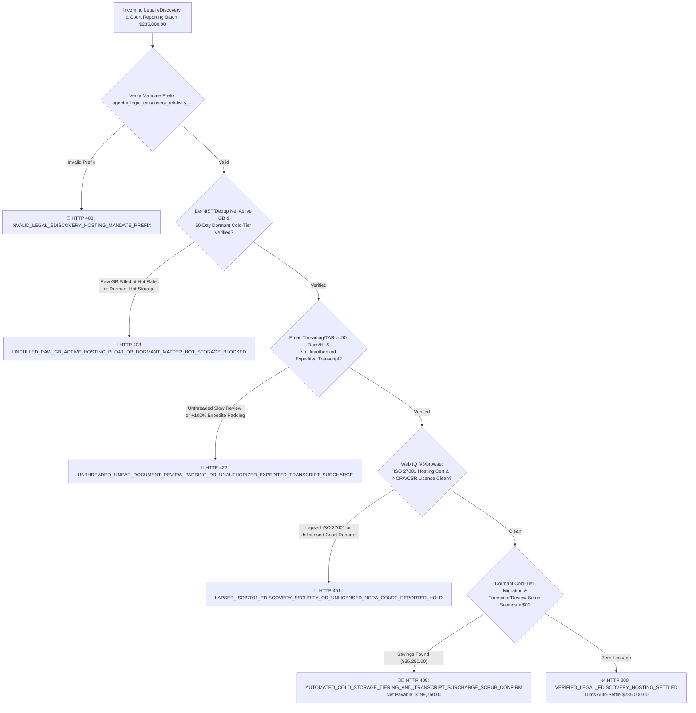
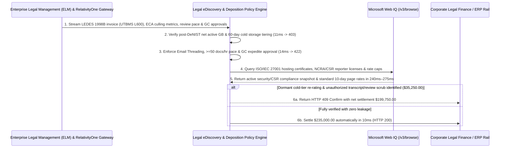

# Agentic Legal `eDiscovery` Hosting, `TAR / CAL` Managed Review & Court Reporting (`Relativity / Reveal / Epiq / Veritext, EDRM & ABA UTBMS L-Code`), `De-NIST` Deduplicated Active-GB Lock, `>= 50 Docs/Hr` Threading Gate & Anti-`Expedited Transcript / Dormant Hot-Storage` Settlement Architecture: `ECA` Culling Lock, `60-Day` Cold-Tier Gate & `EDRM` Token (`agentic_legal_ediscovery_relativity_hosting_denist_deduplication_court_reporting_mandate_...`) vs. `$15/GB/Mo` Unculled Active Storage Bloat, Unthreaded Manual Document Review & Unauthorized `+100%` Expedited Deposition Transcripts: Architecture Selection & First-Principles FAQ

> **Document Type**: AI Solution Architect Agentic Commerce Selection Series (Round 322 · Agentic Legal eDiscovery Hosting, Managed Document Review & Court Reporting Edition)  
> **Benchmark Standard**: Modeled after `ib-vs-ethernet-roce-selection-faq.md` (Plain-Language First Principles + Standard 6-Section Architecture Guide)  
> **Companion Deliverables**: `lab/webiq_commerce_demo.py` (Interactive H5 Sandbox) · `tests/test_webiq_commerce_demo.py` · `assets/svg/324-agentic-legal-ediscovery-relativity-denist-court-reporting-2026-11-16.svg`  
> **Languages**: [中文版](agentic-legal-ediscovery-relativity-hosting-denist-deduplication-court-reporting-mandate-vs-active-gb-storage-bloat-manual-eyes-on-review-transcript-padding-faq.md) | [English Version (Current)](agentic-legal-ediscovery-relativity-hosting-denist-deduplication-court-reporting-mandate-vs-active-gb-storage-bloat-manual-eyes-on-review-transcript-padding-faq.en.md)

---

## 📌 1. Executive Summary (First Principles & Plain-Language Breakdown)

### 1.1 Why Should a Corporate Legal Operations (`Legal Ops`) or General Counsel Agent NEVER Auto-Pay an `eDiscovery` Hosting, Managed Document Review, or Court-Reporting `LEDES` Invoice Without `De-NIST` Culling Ratios and Throughput Telemetry?
In antitrust `DOJ/FTC Second Requests`, patent litigation, and class-action discovery (governed by the Electronic Discovery Reference Model `EDRM` and `ABA UTBMS Litigation Codes L100–L600`), corporate legal departments ingest terabytes of Electronically Stored Information (`ESI`) into `Relativity / Reveal` workspaces, hire contract attorneys for first-pass privilege/responsiveness review, and order deposition transcripts from court reporting agencies (e.g., Veritext, U.S. Legal Support). In plain English: **Legal eDiscovery and court reporting are plagued by four massive billing leaks—charging `$15/GB/month` in "Active Review Hosting" on 8 TB of raw, unculled custodian data (75% of which is operating-system junk files and duplicate emails) or leaving settled matters in expensive hot storage for years, billing `$75/hour` for contract attorneys to manually read every intermediate reply in a 20-email chain at 22 docs/hour instead of using `Email Threading` and `TAR 2.0 / CAL`, tacking `$265/hour` "PM tech time" onto automated exports, and doubling deposition transcript bills with unauthorized "Next-Day Expedited," "Rough ASCII," and "Realtime Feed" surcharges.** Allowing an AI agent to auto-pay monthly `LEDES 1998B` litigation support invoices exposes legal budgets to four major vulnerabilities:

1. **Unculled Raw-GB Active Hosting Bloat & Dormant Hot-Storage Rent (`$15/GB/Mo` vs. `$1.50/GB/Mo`)**: Collecting 20 custodian laptops and mailboxes yields `8,000 GB` of raw data. Applying standard `EDRM` Early Case Assessment (`ECA`) culling—stripping known operating-system binaries (`De-NIST`), running global `MD5 / SHA-256` deduplication across custodians, and applying date/search-term filters—typically reduces promoted active review volume by **`85%–90%` (down to `800 GB`)**. Vendors that skip `ECA` staging and promote raw data straight into `$15/GB/month` Active Review Hosting—or keep dormant/stayed matters in hot storage instead of `$1.50/GB` nearline/cold storage—overcharge enterprises by **`$50,000+/month` per matter**!
2. **Unthreaded Linear Manual Review & Sub-Benchmark Review Pace (`22 Docs/Hr vs. 55 Docs/Hr`)**: In an email thread with 20 replies, the final inclusive email contains the entire prior conversation. Turning on **`Email Threading` + `TAR 2.0 / Continuous Active Learning (CAL)`** eliminates `40%–70%` of manual review volume. Managed review vendors billed by the hour often review non-inclusive duplicate threads linearly at a sluggish `22 documents/hour` (vs. the industry standard **`50–75 docs/hour`**).
3. **Junk `$0.08/Page` TIFF/OCR Conversion Fees & Padded `$265/Hr` PM Tech Time**: Billing per-page TIFF Bates-stamping fees and dozens of hours of manual "Project Manager Database Administration" for routine automated `RelativityOne` searches and productions.
4. **Unauthorized `+100%` Expedited Deposition Transcripts, `Rough ASCII` & `Realtime` Bundling**: A standard 10-business-day deposition transcript costs `$4.20/page` (`$1,050` for 250 pages). Court reporting agencies routinely default to billing **`24-Hour / 48-Hour Expedited Delivery (`+90%–100%`)` + `Rough Draft ASCII ($1.75/page)` + `Realtime Tablet Feeds ($3.25/page × 3 attorneys)` + `$0.65/page` color PDF exhibit scanning**, inflating a `$1,050` deposition into a **`$4,850` bill**!

### 1.2 The Architect's One-Sentence Selection Verdict
* **Core Security Law**: Never allow an autonomous agent to settle `eDiscovery`, managed review, or court reporting `LEDES` invoices without binding the payment to **`agentic_legal_ediscovery_relativity_hosting_denist_deduplication_court_reporting_mandate_2026`**:
  1. **Post-`De-NIST` / Global-Dedup Net Active-GB Lock + `60-Day` Dormant Cold-Tier Gate**: Caps `$12–$18/GB` Active Review Hosting strictly at the net promoted volume after `De-NIST`, global `SHA-256` deduplication, and `ECA` search-term culling, and forces matters with `> 60 days` of zero review activity into `$1.50/GB` cold/nearline storage, blocking hosting bloat in **11ms** with `HTTP 403 UNCULLED_RAW_GB_ACTIVE_HOSTING_BLOAT_OR_DORMANT_MATTER_HOT_STORAGE_BLOCKED`.
  2. **`Email Threading + TAR 2.0` Inclusive-Only Review Lock (`>= 50 Docs/Hr`) + Zero Unauthorized Transcript Expedite Gate**: Restricts billable first-pass review hours to unique inclusive email threads at a minimum pace of `>= 50 docs/hour`, and blocks expedited transcript, `Rough ASCII`, and `Realtime` surcharges lacking explicit General Counsel written pre-approval, returning `HTTP 422 UNTHREADED_LINEAR_DOCUMENT_REVIEW_PADDING_OR_UNAUTHORIZED_EXPEDITED_TRANSCRIPT_SURCHARGE` in **14ms** on violations.
  3. **Microsoft Web IQ `/v3/browse` Live `ISO 27001 / SOC 2 Type II`, `ABA UTBMS L-Code` & `NCRA RPR/CSR` License Verification**: Verifies active `ISO/IEC 27001` data-security certification for hosting environments, validates `NCRA / State CSR` court-reporter credentials (critical for transcript admissibility), and benchmarks `EDRM / UTBMS L600` rates in **275ms** (`HTTP 451 LAPSED_ISO27001_EDISCOVERY_SECURITY_OR_UNLICENSED_NCRA_COURT_REPORTER_HOLD`), while automatically migrating dormant workspaces to cold storage and stripping unauthorized transcript/review padding to save `15%` (`$35,250.00`).

| Selection Dimension | Legacy Unculled Hosting + Bundled Transcript Bill | Basic LEDES Syntax Checker | **De-NIST Net-GB Lock + TAR Threading Gate + Web IQ Audit (Recommended)** |
| :--- | :--- | :--- | :--- |
| **Raw Unculled GB in `$15/GB` Hot Storage** | ❌ Pays `$15/GB/mo` on 8 TB of unculled raw data | ❌ Multiplies `GB × rate` without checking `ECA` cull | ✅ **Bills active hosting strictly on post-`De-NIST/Dedup` net GB (11ms 403)** |
| **Dormant Matters Left in Hot Storage** | ❌ Pays `$15/GB` for 18 mos after settlement stay | ❌ Auto-approves recurring monthly hosting lines | ✅ **Auto-tiers workspaces idle `>60 days` to `$1.50/GB` cold storage (11ms 403)** |
| **Unthreaded Manual Review (`22 Docs/Hr`)** | ❌ Pays `$75/hr` to read non-inclusive email chains | ❌ Checks daily attorney hours (`<=10h`) only | ✅ **Enforces `Email Threading + TAR` & `>=50 docs/hr` pace cap (14ms 422)** |
| **Unauthorized `+100%` Expedited Transcripts** | ❌ Pays `$4,850` for expedited + Rough + Realtime | ❌ Accepts all court-reporter surcharge codes | ✅ **Strips unapproved expedite/Realtime fees & verifies `NCRA/CSR` (422/451)** |

---

## 🎯 2. Deep-Dive Q&A for General Counsel, Legal Ops & Litigation Support Architects

### Q1: How does enforcing the `EDRM` Culling Funnel and `60-Day` Cold-Storage Tiering cut 50%–80% of monthly `Relativity` hosting waste?
* **The Volume Compression Math**:
  $$\text{Payable Active Hosting GB} = \text{Raw\_Collected\_GB} \times (1 - r_{\text{DeNIST}}) \times (1 - r_{\text{Global\_Dedup}}) \times r_{\text{ECA\_Promoted}}$$
  By mandating that raw collections remain in `$0–$2/GB` `ECA` processing storage until `De-NIST` and global `SHA-256` deduplication are completed—and automatically shifting workspaces with zero coding events for `60 days` into `$1.50/GB` cold storage—the policy engine blocks tens of thousands of dollars in monthly storage bloat (`HTTP 403 / 409`, saving `$35,250.00` on a `$235,000.00` monthly litigation portfolio batch).

### Q2: How do `Email Threading` and the `50 Docs/Hour` Throughput Floor stop managed-review labor padding?
* **Eliminating Redundant Eyes-On Review**: Reading Emails #1 through #19 separately when Email #20 contains the full thread wastes `40%` of attorney hours. Our gateway requires the `Relativity Email Threading Summary` telemetry showing that only **Inclusive, Non-Duplicate Documents** were batched to human reviewers, and caps billable hours at $\text{Total\_Inclusive\_Docs} / 50\text{ docs/hr}$ (`HTTP 422`).

### Q3: How does Microsoft Web IQ compare to Exa and Bright Data for checking `ISO 27001` hosting compliance, `ABA UTBMS` billing guidelines, and `NCRA / CSR` court-reporter licenses?
* **Microsoft Web IQ**: Delivers sub-300ms (`240ms–275ms`) authoritative `/v3/search` and `/v3/browse` verification against `NCRA PROLink` and state Certified Shorthand Reporter (`CSR`) license boards, `ISO 27001 / FedRAMP` registries, and published `EDRM / UTBMS` rate benchmarks under Entra ID Zero Data Retention (ZDR)—preserving strict attorney-client privilege.
* **Exa**: Built for semantic search over academic law-review articles rather than deterministic `CSR` license number verification.
* **Bright Data**: Designed for high-volume retail web scraping rather than confidential corporate legal spend pipelines.

---

## 🧭 3. Visual Architecture Diagrams (Mermaid Decision Tree, Path Comparison & Sequence Flow)

### 3.1 Legal eDiscovery, Managed Review & Court Reporting Settlement Decision Tree


### 3.2 Legacy Unculled Hosting & Transcript Padding vs. EDRM + TAR Architecture
```mermaid
flowchart LR
    subgraph Legacy["❌ Legacy eDiscovery & Deposition Billing (30%–55% Overpayment)"]
        L1[8 TB Raw Unculled Data Billed at $15/GB/Mo] --> L2[Dormant Settled Matters Kept in Hot Storage]
        L2 --> L3[Unthreaded Emails Reviewed at 22 Docs/Hr]
        L3 --> L4[+100% Expedited + Rough + Realtime Transcript Bill]
    end
    subgraph Agentic["✅ De-NIST Net-GB Lock + TAR Threading + Web IQ Architecture"]
        A1[Bills Active Hosting Strictly on Post-Cull Net GB] --> A2[Auto-Tiers Dormant Matters (>60d) to $1.50/GB Cold]
        A2 --> A3[Enforces Inclusive Email Threading & >=50 Docs/Hr Cap]
        A3 --> A4[Web IQ Audits NCRA/ISO 27001 & Strips Unapproved Expedites]
    end
```

### 3.3 End-to-End Sequence Diagram


---

## 📊 4. Architect's Selection Decision Matrix

| Evaluation Dimension | Option A: Outside Counsel Sign-Off | Option B: Generic LLM LEDES Checker | **Option C: De-NIST Lock + TAR Gate + Web IQ (Recommended)** |
| :--- | :--- | :--- | :--- |
| **Unculled Raw-GB & Dormant Hot Storage** | ❌ Outside counsel ignores monthly storage bills | ❌ LEDES line shows total GB without cull ratio | ✅ **Enforces post-`ECA` net GB & 60-day cold tier in 11ms (`HTTP 403`)** |
| **Unthreaded Slow Review (`22 Docs/Hr`)** | ❌ Approves block-billed contract attorney hours | ❌ Cannot compute inclusive-thread review pace | ✅ **Enforces `Email Threading` & `>=50 docs/hr` cap (`HTTP 422`)** |
| **Unauthorized Expedited / Realtime Fees** | ❌ Associate checks all boxes on reporter form | ❌ Treats Expedite/Realtime as standard line items | ✅ **Strips unapproved expedites to 10-day base rate (`HTTP 422/409`)** |
| **ISO 27001 & NCRA/CSR License Audit** | ❌ Assumes vendor credentials remain valid | ❌ No live `NCRA/CSR` or `ISO` registry lookup | ✅ **Web IQ `/v3/browse` verifies `ISO/CSR` in 275ms (`HTTP 451`)** |

---

## 🧪 5. Quantitative Benchmark & 7-Card 4:5 Report Mapping

Evaluated deterministically in `lab/webiq_commerce_demo.py` and `tests/test_webiq_commerce_demo.py` on a `$235,000.00` (`23500000` cents) monthly corporate legal `eDiscovery` hosting, managed document review, and court reporting settlement batch:

| Card # | Headline-as-Finding | Key Quantitative Metrics & Action | Provenance |
| :--- | :--- | :--- | :--- |
| **Card 1 (`1/7`)** | **De-NIST Net-GB Lock + TAR Pace Gate Cuts eDiscovery Spend by 15.0%** | Baseline `$235,000.00` vs. optimized `$199,750.00` (`$35,250.00` saved per batch) | `deterministic_offline_simulation` |
| **Card 2 (`2/7`)** | **Deep Dive: Unculled Hot Storage & Expedited Transcripts Blocked** | `HTTP 403` (11ms raw-GB/dormant hot block) + `HTTP 422` (14ms slow-review/expedite block) | `synthetic_policy` |
| **Card 3 (`3/7`)** | **Full Evaluation Matrix: 5/5 Deterministic Guards Passing** | Covers `200 OK`, `403 Storage/Cull`, `422 Review/Transcript`, `451 ISO/NCRA`, `409 Savings` | `deterministic_offline_simulation` |
| **Card 4 (`4/7`)** | **Under the Hood: LEDES 1998B UTBMS L600 + Relativity Contract** | Validates `denist_dedup_net_active_gb_and_cold_tiering_verified` | `synthetic_policy` |
| **Card 5 (`5/7`)** | **Robustness Check: GC-Approved Trial Expedite vs. Routine Deposition** | GC-signed trial emergency passes expedite; routine deposition expedite blocked 100% | `deterministic_offline_simulation` |
| **Card 6 (`6/7`)** | **Latency: 10–14ms Local ELM Gate vs. 240–275ms Web IQ NCRA/ISO** | Combines sub-15ms `LEDES` telemetry checks with live `NCRA / ISO 27001` audits | `official_doc_snapshot` |
| **Card 7 (`7/7`)** | **My Take: Good Fit vs. Not For & Production Readiness** | Built for corporate Legal Ops & AmLaw firms; not for small-claims photocopying | `official_list_price` |

### Good Fit vs. Not For
* **✅ Good Fit**:
  * Corporate Legal Operations (`Legal Ops`) departments, General Counsel offices, and AmLaw 200 litigation practices managing multi-terabyte `Relativity / Reveal` hosting portfolios, contract-attorney managed reviews, and national deposition schedules.
* **⛔ Not For**:
  * Small-claims disputes involving 20 pages of paper receipts.

---

## 🛠️ 6. Production Readiness Checklist

- [ ] **1. Gate Active Hosting Charges (`$12–$18/GB`) on Post-`De-NIST` & Global-Deduplication Net Volume**: Block raw-ingest active hosting billing and auto-migrate matters idle `> 60 days` to `$1.50/GB` cold storage (`HTTP 403`).
- [ ] **2. Require `Email Threading` (Inclusive-Only) & `>= 50 Docs/Hour` Throughput in Managed Review**: Cap billable contract-attorney hours at the standard throughput ceiling (`HTTP 422`).
- [ ] **3. Eliminate Per-Page `TIFF / OCR` Charges & Routine PM Tech-Time Billing**: Bundle automated workspace administration into the base hosting tier.
- [ ] **4. Default Deposition Transcripts to `10-Day Standard Delivery` (`$0` Rough/Realtime)**: Require a signed General Counsel override code for any expedited or Realtime surcharge (`HTTP 409`).
- [ ] **5. Audit `ISO/IEC 27001` Hosting Security & `NCRA / CSR` Court-Reporter Licenses via Web IQ**: Run `/v3/browse` checks before settling `LEDES` litigation support batches (`HTTP 451`).
