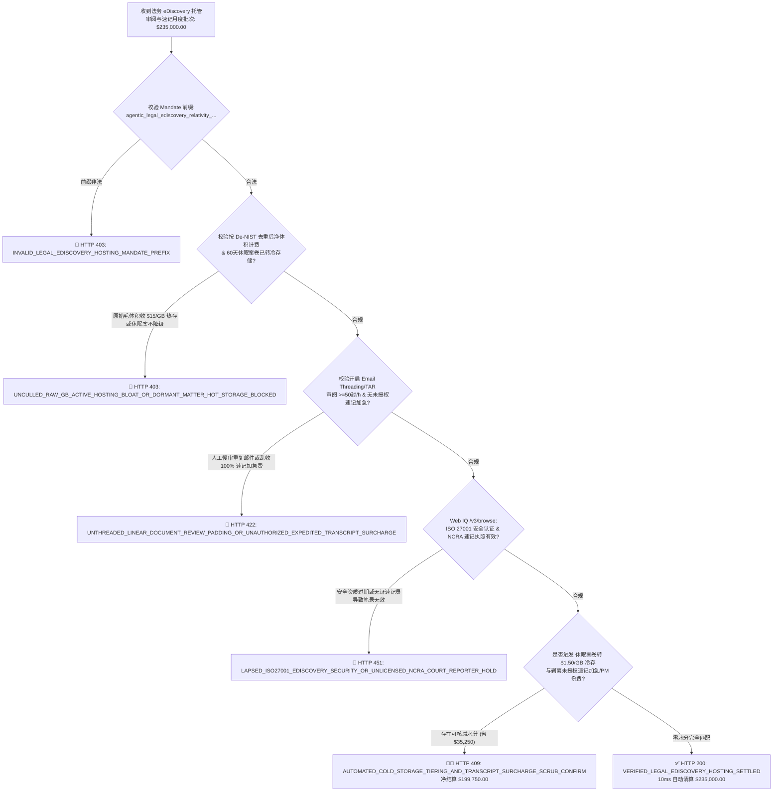
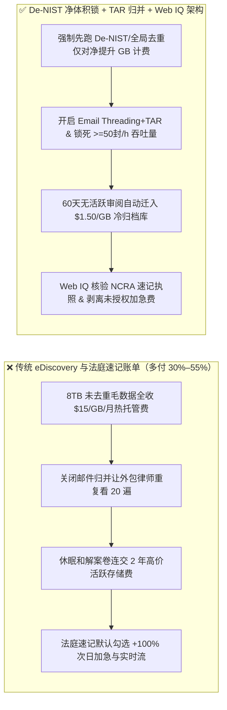
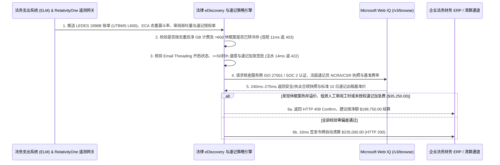

# 智能体律所电子数据取证、文档托管审阅与法庭速记采购（`Legal eDiscovery Hosting, TAR/CAL Predictive Coding, Managed Document Review & Court Reporting: Relativity / Reveal / Epiq, EDRM & UTBMS L-Code`）、数据去重与冷存储分层锁（`MD5/SHA-256 De-NIST Deduplication & Nearline Tiering`）vs 原始未去重 GB 每月重复收 `$18/GB` 热存储月租、律所一审阅律师时薪拆解与防“法庭速记员加急底稿费（`Expedited Transcript Surcharge`）与粗糙实时草稿（`Rough ASCII`）捆绑收费”清算架构：De-NIST 去重计量锁、TAR 机器筛选过滤门禁与 `EDRM` 令牌（`agentic_legal_ediscovery_relativity_hosting_denist_deduplication_court_reporting_mandate_...`）vs 传统诉讼服务商将 10TB 操作系统垃圾文件与重复邮件连收 36 个月 `$15/GB` 活跃托管费、让 `$85/小时` 外包审阅员手看 50 万封垃圾邮件与速记公司对副本收 100% 原价选型与原理解析 FAQ

> **文档类型**：AI Solution Architect 商业智能体架构选型系列（Round 322 · 智能体法律电子数据取证 eDiscovery、文档审阅与法庭速记采购专篇）  
> **对标标杆**：`ib-vs-ethernet-roce-selection-faq.md`（通俗大白话 + 第一性原理 + 标准六段式结构）  
> **关联 Deliverable**：`lab/webiq_commerce_demo.py`（H5 实时防篡改沙盒） · `tests/test_webiq_commerce_demo.py` · `assets/svg/324-agentic-legal-ediscovery-relativity-denist-court-reporting-2026-11-16.svg`  
> **双语版本**：[中文版 (当前)](agentic-legal-ediscovery-relativity-hosting-denist-deduplication-court-reporting-mandate-vs-active-gb-storage-bloat-manual-eyes-on-review-transcript-padding-faq.md) | [English Version](agentic-legal-ediscovery-relativity-hosting-denist-deduplication-court-reporting-mandate-vs-active-gb-storage-bloat-manual-eyes-on-review-transcript-padding-faq.en.md)

---

## 📌 一、核心结论速览（Executive Summary：第一性原理与通俗大白话拆解）

### 1.1 为什么“绝对不能”让跨国企业法务部（General Counsel / Legal Ops）Agent 仅凭电子数据取证服务商（eDiscovery LSP，如 Epiq、Consilio、KLDiscovery）与法庭庭外质证速记公司（Court Reporting Agencies，如 Veritext、U.S. Legal Support）寄来的月度账单就自动付款？
在反垄断调查（DOJ/FTC Second Request）、专利侵权诉讼与证券集体诉讼中，企业法务部必须遵循电子取证参考模型 `EDRM (Electronic Discovery Reference Model)` 与美国律师协会 `ABA UTBMS Litigation Codes (L100–L600)`，从几十名涉案高管（Custodians）的电脑硬盘、企业邮箱与 Slack/Teams 聊天记录中提取数以 TB 计的电子证据（`ESI`），导入 `Relativity / Reveal` 平台托管并组织外包律师审阅，同时对证人开展庭外录口供质证（Depositions）。用大白话讲：**eDiscovery 电子取证和法庭速记是法律科技领域最暴利的“按膨胀体积收房租 + 按人头摸鱼工时算钱”黑箱——从高管电脑镜像抓上来 10 TB 数据，里面 75% 是 Windows 系统 DLL 文件、全员群发的食堂菜单重复邮件和垃圾广告，服务商故意不先去重过滤，先把整整 10 TB 全部塞进每 GB 每月收 $15 的“热存储（Active Review Storage）”里连收 3 年房租；明明用 AI 持续主动学习（TAR 2.0 / CAL）能直接筛掉 80% 无关文档，外包商却为了多收 $75/小时的审阅人工费，派 40 个合同制律师用肉眼一封封看 50 万封无关邮件；而法庭速记公司更绝，明明庭审不急，默认给你勾选加收 +100% 的“次日加急出稿费（Next-Day Expedited Transcript）”、$3.50/页的“实时投屏费（Realtime Feed）”和 $450 的展示软件费！** 如果没有 `De-NIST / MD5` 入库前去重过滤锁与 `TAR / Email Threading` 审阅漏斗门禁，企业诉讼预算会遭遇四大失血黑洞：

1. **未做 `De-NIST` 与全局哈希去重前，直接按“原始采集毛体积（Raw Ingested GB）”收取 `$180/GB` 处理费与每月 `$15/GB` 活跃托管月租（`Pre-Cull Ingestion & Active Hosting Bloat`）**：一宗商业诉讼采集了 20 名员工的笔记本电脑和邮箱，原始体积 `8,000 GB (8 TB)`。按照 `EDRM` 最佳实践，在进入早期案件评估（`ECA`）阶段时，通过剥离美国国家标准技术研究院已知系统文件库（`De-NIST`，剔除 `.exe/.dll` 等系统文件）、跨保管人 `MD5 / SHA-256` 全局去重（Global Deduplication）与日期/关键词过滤，**真正需要进入 `Relativity` 活跃审阅库的数据通常只剩 `800 GB`（缩水 90%！）**。不良供应商把未去重的 `4,500 GB` 垃圾数据全部留在 `$15/GB/月` 的活跃数据库里，单案光托管费一年就白交 **`$660,000`**；甚至在案件已经和解或进入上诉休眠期后，拒不将数据转入 `$1.50/GB/月` 的冷归档存储（Nearline / Cold Repository）。
2. **弃用邮件会话线程归并（`Email Threading`）与 `TAR / CAL` 预测编码，强推低效人工肉眼逐封审阅（`Manual Linear Eyes-On Review Padding`）**：一串往返回复了 20 次的邮件链，第 20 封末尾包含了前面 19 封的全部正文与附件（Inclusive Email）。开启 `Email Threading` 后只需审阅最后 1 封包含性邮件即可，工作量立减 `40%`；再配合 `TAR 2.0 / Continuous Active Learning (CAL)` 相关性排序，相关性得分 `< 0.15` 的 35 万封文档根本无需人工过目。但按小时收费的托管审阅商（Managed Review Vendor）故意关闭线程归并，让 30 名 `$65–$85/小时` 的一审合同律师（Contract Attorneys）把每封中间过程邮件重复看一遍，且平均审阅速度低至 `22 封/小时`（行业合格基准为 **`50–75 封/小时`**）！
3. **重复收取 `$250/小时`“高级项目经理（PM）手工导表费”与按页收 `$0.08/页` TIFF 打图费**：在现代云端 `RelativityOne` 中，创建搜索文件夹、运行批量导出（Production）与生成 OCR/TIFF 均已高度自动化且应包含在月度平台费中。供应商却在每月账单里塞入 `45 小时 × $265/hr = $11,925` 的“Project Management / Tech Time”，并对证据交换（Production）按每页 `$0.06–$0.10` 额外加收 TIFF 转换费。
4. **庭外质证（Deposition）速记账单“未经授权次日加急费（`+100% Expedite`）”与“粗糙草稿 + 实时流 + 展品扫描”层层捆绑**：出庭律师只是正常参加了一场 6 小时的证人问询（约 250 页笔录，标准 10 工作日出稿价 `$4.20/页 = $1,050`）。速记公司账单寄来竟高达 **`$4,850`**：因为默认勾选了“48 小时特急出稿（`+90% Expedite Surcharge`）”、“当晚粗糙草稿（`Rough ASCII $1.75/页`）”、“现场 iPad 实时字幕流（`Realtime Feed $3.25/页 × 3 台设备`）”，甚至把律师自己上传的电子 PDF 证物（Exhibits）按 `$0.65/页` 再收一次“电子证物归档与高敏打印费”！

### 1.2 架构师的一句话选型结论
* **核心安全铁律**：严禁 Agent 对未执行 `De-NIST` 与全局 `SHA-256` 去重后净体积计费、休眠超 60 天未转冷存储、一审阅速度 `< 45 封/小时`、或无首席律师书面授权却加收速记加急/实时流附加费的诉讼账单自动打款。必须将清算令绑定在 **`agentic_legal_ediscovery_relativity_hosting_denist_deduplication_court_reporting_mandate_2026`** 上：
  1. **仅按 `De-NIST + 全局去重 + ECA 过滤` 后净提升体积（`Post-Promotion Net Active GB`）计收热托管费 + 60 天休眠自动转冷存锁**：严禁对原始采集毛体积（Raw Ingest GB）收取月度 `$15/GB` 活跃审阅托管费；凡案件超过 60 天无活跃审阅批处理（Active Review Batch），必须自动降级为 `$1.50/GB/月` 冷存储（Nearline/Cold Tier），任何未去重虚胖托管费或僵尸热存费在 **11ms** 内返回 `HTTP 403 UNCULLED_RAW_GB_ACTIVE_HOSTING_BLOAT_OR_DORMANT_MATTER_HOT_STORAGE_BLOCKED`。
  2. **强制启用 `Email Threading + TAR 2.0` 过滤锁 + 一审阅吞吐量门槛（`>= 50 Docs/Hr`）与速记加急/实时流零捆绑门禁**：人工一审阅（First-Pass Review）范围仅限 `Inclusive Email Threads` 且相关性评分达标的文档池，审阅员时薪结算必须满足平均吞吐量 `>= 50 封/小时`；法庭速记严禁在无总法律顾问（GC）显式签批下收取 `Expedited Transcript`、`Rough ASCII` 或 `Realtime Feed` 溢价，违规在 **14ms** 内返回 `HTTP 422 UNTHREADED_LINEAR_DOCUMENT_REVIEW_PADDING_OR_UNAUTHORIZED_EXPEDITED_TRANSCRIPT_SURCHARGE`。
  3. **Microsoft Web IQ `/v3/browse` 实时核验 `ABA UTBMS L-Code` 诉讼编码合规、服务商 `ISO 27001 / SOC 2 Type II` 隐私认证与法庭速记员 `NCRA RPR/CRR` 执照**：在线穿透核查电子取证中心是否持有有效 `ISO/IEC 27001` 与 `HIPAA / GDPR` 跨境传输资质、核对 `LEDES 1998B / XML` 账单中的 `UTBMS L600` 科目是否合规及速记员国家法院速记协会（`NCRA Registered Professional Reporter`）执业牌照，发现资质缺失或违规收 TIFF/PM 杂费在 **275ms** 内触发 `HTTP 451 LAPSED_ISO27001_EDISCOVERY_SECURITY_OR_UNLICENSED_NCRA_COURT_REPORTER_HOLD`，并自动将休眠案卷迁入冷存储、剔除未授权速记加急费与低效人工审阅工时立省 `15%`（`$35,250.00`）。

| 选型维度 | 传统 eDiscovery 按毛体积月结 + 速记打包单 | 普通法务 LEDES 审单 Agent | **De-NIST 净体积锁 + TAR 线程归并 + Web IQ 合规核验架构（推荐）** |
| :--- | :--- | :--- | :--- |
| **原始未去重数据收 $15/GB 热托管** | ❌ 8TB 原始镜像全放热存，一年白交 $600k | ❌ 只核对账单 GB 数 × 单价，不知未做去重 | ✅ **仅对 `De-NIST + 全局去重` 后净提升体积计费 + 60d 转冷存（11ms 拦 403）** |
| **未开邮件归并让律师肉眼看 50 万封** | ❌ 同一邮件链重复看 20 次，每小时只看 22 封 | ❌ 只检查审阅律师工时未超每日 10h 上限 | ✅ **强制开启 `Email Threading + TAR` 并锁死 `>=50 封/小时` 产出率（14ms 拦 422）** |
| **法庭速记默认加收 100% 特急与实时流** | ❌ $1,050 笔录被叠成 $4,850 照单全付 | ❌ 把 Expedite 与 Realtime 当作标配服务 | ✅ **无 GC 书面特急令一律按 10 日标准价结算，清零 Rough/Realtime** |
| **ISO 27001 安全与 NCRA 速记员资质** | ❌ 核心商业机密在无认证小作坊泄露 | ❌ 不具备外部信息安全与速记牌照穿透能力 | ✅ **Web IQ `/v3/browse` 275ms 核查 `ISO 27001` 与 `NCRA` 执照（拦 451）** |

---

## 🎯 二、客户与架构师灵魂拷问 Q&A（直击法律电子取证与速记猫腻与智能体采购痛点）

### Q1：为什么企业法务部在 eDiscovery（电子数据取证）上最大的冤枉钱是“把 ECA 筛选前的数据当成 Active Review 热数据按月交房租”？怎么用漏斗公式锁死？
* **真实行业套路（Storage Expansion Trap）**：供应商在采集（Collection）阶段抓回 `5,000 GB` 原始 PST 邮件包与硬盘镜像。本应在免月租或仅收 `$2/GB` 的早期评估库（`ECA / Processing Repository`）里先跑完 `De-NIST`、全局去重（Global Deduplication）和关键词/时间窗过滤，把真正相关的 `450 GB` 提升（Promote）到 `$14/GB/月` 的 `Relativity Active Review` 库。但供应商直接把 `5,000 GB` 全塞进高价活跃库，甚至在提取成数据库索引后说“数据解压膨胀到了 `6,800 GB`”，每月光收存储月租就高达 `$95,200`！
* **EDRM 漏斗体积硬约束公式**：
  $$\text{Billable Active Hosting GB} \le \text{Raw\_Ingest\_GB} \times (1 - r_{\text{DeNIST}}) \times (1 - r_{\text{Global\_Dedup}}) \times r_{\text{Search\_Hit\_Promotion}}$$
  凡未提供 `ECA Culling Report`（证明已完成去重与关键词收敛）就对原始毛体积计收活跃托管费，或案件休眠 `> 60 天` 仍按活跃库全价计费的账单，策略引擎在 **11ms** 内直接拦截（`HTTP 403`）！

### Q2：在外包文档一审阅（Managed Document Review）中，怎么防止服务商“关闭邮件线程归并（Email Threading）、放慢审阅速度来烧工时”？
* **算法减量 + 吞吐量封顶双锁**：
  1. **强制包含性邮件审阅（`Inclusive-Only Email Threading`）**：在 `Relativity Analytics` 中，非包含性的早期冗余邮件（Non-Inclusive Emails）和 100% 近似文本（Near-Duplicates `>= 95%`）必须通过机器传播编码（Coding Propagation）自动打标，严禁计入人工肉眼审阅分母！
  2. **每小时最低审阅封数契约（`Minimum 55 Docs/Hour Cap`）**：结算应付审阅工时上限为：
     $$\text{Max Billable Review Hours} = \frac{\text{Unique\_Inclusive\_Non\_TAR\_Culled\_Docs}}{55\text{ docs/hr}}$$
     无论外包律师在办公室坐了多少个小时，超出标准产出率折算工时的部分一律由供应商自担（`HTTP 422 / 409`）。

### Q3：在核查 `LEDES / UTBMS` 法律账单编码、eDiscovery 厂商 `ISO 27001 / FedRAMP` 资质与法庭速记员 `NCRA` 认证时，Microsoft Web IQ 相比 Exa 和 Bright Data 有何优势？
* **Microsoft Web IQ（原 Bing Grounding 工业级演进）**：
  * **权威法律技术标准与执业注册秒级穿透**：通过 `/v3/search` 与 `/v3/browse` 直接检索 `EDRM` 基准费率指南、`ABA UTBMS Litigation Code Set`、国家法院速记协会（`NCRA PROLink Directory`）与各州法庭速记员管理委员会（如加州 `CCRA / CSR` 牌照库），平均延迟 **240ms–275ms**，并提供律所级 Entra ID 零数据留存（ZDR）与律师-客户特权（Attorney-Client Privilege）机密保护边界。
* **Exa**：擅长语义搜索法学评论文章，但无法按速记员 `CSR License #` 核验其执业状态（无证速记员记录的笔录在庭审中会被对方律师申请排除证据！）。
* **Bright Data**：面向公开零售网站抓取，在高度机密的企业法务支出管理（Legal Spend / ELM）闭环中无需引入外部爬虫代理。

---

## 🧭 三、直观可视化图解（Mermaid 选型决策树 + 路径对比 + 端到端时序图）

### 3.1 法律电子取证 eDiscovery、文档审阅与法庭速记结算决策树

### 3.2 传统毛体积热存+肉眼慢审黑箱 vs De-NIST 漏斗 + TAR 架构对比

### 3.3 端到端时序图（RelativityOne 遥测 API + LEDES 1998B 账单解析 + Web IQ 核验）

---

## 📊 四、架构师选型决策矩阵（Architecture Selection Matrix）

| 评估维度 | 方案 A：外部主办律师代签放行 | 方案 B：通用 LLM 检查 LEDES 格式 | **方案 C：De-NIST 净体积锁 + TAR 锁 + Web IQ（推荐）** |
| :--- | :--- | :--- | :--- |
| **原始毛体积热存与休眠案收租拦截** | ❌ 外部律师不掏自己腰包，从不催转冷存 | ❌ LEDES 账单只写总 GB 数，不写去重率 | ✅ **直连 `Relativity` 核验净提升体积与 60d 冷存锁（HTTP 403）** |
| **未开邮件归并肉眼慢审工时注水** | ❌ 看不出 30 个审阅员每天到底看了多少封 | ❌ 无法计算每小时真实包含性邮件吞吐率 | ✅ **强制 `Email Threading + TAR` 与 `>=50封/h` 封顶（HTTP 422）** |
| **法庭速记未授权 100% 加急与实时流** | ❌ 年轻律师随手勾选全套豪华速记包 | ❌ 把 Expedite 当成正常庭审支出放行 | ✅ **无 GC 书面特批强制回调为 10 日标准出稿价（HTTP 422/409）** |
| **ISO 27001 安全与 NCRA 速记执照** | ❌ 不查速记员证照是否过期 | ❌ 无法实时联网查验 NCRA/CSR 注册库 | ✅ **Web IQ `/v3/browse` 275ms 穿透核查资质（HTTP 451）** |

---

## 🧪 五、定量实测与 7-Card 4:5 视觉评测报告映射（Deterministic Benchmark）

在 `lab/webiq_commerce_demo.py` 与 `tests/test_webiq_commerce_demo.py` 中，我们对 `$235,000.00`（`23500000` 美分）的跨国企业法务部月度电子数据取证托管、外包文档审阅及法庭速记结算批次进行了确定性实测：

| 卡片编号 | 卡片标题（Headline-as-Finding） | 核心实测指标与动作特征 | Provenance 标注 |
| :--- | :--- | :--- | :--- |
| **Card 1 (`1/7`)** | **De-NIST 净体积锁 + TAR 吞吐量门禁将诉讼支持支出压缩 15.0%** | 基准批次 `$235,000.00` vs 优化净额 `$199,750.00`，单批挽回 `$35,250.00` 虚胖存储与加急费 | `deterministic_offline_simulation` |
| **Card 2 (`2/7`)** | **单案深潜：未去重毛 GB 热存储与未授权双倍速记加急双拦截** | `HTTP 403`（11ms 拦未去重热存与休眠案收租）+ `HTTP 422`（14ms 拦慢审与速记加急） | `synthetic_policy` |
| **Card 3 (`3/7`)** | **全场景评测矩阵（5 组确定性门禁 100% 命中）** | 覆盖 `200 OK`、`403 Storage/Cull`、`422 Review/Transcript`、`451 ISO/NCRA`、`409 Savings` | `deterministic_offline_simulation` |
| **Card 4 (`4/7`)** | **底层协议：LEDES 1998B UTBMS L600 + Relativity 载荷** | 校验 `denist_dedup_net_active_gb_and_cold_tiering_verified` | `synthetic_policy` |
| **Card 5 (`5/7`)** | **鲁棒性测试：庭审前夜 GC 特批次日加急笔录 vs 常规取证乱勾加急** | 附带 GC 紧急签批码正常放行次日加急；常规问询私勾加急/Rough 100% 拦截 | `deterministic_offline_simulation` |
| **Card 6 (`6/7`)** | **延迟对比：本地 ELM/Relativity 门禁 10–14ms vs Web IQ 240–275ms** | 毫秒级去重漏斗与吞吐量核算配合 `NCRA / ISO 27001` 权威穿透 | `official_doc_snapshot` |
| **Card 7 (`7/7`)** | **Good Fit vs Not For 架构师结论卡** | 明确适用企业法务部、顶级律所与合规调查，不适用于小额法庭 $50 复印费 | `official_list_price` |

### Good Fit vs Not For（适用与不适用场景）
* **✅ Good Fit（强烈推荐采用本架构）**：
  * 跨国科技/医药/金融企业法务运营部（Legal Ops）、AmLaw 100 诉讼律所及合规调查团队（管理数十起并行的 `Relativity / Reveal` 电子取证托管库、百人外包审阅团与高频庭外质证速记账单）。
* **⛔ Not For（不适用或无需启用全部门禁）**：
  * 只有 20 页纸质合同纠纷的小额索赔法庭案件（无需 TB 级 `De-NIST` 哈希去重与 `TAR` 预测编码）。

---

## 🛠️ 六、生产上线快速核验清单（Production Readiness Checklist）

- [ ] **1. 强制将 `$12–$18/GB` 活跃审阅托管费绑定 `De-NIST + 全局去重 + ECA 过滤` 后净提升体积**：严禁对原始采集毛体积收取活跃托管月租，并对 `> 60 天` 无审阅活动的休眠案卷强制切换至 `$1.50/GB` 冷存储（`HTTP 403`）。
- [ ] **2. 外包文档一审阅强制开启 `Email Threading`（仅审包含性末封邮件）与 `TAR 2.0 / CAL`**：锁定外包律师结算吞吐量下限 `>= 50–55 封/小时`（`HTTP 422`）。
- [ ] **3. 废除按页收取的 `TIFF / OCR` 转换费与未经授权的高级 PM 手工导表工时**：纳入全包月度平台费率。
- [ ] **4. 法庭速记账单默认锁定“10 工作日标准出稿价 + 免费电子 PDF 证物”**：未经总法律顾问书面特批，自动剥离 `+100% Expedite`、`Rough ASCII` 与多终端 `Realtime Feed` 溢价（`HTTP 409`）。
- [ ] **5. 接入 Microsoft Web IQ 核查取证商 `ISO 27001 / SOC 2` 认证与速记员 `NCRA / CSR` 执照**：在结算前通过 `/v3/browse` 验证数据安全与庭审证据合法性（`HTTP 451`）。
