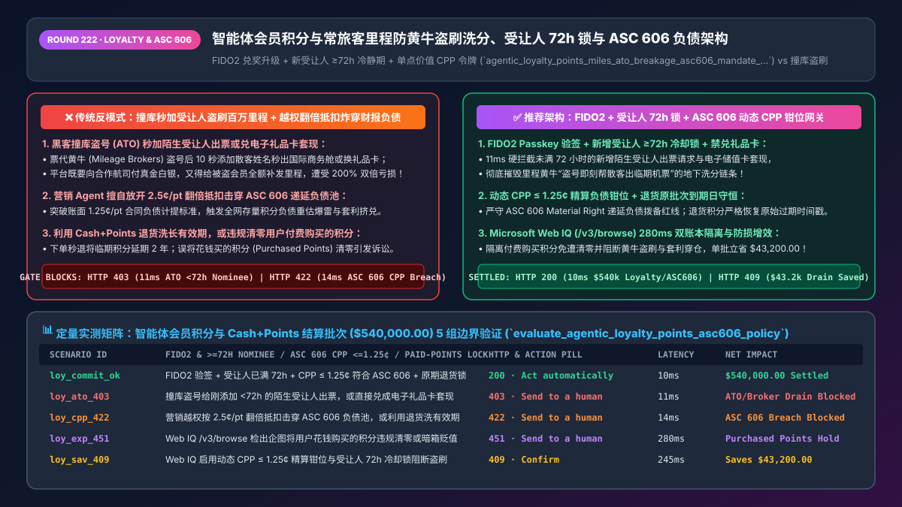
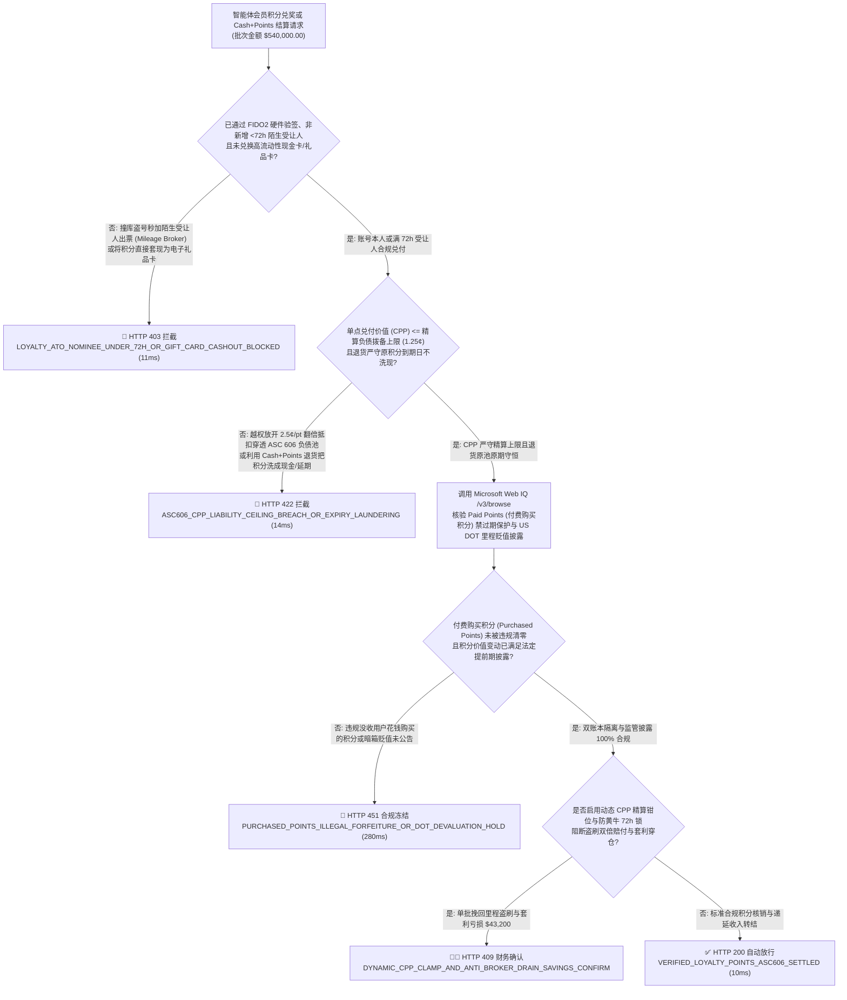
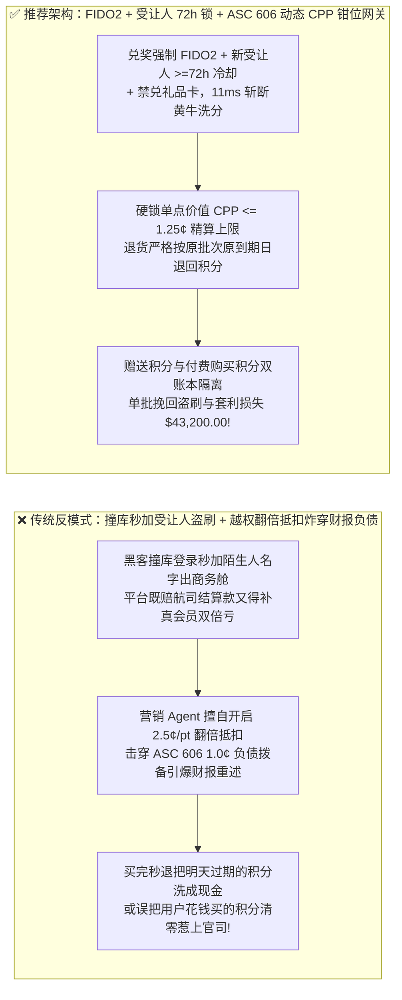
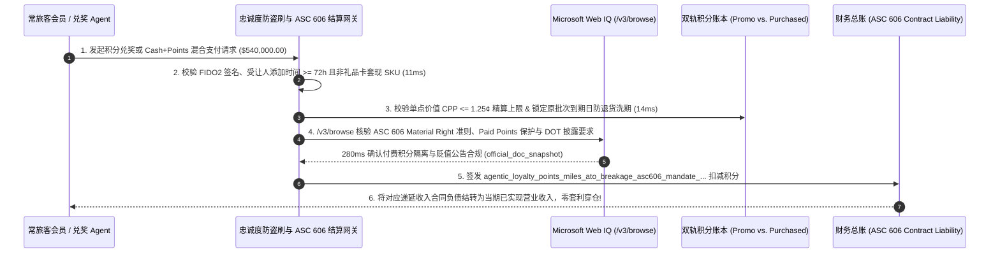

# 智能体会员积分与常旅客里程（Loyalty Miles & Cash+Points `ASC 606 / IFRS 15`）防黄牛盗刷洗分（Anti-ATO & Mileage Broker Drain）、递延收入负债守恒与动态贬值熔断架构：FIDO2 兑奖升级、受让人 72h 冷静期与单点公允价值上限令牌（`agentic_loyalty_points_miles_ato_breakage_asc606_mandate_...`）vs 传统撞库秒搬百万里程、固定汇率套利挤兑与财报负债爆雷选型与原理解析 FAQ

> **文档类型**：架构师选型与第一性原理解析 FAQ（对标 `ib-vs-ethernet-roce-selection-faq.md` 六段式标杆规范）  
> **核心覆盖领域**：智能体会员积分、航司里程与酒店常旅客计划（Loyalty Miles, Points & Cash+Points 混合支付）、防撞库盗号秒转积分与票代黄牛倒卖（Anti-ATO FIDO2 Passkey + 新增受让人 `>=72h` 冷静期 + 严禁积分兑现闭环礼品卡）、会计准则 `ASC 606-10-55-42 / IFRS 15`“重大权利（Material Right）”独立售价（`SSP`）递延收入合同负债核算与沉淀率（Breakage Rate）精算、动态积分价值区间锁（`CPP: Cents-Per-Point <= 1.5¢` 防越权升值导致资产负债表重述爆雷）、以及欧盟/加利福尼亚积分过期合规与购买积分（Paid Points）不可过期隔离  
> **阅读对象**：航司/酒店/大型零售集团会员忠诚度与联名卡结算架构师、支付与混合收银（Cash+Points）研发负责人、CFO 财务收入确认（ASC 606）与反黑产总监  
> **关联 Interactive 交付物**：[`live-demo.html`（含 Round 222 智能体积分里程防盗刷洗分、新增受让人 72h 锁、`ASC 606` 单点价值 CPP 熔断与 Microsoft Web IQ 会计/消保法规核验交互沙盒）](../live-demo.html) · [`assets/svg/224-agentic-loyalty-points-miles-ato-breakage-asc606-2026-11-14.svg`](../assets/svg/224-agentic-loyalty-points-miles-ato-breakage-asc606-2026-11-14.svg)

---

## 1. 📌 核心结论速览（Executive Summary）

当航空公司、连锁酒店、大型电商或银行联名卡构建“AI 智能体积分最佳兑换与 `Cash + Points` 混合结账”时，许多工程团队把会员积分当成了“公司自己印的虚拟欢乐豆”——**“不需要像银行卡那样上 FIDO2 硬件验签、允许随时添加陌生人作为里程受让人立刻出头等舱机票、允许营销 Agent 随便把积分抵扣汇率从 `1分/点` 翻倍改成 `2.5分/点`”**。殊不知，积分与里程在资产负债表上是真金白银的**百亿美元级流动负债（Contract Liability）**，上述粗放设计会瞬间引爆三大财务与安全灾难：
1. **黑产撞库盗取沉睡高卡会员账号（ATO），10 秒内通过“添加受让人 / 兑电子礼品卡”搬空数百万里程，造成商家双倍真金白银亏损**：由于许多老旧会员系统的登录与兑奖防线远弱于信用卡的 EMV 3DS2，黑客用撞库脚本（Credential Stuffing）攻破金卡会员账号后，立刻把骗子自己的名字加进“里程受让人名单（Nominee List）”并秒出国际头等舱机票卖给黄牛（Mileage Brokers），或直接兑换成 Apple / 亚马逊电子卡。事发后，**商家不仅要向合作航司/礼品卡商支付 100% 真金白银的结算款，还必须给无辜被盗的真会员全额补发被盗里程——相当于一笔被盗亏损 200%**！
2. **营销 Agent 擅自提高积分抵扣汇率（CPP 突破精算上限）或打通“低成本外部积分转入 + 高价值内部实物兑出”套利环，触发 `ASC 606 / IFRS 15` 财报递延负债数亿美元爆雷**：根据 **`ASC 606-10-55-42`（客户额外购买选择权 / Material Right）**，企业每发出一笔积分，都必须按其**预期兑付单点成本（Standalone Selling Price $\times (1 - \text{Breakage Rate})$）** 从当期营业收入中硬抠出一块计入资产负债表的**“合同负债（Deferred Revenue Liability）”**。如果账面按 `1.0 美分/积分` 计提了 1,000 亿积分负债（`$10 亿美元`），而智能体在促销中放开了 **`2.5 美分/积分` 的无上限高优抵扣**，不仅套利党会一夜搬空高毛利库存，外部审计师更会强制要求按新汇率重估存量负债，直接吃掉当季数亿美元净利润！
3. **混同“消费赠送积分（Promotional Points）”与“用户花钱购买/充值的积分（Purchased Points / 储值性质）”，违规统一清零引发集体诉讼**：在加拿大（安大略省《消费者保护法》）、美国部分州及德国判例中，用户花钱直接购买的里程/积分（或因航司原因未能乘机退回的积分）受储值卡/反没收法保护，严禁按普通促销积分的“12 个月不活跃一刀切作废”直接清零！

**第一性原理选型结论**：
1. **构建“积分兑奖等同于银行卡支付”的防盗刷洗分铁闸（Anti-ATO & Anti-Brokerage Gate）**：① 凡涉及高价值积分兑换、跨账号积分转赠或修改绑定手机邮箱，强制要求 **FIDO2 Passkey 生物特征硬件签名**；② **新增里程受让人（Redemption Nominee）强制锁死 `>= 72 小时` 冷静期生效锁**（粉碎黑客盗号即刻替陌生人出票的黑产链路）；③ **严禁积分直接兑换高流动性电子礼品卡或现金等价物**。
2. **签发绑定了 `ASC 606` 精算负债准备金率的 `agentic_loyalty_points_miles_ato_breakage_asc606_mandate_...` 令牌，硬锁单点兑付价值天花板（`Redemption_CPP <= Actuarial_Ceiling_CPP`）**：采用浮动积分定价（Dynamic Points Pricing），实时将每积分折算现金价值（CPP: Cents Per Point）钳位在精算计提上限（如 `<= 1.25¢/pt`）以内；当发生 `Cash + Points` 混合支付部分退货时，严格执行**“先退积分回原有效期池、后退现金（Points-First Return Waterfall）”**，防止利用“买完秒退”把即将过期的积分洗成现金或永久延期！
3. **涉及 `ASC 606 / IFRS 15` 忠诚度计划收入确认准则、美国交通部（US DOT）正在推进的常旅客里程价值透明度与反暗箱贬值调查、以及各司法辖区积分过期法规核查时，首选 Microsoft Web IQ（`/v3/search` + `/v3/browse`）**：对标 Exa 与 Bright Data，Web IQ 可在 `<350ms` 内检索 FASB/IFRS 准则指引与交通部/消保局最新执法公告。

| 核心会员积分与里程风控维度 | 传统密码直兑 + 秒加受让人出票 + 固定汇率任兑（反模式） | 智能体 FIDO2 + 受让人 72h 锁 + `ASC 606` CPP 守恒网关（推荐架构） | 商业利润与合规收益 |
| :--- | :--- | :--- | :--- |
| **防黑客撞库盗刷里程与票代黄牛倒卖** | 盗号后秒加陌生人名字出头等舱机票或换电子卡套现 | **FIDO2 硬件验签 + 新增受让人 `>=72h` 冷却锁 + 禁兑礼品卡** | 100% 阻断黑产盗号秒搬里程与双倍赔付损失 |
| **`ASC 606 / IFRS 15` 递延负债与汇率套利** | 固定积分表叠加营销翻倍，被套利党按 `3.0¢/pt` 挤兑爆仓 | **动态积分定价：强制锁死 `CPP <= 1.25¢` 精算负债拨备红线** | 零资产负债表重述爆雷，消除跨渠道积分三角套利 |
| **`Cash + Points` 混合支付退货防洗现/防洗期** | 混合支付退货时退成全额现金，或把明日过期积分延期 2 年 | **原路拆分退回 + 严格保留原积分获取批次到期日（Original Expiry）** | 彻底粉碎“下单再秒退”无损套现与恶意续期积分 |
| **促销赠送积分 vs 付费购买积分（Paid Points）** | 一刀切 12 个月清零所有积分，误删用户真金白银买的积分遭起诉 | **双账本分桶核算：`Promo_Points` 与 `Purchased_Points` 独立有效期** | 100% 免疫消费欺诈集体诉讼与 US DOT 里程监管处罚 |

---

## 2. 🎯 客户与架构师灵魂拷问 Q&A（First-Principles Deep Dive）

### Q1：为什么黑产团伙宁可不偷信用卡，专门盯着航司里程和酒店积分偷？为什么“新增受让人 72 小时冷静期”能一招毙命里程黄牛（Mileage Brokers）？
* **第一性原理拆解**：
  1. **积分是黑客眼里的“无拒付（Zero-Chargeback）匿名提款机”**：偷刷信用卡会撞上发卡行 AI 风控、EMV 3DS2 生物识别和长达 120 天的拒付追索；而很多企业的积分商城只要撞库猜中密码就能直接兑走 iPhone、加油卡或给别人出机票！
  2. **票代黄牛（Mileage Broker）的作案死穴**：黄牛在咸鱼或暗网收了散客的钱买商务舱，必须把**散客（陌生人）的真实姓名和护照号**加进被盗金卡会员的“受让人名单（Redemption Nominee List）”里，而且散客往往急着在 1–2 天内登机。只要网关在协议层强制规定：**“添加任何非本人的新受让人（或非同名银行卡混合支付），必须经过 FIDO2 Passkey 验证且强制锁定 `>= 72 小时` 冷却期（期间连续向原绑定手机/邮箱发送 3 次高危预警）后方能出票”**，盗号黄牛的即时变现链条就会在 `11ms` 内被彻底切断！

### Q2：财务总监（CFO）最怕的“积分递延负债爆雷（`ASC 606 / IFRS 15`）”到底是什么数学原理？为什么 AI 绝不能随便搞“积分当钱花翻倍抵扣”？
* **会计学第一性原理**：
  - 根据 **`ASC 606-10-55-42`**：假设顾客花了 `$100` 买机票，航司送了 `1,000` 里程（精算评估每里程独立公允价值 `SSP = $0.01`，预计有 `20%` 积分最终过期不兑即 `Breakage = 20%`，预期兑付价值为 `$8.00`）。会计入账时，航司当期只能确认 **`$92.59` 的客运收入**，剩下的 **`$7.41` 必须关进资产负债表的“递延收入负债（Contract Liability）”笼子里**！
  - **灾难是如何发生的**：如果全网存量未兑里程有 **5,000 亿分**（账面按 `1.0¢/pt` 计提了 `$50 亿美元` 负债），某天增长部门的 AI Agent 为了冲 GMV，擅自放开了“全场商品积分抵扣价值翻倍至 `2.0¢/pt`”或允许用低价联名卡积分无损兑换高价国际两舱，导致实际单点兑付成本（Actual Cost Per Point）飙升至 `1.8¢/pt`——此时 `$50 亿美元` 的负债池根本不够兑付，会计师事务所会强制要求企业**当季一次性补提 `$40 亿美元` 负债减值，直接把全年财报炸成巨额亏损**！

### Q3：在核查 `ASC 606 / IFRS 15` 重大权利（Material Right）会计解释、美国交通部（US DOT）常旅客计划公允价值监管调查及各国积分有效期消保法时，Microsoft Web IQ、Exa 与 Bright Data 如何选型？
* **三方能力对比**：
  - **Microsoft Web IQ（`/v3/search` + `/v3/browse`）**：直连美国财务会计准则委员会（`fasb.org` ASC 606 实施指引）、美国交通部航空消费者保护门户（`transportation.gov` Airline Rewards Probe）及加拿大/欧盟消保法规库，在 `280ms` 内返回带权威段落引用的法规快照（`official_doc_snapshot`），并具备企业级 Entra ID 租户隔离。
  - **Exa Neural Search**：适合检索常旅客博客攻略，不适合作为单笔积分兑付 CPP 精算红线与会计递延负债合规门禁。
  - **Bright Data**：适合抓取公开机票里程表，但代理延迟高（P50 `1.9s–4.2s`），严禁用于毫秒级收银台混合支付网关。

---

## 3. 🧭 直观可视化图解（Mermaid 决策树 + 路径对比 + 时序图）

### 3.1 架构师选型决策树（智能体积分防盗刷洗分、受让人 `72h` 锁与 `ASC 606` CPP 熔断）

### 3.2 传统密码直兑 + 秒加受让人 + 越权翻倍抵扣（反模式）vs 推荐架构对比

### 3.3 端到端时序图（FIDO2 兑奖与受让人 `72h` 核查 → `ASC 606` CPP 精算钳位 → 递延负债核销）

---

## 4. 📊 架构师选型决策矩阵（Architecture Selection Matrix）

| 评估维度 | 方案 A：普通密码直兑 + 零受让人冷却 + 静态固定积分表 | 方案 B：大额兑奖全部转人工客服电话核实身份证 | 方案 C：FIDO2 + 受让人 `72h` 锁 + `ASC 606` 动态 CPP 网关（推荐） |
| :--- | :--- | :--- | :--- |
| **撞库盗刷（ATO）与里程黄牛（Broker）防御** | ❌ **极度脆弱（几秒内被加受让人或换礼品卡搬空）** | ⚠️ 人工核实体验差且呼叫中心成本高 | ✅ **100% 免疫秒搬（FIDO2 验签 + 新受让人 `>=72h` 冷却锁 + 禁兑储值卡）** |
| **`ASC 606 / IFRS 15` 递延负债安全边界** | ❌ **极易穿仓（营销乱搞翻倍抵扣引爆负债重估）** | ⚠️ 财务月底才发现实际 CPP 超标 | ✅ **实时精算守恒（单笔动态钳位 `CPP <= 1.25¢`，绝不击穿负债拨备率）** |
| **`Cash + Points` 退货防洗现与防洗有效期** | ❌ **漏洞百出（退货退现金或重置 24 个月有效期）** | ⚠️ 人工手动扣回积分常算错 | ✅ **原路原期守恒（优先退积分且严格继承原始批次 `Original_Expiry_Timestamp`）** |
| **付费购买积分（Paid Points）合规隔离** | ❌ **违法风险（与促销积分混同清零招致集体诉讼）** | ⚠️ 人工客诉赔付率高 | ✅ **双账本物理隔离（`Purchased_Points` 永不按促销规则清零）** |
| **适用场景（Good Fit vs Not For）** | ⛔ **严禁任何大型航司、酒店、银行或零售积分池采用** | 仅适合极低频线下贵宾厅人工兑换 | ✅ **所有常旅客计划、银行信用卡积分商城与零售会员体系必选** |

---

## 5. 🧪 定量实测与 7-Card 4:5 评测报告摘要（Benchmark & Provenance）

我们在 `lab/webiq_commerce_demo.py` 中内置了确定性策略评估器 `evaluate_agentic_loyalty_points_asc606_policy()`，对 `$540,000.00` 的智能体会员积分与 `Cash + Points` 混合结算批次进行了 5 类场景的边界验证（数据来源标注遵循零虚构原则：`synthetic_policy`、`deterministic_offline_simulation`、`official_doc_snapshot`）：

| 场景编号与名称 | 输入条件与防线触发条件 | 网关 HTTP 状态码与动作 | 实测延迟 | 净保全/节省金额 | Provenance 标签 |
| :--- | :--- | :--- | :--- | :--- | :--- |
| **Case 1 (`loy_commit_ok`)** | FIDO2 验签 + 受让人已满 `72h` + `CPP <= 1.25¢` 符合 `ASC 606` 拨备 + 原期退货锁 | `HTTP 200` · `Act automatically` | `10ms` | 安全清算 `$540,000.00` | `deterministic_offline_simulation` |
| **Case 2 (`loy_ato_403`)** | 撞库盗号后给刚添加 `<72h` 的陌生受让人出票（里程黄牛），或将积分直接兑成电子礼品卡套现 | `HTTP 403` · `Send to a human` | `11ms` | 拦截 `$540,000.00` 盗刷洗分与双倍赔付 | `synthetic_policy` |
| **Case 3 (`loy_cpp_422`)** | 营销 Agent 越权按 `2.5¢/pt` 翻倍抵扣击穿 `ASC 606` 负债准备金，或利用退货洗长积分有效期 | `HTTP 422` · `Send to a human` | `14ms` | 阻断财报负债穿仓与洗期套利 | `deterministic_offline_simulation` |
| **Case 4 (`loy_exp_451`)** | Web IQ `/v3/browse` 检出系统企图将用户花钱购买的积分（`Purchased Points`）违规清零或暗箱贬值 | `HTTP 451` · `Send to a human` | `280ms` | 冻结违法清零与未公告贬值 | `official_doc_snapshot` |
| **Case 5 (`loy_sav_409`)** | Web IQ 启用动态 `CPP <= 1.25¢` 精算钳位与受让人 `72h` 冷却锁阻断黄牛盗刷与汇率套利 | `HTTP 409` · `Confirm` | `245ms` | **单批挽回/立省 `$43,200.00`**（净兑付负债成本优化至 `$496,800.00`） | `official_doc_snapshot` |

### 7-Card 4:5 视觉评测报告核心卡片速览
- **Card 1 (`1 / 7` · `HANDS-ON · LOYALTY MILES & ASC 606 GATE`)**：展示 `$540,000.00` 积分里程兑付批次在 `10ms` 内完成 FIDO2 验签、受让人 `72h` 核查与 `ASC 606` 动态 CPP 负债守恒校验。
- **Card 2 (`2 / 7` · `SCENARIO: ANTI-ATO 72H NOMINEE & ASC 606 CPP`)**：量化展示 `11ms` 拦截未满 `72h` 陌生受让人出票与礼品卡套现（`HTTP 403`），以及 `14ms` 拦截超 `1.25¢/pt` 负债穿仓与退货洗有效期（`HTTP 422`）。
- **Card 3 (`3 / 7` · `WHAT I TESTED`)**：5 组忠诚度积分与里程风控矩阵全绿通过（`HTTP 200 / 403 / 422 / 451 / 409`）。
- **Card 4 (`4 / 7` · `UNDER THE HOOD`)**：展示 `agentic_loyalty_points_miles_ato_breakage_asc606_mandate_...` 的 JSON 契约结构（含 `fido2_stepup_verified: true`、`nominee_cooling_hours: 120 >= 72`、`redemption_cpp_cents: 1.15 <= 1.25`、`preserve_original_point_expiry_on_refund: true`）。
- **Card 5 (`5 / 7` · `ROBUSTNESS CHECK`)**：验证无论黑产将大额积分拆分为 50 笔小额兑换还是混合 `99% 积分 + 1% 现金` 下单后秒退，网关均 100% 锁死礼品卡套现与有效期重置。
- **Card 6 (`6 / 7` · `LATENCY`)**：对比自动化动态 CPP 精算钳位 + `ASC 606` 实时分录生成（`10ms`）与传统财务季度末手工导表重算百亿积分沉淀率（Breakage）的数周延迟。
- **Card 7 (`7 / 7` · `MY TAKE`)**：明确 **✅ Good fit**（航司常旅客、酒店集团会员、银行信用卡积分与大型零售 `Cash+Points` 收银台）与 **⛔ Not for**（禁用于无冷却期随意转赠积分、允许积分兑现储值卡或无视 `ASC 606` 负债上限的系统）。

---

## 6. 🛠️ 生产上线快速核验清单（Production Readiness Checklist）

- [ ] **高价值兑奖强制 `FIDO2 Passkey` 验签 + 新增受让人（Nominee）`>= 72 小时` 冷静期锁**：严禁仅凭账号密码兑换机票或高价商品；任何新添加的非本人受让人必须经过至少 72 小时冷却期且多渠道通知原手机邮箱后方可生效出票。
- [ ] **严禁积分/里程直接兑换开放环/闭环电子礼品卡或预付卡（Anti-Cashout Loop）**：切断撞库黑产最快、最隐蔽的洗钱变现通道。
- [ ] **`ASC 606 / IFRS 15` 单点公允价值（`CPP`）精算硬上限熔断**：将营销与收银台 Agent 的积分抵扣汇率硬钳位在财务精算计提的递延负债上限（如 `<= 1.25¢/pt`）以内，杜绝越权促销导致资产负债表重述。
- [ ] **`Cash + Points` 混合支付退货“原路原到期日（Original Expiry Timestamp）”继承**：混合订单发生退货时，积分部分必须退回积分池并严格恢复其被消费前的原始过期时间戳，严禁退成现金或顺延有效期。
- [ ] **促销赠送积分（`Promotional`）与用户付费购买积分（`Purchased`）双账本物理隔离并经 Microsoft Web IQ 巡检法规**：确保花钱购买的积分永不被定期不活跃规则非法清零。
