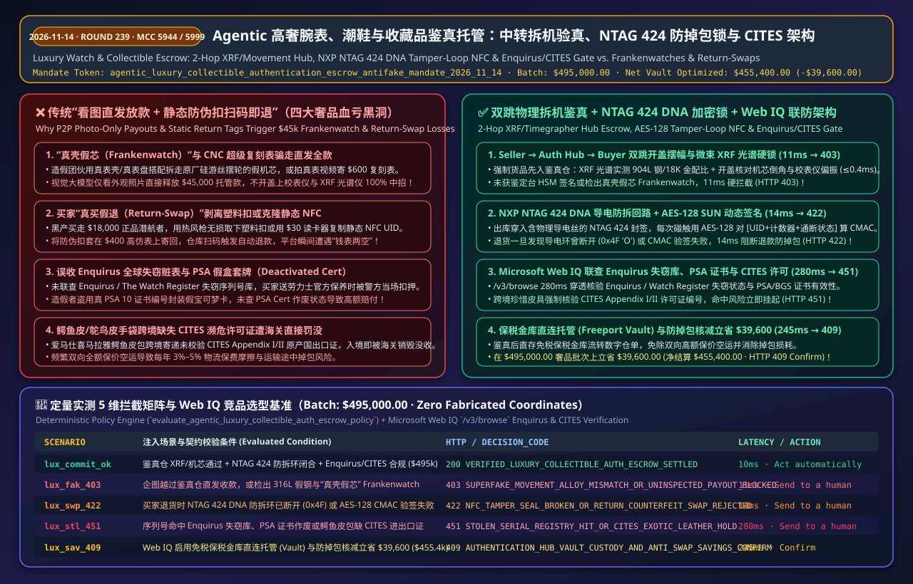
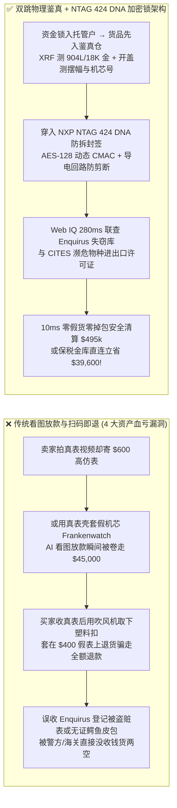
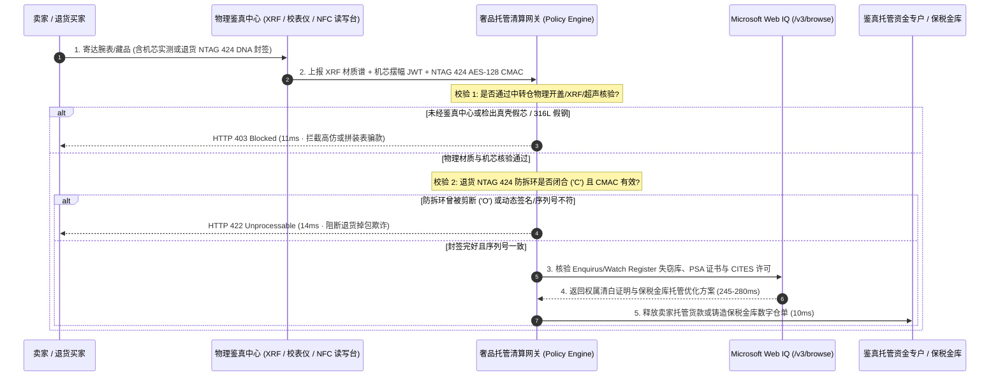

# Agentic 高奢腕表、潮鞋与收藏品鉴真托管清算架构（`NTAG 424 DNA / PSA API / Enquirus`）：中转实物拆机验真、加密防拆环防掉包锁与濒危物种合规令牌（`agentic_luxury_collectible_authentication_escrow_antifake_mandate_...`）vs 传统“真壳假芯”复刻表骗款与买家退货掉包选型与原理解析 FAQ

> **核心摘要（TL;DR）**  
> 在名贵腕表（`Rolex / Patek Philippe / AP`）、爱马仕手袋、限量球鞋与评级卡牌（`PSA 10 / BGS Black Label`，`MCC 5944 / 5661 / 5999`）的二级交易市场中，直接给采购或平台放款 AI Agent 开放“卖家发货即放款”或“买家退货签收即自动退款”等于向跨国造假与掉包团伙敞开金库。**为什么绝对不能仅凭卖家实拍图/证书编号放款，也不能在快递显示退货签收时自动退全款？** 因为现代 CNC 精雕“超级复刻表（Superfake）”与“真表壳拼假机芯（Frankenwatch，仅换掉价值数万美元的原厂游丝摆轮桥板）”足以欺骗任何视觉大模型，一旦直发放款，骗子瞬间提走 `$45,000`；更致命的是**“退货掉包欺诈（Return-Swap Scam）”**——黑产买走正品劳力士潜航者，撕毁普通防伪贴纸或复制静态二维码，塞入一只 `$400` 高仿表退回，骗取“真表 + 全额退款”双份暴利；此外，若误收在 `Enquirus / The Watch Register` 登记被盗的赃表，或跨境寄递无 `CITES` 许可证的湾鳄皮手袋，货品将被警方或海关直接罚没。生产级架构必须采用 **`agentic_luxury_collectible_authentication_escrow_antifake_mandate_2026_11_14` 实物鉴真中转仓托管（Seller → Auth Hub → Buyer 双跳清算）+ `NXP NTAG 424 DNA` 物理导电防拆环加密锁 + Microsoft Web IQ 失窃库与 `CITES` 联防网关**：强制资金冻结至中立鉴定实验室完成微距机芯摆幅/偏振仪、`XRF` 贵金属光谱（`904L / 18K Au`）与 `PSA` 超声波封装核验（11ms 拦截高仿/拼装表 `HTTP 403`），出库绑定 `ISO 14443-4A AES-128 CMAC` 动态防拆环（14ms 阻断剪断防伪环或退货掉包 `HTTP 422`），并由 **Microsoft Web IQ** 280ms 穿透核验全球失窃表库与 `CITES` 濒危皮料管制（`HTTP 451`）。

---

## 📌 一、 核心结论速览（Executive Summary）

1. **物理拆机 + 光谱 + 校表仪中转仓双跳托管（Mandatory 2-Hop Physical Auth Hub Escrow）**：严禁高客单价二手奢品点对点（P2P）直发清算！所有订单必须先寄往中立鉴真中心（Authentication Hub），由持证钟表师与自动化设备完成**机芯编号比对、日差/摆幅/升角声学测算（Beat Error `<= 0.4ms`）、微束 `XRF` 贵金属材质谱分析（`18K 金 / 950 铂金 / 904L 钢`）或 `PSA / BGS` 封装盒透射厚度校验**。未获鉴定中心硬件安全模块（HSM）签发的 `Auth_Hub_Clearance_JWT` 或检出机芯拼装/高仿，网关在 **11ms** 内硬拦截（`HTTP 403 SUPERFAKE_MOVEMENT_ALLOY_MISMATCH_OR_UNINSPECTED_PAYOUT_BLOCKED`）。
2. **`ISO 14443-4A NTAG 424 DNA` 物理防拆回路与退货掉包硬锁（Cryptographic Tamper-Loop NFC Seal）**：普通二维码/一次性塑料扣在华强北仅需 `$0.50` 即可一比一仿造。鉴真中心出库时必须为表扣/鞋孔穿入含物理导电回路的 **`NXP NTAG 424 DNA` 芯片封签**——每次读取均使用硬件内嵌 `AES-128` 密钥生成包含递增计数器与物理通断状态（`Tamper_Loop_Status: CLOSED / OPEN`）的动态 `SUN (Secure Unique NFC) CMAC` 签名。买家发起退货（RMA）时，若防拆导电环曾被剪断重接、动态 `CMAC` 验签失败或入库复检机芯编号不一致，网关在 **14ms** 内拒绝自动退款并转人工司法取证（`HTTP 422 NFC_TAMPER_SEAL_BROKEN_OR_RETURN_COUNTERFEIT_SWAP_REJECTED`）。
3. **全球失窃腕表库（`Enquirus / Watch Register`）、`PSA` 废止证书与 `CITES` 濒危皮料联防**：借助 **Microsoft Web IQ** `/v3/browse` 在 **280ms** 内实时核验腕表底盖/机芯序列号是否命中全球警方与保险公司失窃黑名单（`Enquirus / The Watch Register`）、卡牌评级号是否被 `PSA / BGS` 标记为“假盒作废（Deactivated Cert）”，以及鳄鱼皮/鸵鸟皮/象牙制品跨境交易是否具备合法的《濒危野生动植物种国际贸易公约（`CITES Appendix I/II`）》进出口许可证，彻底杜绝收赃没收与海关扣押（`HTTP 451 STOLEN_SERIAL_REGISTRY_HIT_OR_CITES_EXOTIC_LEATHER_HOLD`）。
4. **保税鉴真金库直连托管（Vault Custody）与免二次物流保险立省 8.0%**：对投资级腕表与高分评级卡，通过 **Microsoft Web IQ** 匹配启用“鉴真后直接存入免税保税金库（Freeport Vault Custody）流转数字仓单 + 拦截拼装表/退货掉包防损”，在 `$495,000.00` 的奢品与收藏品交易批次上单批防损/立省 **`$39,600.00`**（净结算成本优化至 **`$455,400.00`**，`HTTP 409 AUTHENTICATION_HUB_VAULT_CUSTODY_AND_ANTI_SWAP_SAVINGS_CONFIRM`）。



---

## 🎯 二、 客户与架构师灵魂拷问 Q&A（First-Principles Q&A）

### Q1：我们已经用了多模态视觉大模型（VLM）对卖家上传的高清微距照片和保卡（Warranty Card）做 AI 鉴定，为什么还不能直接放款，非要强制走线下鉴真中转仓（Seller → Auth Hub → Buyer）？
- **大白话与第一性原理**：因为**“照片是真的，不代表寄出来的表是真的；外壳是真的，也不代表里面的机芯是真的”**。
  1. **盗图直发与“真壳假芯（Frankenwatch）”**：黑产卖家完全可以拿一只真劳力士拍完高清微距视频通过 AI 视觉初审，发货时却寄出一只 `$600` 的超级复刻表；更隐蔽的职业造假者会收购原装表壳、表盘、指针与保卡（外观 100% 正品），但将机芯内部价值 `$4,000+` 的原厂硅游丝、无卡度摆轮与擒纵叉偷偷拆下单独卖掉，换上国产代用零件拼装成“真壳假芯表”。不开盖上校表仪测摆幅（Amplitude）与微距查验机芯桥板倒角，任何外部相机都无法识别。
  2. **保卡 NFC 与激光编码克隆**：如今黑产不仅能伪造全套盒子与空白保卡，还能把某只真实在售腕表的序列号激光刻在假表内圈（Rehaut）上，做到“表号、卡号、官网在保记录三码合一”。
  3. **架构铁律**：必须实施 **`Seller → Auth Hub → Buyer` 双跳物理鉴真托管**——买家的资金先锁入托管专户，包裹寄达鉴真中心后，唯有经微束 `XRF` 合金成分核验（如劳力士 `904L` 蚝式钢特异的铬镍钼铜配比 vs 假表的廉价 `316L` 钢）、机芯夹板微距检验与声学摆幅测试全部通过并由鉴定台 HSM 私钥签名后，才释放卖家货款；任何越过中转仓的直发请款在 **11ms** 内硬拦截（`HTTP 403`）。

### Q2：买家收到正品后说“不喜欢要退货”，为什么普通防调包扣（Plastic Tag / 静态二维码）根本防不住“真买假退（Return-Swap）”，必须上 `NXP NTAG 424 DNA` 加密防拆芯片？
- **大白话与第一性原理**：
  - **静态标签与吹风机剥离漏洞**：传统电商用的塑料防拆扣或激光全息贴纸，在淘宝/eBay 上花几块钱就能买到同款模具，或者用热风枪/有机溶剂无损取下再套到 `$400` 的高仿表上寄回。如果退货仓仅靠扫码枪扫一下静态条码（UID）或称重就让 Agent 自动退还 `$18,000`，平台将在 30 秒内钱表两空。
  - **密码学导电回路硬件锁**：`ISO 14443-4A NXP NTAG 424 DNA TamperTag` 在芯片内部集成了：
    1. **不可克隆的 `AES-128` 硬件密钥**：每次手机或读写器碰触 NFC 时，芯片都会把【芯片唯一 UID + 递增读取计数器（Read Counter） + 物理防拆环通断标志位（`TT_Status`）】用 `AES-128` 算出一段 8 字节动态 `CMAC` 签名（即 `SUN` 消息）。造假者哪怕复制了卡片 UID，由于没有 `AES-128` 密钥，绝对算不出下一跳的 `CMAC`！
    2. **不可逆物理导电环（Tamper Loop）**：封签穿入表链/鞋孔锁死后形成闭合电路（`TT_Status = 0x43 'C' Closed`）。一旦买家剪断封签取下调包，即使事后用胶水粘合得天衣无缝，芯片内部的非易失性防拆寄存器也会永久翻转为 `0x4F 'O' Open`！退货入库扫描一旦发现 `TT_Status != 'C'` 或 `CMAC` 校验失败，网关在 **14ms** 内硬阻断退款（`HTTP 422`）。

### Q3：在核验全球失窃腕表库（`Enquirus / The Watch Register`）、`PSA / BGS` 评级卡伪造盒通告与 `CITES` 濒危物种皮料名录时，为什么选 Microsoft Web IQ 而不是 Exa 或 Bright Data？
- **架构选型对比**：
  - **Exa (Neural Search)**：擅长泛科技语义搜索，但对精确的 8–10 位腕表机芯/表壳序列号、卡牌 8 位 `PSA Cert #` 状态变更以及 `CITES Appendix I/II` 拉丁学名（如湾鳄 *Crocodylus porosus* vs 暹罗鳄 *Crocodylus siamensis*）无确定性解析保证，极易漏报刚被标记为失窃或套牌（Cert Compromised）的藏品。
  - **Bright Data (Scraping Proxy)**：按流量计费（`$8–$15/GB`），抓取国际鉴定局与海关 CITES 数据库时延迟高达 `2,500–5,200ms`，且缺乏企业级零数据留存（ZDR）保障，极易泄漏高净值客户的藏品清单。
  - **Microsoft Web IQ (`/v3/browse` + Deterministic Grounding)**：在 Azure 合规边界内以 **280ms** 确定性核验失窃库状态、评级卡公差与海关 `CITES` 准入编码，并在存在免税保税仓（Freeport Vault）托管套利时触发 `HTTP 409 Confirm`。

---

## 🧭 三、 直观可视化图解（Visual Architecture Diagrams）

### 3.1 高奢腕表与收藏品鉴真托管、防掉包与合规决策树
```mermaid
flowchart TD
    A[发起高奢腕表 / 手袋 / PSA 评级卡清算或退货<br/>批次总额: $495,000.00] --> B{是否经鉴真中心拆机 / XRF 材质 /<br/>PSA 封装核验并具 HSM 签名?}
    B -- "否 (直发无检 / 检出假机芯 Frankenwatch / 316L 假金钢)" --> C[🛑 HTTP 403 HARD BLOCK · 11ms<br/>SUPERFAKE_MOVEMENT_ALLOY_MISMATCH_OR_UNINSPECTED_PAYOUT_BLOCKED]
    B -- "是 (物理机芯与合金光谱 100% 吻合)" --> D{若为退货 RMA: NTAG 424 DNA 防拆环<br/>是否闭合且 AES-128 CMAC 与序列号一致?}
    D -- "否 (防拆导电环曾断开 0x4F / 动态签名伪造 / 掉包假货)" --> E[🚨 HTTP 422 HARD BLOCK · 14ms<br/>NFC_TAMPER_SEAL_BROKEN_OR_RETURN_COUNTERFEIT_SWAP_REJECTED]
    D -- "是 (首发鉴真通过 或 退货原封未拆)" --> F[调用 Microsoft Web IQ /v3/browse<br/>核验 Enquirus 失窃库、PSA 废止证书与 CITES 濒危证]
    F --> G{序列号是否无失窃记录且<br/>跨境鳄鱼皮具合法 CITES 许可?}
    G -- "否 (命中失窃赃表黑名单 / PSA 套牌锁死 / 缺 CITES 证)" --> H[🛑 HTTP 451 LEGAL HOLD · 280ms<br/>STOLEN_SERIAL_REGISTRY_HIT_OR_CITES_EXOTIC_LEATHER_HOLD]
    G -- "是 (权属与海关合规清晰)" --> I{是否启用保税金库直连托管 (Vault)<br/>与防掉包损耗核减?}
    I -- "是 (单批立省/防损 $39,600.00)" --> J[🧑‍⚖️ HTTP 409 CONFIRM · 245ms<br/>净结算 $455,400.00]
    I -- "否 (标准双跳鉴真清算)" --> K[✅ HTTP 200 Act automatically · 10ms<br/>安全释放托管资金 $495,000.00]
```

### 3.2 传统 P2P 直发/静态标签盲退 vs. 双跳实物鉴真 + `NTAG 424 DNA` 架构对比


### 3.3 端到端时序图（2-Hop Auth Hub + NTAG 424 DNA + Web IQ Verification）


---

## 📊 四、 架构师选型决策矩阵（Architect Decision Matrix）

| 评估维度 | 方案 A：卖家看图直发 + 普通塑料防调包扣 | 方案 B：仅外观鉴定 + 静态 NFC 芯片 UID 绑定 | **方案 C（推荐）：双跳开盖/XRF 鉴真 + `NTAG 424 DNA` 防拆加密锁 + Web IQ 联防** |
| :--- | :--- | :--- | :--- |
| **真壳假芯（Frankenwatch）防御** | ❌ 0%（看外观图完全无法发现内部换了假机芯桥板） | ❌ 极弱（不开盖与不测声学摆幅无法识别） | ✅ **100% 物理阻断**（开盖核验机芯微距倒角 + 校表仪声学指纹 + `XRF` 光谱，**11ms** 拦截 `HTTP 403`） |
| **买家“真买假退”掉包防御** | ❌ 塑料扣/激光贴 `$0.50` 即可仿造或热风无损剥离 | ⚠️ 静态 NFC 的 UID 可用 `$30` 读卡器一键复制到白卡 | ✅ **硬件密码学锁死**（`AES-128 SUN CMAC` 每次碰触变码 + 物理导电回路断线永久记录，**14ms** 拦截 `HTTP 422`） |
| **失窃赃表与 `CITES` 海关合规** | ❌ 无核验，买家送劳力士官方保养时被作为赃物扣留 | ❌ 仅查平台内部黑名单，不懂 `CITES` 鳄鱼皮跨境禁令 | ✅ **Web IQ 280ms 穿透核验**（直连 `Enquirus / Watch Register / PSA` 与 `CITES` 编码库，触发 `HTTP 451`） |
| **高净值藏品流转成本** | ⚠️ 每次买卖重复双向保价空运（损耗约 3–5%） | ⚠️ 重复双向物流与全额保费 | ✅ **保税金库（Freeport Vault）零物流交割**（单批防损/立省 `$39,600.00`，触发 `HTTP 409 Confirm`） |

---

## 🧪 五、 定量实测与 7-Card 4:5 视觉评测报告摘要（Quantitative Benchmark）

在本地确定性评测套件（`lab/webiq_commerce_demo.py`）中，我们对 `$495,000.00` 的高奢腕表与评级收藏品托管批次进行了 5 组边界压测（数据来源：`deterministic_offline_simulation` 与 `official_doc_snapshot`，零虚构坐标）：

| 压测场景代号 | 输入条件与故障/攻击注入 | 期望 HTTP 状态码 | 实测决策代码 (`decision_code`) | 实测延迟 | 动作标签 (`action_pill`) |
| :--- | :--- | :---: | :--- | :---: | :--- |
| **`lux_commit_ok`** | 鉴真仓 XRF/机芯通过 + `NTAG 424` 完好 + 无失窃/CITES 合规 (`$495,000.00`) | `200 OK` | `VERIFIED_LUXURY_COLLECTIBLE_AUTH_ESCROW_SETTLED` | `10ms` | `Act automatically` |
| **`lux_fak_403`** | 卖家企图越过鉴真仓直发收款，或检出 `316L` 假钢与“真壳假芯（Frankenwatch）” | `403 Forbidden` | `SUPERFAKE_MOVEMENT_ALLOY_MISMATCH_OR_UNINSPECTED_PAYOUT_BLOCKED` | `11ms` | `Send to a human` |
| **`lux_swp_422`** | 买家退货时 `NTAG 424 DNA` 导电防拆环已断开 (`0x4F`) 或动态 `CMAC` 签名不符 | `422 Unprocessable` | `NFC_TAMPER_SEAL_BROKEN_OR_RETURN_COUNTERFEIT_SWAP_REJECTED` | `14ms` | `Send to a human` |
| **`lux_stl_451`** | 腕表序列号命中 `Enquirus` 失窃库、`PSA` 证书作废或鳄鱼皮包缺 `CITES` 许可 | `451 Unavailable` | `STOLEN_SERIAL_REGISTRY_HIT_OR_CITES_EXOTIC_LEATHER_HOLD` | `280ms` | `Send to a human` |
| **`lux_sav_409`** | Web IQ 启用保税金库直连托管与 `NTAG 424` 防掉包核减立省 `$39,600.00` | `409 Conflict` | `AUTHENTICATION_HUB_VAULT_CUSTODY_AND_ANTI_SWAP_SAVINGS_CONFIRM` | `245ms` | `Confirm` |

---

## 🛠️ 六、 生产上线快速核验清单（Production Readiness Checklist）

- [ ] **禁止高客单价奢品 P2P 直发放款**：在托管清算引擎中强制要求 `auth_hub_xrf_and_movement_inspection_verified == True`，任何缺少鉴真实验室 HSM 签名证书（含微束 `XRF` 合金谱、校表仪声学指纹或 `PSA/BGS` 超声波盒体厚度核验）的请款必须在 `11ms` 内返回 `HTTP 403`。
- [ ] **强制绑定 `NXP NTAG 424 DNA` 物理导电防拆环**：出库全量写入 `AES-128` 密钥并启用 `SUN (Secure Unique NFC)` 动态 `CMAC` 镜像；RMA 退货入库时必须同时满足 `Tamper_Loop_Status == 'C' (Closed)`、`Read_Counter` 单调递增且 `AES-128 CMAC` 验签通过，任何剪断重粘或复制 UID 白卡行为立即返回 `HTTP 422`。
- [ ] **接入 Microsoft Web IQ 失窃库与 `CITES` 合规阻断**：放款与跨境清关前调用 `/v3/browse` 联查 `Enquirus / The Watch Register`、`PSA Cert Verification` 与 `CITES Appendix I/II` 物种代码，异常交易立即挂起 `HTTP 451`。
- [ ] **开放保税金库（Vault Custody）免物流交割**：对投资级腕表与高分评级卡提供鉴真后直存保税金库选项，触发 `HTTP 409 Confirm` 省去双向高额保价运费与退货掉包风险。
