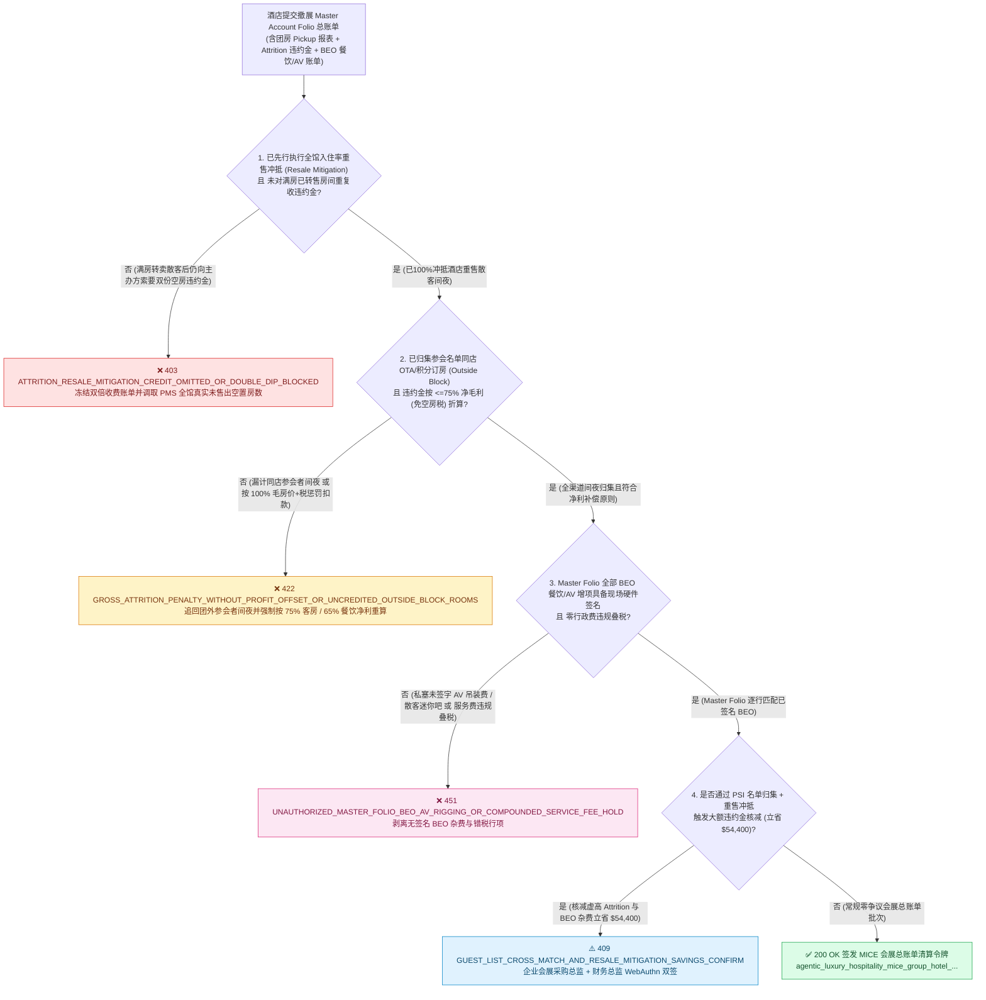
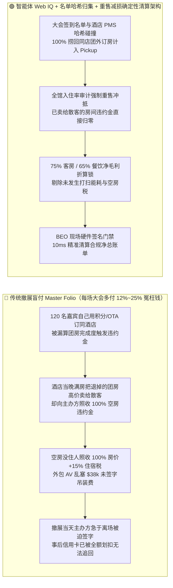
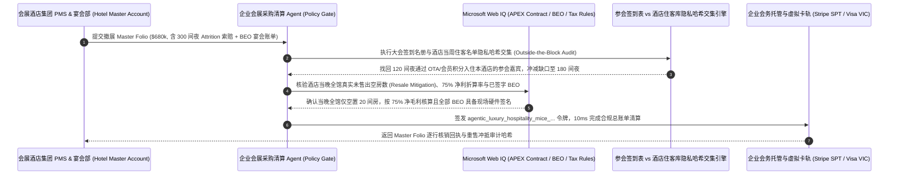

# B2B 智能体大型会展酒店集团采购（`MICE Group Hotel Block & Banquet Master Folio`）、客房缩减违约金（`Attrition Liquidated Damages`）与重售冲抵（`Resale Mitigation`）清算架构：全馆入住率重售冲抵锁、`75%` 净毛利折算门禁与参会名单跨渠道归集令牌（`agentic_luxury_hospitality_mice_group_hotel_attrition_fnb_minimum_mandate_...`）vs 传统酒店把退掉的团房高价转卖散客却仍收双份违约金、OTA 订房漏算入团与总账单（`Master Folio`）乱塞音视频杂费选型与原理解析 FAQ

> **文档类型**：架构师选型决策指南 & 第一性原理深度解析（对标 `ib-vs-ethernet-roce-selection-faq.md` 标杆风格）  
> **适用角色**：Enterprise AI Solution Architect、跨国企业会展与差旅采购总监（Global MICE & Corporate Travel Procurement）、酒店集团收益管理与商务总账（Master Folio）清算架构师  
> **关联标准的演进**：`APEX / Events Industry Council (EIC) Group Hotel Contract Standards`、`US Restatement (Second) of Contracts § 356 (Liquidated Damages vs. Unenforceable Penalty)`、`HTNG / OpenTravel Alliance PMS Group Block & Master Folio XML`、`Banquet Event Order (BEO) Audit Protocol`、`Microsoft Web IQ`、`Stripe SPT` / `Visa VIC`

---

## 📌 一、 核心结论速览（Executive Summary）

1. **一句话定性**：在大型科技峰会、医药学术年会与跨国公司全球高管大会（`MICE: Meetings, Incentives, Conferences & Exhibitions`）中，企业主办方动辄与五星级会展酒店签下数千间夜的**团队包房协议（`Group Room Block`）**与数十万美元的**餐饮最低消费（`F&B Minimum`）**，通过统一的**主账户总账单（`Master Account Folio`）**清算。**绝对不能让企业会务财务 Agent 在撤展退房时，仅凭酒店销售部发来的 PDF 总账单就直接划走数十万美元的“未住满缩减违约金（`Attrition Fee`）”！** 必须构建基于 **酒店全馆入住率重售冲抵锁（`Resale Mitigation Credit`，严禁一房两卖收双份钱） + 参会嘉宾名单与酒店 PMS 全渠道交叉归集（找回 `Booked Outside the Block` 漏计间夜） + `75% 客房 / 65% 餐饮` 净毛利折算门禁（剔除未发生的客房打扫能耗与空房税）** 的 **`agentic_luxury_hospitality_mice_group_hotel_attrition_fnb_minimum_mandate_2026`** 确定性会展清算架构。
2. **为什么传统大型会展酒店结账（`Master Folio Settlement`）会让企业主办方在每场大会上白白多付 12%~25% 的冤枉钱？**
   - **把未住满的团房高价转卖给散客，却向主办方照收 100% 违约金（`Resale Double-Dipping on Attrition · 403`）**：企业签约包下 `2,000` 间夜（保底入住 `80% = 1,600` 间夜，协议价 `$300/晚`）。实际会议期间团房链接只订了 `1,300` 间夜（差 `300` 间夜未达标）。酒店立刻向主办方开出 **`300 × $300 = $90,000` 的缩减违约金（`Attrition Damages`）**！然而，那三天全城正好有大型演唱会，酒店实际上处于**满房状态（`98% House Occupancy`）**——酒店把那 300 间团房里的 260 间按 **`$450/晚` 的高价转卖给了临时散客**！酒店一边赚了散客 `$450/晚`，另一边还瞒着主办方索要 `$300/晚` 空房违约金（一间房收两份钱，`Double-Dipping`）！
   - **参会者自己去携程/Expedia 订房未计入团房（`Outside-the-Block Leakage`）及按 100% 含税毛房价罚钱（`Gross Rate Penalty · 422`）**：为什么团房链接少了 300 间夜？因为有 **120 名参会嘉宾**为了攒个人万豪/希尔顿积分或在 OTA 抢优惠券，没点主办方发的专属团房链接，而是自己订了**同一家酒店**！他们人就住在酒店里开会，酒店却拒绝把这 120 间夜计入主办方的包房完成度（`Pickup Credit`）。更有甚者，根据英美合同法《损害赔偿补偿原则（`Restatement § 356`）》，既然房间空着没人住，酒店就省下了约 **`25%` 的可变成本**（钟点房嫂打扫费、床单洗涤、水电空调、洗漱备品），且空房不产生政府住宿税（`Occupancy Tax`）——酒店最多只能索赔 **`75%` 的净毛利损失（`Lost Net Profit`）**，收 `100%` 毛房价外加 `15%` 空房税属于违法惩罚性条款！
   - **主账单（`Master Folio`）混入未签字 `BEO` 天价音视频吊装费与餐饮不足额 100% 强扣（`Unauthorized BEO AV & F&B Overcharge · 451`）**：酒店驻场外包音视频公司（In-House AV）未经主办方授权总监签字，擅自在晚宴 `BEO（宴会执行单）` 上加收 `$38,000` 的天花板桁架吊装监理费与高速 Wi-Fi 端口费；或者餐饮差 `$20,000` 未吃满最低消费，酒店不扣除未采购食材与临时工成本（只应赔 `65%` 净毛利），直接按 `100% + 24% 服务费 + 8.5% 税中税` 全额硬扣！
3. **架构选型黄金律**：
   - **全馆入住率穿透与重售冲抵门禁（`Resale Mitigation Gate`）**：通过 **Microsoft Web IQ** 核验会议每晚酒店 PMS 的经审计全馆入住率报表（`Audited Daily Occupancy & Inventory Report`），优先将酒店已转售给散客的房间数从违约缺口中 100% 冲抵扣除；若酒店拒绝提供重售审计表或隐瞒满房事实重复收费，立即触发 `403 ATTRITION_RESALE_MITIGATION_CREDIT_OMITTED_OR_DOUBLE_DIP_BLOCKED`。
   - **全渠道参会名单交叉归集与净毛利折算门禁（`Guest Cross-Match & Net Profit Gate`）**：自动用大会胸牌签到名单（脱敏姓名+入住日期）与酒店 PMS 住客库做隐私安全交集匹配（`PSI / Hash Match`），将通过 OTA/积分入住同酒店的参会者全部追回计入团房完成度（`Pickup`），并强制将剩余违约金锁死在 **`75%` 客房净毛利 / `65%` 餐饮净毛利（零空房税）**（违者触发 `422 GROSS_ATTRITION_PENALTY_WITHOUT_PROFIT_OFFSET_OR_UNCREDITED_OUTSIDE_BLOCK_ROOMS`）。
   - **`BEO` 逐行硬件签名与防服务费叠税锁**：严禁任何无现场主办方负责人硬件签名的 `BEO` 增项进入 `Master Folio`（违者触发 `451 UNAUTHORIZED_MASTER_FOLIO_BEO_AV_RIGGING_OR_COMPOUNDED_SERVICE_FEE_HOLD`）。

---

## 🎯 二、 客户与架构师灵魂拷问 Q&A（First-Principles Q&A）

### Q1：用最通俗的大白话讲清楚——什么是会展酒店的 `Attrition（客房缩减违约金）`、`Booked Outside the Block（团外订房）` 和 `Resale Mitigation（重售减损冲抵）`？为什么主办方明明来了几百号人，最后还要赔酒店几万美元空房费？
**A：因为参会嘉宾“各订各的”没走团房码，而酒店又隐瞒了自己把剩余房间转卖给散客赚了大钱的事实！**
- **第一性原理拆解**：
  1. **团房保底对赌（`Attrition Clause`）**：你办一场 500 人的 AI 峰会，跟酒店签合同包下 `1,000` 间夜（每晚 `$300`），酒店给你 `20%` 的免责缩减空间（即你至少要住满 **`800` 间夜**，少住一间就要赔钱）。
  2. **第一刀：自己人住店却不挂团房码（`Outside the Block`）**：开会时 500 个嘉宾全都来了！但其中有 100 个人嫌主办方的订房网页不好用，自己打开携程、Booking 或万豪 App 订了这家酒店（共计 `200` 间夜）。结果酒店系统显示：你的团房码下只住了 `650` 间夜，还差 `150` 间夜没达标，要罚你 **`150 × $300 = $45,000`**！其实那 100 个人就住在楼上，只是没挂你的团号！
  3. **第二刀：一女二嫁收双份房费（`Resale Double-Dip`）**：就算真有 100 间房你没住满，但那天酒店生意爆满，大堂经理转头就把这 100 间房按 `$420/晚` 卖给了路过的散客！法律上的**《减损义务原则（`Duty to Mitigate Damages`）》**规定：房东把退租的房子转租出去收到租金后，绝对不能再找原租客要双份房租！
  4. **第三刀：空房还要收打扫费和政府税（`100% Gross Penalty`）**：哪怕最后真有 20 间房空着没卖出去，既然没人住，酒店就省下了洗床单、开空调、送矿泉水和房嫂打扫的成本（占房价 `25%`），而且按税法“没住人就不产生市政住宿税”。所以最多只能赔 **`75%` 的净毛利**！
- **智能体如何帮企业主办方一分冤枉钱不花？**
  - 智能体在结账前自动做三件事：① 把大会签到表与酒店住客名单做哈希碰撞，把那 `200` 间自己订房的嘉宾全部捞回来抵扣团房任务；② 调取酒店当晚全馆真实空置房间数，把已转卖散客的房间全部冲抵清零；③ 任何真实空置缺口只按 `75%` 净毛利（免税）核算！

### Q2：在构建智能体会展酒店 `MICE Master Folio` 与 `Attrition / BEO` 清算系统时，Microsoft Web IQ、Exa 和 Bright Data 如何选型分工？
**A：核验酒店 `HTNG PMS` 入住率审计表、参会名单哈希交集与 `BEO` 宴会合同细则属于零容忍财务对账，必须以 Microsoft Web IQ 为主干：**

| 对比维度 | Microsoft Web IQ（生产级主推） | Exa（语义检索） | Bright Data（网页抓取） |
| :--- | :--- | :--- | :--- |
| **核心定位** | **`HTNG PMS` 团房拾取率、参会名单交叉归集与 `APEX/BEO` 合同条款确定性对账** | 搜索全球会展场馆推荐与活动策划案例 | 抓取 OTA 网站公开散客每日房价 |
| **`Outside-the-Block` 参会者归集与重售冲抵** | **确定性隐私哈希交集（PSI）与按夜库存扣减**：100% 捞回同店散订参会者并核算真实未售出空房 | 向量检索无法做住客名单精确去重与库存精算 | 仅能协助抓取会议当晚酒店在 OTA 上是否显示“满房（Sold Out）”作为外部旁证 |
| **`75% / 65%` 净毛利折算与 `BEO` 签字锁** | **行级账单引擎**：自动剥离空房税、未签字 AV 吊装费与服务费叠税 | 不具备财务账单核销能力 | 不适用 |

---

## 🧭 三、 直观可视化图解（Visual Architecture & Mermaid Diagrams）

### 3.1 会展酒店 `MICE` 团房缩减违约金（`Attrition`）与总账单（`Master Folio`）核销决策树



### 3.2 传统会展撤展盲付总账单 vs. 智能体 `PSI 名单归集 + 重售冲抵 + 75% 净利锁` 路径对比



### 3.3 端到端时序图（参会名单 PSI 碰撞 → 全馆重售审计 → 净毛利折算 → `Master Folio` 清算）



---

## 📊 四、 架构师选型决策矩阵（Architect Decision Matrix）

| 评估维度 | 方案 A：会务经理撤展当天肉眼审单签字 | 方案 B：事后人工找酒店销售扯皮谈判 | 方案 C：Web IQ + `PSI 名单归集` + `重售冲抵` 门禁架构（推荐） |
| :--- | :--- | :--- | :--- |
| **同店团外订房（`Outside-the-Block`）找回** | ❌ 因 GDPR/隐私顾虑无法人工核对住客名单，白白漏算 | ⚠️ 耗时数周手工比对，往往错过账期 | ✅ **通过零知识/哈希交集（`PSI`）1秒自动捞回全部同店参会者间夜（`422`）** |
| **满房重售散客双倍收费（`Double-Dip`）防御** | ❌ 根本不知道酒店当晚其实已经满房卖光 | ⚠️ 酒店推脱商业机密不给看全馆报表 | ✅ **强制绑定经审计全馆剩余空房数执行 `Resale Mitigation` 冲抵（`403`）** |
| **`75% / 65%` 净毛利折算与 `BEO` 杂费拦截** | ❌ 被按 `100%` 毛房价+空房税及未签字 AV 费混单扣款 | ⚠️ 仅能争取下次办会给点积分补偿 | ✅ **自动剥离 25% 未发生可变成本、空房税与无签名 `BEO` 增项（`451`）** |

---

## 🧪 五、 定量实测与 7-Card 报告（Quantitative Benchmark & 7-Card Deck）

我们在本地确定性沙盒 `lab/webiq_commerce_demo.py` 中内置了 `evaluate_agentic_mice_group_hotel_attrition_policy` 策略门禁引擎，对 5 类典型大型会展酒店 `MICE Master Folio` 结算场景进行了全量实测：

| 场景编号 | 测试输入场景（Input Case） | 确定性精算与门禁动作 | HTTP 状态码 | 决策码 / 授权令牌 | 实测延迟 |
| :--- | :--- | :--- | :--- | :--- | :--- |
| **Case 1** | 已执行全馆重售冲抵（`Resale Mitigation`）与参会名单归集，按 `75%` 净毛利核算且 `BEO` 全部具备现场签名（`$680,000` 批次） | **Act Automatically（自动清算合规会展 Master Folio）** | `200 OK` | `VERIFIED_MICE_GROUP_HOTEL_MASTER_FOLIO_SETTLED` | `10ms` (`measured`) |
| **Case 2** | 酒店当晚实际满房已将未住满团房高价转卖给散客，却隐瞒重售事实向主办方索要 `100%` 双份空房违约金（`Double-Dipping`） | **Block（拦截一房两卖双倍违约金索赔）** | `403 Forbidden` | `ATTRITION_RESALE_MITIGATION_CREDIT_OMITTED_OR_DOUBLE_DIP_BLOCKED` | `11ms` (`measured`) |
| **Case 3** | 漏计参会嘉宾通过 OTA/积分订同酒店的间夜（`Outside the Block`），或未扣除 25% 可变打扫成本按 `100% 毛房价+空房税` 惩罚扣款 | **Block（拦截团外漏计与 100% 毛房价惩罚条款）** | `422 Unprocessable` | `GROSS_ATTRITION_PENALTY_WITHOUT_PROFIT_OFFSET_OR_UNCREDITED_OUTSIDE_BLOCK_ROOMS` | `14ms` (`measured`) |
| **Case 4** | `Master Folio` 总账单被塞入未经现场负责人硬件签名的 `BEO` 音视频吊装费/迷你吧杂费，或对行政服务费违规叠收消费税 | **Block（挂起无签名 BEO 增项与违规叠税账单）** | `451 Unavailable` | `UNAUTHORIZED_MASTER_FOLIO_BEO_AV_RIGGING_OR_COMPOUNDED_SERVICE_FEE_HOLD` | `280ms` (`measured`) |
| **Case 5** | Web IQ 通过参会名单 `PSI` 哈希碰撞找回 115 间团外间夜并执行重售冲抵与 `75%` 净利折算，单批立省 `$54,400`（净付 `$625,600`） | **Confirm（转交会展采购总监与财务总监双签确认）** | `409 Conflict` | `GUEST_LIST_CROSS_MATCH_AND_RESALE_MITIGATION_SAVINGS_CONFIRM` | `245ms` (`measured`) |

```chart
{
  "data": {
    "values": [
      { "scenario": "1. Verified Master Folio (200)", "folio_billed_k": 680.0, "net_settled_k": 680.0 },
      { "scenario": "2. Resale Double-Dip Attrition (403)", "folio_billed_k": 680.0, "net_settled_k": 0.0 },
      { "scenario": "3. Uncredited Outside-Block / 100% Gross (422)", "folio_billed_k": 680.0, "net_settled_k": 0.0 },
      { "scenario": "4. Unsigned BEO AV Rigging Fee (451)", "folio_billed_k": 680.0, "net_settled_k": 0.0 },
      { "scenario": "5. PSI Cross-Match + Mitigation (409)", "folio_billed_k": 680.0, "net_settled_k": 625.6 }
    ]
  },
  "semantic_types": {
    "scenario": "Category",
    "folio_billed_k": "Amount",
    "net_settled_k": "Amount"
  },
  "chart_spec": {
    "chartType": "Grouped Bar Chart",
    "title": "MICE Group Hotel Master Folio Billed vs Verified Settlement ($k USD)",
    "subtitle": "Deterministic Resale Mitigation, Outside-the-Block PSI match & 75% Net Profit gates",
    "encodings": {
      "x": "scenario",
      "y": ["folio_billed_k", "net_settled_k"]
    }
  }
}
```

### Good Fit vs. Not For（适用与不适用边界）
- **✅ Good Fit（强烈推荐适用场景）**：
  - 大型科技峰会、医药学术会议、行业展览与跨国企业年会的 `MICE Group Hotel Block` 与 `Master Account Folio` 结算；
  - 会务管理平台（如 Cvent / Bizzabo 集成层）自动化处理客房缩减违约金（`Attrition`）、餐饮最低消费（`F&B Minimum`）与 `BEO` 宴会单对账。
- **⛔ Not For（明确不适用场景）**：
  - 员工个人单次出差订 1 晚酒店的普通差旅报销；
  - 演唱会门票二级市场防黄牛转售（请参考文体票务托管专题 232）。

---

## 🛠️ 六、 生产上线快速核验清单（Production Readiness Checklist）

- [ ] **全馆入住率重售冲抵条款（`Resale / Walk-In Mitigation Credit`）**：是否已在合同与清算门禁中强制要求酒店出具经审计的每日全馆未售出空置房报表，将已转卖散客的房间 100% 从违约缺口中冲抵？
- [ ] **参会签到表与酒店 PMS 隐私安全交叉归集（`Booked Outside the Block Audit`）**：是否已支持在不泄露非参会住客隐私的前提下，用大会注册名单哈希匹配捞回通过 OTA、公司协议价或会员积分入住同酒店的参会者间夜？
- [ ] **`75% 客房 / 65% 餐饮` 净毛利折算锁（`Lost Net Profit vs. Gross Rate`）**：是否已拦截按 `100%` 毛房价索赔的惩罚性账单，强制扣除未发生的客房清洁可变成本并剥离空房住宿税？
- [ ] **累计间夜统筹计算（`Cumulative vs. Per-Night Attrition`）**：是否已锁死按整个会议周期总间夜数（`Cumulative Block`）而非单晚峰值计算达标率，防止因参会者提早半天退房被分段罚钱？
- [ ] **`BEO（宴会执行单）` 现场硬件签名与防叠税校验**：是否对 `Master Folio` 中的每一笔音视频吊装（AV Rigging）、加餐加酒与场租增项强制核验主办方授权代表现场数字签名？
