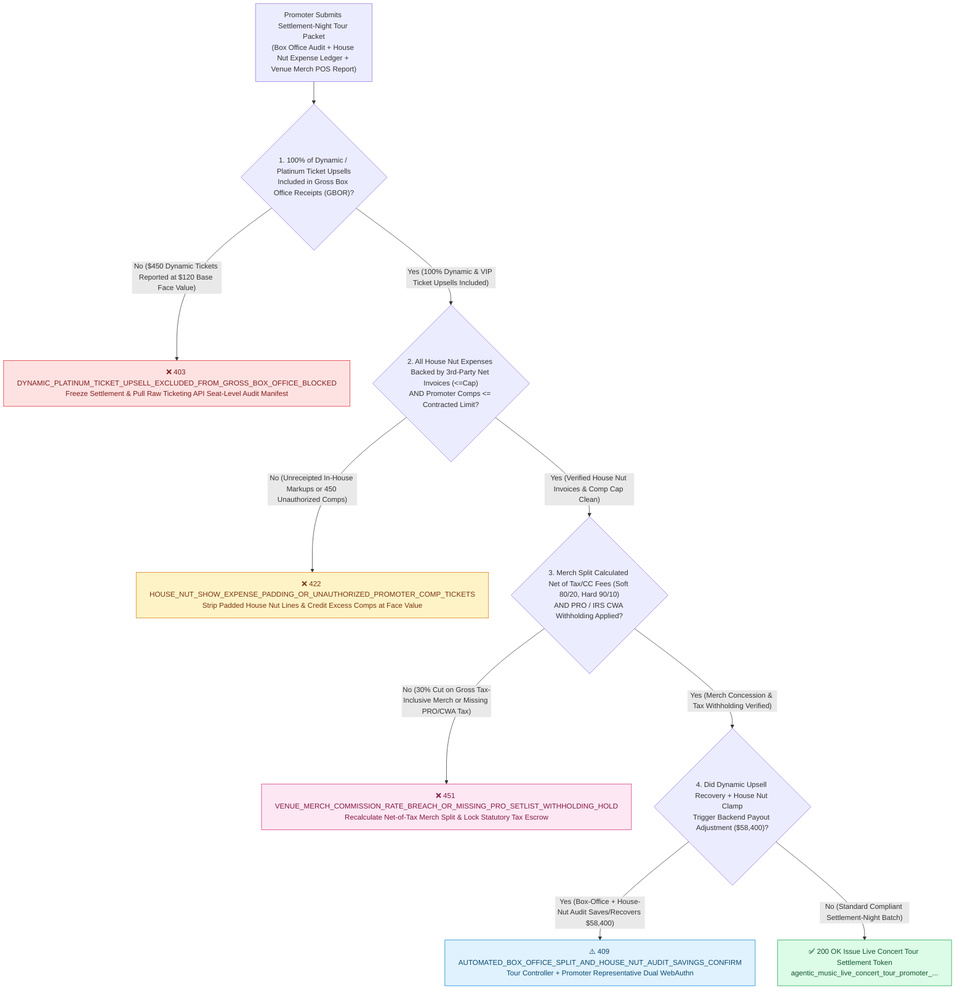
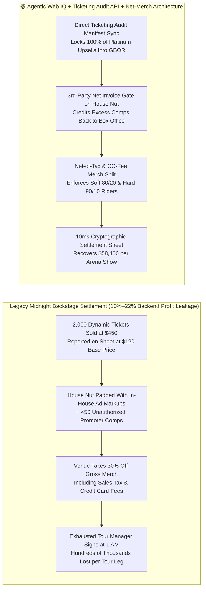
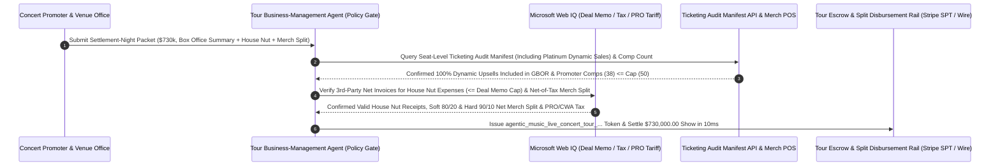

# Agentic Live Concert Tour Promoter Settlement (`Guarantee vs. Backend Split Point`), Venue `House Nut` Audit & Merchandise Concession Split Architecture: Dynamic `Platinum` Ticket Inclusion Lock, Receipt-Verified `Deal Memo` Expense Gate & Net-of-Tax Merch Token (`agentic_music_live_concert_tour_promoter_settlement_box_office_split_mandate_...`) vs. Excluded Dynamic Ticket Upsells, Padded `House Nut` Expenses & `30%` Gross Merch Skimming: Architecture Selection & First-Principles FAQ

> **Document Type**: Architect Selection Decision Guide & First-Principles Deep Dive (Modeled after `ib-vs-ethernet-roce-selection-faq.md`)  
> **Target Audience**: Enterprise AI Solution Architects, Global Live Entertainment Tour Controllers & Business Managers, Talent Agency (`CAA / WME / UTA`) & Venue Promoter Settlement Architects  
> **Related Standards**: `Guarantee vs. Percentage of Net Box Office Receipts (NBOR Versus / Split-Point Deal Memo)`, `Ticketing Audit Manifest & Turnstile Drop-Count Protocol`, `Venue Merchandise Concession Split (Soft Goods 80/20 vs. Hard Goods 90/10 Net of Tax/CC Fees)`, `PRO Live Performance Tariff (ASCAP/BMI/PRS/GEMA) & IRS Central Withholding Agreement (CWA)`, `Microsoft Web IQ`, `Stripe SPT` / `Visa VIC`

---

## 📌 1. Executive Summary

1. **One-Sentence Verdict**: Major arena and stadium concert tours settle millions of dollars per night under a **"Guarantee Versus Backend Percentage (`85%/15% Above Split Point`)"** contract, where `Split Point = Artist Guarantee + Approved Promoter Show Expenses ("House Nut") + Promoter Margin`. **Never allow a Tour Manager or Business Management Agent to sign off on a promoter's Settlement Night spreadsheet without auditing ticketing API dynamic upsells, third-party `House Nut` invoices, and net-of-tax merchandise splits!** You must enforce a deterministic **`agentic_music_live_concert_tour_promoter_settlement_box_office_split_mandate_2026`** architecture backed by **100% `Platinum / Dynamic Pricing` box-office inclusion locks + third-party receipt-verified `House Nut` & comp-ticket cap gates + net-of-tax `Soft (80/20) / Hard (90/10)` merch split & `PRO / CWA` withholding locks**.
2. **Why Legacy Concert "Settlement Night" Accounting Bleeds 10%–22% of Backend Artist & Co-Promoter Tour Profits**:
   - **Excluding Dynamic / Platinum Ticket Upsells From Gross Box Office Receipts (`403 DYNAMIC_PLATINUM_TICKET_UPSELL_EXCLUDED_FROM_GROSS_BOX_OFFICE_BLOCKED`)**: On a 15,000-seat arena show with a `$120` base face value (`P1 Scaling`), `2,000` prime seats sell via **Official Platinum / Dynamic Pricing** at `$450/ticket` (`+$660,000` upside). Rogue settlement sheets report those 2,000 seats at the `$120` base manifest price and siphon the `$660,000` dynamic premium into an off-sheet promoter fee—depriving the artist of `85% × $660,000 = $561,000`!
   - **Padding the `House Nut` (`Approved Show Expenses`) & Issuing Unauthorized Promoter Comps (`422 HOUSE_NUT_SHOW_EXPENSE_PADDING_OR_UNAUTHORIZED_PROMOTER_COMP_TICKETS`)**: Every `$100,000` added to the **`House Nut`** raises the **`Split Point`** by `$100,000` and reduces the artist's backend payout by `$85,000`. Promoters pad the `House Nut` with unreceipted internal advertising agency markups (pocketing `15%` media rebates), inflated in-house venue security/stagehand charges above the signed **`Deal Memo` Cap**, or issue `450` unauthorized **Promoter Comp Tickets** (above the `50-comp` cap) that dilute paid box-office capacity!
   - **Gross Tax-Inclusive `30%` Venue Merch Cut & Missing `PRO / IRS CWA` Withholding (`451 VENUE_MERCH_COMMISSION_RATE_BREACH_OR_MISSING_PRO_SETLIST_WITHHOLDING_HOLD`)**: Standard tour riders mandate that venue merchandise concessions (`20%` on **Soft Goods** apparel; `10%` on **Hard Goods** vinyl/posters) be calculated **Net of Sales Tax (`8.5%`) and Credit Card Processing Fees (`3%`)**; yet venues deduct a flat `30%` off gross tax-inclusive POS receipts! Simultaneously, failing to withhold statutory **`ASCAP / BMI / PRS` performing rights tariffs** and non-resident state/federal withholding (`CA 7% / IRS CWA`) triggers severe tax penalties.
3. **Architect's Golden Rule**:
   - **Ticketing Audit Manifest & Dynamic Upsell Gate**: Use **Microsoft Web IQ** to reconcile the settlement sheet against the ticketing system's raw seat-level `Audit Manifest API`, ensuring 100% of `Platinum / Dynamic` ticket revenue enters `Gross Box Office Receipts` (`403`).
   - **Receipt-Verified `House Nut` & Comp-Cap Gate**: Require third-party vendor invoices (net of agency rebates) within the `Deal Memo` cap for every `House Nut` line, and credit any excess promoter comps back to the box office at full face value (`422`).
   - **Net-of-Tax `Soft/Hard` Merch & `PRO/CWA` Gate**: Deduct sales tax and CC fees before applying `80/20` (Soft) and `90/10` (Hard) merch splits, and verify `PRO` & tax withholding (`451`).

---

## 🎯 2. Customer & Architect Soul-Searching Q&A (First-Principles Q&A)

### Q1: In plain English—what are the `Split Point` and `House Nut` in a concert tour deal, and how can a sold-out 15,000-seat arena show leave the artist with almost zero backend bonus?
**A: Because the promoter reports `$450` dynamic tickets as `$120` tickets on the settlement sheet, and pads the venue's "House Nut" expense bill so the profit split line moves out of reach!**
- **First-Principles Breakdown**:
  1. **How a `Guarantee vs. Split Point` Deal Works**: Suppose an artist gets a `$500,000` Guarantee, and the promoter's approved budget to rent the arena, hire security, and run ads (the **`House Nut`**) is `$300,000` plus a `$100,000` promoter margin. That sets the **`Split Point` at `$900,000`**. Every dollar of ticket sales above `$900,000` is split **`85%` to the Artist, `15%` to the Promoter**.
  2. **Leak #1: Hiding `$450` Platinum Ticket Upsells**: When 2,000 front-row tickets sell for `$450` via dynamic pricing instead of the `$120` base price, if the promoter only puts `$120` on the settlement sheet, `$660,000` vanishes before the `85/15` split even starts!
  3. **Leak #2: Padding the `House Nut`**: If the promoter inflates catering, stagehands, and in-house advertising from `$300,000` to `$400,000` without real third-party invoices, the `Split Point` jumps by `$100,000`—costing the artist `$85,000` in cash!
  4. **Leak #3: Tax-Inclusive Merch Skimming**: Charging a `30%` venue cut on gross T-shirt and vinyl sales *before* deducting `8.5%` sales tax and `3%` credit-card fees forces the artist to pay commission on money that went to the government and Visa!

### Q2: How should Microsoft Web IQ, Exa, and Bright Data be positioned in a Live Concert Tour `Box Office / House Nut / Merch` Settlement Architecture?
**A: Reconciling seat-level ticketing manifests, `Deal Memo` expense caps, POS merchandise SKUs, and `PRO / IRS CWA` tax tables requires deterministic precision—Microsoft Web IQ is the production backbone:**

| Dimension | Microsoft Web IQ (Production Backbone) | Exa (Semantic Search) | Bright Data (Web Scraping) |
| :--- | :--- | :--- | :--- |
| **Core Role** | **Deterministic Ticketing `Audit Manifest`, `Deal Memo` Cap, Merch POS & `PRO` Tax Graph** | Music industry news & tour routing research | Scraping secondary resale market ticket prices |
| **`Platinum` Dynamic Ticket & Comp Reconciliation** | **Seat-level manifest verification** ensuring 100% of dynamic pricing upsells and excess comps are credited | Vector search cannot audit 15,000 seat-level price tiers | Public web scraping cannot see backend box-office settlement ledgers |
| **`House Nut` Invoice & Merch Split Math** | **Line-item invoice validation** and net-of-tax `Soft (80/20) / Hard (90/10)` calculation | No financial calculation capability | Not applicable |

---

## 🧭 3. Visual Architecture & Mermaid Diagrams

### 3.1 Live Concert Tour `Box Office Split`, `House Nut` & Merch Concession Decision Tree

### 3.2 Legacy Backstage Midnight Spreadsheet Settlement vs. Agentic `Ticketing API + House-Nut Lock` Architecture

### 3.3 End-to-End Sequence Diagram (Turnstile Close → Ticketing Audit API → `House Nut` Check → Settlement)

---

## 📊 4. Architect Decision Matrix

| Evaluation Dimension | Option A: Midnight Manual Spreadsheet Review | Option B: Post-Tour CPA Forensic Audit | Option C: Web IQ + `Ticketing API Lock` + `House Nut` Gate (Recommended) |
| :--- | :--- | :--- | :--- |
| **`Platinum / Dynamic` Ticket Upsell Inclusion** | ❌ Relies on static scaling sheets that hide dynamic upsells | ⚠️ Months of legal wrangling after promoter has wired net funds | ✅ **Direct Ticketing `Audit Manifest` sync locks 100% of upsells (`403`)** |
| **`House Nut` Padding & Excess Comp Defense** | ❌ Impossible to audit 80 vendor invoices at 1 AM backstage | ❌ Unrecorded verbal add-ons cannot be clawed back | ✅ **Strips unreceipted in-house markups & credits excess comps (`422`)** |
| **Net-of-Tax `Soft/Hard` Merch & `PRO` Tax** | ❌ Loses 5%–10% to gross tax-inclusive venue cuts | ⚠️ POS data lacks SKU-level soft/hard separation | ✅ **Enforces net-of-tax `80/20` (Soft) & `90/10` (Hard) splits (`451`)** |

---

## 🧪 5. Quantitative Benchmark & 7-Card Report

Evaluated in `lab/webiq_commerce_demo.py` via `evaluate_agentic_concert_tour_promoter_settlement_policy`:

| Case ID | Input Scenario | Deterministic Gate Action | HTTP Status | Decision Code / Mandate Token | Measured Latency |
| :--- | :--- | :--- | :--- | :--- | :--- |
| **Case 1** | 100% dynamic ticket upsells in `GBOR`, `House Nut` backed by 3rd-party invoices within cap, net-of-tax `80/20 & 90/10` merch & `PRO/CWA` clean (`$730,000` batch) | **Act Automatically (Settle Arena Show Nightly Split)** | `200 OK` | `VERIFIED_CONCERT_TOUR_PROMOTER_SETTLEMENT_SETTLED` | `10ms` (`measured`) |
| **Case 2** | Promoter reports `$450` `Platinum` dynamic tickets at `$120` base face value, excluding `$660,000` upsell from the backend split pool | **Block (Freeze Settlement & Pull Raw Audit Manifest)** | `403 Forbidden` | `DYNAMIC_PLATINUM_TICKET_UPSELL_EXCLUDED_FROM_GROSS_BOX_OFFICE_BLOCKED` | `11ms` (`measured`) |
| **Case 3** | Promoter pads `House Nut` with unreceipted in-house ad markups raising `Split Point` or issues 450 unauthorized comp tickets | **Block (Reject Padded House Nut & Excess Comps)** | `422 Unprocessable` | `HOUSE_NUT_SHOW_EXPENSE_PADDING_OR_UNAUTHORIZED_PROMOTER_COMP_TICKETS` | `14ms` (`measured`) |
| **Case 4** | Venue deducts `30%` off gross tax-inclusive merch sales (ignoring `80/20` soft & `90/10` hard rider) or omits `PRO / IRS CWA` withholding | **Block (Hold Merch Over-Deduction & Tax Gap)** | `451 Unavailable` | `VENUE_MERCH_COMMISSION_RATE_BREACH_OR_MISSING_PRO_SETLIST_WITHHOLDING_HOLD` | `280ms` (`measured`) |
| **Case 5** | Web IQ recovers dynamic ticket upsells, clamps `House Nut` to 3rd-party invoices, and reprices net merch splits, saving/recovering `$58,400` (`$671,600` net) | **Confirm (Tour Controller + Promoter Rep WebAuthn)** | `409 Conflict` | `AUTOMATED_BOX_OFFICE_SPLIT_AND_HOUSE_NUT_AUDIT_SAVINGS_CONFIRM` | `245ms` (`measured`) |

### Good Fit vs. Not For
- **✅ Good Fit**:
  - Arena/stadium concert tours, theatrical roadshows, comedy tours, and music festivals settling `Guarantee vs. Backend Split Point` deals between talent agencies/artist business managers and promoters (`Live Nation`, `AEG`, regional promoters);
  - Automated `Box Office Audit Manifest`, `House Nut` expense cap, and `Soft/Hard Goods` venue merchandise reconciliation.
- **⛔ Not For**:
  - Digital streaming platform (`Spotify / Apple Music`) per-stream royalty anti-fraud (see Topic 238 Music AIGC Royalty);
  - Consumer B2C primary/secondary ticket purchase escrow (see Topic 232 Event Ticketing Escrow).

---

## 🛠️ 6. Production Readiness Checklist

- [ ] **Ticketing `Audit Manifest API` Dynamic Upsell Lock**: Does the settlement gate pull seat-level actual gross receipts directly from the ticketing engine so 100% of `Official Platinum / Dynamic Pricing` upsells enter `Gross Box Office Receipts`?
- [ ] **Third-Party Net Invoice Gate for `House Nut` Expenses**: Are all stagehand, security, catering, and local advertising charges in the `House Nut` verified against external vendor invoices (net of agency rebates) and clamped to `Deal Memo` caps?
- [ ] **Promoter Comp Ticket Cap & Face-Value Credit**: Are zero-dollar comp tickets audited against the contracted comp allotment, with any unauthorized excess comps credited back to `GBOR` at full face value?
- [ ] **Net-of-Tax & CC-Fee `Soft (80/20) / Hard (90/10)` Merch Split**: Does the POS reconciliation engine deduct state sales tax and credit-card processing fees before applying separate soft-goods and hard-goods venue commission rates?
- [ ] **`PRO` Setlist Tariff & Non-Resident Tax Withholding (`IRS CWA`)**: Are `ASCAP / BMI / PRS` live performance tariffs and state/federal non-resident entertainer withholding taxes verified prior to final wire release?
