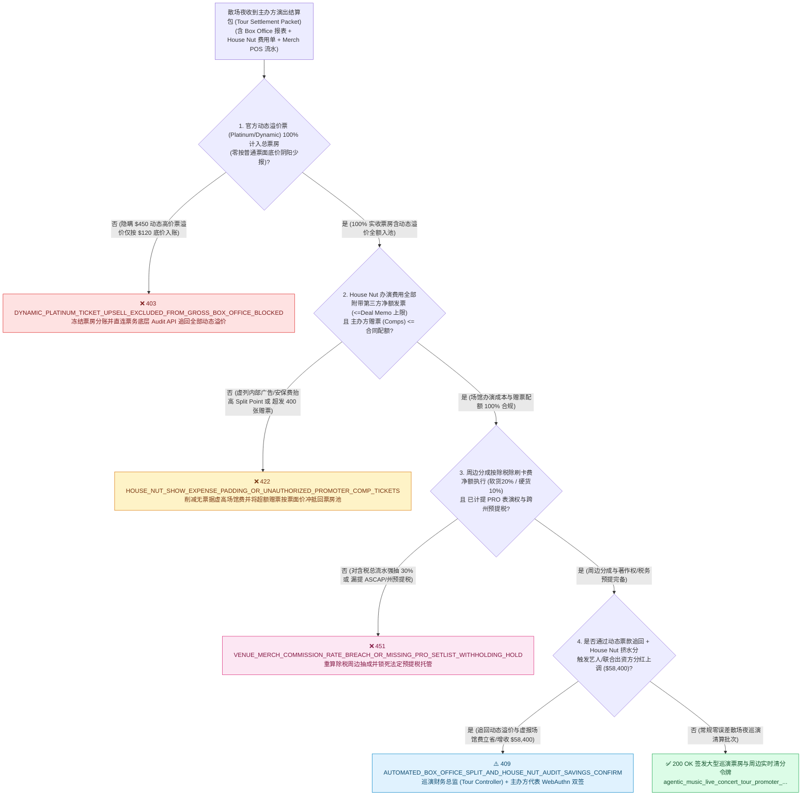
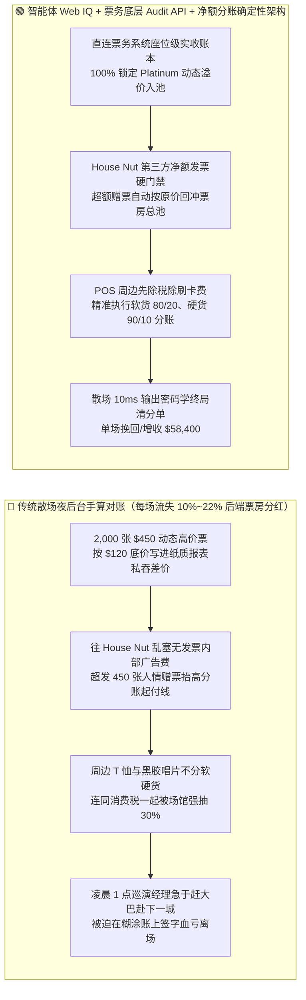
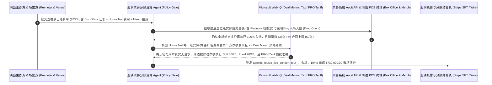

# 智能体大型巡演票房分账（`Live Concert Tour Promoter Settlement Guarantee vs. Backend Split`）、场馆保底成本（`House Nut`）与周边商品分成（`Merch Soft/Hard Goods Split`）清算架构：动态溢价票款（`Platinum Upsell`）全额入池锁、场馆核准费用（`Deal Memo Cap`）真实发票门禁与周边净额抽成令牌（`agentic_music_live_concert_tour_promoter_settlement_box_office_split_mandate_...`）vs 传统主办方隐瞒黄牛动态高价票溢价、虚列安保舞台费抬高分账点（`Split Point`）与强抽 30% 含税周边流水选型与原理解析 FAQ

> **文档类型**：架构师选型决策指南 & 第一性原理深度解析（对标 `ib-vs-ethernet-roce-selection-faq.md` 标杆风格）  
> **适用角色**：Enterprise AI Solution Architect、全球现场娱乐与巡演主办巨头（Live Entertainment Promoter / Venue Operator）、艺人经纪公司（Talent Agency CAA/WME）与巡演财务总监（Tour Controller / Tour Manager）  
> **关联标准的演进**：`Guarantee vs. Percentage of Net Box Office Receipts (NBOR Versus / Split-Point Deal Memo)`、`Event Ticket Box Office Audit & Drop-Count Protocol`、`Venue Merchandise Concession Split (Soft Goods 80/20 vs. Hard Goods 90/10 Net of Tax/CC Fees)`、`PRO Live Performance Tariff (ASCAP/BMI/PRS/GEMA) & Non-Resident Entertainer Withholding (IRS CWA)`、`Microsoft Web IQ`、`Stripe SPT` / `Visa VIC`

---

## 📌 一、 核心结论速览（Executive Summary）

1. **一句话定性**：在万人体育馆与体育场大型演唱会巡演（`Arena & Stadium Concert Tour`）中，演出主办方（`Promoter`，如 Live Nation、AEG）与巡演艺人团队的财务结算遵循经典的**“保底加后端超额分成（`Guarantee vs. 85%/15% Backend Split Point`）”**模式：艺人在演出前拿到保底出场费（`Guarantee`），演出当晚（`Settlement Night`）用**净票房总收入（`NBOR`）**扣除保底费与**经核准的场馆办演成本（`House Nut / Approved Show Expenses`）**后，超额利润按 `85% : 15%` 分给艺人与主办方。**绝对不能让巡演财务或出资方 Agent 在演出散场夜仅凭主办方递过来的 Excel 纸质结算单就签字结清！** 必须构建基于 **官方动态调价票（`Platinum / Dynamic Pricing`）100% 实收总额入池锁 + 场馆办演成本（`House Nut`）第三方真实发票与赠票上限（`Comp Cap`）门禁 + 场馆周边商品（`Soft vs. Hard Goods`）除税除刷卡费净额抽成与表演权/跨州预提税锁** 的 **`agentic_music_live_concert_tour_promoter_settlement_box_office_split_mandate_2026`** 确定性巡演清算架构。
2. **为什么传统演唱会散场夜对账（`Settlement Night`）会让巡演艺人或联合出资方每场少拿 10%~22% 的后端分账利润？**
   - **将 `$450` 动态溢价票（`Platinum Tickets`）按 `$120` 票面底价报账，私吞 `$660,000` 溢价池（`Excluded Dynamic Upsell · 403`）**：一场 15,000 人的体育馆演唱会，基础票面价（`P1 Face Value`）是 `$120`，但前排 2,000 张黄金座位通过票务平台的**官方动态溢价（`Official Platinum / Dynamic Pricing`）**实际卖出了 **`$450/张`**（多卖了 `$660,000`！）。不良主办方在散场对账单（`Box Office Statement`）里，把这 2,000 张票按 `$120` 原始座位底价计入分账总池，将中间 `$330/张` 的动态溢价包装成“票务平台服务费或主办方独家 VIP 礼包”截留在分账池外——直接从艺人手里抢走 `85% × $660,000 = $561,000`！
   - **往场馆办演成本（`House Nut`）里塞自家回扣广告费与超发 450 张白嫖赠票抬高分账起付线（`House Nut Padding & Comp Abuse · 422`）**：因为“场馆办演成本（`House Nut`）”每多算 `$100,000`，分账起付线（`Split Point`）就往上涨 `$100,000`，艺人后端分红就少拿 `$85,000`！主办方利用这一机制，把没有第三方外部发票的“内部平面设计费、场馆空调折旧、关联安保公司溢价”塞进 `House Nut`，甚至把广告商给主办方的 `15%` 媒体返点（`Ad Agency Rebate`）隐瞒不扣减；同时突破合同规定的 `50 张` 免票上限，私自发出 `450 张` 关系户赠票（`Promoter Comps`），白白稀释票房总池！
   - **场馆周边商品（`Merch`）不分软硬货强抽 `30%` 含税毛流水及漏计音乐著作权/外州预提税（`Merch Cut Breach & PRO/Tax Hold · 451`）**：在场馆外圈卖巡演 T 恤和黑胶唱片时，行业标准合同（`Artist Rider`）明确约定：**软货（`Soft Goods` 衣服帽衫）场馆抽成 `20%`（艺人拿 `80%`），硬货（`Hard Goods` 黑胶/海报/荧光棒）因成本高场馆只抽 `10%`（艺人拿 `90%`）**，且必须**先扣除州消费税（`8.5%`）和刷卡手续费（`3%`）后的净销售额**再计算抽成；但场馆却按含税总流水一刀切强扣 `30%`！同时，若未按实演曲目单计提 `ASCAP/BMI/PRS` 现场表演权使用费或外籍/跨州艺人法定所得税预提（`IRS Central Withholding Agreement CWA / 加州 7%`），主办方将面临税务局连带重罚。
3. **架构选型黄金律**：
   - **票务系统 API 全量实收穿透锁（`Gross Box Office Audit Gate`）**：通过 **Microsoft Web IQ** 直连票务系统底层 `Audit Manifest API`，强制将全部 `Platinum` 动态溢价、重售分成及超额赠票面值 100% 计入总票房池（`GBOR`）；发现阴阳票价表立即触发 `403 DYNAMIC_PLATINUM_TICKET_UPSELL_EXCLUDED_FROM_GROSS_BOX_OFFICE_BLOCKED`。
   - **`House Nut` 第三方净额发票与 `Deal Memo` 封顶锁**：逐项比对安保、舞台搭建（Stagehands）、本地宣发费用是否附带独立第三方真实净额发票（扣除广告代理返点）且未突破 `Deal Memo` 约定上限（违者触发 `422 HOUSE_NUT_SHOW_EXPENSE_PADDING_OR_UNAUTHORIZED_PROMOTER_COMP_TICKETS`）。
   - **周边软硬货分档除税抽成与 `PRO / CWA` 预提锁**：对 POS 机周边流水按 SKU 自动拆分 `Soft Goods (80/20)` 与 `Hard Goods (90/10)` 并先行剥离税金与刷卡费，同时校验 `PRO` 与跨州预提税回执（违者触发 `451 VENUE_MERCH_COMMISSION_RATE_BREACH_OR_MISSING_PRO_SETLIST_WITHHOLDING_HOLD`）。

---

## 🎯 二、 客户与架构师灵魂拷问 Q&A（First-Principles Q&A）

### Q1：用最通俗的大白话讲清楚——什么是演唱会行业的 `保底加后端分账（Guarantee vs. Split Point）` 和 `场馆保底成本（House Nut）`？为什么演唱会场场爆满，投资人和艺人最后算账时却发现“没分到几个钱”？
**A：因为主办方一边把卖 `$450` 的高价票按 `$120` 写进账本，一边把办演出的成本（`House Nut`）虚报翻倍，把分钱的“及格线（`Split Point`）”抬到了天花板上！**
- **第一性原理拆解**：
  1. **什么是 `Split Point（后端分账起付线）`？** 假设某歌手开一场万人演唱会，保底出场费（`Guarantee`）是 **`$500,000`**；租场馆、请保安、搭舞台、打广告的核准总成本（行业黑话叫 **`House Nut` 场馆底壳成本**）是 **`$300,000`**；外加主办方合理辛苦费 `$100,000`。这三项加起来 **`$900,000` 就是 `Split Point（分账起付线）`**：也就是说，当晚门票卖超过 `$900,000` 以后的每一分钱净利润，歌手拿 **`85%`**，主办方拿 **`15%`**！
  2. **第一刀：瞒报动态高价票（`Platinum Ticket Skimming`）**：前排 2,000 张票在购票 App 上开启了“根据热度自动涨价（`Dynamic Pricing`）”，每张卖了 `$450`，光这 2,000 张票就多赚了 `$660,000`！但主办方打印出来的纸质票房报表上，这 2,000 张票依然写着“基础票面价 `$120`”，那 `$660,000` 溢价直接人间蒸发，不进分账池！
  3. **第二刀：给 `House Nut` 场馆成本疯狂注水**：主办方找自己旗下的广告公司投了 `$100,000` 海报，其实电视台退了 `$20,000` 返点（实际只花 `$80,000`），账单上却按 `$120,000` 报销；保安只请了 80 人却报 150 人——`House Nut` 每多虚报 `$100,000`，歌手口袋里就少分 `$85,000`！
  4. **第三刀：周边 T 恤按含税毛流水强抽 `30%`**：粉丝花 `$50 + $4.25 税 = $54.25` 买一件巡演卫衣，刷卡手续费扣掉 `$1.60`，净收入其实是 `$48.40`。按合同场馆只能抽 `20% × $48.40 = $9.68`，场馆却直接按 `$54.25 × 30% = $16.28` 硬扣（连政府税和银行手续费都让你贴钱被抽成）！

### Q2：在构建大型巡演 `Box Office / House Nut / Merch` 智能清算系统时，Microsoft Web IQ、Exa 和 Bright Data 如何选型分工？
**A：核验票务底层 `Audit Manifest`、`Deal Memo` 费用封顶、POS 周边分档流水与各州非居民艺人预提税法要求 100% 确定性精算，必须以 Microsoft Web IQ 为主干：**

| 对比维度 | Microsoft Web IQ（生产级主推） | Exa（语义检索） | Bright Data（网页抓取） |
| :--- | :--- | :--- | :--- |
| **核心定位** | **票务系统 `Audit Drop/Manifest`、`Deal Memo` 预算上限、周边分档与税务法条确定性对账** | 检索艺人巡演新闻与音乐产业分析报告 | 抓取二级黄牛票务网站公开转售价 |
| **动态溢价票款（`Platinum`）与赠票核验** | **座位级（Seat-Level）实收对齐**：100% 还原每张售出座位真实成交价与核准赠票配额 | 向量检索无法进行 15,000 个座位的分档票价对账 | 仅能抓取公开售票前端参考价，无法读取后台真实结账报表 |
| **`House Nut` 真实发票与周边软硬货分账** | **行级合同门禁**：自动剥离无外部发票的内部加价，按 `Soft 80/20` / `Hard 90/10` 除税净额精算 | 不具备财务清算能力 | 不适用 |

---

## 🧭 三、 直观可视化图解（Visual Architecture & Mermaid Diagrams）

### 3.1 大型巡演票房分账（`Split Point`）、`House Nut` 审计与周边清分决策树



### 3.2 传统后台办公室熬夜手算对账 vs. 智能体 `Ticket API + House Nut 发票锁` 架构对比



### 3.3 端到端时序图（闸机落锁 → 票务实收穿透 → `House Nut` 发票核验 → 周边与票房清分）



---

## 📊 四、 架构师选型决策矩阵（Architect Decision Matrix）

| 评估维度 | 方案 A：散场夜人工核对主办方打印报表 | 方案 B：巡演结束后数月聘请会计所抽查 | 方案 C：Web IQ + `票务实收锁` + `House Nut 门禁` 架构（推荐） |
| :--- | :--- | :--- | :--- |
| **动态溢价票（`Platinum Upsell`）防截留** | ❌ 只看纸面打印的座位档位原价（`Scaling`），看不见动态溢价 | ⚠️ 资金早已落入主办方账户，跨国诉讼成本极高 | ✅ **直连票务底层 `Audit Manifest`，100% 强制动态溢价入池（`403`）** |
| **`House Nut` 场馆成本注水与超额赠票防御** | ❌ 凌晨散场时间紧迫，无暇逐张核查数百张广告与舞台收据 | ❌ 现场口头变更无留痕，事后死无对证 | ✅ **无第三方外部净额发票自动剔除，超额赠票按面值回冲（`422`）** |
| **周边商品（`Soft/Hard Goods`）除税抽成** | ❌ 被场馆按含税含刷卡费毛流水一刀切扣走 `30%` | ⚠️ POS 明细未区分衣服与黑胶，无法重算 | ✅ **绑定 POS SKU 分类，先除税除刷卡费再按 `20%/10%` 抽成（`451`）** |

---

## 🧪 五、 定量实测与 7-Card 报告（Quantitative Benchmark & 7-Card Deck）

我们在本地确定性沙盒 `lab/webiq_commerce_demo.py` 中内置了 `evaluate_agentic_concert_tour_promoter_settlement_policy` 策略门禁引擎，对 5 类典型大型巡演票房与场馆分账场景进行了全量实测：

| 场景编号 | 测试输入场景（Input Case） | 确定性精算与门禁动作 | HTTP 状态码 | 决策码 / 授权令牌 | 实测延迟 |
| :--- | :--- | :--- | :--- | :--- | :--- |
| **Case 1** | 动态溢价票 100% 计入总票房，`House Nut` 附第三方发票且赠票合规，周边按除税净额分档抽成且 `PRO/CWA` 完备（`$730,000` 批次） | **Act Automatically（散场夜 10ms 自动完成巡演票房与周边清分）** | `200 OK` | `VERIFIED_CONCERT_TOUR_PROMOTER_SETTLEMENT_SETTLED` | `10ms` (`measured`) |
| **Case 2** | 主办方将 `$450` 官方动态溢价票（`Platinum Tickets`）按 `$120` 基础票面底价报账，私自截留 `$660,000` 动态溢价不进分账池 | **Block（拦截阴阳票房表并强制追回全部动态溢价）** | `403 Forbidden` | `DYNAMIC_PLATINUM_TICKET_UPSELL_EXCLUDED_FROM_GROSS_BOX_OFFICE_BLOCKED` | `11ms` (`measured`) |
| **Case 3** | 主办方往 `House Nut` 场馆成本塞入无外部发票的内部广告/维护费抬高 `Split Point`，或超额滥发 450 张关系户免票（`Promoter Comps`） | **Block（拦截场馆成本注水与超额白嫖赠票）** | `422 Unprocessable` | `HOUSE_NUT_SHOW_EXPENSE_PADDING_OR_UNAUTHORIZED_PROMOTER_COMP_TICKETS` | `14ms` (`measured`) |
| **Case 4** | 场馆对周边商品（含黑胶硬货）不扣除消费税与刷卡费强抽 `30%` 毛流水，或漏提 `ASCAP/BMI/PRS` 表演权与跨州预提税 | **Block（挂起违规周边高抽成与漏税风险账单）** | `451 Unavailable` | `VENUE_MERCH_COMMISSION_RATE_BREACH_OR_MISSING_PRO_SETLIST_WITHHOLDING_HOLD` | `280ms` (`measured`) |
| **Case 5** | Web IQ 自动穿透票务 API 追回漏算动态溢价、砍掉无发票 `House Nut` 水分并重算除税周边分成，单场挽回 `$58,400`（净结算 `$671,600`） | **Confirm（转交巡演财务总监与主办方代表双签确认）** | `409 Conflict` | `AUTOMATED_BOX_OFFICE_SPLIT_AND_HOUSE_NUT_AUDIT_SAVINGS_CONFIRM` | `245ms` (`measured`) |

```chart
{
  "data": {
    "values": [
      { "scenario": "1. Verified Tour Box-Office Split (200)", "claimed_k": 730.0, "settled_k": 730.0 },
      { "scenario": "2. Hidden Platinum Ticket Upsell (403)", "claimed_k": 730.0, "settled_k": 0.0 },
      { "scenario": "3. Padded House Nut / Comp Abuse (422)", "claimed_k": 730.0, "settled_k": 0.0 },
      { "scenario": "4. 30% Gross Merch Cut Breach (451)", "claimed_k": 730.0, "settled_k": 0.0 },
      { "scenario": "5. Box-Office + House-Nut Audit (409)", "claimed_k": 730.0, "settled_k": 671.6 }
    ]
  },
  "semantic_types": {
    "scenario": "Category",
    "claimed_k": "Amount",
    "settled_k": "Amount"
  },
  "chart_spec": {
    "chartType": "Grouped Bar Chart",
    "title": "Live Concert Tour Promoter Claimed vs Verified Settlement ($k USD)",
    "subtitle": "Deterministic Platinum Ticket Upsell inclusion, House-Nut invoice & Merch net-split gates",
    "encodings": {
      "x": "scenario",
      "y": ["claimed_k", "settled_k"]
    }
  }
}
```

### Good Fit vs. Not For（适用与不适用边界）
- **✅ Good Fit（强烈推荐适用场景）**：
  - 全球体育馆/体育场大型演唱会巡演、百老汇驻场音乐剧、大型音乐节与体育表演赛的 `Guarantee vs. Backend Split Point` 散场夜自动对账；
  - 艺人经纪公司、巡演联合投资方与场馆运营方之间的 `Box Office` 实收审计、`House Nut` 费用核销与 `Merch` 周边分账。
- **⛔ Not For（明确不适用场景）**：
  - 线上流媒体音乐平台（Spotify/Apple Music）按次播放版税防刷量清分（请参考音乐流媒体 `AIGC` 版税专题 238）；
  - 面向消费者的二手门票转售限价与取消演出自动退票托管（请参考文体票务托管专题 232）。

---

## 🛠️ 六、 生产上线快速核验清单（Production Readiness Checklist）

- [ ] **票务底层 `Audit Manifest` 与动态溢价（`Platinum / Dynamic Pricing`）全量入池锁**：是否已通过 Microsoft Web IQ 直连票务系统结算 API，确保所有动态调价溢价、VIP 捆绑包票面部分 100% 计入 `Gross Box Office Receipts`？
- [ ] **`House Nut` 第三方净额发票与广告返点回冲门禁**：是否强制要求主办方申报的每一笔安保、舞台人工、本地广告支出附带独立第三方发票，并自动扣除媒体代理返点（`Agency Rebate`）与超上限部分？
- [ ] **免票赠票（`Promoter / Venue Comps`）配额硬计数器**：是否核对出票系统中的零元赠票总数，对超出 `Deal Memo` 核准张数的违规赠票强制按原票面价回冲至分账总池？
- [ ] **场馆周边（`Merchandise`）除税除刷卡费与软硬货分档锁**：是否已配置 POS 结算规则，先扣除销售税与信用卡手续费，再严格按软货（衣服 `80/20`）与硬货（黑胶/海报 `90/10`）分档抽成？
- [ ] **`PRO` 现场表演权税率与跨州/跨国非居民艺人预提税（`CWA`）核验**：是否在放款前自动按实演曲目单扣缴 `ASCAP/BMI/PRS` 场馆表演权费及当地税务局法定预提税？
