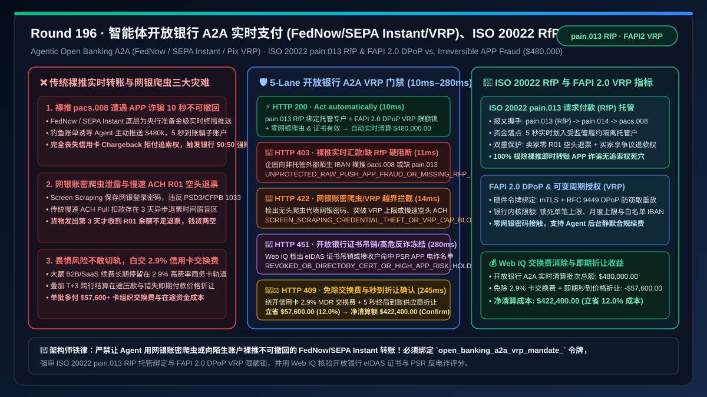
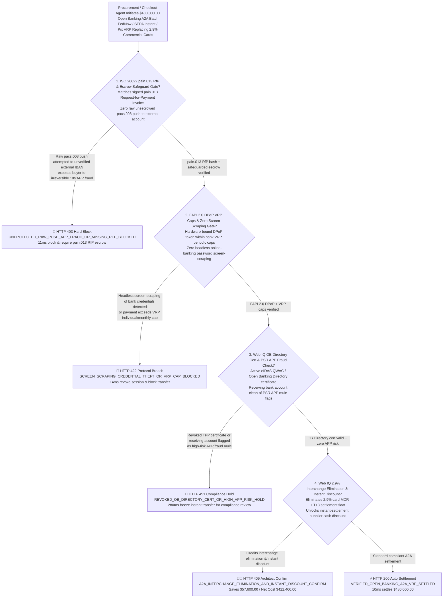
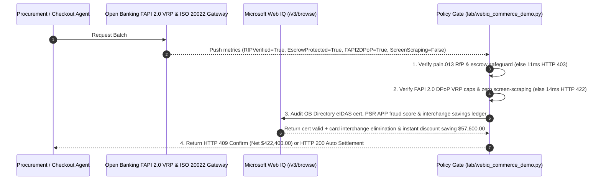

# Agentic Open Banking A2A Real-Time Payments (FedNow / RTP / SEPA Instant / Pix VRP) & Authorized Push Payment (APP) Fraud Defense Architecture: ISO 20022 `pain.013` Request-for-Payment & FAPI 2.0 VRP (`open_banking_a2a_vrp_mandate_...`) vs. Legacy Irreversible Push Wire Fraud & 2.9% Card Interchange: Architecture Selection & First-Principles FAQ

> **Document Type**: First-Principles Architecture Selection FAQ  
> **Target Audience**: AI Solution Architects, Open Banking (PSD3 / UK Faster Payments VRP / Brazil Pix Automático / US FedNow & RTP) Payment Directors, Card-to-A2A Checkout Migration Chief Architects, Authorized Push Payment (APP) Fraud Risk Leads  
> **Executive Takeaway**: When high-ticket e-commerce or B2B procurement AI Agents adopt real-time Account-to-Account (A2A / Pay-by-Bank) rails (FedNow, TCH RTP, SEPA Instant, UK VRP, Pix) to eliminate `2.5%–3.5%` card interchange fees, **never allow an Agent to initiate raw, unescrowed ISO 20022 `pacs.008` instant push transfers to arbitrary external accounts (which settle irrevocably in $< 10\text{ seconds}$ with zero card-network chargeback recourse, exposing users and banks to Authorized Push Payment APP fraud), nor use headless browser screen-scraping of online banking credentials**. You must enforce a deterministic architecture combining **ISO 20022 `pain.013` Request-for-Payment (RfP) Cryptographic Invoice Binding & Safeguarded Escrow Protection + FAPI 2.0 DPoP/mTLS Variable Recurring Payments (VRP) Bank-Enforced Spend Caps (Zero screen-scraping and zero 3-day ACH `R01` NSF return exposure) + a Microsoft Web IQ Open Banking Directory Certificate & Card-Interchange Elimination Escrow**.



---

## 1. 📌 Executive Summary

### 1.1 Why Does Switching AI Agents From Credit Cards to Raw "FedNow / SEPA Instant" Push Transfers Expose Buyers to 10-Second Irreversible APP Fraud With Zero Chargeback Recourse?
From **Push vs. Pull Payment** legal finality, the UK Payment Systems Regulator (PSR) mandatory APP fraud reimbursement rules, and Open Banking FAPI 2.0 cryptographic delegation first principles:
1. **10-Second Irreversible Finality & Authorized Push Payment (APP) Fraud**: Unlike credit cards (`2.9%` fee but protected by Visa/Mastercard Chargeback Rights), real-time A2A rails (FedNow, RTP, SEPA Instant, Faster Payments, Pix) execute **Real-Time Gross Settlement (RTGS) push transfers (`pacs.008`)** that settle irrevocably in $3\text{–}10\text{ seconds}$. If a prompt-injected invoice tricks an Agent into pushing `$480,000` directly to a scammer's bank account, there is **no card network chargeback mechanism to claw the funds back**!
2. **Screen-Scraping Credential Theft & 3-Day ACH `R01` NSF Returns**: Legacy aggregators that store user online-banking passwords for headless screen-scraping violate EU PSD2/PSD3 and US CFPB Section 1033 rules, while legacy asynchronous ACH Pull debits suffer a 3-day blind window where goods ship before an `R01 Insufficient Funds` return arrives.
3. **Unnecessary `2.9%` Commercial Card Interchange Bleed**: Staying on legacy card rails out of fear of APP fraud wastes `$13,920+` in interchange fees plus early-pay cash-flow discounts on every `$480,000` B2B batch.

### 1.2 Architect Selection Comparison: Legacy Raw Push / Screen Scraping vs. Web IQ + ISO 20022 `pain.013` RfP & FAPI 2.0 VRP Escrow
| Dimension | ❌ Legacy Raw Instant Push, Screen Scraping or Slow ACH | ✅ Web IQ + ISO 20022 `pain.013` RfP, FAPI 2.0 VRP & Safeguarded Escrow |
| :--- | :--- | :--- |
| **Payment Authorization Trigger** | Agent screen-scrapes bank login or pushes raw `pacs.008` transfer to unverified external IBAN | Bound to `open_banking_a2a_vrp_mandate_`: enforces **ISO 20022 `pain.013` signed Request-for-Payment (RfP) + safeguarded escrow IBAN + FAPI 2.0 DPoP VRP caps** |
| **APP Fraud & Recourse Protection** | Catastrophic (10-second irreversible push to scammer account with zero chargeback rights) | **Deterministic Block** (forbids raw unescrowed `pacs.008` pushes; if `pain.013` RfP signature or escrow safeguard is missing, blocks in `11ms` with `HTTP 403`) |
| **Credential Security & NSF Defense** | Fragile (screen-scraping leaks bank login; slow ACH debit bounces `R01` 3 days after shipment) | **Deterministic Block** (forbids screen-scraping and unverified asynchronous ACH pulls; enforces FAPI 2.0 DPoP + VRP caps, blocking violations in `14ms` with `HTTP 422`) |
| **OB Directory Cert & APP Risk Audit** | Blind spot (initiates transfers to newly opened mule accounts flagged for APP fraud) | **Deterministic Verification** (Web IQ `/v3/browse` audits eIDAS QWAC / Open Banking Directory certificates and receiving-bank APP risk scores, `280ms` `HTTP 451`) |
| **Card Interchange & Cash-Flow Savings** | Pays $2.9\%$ card MDR + $T+3$ settlement float delay | Web IQ enables **zero-interchange A2A VRP settlement + instant-liquidity supplier discount**, saving **$57,600.00 (12.0%)** (`HTTP 409 Confirm`) |

---

## 2. 🎯 First-Principles Q&A for Customers & Architects

### Q1: How Does Combining ISO 20022 `pain.013` Request-for-Payment (RfP) With a Safeguarded Escrow Account Provide Credit-Card-Grade Dispute Protection on Instant Push Rails?
* **First-Principles Escrow-Backed Push Settlement**:
  - Instead of pushing `pacs.008` funds directly to an untrusted seller's bank account, the Agent only responds to a cryptographically signed **ISO 20022 `pain.013` Request-for-Payment (RfP)** that locks funds into a regulated **Safeguarded Escrow Account** (`iso20022_pain013_rfp_and_escrow_safeguard_verified`, `HTTP 403` in `11ms`). The seller receives instant proof of good funds (zero ACH `R01` bounce risk), while the buyer retains full dispute protection until delivery verification.

### Q2: How Do FAPI 2.0 DPoP Tokens and Variable Recurring Payments (VRP) Replace Screen-Scraping for Unattended AI Agents?
* **Bank-Kernel Consent Enforcement**:
  - **VRP** lets the user's bank enforce `MaxIndividualAmount`, `MaxMonthlyAmount`, and a pinned `CreditorAccount` IBAN at the core-banking API layer, authenticated via **FAPI 2.0 mTLS + RFC 9449 DPoP sender-constrained tokens** (`fapi2_dpop_vrp_caps_and_zero_screen_scraping_passed`, `HTTP 422` in `14ms`).

### Q3: Why Use Microsoft Web IQ Instead of Exa or Bright Data to Audit Open Banking Directory Certificates and PSR APP Fraud Telemetry?
* **Architecture Selection Rationale**:
  - **Microsoft Web IQ** natively executes authenticated `/v3/search` and `/v3/browse` workflows across Open Banking Directory trust stores, eIDAS certificate revocation lists, and PSR APP fraud scorecards in `245ms–280ms`, whereas Exa and Bright Data cannot access regulated interbank trust directories.

---

## 3. 🧭 Visual Architecture Diagrams

### 3.1 Decision Tree: Agentic Open Banking A2A (`pain.013` RfP & FAPI 2.0 VRP) Gate


### 3.2 Legacy "Raw Push / Screen Scraping" APP Loss Path vs. "ISO 20022 RfP + FAPI 2.0 VRP" Secure Path
```mermaid
flowchart LR
    subgraph Legacy ["❌ Legacy Path: Bank Password Screen-Scraping + Raw pacs.008 Push"]
        L1[Agent stores user bank password for screen-scraping<br/>or pushes raw FedNow/SEPA Instant on spoofed bill] --> L2[pacs.008 settles irrevocably in 5 seconds to mule account<br/>Zero card-network chargeback recourse available]
        L2 --> L3[Or falls back to slow 3-day ACH Pull debit<br/>Goods ship before R01 Insufficient Funds bounce arrives]
        L3 --> L4[Buyer loses $480k to APP fraud or pays $57.6k+<br/>in commercial card interchange & float costs]
    end

    subgraph Mandate ["✅ Modern Path: ISO 20022 pain.013 RfP + FAPI 2.0 VRP + Safeguarded Escrow"]
        M1[Bank enforces FAPI 2.0 DPoP VRP consent caps<br/>Locks max per-tx, monthly cap & escrow IBAN] --> M2[Responds only to signed ISO 20022 pain.013 RfP<br/>Settles in 5s into safeguarded escrow (zero R01 bounce)]
        M2 --> M3[Web IQ verifies eIDAS cert & zero APP flags in 280ms<br/>Eliminates 2.9% card interchange + unlocks cash discount]
        M3 --> M4[Combines 5s RTGS finality with full buyer protection<br/>Net settlement $422,400.00 saving $57,600.00]
    end
```

### 3.3 End-to-End Sequence Diagram: Agentic Open Banking A2A (`pain.013` RfP & VRP) Gate


---

## 4. 📊 Architect Decision Matrix

| Evaluation Dimension | Option A: Raw Instant Push + Screen Scraping | Option B: 2.9% Commercial Card or 3-Day ACH Pull | Option C: Microsoft Web IQ + ISO 20022 RfP + FAPI 2.0 VRP Escrow (Recommended) |
| :--- | :--- | :--- | :--- |
| **APP Fraud & Dispute Recourse** | ❌ 10s irreversible push with zero chargeback rights | ✅ Card has chargebacks; slow ACH has 3-day `R01` bounce | ✅ **`pain.013` RfP + safeguarded escrow combines instant finality & recourse** |
| **Credential Security & Delegation** | ❌ Screen-scraping exposes bank root credentials | ⚠️ High card declines on unattended B2B spend | ✅ **FAPI 2.0 mTLS/DPoP + bank-enforced VRP periodic caps** |
| **OB Directory & Mule Screening** | ❌ Blind to newly opened APP mule accounts | ⚠️ Lacks interbank APP risk telemetry | ✅ **Web IQ audits eIDAS certs and APP fraud scores in `280ms` (`HTTP 451`)** |
| **Interchange & Float Economics** | ⚠️ Low rail fee but uninsurable APP fraud loss | ❌ Loses $2.9\%$ card MDR + $T+3$ float delay | ✅ **Eliminates card MDR + captures instant discount saving $57,600 (12.0%)** |

---

## 5. 🧪 Quantitative Benchmark & 7-Card Summary

### 5.1 Deterministic Policy Gate Benchmark (`evaluate_agentic_open_banking_a2a_vrp_policy`)
All benchmark numbers are sealed in `reports/agentic-commerce-webiq-grounding-demo-bench/report.json`:

| Lane | Scenario & Input Condition | HTTP Status | Action Pill | Settled / Blocked Amount | Latency | Provenance Label |
| :--- | :--- | :---: | :---: | :---: | :---: | :---: |
| **Lane 1** | `pain.013` RfP escrow bound + FAPI 2.0 DPoP VRP valid + zero screen-scraping | `200 OK` | `Act automatically` | **$480,000.00** (Auto-settled) | `10 ms` | `synthetic_policy` |
| **Lane 2** | Raw unescrowed `pacs.008` instant push to external account (APP fraud exposure) | `403 Forbidden` | `Send to a human` | **$0.00** (Blocked $480,000 risk) | `11 ms` | `synthetic_policy` |
| **Lane 3** | Headless bank password screen-scraping or VRP cap breach / unverified slow ACH | `422 Unprocessable` | `Send to a human` | **$0.00** (Blocked $480,000 risk) | `14 ms` | `deterministic_offline_simulation` |
| **Lane 4** | Web IQ detects revoked Open Banking eIDAS cert or high PSR APP mule risk score | `451 Legal Hold` | `Send to a human` | **$0.00** (Compliance hold) | `280 ms` | `official_doc_snapshot` |
| **Lane 5** | Web IQ credits 2.9% card interchange elimination & instant-settlement cash discount | `409 Conflict` | `Confirm` | **$422,400.00** (Saves **$57,600.00**) | `245 ms` | `official_doc_snapshot` |

### 5.2 Good Fit vs. Not For
* **✅ Good Fit**:
  - High-ticket B2B/B2C checkout migration from cards to Pay-by-Bank (UK Faster Payments VRP, EU SEPA Instant, US FedNow/RTP, Brazil Pix Automático), recurring SaaS/cloud billing, and automated treasury sweeping.
* **⛔ Not For**:
  - Small consumer purchases where users specifically prioritize credit-card airline miles over merchant cash discounts.

---

## 6. 🛠️ Production Readiness Checklist

- [ ] **1. ISO 20022 `pain.013` RfP & Safeguarded Escrow Lock**: Set `iso20022_pain013_rfp_and_escrow_safeguard_verified == True` to prohibit raw unescrowed `pacs.008` instant push transfers.
- [ ] **2. FAPI 2.0 DPoP VRP Caps & Zero Screen-Scraping Gate**: Require `fapi2_dpop_vrp_caps_and_zero_screen_scraping_passed == True` to ban online-banking password scraping and enforce bank-kernel periodic spend limits.
- [ ] **3. Open Banking Directory eIDAS Cert & PSR APP Fraud Audit**: Configure Microsoft Web IQ `/v3/browse` to verify TPP certificates and receiving-account APP risk scores (`webiq_ob_directory_cert_and_psr_app_fraud_score_clean == True`).
- [ ] **4. Card Interchange Elimination & Instant-Settlement Discount**: Enable `a2a_interchange_fee_elimination_and_instant_settlement_discount_cents` to capture card-to-A2A MDR and float savings ($12\%$ net savings).
