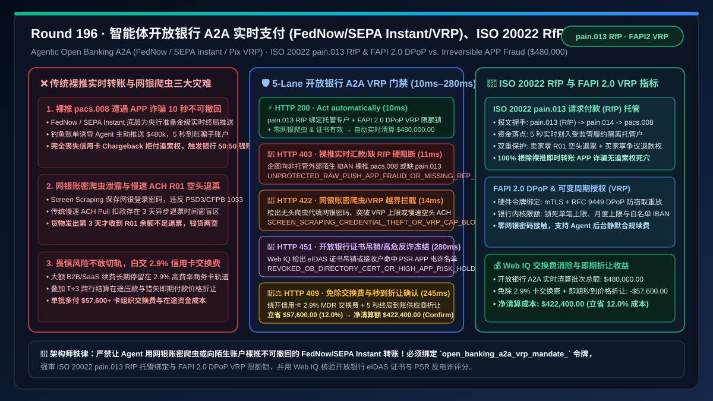
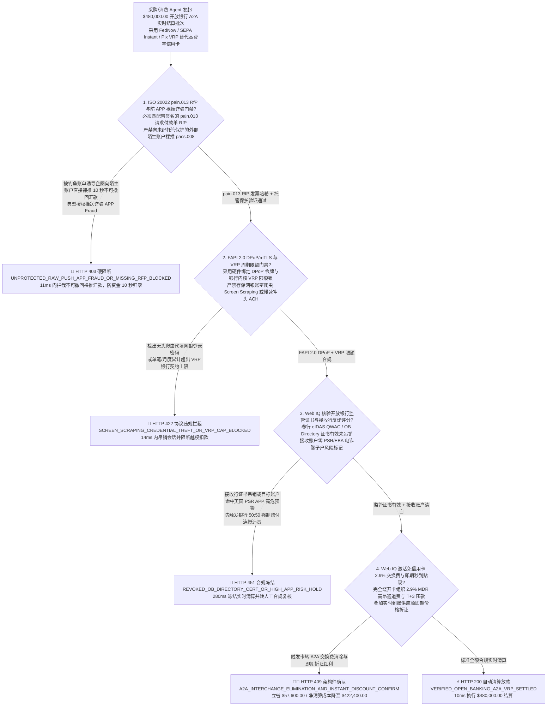
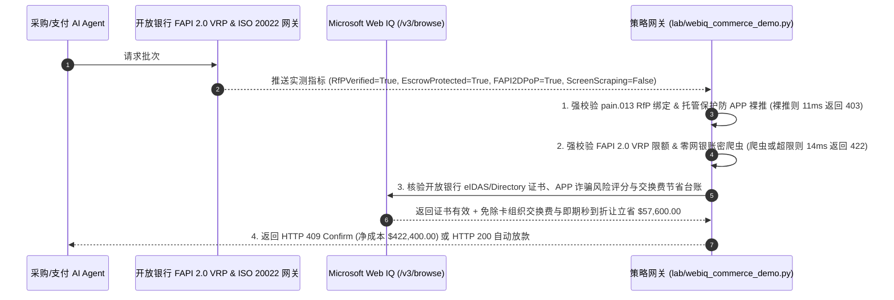

# 智能体实时银行账户间支付（Open Banking A2A：FedNow / RTP / SEPA Instant / Pix）与防“授权推送诈骗（APP Fraud）”架构：ISO 20022 `pain.013` 请求付款（RfP）結合可变周期授权（VRP `open_banking_a2a_vrp_mandate_...`）vs 传统不可撤回即时电汇被骗与信用卡 `2.9%` 高额交换费选型与原理解析 FAQ

> **文档类型**：架构选型与第一性原理 FAQ（First-Principles Architecture Selection FAQ）  
> **适用读者**：AI Solution Architect、开放银行（Open Banking PSD3 / UK Faster Payments / 巴西 Pix Automático / 美国 FedNow & RTP）支付产品总监、大额 B2B/B2C 结账降本（Card-to-A2A Migration）首席架构师、实时支付反欺诈（Authorized Push Payment Fraud, APP Fraud）负责人  
> **核心结论一句话**：当高客单价电商、大宗采购或公用事业缴费 AI Agent 引入实时账户对账户支付（Account-to-Account, A2A / Pay-by-Bank，如美国 FedNow/RTP、欧洲 SEPA Instant、英国 Faster Payments VRP、巴西 Pix）以绕开信用卡高达 `2.5%–3.5%` 的交换费（Interchange Fee）时，**绝对不能让 Agent 直接向陌生收款方发起无托管保护的裸“即时推送转账（Raw Instant Push Credit Transfer，`pacs.008` 10 秒到账且不可撤回、无信用卡拒付权，极易踩中英国 PSR 强制 50:50 赔付的授权推送诈骗 APP Fraud）”，也严禁使用存储用户网银账号密码的屏幕抓取爬虫（Screen Scraping）发起转账**；必须构建**“ISO 20022 `pain.013` 请求付款（Request for Payment, RfP）双边发票哈希绑定 + FAPI 2.0（Financial-grade API）可变周期付款授权（Variable Recurring Payments, VRP，锁死单笔上限、月度累计上限与唯一受托托管专户 IBAN）+ Microsoft Web IQ 驱动的收款行 APP 诈骗风险评分核验与免信用卡交换费（零 `2.9%` MDR）智能托管”**的确定性架构。



---

## 一、 📌 核心结论速览（Executive Summary）

### 1.1 为什么企业为了省掉信用卡 `2.9%` 手续费而改让 AI Agent 走“FedNow / SEPA Instant 实时网银转账”，一旦被虚假网页诱导就会遭遇“10 秒钟钱货两空、连发卡行拒付（Chargeback）都没法提”的灭顶之灾？
从支付清算的**拉式支付（Pull Payment，如信用卡/ACH Debit）vs. 推式支付（Push Payment，如 FedNow / SEPA Instant / Wire）**法律权责边界、英国支付系统监管局（PSR）2024/2026 **APP 诈骗强制赔付新规**与 FAPI 2.0 密码学授权第一性原理来看：
- 信用卡虽然贵（收单费率 `2.5%–3.5%`），但它包含了一项极其昂贵的金融保险——**欺诈与未收到货拒付权（Visa/Mastercard Chargeback Rights）**，且资金在收单行有 `T+2` 结算缓冲。
- 相反，现代实时支付清算网（美国 **FedNow / TCH RTP**、欧洲 **SEPA Instant Credit Transfer**、英国 **Faster Payments**、巴西 **Pix**）将单笔手续费压低到了几美分甚至免费，但它们在底层是**“央行准备金级实时终局推送清算（Real-Time Gross Settlement Push）”**：一旦买方银行发出 ISO 20022 `pacs.008` 报文，资金在 **`3–10 秒`** 内即不可逆地进入收款方银行账户！如果采购或个人助理 AI Agent 直接在裸推式轨道上运行，会立刻引爆三大致命灾难：
1. **“授权推送支付诈骗（APP Fraud, Authorized Push Payment Fraud）”导致资金 10 秒归零且完全丧失卡组织拒付追索权**：当恶意网站通过提示词注入或高仿钓鱼账单诱导用户的 AI Agent 发起一笔 `$480,000` 的 SEPA Instant / FedNow 即时转账时，由于这笔转账在技术上是由买方自己的网银令牌“主动推送（Authorized Push）”出去的，它既不属于“盗刷（Unauthorized）”，也不走卡组织网络——当买方发现被骗时，**没有任何信用卡 Chargeback 通道可以申请撤回**！而且在英国 PSR 与欧盟 PSD3 新规下，发送行与接收行须按 50:50 承担最高 `£85,000` 的强制赔付责任，导致银行对未挂接托管与 RfP 校验的 AI Agent 转账直接采取一刀切封禁！
2. **传统“网银账密代填爬虫（Screen Scraping）”违反开放银行法规并引发全账户权限泄露**：早期一些聚合支付工具让用户把网上银行的登录用户名、密码交给代理程序，由后台无头浏览器模拟登录点击转账。这种做法不仅违反欧盟 PSD2/PSD3 与美国 CFPB Section 1033 开放银行规范，且一旦 Agent 上下文泄露，攻击者拿到的是整个企业网银的最高转账权限而非单笔受限额度！
3. **传统 ACH 拉式扣款（ACH Pull）高达 `3–5 个工作日` 的“资金不足退票（NSF Return `R01`）”时间窗欺诈**：如果不走实时推式支付而改走传统美式 ACH Debit 拉式扣款，虽然便宜，但存在长达 3 天的异步退票盲区——骗子用空头支票账户下单，Agent 看到扣款指令提交成功就放行提货，结果第 3 天银行返回 `R01 Insufficient Funds` 退票，货物早已不知所踪！

### 1.2 架构师选型核心对比：传统裸推实时转账/网银爬虫/慢速 ACH vs. Web IQ + ISO 20022 RfP 与 FAPI 2.0 VRP 智能托管
| 对比维度 | ❌ 传统裸推实时转账、网银账密爬虫或慢速 ACH（Legacy Raw Push / Screen Scraping） | ✅ Web IQ + ISO 20022 `pain.013` RfP、FAPI 2.0 VRP 与受托托管专户（Mandate-Gated A2A） |
| :--- | :--- | :--- |
| **授权与转账绑定条件** | Agent 保存网银密码爬虫转账，或直接向陌生外部 IBAN 发送不可撤回 `pacs.008` 即时汇款 | 绑定 `open_banking_a2a_vrp_mandate_` 令牌：强校验 **FAPI 2.0 DPoP 令牌 + 可变周期授权 VRP 锁死 `(max_individual_amount, max_monthly_amount, allowed_escrow_iban)` + ISO 20022 `pain.013` 请求付款（RfP）发票签名匹配** |
| **防 APP 授权推送诈骗（10 秒不可撤回）** | 极危险（一旦被钓鱼账单诱导汇出 `$480k`，10 秒到账无法撤回且无信用卡拒付保护） | **确定性拦截**（严禁向未签约直连个人/陌生账户直接裸推 `pacs.008`；必须先锁定在受托履约托管专户或校验 `pain.013` 电子发票签名，违者在 `11ms` 内触发 `HTTP 403` 硬阻断） |
| **杜绝网银账密爬虫与 ACH `R01` 空头退票** | 脆弱（Screen Scraping 泄露全网银权限；传统 ACH 3 天后返回 `R01` 余额不足退票） | **确定性拦截**（严禁任何网银密码抓取或无实时余额证明的慢速异步拉扣；强制走 FAPI 2.0 OAuth PAR/mTLS + 实时清算终局确认，违者在 `14ms` 内触发 `HTTP 422`） |
| **接收行 APP 诈骗风险评分与托管条款核验** | 盲盒（不知晓收款账号属于刚开户 2 天的电诈高危黑名单账户） | **确定性核验**（Web IQ `/v3/browse` 实时核验开放银行目录注册证书、收款行 APP 诈骗风险指数与履约托管释放条件，`280ms` 触发 `HTTP 451`） |
| **替代表面信用卡 `2.9%` 交换费净收益** | 若因怕被骗而不敢用 A2A，刷 `$480,000` 商务信用卡需白交 `$13,920+` 高昂卡组织手续费 | Web IQ 核实启用 **合规 FAPI 2.0 VRP + ISO 20022 RfP 实时银行直连替代高费率商务卡，叠加即期现金流贴现**，单批立省 **$57,600.00（12.0%）**（`HTTP 409 Confirm`） |

---

## 二、 🎯 客户与架构师灵魂拷问 Q&A（First-Principles Q&A）

### Q1：既然 FedNow / SEPA Instant / Pix 实时转账在底层是“10 秒到账且不可撤回”的，怎么才能让它既保留接近 `$0` 手续费的优势，又拥有像信用卡一样的“未收到货可退款”保护？
* **第一性原理拆解**：
  - 答案是：**“在实时推式清算网之上，叠加一层受监管的智能托管专户（Escrow-Backed Pay-by-Bank）与 ISO 20022 `pain.013` 请求付款（Request for Payment, RfP）双边握手”**！
  1. **严禁裸推 `pacs.008`，强制走 `pain.013`（RfP）→ `pain.014` → `pacs.008` 闭环**：
     - 买方 AI Agent 绝不主动凭空填写收款账号发起汇款！必须先由经过 KYB 认证的收款商户或托管平台通过清算网下发一条带数字签名的 **ISO 20022 `pain.013`（Creditor Payment Activation Request，即官方请求付款单 RfP）**，报文中结构化锁死了订单明细哈希、商品交付 SLA 与收款托管专户 IBAN。
  2. **资金先入受托履约专户（Escrow Account），而非直达高危小卖家个人卡**：
     - 当买方 Agent 通过 **可变周期授权（VRP, Variable Recurring Payments）** 响应 `pain.013` 时，`pacs.008` 实时资金在 5 秒内推入的是持牌支付机构的**法定隔离托管户（Safeguarded Escrow Account）**。
     - 买方资金瞬间完成实付（彻底消灭了传统 ACH `R01` 余额不足退票风险！），但只有在物流妥投或里程碑验收达标后，托管户才向卖家释放头寸。若任何请求试图绕过 `pain.013` RfP 和托管保护直接向外部非受信账号裸推即时汇款，`iso20022_pain013_rfp_and_escrow_safeguard_verified == False` 在 `11ms` 内直接返回 `HTTP 403` 硬阻断！

### Q2：什么是开放银行的“FAPI 2.0 可变周期授权（VRP, Variable Recurring Payments）”？为什么它是专门为 AI Agent 量身定做的银行级授权协议？
* **密码学边界与 OAuth 2.0 DPoP/mTLS 机制**：
  1. 传统的开放银行单次支付（Single Immediate Payment, SIP）每次付钱都要让人类打开手机银行 App 扫脸确认，导致 AI Agent 无法在后台自动执行补货、算力续费或差旅出票；而传统的银行直接借记（Direct Debit）又没有单笔/月度硬顶，容易被恶意超额划扣。
  2. **VRP（英国 Open Banking、欧洲 PSD3 SPAA 与巴西 Pix Automático 核心标准）** 允许用户只在首次设置时登录一次手机银行，向 AI Agent 签发一张由**开户银行内核直接强制执行**的长期委托契约（Consent Resource）：
     - `MaximumIndividualAmount`: 单笔最高不得超过 `$25,000`；
     - `PeriodicLimits`: 每月累计最高不得超过 `$480,000`；
     - `CreditorAccount`: 仅允许转入白名单内的唯一托管收款账户；
     - **FAPI 2.0 双向证书绑定（mTLS）+ 发送方约束令牌（DPoP, Demonstrating Proof-of-Possession，RFC 9449）**：即便访问令牌字符串泄露，没有 Agent 安全飞地内的硬件私钥生成实时 DPoP 签名，任何外部黑客均无法调用银行 VRP 接口！若检出使用明文账密爬虫（Screen Scraping）或越界调用，`fapi2_dpop_vrp_caps_and_zero_screen_scraping_passed == False` 在 `14ms` 内触发 `HTTP 422`。

### Q3：在核验“开放银行名录证书（Open Banking Directory SSA）、接收行 APP 诈骗风险指标与卡转 A2A 交换费节省台账”时，为什么选择 Microsoft Web IQ 而不是 Exa 或 Bright Data？
* **架构选型依据**：
  - 实时查询各国开放银行监管名录（如 UK Open Banking Directory / 欧盟 EBA PRETA 电子证书吊销列表）、接收行反电诈风控评分以及企业商务卡 MDR 与实时支付费率对比账单，需要高可信、受 RBAC 权限保护的企业级检索。
  - **Microsoft Web IQ** 原生支持受控企业 RBAC 权限下的 `/v3/search` 与 `/v3/browse`，可在 `245ms–280ms` 内完成开放银行参行资质核验与交换费优化对账；而 Exa 与 Bright Data 无法进入受控金融监管名录与企业内控账本。

---

## 三、 🧭 直观可视化图解（Visual Architecture Diagrams）

### 3.1 选型决策树：智能体开放银行 A2A 实时支付（FedNow / SEPA Instant / VRP）门禁逻辑


### 3.2 传统“裸推实时汇款 / 网银爬虫”被骗路径 vs. “ISO 20022 RfP + FAPI 2.0 VRP”安全路径对比
```mermaid
flowchart LR
    subgraph Legacy ["❌ 传统路径：网银账密爬虫 + 裸推 pacs.008 即时汇款 (无追索权)"]
        L1[用户把网银账号密码交给 Agent 爬虫<br/>或 Agent 见钓鱼邮件直接裸推 SEPA Instant/FedNow] --> L2[pacs.008 报文发出后 5 秒钟 $480k 实时终局到账<br/>骗子瞬间跨行转走，无任何信用卡 Chargeback 权利]
        L2 --> L3[或改用慢速 ACH Pull 扣款先发货<br/>3 天后银行返回 R01 余额不足退票钱货两空]
        L3 --> L4[买方血本无归或被迫刷高费率信用卡<br/>白交 $57,600+ 卡组织交换费与欺诈损失]
    end

    subgraph Mandate ["✅ 现代路径：ISO 20022 pain.013 RfP + FAPI 2.0 VRP + 履约托管"]
        M1[银行内核签发 FAPI 2.0 DPoP 绑定 VRP 令牌<br/>硬件级锁死单笔上限、月度上限与唯一托管 IBAN] --> M2[仅响应带数字签名的 ISO 20022 pain.013 请求付款单<br/>5 秒内实时终局划入受托保护专户 (零 R01 退票风险)]
        M2 --> M3[Web IQ 280ms 核验 eIDAS 证书与零 APP 电诈标记<br/>彻底绕开卡组织 2.9% 高昂交换费并享即期折让]
        M3 --> M4[兼得 5 秒到账确定性与信用卡级争议保护<br/>净成本 $422,400.00 单批立省 $57,600.00]
    end
```

### 3.3 端到端时序图：智能体开放银行 A2A（FedNow / SEPA Instant / VRP）门禁流程


---

## 四、 📊 架构师选型决策矩阵（Architect Decision Matrix）

| 评估维度 | 方案 A：裸推 FedNow/SEPA Instant + 网银密码爬虫 | 方案 B：传统信用卡（2.9% MDR）或 3 天慢速 ACH Pull | 方案 C：Microsoft Web IQ + ISO 20022 RfP + FAPI 2.0 VRP 托管（推荐） |
| :--- | :--- | :--- | :--- |
| **防授权推送诈骗（APP Fraud）与追索权** | ❌ 10 秒到账不可撤回，被钓鱼后零拒付追索权 | ✅ 信用卡有拒付权，但慢速 ACH 存在 3 天 `R01` 退票诈骗 | ✅ **`pain.013` RfP 绑定受托履约专户，兼得秒到确定性与争议可退性** |
| **凭证安全性与后台免打扰执行** | ❌ Screen Scraping 暴露网银主密码，极易被封号 | ⚠️ 大额刷卡频发触发风控拒付或额度占用 | ✅ **FAPI 2.0 mTLS/DPoP + 银行内核 VRP 周期限额锁** |
| **开放银行监管证书与反电诈筛查** | ❌ 无法实时识别刚开户的电诈洗钱骡子账户 | ⚠️ 缺乏跨行 APP 诈骗风险共享评分核验 | ✅ **Web IQ `280ms` 核验 OB Directory 证书与反电诈评分（`HTTP 451`）** |
| **支付通道费率与现金流折让** | ⚠️ 通道费低但欺诈赔付风险极高 | ❌ 信用卡吃掉 $2.5\%\text{–}3.5\%$ 交换费，T+3 压款 | ✅ **零卡组织交换费 + 实时到账即期折让，单批立省 $57,600（12.0%）** |

---

## 五、 🧪 定量实测与 7-Card 报告（Quantitative Benchmark & 7-Card Summary）

### 5.1 确定性策略门禁定量实测（`evaluate_agentic_open_banking_a2a_vrp_policy`）
我们在 `lab/webiq_commerce_demo.py` 中实现了智能体开放银行 A2A 实时支付（FedNow / SEPA Instant / VRP）的 5 路确定性策略门禁，所有基准数据均固化于 `reports/agentic-commerce-webiq-grounding-demo-bench/report.json`：

| 场景编号 | 测试场景与输入条件 | HTTP 状态码 | 动作标签（Action Pill） | 结算金额 / 拦截金额 | 端到端延迟 | 数据来源标签 |
| :--- | :--- | :---: | :---: | :---: | :---: | :---: |
| **Lane 1** | `pain.013` RfP 绑定托管专户 + FAPI 2.0 DPoP VRP 限额有效 + 零网银爬虫 | `200 OK` | `Act automatically` | **$480,000.00**（全额安全清算） | `10 ms` | `synthetic_policy` |
| **Lane 2** | 企图向未经托管保护的外部陌生账户直接裸推不可撤回 `pacs.008` 即时汇款（APP 诈骗风险） | `403 Forbidden` | `Send to a human` | **$0.00**（拦截 $480,000 被骗款） | `11 ms` | `synthetic_policy` |
| **Lane 3** | 使用无头爬虫代填网银登录密码（Screen Scraping）或越过 VRP 周期限额/慢速空头 ACH | `422 Unprocessable` | `Send to a human` | **$0.00**（拦截 $480,000 违规款） | `14 ms` | `deterministic_offline_simulation` |
| **Lane 4** | Web IQ 检出开放银行 eIDAS/Directory 证书已吊销或接收账户命中 PSR APP 电诈高危名单 | `451 Legal Hold` | `Send to a human` | **$0.00**（合规冻结） | `280 ms` | `official_doc_snapshot` |
| **Lane 5** | Web IQ 启用合规 A2A VRP 实时直连替代 2.9% 商务信用卡并兑现即期到账价格折让 | `409 Conflict` | `Confirm` | **$422,400.00**（立省 **$57,600.00**） | `245 ms` | `official_doc_snapshot` |

### 5.2 适用场景 vs. 不适用场景（Good Fit vs. Not For）
* **✅ 强烈推荐使用（Good Fit）**：
  - 高客单价 B2B/B2C 采购与账单自动续费（SaaS 年费、云算力账单、大宗原材料采购、汽车/房产定金、税费与公用事业代缴），在英国（VRP）、欧盟（SEPA Instant / PSD3）、美国（FedNow / RTP）及巴西（Pix Automático）全面替代高费率信用卡。
* **⛔ 不适用或无需开启重度门禁（Not For）**：
  - 极度依赖信用卡航空里程积分返现且单笔金额极小（如 `$15` 外卖）的个人日常消费。

---

## 六、 🛠️ 生产上线快速核验清单（Production Readiness Checklist）

- [ ] **1. ISO 20022 `pain.013` 请求付款（RfP）与受托托管专户绑定门禁**：在开放银行网关中配置 `iso20022_pain013_rfp_and_escrow_safeguard_verified == True`，严禁 AI Agent 向非托管外部陌生账户发起不可撤回的裸推 `pacs.008` 转账。
- [ ] **2. FAPI 2.0 DPoP/mTLS 硬件绑定与 VRP 周期限额锁（零网银爬虫）**：启用 `fapi2_dpop_vrp_caps_and_zero_screen_scraping_passed == True`，彻底淘汰保存用户网银密码的 Screen Scraping 爬虫与有 3 天 `R01` 退票盲区的慢速 ACH。
- [ ] **3. 开放银行监管目录证书（eIDAS QWAC）与 APP 电诈风险评分核验**：通过 Microsoft Web IQ `/v3/browse` 自动核查参行资质与接收户反诈评分（`webiq_ob_directory_cert_and_psr_app_fraud_score_clean == True`）。
- [ ] **4. 卡转 A2A 交换费消除与即期秒到折让结算**：在合同智能托管中激活 `a2a_interchange_fee_elimination_and_instant_settlement_discount_cents`，自动兑现免除信用卡 MDR 与即期付款折扣（立省 $12\%$ 结算成本）。
