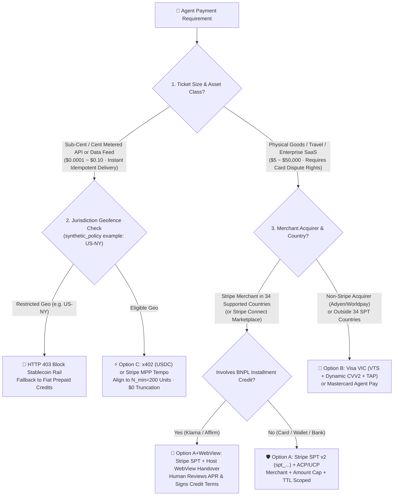
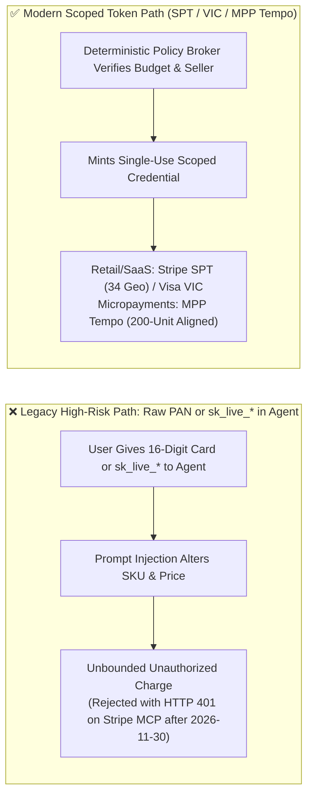
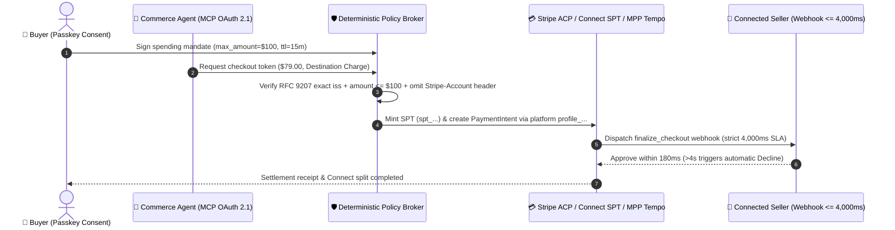

# Agentic Commerce Payment Rails Selection & First-Principles FAQ: Stripe SPT vs. Visa VIC vs. x402 / MPP Tempo

> **Single-Topic Scope**: This guide focuses exclusively on **Agentic Payment & Settlement Rail Selection (`Stripe SPT` vs. `Visa VIC` vs. `x402 / MPP Tempo`)**. For real-time web grounding selection, see the companion guide **[Real-Time Web Grounding Selection FAQ: Microsoft Web IQ vs. Exa vs. Bright Data](webiq-vs-exa-brightdata-grounding-selection-faq.en.md)** (or the combined navigation hub **[Payment & Grounding Hub](agentic-payment-rails-and-webiq-grounding-selection-faq.en.md)**).  
> **Style Benchmark**: Modeled directly on `ib-vs-ethernet-roce-selection-faq.md` (Executive Summary, First-Principles Q&A, Mermaid Decision Tree / Comparison / Sequence Diagram, 6-Dimension Matrix, Provenance-Tagged Benchmark Table, and Architect Checklist).  
> **Bilingual Editions**: **[中文版 (`agentic-payment-rails-spt-vic-x402-selection-faq.md`)](agentic-payment-rails-spt-vic-x402-selection-faq.md)** · **[English Version (Current)](agentic-payment-rails-spt-vic-x402-selection-faq.en.md)**  
> **Provenance & As-Of Notice (`2026-11-08`)**: Official protocol rules cite `research/daily/2026-11-08-sources.json` (`official_doc_snapshot`); local evaluation metrics cite `reports/agentic-commerce-webiq-grounding-demo-bench/report.json` (`deterministic_offline_simulation`); reference enterprise risk thresholds/geofences are labeled `synthetic_policy`; live uncredentialed third-party payment network latency is marked `not_measured`.

---

## 📌 1. Executive Summary

When designing an AI agent that executes commercial transactions, payment rail selection is governed by **transaction ticket size** and **merchant acquirer coverage**:

1. **Retail Goods, Enterprise SaaS, and Multi-Seller Marketplaces (`$5 ~ $5,000+` per order) 👉 Choose [`Stripe SPT` (`spt_...` Shared Payment Token) + `ACP/UCP` Checkout]**:
   - **When to use**: The merchant processes on Stripe (or splits payouts via Stripe Connect) within Stripe's **34 supported SPT countries** (`official_doc_snapshot`, `as_of: 2026-11-08`, source: `docs.stripe.com/agentic-commerce/protocol/shared-payment-tokens`).
   - **Why**: Binds a single-use token to a specific `seller_account`, hard `max_amount`, and expiry (`TTL`), supporting cards, wallets, bank debits, and BNPL (via mandatory Host WebView handover).
2. **Global Multi-Acquirer Retail, Airlines/Hotels, and Merchants Outside the 34 SPT Countries (`$10 ~ $50,000`) 👉 Choose [`Visa VIC` (Visa Intelligent Commerce) or `Mastercard Agent Pay`]**:
   - **When to use**: The merchant uses non-Stripe acquirers (Adyen, Worldpay, Checkout.com, or regional banks) or requires issuer-direct fraud liability shift.
   - **Why**: Issues a 16-digit Visa Token Service (`VTS`) network token + dynamic `CVV2` + FIDO2 Passkey cardholder mandate + RFC 9421 `TAP` signature accepted across global Visa/Mastercard rails.
3. **High-Frequency API Calls, Real-Time Data Feeds, and Burst Compute (`$0.0001 ~ $0.10` per call) 👉 Choose [`x402` (Base `USDC`) or `Stripe MPP Tempo` (`pathUSD` 6-Decimal Deposit Channel)]**:
   - **Why**: Traditional card rails charge ~`$0.30` fixed fee per transaction (`official_list_price`), making a `$0.01` API call 30x unprofitable. `x402` and `Stripe MPP Tempo` settle via `HTTP 402 Payment Required` headers with sub-cent precision; on MPP Tempo, aligning batch settlement to **200 units** eliminates sub-cent truncation loss (`$0.000000` loss verified in `deterministic_offline_simulation`).

---

## 🎯 2. Client & Architect High-Frequency Q&A (FAQ-Driven)

### Q1: Why can't we pass a user's 16-digit card number (PAN) or `sk_live_*` key to an AI Agent—and how do SPT, VIC, and x402 solve this from first principles?

**Answer: LLM context windows are non-deterministic and outside PCI-DSS boundaries, and raw card numbers / secret keys carry zero cryptographic spending constraints.**

1. **Three Failures of Raw Card Numbers & Legacy API Keys**:
   - **PCI-DSS Scope Explosion**: Exposing PAN/CVV inside prompts or traces pulls the entire AI stack into PCI-DSS Level 1 audit scope.
   - **Unbounded Spend Exposure**: A raw card cannot enforce "only pay Merchant A up to `$79.00` within 15 minutes."
   - **Stripe MCP `2026-11-30` Deprecation Cutoff (`official_doc_snapshot`, `as_of: 2026-11-08`, `docs.stripe.com/mcp`)**: Starting December 2026 (after **November 30, 2026**), `mcp.stripe.com` rejects all `sk_live_*` secret keys and untagged `rk_live_*` keys with `HTTP 401`, requiring **MCP OAuth 2.1 (with RFC 9207 exact `iss` validation)**.
2. **How Scoped Cryptographic Credentials Replace Raw Cards**:
   - **Stripe SPT (`spt_...`)**: Minted by a deterministic policy broker outside the LLM, locking `seller_account`, `max_amount`, and `TTL`.
   - **Visa VIC (`VTS` + `Passkey` + `TAP`)**: Hardware Passkey signature binds the buyer's biometric consent to a single-use network token and RFC 9421 HTTP signature.
   - **x402 / Stripe MPP Tempo (`pathUSD`)**: Signs micro-vouchers from a segregated petty-cash channel in response to `HTTP 402` challenges.

---

### Q2: For multi-seller marketplaces on Stripe Connect SPT, what are the two most common integration traps?

**Answer: The `Stripe-Account` header ownership rule and the asymmetric 4-second seller webhook timeout (`official_doc_snapshot`: `docs.stripe.com/agentic-commerce/protocol/shared-payment-tokens?agent-seller=connect`).**

1. **The `Stripe-Account` Header Rule**:
   - **Direct Charges**: Pass the connected account's `network_business_profile` AND include `Stripe-Account: {{CONNECTED_ACCOUNT_ID}}`.
   - **Destination Charges / Separate Charges & Transfers (without `on_behalf_of`)**: Use the platform's own `profile_...` ID and **strictly omit the `Stripe-Account` header** (including it triggers an ownership conflict error).
2. **Asymmetric `4,000 ms` Seller Webhook SLA**:
   - If `product_price_availability` exceeds `4,000 ms`, Stripe **falls back to the seller's imported Catalog Feed (`upsert`)** and continues checkout.
   - If `finalize_checkout` exceeds `4,000 ms`, Stripe **immediately declines the payment**.

---

### Q3: Why does Stripe MPP Tempo require whole-cent batch alignment (e.g., `200 units` at `$0.000550/call`)?

**Answer: Tempo's on-chain `pathUSD` uses 6 decimals, whereas Stripe fiat balances credit in 2-decimal whole cents (`floor to $0.01`).**

- **Protocol Rule (`official_doc_snapshot`: `docs.stripe.com/payments/machine/mpp`)**: Sub-cent remainders are floored to zero when crediting fiat balances.
- **Quantitative Verification (`deterministic_offline_simulation`, `reports/agentic-commerce-webiq-grounding-demo-bench/report.json`)**:
  - Closing an unaligned `50-unit` batch at `$0.000875/unit` (`$0.043750` gross) forfeits **`$0.023750` (`54.3%` loss)**.
  - Aligning `$0.000550/unit` to $N_{\min} = \frac{10000}{\gcd(550, 10000)} = 200$ units (`$0.110000` gross) achieves **`$0.000000` (`0%`) truncation forfeiture**.

---

## 🧭 3. Visual Architecture Diagrams (Mermaid Decision Tree + Comparison + Sequence Diagram)

### 3.1 Payment Rail Selection Decision Tree

---

### 3.2 Legacy Raw Credentials vs. Scoped Token Payment Path

---

### 3.3 End-to-End Multi-Party Payment Sequence Diagram

---

## 📊 4. Architect Decision Matrix

| Dimension | Option A: Stripe SPT v2 (`spt_...`) + Connect | Option B: Visa VIC (`VTS` + `TAP`) / MC Agent Pay | Option C: `x402` (`USDC`) / Stripe MPP Tempo (`pathUSD`) |
|---|---|---|---|
| **Primary Use Cases** | **Retail, SaaS & Connect marketplaces in 34 countries** (`$5–$5,000+`) | **Global multi-acquirer retail, travel & merchants outside 34 countries** | **High-frequency APIs, live data feeds & burst compute** (`$0.0001–$0.10`) |
| **Security & Scoping** | Single-use `spt_...` locked to seller, cap & TTL; MCP OAuth 2.1 | 16-digit `VTS` token + dynamic `CVV2` + Passkey + RFC 9421 `TAP` | `HTTP 402` + `EIP-3009` / Tempo `pathUSD` segregated deposit channel |
| **Human Friction** | Zero-touch within mandate; **human confirmation on BNPL/refunds** | Biometric Passkey tap on mandate creation or step-up | **Zero popups** inside pre-funded micropayment session |
| **Integration Effort** | **Low** (extends Stripe `PaymentIntent` & Connect) | **Medium** (requires VTS token & RFC 9421 `TAP` verification) | **Very Low** (`HTTP 402` header middleware) |
| **Coverage (with Provenance)** | **34 countries** (`official_doc_snapshot`, `as_of: 2026-11-08`) | **Global Visa / Mastercard acquiring banks** | Global on-chain (`US-NY` blocked in lab `synthetic_policy`) |
| **Fee Floor & Precision** | Standard processing (`2.9% + $0.30` `official_list_price`) | Standard card interchange | **No `$0.30` fixed floor**; requires **200-unit whole-cent alignment** |

---

## 🧪 5. Quantitative Benchmark Findings & Provenance Matrix

Every metric below is explicitly tagged with its provenance category (`official_doc_snapshot`, `deterministic_offline_simulation`, `synthetic_policy`, or `not_measured`) as of `2026-11-08`:

| Metric / Rule | Value / Finding | Provenance Category | Source Path / As-Of Date & Scope |
|---|---|---|---|
| **Stripe SPT Country Coverage** | **`34` countries** | `official_doc_snapshot` | `research/daily/2026-11-08-sources.json` (`stripe-spt`, `as_of: 2026-11-08`, SHA-256 `ec830c09...`) |
| **Stripe MCP Key Sunset Date** | **`2026-11-30`** cutoff for `sk_live_*` & untagged `rk_live_*` | `official_doc_snapshot` | `research/daily/2026-11-08-sources.json` (`stripe-mcp`, `as_of: 2026-11-08`, SHA-256 `407eb306...`) |
| **Seller Webhook Timeout SLA** | **`4,000 ms`** (price hook falls back to catalog; finalize declines) | `official_doc_snapshot` | `docs.stripe.com/agentic-commerce/protocol/shared-payment-tokens` (`as_of: 2026-11-08`) |
| **MPP Tempo Sub-Cent Truncation** | **`$0.000000` loss at `200 units`** vs. **`54.3%` (`$0.023750`)** on unaligned 50 units | `deterministic_offline_simulation` | `reports/agentic-commerce-webiq-grounding-demo-bench/report.json` (`W08` / `lab/webiq_commerce_demo.py`) |
| **RFC 9207 `iss` Mix-Up Block Rate** | **`100%` blocked** on case-folded `https://AUTH.merchant.example` | `deterministic_offline_simulation` | `reports/agentic-commerce-webiq-grounding-demo-bench/report.json` (`stage_1756_guards`) |
| **Geofence & Dispute Window Rules** | `US-NY` stablecoin block (`HTTP 403`), `120-day` dispute reference | `synthetic_policy` | Reference lab policy guardrails (illustrative architecture policy, not legal advice) |
| **Live Production Payment Gateways** | Live Stripe / Visa VIC network latency marked **`not_measured`** | `not_measured` | No live real-money payment API calls executed; verified via offline deterministic harness |

---

## 🛠️ 6. Appendix: Production Readiness & Pre-Sales Checklist (Architect Checklist)

- [ ] **1. `2026-11-30` Stripe MCP Key Cutoff**: Have all `sk_live_*` and untagged `rk_live_*` keys been replaced with **MCP OAuth 2.1 (with RFC 9207 exact `iss` matching)** or `Agent`-tagged restricted keys?
- [ ] **2. Connect `Stripe-Account` Header Discipline**: On Destination / Separate Charges without `on_behalf_of`, does the gateway strictly omit the `Stripe-Account` header?
- [ ] **3. `4,000 ms` `finalize_checkout` SLA**: Is the seller's checkout finalization webhook load-tested to respond under `4,000 ms` at P99?
- [ ] **4. Whole-Cent GCD Alignment on MPP Tempo**: Are `pathUSD` micropayment batches aligned to `200 units` (or $N_{\min}$) to guarantee `$0.000000` sub-cent truncation loss?
- [ ] **5. Human Confirmation Gates**: Do `create_refund`, Treasury money movement tools, and BNPL credit flows always pause for explicit human confirmation (`Confirm` / Host WebView)?
