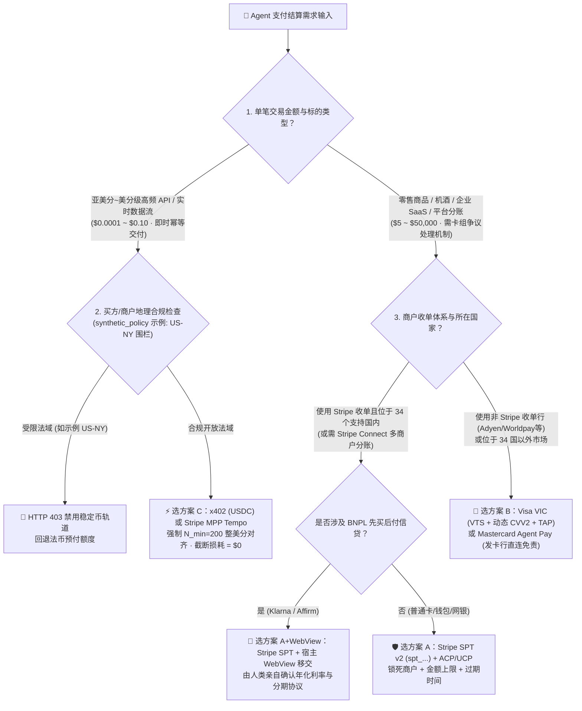
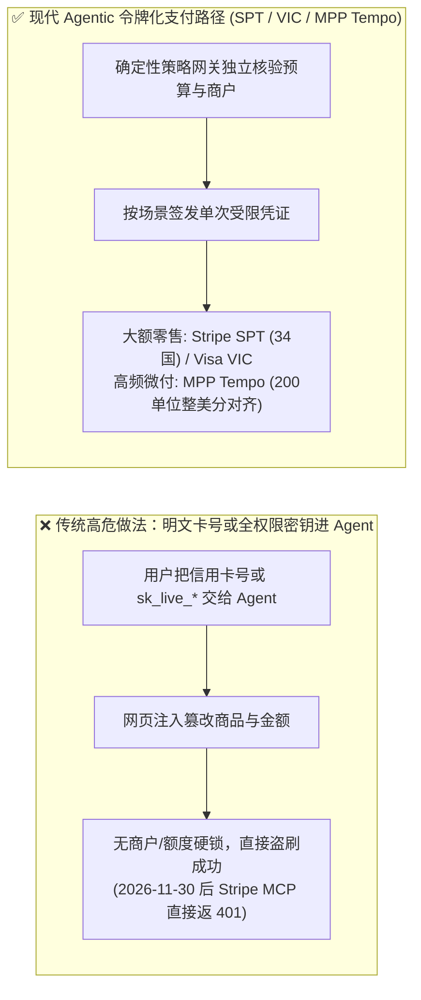
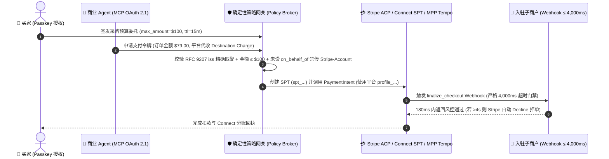

# Agentic Commerce 支付轨道选型与原理解析 FAQ：Stripe SPT vs. Visa VIC vs. x402 / MPP Tempo 实战指南

> **专题定位（单一决策聚焦）**：本篇仅聚焦 **“AI Agent 支付结算轨道怎么选与底层资金流原理”** 这一项核心架构决策（有关网页接地选型请直接阅读姊妹篇 **[《实时网页接地选型 FAQ：Microsoft Web IQ vs. Exa vs. Bright Data》](webiq-vs-exa-brightdata-grounding-selection-faq.md)**；合集导航页见 **[《支付轨道与接地总览入口》](agentic-payment-rails-and-webiq-grounding-selection-faq.md)**）。  
> **文风标杆**：严格对标 `ib-vs-ethernet-roce-selection-faq.md`（核心结论、第一性原理 Q&A、Mermaid 决策树/对比图/时序图、选型矩阵、带 Provenance 溯源的定量发现、生产 Checklist）。  
> **双语版本**：**[中文版（当前）](agentic-payment-rails-spt-vic-x402-selection-faq.md)** · **[English Version (`agentic-payment-rails-spt-vic-x402-selection-faq.en.md`)](agentic-payment-rails-spt-vic-x402-selection-faq.en.md)**  
> **数据溯源声明（Provenance & As-Of `2026-11-08`）**：文中官方协议规则引自 `research/daily/2026-11-08-sources.json`（标记为 `official_doc_snapshot`）；本地评测数据引自 `reports/agentic-commerce-webiq-grounding-demo-bench/report.json`（标记为 `deterministic_offline_simulation`）；企业风控阈值与地区围栏示例标记为 `synthetic_policy`；未挂载真实生产密钥的第三方在线支付网关实测标记为 `not_measured`。

---

## 📌 一、核心结论速览（Executive Summary）

当企业构建能够自主下单或调取付费资源的 AI Agent 时，支付结算轨道的选型取决于 **“单笔交易客单价（Ticket Size）”** 与 **“商户收单网络形态（Acquirer Footprint）”**：

1. **零售实物商品、企业 SaaS 订阅、多商户撮合平台分账（单笔 `$5 ~ $5,000+`）👉 选【Stripe SPT (`spt_...` 共享支付令牌) + ACP/UCP 结账协议】**：
   - **适用条件**：商户使用 Stripe 收单（或平台使用 Stripe Connect 向子商户分账），且位于 Stripe 官方文档列出的 **34 个 SPT 支持国家/地区**内（`official_doc_snapshot`, `as_of: 2026-11-08`, 来源：`docs.stripe.com/agentic-commerce/protocol/shared-payment-tokens`）。
   - **核心价值**：支持将支付凭证精确锁死在“唯一指定商户 + 最高扣款金额上限 + 过期时间（TTL）”内，原生支持网银、钱包与先买后付（BNPL，需拉起宿主 WebView 由人类确认信贷条款）。
2. **跨收单行全球泛零售、航司酒旅、34 国以外商户收单（单笔 `$10 ~ $50,000`）👉 选【Visa VIC（Visa Intelligent Commerce）或 Mastercard Agent Pay】**：
   - **适用条件**：商户未使用 Stripe（例如使用 Adyen、Worldpay、Checkout.com 或各国本地银行收单），或需要发卡行直连的卡组网络欺诈责任转移保护。
   - **核心价值**：直接走四方卡组织清算网络，由发卡行下发 16 位动态网络令牌（`VTS`）+ 动态 `CVV2` + 持卡人硬件 `FIDO2 Passkey` 委托签名，全球所有支持 Visa/Mastercard 的收单行均可受理。
3. **高频 API 按次调用、实时金融/物流数据抓取、边缘算力租用（单笔 `$0.0001 ~ $0.10`）👉 选【x402（Base USDC）或 Stripe MPP Tempo（`pathUSD` 6 位小数存款通道）】**：
   - **核心原因**：传统卡组织每笔收取约 `$0.30` 固定授权费（`official_list_price`），刷卡付 `$0.01` 的 API 会产生 30 倍手续费倒挂。`x402` 与 `Stripe MPP Tempo` 通过 `HTTP 402 Payment Required` 请求头实现毫秒级机器微支付；在接入 MPP Tempo 时，需按 **200 单位整美分对齐步长** 结算（`deterministic_offline_simulation` 验证尾数截断损耗为 **`$0.000000`**）。

---

## 🎯 二、客户与架构师灵魂拷问 Q&A（FAQ-Driven）

### Q1：为什么不能直接把买家的 16 位信用卡号（PAN）塞进 Prompt 交给大模型？Stripe SPT、Visa VIC 和 x402 是怎么解决这个问题的？

**答：因为大模型上下文不满足 PCI-DSS 隔离要求，且明文卡号没有任何“消费额度、指定商户与单次时效”的密码学约束。**

1. **把明文信用卡号或 `sk_live_*` 私钥交给 AI Agent 的三大灾难**：
   - **合规越界**：カード明文（PAN + CVV）一旦进入 LLM 推理日志或第三方可观测平台，企业即刻触发完整的 PCI-DSS L1 审计范围。
   - **无限敞口**：普通卡号没有“单笔最高只能刷 `$79`、且只能付给 A 商户”的硬边界；一旦遭遇网页隐藏提示词注入，攻击者可指令 Agent 盗刷高价礼品卡。
   - **MCP 密钥断代**：根据 Stripe 官方 MCP 文档（`official_doc_snapshot`, `as_of: 2026-11-08`, `docs.stripe.com/mcp`），自 **2026 年 11 月 30 日**起，`mcp.stripe.com` 将拒绝所有明文私钥 `sk_live_*` 与未打 `Agent` 专属标签的 `rk_live_*`，强制要求升级为 **MCP OAuth 2.1（含 RFC 9207 `iss` 逐字符精确匹配）**。
2. **三大现代协议如何用“受限令牌（Scoped Token）”替代明文卡号**：
   - **Stripe SPT (`spt_...`)**：由独立的确定性策略网关向 Stripe 请求签发一枚只活 15 分钟（`synthetic_policy` 示例 TTL）、只认当前 `seller_account`、金额锁死 `$79.00` 的一次性令牌。大模型只能传递这串 `spt_...`，哪怕被黑客截获也无法在别处盗刷一分钱。
   - **Visa VIC (`VTS` + `Passkey` + `TAP`)**：买家用手机指纹（FIDO2 Passkey）对购物上限签名后，Visa 令牌服务生成单次受限虚拟卡号，并通过 RFC 9421 头部签名（`Visa TAP`）交由收单行验真。
   - **x402 / Stripe MPP Tempo (`pathUSD`)**：针对单次几厘钱的 API 调用，Agent 从小额专用预存池中按 `HTTP 402` 挑战头签发微支付凭证，与企业主资金池物理隔离。

---

### Q2：客户如果是多商户撮合平台（Marketplace），接入 Stripe Connect SPT 分账时最容易踩的 2 个协议坑是什么？

**答：分别是“`Stripe-Account` 请求头误传报错”与“卖家 4 秒 Webhook 的非对称超时行为”（均引自 `official_doc_snapshot`: `docs.stripe.com/agentic-commerce/protocol/shared-payment-tokens?agent-seller=connect`）。**

1. **请求头铁律（何时传、何时绝不能传 `Stripe-Account`）**：
   - **直连子商户收款（`Direct Charges`）**：平台替子商户创单时，必须传入子商户的 `network_business_profile` 并在请求头附上 **`Stripe-Account: {{CONNECTED_ACCOUNT_ID}}`**。
   - **平台代收后分账（`Destination Charges` 或 `Separate Charges and Transfers`）**：当**未设置 `on_behalf_of`** 时，平台调 `PaymentIntent` 必须使用平台自己的 `profile_...` 标识，**绝对不能在请求头里传 `Stripe-Account`**（否则会触发账户归属冲突报错）。
2. **卖家 4 秒 Webhook 的“非对称容错机制”**：
   - Stripe 对卖家 `v1.delegated_checkout.*` Webhook 设定了严格的 **`4,000 ms`（4 秒）** 超时：
   - **查价阶段（`product_price_availability`）超时 `> 4s`**：Stripe **不会拒单**，而是自动降级读取卖家预先通过 Catalog Feed（`upsert`）同步的目录快照价格继续结账。
   - **终审阶段（`finalize_checkout`）超时 `> 4s`**：Stripe **立即拒单（Decline Payment）**，绝不绕过卖家最终风控。

---

### Q3：为什么亚美分微支付（如 `$0.000550/call`）在 Stripe MPP Tempo 上必须做“整美分步长对齐”？

**答：因为链上稳定币 `pathUSD` 是 6 位小数精度，而商户法币账本是 2 位小数精度（整美分），入账时不足 1 美分的尾数会被向下截断归零。**

- **机制来源（`official_doc_snapshot`: `docs.stripe.com/payments/machine/mpp`）**：Tempo 链上 `pathUSD` 最小单位为 $10^{-6}$ USD（`1 美分 = 10,000 units`），但法币余额结算执行 `floor_to_whole_cent`（不四舍五入、不结转余数）。
- **定量算例（`deterministic_offline_simulation`, `reports/agentic-commerce-webiq-grounding-demo-bench/report.json`）**：
  - 若单价为 `$0.000875/call`，在未对齐的 `50` 次批次结算时，总金额 `$0.043750` 会损失高达 **`$0.023750`（`54.3%` 尾差蒸发）**；
  - 若单价为 `$0.000550/call`，按最大公约数公式 $N_{\min} = \frac{10000}{\gcd(550, 10000)} = 200$ 对齐为 **200 次/批**（总额 `$0.110000`），实测截断损耗为 **`$0.000000`（0% 损耗）**。

---

## 🧭 三、直观可视化图解（Mermaid 选型决策树 + 传统路径 vs 令牌化路径 + 端到端时序图）

### 3.1 支付结算轨道选型决策树（Payment Rail Decision Tree）

---

### 3.2 传统明文卡号/私钥裸奔 vs. Agentic 受限令牌支付路径对比图

---

### 3.3 买家-Agent-策略网关-Stripe Connect SPT / MPP Tempo 端到端时序图

---

## 📊 四、架构师选型决策矩阵（Architect Decision Matrix）

| 评估维度 | 方案 A：Stripe SPT v2 (`spt_...`) + Connect | 方案 B：Visa VIC (`VTS` + `TAP`) / MC Agent Pay | 方案 C：x402 (`USDC`) / Stripe MPP Tempo (`pathUSD`) |
|---|---|---|---|
| **核心适用场景** | **34 国以内的零售电商、SaaS、多商户平台分账**（`$5 ~ $5,000+`） | **跨收单行全球零售、航司酒旅、34 国以外市场**（`$10 ~ $50,000`） | **高频 API 按量计费、实时数据流、算力微支付**（`$0.0001 ~ $0.10`） |
| **授权与安全隔离机制** | 一次性 `spt_...` 锁死商户、金额上限与 TTL；MCP 强制 OAuth 2.1 | 发卡行 16 位 `VTS` 令牌 + 动态 `CVV2` + `FIDO2 Passkey` + `RFC 9421 TAP` | `HTTP 402` + `EIP-3009` / Tempo `pathUSD` 预存通道签名，物理隔离主卡 |
| **用户体验与人工确认摩擦** | 常规消费可授权内自动扣；**BNPL 与退款/资金划拨强制人类确认** | 首次或超限唤起生物识别 Passkey 确认 | 预授权微支付池内 **0 人工弹窗（毫秒级静默结算）** |
| **接入改造成本** | **低**（基于现有 Stripe `PaymentIntent` 与 Connect 体系） | **中**（需接入卡组令牌解包与 RFC 9421 `TAP` 验签） | **极低**（HTTP `402` 标准中间件） |
| **生态覆盖度（含溯源）** | **34 个国家/地区**（`official_doc_snapshot`, `as_of: 2026-11-08`） | **全球 Visa / Mastercard 收单网络** | 全球链上结算（示例策略在 `US-NY` 禁用，`synthetic_policy`） |
| **费率结构与精度要求** | 标准收单费率（如 `2.9% + $0.30` `official_list_price`） | 标准卡组清算与发卡行费率 | **无 `$0.30` 固定起步费**；Tempo 需按 **`200 单位`整美分对齐**防截断 |

---

## 🧪 五、简明定量实测与数据溯源表（Benchmark & Provenance Matrix）

以下所有数字均严格区分 **官方规范快照（`official_doc_snapshot`）**、**本地确定性模拟测量（`deterministic_offline_simulation`）**、**参考架构策略示例（`synthetic_policy`）** 与 **未实测第三方在线接口（`not_measured`）**：

| 指标 / 规则项 | 数值 / 结论 | 数据类别 (Provenance) | 精确来源路径 / As-Of 日期与适用范围说明 |
|---|---|---|---|
| **Stripe SPT 支持国家数** | **`34` 个国家/地区** | `official_doc_snapshot` | `research/daily/2026-11-08-sources.json` (`stripe-spt`, `as_of: 2026-11-08`, SHA-256 `ec830c09...`) |
| **Stripe MCP 密钥断代截止日** | **`2026-11-30`** 后拒绝 `sk_live_*` 与未打标 `rk_live_*` | `official_doc_snapshot` | `research/daily/2026-11-08-sources.json` (`stripe-mcp`, `as_of: 2026-11-08`, SHA-256 `407eb306...`) |
| **Seller Webhook 超时阈值** | **`4,000 ms`**（查价超时回退目录，终审超时拒单） | `official_doc_snapshot` | `docs.stripe.com/agentic-commerce/protocol/shared-payment-tokens` (`as_of: 2026-11-08`) |
| **MPP Tempo 整美分对齐损耗** | **`200 单位`损耗 `$0.000000`** vs 未对齐 50 单位损耗 **`54.3%` (`$0.023750`)** | `deterministic_offline_simulation` | `reports/agentic-commerce-webiq-grounding-demo-bench/report.json` (`W08` / `lab/webiq_commerce_demo.py`) |
| **RFC 9207 `iss` 混淆攻击拦截** | **`100%` 阻断**大小写混淆 `https://AUTH.merchant.example` | `deterministic_offline_simulation` | `reports/agentic-commerce-webiq-grounding-demo-bench/report.json` (`stage_1756_guards`) |
| **地区围栏与卡组织争议期示例** | 示例 `US-NY` 稳定币拦截 (`HTTP 403`)、参考 `120 天`卡争议期 | `synthetic_policy` | 本仓库策略网关参考风控规则（非通用法律意见，生产需按企业法务与收单合同配置） |
| **第三方商业支付网关在线实测** | Stripe / Visa VIC 生产网在线延迟标为 **`not_measured`** | `not_measured` | 本次夜间任务遵循安全规范不发起真实资金交易，仅执行本地确定性协议契约验证 |

---

## 🛠️ 六、附录：生产上线快速核验与售前打单清单（Architect Checklist）

- [ ] **1. 密钥断代合规检查（`2026-11-30` Cutoff）**：是否已全面排查并清理 MCP 配置中的 `sk_live_*` 与普通 `rk_live_*`，切换至 **MCP OAuth 2.1（含 RFC 9207 `iss` 逐字符精确匹配）** 或带 `Agent` 专属标签的受限密钥？
- [ ] **2. Connect 分账请求头核验**：在 Stripe Connect `Destination` / `Separate Charges` 且未设 `on_behalf_of` 时，是否已在代码层强制禁止传入 `Stripe-Account` 请求头？
- [ ] **3. 卖家 `finalize_checkout` 4 秒 SLA 压测**：卖家结账终审 Webhook 的 P99 响应时间是否稳定控制在 `4,000 ms` 以内，避免被 Stripe 自动拒单？
- [ ] **4. MPP Tempo 整美分步长对齐**：接入 `pathUSD` 微支付时，是否已配置 `200 单位`（或按 GCD 公式计算的 $N_{\min}$）整美分结算步长，确保亚美分截断损耗为 `$0.000000`？
- [ ] **5. 高风险工具与 BNPL 人工确认门禁**：`create_refund`、Treasury 资金划拨以及 BNPL 分期信贷结账是否已100% 配置暂停并交由人类显式确认（`Confirm` / Host WebView）？
