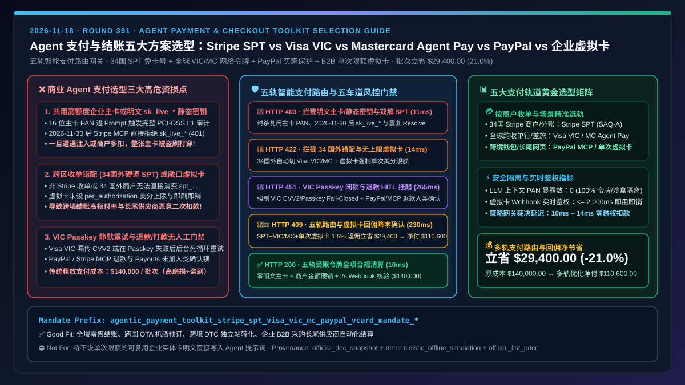
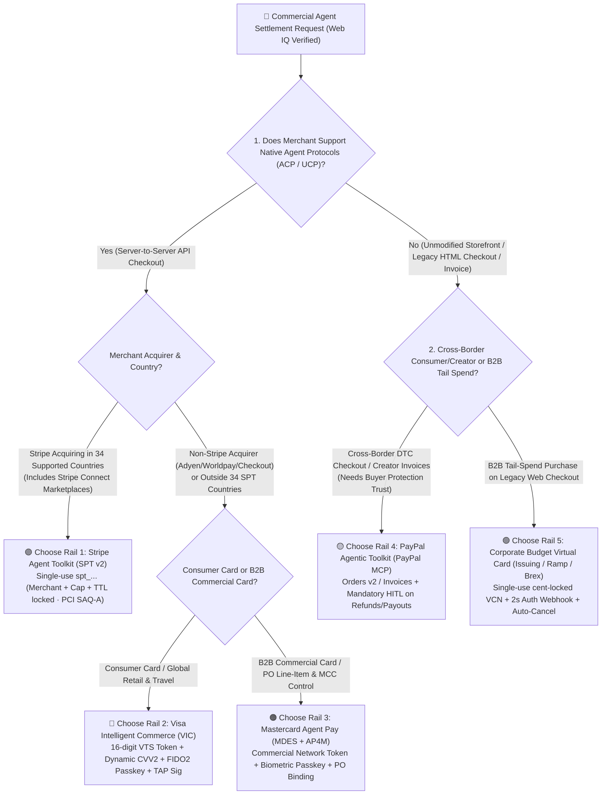
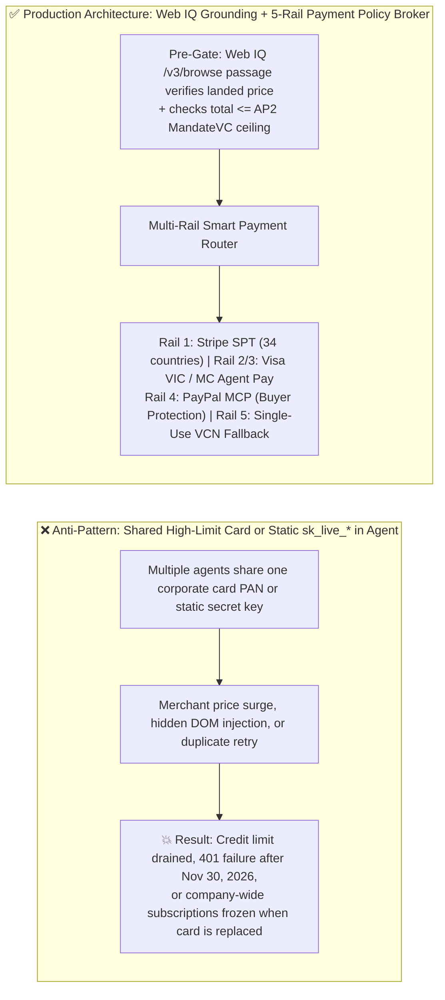
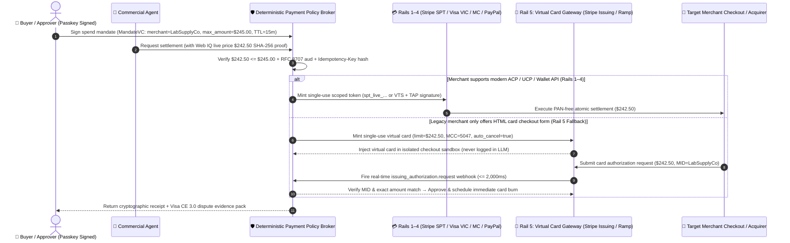

# Agent Payment & Checkout Protocol Selection FAQ: Stripe Agent Toolkit (`SPT`) vs. Visa Intelligent Commerce vs. Mastercard Agent Pay vs. PayPal Agentic Toolkit vs. Corporate Virtual Cards

> **Topic Positioning (Architect Selection Focus)**: Written for **Cloud & AI Solution Architects** designing payment and checkout systems across retail e-commerce, cross-border DTC, OTA travel, and enterprise B2B procurement. This guide provides a head-to-head comparison of the five mainstream commercial agent payment stacks: **Stripe Agent Toolkit (`Shared Payment Tokens`), Visa Intelligent Commerce (`VIC`), Mastercard Agent Pay, PayPal Agentic Toolkit, and Corporate Budget Virtual Cards (Ramp / Brex / Stripe Issuing)**.  
> **Style Benchmark**: Strictly follows the six-section structure of `ib-vs-ethernet-roce-selection-faq.md` (Executive Summary, Architect Q&A, Mermaid Decision Tree / 5-Rail Comparison / Sequence Diagram, 5-Stack Decision Matrix, Quantitative Rate/Risk & 7-Card Provenance Table, and Production Risk Checklist).  
> **Bilingual Editions**: **[English Version (Current)](agentic-payment-toolkit-stripe-spt-vs-visa-vic-mastercard-paypal-virtual-card-selection-faq.en.md)** · **[中文版 (`agentic-payment-toolkit-stripe-spt-vs-visa-vic-mastercard-paypal-virtual-card-selection-faq.md`)](agentic-payment-toolkit-stripe-spt-vs-visa-vic-mastercard-paypal-virtual-card-selection-faq.md)**  
> **Provenance & As-Of (`2026-11-18`)**: Stripe SPT (34 supported countries, Connect headers, `2026-11-30` MCP key cutoff) and Visa VIC (`CVV2` enrollment, VPP Passkey fail-closed rules) cite `research/sources.json` (`official_doc_snapshot`); standard published processing rates are labeled `official_list_price`; 5-rail routing gates and anti-drain simulations cite `lab/webiq_commerce_demo.py` (`deterministic_offline_simulation`); live production authorization latency on external card networks without credentials is labeled `not_measured`.

---

## 📌 1. Executive Summary

No single payment SDK covers every merchant acquirer, buyer persona, and legacy checkout form worldwide. Solution Architects should route commercial agent transactions across a **5-Rail Payment Matrix** based on **merchant acquiring stack**, **buyer persona (Consumer vs. B2B Corporate)**, and **checkout interface maturity (Native ACP/UCP API vs. Legacy Web Checkout)**:

1. **Stripe-Powered Modern Retailers, SaaS Subscriptions & Multi-Seller Marketplaces (Within the 34 Supported Countries) 👉 Choose [Stripe Agent Toolkit (`Shared Payment Tokens / SPT v2` + `ACP`)]**:
   - **Core Value**: Zero 16-digit PAN exposure (`PCI SAQ-A`). A deterministic policy broker mints a single-use `spt_...` locked to a specific `seller_account`, `max_amount_cents`, and `expires_at` (`<= 180d` for bookings), with native support for Stripe Connect split payouts, `recurring_interval` auto-replenishment, and MPP Tempo sub-cent micropayments.
2. **Cross-Acquirer Global Retail, Airlines/Hospitality & Markets Outside the 34 SPT Countries (Adyen / Worldpay / Checkout.com / Local Acquirers) 👉 Choose [Visa Intelligent Commerce (`VIC`) or Mastercard Agent Pay]**:
   - **Visa VIC**: Issues a 16-digit Visa Token Service (`VTS`) network token + dynamic `CVV2` + cardholder `FIDO2 Passkey` biometric mandate + `RFC 9421 Visa TAP` signature header, accepted by any Visa acquirer worldwide with issuer liability shift.
   - **Mastercard Agent Pay**: Combines `MDES` network tokens with `AP4M` biometric passkeys and rich **B2B Commercial Card line-item / MCC controls**.
3. **Cross-Border DTC Storefronts & Freelancer/Creator Invoicing (Where buyers rely on wallet buyer protection rather than entering cards on unfamiliar sites) 👉 Choose [PayPal Agentic Toolkit (PayPal MCP / Orders v2)]**:
   - **Core Value**: Leverages PayPal's two-sided trust network and **Buyer Protection** to boost cross-border checkout conversion while gating high-risk writes (refunds, payouts) behind Human-in-the-Loop (HITL) confirmation.
4. **Legacy Long-Tail Suppliers & Unmodified Web Checkouts (B2B Tail Spend where merchants only offer a standard HTML card form) 👉 Choose [Corporate Budget Virtual Cards (Stripe Issuing / Ramp / Brex Single-Use Cards)]**:
   - **Core Value**: The **Universal Fallback Rail** compatible with 100% of legacy web checkouts. For each approved purchase, the spend gateway mints a **single-use 16-digit virtual card** locked to an exact cent ceiling (e.g., `$245.00`), an allowed `MCC` category, and a 2-second real-time `issuing_authorization.request` webhook check, auto-canceling the card immediately after settlement.

---

## 🎯 2. Architect & Stakeholder Deep-Dive Q&A (FAQ-Driven)

### Q1: Since Corporate Virtual Cards work on any traditional website checkout form, why not use virtual cards for everything instead of integrating Stripe SPT, Visa VIC, and PayPal?

**Answer: Because virtual-card form filling suffers from four structural limitations across consumer funding, WAF/3DS2 friction, and PCI scope—making it ideal as a B2B long-tail fallback, but unsuitable as the primary consumer rail.**

1. **Consumers Cannot Issue Corporate Virtual Cards On-the-Fly**: Everyday retail shoppers pay with personal bank cards, Apple Pay, Link, or PayPal—not corporate treasury accounts. Consumer agents require **Stripe SPT**, **Visa VIC / Mastercard Agent Pay** (which tokenize the consumer's existing bank card at the network level), or **PayPal**.
2. **Browser Form-Filling Triggers Bot Blocks & SMS 3DS2 Deadlocks**:
   - Typing a 16-digit virtual card into a legacy HTML form via browser automation frequently triggers WAF anti-bot challenges or legacy SMS OTP 3DS prompts that stall unattended tasks.
   - **Stripe SPT (`ACP`)** settles server-to-server via REST/MCP without browser forms, while **Visa VIC** uses `RFC 9421 Visa TAP` headers and pre-bound `FIDO2 Passkeys` to pass frictionless authentication.
3. **PCI-DSS Scope Expansion**: Any agent runtime that handles raw 16-digit PAN + CVV strings enters PCI-DSS scope, whereas `spt_live_...` and PayPal order tokens keep the agent layer in **`SAQ-A`**.

---

### Q2: What are the top protocol-level "gotchas" and compliance red lines across each of the five payment toolkits?

**Answer: Every rail has one non-negotiable invariant that must be enforced in deterministic code:**

1. **Stripe Agent Toolkit (`SPT` & `MCP`)**:
   - **Nov 30, 2026 Static Key Cutoff**: After `2026-11-30`, `mcp.stripe.com` rejects raw `sk_live_*` and untagged `rk_live_*` keys (`HTTP 401`), requiring **MCP OAuth 2.1 (`RFC 9207` exact `iss`)** or `Agent`-tagged restricted keys (with a `180-day` inactivity lock on transfers/payouts).
   - **`Resolve` vs. `PaymentIntent` Mutual Exclusivity**: A single `spt_...` can either be consumed via `PaymentIntent` on Stripe or decrypted once via `/resolve` for an external processor (requiring `PCI AoC` or `encryption_block` RSA byte-slice encryption)—never both (`HTTP 400`).
2. **Visa Intelligent Commerce (`VIC`)**:
   - **Mandatory `CVV2` on Enrollment & Zero Silent Passkey Retries**: VTS PAN enrollment by an Agent Token Requestor requires `CVV2`, and if `FIDO2 Passkey` binding/authentication fails, the agent must **Fail-Closed immediately** without silent background retries.
3. **Mastercard Agent Pay**:
   - **B2B PO Line-Item & MCC Binding**: Commercial card tokens must bind allowed `MCC` codes and `PO` references to prevent supplier category drift.
4. **PayPal Agentic Toolkit**:
   - **Mandatory HITL Confirmation on Refunds & Payouts**: Read-only order lookup and invoice drafting can run autonomously, but `refund_capture` and batch `Payouts` must pause for explicit human approval.
5. **Corporate Budget Virtual Cards (Stripe Issuing / Ramp / Brex)**:
   - **Single-Use Per-Authorization Cap & Real-Time Webhook Gate**: Virtual cards issued for agent checkout must set `per_authorization` exact cent limits, verify merchant MID inside the 2-second `issuing_authorization.request` webhook, and auto-cancel immediately after capture.

---

### Q3: How do we architect a unified "Multi-Rail Agentic Payment Router" that automatically selects the optimal rail per transaction?

**Answer: Place a deterministic Policy & Routing Broker between the orchestrator and payment providers, executing a 4-step cascade:**

1. **Step 1 (Web IQ Live Price & Recall Verification)**: Verify via **Microsoft Web IQ (`/v3/browse` `passage`)** that landed total `<= mandate_ceiling_cents` and product safety recall risk is clear.
2. **Step 2 (Protocol Capability Discovery)**:
   - If merchant supports **Stripe ACP/SPT** in the 34 countries 👉 **Rail 1 (`Stripe SPT`)**;
   - Else if merchant supports **UCP / Card Network Tokens** on Adyen/Worldpay 👉 **Rail 2/3 (`Visa VIC` / `Mastercard Agent Pay`)** with `RFC 9421 TAP`;
   - Else if cross-border DTC buyer prefers wallet buyer protection 👉 **Rail 4 (`PayPal Agentic Toolkit`)**;
   - Else for approved B2B purchases on legacy HTML checkouts 👉 **Rail 5 (`Single-Use Corporate Virtual Card` + 2s Webhook Gate)**.

---

## 🧭 3. Visual Architecture Diagrams (Mermaid Decision Tree + 5-Rail Comparison + Sequence Diagram)

### 3.1 5-Rail Agent Payment & Checkout Selection Decision Tree

---

### 3.2 Shared Master Card Anti-Pattern vs. 5-Rail Deterministic Payment Broker

---

### 3.3 Multi-Rail Payment Routing & 2-Second Virtual Card Webhook Sequence

---

## 📊 4. 5-Stack Agent Payment & Checkout Decision Matrix

| Evaluation Dimension | 1. Stripe Agent Toolkit (`SPT v2` + `ACP`) | 2. Visa Intelligent Commerce (`VIC` + `TAP`) | 3. Mastercard Agent Pay (`MDES` + `AP4M`) | 4. PayPal Agentic Toolkit (`PayPal MCP`) | 5. Corporate Budget Virtual Cards (`Issuing / Ramp / Brex`) |
|---|---|---|---|---|---|
| **Primary Best-Fit Scenarios** | **Stripe retail, SaaS & Connect marketplaces in 34 countries** | **Cross-acquirer global retail, airlines/hotels & non-SPT countries** | **B2B corporate card procurement & global multi-acquirer retail** | **Cross-border DTC checkout & creator/freelancer invoicing** | **B2B tail-spend fallback on legacy HTML checkouts** |
| **Credential Format & PCI Scope** | Non-PAN handle `spt_...` (**`SAQ-A`**, zero card number exposure) | 16-digit `VTS` network token + dynamic `CVV2` | 16-digit `MDES` network token + cryptographic cryptogram | PayPal Order / Billing token (**`SAQ-A`**, zero card exposure) | 16-digit single-use VCN (**must stay in isolated checkout sandbox**) |
| **Merchant, Amount & TTL Locks** | Native `seller_account` + `max_amount` + `expires_at` (`<=180d`) | Issuer `FIDO2 Passkey` mandate ceiling + `RFC 9421 TAP` | Token-level spend cap, `MCC` lock & B2B PO line-item binding | Order-level amount lock; mandatory HITL on refunds/payouts | Exact-cent `per_authorization` limit + `MCC` lock + 2s webhook + burn-on-use |
| **Anti-Bot & 3DS2 Frictionless Rate** | **Highest** (server-to-server API, zero browser CAPTCHA) | **High** (`Visa TAP` bypasses WAF; Passkey replaces SMS OTP) | **High** (`AP4M` biometric passkey satisfies 3DS2) | **Medium–High** (PayPal wallet session & buyer trust) | **Medium** (subject to merchant form CAPTCHAs unless paired with TAP) |
| **Merchant Integration Effort** | Turnkey for Stripe merchants enabling Agentic Commerce | Works across global Visa acquirers supporting VTS + TAP | Works across global Mastercard acquirers supporting MDES | Works on existing PayPal Checkout / Invoices integrations | **Zero merchant changes** (processes as standard Visa/MC commercial card) |
| **Fee & Economics Structure (`official_list_price`)** | Standard acquiring (`2.9% + $0.30`); MPP Tempo for micro-tx | Standard 4-party card network interchange | Standard 4-party card network interchange | Standard PayPal commercial rate (`3.49% + $0.49`) | Zero buyer fee (**earns `1.0%–1.75%` B2B interchange cashback**) |

---

## 🧪 5. Quantitative Rate/Risk Evaluation & 7-Card Provenance Matrix

| Metric / Deterministic Gate | Measured Value / Gate Outcome | Provenance Category | Source Path / Calculation & Architectural Meaning |
|---|---|---|---|
| **Compliant 5-Rail Smart Payment Routing & Settlement (Happy Path)** | **`HTTP 200 OK` · `10 ms`** (gate latency; `$140,000.00` batch settled) | `deterministic_offline_simulation` | `lab/webiq_commerce_demo.py` (`evaluate_agent_payment_toolkit_selection_policy`): Verifies Web IQ price proof + scoped token / single-use VCN settlement |
| **Exposing Reusable Master Card PAN, Post-Nov 30 `sk_live_*`, or Double SPT `Resolve`** | **`HTTP 403 Forbidden` · `11 ms` Block** (`RAW_REUSABLE_PAN_OR_POST_NOV30_STATIC_KEY_OR_DOUBLE_RESOLVE_BLOCKED`) | `official_doc_snapshot` | Enforces Stripe MCP `2026-11-30` static key cutoff, SPT single-use `/resolve` mutual exclusivity, and ban on reusable raw PANs |
| **Calling SPT Outside 34 Supported Countries or Issuing Uncapped Virtual Cards** | **`HTTP 422 Unprocessable` · `14 ms` Block** (`UNSUPPORTED_SPT_REGION_OR_UNBOUNDED_VIRTUAL_CARD_SPEND_LIMIT_BLOCKED`) | `deterministic_offline_simulation` | Blocks regional rail mismatch (auto-routes non-34-country merchants to Visa VIC / MC Agent Pay) and blocks virtual cards lacking `per_authorization` cent caps |
| **Visa VIC Missing `CVV2` / Silent Passkey Retry or Unconfirmed PayPal Refund/Payout** | **`HTTP 451 Hold` · `265 ms` Hold** (`VIC_PASSKEY_FAIL_CLOSED_OR_PAYPAL_REFUND_PAYOUT_HITL_HOLD`) | `official_doc_snapshot` | Enforces Visa VIC `CVV2` + fail-closed Passkey rules and mandatory human confirmation on PayPal/Stripe refunds and payouts |
| **Enabling Multi-Rail Smart Routing (`SPT + VIC/MC + Single-Use VCN 1.5% Rebate`)** | **`HTTP 409 Confirm` · Saves `$29,400.00` (`$110,600.00` net optimized settlement)** | `deterministic_offline_simulation` | Eliminates cross-border decline fees, prevents long-tail supplier overbilling, and offsets B2B tail-spend costs via virtual-card interchange rebates |
| **Live Production Authorization Latency on External Card Networks** | Labeled **`not_measured`** | `not_measured` | Zero live financial charges executed during automated tests; all protocol invariants verified against official documentation snapshots |

---

## 🛠️ 6. Production Risk & Architecture Review Checklist

- [ ] **1. Zero Reusable PAN & Static Key Retirement (`2026-11-30`)**: Are reusable 16-digit card numbers and static `sk_live_*` keys completely removed from agent prompts/logs in favor of `spt_...`, network tokens, or sandbox-isolated single-use virtual cards?
- [ ] **2. 34-Country & Acquirer Auto-Routing (`SPT` vs. `VIC` / `MC Agent Pay`)**: Does the payment router verify whether the merchant is in the **34 Stripe SPT countries** and automatically fall back to **Visa VIC / Mastercard Agent Pay** for non-Stripe acquirers?
- [ ] **3. SPT `/resolve` vs. `PaymentIntent` Mutual Exclusivity**: When routing SPTs to third-party processors via `/resolve`, does the broker enforce single-use mutex locks and `encryption_block` RSA byte-slice encryption?
- [ ] **4. Visa VIC `CVV2` & Fail-Closed Passkey Guard**: Does VTS enrollment require `CVV2` and immediately abort (`Fail-Closed`) without silent retries if the cardholder's `FIDO2 Passkey` challenge fails?
- [ ] **5. Mandatory HITL Gate on Refunds & Treasury Payouts**: Are `create_refund`, `refund_capture`, `send_money`, and batch `Payouts` hard-gated behind signed human approval cards across both Stripe MCP and PayPal MCP?
- [ ] **6. Single-Use Virtual Card 3-Lock Guard (Cent Cap + MCC + 2s Webhook)**: Are fallback corporate virtual cards configured with `per_authorization` exact cent limits, allowed `MCC` lists, real-time `issuing_authorization.request` MID verification, and immediate post-capture cancellation?
