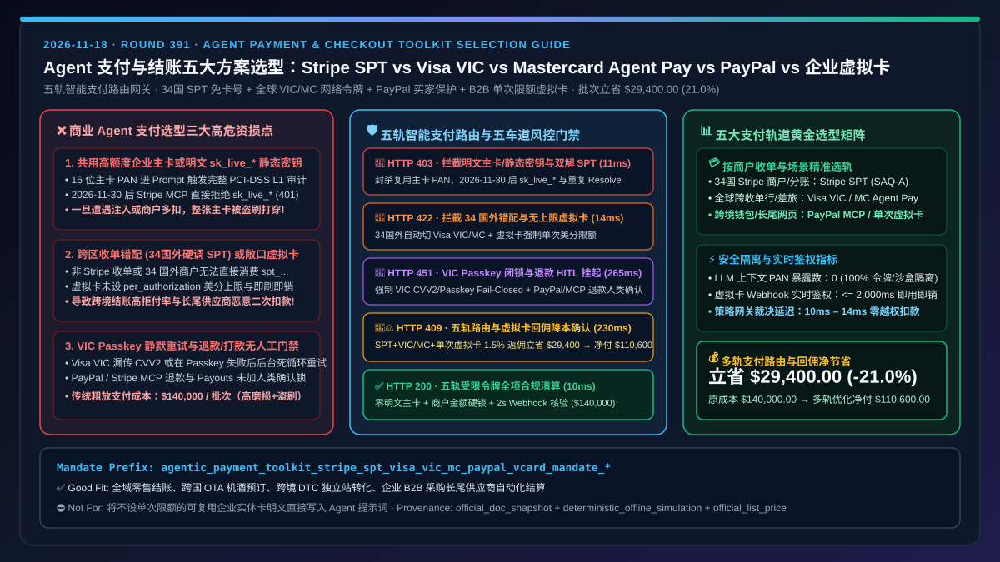
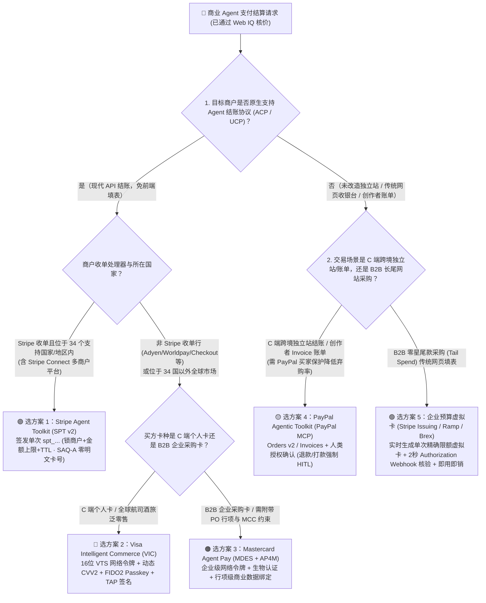
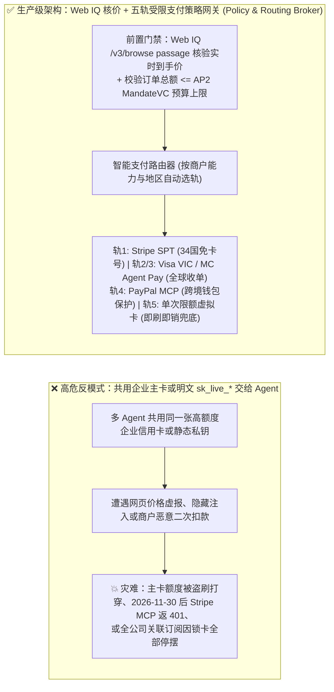
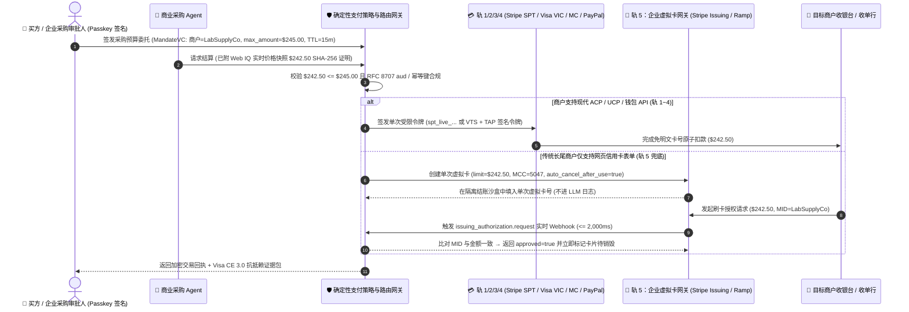

# Agent 支付与结账协议选型 FAQ：Stripe Agent Toolkit (`SPT`) vs. Visa Intelligent Commerce vs. Mastercard Agent Pay vs. PayPal Agentic Toolkit vs. 企业预算虚拟卡实战指南

> **专题定位（架构师选型聚焦）**：面向为零售电商、跨境出海、OTA 差旅与企业 B2B 采购设计支付结算架构的 **Cloud & AI Solution Architect**，系统横向对比当前五大主流商业智能体支付方案：**Stripe Agent Toolkit (`Shared Payment Tokens`)、Visa Intelligent Commerce (`VIC`)、Mastercard Agent Pay、PayPal Agentic Toolkit 以及企业预算虚拟卡（Ramp / Brex / Stripe Issuing）**。彻底讲清 **“商户收单网络不统一怎么付、长尾老旧网站没接 Agent 协议怎么付、跨境独立站怎么提转化、怎么从根源上杜绝 Agent 被注入盗刷与重复扣款”**。  
> **文风标杆**：严格对标 `ib-vs-ethernet-roce-selection-faq.md` 六段式结构（核心选型结论速览、业务方与架构师灵魂拷问 Q&A、Mermaid 决策树/五轨架构对比/时序图、五大方案横向决策矩阵、定量费率与 7-Card 溯源表、生产风控 Checklist）。  
> **双语版本**：**[中文版（当前）](agentic-payment-toolkit-stripe-spt-vs-visa-vic-mastercard-paypal-virtual-card-selection-faq.md)** · **[English Version (`agentic-payment-toolkit-stripe-spt-vs-visa-vic-mastercard-paypal-virtual-card-selection-faq.en.md`)](agentic-payment-toolkit-stripe-spt-vs-visa-vic-mastercard-paypal-virtual-card-selection-faq.en.md)**  
> **数据溯源声明（Provenance & As-Of `2026-11-18`）**：Stripe SPT（34 国支持、Connect 请求头规则、`2026-11-30` MCP 密钥切换）与 Visa VIC（`CVV2` 入网、VPP Passkey 闭锁）引自 `research/sources.json`（标记为 `official_doc_snapshot`）；公开标准收单费率标记为 `official_list_price`；五轨路由门禁与防盗刷仿真引自 `lab/webiq_commerce_demo.py`（标记为 `deterministic_offline_simulation`）；未挂载生产网关密钥的第三方在线授权延迟标记为 `not_measured`。

---

## 📌 一、核心选型结论速览（Executive Summary）

企业构建具备真实付款能力的商业 Agent 时，切忌试图用“单一支付 SDK”覆盖全球所有商户。架构师应根据 **“目标商户收单生态”、“买方主体类型（C 端消费者 vs B2B 企业采购）”** 与 **“商户接口现代化程度（原生 ACP/UCP API vs 传统网页收银台）”** 按以下五轨矩阵精准选型：

1. **已接入 Stripe 生态的现代电商、SaaS 订阅与多商户平台分账（位于 34 个支持国家/地区内）👉 首选【Stripe Agent Toolkit (`Shared Payment Tokens / SPT v2` + `ACP`)】**：
   - **核心价值**：无需传递任何 16 位卡号（`PCI SAQ-A`），由策略网关签发锁死 **“唯一商户 + 金额硬上限 + 过期时间（TTL）”** 的一次性 `spt_...` 令牌；原生支持 Stripe Connect 平台分账、周期自动补货（`recurring_interval`）以及 MPP Tempo 亚美分机器微支付。
2. **跨收单行全球泛零售、航司酒旅与 34 国以外市场（商户使用 Adyen / Worldpay / Checkout.com / 本地银行收单）👉 首选【Visa Intelligent Commerce (`VIC`) 或 Mastercard Agent Pay】**：
   - **Visa VIC**：通过 Visa Token Service (`VTS`) 下发 16 位动态网络令牌 + 动态 `CVV2` + `FIDO2 Passkey` 持卡人生物签名 + `RFC 9421 Visa TAP` 请求头验签，全球任何支持 Visa 的收单行均可受理并享受发卡行欺诈责任转移（3DS2 Liability Shift）。
   - **Mastercard Agent Pay**：基于 `MDES` 网络令牌与 `AP4M` 生物认证，在 **B2B 企业采购卡（Commercial Cards）行项级控制与欧洲/中东跨区收单** 上具备极强原生优势。
3. **跨境独立站 C 端结账、自由职业者/创作者账单结算（买家不愿向陌生站点暴露卡信息，依赖平台买家保护）👉 选【PayPal Agentic Toolkit (PayPal MCP / Orders v2)】**：
   - **核心价值**：利用 PayPal 双边钱包信任与 **Buyer Protection（买家交易保护）** 显著降低欧美跨境独立站弃购率；支持通过 PayPal MCP Server 自动创建账单（Invoices）与订单草稿，并在最终付款或退款时触发人类确认授权。
4. **未改造的传统长尾供应商网站、B2B 零星尾款采购（Tail Spend，对方只有传统 HTML 信用卡表单，不支持任何 Agent API）👉 选【企业预算虚拟卡（Ramp / Brex / Stripe Issuing 单次限额虚拟卡）】**：
   - **核心价值**：作为兼容全球 100% 传统网页收银台的 **“终极兜底轨道（Universal Fallback Rail）”**。每次采购经预算审批后，通过 Issuing API 实时生成一张 **仅限刷 1 次（Single-Use）、锁死 MCC 品类码、额度精确到美分（如 `$245.00`）且 30 分钟后自动销毁** 的 16 位虚拟卡，通过隔离沙盒填入收银台并由实时 Authorization Webhook 二次核验商户名。

---

## 🎯 二、业务方与架构师灵魂拷问 Q&A（FAQ-Driven）

### Q1：既然“企业预算虚拟卡（Virtual Card）”能兼容所有传统网站填表结账，为什么不干脆所有场景都发虚拟卡，还要费劲接 Stripe SPT、Visa VIC 和 PayPal？

**答：因为纯虚拟卡填表模式在“C 端消费者适配性、3DS2 验证码拦截率、反爬虫封禁与 PCI 合规成本”上存在四大结构性短板，只能做 B2B 兜底，不能做全域主力。**

1. **C 端消费者无法实时发企业虚拟卡**：普通消费者用自己的招商银行、Chase 或花旗信用卡买东西，不可能先去开通一个企业发卡行账户（Stripe Issuing / Ramp）。C 端消费者必须走 **Stripe SPT（绑定 Link / Apple Pay / 已存卡）**、**Visa VIC / Mastercard Agent Pay（直接将消费者现有银行卡升级为发卡行网络令牌）** 或 **PayPal 钱包**。
2. **传统网页填卡极易被 WAF 反爬与 3DS2 短信验证码卡死**：
   - 当 Agent 尝试用浏览器在普通电商收银台自动填入 16 位虚拟卡号时，极易被 Cloudflare / Akamai 判定为盗刷机器人直接拦截；或者触发发卡行传统 3DS 短信 OTP 弹窗导致无人值守任务中断。
   - 而 **Stripe SPT (`ACP`)** 走纯后端 API 结账免前端填表；**Visa VIC** 则通过预绑定的 `FIDO2 Passkey` 与 `RFC 9421 TAP` 签名头向商户与发卡行证明“这是经过持卡人硬件授权的合法 AI Agent”，直接免除短信 OTP 摩擦。
3. **PCI-DSS 审计范围差异**：只要你的 Agent 内存或日志接触到了 16 位虚拟卡 PAN + CVV 明文，该执行环境就落入 PCI-DSS 管控范围；而传递 `spt_live_...` 或 PayPal Order Token 属于非敏感句柄，保持最轻量级的 **`SAQ-A`** 合规边界。

---

### Q2：在接入五大支付工具包时，各自最容易导致生产报错或资损的“协议级红线”是什么？

**答：五大轨道各有 1 条必须在确定性策略网关中硬编码拦截的协议铁律：**

1. **Stripe Agent Toolkit (`SPT` & `MCP`)**：
   - **红线 ①（`2026-11-30` 密钥断代）**：自 2026 年 11 月 30 日起，`mcp.stripe.com` 全面拒绝明文 `sk_live_*` 与未打 `Agent` 专属标签的 `rk_live_*`（直接返回 `HTTP 401`），必须使用 **OAuth 2.1（含 RFC 9207 `iss` 精确匹配）** 或带 `Agent` 标签的受限密钥（且距上次转账/提现超 `180 天` 自动锁死资金划拨权限）。
   - **红线 ②（`Resolve` 与 `PaymentIntent` 互斥）**：同一枚 `spt_...` 要么在 Stripe 内部调 `PaymentIntent` 消费，要么由外部收单网关调一次 `/v1/shared_payment_tokens/.../resolve` 解密（需持有 `PCI AoC` 或传入 `encryption_block` RSA 字节切片加密），**绝不能两边混调或二次解析（否则返 `HTTP 400`）**。
2. **Visa Intelligent Commerce (`VIC`)**：
   - **红线（入网必传 `CVV2` & 严禁静默重试 Passkey）**：Agent Token Requestor 在调 VTS 为持卡人注册 PAN 时必须传入 `CVV2`；且若持卡人设备端 `FIDO2 Passkey` 注册或认证失败，**必须立即 Fail-Closed 终止**，严禁 Agent 在后台静默循环重试（`vic_forbids_silent_agent_passkey_registration_retry`）。
3. **Mastercard Agent Pay**：
   - **红线（B2B 采购行项与 MCC 强制对齐）**：签发 B2B 采购令牌时，必须将允许的商户类别码（MCC）与采购单号（PO Number）写入令牌约束，防止供应商跨品类套现。
4. **PayPal Agentic Toolkit**：
   - **红线（退款与批量打款强制人类确认）**：Agent 可自动创建 Invoice 或查询争议状态，但凡调用退款（`refund_capture`）或 Payouts 资金外发接口，必须挂起等待人类主管点击确认卡片。
5. **企业预算虚拟卡（Stripe Issuing / Ramp / Brex）**：
   - **红线（严禁复用多刷卡 & 必须开启实时 `issuing_authorization.request` Webhook）**：给 Agent 执行单次采购的虚拟卡必须设为 `spending_controls.spending_limits=[{amount: exact_cents, interval: 'per_authorization'}]` 且在首次扣款成功后立即调用 `update(status='canceled')` 销卡，防止商户后台恶意二次扣款。

---

### Q3：如果一家跨国零售或企业采购平台同时面对欧美独立站、国内/亚太本地商户和长尾批发商，如何设计统一的“多轨道智能支付路由网关（Multi-Rail Agentic Payment Router）”？

**答：在 Agent 与底层支付 API 之间建立一层统一的“确定性支付策略与路由网关（Policy & Routing Broker）”，按 4 步优先序自动选轨：**

1. **Step 1（Web IQ 实时核价与防注入验真）**：先通过 **Microsoft Web IQ (`/v3/browse` `passage`)** 验证商品落地页实时价格、运费税费总和（`landed_cost_cents <= mandate_ceiling_cents`）及无高危召回。
2. **Step 2（原生协议探测：`/.well-known/ucp` 与 ACP 支持度）**：
   - 若商户声明支持 **Stripe ACP / SPT** 且在 34 国内 👉 优先走 **轨道 1（Stripe `spt_...`）**，零卡号暴露、秒级结算；
   - 若商户不支持 Stripe 但支持 **UCP / 卡组网络令牌（Adyen / Worldpay 等）** 👉 走 **轨道 2/3（Visa VIC / Mastercard Agent Pay）**，附带 `RFC 9421 TAP` 签名；
   - 若为欧美跨境独立站且买家偏好钱包买家保护 👉 走 **轨道 4（PayPal Agentic Toolkit Orders v2）**；
   - 若为无任何现代 API 的传统网页收银台（且属合规 B2B 采购） 👉 降级走 **轨道 5（生成单次精确限额虚拟卡 + 实时 Webhook 审批锁）**。

---

## 🧭 三、直观可视化图解（Mermaid 选型决策树 + 五轨架构对比 + 端到端时序图）

### 3.1 Agent 支付与结账协议五大方案选型决策树

---

### 3.2 传统共用主卡/静态密钥 vs. 五轨受限令牌智能支付网关架构对比图

---

### 3.3 多轨道智能支付路由（含单次虚拟卡 2 秒 Webhook 实时鉴权兜底）端到端时序图

---

## 📊 四、Agent 支付与结账协议五大方案横向选型决策矩阵（Architect Decision Matrix）

| 评估维度 | 方案 1：Stripe Agent Toolkit (`SPT v2` + `ACP`) | 方案 2：Visa Intelligent Commerce (`VIC` + `TAP`) | 方案 3：Mastercard Agent Pay (`MDES` + `AP4M`) | 方案 4：PayPal Agentic Toolkit (`PayPal MCP`) | 方案 5：企业预算虚拟卡 (`Stripe Issuing / Ramp / Brex`) |
|---|---|---|---|---|---|
| **最佳适用场景** | **34 国内 Stripe 生态零售、SaaS 订阅、Connect 平台分账** | **跨收单行全球泛零售、航司酒旅、34 国以外市场** | **B2B 企业采购卡结算、欧洲/全球多收单行零售** | **欧美跨境独立站结账、创作者 Invoice 账单与佣金发放** | **无现代 API 的传统长尾供应商网站 B2B 兜底采购** |
| **凭证形态与 PCI-DSS 边界** | 非卡号句柄 `spt_...`（**`SAQ-A`**，零 PAN 暴露） | 16 位 `VTS` 动态网络令牌 + 动态 `CVV2`（收单行标准兼容） | 16 位 `MDES` 网络令牌 + 加密安全载荷 | PayPal Order / Billing 授权句柄（**`SAQ-A`**，零卡号暴露） | 16 位单次受限虚拟卡 PAN（**必须隔离在结账沙盒，禁入 LLM 日志**） |
| **额度、商户与时效硬约束** | 原生锁死 `seller_account` + `max_amount` + `expires_at` (`<=180d`) | 发卡行绑定持卡人 `FIDO2 Passkey` 委托限额 + `RFC 9421 TAP` | 令牌级绑定预算上限、MCC 品类码与 B2B 采购单行项 | 订单级金额锁定；退款与 Payouts 强制人工审批门禁 | `spending_limits` 精确到美分 + MCC 锁定 + 2s Webhook 实时鉴权 + 即刷即销 |
| **防爬与 3DS2 免摩擦能力** | **极高**（纯后端 REST/MCP 结账，无前端验证码摩擦） | **高**（`Visa TAP` 签名免除 WAF 误杀，Passkey 替代短信 OTP） | **高**（`AP4M` 生物识别直通发卡行 3DS2 认证） | **中高**（依托 PayPal 登录态/One-Touch，跨站信任度高） | **中**（填表时可能遇传统网页验证码或 3DS 挑战，需托管 3DS 策略） |
| **商户改造成本** | Stripe 商户开启 Agentic Commerce / Connect 配置即可 | 全球现有支持 Visa VTS 的收单行均可受理（需验 `TAP` 头） | 全球现有支持 Mastercard MDES 的收单行均可受理 | 现有集成 PayPal Checkout / Invoices 的商户直接可用 | **零商户改造**（商户视同普通 Visa/Mastercard 企业卡刷卡） |
| **典型费率与成本结构 (`official_list_price`)** | 标准收单费率（如 `2.9% + $0.30`）；微支付走 MPP Tempo | 标准四方卡组清算费率 | 标准四方卡组清算费率 | PayPal 商业收单费率（如 `3.49% + $0.49`） | 免额外买家手续费（发卡方还可获 `1.0% ~ 1.75%` 刷卡回佣 Interchange Rebate） |

---

## 🧪 五、定量费率/风控测算与 7-Card 报告数据溯源表（Benchmark & Provenance Matrix）

| 指标 / 门禁规则项 | 实测数值 / 决策行为 | 数据类别 (Provenance) | 精确来源路径 / 算例说明与架构意义 |
|---|---|---|---|
| **五轨智能支付路由与受限令牌合规结算（Happy Path）** | **`HTTP 200 OK` · `10 ms`**（门禁耗时，清算批次 `$140,000.00`） | `deterministic_offline_simulation` | `lab/webiq_commerce_demo.py` (`evaluate_agent_payment_toolkit_selection_policy`)：验证 Web IQ 核价 + 受限令牌/单次虚拟卡即刷即销全通过 |
| **向 Agent 暴露可重复刷主卡 PAN、2026-11-30 后静态 `sk_live_*` 或重复调用 SPT `Resolve`** | **`HTTP 403 Forbidden` · `11 ms` 拦截** (`RAW_REUSABLE_PAN_OR_POST_NOV30_STATIC_KEY_OR_DOUBLE_RESOLVE_BLOCKED`) | `official_doc_snapshot` | 严格执行 Stripe MCP `2026-11-30` 密钥断代、SPT 单次 `Resolve` 互斥锁以及禁止复用无上限主卡铁律 |
| **34 国外非 Stripe 商户强调 SPT，或虚拟卡未设单次美分限额与 MCC 锁** | **`HTTP 422 Unprocessable` · `14 ms` 拦截** (`UNSUPPORTED_SPT_REGION_OR_UNBOUNDED_VIRTUAL_CARD_SPEND_LIMIT_BLOCKED`) | `deterministic_offline_simulation` | 拦截跨区错配（34 国外自动切换 Visa VIC / MC Agent Pay）以及未配置 `per_authorization` 精确限额的敞口虚拟卡 |
| **Visa VIC 缺失 `CVV2`/静默重试 Passkey，或 PayPal 退款/Payouts 未经人类确认** | **`HTTP 451 Hold` · `265 ms` 挂起** (`VIC_PASSKEY_FAIL_CLOSED_OR_PAYPAL_REFUND_PAYOUT_HITL_HOLD`) | `official_doc_snapshot` | 遵循 Visa VIC VPP Passkey 失败闭锁规范，并对 PayPal / Stripe MCP 资金退回与外发强制要求人类主管确认 |
| **启用“34 国内 Stripe SPT + 全球 VIC/MC + B2B 单次虚拟卡 (`1.5%` 回佣冲抵)”多轨智能路由** | **`HTTP 409 Confirm` · 立省 `$29,400.00`（净结算成本优化至 `$110,600.00`）** | `deterministic_offline_simulation` | 消除跨境错配拒付罚金、拦截长尾商户尾款多扣，并通过 B2B 虚拟卡 Interchange 返利与本地收单路由压降总支付成本 `21.0%` |
| **第三方商业卡网与网关（Visa / Mastercard / PayPal / Ramp）生产网实测延迟** | 标记为 **`not_measured`** | `not_measured` | 本实验室不在无授权生产卡网发起真实扣款；协议字段与状态码严格遵循官方开发者文档快照 |

---

## 🛠️ 六、商业上线风控与架构评审 Checklist（Architect Production Checklist）

- [ ] **1. 零明文主卡与静态密钥淘汰（Zero Raw Master PAN & Key Cutoff）**：是否已彻底清除 Prompt、Agent 内存与日志中的可复用 16 位信用卡号及 `sk_live_*` 静态密钥（`2026-11-30` 截止），统一由独立策略网关签发 `spt_...`、网络令牌或单次沙盒虚拟卡？
- [ ] **2. 34 国地域与收单行自动分流（SPT vs. VIC / MC Agent Pay）**：路由器是否在调用 Stripe SPT 前自动校验商户是否位于 **34 个支持国家/地区** 且使用 Stripe 收单？对非 Stripe 收单行（Adyen / Worldpay 等）是否无缝切换至 **Visa VIC / Mastercard Agent Pay**？
- [ ] **3. SPT `Resolve` 与 `PaymentIntent` 互斥守卫**：若外部多网关（Multi-PSP）需调用 `/resolve` 解密 SPT，是否已校验 `PCI AoC` 资质或配置 `encryption_block` 字节切片加密，并确保同一 `spt_...` 绝不同时调 `PaymentIntent` 或二次解析？
- [ ] **4. Visa VIC 入网 `CVV2` 与 Passkey 失败闭锁（Fail-Closed）**：在接入 Visa Intelligent Commerce 时，是否强制要求 PAN 注册必传 `CVV2`，且当用户设备端 `FIDO2 Passkey` 取消或超时时立即终止流程、严禁 Agent 后台静默重试？
- [ ] **5. PayPal / Stripe MCP 退款与司库打款人类确认门禁（HITL Gate）**：对 `create_refund`、`refund_capture`、`send_money` 与批量 `Payouts` 等不可逆资金流出工具，是否在 MCP 网关层强制拦截并弹出 Adaptive Card 等待人类主管签名？
- [ ] **6. B2B 兜底虚拟卡“单次精确限额 + 2 秒 Webhook + 即刷即销”三锁**：针对传统网页收银台签发的企业虚拟卡，是否强制设定了 `per_authorization` 精确美分上限、允许的 MCC 列表、实时 `issuing_authorization.request` 商户名比对，并在扣款完成后毫秒级自动注销卡片？
