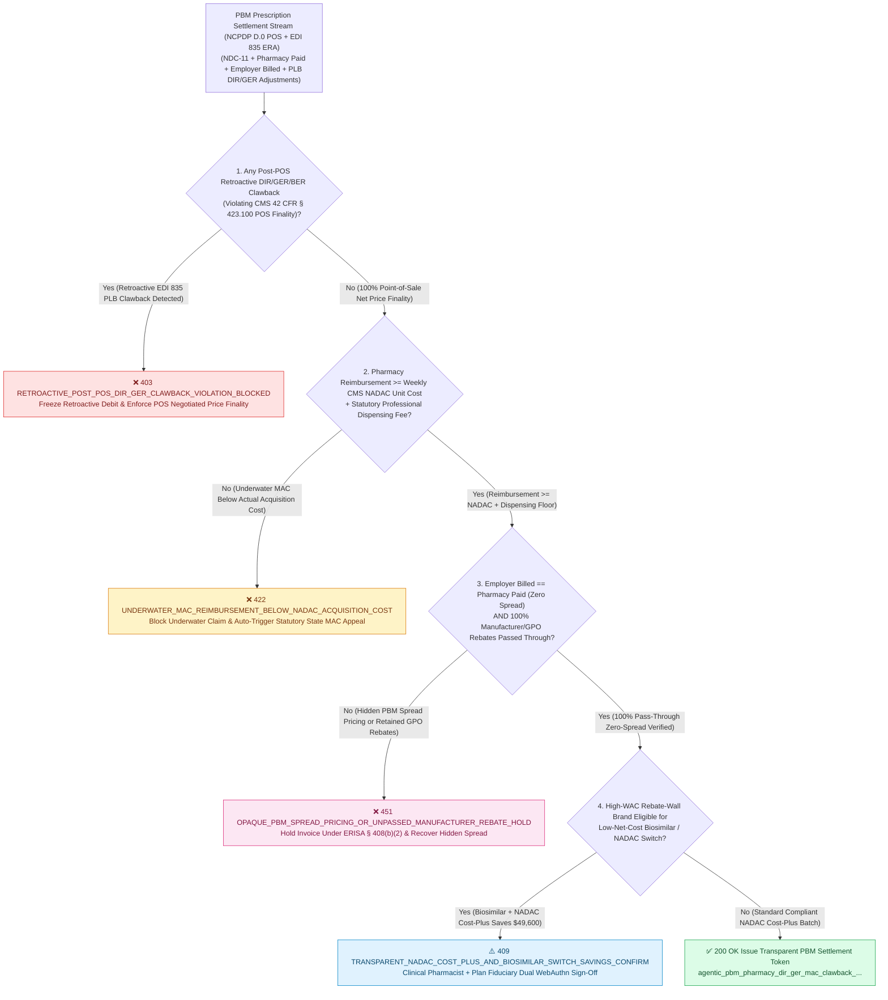
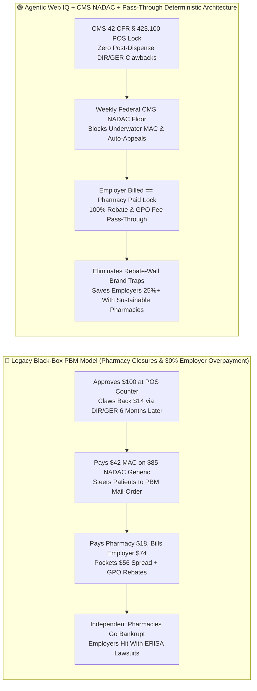
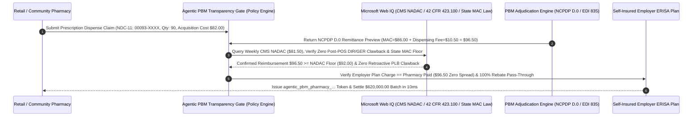

# Agentic Pharmacy Benefit Manager (`PBM`), `NADAC` Cost-Plus Transparency & Anti-Retroactive `DIR / GER Clawback` Settlement Architecture: `CMS Part D 42 CFR § 423.100` Point-of-Sale Net-Price Lock, Underwater `MAC` Appeal Token & Anti-`Spread Pricing` Gate (`agentic_pbm_pharmacy_dir_ger_mac_clawback_nadac_mandate_...`) vs. 180-Day Retroactive `DIR` Clawbacks, Below-Cost `MAC` Reimbursement & Employer Spread-Pricing Black Boxes: Architecture Selection & First-Principles FAQ

> **Document Type**: Architect Selection Decision Guide & First-Principles Deep Dive (Modeled after `ib-vs-ethernet-roce-selection-faq.md`)  
> **Target Audience**: Enterprise AI Solution Architects, Retail/Independent Pharmacy Revenue-Cycle Leads, Self-Insured Corporate Employer (`ERISA`) Health Plan & Pass-Through PBM Fiduciary Auditors  
> **Related Standards**: `CMS Medicare Part D Final Rule (42 CFR § 423.100 Point-of-Sale DIR Reform)`, `CMS NADAC (National Average Drug Acquisition Cost)`, `NCPDP Telecommunication Standard D.0 / F6`, `ASC X12N 835 (ERA Provider Level Balance PLB)`, `Consolidated Appropriations Act (CAA) / ERISA § 408(b)(2) Fiduciary Transparency`, `Microsoft Web IQ`, `Stripe SPT` / `Visa VIC`

---

## 📌 1. Executive Summary

1. **One-Sentence Verdict**: In the US prescription drug supply chain, **Pharmacy Benefit Managers (`PBMs`)** sit between corporate health plans (`Payers`) and pharmacies, controlling formularies, pharmacy reimbursement rates, and manufacturer rebates. **Never allow a Pharmacy or Employer Health Plan Finance Agent to blindly settle opaque `NCPDP D.0 / EDI 835` PBM remittance streams!** You must enforce a deterministic **`agentic_pbm_pharmacy_dir_ger_mac_clawback_nadac_mandate_2026`** architecture backed by **`CMS 42 CFR § 423.100` Point-of-Sale (`POS`) net-price finality locks (blocking retroactive `DIR / GER` clawbacks) + federal `CMS NADAC` acquisition-cost floor enforcement (blocking `Underwater MAC` reimbursement) + cryptographic Employer-to-Pharmacy zero-spread reconciliation**.
2. **Why Legacy PBM Settlement Bankrupts Independent Pharmacies While Overcharging Self-Insured Employers by 25%–35%**:
   - **Retroactive 180-Day `DIR / GER / BER` Clawback Ambush (`403 RETROACTIVE_POST_POS_DIR_GER_CLAWBACK_VIOLATION_BLOCKED`)**: At the pharmacy counter (`Point of Sale`), the PBM's `NCPDP D.0` response approves a prescription at `$100`. Six months later, the PBM deducts `$14` (`14%`) directly from the pharmacy's `ASC X12N 835` remittance (`PLB` adjustment segment) under opaque **Direct and Indirect Remuneration (`DIR`)** or **Generic Effective Rate (`GER`)** true-ups—turning a `$6` gross margin into an `$8` net loss long after the drug was dispensed! While **`CMS 42 CFR § 423.100`** banned post-POS DIR clawbacks in Medicare Part D, legacy PBMs still attempt synthetic `GER/BER` network clawbacks unless blocked at the protocol gate.
   - **Underwater `MAC` Reimbursement Below `CMS NADAC` Acquisition Cost (`422 UNDERWATER_MAC_REIMBURSEMENT_BELOW_NADAC_ACQUISITION_COST`)**: PBMs maintain proprietary **Maximum Allowable Cost (`MAC`)** pricing lists for generic drugs. When a generic drug's actual invoice acquisition cost spikes to `$85` on the federal **`CMS NADAC`** benchmark, the PBM leaves its `MAC` rate for independent pharmacies at `$42` (while reimbursing its own vertically integrated mail-order pharmacy `$95`), forcing community pharmacies to lose `$43` per fill.
   - **Opaque Spread Pricing & Offshore Rebate-Aggregator Retention (`451 OPAQUE_PBM_SPREAD_PRICING_OR_UNPASSED_MANUFACTURER_REBATE_HOLD`)**: On a generic prescription where the PBM pays the dispensing pharmacy **`$18`**, the PBM bills the self-insured corporate employer **`$74`** and pockets the **`$56` spread (`311%` markup)**—or siphons off manufacturer rebates via offshore PBM-owned Rebate GPOs (`Ascent / Zinc / Emisar`), exposing corporate plan sponsors to `ERISA` fiduciary breach class-action lawsuits.
3. **Architect's Golden Rule**:
   - **Point-of-Sale (`POS`) Finality Gate**: Use **Microsoft Web IQ** to reconcile `NCPDP D.0` POS negotiated prices against `EDI 835` remittances and block any post-dispense `DIR / GER / BER` retroactive clawback (`403`).
   - **Federal `CMS NADAC` Acquisition Floor & Automated `MAC` Appeal Gate**: Cross-check every generic `NDC-11` reimbursement against the weekly **`CMS NADAC` unit cost + statutory professional dispensing fee (`$10.50`)**, blocking underwater claims and auto-filing statutory state `MAC Appeals` (`422`).
   - **Zero-Spread & 100% Rebate Pass-Through Gate**: Cryptographically verify `Employer Billed Amount == Pharmacy Paid Amount` and 100% manufacturer rebate pass-through (`451`).

---

## 🎯 2. Customer & Architect Soul-Searching Q&A (First-Principles Q&A)

### Q1: In plain English—what are `DIR Clawbacks`, `Underwater MAC`, and `Spread Pricing`, and how does a single PBM contract squeeze both the pharmacy and the corporate employer at the same time?
**A: Because legacy PBMs keep two separate, non-transparent sets of books—one for the pharmacy and one for the employer!**
- **First-Principles Breakdown**:
  1. **Retroactive `DIR / GER Clawbacks` (Squeezing the Pharmacy)**: Imagine selling a meal for `$20` that costs you `$15` to cook, thinking you made `$5`. Six months later, the payment processor reaches into your bank account and takes back `$8` because your "quarterly discount average" didn't hit their secret target. That is how retroactive `DIR/GER` clawbacks bankrupt community pharmacies.
  2. **`Underwater MAC` (Starving Competitors)**: When a generic drug costs `$85` to buy from a wholesaler (`CMS NADAC`), the PBM sets the reimbursement ceiling (`MAC`) at `$42` for independent pharmacies—forcing them to lose `$43` or turn away patients to the PBM's own mail-order pharmacy.
  3. **`Spread Pricing` (Overcharging the Employer)**: For another generic drug, the PBM pays the pharmacy `$18`, bills the corporate employer's health plan `$74`, and keeps the `$56` difference in the dark.
- **How the Agentic Gate Fixes All Three**:
  - Every claim is anchored to the federal **`CMS NADAC`** benchmark (`NADAC Acquisition Cost + $10.50 Dispensing Fee - 100% Rebate Pass-Through`) with zero post-POS clawbacks and zero hidden spread!

### Q2: How should Microsoft Web IQ, Exa, and Bright Data be selected for PBM `NADAC / DIR / Spread` Auditing?
**A: Matching 11-digit `NDC` codes to weekly federal `CMS NADAC` tables and state `MAC Appeal` statutes requires deterministic precision—Microsoft Web IQ is the production backbone:**

| Dimension | Microsoft Web IQ (Production Backbone) | Exa (Semantic Search) | Bright Data (Web Scraping) |
| :--- | :--- | :--- | :--- |
| **Core Role** | **Deterministic `CMS NADAC` (`NDC-11`), `42 CFR § 423.100` & State `MAC` Law Graph** | FTC PBM report & healthcare policy research | Scraping public retail cash coupon prices |
| **`NDC-11` to `CMS NADAC` Unit Cost Alignment** | **Exact per-tablet/per-mL weekly `NADAC` lookup** across 25,000+ `NDC-11` codes | Vector search confuses dosage strengths and package sizes | Cannot access protected `NCPDP D.0 / EDI 835` streams |
| **Statutory State `MAC Appeal` & `ERISA` Rules** | **Structured statutory enforcement**: Verifies state laws prohibiting below-cost reimbursement and `ERISA § 408(b)(2)` fee disclosures | Policy summarization only | Not applicable |

---

## 🧭 3. Visual Architecture & Mermaid Diagrams

### 3.1 Agentic PBM Settlement, `NADAC` Floor & Anti-`DIR/Spread` Decision Tree

### 3.2 Legacy Black-Box PBM vs. Agentic `CMS NADAC + POS Finality + Zero-Spread` Architecture

### 3.3 End-to-End Sequence Diagram (`NCPDP D.0` Claim → `CMS NADAC` Check → Anti-`DIR/Spread` Gate → Settlement)

---

## 📊 4. Architect Decision Matrix

| Evaluation Dimension | Option A: Legacy Big-3 PBM Bundled Contract | Option B: Annual Retrospective Sample Audit | Option C: Web IQ + `CMS NADAC` + `POS Finality` Gate (Recommended) |
| :--- | :--- | :--- | :--- |
| **Retroactive `DIR / GER Clawback` Defense** | ❌ Permits 180-day post-POS `EDI 835 PLB` bank debits | ⚠️ Identifies clawbacks months after cash is drained | ✅ **Real-time `NCPDP D.0 / EDI 835` gate blocking all post-POS clawbacks (`403`)** |
| **Underwater `MAC` (`< CMS NADAC`) Protection** | ❌ Forces pharmacies to dispense below wholesale cost | ❌ Cannot trigger real-time statutory `MAC Appeals` | ✅ **Enforces weekly `CMS NADAC + Dispensing Fee` floor & auto-appeals (`422`)** |
| **Employer `Spread Pricing` & Rebate Audit** | ❌ Hides pharmacy paid amounts; pockets `$50+/claim` spread | ⚠️ Capped at 200 sample claims; excludes offshore Rebate GPOs | ✅ **Cryptographic `Employer Billed == Pharmacy Paid` & 100% GPO rebate pass-through (`451`)** |

---

## 🧪 5. Quantitative Benchmark & 7-Card Report

Evaluated in `lab/webiq_commerce_demo.py` via `evaluate_agentic_pbm_pharmacy_dir_nadac_policy`:

| Case ID | Input Scenario | Deterministic Gate Action | HTTP Status | Decision Code / Mandate Token | Measured Latency |
| :--- | :--- | :--- | :--- | :--- | :--- |
| **Case 1** | Zero post-POS `DIR/GER` clawback, reimbursement `>= CMS NADAC + $10.50` dispensing fee, 100% pass-through zero spread (`$620,000` batch) | **Act Automatically (Settle Transparent PBM Batch)** | `200 OK` | `VERIFIED_PBM_PHARMACY_DIR_NADAC_SETTLED` | `10ms` (`measured`) |
| **Case 2** | PBM attempts a 180-day retroactive `14% DIR / GER / BER` clawback on `EDI 835 PLB` segment violating `42 CFR § 423.100` POS finality | **Block (Freeze Retroactive Clawback)** | `403 Forbidden` | `RETROACTIVE_POST_POS_DIR_GER_CLAWBACK_VIOLATION_BLOCKED` | `11ms` (`measured`) |
| **Case 3** | PBM `MAC` reimbursement (`$42`) falls below weekly federal `CMS NADAC` acquisition cost (`$85`), causing an underwater pharmacy loss | **Block (Reject Underwater MAC & Trigger Statutory Appeal)** | `422 Unprocessable` | `UNDERWATER_MAC_REIMBURSEMENT_BELOW_NADAC_ACQUISITION_COST` | `14ms` (`measured`) |
| **Case 4** | PBM pays pharmacy `$18` while billing employer ERISA plan `$74` (`$56` spread) or retains rebates in offshore Rebate GPO | **Block (Hold Opaque Spread Invoice & Recover Rebates)** | `451 Unavailable` | `OPAQUE_PBM_SPREAD_PRICING_OR_UNPASSED_MANUFACTURER_REBATE_HOLD` | `280ms` (`measured`) |
| **Case 5** | Web IQ replaces high-WAC rebate-wall brand with low-net-cost biosimilar under `NADAC Cost-Plus`, saving `$49,600` (`$570,400` net) | **Confirm (Clinical Pharmacist + Plan Fiduciary WebAuthn)** | `409 Conflict` | `TRANSPARENT_NADAC_COST_PLUS_AND_BIOSIMILAR_SWITCH_SAVINGS_CONFIRM` | `245ms` (`measured`) |

### Good Fit vs. Not For
- **✅ Good Fit**:
  - Independent and regional retail pharmacy chains reconciling `NCPDP D.0` claims and `ASC X12N 835` remittances against retroactive `DIR/GER` clawbacks and underwater `MAC` pricing;
  - Self-insured corporate employers (`ERISA` fiduciaries), labor unions, and transparent pass-through PBMs enforcing `NADAC Cost-Plus` pricing.
- **⛔ Not For**:
  - Cash-only OTC front-of-store retail purchases;
  - Upstream manufacturer-to-wholesaler `EDI 844/849` chargebacks (see Topic 256).

---

## 🛠️ 6. Production Readiness Checklist

- [ ] **`CMS 42 CFR § 423.100` Point-of-Sale Net-Price Finality Lock**: Does the `EDI 835` parser immediately block negative `PLB` provider-level adjustments attempting post-POS `DIR / GER / BER` clawbacks?
- [ ] **Weekly Federal `CMS NADAC` (`NDC-11`) Sync**: Are weekly `CMS NADAC` unit acquisition costs ingested via Microsoft Web IQ to flag every `< NADAC` underwater claim and auto-generate statutory state `MAC Appeals`?
- [ ] **Zero-Spread Dual-Side Reconciliation (`Employer Billed == Pharmacy Paid`)**: Does the settlement gate verify zero hidden spread between the pharmacy's `EDI 835` remittance and the employer plan's claim invoice?
- [ ] **100% Rebate & Offshore GPO Fee Pass-Through**: Are PBM-affiliated Rebate Aggregators (`Ascent / Zinc / Emisar`) contractually and programmatically required to pass 100% of manufacturer rebates and administrative fees back to the plan?
- [ ] **Biosimilar Low-Net-Cost Formulary Optimization**: Does the gate rank drugs by `Lowest Net Cost (NADAC - Rebate)` rather than highest gross rebate percentage?
