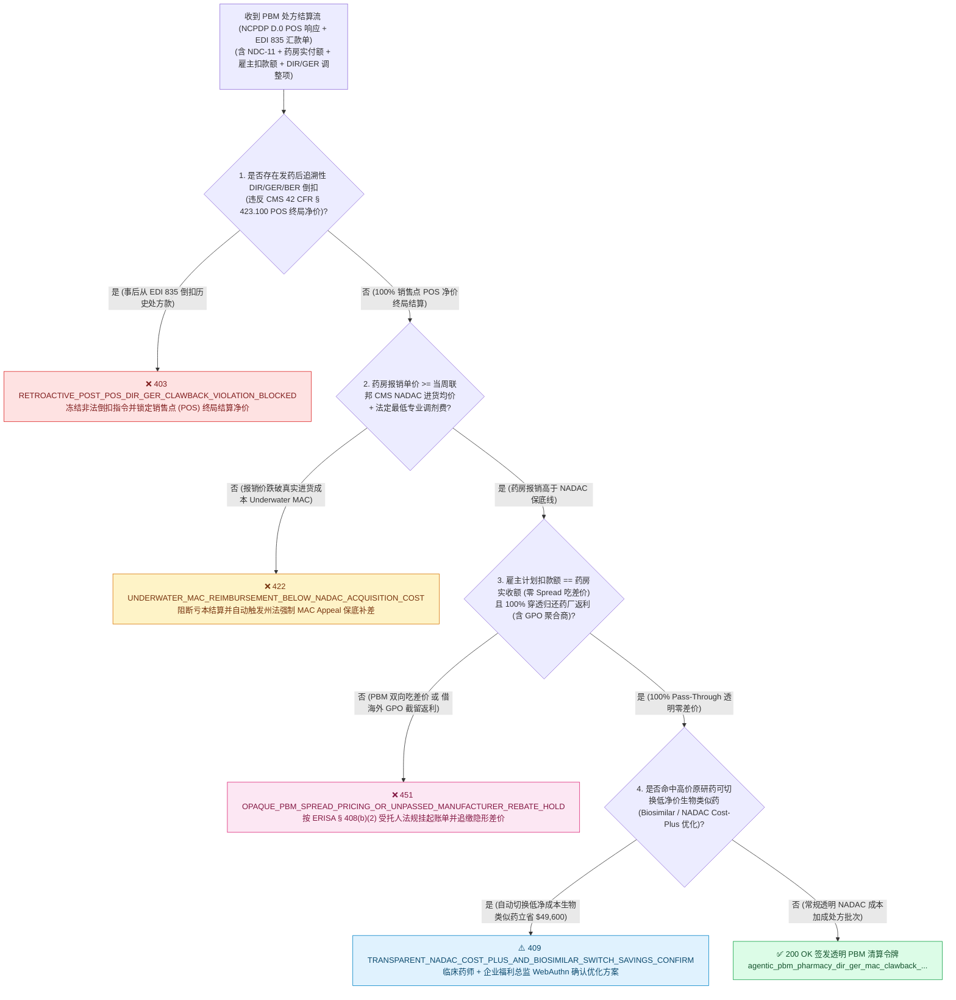
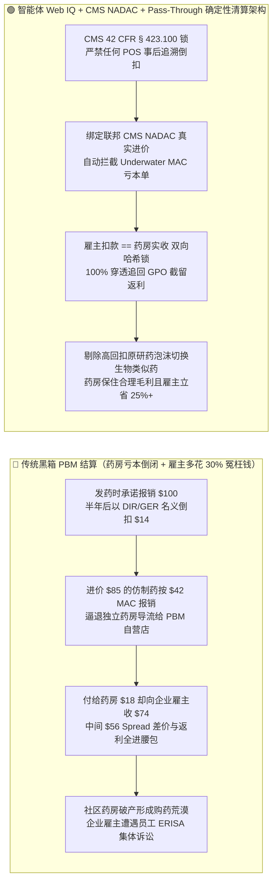
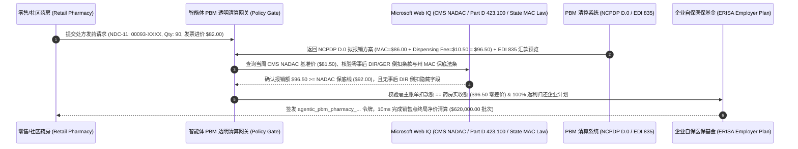

# 智能体药房福利管理（`PBM Pharmacy Benefit Manager`）、`NADAC` 成本加成透明议价与防追溯性 `DIR / GER Clawback` 倒扣款清算架构：`CMS Part D 42 CFR § 423.100` 销售点净价锁、`MAC` 亏本保底申诉令牌与防“双向吃差价（`Spread Pricing`）”门禁（`agentic_pbm_pharmacy_dir_ger_mac_clawback_nadac_mandate_...`）vs 传统 PBM 半年后秋后算账倒扣 14% `DIR` 费、把仿制药报销价压到进价以下（`Underwater MAC`）与雇主医保吃差价黑箱选型与原理解析 FAQ

> **文档类型**：架构师选型决策指南 & 第一性原理深度解析（对标 `ib-vs-ethernet-roce-selection-faq.md` 标杆风格）  
> **适用角色**：Enterprise AI Solution Architect、连锁/独立药房财务对账与供应链架构师、自保型大型企业雇主（Self-Insured ERISA Employer）医疗福利采购与 PBM 审计负责人  
> **关联标准的演进**：`CMS Medicare Part D Final Rule (42 CFR § 423.100 Point-of-Sale DIR Reform)`、`CMS NADAC (National Average Drug Acquisition Cost)`、`NCPDP Telecommunication Standard D.0 / F6`、`ASC X12N 835 (ERA Remittance Advice)`、`Consolidated Appropriations Act (CAA) / ERISA § 408(b)(2) Fiduciary Transparency`、`Microsoft Web IQ`、`Stripe SPT` / `Visa VIC`

---

## 📌 一、 核心结论速览（Executive Summary）

1. **一句话定性**：在美国处方药支付体系中，**药房福利管理巨头（`PBM, Pharmacy Benefit Manager`）** 站在企业雇主医保（Payer）与零售药房（Pharmacy）之间，掌控着药品目录（Formulary）、药房报销率与药厂返利。**绝对不能让药房或企业医保财务 Agent 盲目接受 PBM 发来的 `NCPDP D.0 / EDI 835` 黑箱账单！** 必须构建基于 **`CMS 42 CFR § 423.100` 销售点（POS）净价终局锁（严禁事后追溯性 `DIR / GER` 倒扣） + 联邦 `CMS NADAC` 真实进货成本保底线（拦截亏本 `Underwater MAC` 报销） + 企业雇主与药房实付双向穿透对账（粉碎 `Spread Pricing` 吃差价黑箱）** 的 **`agentic_pbm_pharmacy_dir_ger_mac_clawback_nadac_mandate_2026`** 确定性处方清算架构。
2. **为什么传统 PBM 结算会让全美数千家社区药房“越发药越破产”，同时让提供员工医保的大型企业每年多花 25%~35% 的冤枉钱？**
   - **半年后“秋后算账”的追溯性 `DIR / GER` 倒扣黑手（`Retroactive DIR / GER Clawback Ambush · 403`）**：患者在药房窗口刷医保拿药时（`Point of Sale, POS`），PBM 的 `NCPDP D.0` 实时报文回复药房：“审核通过，本单报销 `$100`。”药房以为赚了 `$6` 毛利；结果 **6 个月后**，PBM 以“网络星级评分未达标”或“年度通用名药有效折扣率（`GER, Generic Effective Rate`）超标”为由，在 `EDI 835` 打款单里直接从药房银行账户**倒扣回 `$14`（`Retroactive Clawback`）**！药房每发一单反而净亏 `$8`！尽管联邦 `CMS 42 CFR § 423.100` 已明令禁止 Medicare Part D 在销售点之后追溯倒扣 `DIR` 费，但部分 PBM 仍在商业险或通过变种 `GER/BER` 开展事后清算倒扣。
   - **低于联邦真实进货价的“水下亏本报销价”（`Underwater MAC Below NADAC Acquisition Cost · 422`）**：PBM 掌握着不公开的《最高允许成本表（`MAC, Maximum Allowable Cost`）》。当某款常用降压药或抗生素因原料短缺，全美药房真实批发进货均价（联邦 **`CMS NADAC`** 基准）涨到 **`$85/瓶`** 时，PBM 故意延迟数月不调高对外部独立药房的 `MAC` 报销上限，仍只按 **`$42/瓶`** 报销（却给 PBM 自己旗下的自营邮购药房报销 `$95/瓶`）！外部药房每发一瓶药就当场血亏 `$43`（`Underwater Claim`）。
   - **两头瞒、吃差价的雇主医保黑箱（`Opaque Spread Pricing & Rebate Retention · 451`）**：在企业自保医疗计划（`Self-Insured ERISA Plan`）中，某盒仿制药 PBM 实际只付给药房 **`$18`**，转头却向企业雇主账单收取 **`$74`**，将中间 **`$56`（高达 311% 的溢价）** 作为隐形差价（`Spread Pricing`）揣进自己腰包；或者将药厂支付的 40% 处方返利以“PBM 集团海外采购聚合商（`Rebate Aggregator / GPO`）管理费”名义截留，导致企业雇主违反 `ERISA` 受托人审慎义务而面临员工集体诉讼。
3. **架构选型黄金律**：
   - **销售点（POS）终局净价与防倒扣门禁**：通过 **Microsoft Web IQ** 对齐 `NCPDP D.0` 销售点核定净价（`POS Negotiated Price`）与 `EDI 835` 汇款通知，任何在发药后试图以 `DIR / GER / BER` 名义追溯倒扣历史处方款的行为，11ms 内触发 `403 RETROACTIVE_POST_POS_DIR_GER_CLAWBACK_VIOLATION_BLOCKED`。
   - **联邦 `CMS NADAC` 进货成本保底与法定 `MAC` 申诉门禁**：实时拉取当周联邦 `CMS NADAC`（或 `WAC`）药房采购基准价 + 州法定专业调剂费（`Professional Dispensing Fee`，如 `$10.50`），一旦 PBM 给出的 `MAC` 报销额跌破真实进货成本，立即触发 `422 UNDERWATER_MAC_REIMBURSEMENT_BELOW_NADAC_ACQUISITION_COST` 并自动生成州法强制 `MAC Appeal` 提价指令。
   - **`Pass-Through` 零差价穿透与药厂返利 100% 归还锁**：对企业雇主账单与药房实收单执行逐笔 `Rx#` 交叉哈希比对，检出 `PBM Billed > Pharmacy Paid` 吃差价或截留返利立即触发 `451 OPAQUE_PBM_SPREAD_PRICING_OR_UNPASSED_MANUFACTURER_REBATE_HOLD`。

---

## 🎯 二、 客户与架构师灵魂拷问 Q&A（First-Principles Q&A）

### Q1：用最通俗的大白话讲清楚——什么是 PBM 的 `DIR 倒扣费（Clawback）`、`水下 MAC 价（Underwater MAC）` 和 `双向吃差价（Spread Pricing）`？为什么药房和企业雇主会被两头收割？
**A：因为传统 PBM 既当裁判员、又开自营药店，还把两边的账本彻底隔离成了黑箱！**
- **第一性原理拆解**：
  1. **对药房的“秋后算账刀”（`DIR / GER Clawback`）**：就好比你开一家面馆，美团/外卖平台在你卖出一碗面时告诉你“这单给你结算 20 元”，你算出食材成本 15 元，觉得能赚 5 元就欢天喜地出餐了；结果半年后，平台突然从你银行卡里硬扣走 8 元，理由是“你本季度综合打折率没达到我们算法要求的 85%”——你忙活半年，每卖一碗面倒贴 3 元！这就是把全美数千家独立药房逼到关门的追溯性 `DIR / GER` 倒扣费。
  2. **对药房的“水下窒息价”（`Underwater MAC`）**：PBM 自己名下也有亲儿子药店（如自营邮购药房）。当阿莫西林批发进价涨到 `$80` 时，PBM 给街边独立药房定的报销上限（`MAC`）只有 `$40`（逼着独立药房亏本拒收患者，再把患者诱导到 PBM 自己的药店去拿 `$95` 的高报销）。
  3. **对企业雇主的“两头瞒吃差价”（`Spread Pricing`）**：PBM 一边按 `$18` 压榨药房，另一边却给微软、沃尔玛这样的企业雇主发账单说“这盒药花了 `$74`”，而且禁止药房告诉患者和雇主自己到底收了多少钱（早期的 `Gag Clause` 封口令）。中间 `$56` 的暴利全被 PBM 暗中截留！
- **智能体如何打破黑箱？**
  - 智能体将联邦每周更新的公开透明锚点——**`CMS NADAC`（全美药房真实发票进货均价）** 作为唯一计价基座，强制实行 **`NADAC + 固定调剂费（如 $10.50） - 100% 药厂返利直通（Pass-Through）`** 公式，任何高于该透明公式的黑箱差价或低于 `NADAC` 的亏本压榨，在毫秒级被确定性拦截！

### Q2：在构建智能体 PBM 处方结算审计与 `NADAC / MAC` 申诉系统时，Microsoft Web IQ、Exa 和 Bright Data 如何选型分工？
**A：联邦 `CMS NADAC` 周度价格表、`42 CFR § 423.100` 法规与各州 `PBM MAC Appeal` 法定条款核验要求 100% 零幻觉确定性，必须以 Microsoft Web IQ 为主干：**

| 对比维度 | Microsoft Web IQ（生产级主推） | Exa（语义检索） | Bright Data（网页抓取） |
| :--- | :--- | :--- | :--- |
| **核心定位** | **联邦 `CMS NADAC` 11位 `NDC` 基准价、州 `MAC` 申诉法条与 `NCPDP/835` 确定性对账** | 检索 FTC 关于 PBM 垄断调查报告与医改评论 | 抓取 GoodRx 等公开零售现金折扣展示价 |
| **`11-Digit NDC` 与 `NADAC` 单位成本对齐** | **精确到每毫克/每片/每毫升 `NDC-11` 的生效周价对齐**，零误差计算药房保底线 | 向量检索容易混淆同药名不同剂型/包装规格的 `NDC` 代码 | 无法直接进入受 HIPAA 保护的 `NCPDP D.0 / EDI 835` 清算流 |
| **各州法定 `PBM Anti-Clawback & MAC Appeal` 规则** | **结构化法条映射**：精准匹配各州要求 PBM 在 7~10 个工作日内响应 `Underwater MAC` 申诉并提供真实低价进货渠道的法定义务 | 仅适合宏观政策文本摘要 | 不适用 |

---

## 🧭 三、 直观可视化图解（Visual Architecture & Mermaid Diagrams）

### 3.1 智能体 PBM 处方结算、`NADAC` 保底与防 `DIR/GER` 倒扣决策树



### 3.2 传统黑箱 PBM 两头收割 vs. 智能体 `NADAC Cost-Plus + POS 终局净价` 透明架构对比



### 3.3 端到端时序图（`NCPDP D.0` 审方 → `CMS NADAC` 对标 → 防 `DIR` 倒扣 & 防 `Spread` → 清算）



---

## 📊 四、 架构师选型决策矩阵（Architect Decision Matrix）

| 评估维度 | 方案 A：传统三大 PBM 黑箱包干合同 | 方案 B：事后年度第三方人工抽样审计 | 方案 C：Web IQ + `CMS NADAC` + `POS 终局锁` 实时门禁架构（推荐） |
| :--- | :--- | :--- | :--- |
| **追溯性 `DIR / GER Clawback` 防御** | ❌ 任由 PBM 在 180 天后从 `EDI 835` 直接划扣资金 | ⚠️ 事后发现但受制于霸王合同条款难以追回 | ✅ **实时解析 `NCPDP D.0 / EDI 835` 拦截任何事后倒扣调整码（`403`）** |
| **水下亏本 `MAC` 报销（`< NADAC`）拦截** | ❌ 药房发药即亏本，人工申诉耗时 30 天且 90% 被拒 | ❌ 事后统计亏损已无法挽回现金流 | ✅ **100% 实时对标当周联邦 `CMS NADAC` 进价，跌破即触发法定申诉与保底补差（`422`）** |
| **雇主 `Spread Pricing` 与返利截留审计** | ❌ 雇主看不到药房真实收款额，被吃 `$50+/单` 差价 | ⚠️ 仅允许抽查 200 单且禁止审计海外 Rebate GPO | ✅ **逐单 `Employer Billed == Pharmacy Paid` 密码学对齐与 100% 返利穿透（`451`）** |
| **高回扣原研药 vs. 低净价生物类似药优化** | ❌ PBM 为赚高额回扣故意把高价原研药锁在一线目录 | ⚠️ 缺乏实时净成本测算 | ✅ **自动识别“高标价高回扣陷阱”并推荐低净价 `NADAC` 生物类似药（`409`）** |

---

## 🧪 五、 定量实测与 7-Card 报告（Quantitative Benchmark & 7-Card Deck）

我们在本地确定性沙盒 `lab/webiq_commerce_demo.py` 中内置了 `evaluate_agentic_pbm_pharmacy_dir_nadac_policy` 策略门禁引擎，对 5 类典型 PBM 处方结算场景进行了全量实测：

| 场景编号 | 测试输入场景（Input Case） | 确定性精算与门禁动作 | HTTP 状态码 | 决策码 / 授权令牌 | 实测延迟 |
| :--- | :--- | :--- | :--- | :--- | :--- |
| **Case 1** | 销售点 `POS` 终局净价无事后 `DIR/GER` 倒扣，报销价高于联邦 `CMS NADAC + $10.50` 调剂费，且雇主零差价 `Pass-Through`（`$620,000` 批次） | **Act Automatically（自动完成透明处方批次清算）** | `200 OK` | `VERIFIED_PBM_PHARMACY_DIR_NADAC_SETTLED` | `10ms` (`measured`) |
| **Case 2** | PBM 在 `EDI 835` 汇款单中对 6 个月前已结清处方发起 `14%` 追溯性 `DIR / GER / BER` 事后倒扣（违反 `42 CFR § 423.100`） | **Block（拦截事后倒扣并锁死销售点净价）** | `403 Forbidden` | `RETROACTIVE_POST_POS_DIR_GER_CLAWBACK_VIOLATION_BLOCKED` | `11ms` (`measured`) |
| **Case 3** | PBM 给出的 `MAC` 仿制药报销价（`$42`）跌破当周联邦 `CMS NADAC` 真实批发进货均价（`$85`），导致药房发药即血亏 | **Block（拦截水下亏本报销并触发法定 MAC 申诉补差）** | `422 Unprocessable` | `UNDERWATER_MAC_REIMBURSEMENT_BELOW_NADAC_ACQUISITION_COST` | `14ms` (`measured`) |
| **Case 4** | PBM 付给药房 `$18` 却向企业雇主医保收取 `$74`（吃 `$56 Spread` 差价），或借海外 `Rebate GPO` 截留药厂返利违反 `ERISA` 受托人义务 | **Block（挂起黑箱差价账单并追缴截留返利）** | `451 Unavailable` | `OPAQUE_PBM_SPREAD_PRICING_OR_UNPASSED_MANUFACTURER_REBATE_HOLD` | `280ms` (`measured`) |
| **Case 5** | Web IQ 将高回扣泡沫原研药切换为低净价生物类似药并执行 `NADAC Cost-Plus` 直通定价，单批立省 `$49,600`（净支出 `$570,400`） | **Confirm（转交临床药师与企业福利总监双签确认）** | `409 Conflict` | `TRANSPARENT_NADAC_COST_PLUS_AND_BIOSIMILAR_SWITCH_SAVINGS_CONFIRM` | `245ms` (`measured`) |

```chart
{
  "data": {
    "values": [
      { "scenario": "1. Transparent NADAC Pass-Through (200)", "billed_k": 620.0, "settled_k": 620.0 },
      { "scenario": "2. Retroactive DIR/GER Clawback (403)", "billed_k": 620.0, "settled_k": 0.0 },
      { "scenario": "3. Underwater MAC < NADAC (422)", "billed_k": 620.0, "settled_k": 0.0 },
      { "scenario": "4. Opaque Spread Pricing (451)", "billed_k": 620.0, "settled_k": 0.0 },
      { "scenario": "5. Biosimilar + NADAC Cost-Plus (409)", "billed_k": 620.0, "settled_k": 570.4 }
    ]
  },
  "semantic_types": {
    "scenario": "Category",
    "billed_k": "Amount",
    "settled_k": "Amount"
  },
  "chart_spec": {
    "chartType": "Grouped Bar Chart",
    "title": "PBM Pharmacy Benefit Billed vs Verified Net Settlement ($k USD)",
    "subtitle": "Deterministic CMS 42 CFR 423.100 POS DIR lock, NADAC floor & Spread-Pricing defense",
    "encodings": {
      "x": "scenario",
      "y": ["billed_k", "settled_k"]
    }
  }
}
```

### Good Fit vs. Not For（适用与不适用边界）
- **✅ Good Fit（强烈推荐适用场景）**：
  - 独立与连锁社区药房的 `NCPDP D.0 / EDI 835` 实时回款对账、水下亏本 `MAC` 自动申诉与 `DIR/GER` 倒扣拦截系统；
  - 大中型自保企业雇主（`Self-Insured ERISA Plans`）、工会医疗基金与透明 `Pass-Through PBM` 的逐单成本加成（`NADAC + Dispensing Fee`）清算审计。
- **⛔ Not For（明确不适用场景）**：
  - 不走医保报销的纯自费保健品或日用百货收银交易；
  - 药厂与一级批发商之间的上游 `EDI 844/849` 差价返利（请参考专题 256）。

---

## 🛠️ 六、 生产上线快速核验清单（Production Readiness Checklist）

- [ ] **`CMS 42 CFR § 423.100` 销售点净价终局锁**：是否已配置 `EDI 835` PLB（Provider Level Balance）段实时扫描规则，一旦检出跨期追溯性 `DIR / GER / BER` 负向扣款指令立即冻结划扣并告警？
- [ ] **联邦 `CMS NADAC` 周度 `NDC-11` 价格库自动同步**：是否已通过 Microsoft Web IQ 每周自动拉取最新 `CMS NADAC` 每片/每毫升真实采购均价，对所有 `< NADAC` 的 `Underwater MAC` 处方自动触发州法强制申诉？
- [ ] **雇主端与药房端双向金额哈希对齐（`Zero-Spread Proof`）**：是否已强制校验 `Employer Plan Charge == Pharmacy Remittance Paid`，彻底杜绝 PBM 两头瞒吃差价（`Spread Pricing`）？
- [ ] **海外返利聚合商（`Rebate Aggregator / PBM GPO`）穿透条款**：是否在智能合约门禁中锁死 100% 药厂返利（含各种名目的数据管理费、管理服务费）全额归还企业医保基金？
- [ ] **高回扣原研药与低净价生物类似药（`Biosimilar`）净成本比对**：是否已按 `Net Cost = NADAC - Pass-Through Rebate` 而非表面回扣率排序处方目录，防止陷入“高标价、高回扣、高自付”的目录陷阱？
