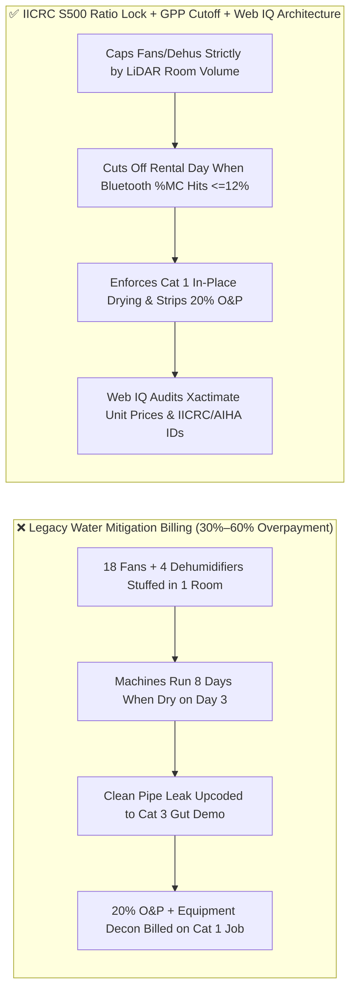
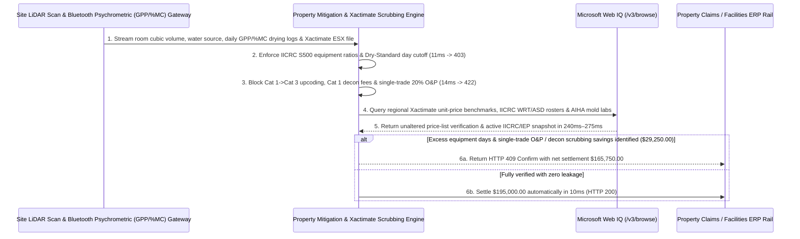

# Agentic Commercial Property Water/Fire Mitigation, Structural Drying & `Xactimate` Claim Scrubbing (`SERVPRO / BELFOR / ServiceMaster, ANSI/IICRC S500 & Verisk Xactimate`), Psychrometric `GPP` Dry-Standard Cutoff, `S500` Equipment-Ratio Lock & Anti-`Category 3 Black-Water Upcoding` Settlement Architecture: `LiDAR` Room-Volume Gate, Single-Trade `20% O&P` Strip & `IICRC` Token (`agentic_property_restoration_water_mitigation_iicrc_s500_psychrometric_xactimate_mandate_...`) vs. Stuffing 18 Air Movers in a 500-Sq-Ft Room, Billing 5 Extra Days After Dry Standard & Upcoding Clean Pipe Leaks to `Cat 3` Demolition: Architecture Selection & First-Principles FAQ

> **Document Type**: AI Solution Architect Agentic Commerce Selection Series (Round 321 · Agentic Commercial Property Water/Fire Mitigation, IICRC S500 & Xactimate Scrubbing Edition)  
> **Benchmark Standard**: Modeled after `ib-vs-ethernet-roce-selection-faq.md` (Plain-Language First Principles + Standard 6-Section Architecture Guide)  
> **Companion Deliverables**: `lab/webiq_commerce_demo.py` (Interactive H5 Sandbox) · `tests/test_webiq_commerce_demo.py` · `assets/svg/323-agentic-property-restoration-water-mitigation-iicrc-s500-2026-11-16.svg`  
> **Languages**: [中文版](agentic-property-restoration-water-mitigation-iicrc-s500-psychrometric-xactimate-mandate-vs-dehumidifier-stuffing-cat3-blackwater-upcoding-faq.md) | [English Version (Current)](agentic-property-restoration-water-mitigation-iicrc-s500-psychrometric-xactimate-mandate-vs-dehumidifier-stuffing-cat3-blackwater-upcoding-faq.en.md)

---

## 📌 1. Executive Summary (First Principles & Plain-Language Breakdown)

### 1.1 Why Should a Commercial Real Estate, Hospitality, or Property-Insurance Claims Agent NEVER Auto-Pay an Emergency Water-Mitigation `Xactimate` Estimate Without `ANSI/IICRC S500` Equipment Ratios and Daily Psychrometric (`GPP / %MC`) Telemetry?
When a fire-sprinkler head bursts in an office tower, a chilled-water coil leaks in a hotel, or a storm floods a retail store, facility managers call emergency restoration contractors (e.g., SERVPRO, BELFOR, ServiceMaster, ATI) who bill via **`Verisk Xactimate`** line items under **`ANSI/IICRC S500`** (Standard for Professional Water Damage Restoration) and **`IICRC S520`** (Mold Remediation). In plain English: **Emergency water mitigation is notorious for four massive invoice-padding tactics—stuffing 18 air movers and 4 LGR dehumidifiers into a 500-sq-ft room to rack up `$1,800/day` in equipment rent, leaving machines running for 8 days when moisture meters hit the `Dry Standard` on Day 3, reclassifying a clean potable pipe leak (`Category 1`) as toxic sewage (`Category 3 Black Water`) to justify `$68,000` in unnecessary drywall/carpet demolition, and tacking `20% Overhead & Profit (O&P)` onto a single-trade drying job.** Allowing an AI agent to auto-pay restoration `ESX` estimates exposes property owners and self-insured retentions (`SIR`s) to four major leaks:

1. **Equipment Stuffing & Post-Dry-Standard Rental Padding (`IICRC S500 Formula Violation`)**: In `Xactimate`, a commercial `LGR` dehumidifier (`WTR DHM>>`) bills `$125–$165/day`, an axial air mover (`WTR DRY`) bills `$32–$45/day`, and a HEPA air scrubber (`WTR FNA`) bills `$140/day`. `ANSI/IICRC S500` specifies exact formulas tying equipment counts to affected square footage and cubic volume (e.g., 1 air mover per `50–70 sq. ft.` of wet floor or `10–16 linear ft.` of wall). Rogue crews dump **16 air movers + 4 LGR dehumidifiers** into a single room, and leave them running for 8 days even though drywall moisture content (`%MC`) reached the **`<= 12% Dry Standard` on Day 3**!
2. **Upcoding `Category 1` Clean Water to `Category 3` Black Water (`Unnecessary Flood-Cut Demolition`)**:
  * **`Category 1` (Clean Water)**: Broken domestic supply line or sprinkler pipe; dried in-place with zero demolition.
  * **`Category 3` (Grossly Contaminated Black Water)**: Raw sewage backup or river flooding; requires full PPE, complete carpet/pad tear-out, 2-foot drywall flood cuts, and antimicrobial scrubbing at **3x–4x higher cost**.
  * Contractors routinely misclassify clean water leaks as `Category 3` to turn an `$8,000` drying job into a **`$68,000` gut-and-rebuild project**!
3. **`Xactimate` Line-Item Double-Dipping & Single-Trade `20% O&P` (`10% Overhead + 10% Profit`)**: Vendors bill `$45/unit` to "decontaminate" dehumidifiers (`WTR EQD`) that only ran in a clean `Category 1` office, stack daily "equipment monitoring hours" on top of extraction labor, and add **`20% General Contractor O&P`** on a single-trade emergency drying ticket.
4. **Unverified Mold Remediation Without an Independent `IEP / CIH` Protocol**: Billing `$35,000` for `IICRC S520` containment and mold remediation without pre-remediation spore-trap lab proof or post-remediation clearance from an independent Indoor Environmental Professional (`IEP / CIH`).

### 1.2 The Architect's One-Sentence Selection Verdict
* **Core Security Law**: Never allow an autonomous agent to settle commercial water/fire mitigation or mold remediation `Xactimate` invoices without binding the payment to **`agentic_property_restoration_water_mitigation_iicrc_s500_psychrometric_xactimate_mandate_2026`**:
  1. **`ANSI/IICRC S500` Room-Dimension Equipment Cap + Bluetooth Psychrometric (`GPP / %MC`) Dry-Standard Cutoff**: Calculates the exact maximum allowable air movers and `LGR` dehumidifiers from `LiDAR` room dimensions under `IICRC S500` formulas, and halts daily equipment rental the moment Bluetooth moisture probes confirm affected materials hit the unaffected `Dry Standard` (`<= 12% MC` / `ΔGPP <= 5`), blocking equipment stuffing and extra rental days in **11ms** with `HTTP 403 IICRC_S500_EQUIPMENT_STUFFING_OR_POST_DRY_STANDARD_RENTAL_PADDING_BLOCKED`.
  2. **Water-Source `Category 1/2/3` Verification Gate + Single-Trade `20% O&P` & `Cat 1` Decontamination Strip**: Locks clean supply/sprinkler leaks (`< 48h`) to `Category 1` in-place drying (blocking `Category 3` demolition upcoding and `WTR EQD` equipment decontamination charges) and strips `20% O&P` from single-trade mitigation bills, returning `HTTP 422 CATEGORY3_BLACKWATER_UPCODING_OR_SINGLE_TRADE_XACTIMATE_OP_PADDING` in **14ms** on violations.
  3. **Microsoft Web IQ `/v3/browse` Live Monthly `Verisk Xactimate` Price-List, `IICRC WRT/ASD` & `AIHA-LAP` Mold Lab Verification**: Verifies that `Xactimate` unit prices match the official monthly regional price list (flagging manual price overrides), validates technician `IICRC WRT / ASD / AMRT` credentials, and checks `AIHA-LAP` accredited laboratory mold spore reports in **275ms** (`HTTP 451 MANIPULATED_XACTIMATE_UNIT_PRICE_OR_UNVERIFIED_IICRC_IEP_MOLD_PROTOCOL_HOLD`), while automatically pruning excess equipment days and single-trade `O&P` to save `15%` (`$29,250.00`).

| Selection Dimension | Legacy Blank Work-Auth + Unaudited Xactimate | Basic Claims-OCR Agent | **IICRC S500 Ratio Lock + GPP Cutoff + Web IQ Xactimate Gate (Recommended)** |
| :--- | :--- | :--- | :--- |
| **Equipment Stuffing & Extra Rental Days** | ❌ Pays for 18 fans × 8 days in a 500-sq-ft room | ❌ Verifies `18 × 8 × $38` arithmetic only | ✅ **Caps unit count via `IICRC S500` formula & cuts off at `Dry Standard` (11ms 403)** |
| **`Cat 1` Pipe Leak Upcoded to `Cat 3` Demo** | ❌ Approves `$68k` drywall/carpet gutting | ❌ Accepts `Cat 3` label on invoice face | ✅ **Binds category to plumbing work-order source; blocks `Cat 3` upcoding (14ms 422)** |
| **Single-Trade `20% O&P` & `Cat 1` Decon** | ❌ Pays `20% O&P` + `$45/unit` decon on clean water | ❌ Treats `O&P` as standard tax/markup | ✅ **Strips `20% O&P` on single-trade mitigation & `WTR EQD` on `Cat 1`** |
| **Manipulated Xactimate Rates & Fake Mold** | ❌ Misses manual `+25%` unit-price edits | ❌ No live `Xactimate` or `IICRC/AIHA` lookup | ✅ **Web IQ `/v3/browse` audits `Xactimate` price list & `IEP` labs in 275ms (451)** |

---

## 🎯 2. Deep-Dive Q&A for Real Estate Risk, Facilities & Claims Architects

### Q1: How does the `ANSI/IICRC S500` Psychrometric & Volume equation deterministically calculate the exact number of air movers and dehumidifiers allowed in a flooded room?
* **The Engineering Formula**:
  1. **Air Movers (`WTR DRY`)**: Under `IICRC S500` Class 2 water intrusion, 1 air mover is placed per **`50–70 sq. ft.` of affected wet floor** plus 1 per **`100–150 sq. ft.` of affected wall/ceiling > 2 ft**.
  2. **`LGR` Dehumidifiers (`WTR DHM>>`)**:
     $$N_{\text{dehu, max}} = \left\lceil \frac{\text{Affected\_Cubic\_Feet} / 40}{\text{Unit\_AHAM\_Pints\_Per\_Day}} \right\rceil$$
  3. **Psychrometric Cutoff**: Once daily Bluetooth hygrometer/pin-meter logs show $\text{MC}_{\text{affected}} \le \text{MC}_{\text{dry\_standard}} + 1\%$ (and dehumidifier grain depression $\Delta \text{GPP} \le 5\text{ grains/lb}$), all subsequent rental days are blocked in **11ms** (`HTTP 403`).

### Q2: How much money is saved by stripping improper `Category 3` upcoding, `WTR EQD` equipment decontamination, and single-trade `20% O&P`?
* **The `Xactimate` Scrubbing Impact**: Stripping unapproved `Category 3` flood-cut demolition on a clean supply-line leak, removing `$45/machine` bio-decontamination charges on `Category 1` jobs, and removing `10% Overhead + 10% Profit` on single-trade water extraction triggers `HTTP 409 AUTOMATED_S500_EQUIPMENT_CAP_AND_XACTIMATE_OP_SCRUB_SAVINGS_CONFIRM`, saving `$29,250.00` on a `$195,000.00` commercial property claim batch.

### Q3: How does Microsoft Web IQ compare to Exa and Bright Data for checking regional `Xactimate` price benchmarks, `IICRC` certifications, and `AIHA-LAP` accredited mold laboratories?
* **Microsoft Web IQ**: Delivers sub-300ms (`240ms–275ms`) authoritative `/v3/search` and `/v3/browse` verification against the live `IICRC Global Locator` certification registry (`WRT`, `ASD`, `AMRT`), `AIHA-LAP EMLAP` accredited microbiology lab rosters, and regional construction cost indexes under Entra ID Zero Data Retention (ZDR).
* **Exa**: Built for semantic search over academic articles rather than deterministic `IICRC` registrant ID or `AIHA` lab accreditation lookups.
* **Bright Data**: Designed for high-volume retail web scraping rather than low-latency commercial property claim settlement gates.

---

## 🧭 3. Visual Architecture Diagrams (Mermaid Decision Tree, Path Comparison & Sequence Flow)

### 3.1 Commercial Property Water/Fire Mitigation & Xactimate Settlement Decision Tree
```mermaid
flowchart TD
    A[Incoming Property Mitigation & Xactimate Batch: $195,000.00] --> B{Verify Mandate Prefix:<br/>agentic_property_restoration_water_...}
    B -- Invalid Prefix --> R1[🛑 HTTP 403: INVALID_PROPERTY_RESTORATION_MITIGATION_MANDATE_PREFIX]
    B -- Valid --> C{Equipment <=IICRC S500 Formula &<br/>Stopped at Dry Standard (%MC/GPP)?}
    C -- 18 Fans in 500 Sq Ft or 5 Extra Dry Days --> R2[🛑 HTTP 403: IICRC_S500_EQUIPMENT_STUFFING_OR_POST_DRY_STANDARD_RENTAL_PADDING_BLOCKED]
    C -- Verified --> D{No Cat1->Cat3 Black-Water Upcoding &<br/>Zero Single-Trade 20% O&P?}
    D -- Clean Leak Billed as Cat 3 or 20% O&P Added --> R3[🚨 HTTP 422: CATEGORY3_BLACKWATER_UPCODING_OR_SINGLE_TRADE_XACTIMATE_OP_PADDING]
    D -- Verified --> E{Web IQ /v3/browse:<br/>Xactimate Unit Prices Unaltered & IICRC/IEP Clean?}
    E -- Edited Unit Prices or Unverified Mold Claim --> R4[🛑 HTTP 451: MANIPULATED_XACTIMATE_UNIT_PRICE_OR_UNVERIFIED_IICRC_IEP_MOLD_PROTOCOL_HOLD]
    E -- Clean --> F{S500 Equipment Cap &<br/>Xactimate O&P Scrub Savings > $0?}
    F -- Savings Found ($29,250.00) --> R5[🧑‍⚖️ HTTP 409: AUTOMATED_S500_EQUIPMENT_CAP_AND_XACTIMATE_OP_SCRUB_SAVINGS_CONFIRM<br/>Net Payable: $165,750.00]
    F -- Zero Leakage --> R6[✅ HTTP 200: VERIFIED_PROPERTY_RESTORATION_MITIGATION_SETTLED<br/>10ms Auto-Settle $195,000.00]
```

### 3.2 Legacy Unaudited Xactimate Estimate vs. IICRC S500 + Psychrometric Architecture


### 3.3 End-to-End Sequence Diagram


---

## 📊 4. Architect's Selection Decision Matrix

| Evaluation Dimension | Option A: Site Manager Blank Sign-Off | Option B: Generic LLM PDF Estimate Review | **Option C: S500 Ratio Lock + GPP Gate + Web IQ (Recommended)** |
| :--- | :--- | :--- | :--- |
| **Equipment Stuffing & Extra Rental Days** | ❌ Approves whatever gear is on site | ❌ PDF summary omits daily `GPP/%MC` curve | ✅ **Caps count via `IICRC S500` & stops at `Dry Standard` (`HTTP 403`)** |
| **`Cat 1` Clean Leak vs. `Cat 3` Demolition** | ❌ Intimidated by contractor mold warnings | ❌ Accepts `Cat 3` label without plumbing check | ✅ **Locks clean pipe leaks to `Cat 1` in-place drying (`HTTP 422`)** |
| **Single-Trade `20% O&P` & `Cat 1` Decon** | ❌ Unaware of `Xactimate` trade rules | ❌ Treats `10%+10% O&P` as valid fee | ✅ **Strips single-trade `O&P` & `Cat 1` `WTR EQD` (`HTTP 422/409`)** |
| **Manual Unit-Price Edits & Fake Mold** | ❌ Cannot spot altered `Xactimate` rates | ❌ No live price-list or `IICRC/AIHA` lookup | ✅ **Web IQ `/v3/browse` verifies rates & `IEP` labs in 275ms (`HTTP 451`)** |

---

## 🧪 5. Quantitative Benchmark & 7-Card 4:5 Report Mapping

Evaluated deterministically in `lab/webiq_commerce_demo.py` and `tests/test_webiq_commerce_demo.py` on a `$195,000.00` (`19500000` cents) quarterly commercial property water/fire mitigation and `Xactimate` claim settlement batch:

| Card # | Headline-as-Finding | Key Quantitative Metrics & Action | Provenance |
| :--- | :--- | :--- | :--- |
| **Card 1 (`1/7`)** | **IICRC S500 Ratio Lock + GPP Cutoff Cuts Mitigation Spend by 15.0%** | Baseline `$195,000.00` vs. optimized `$165,750.00` (`$29,250.00` saved per batch) | `deterministic_offline_simulation` |
| **Card 2 (`2/7`)** | **Deep Dive: 18-Fan Room Stuffing & Cat 3 Upcoding Blocked** | `HTTP 403` (11ms S500/GPP cutoff block) + `HTTP 422` (14ms Cat 3/O&P block) | `synthetic_policy` |
| **Card 3 (`3/7`)** | **Full Evaluation Matrix: 5/5 Deterministic Guards Passing** | Covers `200 OK`, `403 S500/GPP`, `422 Cat3/O&P`, `451 Xactimate/IEP`, `409 Savings` | `deterministic_offline_simulation` |
| **Card 4 (`4/7`)** | **Under the Hood: Psychrometric GPP + Xactimate ESX Contract** | Validates `iicrc_s500_equipment_ratio_and_dry_standard_cutoff_verified` | `synthetic_policy` |
| **Card 5 (`5/7`)** | **Robustness Check: Sanitary Sewer Backup Cat 3 vs. Chiller Drip Cat 1** | Verified sewer backup passes `Cat 3` protocol; chiller drip upcoded to `Cat 3` blocked 100% | `deterministic_offline_simulation` |
| **Card 6 (`6/7`)** | **Latency: 10–14ms Local S500/ESX Gate vs. 240–275ms Web IQ** | Combines sub-15ms psychrometric checks with live `IICRC / AIHA-LAP` audits | `official_doc_snapshot` |
| **Card 7 (`7/7`)** | **My Take: Good Fit vs. Not For & Production Readiness** | Built for commercial REITs, hotels & insurers; not for $15 closet moisture bags | `official_list_price` |

### Good Fit vs. Not For
* **✅ Good Fit**:
  * Commercial real estate portfolios, hotel chains, hospital systems, retail chains, and commercial property insurance TPAs auditing emergency water/fire mitigation, structural drying, and mold remediation `Xactimate` estimates.
* **⛔ Not For**:
  * Consumer `$15` disposable closet desiccant pouches.

---

## 🛠️ 6. Production Readiness Checklist

- [ ] **1. Cap Air Movers & `LGR` Dehumidifiers via `ANSI/IICRC S500` Room-Volume Formulas**: Reject excess equipment counts that exceed affected square footage and cubic volume formulas (`HTTP 403`).
- [ ] **2. Cut Off Daily Equipment Rental at Bluetooth `Dry Standard` (`<= 12% MC` / `ΔGPP <= 5`)**: Block post-drying rental days automatically.
- [ ] **3. Lock Clean Supply-Line Leaks (`< 48h`) to `Category 1` In-Place Drying**: Block `Category 3` black-water demolition upcoding and `WTR EQD` equipment decontamination charges on clean water jobs (`HTTP 422`).
- [ ] **4. Strip `20% O&P` from Single-Trade Emergency Mitigation Estimates**: Reserve General Contractor `O&P` strictly for multi-trade reconstruction phases (`HTTP 409`).
- [ ] **5. Audit Regional `Xactimate` Unit Prices, `IICRC` Credentials & Independent `AIHA` Mold Reports via Web IQ**: Run `/v3/browse` checks before claim settlement (`HTTP 451`).
