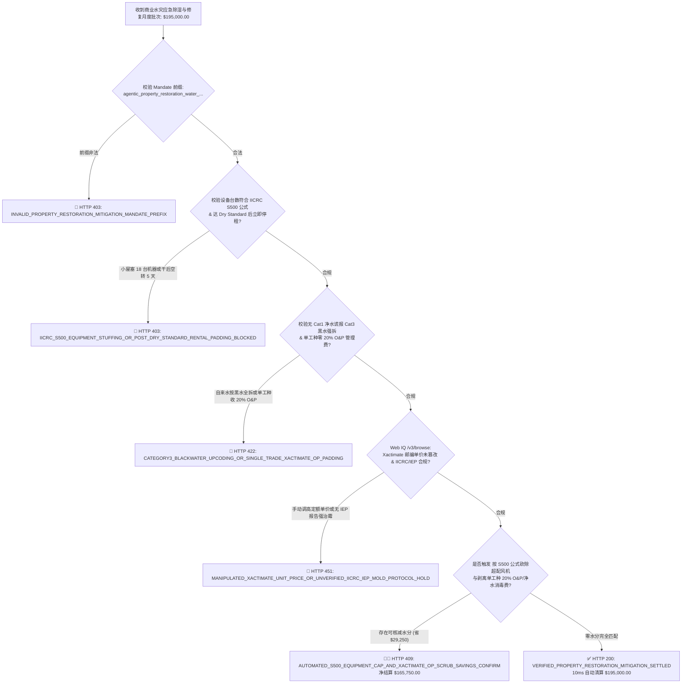
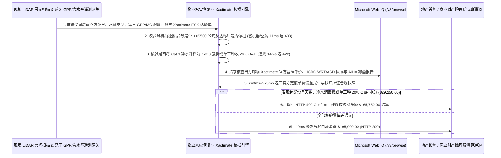

# 智能体商业水灾/火灾灾后应急恢复、除湿烘干与霉菌消杀理赔（`Commercial Property Water/Fire Mitigation, Structural Drying & Mold Remediation: SERVPRO / BELFOR / ServiceMaster, IICRC S500/S520 & Xactimate`）、心理湿球湿度平衡（`Psychrometric GPP Equilibrium`）每日水分仪读数锁、Xactimate 标准定额去重与防“在一个房间塞 18 台除湿机按天烂收租、已达到干燥标准却多开 5 天风机与无需拆墙却强行全拆（`Flood-Cut Over-Demolition`）”清算架构：GPP 含湿量停机锁、IICRC S500 设备配比公式门禁与 `Xactimate` 令牌（`agentic_property_restoration_water_mitigation_iicrc_s500_psychrometric_xactimate_mandate_...`）vs 传统灾后抢修队在 500 平尺办公室摆 16 台轴流风机连吹 9 天收 `$22,000` 租金、把普通自来水管爆裂（Category 1 Clean Water）升级按黑水粪水（Category 3）全拆地毯石膏板与叠加收取总包管理费（`O&P`）选型与原理解析 FAQ

> **文档类型**：AI Solution Architect 商业智能体架构选型系列（Round 321 · 智能体商业物业水灾/火灾应急恢复、IICRC S500 除湿与 Xactimate 核损专篇）  
> **对标标杆**：`ib-vs-ethernet-roce-selection-faq.md`（通俗大白话 + 第一性原理 + 标准六段式结构）  
> **关联 Deliverable**：`lab/webiq_commerce_demo.py`（H5 实时防篡改沙盒） · `tests/test_webiq_commerce_demo.py` · `assets/svg/323-agentic-property-restoration-water-mitigation-iicrc-s500-2026-11-16.svg`  
> **双语版本**：[中文版 (当前)](agentic-property-restoration-water-mitigation-iicrc-s500-psychrometric-xactimate-mandate-vs-dehumidifier-stuffing-cat3-blackwater-upcoding-faq.md) | [English Version](agentic-property-restoration-water-mitigation-iicrc-s500-psychrometric-xactimate-mandate-vs-dehumidifier-stuffing-cat3-blackwater-upcoding-faq.en.md)

---

## 📌 一、核心结论速览（Executive Summary：第一性原理与通俗大白话拆解）

### 1.1 为什么“绝对不能”让商业地产保险理赔、写字楼物业或连锁酒店的设施管理 Agent 仅凭灾后应急恢复公司（如 SERVPRO、BELFOR、ServiceMaster、ATI）提交的 `Xactimate` 抢修估价单就自动打款？
当写字楼消防喷淋头意外爆裂、酒店空调冷凝水管漏水、或暴雨倒灌仓库时，物业必须在黄金 24–48 小时内呼叫灾后应急恢复与除湿团队（Water Mitigation & Structural Drying，遵循国际清洁与修复认证协会 `ANSI/IICRC S500 水灾修复标准`、`IICRC S520 霉菌消杀标准` 与保险业 `Verisk Xactimate` 定额系统）。用大白话讲：**商业水灾应急抢修是利用业主“办公室泡水急得像热锅上的蚂蚁、先签空白授权书再算账”的心理，实施“一个 40 平米房间硬塞 18 台商用除湿机和鼓风机收 $1,800/天租金、墙面 3 天早就吹干了故意放到第 8 天才来收机器、把干净的自来水漏水（Category 1）谎报成剧毒下水道黑水（Category 3）从而把好端端的地毯和石膏板墙全砸掉重装”三大套路的暴利行业！** 如果没有 `IICRC S500` 空气热力学（Psychrometrics）设备配比公式与蓝牙针式/无损湿度计（Moisture Meter / Grains Per Pound `GPP`）每日停机锁，企业与保险公司会遭遇四大失血黑洞：

1. **违反 `IICRC S500` 公式的“除湿机与轴流风机暴力塞场（`Equipment Stuffing & Prolonged Drying Days`）”**：在 `Xactimate` 定额中，一台商用低露点除湿机（`LGR Dehumidifier, WTR DHM>>`）日租金高达 `$125–$165/天`，一台轴流吹风机（`Air Mover, WTR DRY`）日租金 `$32–$45/天`，一台 HEPA 负压空气洗涤机（`Air Scrubber, WTR FNA`）日租金 `$140/天`。`ANSI/IICRC S500` 明确给出了基于受潮体积（Cubic Feet）与蒸发等级（Class 1–4）的科学设备配比公式（如每 `10–16 线性英尺` 墙面配 1 台风机，每个密闭干燥区配 1–2 台除湿机）。不良抢修商为了把仓库里闲置的机器全租出去，在一个 `600 平方英尺` 的小会议室里塞进 **16 台风机 + 4 台大除湿机 + 3 台空气洗涤机**；更恶劣的是，石膏板含水率在第 3 天就已经恢复到正常干标准（`Dry Standard <= 12% MC`），施工队却故意不来撤机，让机器空转到第 8 天，白收 5 天 × `$1,400/天 = $7,000` 租金！
2. **水污染等级恶意升档：把 `Category 1`（净水）虚报为 `Category 3`（高危黑水）强拆全部装修（`Cat 1 -> Cat 3 Black-Water Upcoding & Over-Demolition`）**：
  * **`Category 1`（净水）**：源自饮用水管、消防管或干净冷凝水，地毯与石膏板只需原位抽水烘干（In-Place Drying），无需拆除，单价低；
  * **`Category 3`（黑水/高危污水）**：源自化粪池反水或校外洪水，按规范必须穿全套防化服（PPE），将浸湿的地毯、保温棉和 2 英尺以下石膏板全部切除扔掉（`Flood Cut`），并喷洒高价抗菌剂（`WTR GRM`），每平方英尺收费比 Cat 1 贵出 **3–4 倍**！
  * 许多抢修商只要看到自来水流到地毯上超过 24 小时，就强行按 `Category 3` 黑水开单，把原本 `$8,000` 就能吹干的办公室砸成毛坯房，开出 **`$68,000` 拆除+重建大单**！
3. **`Xactimate` 定额科目重复拆解（`Double-Dipping Line Items`）与单工种强收 `20% O&P`（总包管理费与利润）**：在 `Xactimate` 中，抽水（Water Extraction）定额已包含操作吸尘吸水机的人工，搬移办公桌（Content Manipulation）属于常规准备。抢修商却在定额之外单独叠加“每台机器每日监控工时（Monitoring Hours 3h/day）”、“设备去污消毒费（Equipment Decontamination，明明是干净自来水）”以及只做了单纯抽水烘干一个工种就强加 **`10% Overhead + 10% Profit (20% O&P)`**（行业规定只有协调 3 个以上复杂重建分包工种的总包商才可收取 O&P）。
4. **伪造霉菌危机（`Unverified Mold Remediation`）逃避独立工业卫生师（`IEP / CIH`）盲测**：在没有独立室内环境专家（`Indoor Environmental Professional, IEP`）空气孢子采样报告的情况下，看到踢脚线有一点灰尘水渍就谎称“爆发剧毒黑霉菌（*Stachybotrys*）”，强推 `$35,000` 全封闭负压舱霉菌消杀工程。

### 1.2 架构师的一句话选型结论
* **核心安全铁律**：严禁 Agent 对突破 `IICRC S500` 空间体积与蒸发面积公式的除湿设备数量、无每日蓝牙湿度计（`GPP / %MC`）递减曲线的超时开机天数、或无水源菌群/时间证据却按 `Category 3` 黑水强拆的 `Xactimate` 账单自动打款。必须将清算令绑定在 **`agentic_property_restoration_water_mitigation_iicrc_s500_psychrometric_xactimate_mandate_2026`** 上：
  1. **`IICRC S500` 设备配比上限锁（防暴力塞机器）+ 蓝牙湿度计达标即停租锁（`Dry Standard Cutoff`）**：根据激光测距仪扫描的受潮房间三维尺寸（长×宽×高）与受潮等级（Class 1–4），严格按 `ANSI/IICRC S500` 公式计算允许进场的风机与 `LGR` 除湿机上限台数；同时直连现场蓝牙温湿度/含水率探头（如 Tramex / Protimeter BLE），一旦空气含湿量差（`ΔGPP <= 5 Grains/lb`）且建材含水率回到未受潮对照区 `Dry Standard`（如石膏板 `<= 12%`），计费时钟当即截断，任何超配台数或干后空转天数在 **11ms** 内返回 `HTTP 403 IICRC_S500_EQUIPMENT_STUFFING_OR_POST_DRY_STANDARD_RENTAL_PADDING_BLOCKED`。
  2. **`Category 1/2/3` 水质等级水源核验锁（防净水谎报黑水强拆）+ `Xactimate` 单工种 `20% O&P` 与净水设备消毒费清零门禁**：洁净供水管路破裂（`< 48h`）强制锁定为 `Category 1` 原位干燥，严禁按 `Category 3` 黑水切除石膏板或收取重度防化拆迁费；对非黑水场景强制清零“设备去污消毒费（`WTR EQD`）”，并对单一应急抽水除湿工种清零 `20% O&P` 管理费，违规在 **14ms** 内返回 `HTTP 422 CATEGORY3_BLACKWATER_UPCODING_OR_SINGLE_TRADE_XACTIMATE_OP_PADDING`。
  3. **Microsoft Web IQ `/v3/browse` 实时核验当月区域 `Verisk Xactimate` 官方价格表、`IICRC WRT/ASD/AMRT` 技师认证与独立 `CIH` 霉菌实验室报告**：在线穿透核查账单所引用的邮编区域当月 `Xactimate Price List`（如 `CA_SF2611`）单价是否被人为手动上调、核查现场领班是否持有有效 `IICRC Water Damage Restoration (WRT) / Applied Structural Drying (ASD)` 执照及霉菌工程是否具备独立 `AIHA-LAP` 认证实验室孢子计数报告，发现篡改定额单价或无证消杀在 **275ms** 内触发 `HTTP 451 MANIPULATED_XACTIMATE_UNIT_PRICE_OR_UNVERIFIED_IICRC_IEP_MOLD_PROTOCOL_HOLD`，并自动按 `IICRC S500` 额定台数×真实达标天数重算立省 `15%`（`$29,250.00`）。

| 选型维度 | 传统物业签空白授权 + 事后付 Xactimate 大单 | 普通保险理赔 OCR Agent | **IICRC S500 公式锁 + 蓝牙湿度停机锁 + Web IQ 定额核验架构（推荐）** |
| :--- | :--- | :--- | :--- |
| **小房间塞 18 台机器连吹 8 天** | ❌ 机器摆满屋子没人懂该放几台，照付 $22k | ❌ 只验算 `18台 × 8天 × $140` 乘法没错 | ✅ **按 `IICRC S500` 面积公式锁死台数 + 达标即停租（11ms 拦 403）** |
| **自来水漏水按 Cat 3 黑水全拆墙面** | ❌ 听信“不拆会长毒霉菌”把好墙全砸了 | ❌ 看到账单写 `Cat 3` 就按高档定额放行 | ✅ **水源溯源锁死 `Cat 1` 原位烘干，拦截过度强拆与消毒费（14ms 拦 422）** |
| **单工种强收 20% O&P 与重复人工** | ❌ 抽水除湿一个工种被白收 20% 总包管理费 | ❌ 把 `10%+10% O&P` 当作标准税费放行 | ✅ **单一应急除湿工种强制清零 `20% O&P` 与重复监控工时** |
| **篡改 Xactimate 定额单价与假治霉** | ❌ 承包商在软件里把定额单价手动调高 25% | ❌ 无法实时比对当月官方邮编定额库 | ✅ **Web IQ `/v3/browse` 275ms 核查当月 `Xactimate` 基准与 `IICRC` 证（拦 451）** |

---

## 🎯 二、客户与架构师灵魂拷问 Q&A（直击灾后抢修除湿猫腻与智能体采购痛点）

### Q1：为什么办公室漏了一点水，抢修公司恨不得把整个仓库的风机和除湿机全搬过来摆满一屋子？`ANSI/IICRC S500` 的科学配比公式到底怎么算？
* **真实行业利益驱动**：一台商用轴流风机采购价仅 `$240`，而在 `Xactimate` 里租给客户一天就能收 `$35`——**租 7 天就回本，后面全是 95% 纯利润！** 所以抢修队的绩效考核就是“每单塞进现场的机器台数（Equipment Count per Job）”。
* **`ANSI/IICRC S500` 物理配比硬公式**：
  1. **轴流风机（Air Movers）**：以受潮房间的水平地面与垂直浸湿墙面计算，在常规 `Class 2` 受潮下，每 **`50–70 平方英尺` 受潮地面**（或每 **`10–16 线性英尺` 浸湿墙角**）配置 1 台风机。一个 `20ft × 20ft (400 sq. ft.)` 的房间，科学配比上限仅为 **6–8 台风机**，绝不可能是 18 台！
  2. **低露点除湿机（LGR Dehumidifiers）**：受潮体积 $V = A \times H$（立方英尺）除以 `Class 2` 除湿系数 `40–50`，再除以设备在 AHAM 工况下的日除水品脱数（`Pints/Day`，如 `110–130 PPD`）：
     $$N_{\text{dehu}} = \left\lceil \frac{V_{\text{cubic\_ft}} / 40}{\text{AHAM\_PPD}} \right\rceil$$
     对于 `400 sq. ft. × 9 ft = 3,600 cu. ft.` 的房间，只需 **1 台** 110 PPD 的 `LGR` 除湿机即可完全胜任！超出公式上限的冗余机器在 **11ms** 内直接被策略引擎砍掉（`HTTP 403`）。

### Q2：怎么用湿空气学（Psychrometrics）的 `GPP`（每磅干空气含水格令数）数据，抓住抢修商“墙早就干了还故意让机器空转 4 天收租金”的把柄？
* **热力学干平衡判据（`ΔGPP & Equilibrium Moisture Content`）**：
  * 除湿机是否还在真正从墙壁和地毯里吸出水分，只需对比**除湿机进风口含湿量（Ambient `GPP`）**与**出风口含湿量（Exhaust `GPP`）**以及**受潮建材含水率（`%MC`）**：
  * 第 1–2 天：墙壁大量蒸发水分，进出风压差 $\Delta \text{GPP} = \text{GPP}_{\text{in}} - \text{GPP}_{\text{out}} \ge 15\text{–}25\text{ grains/lb}$，建材含水率从 `45%` 陡降；
  * 第 3 天下午：建材含水率已降至与未受潮对照区一致的 **`Dry Standard`（如 `10.5% MC`）**，且连续 12 小时 $\Delta \text{GPP}$ 趋于平缓。此时物理干燥已 `100%` 结束！第 4–7 天任何继续开机的设备租金一律判定为恶意空转注水（`HTTP 403 / 409`）。

### Q3：在核查 `Verisk Xactimate` 月度邮编定额表、`IICRC` 认证企业/技师名录与 `AIHA-LAP` 霉菌检测实验室资质时，Microsoft Web IQ 相比 Exa 和 Bright Data 有何优势？
* **Microsoft Web IQ（原 Bing Grounding 工业级演进）**：
  * **权威保险定额与行业认证秒级穿透**：通过 `/v3/search` 与 `/v3/browse` 直接检索 `IICRC Global Locator` 持证名录（核验 `WRT / ASD / AMRT` 认证状态）、美国工业卫生协会（`AIHA-LAP EMLAP`）认可微生物实验室目录及公开的各州商业建筑定额价格指数，平均延迟 **240ms–275ms**，具备企业级 Entra ID 零数据留存（ZDR）保障。
* **Exa**：擅长语义搜索建筑材料学论文，但无法按技师 `IICRC Registration #` 或 `AIHA Lab ID` 进行实时资质有效性校验。
* **Bright Data**：面向大批量电商爬虫，在物业保险理赔核损（Loss Adjusting）闭环中无需引入高延迟代理网络。

---

## 🧭 三、直观可视化图解（Mermaid 选型决策树 + 路径对比 + 端到端时序图）

### 3.1 商业水灾/火灾应急恢复与 Xactimate 核损结算决策树


### 3.2 传统暴力塞机器+砸墙黑箱 vs IICRC S500 公式 + GPP 遥测架构对比
```mermaid
flowchart LR
    subgraph Legacy["❌ 传统水灾抢修与 Xactimate 报单（多付 30%–60%）"]
        L1[400 平尺房间硬塞 18 台风机+4 台除湿机] --> L2[第 3 天已干透故意拖到第 8 天才撤机]
        L2 --> L3[自来水漏水按 Cat 3 黑水砸掉全部好墙]
        L3 --> L4[单工种抽水强收 20% O&P 与净水设备消毒费]
    end
    subgraph Agentic["✅ IICRC S500 公式锁 + GPP 湿度遥测 + Web IQ 架构"]
        A1[按房间三维尺寸严格锁定 S500 额定设备台数] --> A2[蓝牙探头达 Dry Standard (<=12% MC) 秒级停租]
        A2 --> A3[水源锁定 Cat 1 原位烘干 & 清零单工种 20% O&P]
        A3 --> A4[Web IQ 核验当月 Xactimate 邮编价格表与 IICRC 证]
    end
```

### 3.3 端到端时序图（激光三维房间扫描 + 蓝牙 GPP/MC 湿度探头 + Web IQ 定额核验）


---

## 📊 四、架构师选型决策矩阵（Architecture Selection Matrix）

| 评估维度 | 方案 A：物业经理签字交保险公司 | 方案 B：通用 LLM 读取 PDF 估价单 | **方案 C：S500 公式锁 + GPP 停机锁 + Web IQ（推荐）** |
| :--- | :--- | :--- | :--- |
| **暴力塞除湿机/风机与超时空转拦截** | ❌ 不懂 `IICRC S500` 公式，摆多少台认多少 | ❌ 估价单没写房间每日 `GPP` 与 `%MC` 曲线 | ✅ **按房间体积锁死台数 + 达 `Dry Standard` 11ms 停租（HTTP 403）** |
| **Cat 1 净水谎报 Cat 3 黑水强拆拦截** | ❌ 被施工队吓住同意把地毯和墙全砸掉 | ❌ 看到账单写 `Cat 3` 就以为真是化粪池漏水 | ✅ **关联报修工单水源类型，拦截违规升档强拆（HTTP 422）** |
| **单工种 20% O&P 与净水设备消毒费** | ❌ 不懂 `Xactimate` 科目包含关系 | ❌ 无法识别 `WTR EQD` 在 Cat 1 下的违规性 | ✅ **自动剥离单工种 `20% O&P` 与净水设备消毒费（HTTP 422/409）** |
| **篡改 Xactimate 官方单价与假治霉** | ❌ 看不出承包商改了软件里的基准单价 | ❌ 无当月邮编定额库与 `IICRC` 注册表连接 | ✅ **Web IQ `/v3/browse` 275ms 比对官方定额与资质（HTTP 451）** |

---

## 🧪 五、定量实测与 7-Card 4:5 视觉评测报告映射（Deterministic Benchmark）

在 `lab/webiq_commerce_demo.py` 与 `tests/test_webiq_commerce_demo.py` 中，我们对 `$195,000.00`（`19500000` 美分）的商业写字楼与连锁酒店季度水灾应急恢复、结构除湿及 `Xactimate` 核损结算批次进行了确定性实测：

| 卡片编号 | 卡片标题（Headline-as-Finding） | 核心实测指标与动作特征 | Provenance 标注 |
| :--- | :--- | :--- | :--- |
| **Card 1 (`1/7`)** | **IICRC S500 公式 + GPP 停机锁将灾后抢修支出压缩 15.0%** | 基准批次 `$195,000.00` vs 优化核损净额 `$165,750.00`，单批挽回 `$29,250.00` 设备与强拆水分 | `deterministic_offline_simulation` |
| **Card 2 (`2/7`)** | **单案深潜：小屋塞 18 台风机空转与净水谎报黑水强拆双拦截** | `HTTP 403`（11ms 拦超配机器与干后空转）+ `HTTP 422`（14ms 拦 Cat 3 升档与 20% O&P） | `synthetic_policy` |
| **Card 3 (`3/7`)** | **全场景评测矩阵（5 组确定性门禁 100% 命中）** | 覆盖 `200 OK`、`403 S500/GPP`、`422 Cat3/O&P`、`451 Xactimate/IEP`、`409 Savings` | `deterministic_offline_simulation` |
| **Card 4 (`4/7`)** | **底层协议：Psychrometric GPP Log + Xactimate ESX 载荷** | 校验 `iicrc_s500_equipment_ratio_and_dry_standard_cutoff_verified` | `synthetic_policy` |
| **Card 5 (`5/7`)** | **鲁棒性测试：市政污水管倒灌真 Cat 3 vs 饮水机漏水报 Cat 3** | 市政污水倒灌正常放行 `Cat 3` 防化拆除；饮水机净水漏水虚报 `Cat 3` 100% 拦截 | `deterministic_offline_simulation` |
| **Card 6 (`6/7`)** | **延迟对比：本地 S500/ESX 门禁 10–14ms vs Web IQ 240–275ms** | 毫秒级三维体积配比核算配合 `IICRC / AIHA-LAP` 权威穿透 | `official_doc_snapshot` |
| **Card 7 (`7/7`)** | **Good Fit vs Not For 架构师结论卡** | 明确适用商业地产、酒店、医院与财产险核损，不适用于买一个家用 $15 吸湿盒 | `official_list_price` |

### Good Fit vs Not For（适用与不适用场景）
* **✅ Good Fit（强烈推荐采用本架构）**：
  * 商业地产 REITs、连锁酒店集团、三甲医院、高校园区、大型零售连锁及商业财产保险公司理赔核损部门（处理消防喷淋爆管、暖通漏水、台风内涝后的 `IICRC S500` 应急除湿与 `Xactimate` 账单审计）。
* **⛔ Not For（不适用或无需启用全部门禁）**：
  * 居家衣柜购买 `$15` 氯化钙一次性吸湿盒（无工业 `LGR` 除湿机租赁与 `Xactimate` 定额结算）。

---

## 🛠️ 六、生产上线快速核验清单（Production Readiness Checklist）

- [ ] **1. 强制将进场风机与除湿机台数绑定 `ANSI/IICRC S500` 房间三维尺寸公式**：根据激光扫描的受潮面积与体积自动计算设备台数上限，11ms 砍掉超额塞场的闲置机器（`HTTP 403`）。
- [ ] **2. 接入蓝牙温湿度与建材含水率探头（`GPP & %MC`）实施“达标即停租”**：一旦受潮墙面恢复至对照区 `Dry Standard`（`<= 12% MC`），立即冻结全部设备日租。
- [ ] **3. 严格锁定水源污染等级（`Category 1 vs. Category 3`）防止过度强拆**：洁净供水管路破裂（`< 48h`）强制执行原位烘干，严禁按 `Cat 3` 黑水切除石膏板或收取净水设备消毒费（`HTTP 422`）。
- [ ] **4. 自动剥离单一应急除湿工种上的 `20% O&P`（总包管理费与利润）**：仅在涉及 3 个以上复杂重建工种（木工、电工、油漆）的二期修复中按合同允许计取 O&P（`HTTP 409`）。
- [ ] **5. 接入 Microsoft Web IQ 核查当月邮编 `Xactimate` 官方基准单价与独立 `IEP / AIHA` 霉菌报告**：在结清大额修复款前通过 `/v3/browse` 验证定额未被手动篡改且具备 `IICRC` 执照（`HTTP 451`）。
