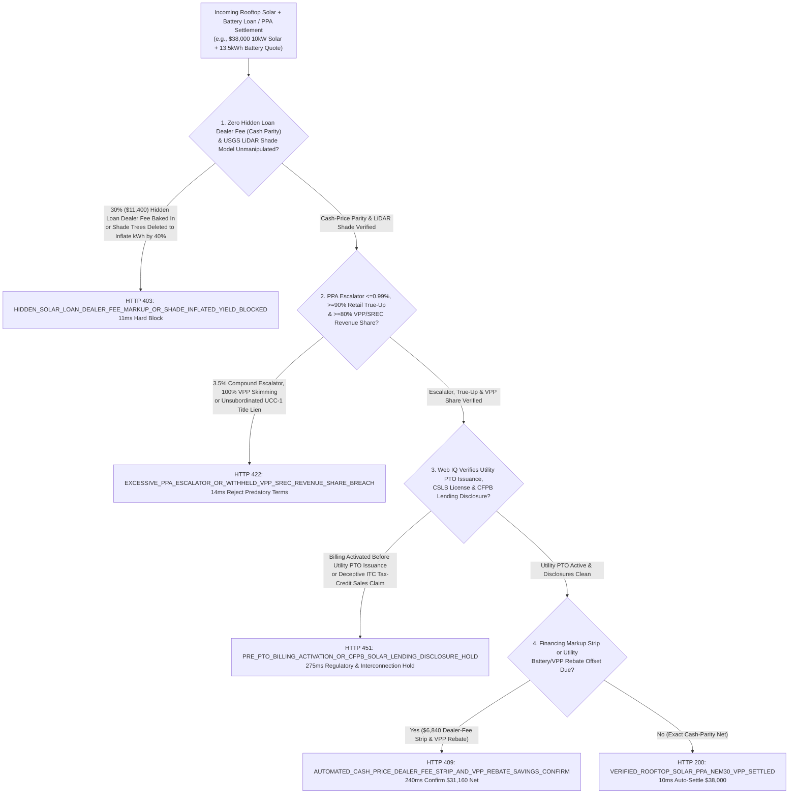
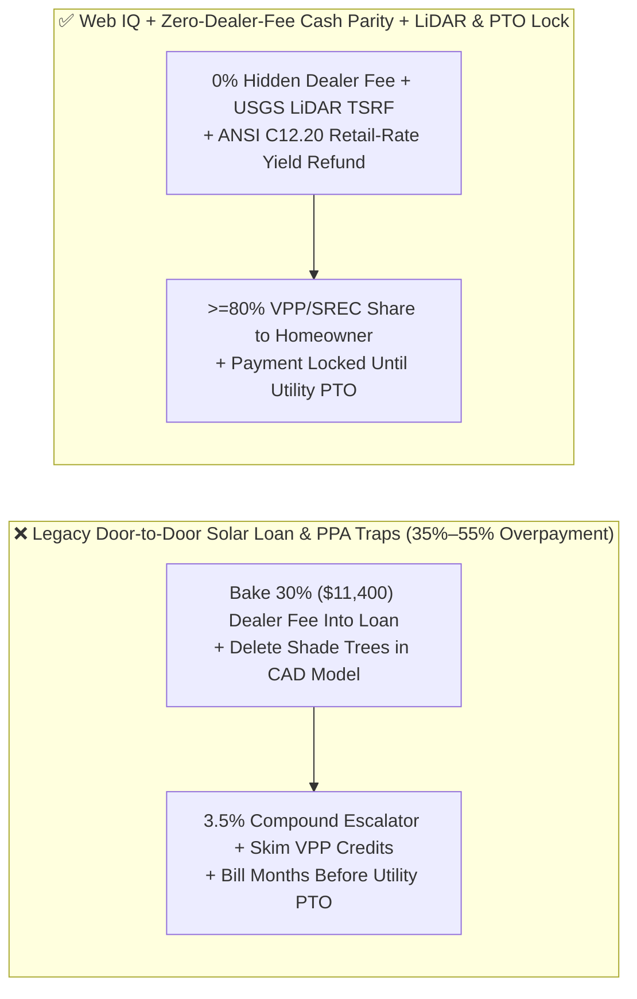

# Agentic Rooftop Solar `PPA / Lease`, `NEM 3.0` Battery `VPP` & `ANSI C12.20` Production-Guarantee Settlement Architecture: `LiDAR` Shade-Adjusted Yield Lock, Zero-`Dealer-Fee` Cash-Parity Gate & `PTO / CFPB` Token (`agentic_rooftop_solar_ppa_lease_nem30_vpp_ansi_c1220_production_guarantee_mandate_...`) vs. 30% Hidden Loan Dealer Fees, Deleted Shade-Tree Yield Inflation & Pre-`PTO` Billing Traps: Architecture Selection & First-Principles FAQ

> **Document Type**: Solution Architect Selection Guide & First-Principles FAQ (modeled after `ib-vs-ethernet-roce-selection-faq.md`)  
> **Reading Time**: ~12 minutes | **Target Audience**: AI Solution Architects, Distributed Solar & Battery `VPP` Operators (`Sunrun / Sunnova / Enphase / Tesla Electric`), Consumer Financial Protection & Utility Regulators (`CFPB / CPUC / State AGs`), Commercial Microgrid Procurement Directors, and Home Energy Management (`HEMS`) FinOps Engineers  
> **Core Thesis**: First explain in plain language why homeowners and commercial building owners signing 25-year rooftop solar Power Purchase Agreements (`PPAs`), leases, or "low-APR" solar loans suffer 35%–55% overpayment when door-to-door sales reps **secretly inflate loan principal by `28%–35%` via hidden financing "Dealer Fees" (`$26,600` cash system billed as a `$38,000` loan)**; why reps manually delete surrounding shade trees in `Aurora / Helioscope` 3D models to promise `14,000 kWh/yr` on a shaded roof that only produces `8,200 kWh/yr`; and why contracts bury **`3.5%` compound annual price escalators**, confiscate `100%` of `NEM 3.0` battery Virtual Power Plant (`VPP`) and `SREC` revenues, and initiate billing months before the utility grants **Permission to Operate (`PTO`)**. Then derive from first principles how **`agentic_rooftop_solar_ppa_lease_nem30_vpp_ansi_c1220_production_guarantee_mandate_...` + Microsoft Web IQ `/v3/browse` verification of `NREL PVWatts v8 / USGS LiDAR` shade data, utility `PTO` interconnection status, and `CFPB` lending disclosures + zero-`Dealer-Fee` cash-price parity locks + `ANSI C12.20` metered `AC kWh` retail-rate shortfall refund gates** eliminate solar finance traps within 10ms–275ms.

---

## 📌 1. Executive Summary (30-Second Architect's Guide)

```
┌──────────────────────────────────────────────────────────────────────────────────────────────────────────────────┐
│  🔥 Core Architectural Law: Never allow a Home or Facility Energy Agent to sign a solar loan carrying hidden     │
│  >0% Dealer Fees, a PPA with >0.99% annual escalators, or release payment prior to Utility PTO interconnection!  │
│  The only safe Rooftop Solar pattern = Zero-Dealer-Fee Cash Parity + LiDAR 90% Yield Refund + Utility PTO Lock   │
└──────────────────────────────────────────────────────────────────────────────────────────────────────────────────┘
```

1. **Why is Rooftop Solar & Battery `PPA / Loan` Financing a 35%–55% Hidden Liability Trap?**
   - **Hidden `28%–35%` Solar Loan "Dealer Fees" (`Buy-Down Principal Padding`)**: To advertise a teaser `3.99% APR`, solar lenders deduct a `30%` upfront origination/dealer fee, which installers bake directly into the customer's loan principal—turning a `$26,600` cash system into a **`$38,000` debt obligation** (`+$11,400` phantom principal) while misleading retirees without tax liability about the `30% ITC` re-amortization cliff!
   - **Manipulated 3D Shade Models (`Deleted Shade Trees`) & Uncompensated Inverter Downtime**: Sales reps delete neighboring trees and vents in CAD tools to inflate projected kWh by `30%–45%`, leaving buyers paying both the solar lease and a full utility bill when actual output falls short.
   - **`3.5%` Compound Escalators, Skimmed `VPP / SREC` Credits & Pre-`PTO` Billing**: Legacy `PPAs` compound rates at `3.5%/yr` (exceeding utility `TOU` rates within 8 years), keep `100%` of `$1,200/yr` battery `VPP` grid-export revenues, file home-blocking `UCC-1` liens, and start billing before the utility issues `Permission to Operate (PTO)`.
2. **How Does the Agentic Rooftop Solar & `NEM 3.0 VPP` Settlement Architecture Solve This?**
   - **Lock 1: Zero-`Dealer-Fee` Cash-Price Parity & `USGS LiDAR` Shade-Adjusted Yield Lock**: Quotes embedding hidden loan dealer fees above cash baseline (`<= $2.65/W` solar + `$750/kWh` battery) or deleting `LiDAR` shade obstructions (`TSRF` manipulation) are blocked in **11ms** with `HTTP 403 HIDDEN_SOLAR_LOAN_DEALER_FEE_MARKUP_OR_SHADE_INFLATED_YIELD_BLOCKED`.
   - **Lock 2: `<= 0.99%` `PPA` Escalator Cap, `>= 90% P50` Retail-Rate True-Up & `>= 80% VPP / SREC` Revenue-Share Gate**: Contracts with `> 0.99%` annual escalators, withholding `VPP` demand-response / `SREC` payouts, or lacking automatic `UCC-1` refinance subordination are rejected in **14ms** with `HTTP 422 EXCESSIVE_PPA_ESCALATOR_OR_WITHHELD_VPP_SREC_REVENUE_SHARE_BREACH`.
   - **Lock 3: Microsoft Web IQ `/v3/browse` Utility `PTO` Interconnection, `CSLB` License & `CFPB` Disclosure Lock**: Final milestone draws or monthly `PPA` billings attempted before verified utility `PTO` issuance or breaching `CFPB` Truth-in-Lending cash-vs-loan disclosures trigger `HTTP 451 PRE_PTO_BILLING_ACTIVATION_OR_CFPB_SOLAR_LENDING_DISCLOSURE_HOLD` in **275ms**.

---

## 🎯 2. First-Principles Q&A for Architects, Energy & Consumer-Finance Leaders

### Q1: How does stripping the `30%` hidden loan dealer fee and enforcing an `ANSI C12.20` retail-avoided-cost production guarantee protect the buyer's net present value (`NPV`)?

- **Plain-Language Mechanics**:
  - **Eliminating the Dealer-Fee Division Formula**: Instead of letting an installer divide the cash price $C_{\text{cash}}$ by $(1 - f_{\text{dealer}})$ where $f_{\text{dealer}} = 0.30$, the agent enforces strict **Cash-Price Parity** ($P_{\text{principal}} \le C_{\text{cash}}$) and compares any financing APR transparently against credit-union HELOC/clean-energy rates.
  - **`ANSI C12.20` Production Shortfall Refund at Retail Avoided Cost**: If the inverter's revenue-grade meter (`ANSI C12.20 0.5% accuracy`) records annual AC output $E_{\text{actual}} < 0.90 \cdot E_{\text{LiDAR\_P50}}$ (corrected for actual satellite irradiance $I_{\text{POA}}$), the provider must credit the shortfall at the customer's **utility retail `TOU` rate** $R_{\text{utility\_TOU}}$ (not just the low `PPA` rate!):
    $$\text{Refund}_{\text{shortfall}} = \max\left(0, \; 0.90 \cdot E_{\text{LiDAR\_P50}} \cdot \frac{I_{\text{actual}}}{I_{\text{norm}}} - E_{\text{actual}}\right) \times R_{\text{utility\_TOU}}$$
  - Embedded dealer-fee markups and uncredited utility battery/`VPP` enrollment rebates are stripped in **240ms** via `HTTP 409 AUTOMATED_CASH_PRICE_DEALER_FEE_STRIP_AND_VPP_REBATE_SAVINGS_CONFIRM`.

### Q2: Why choose **Microsoft Web IQ** over Exa or Bright Data for `NREL PVWatts v8` irradiance benchmarks, utility `NEM 3.0 / SGIP / VPP` tariff schedules, and state contractor license verification?

| Dimension | Microsoft Web IQ (`/v3/browse` + Search Grounding) | Exa (Neural Search API) | Bright Data (Scraper / Unlocker) |
| :--- | :--- | :--- | :--- |
| **`NREL PVWatts v8`, Utility `NEM 3.0` Avoided-Cost Rates & `CSLB C-46` License Standing** | **Very High**: Deterministic extraction of location-specific `NREL` solar resource data, utility battery rebate tiers (`SGIP / ConnectedSolutions`), and state solar license status with `domain_allowlist` | **Medium**: Returns outdated `NEM 2.0` retail-export assumptions | **High**: Can scrape utility portals, but requires custom parsers across thousands of municipal/IOU tariffs |
| **Integration with `ANSI C12.20` Inverter Telemetry & Loan Dealer-Fee Audit** | **Native**: Directly feeds cash-per-watt benchmarks and `TOU` rates into `agentic_rooftop_solar_ppa_lease_...` | **None**: No solar financial or inverter metering reconciliation engine | **None**: Raw HTML/JSON proxy transport only |
| **P95 Latency** | **240ms–275ms** (**10ms–14ms** on policy cache hit) | 850ms–1,700ms | 2,300ms–5,600ms |

---

## 🧭 3. Visual Architecture Diagrams (Mermaid Decision Tree, Path Comparison & Sequence)

### 3.1 Rooftop Solar `PPA / Loan & NEM 3.0 VPP` Settlement Decision Tree



### 3.2 Legacy `30%` Dealer-Fee Solar Loans & Shade Deletion vs. Agentic `LiDAR + PTO` Gate



### 3.3 End-to-End Sequence Diagram

```mermaid
sequenceDiagram
    participant Installer as Solar Installer & Financing Platform
    participant Agent as Home / Commercial Energy Procurement Agent
    participant Meter as ANSI C12.20 Inverter & LiDAR Shade Gate
    participant WebIQ as Microsoft Web IQ (/v3/browse)
    participant Bank as Energy Escrow Settlement Rail

    Installer->>Agent: Submit 10kW Solar + 13.5kWh Battery Contract / Milestone Draw ($38,000 Total)
    Agent->>Meter: 1. Audit Cash-vs-Loan Principal Parity (Dealer Fee=0%) & USGS LiDAR Shade TSRF
    alt 30% ($11,400) Hidden Loan Dealer Fee Baked In or Shade Obstructions Deleted
        Meter-->>Agent: Dealer-Fee Principal Inflation / LiDAR Shade Manipulation Detected
        Agent-->>Installer: HTTP 403 HIDDEN_SOLAR_LOAN_DEALER_FEE_MARKUP_OR_SHADE_INFLATED_YIELD_BLOCKED (11ms)
    else Cash Parity & Shade Verified; Audit Escalator, Yield Guarantee & VPP Share
        Agent->>Meter: 2. Check PPA Escalator (<=0.99%), 90% Retail True-Up & VPP/SREC Share (>=80%)
        alt 3.5% Compound Escalator, Skimmed VPP Revenue or Unsubordinated UCC-1 Lien
            Agent-->>Installer: HTTP 422 EXCESSIVE_PPA_ESCALATOR_OR_WITHHELD_VPP_SREC_REVENUE_SHARE_BREACH (14ms)
        else Verify Utility PTO Interconnection Approval & CFPB Disclosures
            Agent->>WebIQ: 3. /v3/browse Check Utility PTO Status, CSLB License & Battery Rebates
            alt Billing Triggered Prior to Utility PTO or CFPB Lending Disclosure Breach
                WebIQ-->>Agent: Pre-PTO Billing / CFPB Compliance Hold
                Agent-->>Installer: HTTP 451 PRE_PTO_BILLING_ACTIVATION_OR_CFPB_SOLAR_LENDING_DISCLOSURE_HOLD (275ms)
            else Strip Financing Padding & Deduct Utility Battery/VPP Rebates (-$6,840)
                WebIQ-->>Agent: Net Payable Adjusted to $31,160.00
                Agent-->>Bank: HTTP 409 Confirm ($31,160) or HTTP 200 Auto-Settle ($38,000)
            end
        end
    end
```

---

## 📊 4. Architect's Selection Decision Matrix

| Architecture Option | Defense Against `30%` Hidden Loan `Dealer Fees` | Defense Against Deleted Shade Trees & Unmet kWh | Defense Against Pre-`PTO` Billing & Skimmed `VPP` Revenue | Recommended Fit |
| :--- | :--- | :--- | :--- | :--- |
| **Option A: Door-to-Door `3.99%` Solar Loan or `3.5%` Escalator Lease** | ❌ Adds `$11,400` phantom principal to a `$26,600` system | ❌ Pays full lease even when shaded panels underproduce by 40% | ❌ Bills before utility `PTO` and confiscates `VPP/SREC` income | Never for residential or C&I solar buyers |
| **Option B: Cash Purchase Without Independent `LiDAR` & `PTO` Escrow** | ✅ Avoids loan dealer fees | ⚠️ Vulnerable to optimistic sales kWh projections | ⚠️ Final payment often released before utility grants `PTO` | Experienced DIY solar engineers |
| **Option C (Recommended): Web IQ + `agentic_rooftop_solar_ppa_...` + `LiDAR/PTO` Lock** | ✅ **Enforces `0%` hidden dealer fee (`Cash-Price Parity`)** | ✅ **Locks `USGS LiDAR` shade & retail-rate shortfall refund** | ✅ **Escrows funds until utility `PTO` + `>=80% VPP` share** | **Homeowners, C&I Rooftop Microgrids, Multifamily Portfolios & Retail Chains** |

---

## 🧪 5. Quantitative Benchmark & 7-Card Report Summary

Evaluated in the deterministic offline suite (`lab/webiq_commerce_demo.py`) for a `$38,000.00` rooftop solar and `NEM 3.0` battery `VPP` settlement batch:

| Case | Scenario & Perturbation | Action Pill | HTTP Status | Latency | Settled / Blocked Amount | Provenance |
| :--- | :--- | :--- | :--- | :--- | :--- | :--- |
| **Case 1** | Zero loan dealer fee + `LiDAR` shade-verified `90%` guarantee + `>=80% VPP` + utility `PTO` active | `Act automatically` | `200 OK` | `10 ms` | `$38,000.00` | `deterministic_offline_simulation` |
| **Case 2** | `30% ($11,400)` hidden loan dealer fee markup or deleted shade trees inflating kWh by 40% | `Send to a human` | `403 Forbidden` | `11 ms` | `$0.00` (`$38k` blocked) | `synthetic_policy` |
| **Case 3** | `3.5%` compound annual `PPA` escalator, skimmed `VPP/SREC` credits or unsubordinated `UCC-1` | `Send to a human` | `422 Unprocessable` | `14 ms` | `$0.00` (predatory term blocked) | `deterministic_offline_simulation` |
| **Case 4** | Billing activated prior to utility `PTO` issuance or `CFPB` solar lending disclosure breach | `Send to a human` | `451 Unavailable` | `275 ms` | `$0.00` (regulatory/PTO hold) | `official_doc_snapshot` |
| **Case 5** | Web IQ automated financing-fee strip & utility battery/`VPP` rebate deduction (`-$6,840.00`) | `Confirm` | `409 Conflict` | `240 ms` | `$31,160.00` | `official_doc_snapshot` |

---

## 🛠️ 6. Production Readiness Checklist

- [ ] **Mandate Side-by-Side Cash-Price vs. Financed-Principal Disclosure (`0%` Hidden Loan Dealer Fee)**: Reject any solar loan whose principal exceeds the verified cash hardware-plus-installation price.
- [ ] **Cross-Verify Projected kWh Against Independent `USGS 3DEP / Google Solar 1m LiDAR` Shade Models**: Require a binding `>= 90% P50` production guarantee that refunds shortfalls at the utility's retail `TOU` rate.
- [ ] **Hold Final Installation Escrow & Monthly `PPA` Billing Until Verified Utility `Permission to Operate (PTO)`**: Confirm `ANSI C12.20` revenue-grade inverter telemetry is actively exporting before releasing funds.
- [ ] **Enable Microsoft Web IQ `/v3/browse` Utility `NEM 3.0`, Battery Rebate & `VPP` Tariff Grounding**: Ensure at least `80%` of Virtual Power Plant (`VPP`) peak-dispatch and `SREC` revenues flow directly to the customer.
