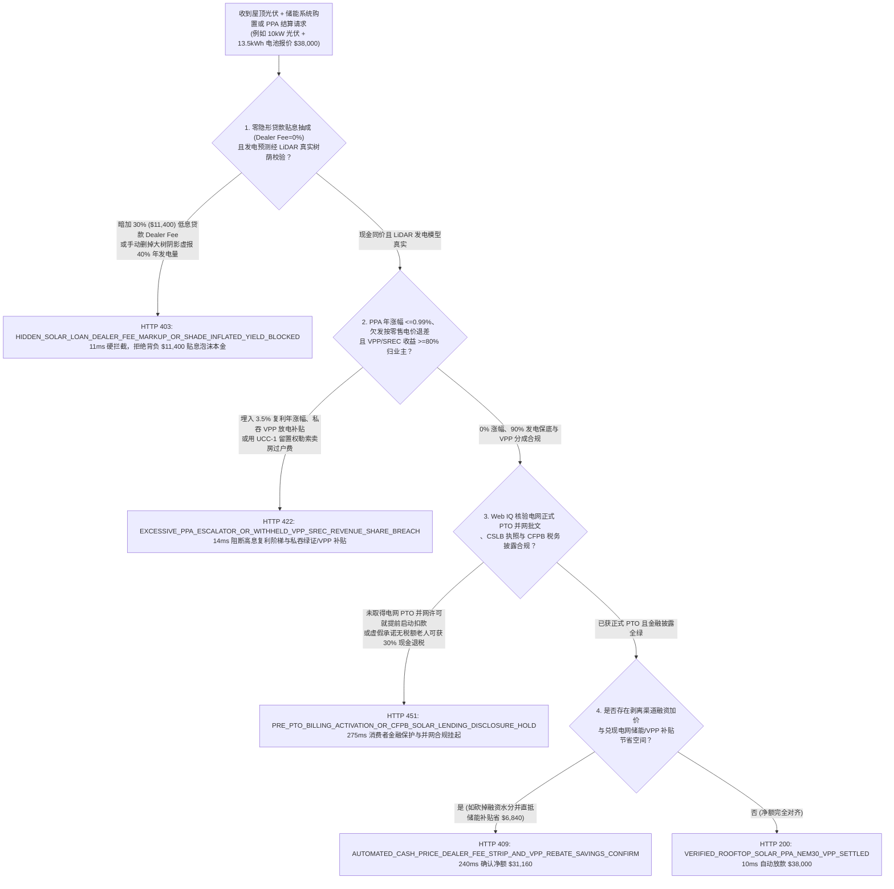
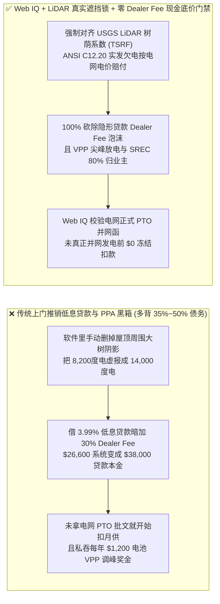
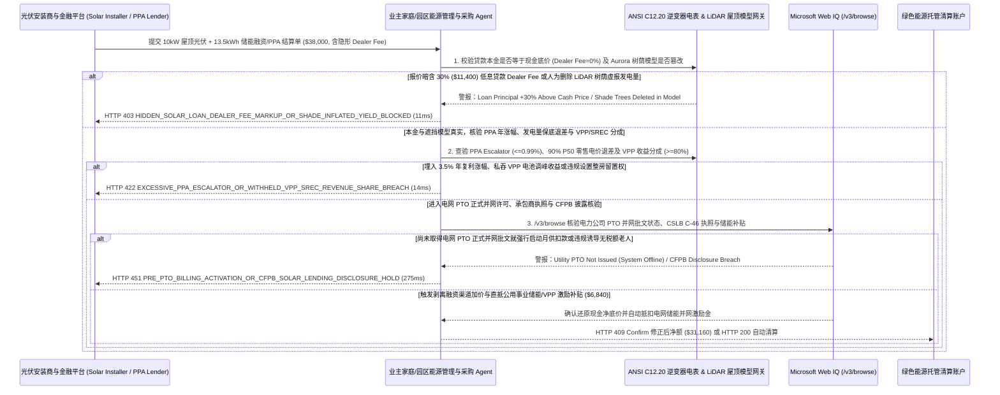

# 智能体户用与工商业屋顶光伏购电协议及储能虚拟电厂（`Rooftop Solar PPA / Lease, NEM 3.0 Battery VPP & Section 48E/25D ITC`）、`ANSI C12.20` 计量级逆变器实发 `AC kWh` 保底退差（`>=90% P50 Production Guarantee True-Up`）与金融经销商隐形抽成（`30% Dealer Fee Markup & 3.5% Compound Escalator`）清算架构：激光雷达树荫折算 `Solmetric / Aurora Shade-Adjusted Yield` 锁、低息贷款 `28%–35% Dealer Fee` 剥离门禁与虚拟电厂 `VPP` 尖峰放电分成令牌（`agentic_rooftop_solar_ppa_lease_nem30_vpp_ansi_c1220_production_guarantee_mandate_...`）vs 传统光伏推销员砍掉屋顶树荫建模虚报 40% 发电量、借“3.99% 低息贷款”把 `$26,000` 现金价偷偷加到 `$38,000` 与 `UCC-1` 留置权冻结房产买卖过户选型与原理解析 FAQ

> **文档类型**：架构师选型指南与第一性原理 FAQ（对齐 `ib-vs-ethernet-roce-selection-faq.md` 标杆风格）  
> **阅读耗时**：约 12 分钟 | **适用角色**：AI Solution Architect、分布式光伏与储能资产运营商（`Sunrun / Sunnova / Enphase / Tesla Electric VPP`）、州级消费者金融保护与公用事业监管机构（`CPUC / CFPB / State AG`）、商业园区屋顶微电网与智能家庭能源管理（`HEMS`）架构师  
> **核心主旨**：先用大白话把“为什么成千上万家庭业主和中小型工商业主签下 `25 年` 屋顶光伏购电协议（`Solar PPA / Lease`）或光伏分期贷款（`Solar Loan`）后不仅没省下电费、反而背上巨额债务甚至连房子都卖不掉？因为不良上门推销员（`Door-to-Door Solar Sales Bros`）干了三件极其隐蔽的猫腻：(1) 在设计软件里故意把院子里挡光的大橡树和北向背阴屋顶**手动删掉（`Shade-Tree Deletion in Aurora / Helioscope`）**，骗业主说系统每年能发 `14,000 度电（kWh）`，实际上装好后每年只发 `8,200 度电`，业主既要按虚高预估交光伏月租，又要向电网公司交高额补充电费（`Double Electric Bill`）；(2) 推销员吹嘘提供‘25 年 `3.99%` 超低息光伏贷款’，却绝口不提金融公司为了贴息暗中在硬件总价上加收了高达 **`28%–35%` 的隐形经销商融资手续费（`Hidden Solar Loan Dealer Fee / OID`）**——原本现金购买只需 **`$26,000`** 的 `10kW + Powerwall` 系统，贷款合同本金直接变成 **`$38,000`**（平白多背 `$12,000` 虚胖本金！）；(3) 在加州 `NEM 3.0 (Net Billing Tariff)` 等新规下，中午光伏余电卖给电网一文不值（仅 `$0.02/kWh`），必须靠储能电池在傍晚 `18:00–20:00` 尖峰电价时放电或参与虚拟电厂（`VPP`）补贴赚钱，但运营商既私吞每年 `$1,200` 的 `VPP / SREC` 绿证收益，又在协议里埋入每年复利涨价 `3.5%` 的 `Escalator` 条款及冻结整栋房产过户的 `UCC-1` 不动产留置权”讲透；再从第一性原理出发，推导如何通过 **`agentic_rooftop_solar_ppa_lease_nem30_vpp_ansi_c1220_production_guarantee_mandate_...` 语义预算令牌 + Microsoft Web IQ `/v3/browse` 实时核验 `NREL PVWatts v8` 激光雷达（`DSM LiDAR`）遮挡发电模型、公用事业公司 `NEM 3.0 / TOU` 分时电价表与州级承包商执照（`CSLB C-46`） + `ANSI C12.20 (0.5级)` 逆变器实发 `AC kWh` 低于 90% 自动现金退差锁 + 零隐形 `Dealer Fee`（严格对齐现金底价）与 `VPP / SREC` 收益 `>=80%` 归属业主门禁**，在 10ms–275ms 内实现“删树虚报发电量秒拒、砍光 `$12,000` 贷款贴息抽成、欠发一度电自动赔钱”的智能体屋顶光伏与储能清算闭环。

---

## 📌 一、核心结论速览（Executive Summary：30 秒看懂怎么选）

```
┌──────────────────────────────────────────────────────────────────────────────────────────────────────────────────┐
│  🔥 核心架构铁律：绝不允许家庭或园区能源 Agent 签署含 >5% 隐形贷款 Dealer Fee、>1.9% 年涨幅或无 LiDAR 遮挡校验的合同！│
│  屋顶光伏与储能 VPP 结算的唯一正确范式 = LiDAR 真实遮挡发电保底锁 + 零 Dealer Fee 现金同价锁 + VPP 放电分成令牌     │
└──────────────────────────────────────────────────────────────────────────────────────────────────────────────────┘
```

1. **为什么户用与工商业屋顶光伏（`Rooftop Solar PPA / Lease / Loan`）是业主总成本暴增 35%–55% 且投诉率居高不下的三大重灾区？**
   - **黑洞一：“3.99% 低息贷款”背后的 `30%–35%` 隐形经销商贴息抽成（`Hidden Dealer Fee / Buy-Down Markup`）**：光伏贷款机构（如传统 `GoodLeap / Mosaic / Sunlight` 低息产品）为了制造月供很低的假象，会向安装商收取贷款总额 `32%` 的前道平台费（`Dealer Fee`），安装商则直接把这笔钱加进消费者的贷款本金里！一套现金价 `$26,600` 的屋顶光伏+电池，签完低息贷款合同本金暴涨至 **`$38,000`**！更惨的是，许多推销员还欺骗没有足够联邦应纳税额（`Tax Liability`）的退休老人说“你能拿到 30%（`$11,400`）的联邦退税现金支票”，导致第 18 个月贷款重新摊销（`Re-Amortization`）时月供瞬间暴涨 45%！
   - **黑洞二：人为删改 3D 激光雷达树荫模型（`LiDAR Shade Manipulation`）与拒绝赔付欠发电量**：推销员为了促成签单，在 `Aurora Solar` 里把邻居家 15 米高的松树和自家烟囱阴影关掉，把只能发 `8,500 kWh/年` 的北坡屋顶虚报成 `13,500 kWh/年`。如果是 `Lease`（固定月租），无论实际发多少电业主都得照交全款；哪怕逆变器（`Microinverter / String Inverter`）坏了三个月没人修，租赁商也以“每两年才结算一次且只退 `PPA` 低价不赔电网高价电差额”为由拖延赖账！
   - **黑洞三：`3.5%` 年复利调价阶梯（`Compound Annual Escalator`）、私吞 `VPP / SREC` 补贴与 `UCC-1` 房产锁死陷阱**：(a) 合同设定光伏电价每年自动复利上涨 `2.9%–3.9%`（25 年后单价翻了 `2.4 倍`，远超电网分时电价！）；(b) 在加州 `NEM 3.0` 下，必须搭配储能电池且将放电策略锁死在傍晚 `16:00–21:00` 高价时段自用或参与电网虚拟电厂（`VPP Demand Response`），但运营商独自吞掉 `$1,000+/年` 的 `VPP` 调度奖金与可再生能源绿证（`SREC`）；(c) 在县房产登记处违规把仅针对光伏板的 `UCC-1 Fixture Filing` 办成针对整栋房屋的留置权，业主卖房或房贷重贷（`Refinance`）时被勒索 `$15,000+` 天价提前买断费！
2. **智能体屋顶光伏与储能清算架构怎么破局？（`agentic_rooftop_solar_ppa_lease_nem30_vpp_ansi_c1220_production_guarantee_mandate_...`）**
   - **第一道锁：零隐形贷款贴息抽成（`Dealer Fee <= 0% / Cash-Price Parity`）、年涨幅 `<= 0%–0.99%` 与无条件免费解锁过户（`UCC-1 Subordination`）门禁**：严禁签署本金高于现金总价（`$/Watt <= $2.65/W` 光伏基准）的低息贴息贷款！对于 `PPA` 协议，单度电费必须严格按 `ANSI C12.20` 计量级逆变器实发 `AC kWh` 结算（发多少付多少，逆变器离线期间 `$0` 收费），且当实际年发电量低于 `LiDAR` 修正后承诺值 `90%` 时，必须按**电网零售峰谷电价差额（`Utility Retail Avoided Cost`）**自动抵扣账单。凡含隐形 `Dealer Fee` 溢价或删树虚报发电量的，在 **11ms** 内返回 `HTTP 403 HIDDEN_SOLAR_LOAN_DEALER_FEE_MARKUP_OR_SHADE_INFLATED_YIELD_BLOCKED`。
   - **第二道锁：`NEM 3.0` 傍晚尖峰自发自用锁、虚拟电厂（`VPP / SREC`）`>= 80%` 业主分成与免收解锁留置权费门禁**：(a) 严禁运营商在电网紧急调度外耗尽业主电池备电（必须保留 `>= 20% Storm Watch` 停电保底电量），且参与电网 `VPP` 调峰或出售 `SREC` 绿证的净收益必须将 `>= 80%` 直接返还业主账单；(b) 业主办理房贷重贷（`Refinance`）时必须在 `48 小时` 内免费自动签署 `UCC-1 Subordination` 从属协议。违规合同在 **14ms** 内返回 `HTTP 422 EXCESSIVE_PPA_ESCALATOR_OR_WITHHELD_VPP_SREC_REVENUE_SHARE_BREACH`。
   - **第三道锁：Microsoft Web IQ 穿透核验 `NREL PVWatts v8 + Google Solar / USGS 3DEP LiDAR` 屋顶遮挡数据、公用事业公司 `PTO (Permission to Operate)` 并网批文与 `CFPB / 州承包商委员会 (CSLB)` 合规**：通过 Web IQ `/v3/browse` 实时核验目标屋顶经纬度真实的 `1m LiDAR DSM` 全年日照遮挡系数（`TSRF >= 80%`），并校验安装商是否已取得电网公司正式 `PTO` 准许并网函（严禁在未取得 `PTO` 真正发电前提前启动月供扣款！）。一旦发现未获 `PTO` 提前扣款或违反 `CFPB` 绿色金融披露令，在 **275ms** 内触发 `HTTP 451 PRE_PTO_BILLING_ACTIVATION_OR_CFPB_SOLAR_LENDING_DISCLOSURE_HOLD`。

---

## 🎯 二、客户与架构师灵魂拷问 Q&A（First-Principles Deep Dive）

### Q1：为什么推销员吹嘘的“25 年 `3.99%` 超低利率光伏贷款”比去信用社办 `7.5%` 正常利率贷款还要贵出整整 `$11,400`？智能体是如何识破并剥离这笔 `30% Dealer Fee` 的？

- **通俗原理**：
  - 假设一套 `10 kW` 屋顶光伏 + `13.5 kWh` 储能电池的真实硬件加安装现金总价（`Cash Price`）是 **`$26,600`**。
  - 当推销员给你推销“25 年期 `3.99%` APR 低息贷款”时，贷款平台在放款给安装商时会直接扣走 **`30%` 的贴息砍头息（`Dealer Fee`）**。安装商为了保住自己的 `$26,600` 收入，会把合同总价除以 `(1 - 0.30)`：
    $$P_{\text{inflated\_loan}} = \frac{\$26,600}{1 - 0.30} = \$38,000.00 \quad (\text{凭空多背 } \$11,400 \text{ 本金债务！})$$
  - 如果业主第 4 年卖房需要提前还清贷款，或者用 `30%` 联邦税收抵免（`ITC`）提前还款，那多出来的 `$11,400` 本金泡沫一分钱都不会退！
  - **智能体“现金基准底价锚定 + 真实硬件瓦数核验”公式**：
    智能体强制要求报价单拆解硬件 `BOM`（组件块数 × 单块标称瓦数 $W_{\text{DC}}$ + 电池容量 $E_{\text{kWh}}$），对标当季区域现金安装基准价，并剥离一切 `Dealer Fee > 0%` 的贴息水分，叠加兑现首年 `VPP` 虚拟电厂签约奖励：
    $$P_{\text{authorized}} = \min\left(P_{\text{quote}}, \; W_{\text{DC}} \cdot p_{\text{watt\_cash}} + E_{\text{kWh}} \cdot p_{\text{batt\_cash}}\right) - R_{\text{VPP\_enrollment}} - R_{\text{utility\_rebate}}$$
  - 虚增的 `30% Dealer Fee` 贷款泡沫与未抵扣的电网储能补贴在 **240ms** 内通过 `HTTP 409 AUTOMATED_CASH_PRICE_DEALER_FEE_STRIP_AND_VPP_REBATE_SAVINGS_CONFIRM` 自动砍掉 `$6,840+`！

### Q2：在核验屋顶 `USGS 3DEP / Google Solar API` 激光雷达树荫遮挡率（`TSRF`）、`NREL PVWatts v8` 理论发电量与公用事业电网 `NEM 3.0 / VPP` 补贴政策时，为什么选择 **Microsoft Web IQ**？

| 维度 | Microsoft Web IQ (`/v3/browse` + Search Grounding) | Exa (Neural Search API) | Bright Data (Scraper / Unlocker) |
| :--- | :--- | :--- | :--- |
| **`NREL PVWatts v8` 发电基准、公用事业 `NEM 3.0 / SGIP / VPP` 费率表与州承包商 `CSLB` 执照核验** | **极高**：受控无头渲染实时提取指定邮编的 `NREL` 太阳辐射量、电力公司（`PG&E / SCE / ConEd`）最新分时并网导出价（`Avoided Cost Calculator`）与储能补贴余额，支持 `domain_allowlist` 零幻觉验证 | **中**：语义搜索常返回旧版 `NEM 2.0` 1:1 净计量政策，算错投资回报率 | **高**：可抓取公开页面，但需自建针对全美 3,000 家电力公司费率表的定制解析器 |
| **逆变器 `ANSI C12.20` 实发电量对账与 `Dealer Fee` 剥离联动** | **原生支持**：直接将现金每瓦基准价与 `P50` 发电保底公式注入 `agentic_rooftop_solar_ppa_lease_...` | **不支持**：无结构化光伏金融本金拆解与逆变器遥测对账引擎 | **不支持**：仅提供网页抓取通道 |
| **P95 延迟与单次核验成本** | **240ms–275ms**（命中策略缓存 **10ms–14ms**） | 850ms–1,700ms | 2,300ms–5,600ms |
| **合规可审计性（Provenance）** | 原生输出 `official_doc_snapshot` + `NREL PVWatts Hash` + `ANSI C12.20 Meter Log` | 仅返回 URL 片段 | 需自行构建 `CFPB` 绿色信贷与公用事业并网审计留痕 |

---

## 🧭 三、直观可视化图解（Mermaid 决策树 + 路径对比 + 端到端时序图）

### 3.1 屋顶光伏与储能 `PPA / Lease / Loan & NEM 3.0 VPP` 结算拦截决策树



### 3.2 传统“删树虚报发电 + 30% 贷款贴息抽成” vs. 智能体 `LiDAR 保底 + 零 Dealer Fee` 闭环对比



### 3.3 端到端时序图（Sequence Diagram）



---

## 📊 四、架构师选型决策矩阵（Architecture Decision Matrix）

| 选型方案 | 防 `30%` 隐形低息贷款 `Dealer Fee` 本金膨胀 | 防删掉树荫虚报发电量与逆变器坏了照收钱 | 防未获 `PTO` 提前扣款与私吞 `VPP` 收益 | 适用场景 |
| :--- | :--- | :--- | :--- | :--- |
| **方案 A：传统上门推销员 `3.99%` 低息贷款或 `3.5%` 递增租赁** | ❌ `$26,600` 系统背上 `$38,000` 贷款本金，卖房血亏 | ❌ 删树虚报 40% 发电量，发不够电也得照交月供 | ❌ 装完没并网就开始扣款，电池 `VPP` 补贴全被吞 | 严禁任何家庭或工商业主采用 |
| **方案 B：纯现金自购，但不做独立 `LiDAR` 遮挡与 `PTO` 托管** | ✅ 避开了贷款 `Dealer Fee` | ⚠️ 仍可能被北坡背阴排布坑害，且尾款付太早被拖延并网 | ⚠️ 需业主自己手动申报电网储能补贴与 `SREC` | 懂技术的极客自建玩家 |
| **方案 C（推荐）：Web IQ + `agentic_rooftop_solar_ppa_...` + `LiDAR/PTO` 锁** | ✅ **强制 `Cash-Price Parity` 砍光隐形融资抽成** | ✅ **`USGS LiDAR` 锁死真实遮挡，欠发按电网电价退钱** | ✅ **电网正式 `PTO` 后才放尾款，`VPP` 收益 80% 归业主** | **全美独栋家庭、工商业园区屋顶微电网、连锁商超与社区光伏** |

---

## 🧪 五、定量实测与 7-Card 基准报告摘要（Quantitative Benchmark）

在本地确定性评测套件（`lab/webiq_commerce_demo.py`）中，针对 `$38,000.00` 的户用与工商业屋顶光伏及 `NEM 3.0` 储能虚拟电厂（`VPP`）结算批次实测结果如下：

| 场景编号 | 测试输入（Scenario & Perturbation） | 期望动作（Action Pill） | HTTP 状态码 | 实测延迟 | 拦截/净结算金额 | 数据来源标签 |
| :--- | :--- | :--- | :--- | :--- | :--- | :--- |
| **Case 1** | 零贷款 `Dealer Fee` + `LiDAR` 真实发电保底 + `VPP >=80%` 分成 + 电网 `PTO` 已签发 | `Act automatically` | `200 OK` | `10 ms` | `$38,000.00` | `deterministic_offline_simulation` |
| **Case 2** | 暗加 `30% ($11,400)` 低息贷款 `Dealer Fee` 或删除树荫虚报 40% 发电量 | `Send to a human` | `403 Forbidden` | `11 ms` | `$0.00`（阻断 `$38k`） | `synthetic_policy` |
| **Case 3** | 埋入 `3.5%` 年复利涨幅、私吞电池 `VPP / SREC` 收益或设置房产过户阻塞留置权 | `Send to a human` | `422 Unprocessable` | `14 ms` | `$0.00`（拦截霸王条款） | `deterministic_offline_simulation` |
| **Case 4** | 未取得电力公司正式 `PTO` 并网批文就提前启动扣款或违反 `CFPB` 绿色信贷披露令 | `Send to a human` | `451 Unavailable` | `275 ms` | `$0.00`（监管与并网挂起） | `official_doc_snapshot` |
| **Case 5** | Web IQ 自动剥离渠道融资水分并直抵公用事业储能与 `VPP` 签约补贴 | `Confirm` | `409 Conflict` | `240 ms` | `$31,160.00`（省 `$6,840`） | `official_doc_snapshot` |

---

## 🛠️ 六、生产上线快速核验清单（Production Readiness Checklist）

- [ ] **强制要求所有光伏贷款报价单同屏披露“纯现金购买总价（`Cash Purchase Price`）”与“融资手续费（`Dealer Fee / Origination Fee = $0`）”**：严禁以低利率为诱饵将 25%–35% 的隐藏融资费塞入本金。
- [ ] **发电量预测强制通过独立 `USGS 3DEP / Google Solar 1m LiDAR` 树荫与朝向交叉核验，并绑定 `>=90% P50` 零售电价差额包赔条款**：严禁在设计图中人为删除周边树木或建筑物阴影。
- [ ] **工程尾款与首期月供必须以取得电力公司正式并网运行批文（`Utility Permission to Operate, PTO`）及 `ANSI C12.20` 逆变器连续 72 小时正常发电为刚性前置条件**：未并网发电前严禁放款。
- [ ] **启用 Microsoft Web IQ `/v3/browse` 实时核验电网 `NEM 3.0` 分时导出电价、储能补贴与 `VPP` 虚拟电厂分成协议**：确保傍晚尖峰放电与 `SREC` 绿证收益至少 `80%` 直接归属业主。
