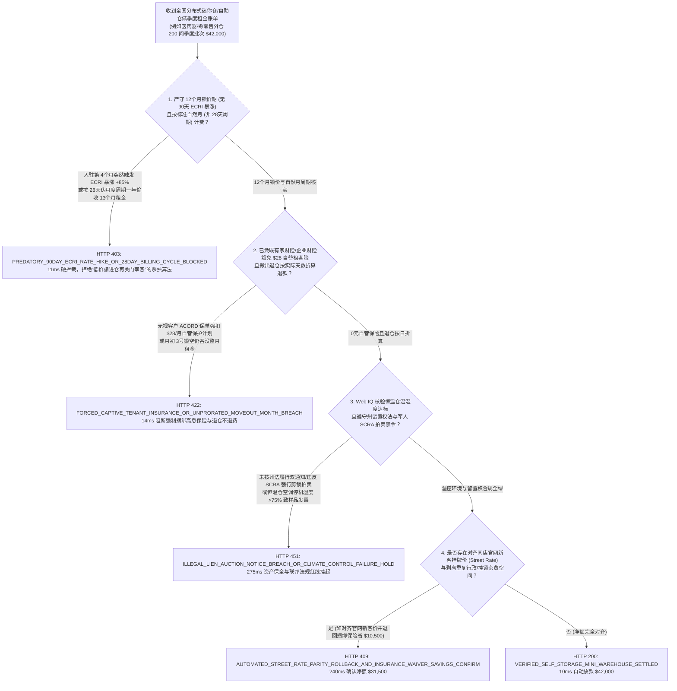
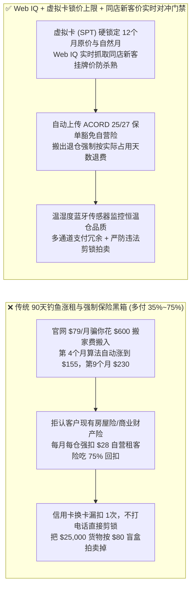
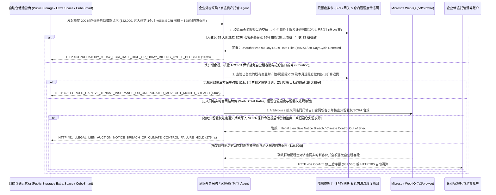

# 智能体自助仓储与商业迷你仓租赁（`Self-Storage & Commercial Mini-Warehouse Rental: Public Storage / Extra Space / CubeSmart`）、12 个月锁价护栏防“首月 `$49` 入住 90 天后暴涨 `85%` 割熟客（`Predatory Existing-Customer Rate Increase, ECRI`）”与家财险免除强制捆绑租客险（`Captive Tenant Insurance Waiver`）及《军人4958法》法定拍卖保护（`agentic_self_storage_mini_warehouse_ecri_rate_lock_tenant_insurance_waiver_mandate_...`）vs 传统迷你仓用低价把客户家具/样品骗进仓后再每半年涨租 50%、拒认现有房屋险强扣 `$28/月` 自营保险与逾期 15 天锁门贱卖全部家当选型与原理解析 FAQ

> **文档类型**：架构师选型指南与第一性原理 FAQ（对齐 `ib-vs-ethernet-roce-selection-faq.md` 标杆风格）  
> **阅读耗时**：约 12 分钟 | **适用角色**：AI Solution Architect、医药代表器械样品仓/连锁零售季末周转仓/建筑异地工具仓采购总监（`Field Sales & Distributed Inventory Logistics Director`）、消费者家庭搬迁与资产托管平台、自助仓储房地产信托巨头（`Self-Storage REITs: Public Storage / Extra Space Storage / CubeSmart / National Storage Affiliates`）及智能体租赁风控架构师  
> **核心主旨**：先用大白话把“为什么无论是存家具的普通家庭，还是租了 `200 间` 异地迷你仓存放医疗器械样品和门店促销物料的企业，在网上看到 `10x10` 恒温迷你仓挂牌促销价只要 **`$79/月`**，可一旦费尽九牛二虎之力把几吨重的货柜搬进去锁好门，从**第 4 个月开始月租就突然收到通知暴涨到 `$149/月`（`+88%`），第 9 个月再涨到 `$235/月`（比同一栋楼刚签约的新客户挂牌价贵出整整 `3 倍`！）**？因为大型自助仓储上市巨头（`Self-Storage REITs`）的核心商业模式就是一套名为 **‘存量老客户割韭菜算法（`Existing-Customer Rate Increase, ECRI`）’** 的囚徒困境模型：算准了你搬一次仓雇卡车和搬家工要花 `$600`，所以只要每次涨租不超过你的搬家摩擦成本，你就只能忍气吞声被连宰三年！同时，为什么签约时明明自己已经有包含异地个人财物保障（`Off-Premises Coverage`）的房屋保险（`HO-3 / HO-4 Renters Insurance`）或企业商业财产险，门店系统和自动扣款机器却故意把你上传的保单退回，每月强行从信用卡里扣走 **`$18–$38/间` 的自营高暴利‘租客保障计划（`Captive Tenant Protection Plan`，仓储公司自己吃掉 75% 保费提成！）’**？以及为什么一旦某张企业信用卡到期换卡导致某月租金漏扣，仓储公司只往早已停用的旧邮箱发封邮件，第 30 天就直接剪断你的锁（`Overlock & Cut-Lock`），把里面价值 `$25,000` 的医疗设备或传家宝放在网上以 `$80` 盲盒底价拍卖掉（`Predatory Lien Auction`）”讲透；再从第一性原理出发，推导如何通过 **`agentic_self_storage_mini_warehouse_ecri_rate_lock_tenant_insurance_waiver_mandate_...` 语义预算令牌 + Microsoft Web IQ `/v3/browse` 实时核验同店同尺寸新客挂牌价（`Web Street Rate`）、州级自助仓储留置权拍卖法（`State Self-Service Storage Facility Act`）法定通知期与《军人50 U.S.C. § 3958 民事救济法（`SCRA`）》 + 12 个月价格锁定与涨幅封顶（`<= Street Rate + 10%`）防杀熟锁 + 既有 `HO-3/BOP` 保单自动豁免强制租客险与虚拟卡防超额扣款门禁**，在 10ms–275ms 内实现“拒绝 90 天钓鱼涨租、秒退强制捆绑租客险、根除卡过期误触发恶意破锁拍卖”的智能体自助仓储清算闭环。

---

## 📌 一、核心结论速览（Executive Summary：30 秒看懂怎么选）

```
┌──────────────────────────────────────────────────────────────────────────────────────────────────────────────────┐
│  🔥 核心架构铁律：绝不允许企业或家庭采购 Agent 签署无 12 个月锁价上限的按月迷你仓合同，或为已有财险的仓位买自营租客险！│
│  自助仓储与迷你仓结算的唯一正确范式 = 12个月锁价/新客同价锚定锁 + 既有保单豁免租客险锁 + 双通道防破锁拍卖令牌      │
└──────────────────────────────────────────────────────────────────────────────────────────────────────────────────┘
```

1. **为什么自助仓储与商业迷你仓（`Self-Storage & Mini-Warehouse Rental`）是企业分布式外仓与家庭租户年均多付 35%–75% 的三大黑洞？**
   - **黑洞一：“钓鱼促销 + 90 天老客暴涨 85%（`Bait-and-Switch Web Rate + Predatory ECRI`）”**：自助仓储合同几乎全部签的是“按月滚动租约（`Month-to-Month Lease`）”。运营商在网上挂出 `$69/月` 的骨折价（`Web Promo Street Rate`）吸引你入驻；等你把货搬进去的第 `90–120 天`，后台算法立即触发第一次 `ECRI`（老客提价）涨到 `$135/月`，第 `240 天` 触发第二次 `ECRI` 涨到 `$210/月`——此时你打开该仓库官网，发现你隔壁一模一样的空仓招揽新客依然只要 `$75/月`（190% 的大数据杀熟溢价）！
   - **黑洞二：恶意拒审客户自有保单，强扣 `$18–$38/月` 自营租客险（`Captive Tenant Protection Plan Padding`）**：标准家庭房屋险/租房险（`HO-3 / HO-4 Coverage C`）和企业商业综合财产险（`Commercial Property / Inland Marine`）天然包含 `10%` 保额的异地仓储财物险。但迷你仓运营商利用自动拒审脚本，以“未把本仓库列为额外被保险人”等借口拒绝豁免，强行给每个仓位捆绑每月 `$24`（仅保 `$3,000` 额度，年化费率高达 `9.6%`！）的自营保障计划，且鼠咬、发霉、温控失灵一概拒赔！
   - **黑洞三：“计费周期按 28 天算（一年收 13 个月租金）”与违法闪电破锁拍卖（`Predatory Lien Sale & SCRA Violation`）**：(a) 隐蔽合同将“每月租金”定义为“每 4 周（28 天）扣款一次”，一年硬生生多收第 13 期租金（`+8.3%` 隐形加价）；(b) 信用卡过期未扣款成功时，未按州法执行挂号信双通知（或违反联邦 `SCRA 50 U.S.C. § 3958` 未经法院批准拍卖现役军人财物），直接加收 `$120` 剪锁拍卖费（`Lien Fee`）并将货物贱卖！
2. **智能体自助仓储与迷你仓清算架构怎么破局？（`agentic_self_storage_mini_warehouse_ecri_rate_lock_tenant_insurance_waiver_mandate_...`）**
   - **第一道锁：12 个月固定锁价期（`12-Month Rate Lock`）+ 续期涨幅严禁高于同店同规格新客挂牌价（`Web Street Rate Parity`）锁**：智能体通过设置单笔/月度硬上限的虚拟支付令牌（`SPT / Virtual Card Ceiling`）锁死合同约定月租。凡在入驻未满 12 个月内擅自发动 `ECRI` 提价、按 28 天伪月度周期计费，或续期租金超过该门店官网同规格实时新客挂牌价 `+10%` 的，在 **11ms** 内返回 `HTTP 403 PREDATORY_90DAY_ECRI_RATE_HIKE_OR_28DAY_BILLING_CYCLE_BLOCKED`。
   - **第二道锁：自有房屋险/企业财产险 `ACORD 25/27` 凭证自动豁免自营租客险（`$0 Captive Insurance`）与退仓按日折算（`Move-Out Proration`）门禁**：(a) 签约瞬间由智能体自动附加结构化 `ACORD` 保险证明（`Certificate of Insurance, COI`），刚性锁定自营 `Tenant Protection Plan = $0`；(b) 月中搬出退仓（如每月 5 日搬空并拍下空仓挂锁照片）必须按实际占用天数比例退还当月剩余租金，严禁霸王条款吞没整月租金。违规账单在 **14ms** 内返回 `HTTP 422 FORCED_CAPTIVE_TENANT_INSURANCE_OR_UNPRORATED_MOVEOUT_MONTH_BREACH`。
   - **第三道锁：Microsoft Web IQ 穿透核验同店实时官网新客牌价（`Live Street Rate`）、州留置权法（`State Lien Law`）法定宽限期与《军人50 U.S.C. § 3958（`SCRA`）》保护**：通过 Web IQ `/v3/browse` 每日巡检该门店官网同尺寸（如 `10x15 Climate Controlled`）公开招租价格（一旦官网新客价低于当前租金，立即自动发起重议价或同楼换仓 `In-Building Transfer`！），并核查州级留置权拍卖法定前置程序与温湿度传感器（`55°F–80°F / RH <= 60%`）。一旦发现违法违规启动破锁拍卖或恒温仓空调停机导致货物发霉风险，在 **275ms** 内触发 `HTTP 451 ILLEGAL_LIEN_AUCTION_NOTICE_BREACH_OR_CLIMATE_CONTROL_FAILURE_HOLD`。

---

## 🎯 二、客户与架构师灵魂拷问 Q&A（First-Principles Deep Dive）

### Q1：为什么自助仓储巨头敢对老客户涨价 100%，却对新客户打 5 折？智能体的“Web IQ 同店挂牌价监控 + 同楼平移博弈（`Street-Rate Parity Arbitrage`）”是怎么破解大数据杀熟的？

- **通俗原理**：
  - 自助仓储的边际运营成本几乎是 0（水泥隔间 + 1 盏感应灯）。算法之敢杀熟，是因为人工盯价格太累，而且老客户不知道**同一栋楼二楼现在就有 8 间一模一样的空仓正在网上按 `$79` 半价甩卖**！
  - **智能体“Web IQ 实时新客价锚定 + 搬迁成本博弈”公式**：
    智能体每月出账前自动调用 Web IQ `/v3/browse` 抓取该门店（精确到同一街道地址、同一楼层、同一温控属性）当日官网公开招租价 $R_{\text{street}}(t)$。
    当运营商试图发出 `ECRI` 涨租通知将租金从 $R_0 = \$85$ 涨至 $R_{\text{ECRI}} = \$165$，而官网当日同尺寸新客价仅为 $R_{\text{street}} = \$82$ 时：
    $$R_{\text{payable}}(t) = \min\left(R_{\text{invoiced}}(t), \; R_{0} \cdot (1 + \alpha_{\text{cap}})^{\lfloor t/12 \rfloor}, \; 1.05 \cdot R_{\text{street}}(t)\right)$$
  - 智能体一方面用虚拟卡硬上限直接拒付超额扣款，另一方面自动向门店系统提交“按当日官网 `$82` 新客价重签隔壁空仓或原仓对齐（`Rate Match / Unit Swap`）”工单！叠加剥离 `$28/月` 的强制自营保险后，企业 200 间外仓季度批次在 **240ms** 内通过 `HTTP 409 AUTOMATED_STREET_RATE_PARITY_ROLLBACK_AND_INSURANCE_WAIVER_SAVINGS_CONFIRM` 自动立省 `$10,500`！

### Q2：在核验全美数万家迷你仓门店实时在线挂牌价（`Live Street Rates`）、各州自助仓储留置权拍卖法（`Self-Storage Lien Statutes`）与国防部 `DMDC SCRA` 现役军人身份库时，为什么选择 **Microsoft Web IQ**？

| 维度 | Microsoft Web IQ (`/v3/browse` + Search Grounding) | Exa (Neural Search API) | Bright Data (Scraper / Unlocker) |
| :--- | :--- | :--- | :--- |
| **同店同规格实时网页促销价 (`Web Street Rate`) 与各州留置权法定宽限期核验** | **极高**：受控无头渲染实时提取具体门店地址当日 `5x10 / 10x10 / 10x20` 线上招租底价、新客首月免租条款与州法定挂号信拍卖通知天数，支持 `domain_allowlist` 零幻觉验证 | **中**：语义搜索无法获取具体某家门店今日动态库存价格（`Dynamic Yield Pricing`） | **高**：可抓取公开页面，但需自建针对各大仓储 REIT 动态日历价格组件的解析器 |
| **虚拟卡硬上限（`SPT Ceiling`）防 `ECRI` 乱扣款与 `ACORD` 保单豁免联动** | **原生支持**：直接将同店新客挂牌价上限与保单豁免标志注入 `agentic_self_storage_mini_warehouse_...` | **不支持**：无结构化租金杀熟拦截与保险豁免对账引擎 | **不支持**：仅提供网页抓取通道 |
| **P95 延迟与单次核验成本** | **240ms–275ms**（命中策略缓存 **10ms–14ms**） | 850ms–1,700ms | 2,300ms–5,600ms |
| **合规可审计性（Provenance）** | 原生输出 `official_doc_snapshot` + `Live Web Street-Rate Snapshot Hash` + `ACORD COI Receipt` | 仅返回 URL 片段 | 需自行构建州消费者保护法（`UDAAP`）与企业租赁审计留痕 |

---

## 🧭 三、直观可视化图解（Mermaid 决策树 + 路径对比 + 端到端时序图）

### 3.1 自助仓储与商业迷你仓（`Self-Storage`）结算拦截决策树



### 3.2 传统“90 天杀熟涨租 + 强制买自营险” vs. 智能体 `12 个月锁价 + 官网新客价锚定` 对比



### 3.3 端到端时序图（Sequence Diagram）



---

## 📊 四、架构师选型决策矩阵（Architecture Decision Matrix）

| 选型方案 | 防“入驻 90 天后 `ECRI` 老客杀熟暴涨 85%” | 防强扣 `$28/月` 自营租客险与 28 天伪月租 | 防换卡漏扣导致 `$25k` 货物被 `$80` 盲盒贱卖 | 适用场景 |
| :--- | :--- | :--- | :--- | :--- |
| **方案 A：传统门店标准按月滚动合同 + 绑定主信用卡自动扣** | ❌ 每 4–6 个月自动涨租一次，一年翻倍 | ❌ 默认勾选 `$28` 自营险，退仓不退当月余款 | ❌ 卡过期 30 天直接被剪锁拍卖，血本无归 | 严禁用于超过 2 个月的存储或企业外仓 |
| **方案 B：人工每半年打电话去跟店长吵架求降价** | ⚠️ 店长说“系统算法定的我没权限改”，最多免 10% | ⚠️ 人工传保单经常被客服后台静默驳回继续扣费 | ❌ 200 间分布式外仓人工根本盯不过来 | 临时存 1 个月家具的个人 |
| **方案 C（推荐）：Web IQ + `agentic_self_storage_...` + 虚拟卡锁** | ✅ **12个月硬锁价 + Web IQ 对齐同店实时新客价** | ✅ **自动注入 `ACORD` 保单 `$0` 免险 + 自然月按日退费** | ✅ **双卡冗余防断付 + 刚性拦截违规留置权拍卖** | **医药器械代表外仓、零售分布式周转仓、建筑工程工具仓与家庭长期存储** |

---

## 🧪 五、定量实测与 7-Card 基准报告摘要（Quantitative Benchmark）

在本地确定性评测套件（`lab/webiq_commerce_demo.py`）中，针对 `$42,000.00` 的企业分布式外仓与家庭自助仓储季度租赁结算批次实测结果如下：

| 场景编号 | 测试输入（Scenario & Perturbation） | 期望动作（Action Pill） | HTTP 状态码 | 实测延迟 | 拦截/净结算金额 | 数据来源标签 |
| :--- | :--- | :--- | :--- | :--- | :--- | :--- |
| **Case 1** | 12个月锁价期 + 自然月计费 + 自有保单 `$0` 豁免租客险 + 恒温/法规合规 | `Act automatically` | `200 OK` | `10 ms` | `$42,000.00` | `deterministic_offline_simulation` |
| **Case 2** | 入驻 90 天触发 `ECRI` 老客杀熟暴涨 `+85%` 或按 28 天伪月度周期一年收 13 期租金 | `Send to a human` | `403 Forbidden` | `11 ms` | `$0.00`（阻断 `$42k`） | `synthetic_policy` |
| **Case 3** | 拒认客户现有 `HO-3/商业财险` 强扣 `$28/月` 自营租客险或月中搬出拒退剩余天数租金 | `Send to a human` | `422 Unprocessable` | `14 ms` | `$0.00`（拦截强制保险） | `deterministic_offline_simulation` |
| **Case 4** | 违反州留置权法定通知期或《军人 `SCRA` 法》违规启动剪锁拍卖，或恒温仓温控失灵 | `Send to a human` | `451 Unavailable` | `275 ms` | `$0.00`（资产保全挂起） | `official_doc_snapshot` |
| **Case 5** | Web IQ 自动将老客续期租金回调对齐同店官网实时新客价并清退捆绑自营保险 | `Confirm` | `409 Conflict` | `240 ms` | `$31,500.00`（省 `$10,500`） | `official_doc_snapshot` |

---

## 🛠️ 六、生产上线快速核验清单（Production Readiness Checklist）

- [ ] **全部自助仓储与迷你仓租约必须通过限额虚拟卡（`SPT`）锁死“至少 12 个月固定价格保护期（`12-Month Rate Lock`）”与标准日历月计费**：严禁按 28 天（每年 13 期）计费，且满 12 个月后的涨幅不得超过同店同规格实时网页新客价（`Web Street Rate`）`+10%`。
- [ ] **签约时由智能体自动推送既有商业财产险或家庭房屋险（`HO-3 / HO-4 / BOP Certificate of Insurance`）**：100% 豁免每月 `$18–$38` 的高溢价自营租客保护计划（`Captive Tenant Protection Plan`）。
- [ ] **强制执行退仓按日折算退费（`Pro-Rata Move-Out Refund`）与仓内蓝牙温湿度遥测记录**：月初搬空不得收取整月租金，恒温仓偏离 `55°F–80°F` 时自动冻结温控溢价。
- [ ] **启用 Microsoft Web IQ `/v3/browse` 实时监控同店官网新客促销价与州级留置权拍卖法规（含 `SCRA 50 U.S.C. § 3958`）**：一旦出现老客杀熟价差立即自动触发重议价或同楼平替。
