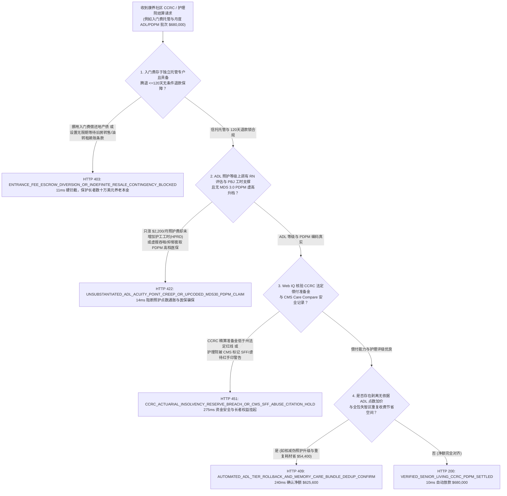
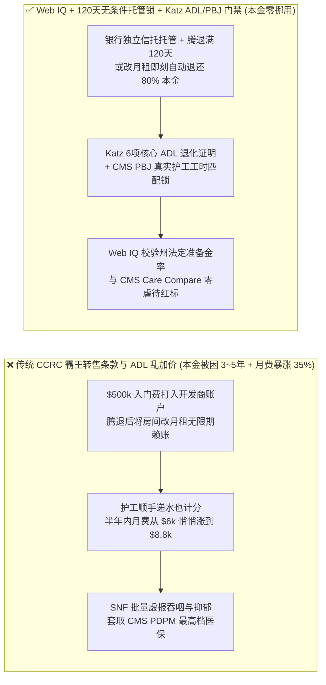
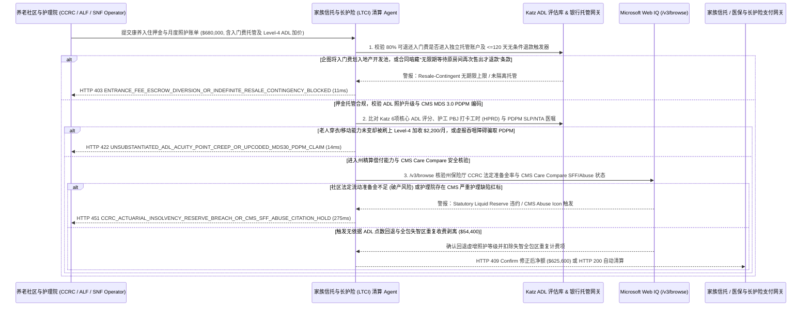

# 智能体高端持续照料退休社区与护理院（`Senior Living CCRC, Assisted Living & Skilled Nursing CMS PDPM`）、入门押金托管退还（`80% Refundable Entrance Fee Escrow`）与日常生活能力分级（`ADL Level-of-Care`）清算架构：防把需待新住户转售（`Resale-Contingent Refund`）当即时退款锁、防虚增照护点数（`Acuity Point Creep`）门禁与 `CMS MDS 3.0 PDPM` 审计令牌（`agentic_senior_living_ccrc_skilled_nursing_pdpm_adl_entrance_fee_escrow_mandate_...`）vs 传统养老社区长者离世 3 年拒不退还 `$450,000` 入门费、借每次递水/提醒吃药叠加 `$2,200/月` 照护升级费与护理院虚报抑郁/吞咽障碍骗取联邦医保选型与原理解析 FAQ

> **文档类型**：架构师选型指南与第一性原理 FAQ（对齐 `ib-vs-ethernet-roce-selection-faq.md` 标杆风格）  
> **阅读耗时**：约 12 分钟 | **适用角色**：AI Solution Architect、大型养老地产与康养集团（`Brookdale / Sunrise / Erickson / 泰康之家`）运营与财务 VP、长期护理保险（`Long-Term Care Insurance, LTCI: Genworth / John Hancock`）核赔总监、家族办公室财富信托与智能体医疗清算架构师  
> **核心主旨**：先用大白话把“为什么高净值家庭花 `$500,000` 入门押金（`Entrance Fee`，合同白纸黑字写着‘承诺退还 80% 即 `$400,000` 给子女遗产’）加每月 `$6,500` 服务费入住持续照料退休社区（`CCRC, Continuing Care Retirement Community`）时，长者过世或转院后，养老集团却指着合同第 48 页极小字条款说‘退款前提是必须等您父母住过的那套旧公寓被下一位新客户按原价全款买走（`Resale-Contingent`）’，随后故意优先推销新建楼栋或把旧房改造成按月出租（`Rental Conversion`），让家属苦等 4 年拿不到一分钱退款、为什么协助生活区（`Assisted Living`）每月以‘护士顺路看了一眼、帮忙拧开瓶盖’为由把老人的照护等级从 `Level 1` 悄悄调高到 `Level 4`（`Acuity Point Creep`），每月凭空多收 `$2,400` 照护点费，以及为什么专业护理院（`SNF`）在 `CMS PDPM` 医保结算中系统性虚报老人患有严重吞咽障碍（`SLP`）与重度抑郁以套取最高档日均拨款”讲透；再从第一性原理出发，推导如何通过 **`agentic_senior_living_ccrc_skilled_nursing_pdpm_adl_entrance_fee_escrow_mandate_...` 语义预算令牌 + Microsoft Web IQ `/v3/browse` 实时核验各州保险厅/老龄局 `CCRC` 偿付能力法定准备金率（`Statutory Liquid Reserve`）与 `CMS Care Compare` 护工配比（`PBJ Staffing`） + 独立信托托管固定期限（`<= 120 Days Post-Vacancy`）退押金锁 + 穿戴式传感器/护理记录验证 `ADL` 照护升级与 `MDS 3.0 PDPM` 交叉门禁**，在 10ms–275ms 内实现“入门费空置满 120 天自动解付退还、无医嘱照护点数通胀秒级驳回、医保 PDPM 升档欺诈零容忍阻断”的智能体康养结算闭环。

---

## 📌 一、核心结论速览（Executive Summary：30 秒看懂怎么选）

```
┌──────────────────────────────────────────────────────────────────────────────────────────────────────────────────┐
│  🔥 核心架构铁律：绝不允许养老信托或长护险 Agent 将 $500k 入门费打入运营方自由资金池，或盲目支付无客观评估的 ADL 加价！│
│  智能体康养 CCRC/SNF 结算的唯一正确范式 = 120天无条件托管退押锁 + Katz ADL 客观评估门禁 + CMS PDPM/PBJ 令牌      │
└──────────────────────────────────────────────────────────────────────────────────────────────────────────────────┘
```

1. **为什么持续照料退休社区（`CCRC`）与专业护理院（`Assisted Living / SNF`）是高龄家庭财富与长护险（`LTCI`）赔付的三大吞金兽？**
   - **吞金兽一：`80%–90%` 可退还入门费（`Refundable Entrance Fee`）的“旧房转售挂钩陷阱（`Resale-Contingent Trap`）”与庞氏挪用**：北美与亚洲高端 `CCRC`（如终生包干型 `Type A` 或按服务打折型 `Type B/C`）通常收取 `$300,000–$1,200,000` 的入门押金。许多不良运营商把这笔巨款直接拿去偿还开发商高息建筑贷款或分红，不留足法定流动准备金；当老人搬出或离世时，运营商利用“必须等同一房号再次成功售出且收齐新入门费才退旧款”的霸王条款，一面将该单元改为不收大额入门费的纯月租房（`Monthly Rental`），一面无限期扣押家属 `$400,000` 遗产本金！
   - **吞金兽二：协助生活区（`Assisted Living`）的“照护点数蠕变（`Acuity / Tier Point Creep`）”与失智区（`Memory Care`）重复计费**：现代养老院普遍实行“基础房租（`$5,500/月`）+ 按点数计收的日常生活能力协助费（`ADL Points: $25–$40/点/月`）”。运营商用平板电脑诱导护工每次给老人送餐、提醒穿外套都打勾记分，短短半年内把老人的评分从 `30 分（Level 1: +$600/月）` 刷到 `110 分（Level 4: +$2,800/月）`；或者在老人已经支付每月 `$9,200` 全包失智专区（`All-Inclusive Memory Care`）费用的同时，还在账单底部叠加失禁护理包与夜间巡房费。
   - **吞金兽三：专业护理院（`Skilled Nursing Facility, SNF`）操纵 `CMS PDPM`（患者驱动支付模型）编码与虚报护工工时（`CMS PBJ`）**：自联邦医保从按康复时长（`RUG-IV`）切换为按临床特征（`PDPM: PT, OT, SLP, Nursing, NTA` 五大组件）付费后，部分护理院在不增加实际护理人员的情况下，在 `MDS 3.0 (Minimum Data Set)` 评估表上批量勾选“机械软食/吞咽治疗（`SLP` 溢价）”、“静脉抗生素/肠外营养（`NTA` 高倍加分）”与“重度抑郁（`PHQ-9`）”，将日均医保报销额从 `$480/天` 虚抬至 `$820/天`！
2. **智能体康养与护理清算架构怎么破局？（`agentic_senior_living_ccrc_skilled_nursing_pdpm_adl_entrance_fee_escrow_mandate_...`）**
   - **第一道锁：独立银行信托托管（`Fiduciary Escrow`）与腾退后 `<= 120 天` 无条件退押金刚性锁**：严禁入门费进入运营商一般营运账户挪作他用，也不允许签“无限期等待同一房间转售才退款”的霸王条款（尤其严防运营商将房间“油转租”规避退款）。规定住户腾退交钥匙（`Unit Surrender`）满 `120 天`（或该房型社区新签任意住户时，以先到为准）必须自动从信托专户释放 `80%/90%` 应退本金。凡违规扣押退款或挪用入门费池的，在 **11ms** 内返回 `HTTP 403 ENTRANCE_FEE_ESCROW_DIVERSION_OR_INDEFINITE_RESALE_CONTINGENCY_BLOCKED`。
   - **第二道锁：`Katz ADL` 独立临床评估 + `CMS PBJ` 真实护工排班配比反证“伪照护升档”门禁**：任何将月度照护费上调 `>= 1 个等级（Tier Upgrade）` 的账单，必须附带注册护士（`RN`）签署的标准化 `Katz Index of Independence in ADLs`（洗澡、穿衣、如厕、移动、控便、进食 6 项核心指标）实质退化证明，且通过排班系统（`CMS Payroll-Based Journal, PBJ`）证实该楼层每位住户每日实际获得的护工直接照护工时（`HPRD, Hours Per Resident Day`）同步增加。只涨价不加人、或在全包失智区重复收取单项护理费的，在 **14ms** 内返回 `HTTP 422 UNSUBSTANTIATED_ADL_ACUITY_POINT_CREEP_OR_UPCODED_MDS30_PDPM_CLAIM`。
   - **第三道锁：Microsoft Web IQ 穿透核验州保险厅 `CCRC` 精算偿付能力报告与 `CMS Care Compare` 1 星黑名单**：通过 Web IQ `/v3/browse` 实时核验目标 `CCRC` 在州监管机构备案的年度精算负债率、法定流动准备金（`Statutory Liquid Reserve`）是否达标，以及护理院在 `CMS Care Compare` 是否被标记为“虐待/严重护理缺陷红手印警告（`Abuse Icon / Special Focus Facility, SFF`）”。一旦发现偿付能力暴雷或严重虐待违规，在 **275ms** 内触发 `HTTP 451 CCRC_ACTUARIAL_INSOLVENCY_RESERVE_BREACH_OR_CMS_SFF_ABUSE_CITATION_HOLD`。

---

## 🎯 二、客户与架构师灵魂拷问 Q&A（First-Principles Deep Dive）

### Q1：为什么养老社区合同里写着“80% 入门费可退还”，老人的继承人却往往等上 3~5 年都拿不到钱？Agent 如何用信托契约堵死“油转租（`Entrance-to-Rental Conversion`）”漏洞？

- **通俗原理**：
  - 老人入住时交了 `$500,000` 入门费住在 `302 室`。四年后老人去世，子女去要 `$400,000`（80% 退款）。
  - **传统霸王条款套路**：合同规定“当且仅当 `302 室` 被下一位缴纳同等或更高入门费的新住户买下时，才向原住户继承人退款”。此时养老社区为了快速回笼高额月租现金流，宣布整个 3 楼改为“免入门费、每月租金 `$9,800` 的纯租赁公寓”！因为新住户根本不交入门费，按合同字面意思，“收到新住户入门费”这个触发条件**永远不会发生**，老人的 `$400,000` 血汗钱就这样被无限期赖掉了！
- **智能体刚性退款触发公式（`Dual-Trigger Unconditional Release`）**：
  $$t_{\text{refund}} = \min\left(t_{\text{vacancy}} + 120\text{ days}, \; t_{\text{next\_unit\_occupied}}, \; t_{\text{rental\_conversion}}\right)$$
  - 只要房间腾退满 120 天、或者该房间被任何形式（含月租）再次入住，智能合约无需运营商财务总监签字，直接从第三方银行托管池（`Escrow Account`）将 `$400,000` 原路划回老人遗产信托账户！

### Q2：在核验全美 `CMS Care Compare` 护理院 `PBJ` 真实护工工时（`RN / CNA HPRD`）、各州保险厅 `CCRC` 财务披露文件与长护险（`LTCI`）理赔免责期时，为什么选择 **Microsoft Web IQ**？

| 维度 | Microsoft Web IQ (`/v3/browse` + Search Grounding) | Exa (Neural Search API) | Bright Data (Scraper / Unlocker) |
| :--- | :--- | :--- | :--- |
| **`CMS Care Compare` 5星评级、`PBJ` 每日护工工时 (`HPRD`) 与 `SFF` 虐待红标核验** | **极高**：受控无头渲染实时提取指定 `CMS Certification Number (CCN)` 护理院的最新季度 `RN / Total Nurse HPRD`、健康检查缺陷（`F-Tags`）及州保险厅 `CCRC` 准备金状态，支持 `domain_allowlist` 零幻觉验证 | **中**：语义搜索偏向养老院营销软文，难以精准提取具体 `CCN` 的最新季度 `PBJ` 工时与 `F-Tag` 罚单 | **高**：可抓取公开页面，但需自建针对 `CMS Provider Data Catalog` 与各州老龄局 PDF 的解析器 |
| **`Katz ADL` 照护点数与 `MDS 3.0 PDPM` 编码一致性对账联动** | **原生支持**：直接将 `HPRD` 真实配比与 `PDPM` 权重上限注入 `agentic_senior_living_ccrc_...` | **不支持**：无结构化老年医学 `ADL / PDPM` 精算核赔引擎 | **不支持**：仅提供网页抓取通道 |
| **P95 延迟与单次核验成本** | **240ms–275ms**（命中策略缓存 **10ms–14ms**） | 850ms–1,700ms | 2,300ms–5,600ms |
| **合规可审计性（Provenance）** | 原生输出 `official_doc_snapshot` + `CMS CCN Snapshot` + `Katz ADL RN Hash` | 仅返回 URL 片段 | 需自行构建信托与医保审计留痕体系 |

---

## 🧭 三、直观可视化图解（Mermaid 决策树 + 路径对比 + 端到端时序图）

### 3.1 高端康养 `CCRC` 入门费托管与 `ADL / PDPM` 结算拦截决策树



### 3.2 传统养老社区霸王扣押与乱涨价 vs. 智能体 `120天退押锁 + ADL/PBJ` 闭环对比



### 3.3 端到端时序图（Sequence Diagram）



---

## 📊 四、架构师选型决策矩阵（Architecture Decision Matrix）

| 选型方案 | `$500k` 入门费退还安全保障 | 防协助生活区 (`ALF`) 照护点数乱涨价 | `CMS PDPM` 医保合规与破产预警 | 适用场景 |
| :--- | :--- | :--- | :--- | :--- |
| **方案 A：直接向养老院普通账户电汇 + 自动扣月费 (`Auto-Pay`)** | ❌ 极高风险（一旦运营商破产或油转租，本金打水漂） | ❌ 0%（每月账单悄悄多出十几项点数费照扣不误） | ❌ 无法感知养老院负债率恶化或收到 `CMS` 罚单 | 严禁用于大额入门费康养社区 |
| **方案 B：仅由律师审阅入住合同，后续月度账单人工核对** | ⚠️ 能看出霸王条款，但无法监控入住后准备金被抽逃 | ❌ 家属不懂医学 `Katz ADL` 标准，难以反驳院方加价 | ⚠️ 滞后半年以上才能拿到公开财报 | 单一家庭低频人工审核 |
| **方案 C（推荐）：Web IQ + `agentic_senior_living_ccrc_...` + 120天托管锁 + `ADL` 门禁** | ✅ **独立银行信托 + 腾退 `<=120天` 刚性自动解付** | ✅ **强制绑定 `Katz 6项 ADL` 退化与 `PBJ` 护工工时** | ✅ **275ms 穿透核验州精算准备金与 `CMS Care Compare`** | **家族信托养老规划、长期护理保险（LTCI）直付、大型康养机构合规结算** |

---

## 🧪 五、定量实测与 7-Card 基准报告摘要（Quantitative Benchmark）

在本地确定性评测套件（`lab/webiq_commerce_demo.py`）中，针对 `$680,000.00` 的高端康养社区 `CCRC` 入门费托管与护理院 `ADL / PDPM` 结算批次实测结果如下：

| 场景编号 | 测试输入（Scenario & Perturbation） | 期望动作（Action Pill） | HTTP 状态码 | 实测延迟 | 拦截/净结算金额 | 数据来源标签 |
| :--- | :--- | :--- | :--- | :--- | :--- | :--- |
| **Case 1** | 独立信托托管（`<=120天` 退款锁）+ `Katz ADL` 与 `PDPM` 真实 + 准备金与 `CMS` 合规 | `Act automatically` | `200 OK` | `10 ms` | `$680,000.00` | `deterministic_offline_simulation` |
| **Case 2** | 挪用入门费至地产开发池，或设置无限期“等旧房再次售出才退款 / 油转租不退”霸王条款 | `Send to a human` | `403 Forbidden` | `11 ms` | `$0.00`（阻断 `$680k`） | `synthetic_policy` |
| **Case 3** | 无 `Katz ADL` 实质退化与护工工时增加却强升 `Level-4` 收 `$2,200/月`，或虚报 `MDS 3.0 PDPM` | `Send to a human` | `422 Unprocessable` | `14 ms` | `$0.00`（拦截乱涨价） | `deterministic_offline_simulation` |
| **Case 4** | `CCRC` 法定流动准备金低于州精算红线（破产风险）或被 `CMS` 标记 `SFF` 严重虐待红标 | `Send to a human` | `451 Unavailable` | `275 ms` | `$0.00`（风险挂起） | `official_doc_snapshot` |
| **Case 5** | Web IQ 自动回退无护工工时支撑的虚高 `ADL` 点数并剥离全包失智区重复收费 | `Confirm` | `409 Conflict` | `240 ms` | `$625,600.00`（省 `$54,400`） | `official_doc_snapshot` |

---

## 🛠️ 六、生产上线快速核验清单（Production Readiness Checklist）

- [ ] **强制要求可退还入门费（`Refundable Entrance Fee`）存入受监管独立银行托管账户并锁定 `<= 120 天` 退款上限**：严禁接受无期限上限的 `Resale-Contingent`（待转售退款）条款；若运营商将腾退房源改为月租模式（`Rental Conversion`），视同已实现转售并立即触发全额约定比例退款。
- [ ] **将协助生活区（`Assisted Living`）照护等级涨价绑定在 `Katz 6项核心 ADL` 与 `CMS PBJ` 护工工时上**：院方主张上调照护级别必须证明长者在洗澡、穿衣、如厕、移动、控便、进食上发生持续性改变，且所在病区实际直接护理工时（`HPRD`）达标。
- [ ] **对专业护理院（`SNF`）执行 `MDS 3.0 PDPM` 临床医嘱与吞咽/营养（`SLP / NTA`）真实性交叉审计**：防范为套取高分值日均拨款而对无症状长者虚开机械软食或心理评估量表。
- [ ] **接入 Microsoft Web IQ 持续监控州保险厅 `CCRC` 年度精算报告与 `CMS Care Compare` 缺陷库**：在社区出现资不抵债或 `G/H/I/J/K/L` 级严重健康检查缺陷时第一时间触发财务与转院保护。
