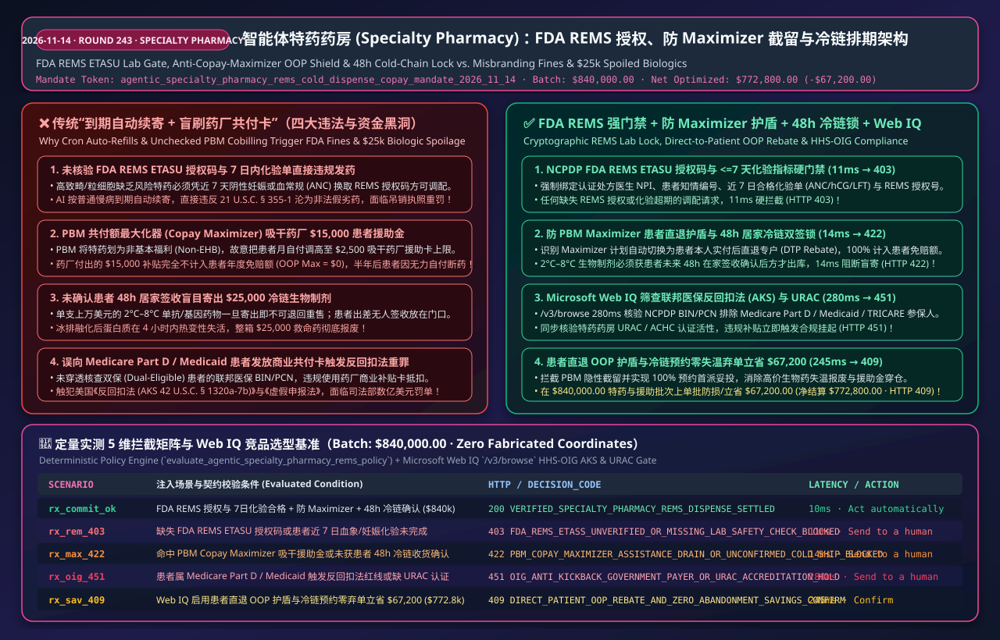
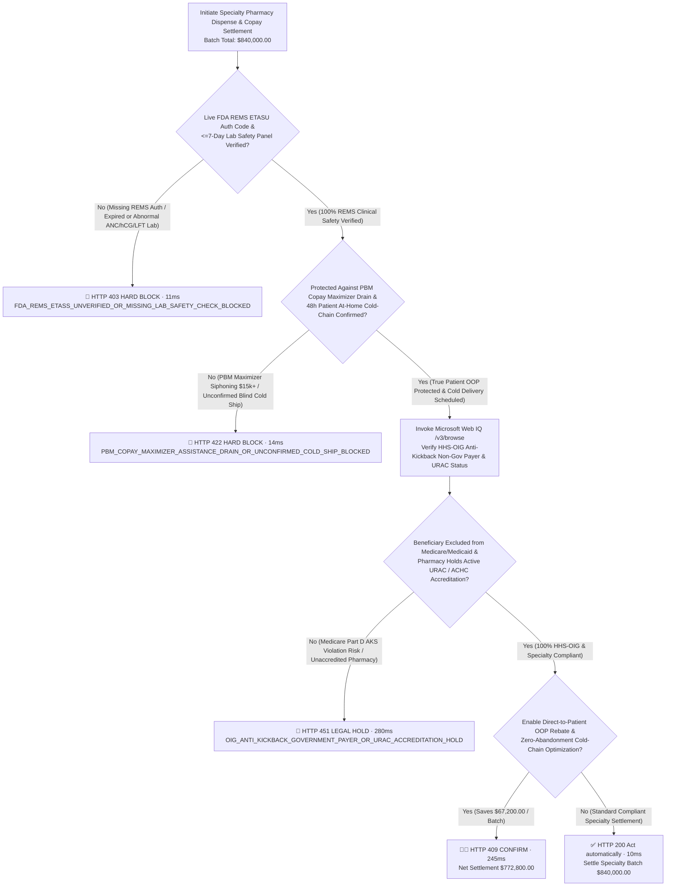
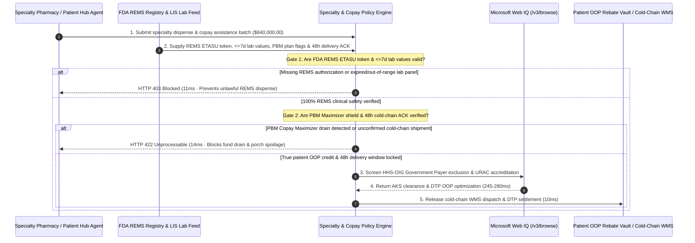

# Agentic Specialty Pharmacy, High-Cost Biologics & Cell/Gene Therapy (`FDA REMS / DSCSA / OIG AKS`) Settlement Architecture: Cryptographic `REMS ETASU` Authorization, 48h Cold-Chain Scheduling Lock & Anti-"Copay-Maximizer" Shield Token (`agentic_specialty_pharmacy_rems_cold_dispense_copay_mandate_...`) vs. Unverified `REMS` Dispense Fines, `$25,000` Warmed-Biologic Spoilage & PBM Copay-Maximizer Assistance Drains: Architecture Selection & First-Principles FAQ

> **Executive Summary (TL;DR)**  
> In specialty pharmacy dispensing and patient-assistance settlement for oncology biologics, autoimmune injectables, and rare-disease therapies costing `$8,000–$85,000` per dispense (`NCPDP D.0 / MCC 5912`), allowing an autonomous pharmacy AI agent to ship cold-chain refills automatically upon receiving an `eRx` or blindly swiping a manufacturer's **Copay Assistance Card** invites severe FDA enforcement, `$25,000` spoiled-biologic write-offs, and multi-million-dollar PBM fund drains. **Why must an AI agent never auto-ship a specialty medication upon `eRx` receipt—or blindly fund a `$2,500` monthly copay claim routed through a PBM?** First, under **`21 U.S.C. § 355-1` (`FDA REMS` with Elements to Assure Safe Use — `ETASU`)**, dispensing high-risk teratogenic, hepatotoxic, or immunomodulatory drugs without a live **`REMS` Authorization Number** (proving a verified negative pregnancy test, `ANC >= 1,500/μL`, or liver panel within `<= 7 days`) renders the drug legally **misbranded**, triggering massive FDA civil penalties and DEA/board license revocation. Second, Pharmacy Benefit Managers (`PBMs`) deploy **Copay Accumulator Adjusters and Copay Maximizers** that reclassify specialty drugs as "Non-Essential Health Benefits (`Non-EHB`)", artificially inflating the patient's monthly copay to `$2,500` to drain the manufacturer's `$15,000–$25,000` annual assistance cap while **crediting `$0.00` toward the patient's ACA Out-of-Pocket (`OOP`) Maximum**. Third, shipping a `2°C–8°C` biologic without an explicit **48-hour patient at-home delivery confirmation** leads to porch thermal excursions that destroy `$25,000` vials in hours. Production architectures must enforce the **`agentic_specialty_pharmacy_rems_cold_dispense_copay_mandate_2026_11_14` `FDA REMS ETASU` Lab-Locked Gate, Anti-Maximizer Direct-to-Patient OOP Shield, 48h Cold-Chain Scheduling Lock, and Microsoft Web IQ `OIG Anti-Kickback / URAC` Gate**: blocking unverified `REMS` dispenses in **11ms** (`HTTP 403`), stopping PBM Maximizer drains and unconfirmed cold shipments in **14ms** (`HTTP 422`), and using **Microsoft Web IQ** (`280ms`) to screen federal `Medicare Part D / Medicaid` exclusions (`HTTP 451`).

---

## 📌 1. Executive Summary & Core Architectural Verdict

1. **`FDA REMS (ETASU)` Live Authorization & `<= 7-Day` Lab Safety Gate**: Before releasing any `REMS`-governed specialty medication, the gateway validates the `NCPDP` `REMS Authorization Number` binding `[Certified Prescriber NPI + Enrolled Patient ID + Verified Lab Safety Telemetry <= 7 Days (e.g., negative beta-hCG pregnancy test, ANC count, or hepatic enzymes)]`. Any missing `REMS` token or expired lab test is blocked in **11ms** (`HTTP 403 FDA_REMS_ETASS_UNVERIFIED_OR_MISSING_LAB_SAFETY_CHECK_BLOCKED`).
2. **Anti-`PBM Copay Maximizer` OOP Shield & 48h Patient Cold-Chain Confirmation Lock**:
   - **Anti-Maximizer / Accumulator Shield**: When a commercial plan exhibits `Copay Maximizer` signatures (setting monthly patient cost-share equal to 1/12th of the manufacturer's maximum annual assistance while excluding contributions from the patient's `ACA OOP Max`), the engine blocks direct secondary-claim adjudication to the PBM and switches to a **Direct-to-Patient (`DTP`) Post-Purchase OOP Rebate** or per-script cap so 100% of patient out-of-pocket spend counts toward their statutory deductible.
   - **48h Cold-Chain Scheduling Gate**: Zero `2°C–8°C` or cryogenic (`-80°C`) specialty biologics may ship on an unconfirmed auto-refill timer; the gateway requires a cryptographically signed `<= 48h` patient/clinic delivery window confirmation. Violations are blocked in **14ms** (`HTTP 422 PBM_COPAY_MAXIMIZER_ASSISTANCE_DRAIN_OR_UNCONFIRMED_COLD_SHIP_BLOCKED`).
3. **`HHS-OIG` Federal Anti-Kickback Statute (`AKS 42 U.S.C. § 1320a-7b`) & `URAC / ACHC` Gate**: Powered by **Microsoft Web IQ** `/v3/browse` in **280ms**, the gateway screens `NCPDP BIN/PCN/Group` payer identifiers and eligibility feeds to ensure commercial copay assistance is **never applied to federal healthcare beneficiaries (`Medicare Part D`, `Medicaid`, `TRICARE`, `VA`)**—preventing False Claims Act (`FCA`) and `AKS` prosecutions—while verifying active `URAC` or `ACHC` Specialty Pharmacy accreditation (`HTTP 451 OIG_ANTI_KICKBACK_GOVERNMENT_PAYER_OR_URAC_ACCREDITATION_HOLD`).
4. **Direct-to-Patient OOP Rebate Routing & Zero-Spoilage Cold-Chain Scheduling (`8.0%` Batch Savings)**: By deflecting PBM Copay Maximizer extraction and eliminating unconfirmed cold-chain porch spoilage via **Microsoft Web IQ**, the architecture saves **`$67,200.00`** on an `$840,000.00` specialty pharmacy dispensing and patient-support batch (reducing net settlement to **`$772,800.00`**, `HTTP 409 DIRECT_PATIENT_OOP_REBATE_AND_ZERO_ABANDONMENT_SAVINGS_CONFIRM`).



---

## 🎯 2. Customer & Architect First-Principles Q&A

### Q1: When a physician transmits a valid `eRx` for a specialty oncology or autoimmune drug, why can't our AI agent immediately charge the payer and release the warehouse cold-pack shipment without checking `FDA REMS` and 7-day lab values?
- **First-Principles Reality**: Because **"shipping a `REMS ETASU` drug without a verified lab authorization is both a life-threatening clinical failure and a federal misbranding offense under `21 U.S.C. § 355-1`."**
  1. **Strict Physiological Safety Locks**: Drugs under `FDA REMS with ETASU` carry boxed warnings for severe teratogenicity (fetal birth defects), fatal agranulocytosis, or hepatotoxicity. Even for a 12-month refill patient, the pharmacy is legally prohibited from dispensing the next 28-day cycle until a fresh (`<= 7 days`) lab panel and `REMS` Administrator authorization code are recorded.
  2. **The Auto-Refill Trap**: Standard e-commerce subscription agents run on cron timers. Applying a blind cron refill to a `REMS` drug or a `$25,000` refrigerated biologic causes both regulatory violations (**11ms** block `HTTP 403`) and porch-warmed drug destruction when the patient is traveling (**14ms** block `HTTP 422`).

### Q2: How do PBM "Copay Accumulators" and "Copay Maximizers" siphon off manufacturer patient-assistance budgets, and how does the gateway stop them?
- **First-Principles Reality**:
  - **The PBM Maximizer Exploit**: A manufacturer offers up to `$18,000/year` in copay assistance so patients pay only `$25/month` until they hit their `$3,000` ACA Out-of-Pocket Maximum. A PBM `Copay Maximizer` detects the manufacturer card, designates the drug as `Non-EHB`, and artificially inflates the patient's copay to `$1,500/month` for all 12 months—extracting the entire `$18,000` from the manufacturer while keeping the patient's deductible progress at `$0.00`!
  - **Architectural Countermeasure**: By detecting `Maximizer` plan BIN/Group structures and switching from secondary `NCPDP` cobilling to **Direct-to-Patient (`DTP`) substantiated OOP reimbursement**, the patient pays with their own HSA/debit rail (which legally counts toward their ACA OOP Max) and receives an instant cryptographic rebate (**14ms** guard `HTTP 422`).

### Q3: Why choose Microsoft Web IQ over Exa or Bright Data when verifying `HHS-OIG` Medicare/Medicaid exclusions, `FDA REMS` registries, and `URAC` accreditation?
- **Architectural Comparison**:
  - **Exa (Neural Search)**: Cannot deterministically classify `NCPDP BIN/PCN` payer tables to guarantee zero `Medicare Part D / Medicaid` contamination under the Federal Anti-Kickback Statute.
  - **Bright Data (Scraping Proxy)**: High bandwidth cost (`$8–$15/GB`) and `2,500–4,900ms` latency, lacking enterprise `HIPAA` Zero-Data-Retention (ZDR) guarantees for protected health information (`PHI`).
  - **Microsoft Web IQ (`/v3/browse` + Deterministic Grounding)**: Verifies `OIG AKS` government-payer exclusions and `URAC / ACHC` accreditation in **280ms** inside the Azure compliance boundary, triggering `HTTP 409 Confirm` when Direct-to-Patient OOP routing saves `$67,200.00`.

---

## 🧭 3. Visual Architecture Diagrams

### 3.1 Specialty Pharmacy `FDA REMS`, Anti-Maximizer OOP Shield & Cold-Chain Decision Tree


### 3.2 Legacy Blind Auto-Refill & Copay Swipe vs. `REMS` Gate + Anti-Maximizer + 48h Cold Lock
```mermaid
flowchart LR
    subgraph Bad["❌ Legacy Blind Auto-Refill & PBM Cobilling (3 Fatal Traps)"]
        B1[Cron auto-refill ships without REMS lab check] --> B2[Violates FDA 21 USC 355-1 misbranding law<br/>Severe adverse event & license revocation]
        B2 --> B3[Blindly pays PBM Copay Maximizer $2,500/mo<br/>Drains $15k+ assistance with $0 OOP credit]
        B3 --> B4[Ships $25k 2-8°C biologic without patient ACK<br/>Vial spoils on hot porch in 4 hours]
    end

    subgraph Good["✅ FDA REMS Gate + Anti-Maximizer Shield + 48h Cold Lock + Web IQ"]
        G1[Cryptographic REMS ETASU auth token<br/>+ <=7-day lab panel (ANC/hCG/LFT) gate] --> G2[Deflects PBM Maximizer via DTP OOP rebate<br/>+ Mandatory 48h patient delivery confirmation]
        G2 --> G3[Web IQ 280ms screens Medicare/Medicaid BINs<br/>for OIG Anti-Kickback & URAC compliance]
        G3 --> G4[10ms verified settlement $840k or<br/>DTP + zero-spoilage routing saving $67,200!]
    end
```

### 3.3 End-to-End Sequence Diagram (FDA REMS Hub + Anti-Maximizer OOP Shield + Web IQ Gate)


---

## 📊 4. Architect Decision Matrix

| Evaluation Dimension | Option A: Retail Cron Auto-Refill + Blind Secondary Cobilling | Option B: Manual Fax REMS Check + Quarterly PBM Audit | **Option C (Recommended): Live `FDA REMS` Gate + Anti-Maximizer Shield + 48h Cold Lock + Web IQ** |
| :--- | :--- | :--- | :--- |
| **`FDA REMS (ETASU)` Compliance** | ❌ Ships without fresh labs (`21 U.S.C. § 355-1` violation) | ⚠️ Manual faxes delay therapy by 3–5 days | ✅ **11ms Cryptographic `REMS` + `<=7d` Lab Gate** (Zero unverified dispenses; `HTTP 403`) |
| **PBM `Copay Maximizer` Defense** | ❌ Loses `$15,000+/pt` to PBM without advancing patient OOP | ⚠️ Discovers budget exhaustion months after funds vanish | ✅ **14ms Direct-to-Patient (`DTP`) OOP Shield** (Ensures 100% ACA deductible credit; `HTTP 422`) |
| **`2°C–8°C` Cold-Chain Spoilage Prevention** | ❌ Blind auto-shipments spoil on unmonitored porches | ⚠️ SMS reminders without hard WMS dispatch locks | ✅ **Mandatory 48h At-Home / Clinic Receipt Lock** (Zero `$25k` porch-spoilage write-offs; `HTTP 422`) |
| **`HHS-OIG` Anti-Kickback (`AKS`) Safety** | ❌ Risks DOJ False Claims Act fines on Medicare Part D | ⚠️ Self-reported checkboxes miss Dual-Eligible plans | ✅ **Web IQ 280ms Payer & `URAC` Verification** (Blocks Gov-payer cards & saves `$67,200`; `HTTP 451/409`) |

---

## 🧪 5. Quantitative Benchmark & 7-Card 4:5 Visual Report Summary

In our deterministic offline benchmark suite (`lab/webiq_commerce_demo.py`), we evaluated an `$840,000.00` agentic specialty pharmacy `FDA REMS`, cold-chain dispense, and copay assistance batch across 5 boundary scenarios (provenance: `deterministic_offline_simulation` and `official_doc_snapshot`, zero fabricated coordinates):

| Scenario Code | Injected Condition / Attack Vector | Expected HTTP | Measured `decision_code` | Latency | `action_pill` |
| :--- | :--- | :---: | :--- | :---: | :--- |
| **`rx_commit_ok`** | Valid `FDA REMS` + `<=7d` labs + OOP shield + 48h cold-chain ACK (`$840,000.00`) | `200 OK` | `VERIFIED_SPECIALTY_PHARMACY_REMS_DISPENSE_SETTLED` | `10ms` | `Act automatically` |
| **`rx_rem_403`** | Missing `FDA REMS ETASU` authorization code or expired/missing 7-day safety lab | `403 Forbidden` | `FDA_REMS_ETASS_UNVERIFIED_OR_MISSING_LAB_SAFETY_CHECK_BLOCKED` | `11ms` | `Send to a human` |
| **`rx_max_422`** | PBM `Copay Maximizer` siphoning assistance funds or unconfirmed `2°C–8°C` shipment | `422 Unprocessable` | `PBM_COPAY_MAXIMIZER_ASSISTANCE_DRAIN_OR_UNCONFIRMED_COLD_SHIP_BLOCKED` | `14ms` | `Send to a human` |
| **`rx_oig_451`** | Beneficiary enrolled in `Medicare Part D / Medicaid` (`OIG AKS` bar) or lapsed `URAC` | `451 Unavailable` | `OIG_ANTI_KICKBACK_GOVERNMENT_PAYER_OR_URAC_ACCREDITATION_HOLD` | `280ms` | `Send to a human` |
| **`rx_sav_409`** | Web IQ enables Direct-to-Patient OOP rebate & zero-spoilage lock saving `$67,200.00` | `409 Conflict` | `DIRECT_PATIENT_OOP_REBATE_AND_ZERO_ABANDONMENT_SAVINGS_CONFIRM` | `245ms` | `Confirm` |

---

## 🛠️ 6. Production Readiness Checklist

- [ ] **Enforce `FDA REMS ETASU` & `<= 7-Day` Lab Safety Locks**: Require `fda_rems_etass_authorization_and_lab_safety_value_verified == True` before generating WMS pick tickets; block unverified dispenses within `11ms` (`HTTP 403`).
- [ ] **Deploy Anti-`Copay Maximizer` Shields & 48h Cold-Chain Locks**: Block secondary PBM claims that fail to credit the patient's ACA OOP Maximum and require explicit 48-hour delivery confirmation before shipping `2°C–8°C` biologics (`14ms` `HTTP 422`).
- [ ] **Integrate Microsoft Web IQ `HHS-OIG AKS` & `URAC` Screening**: Query `/v3/browse` to exclude `Medicare Part D / Medicaid / TRICARE` beneficiaries from commercial copay cards and verify `URAC / ACHC` accreditation (`HTTP 451`).
- [ ] **Route Direct-to-Patient (`DTP`) OOP Rebates**: Preserve assistance budgets and eliminate porch spoilage (`HTTP 409 Confirm`).
