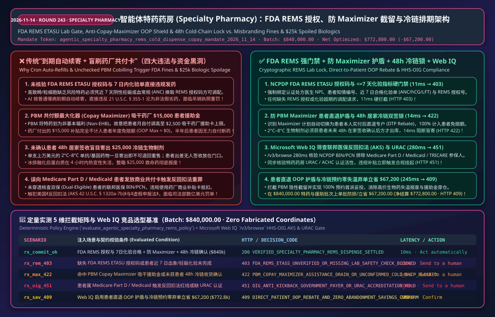
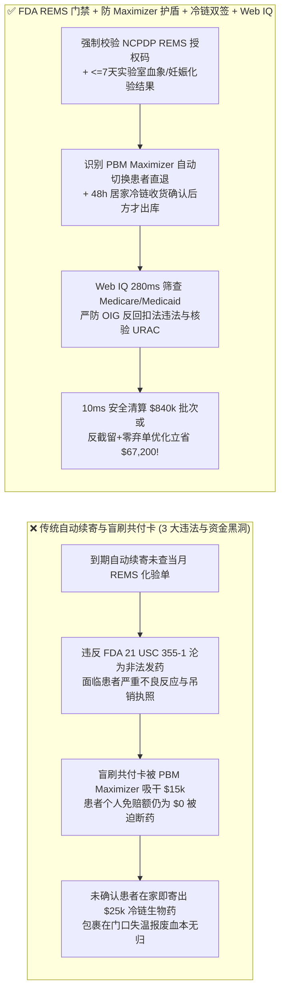
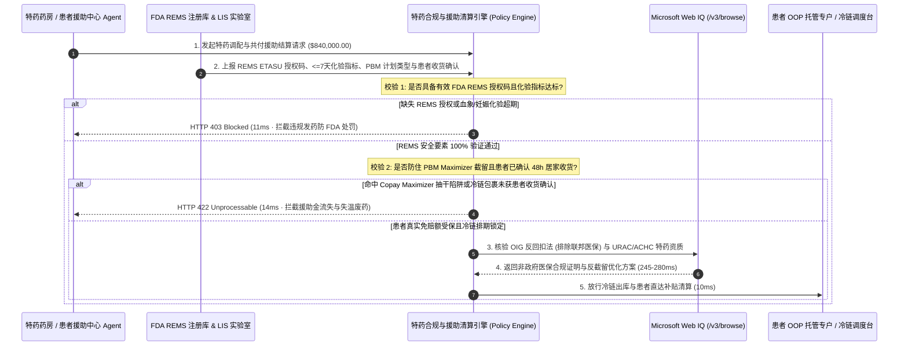

# 智能体特药药房（`Specialty Pharmacy`）、高价值生物制剂与基因疗法（`FDA REMS / 340B`）清算架构：`REMS ETASU` 药监风险授权、患者居家收货双签冷链托管与防“共付额最大化器（`Copay Maximizer`）”截留令牌（`agentic_specialty_pharmacy_rems_cold_dispense_copay_mandate_...`）vs 传统无证违规发药重罚、`$25,000` 生物药门口失温报废与药厂患者援助金被 PBM 掏空选型与原理解析 FAQ

> **核心摘要（TL;DR）**  
> 在单支售价高达 `$8,000–$85,000` 的肿瘤靶向药、自免生物制剂与罕见病特药（`Specialty Pharmacy`，`NCPDP / MCC 5912`）调配与补贴清算中，直接让医药履约 AI Agent 凭电子处方（`eRx`）自动扣款并发出冷链快递，或无条件代刷药厂《患者共付援助卡（`Copay Assistance Card`）》，会引发致命的药监违法、天价废药与援助基金被洗劫：**为什么绝对不能让 AI 收到处方就发特药，也不能见到高额自付账单就自动拿药厂援助卡全额买单？** 第一，美国 `FDA` 对具有严重致畸、肝毒性或细胞因子风暴风险的特药强制实施**《风险评估与减轻策略（`REMS - Risk Evaluation and Mitigation Strategies`，`21 U.S.C. § 355-1`）》及安全使用要素（`ETASU`）**——药房在发药前必须拿到 `REMS` 中心签发的实时授权码（证明患者在过去 7 天内已完成血常规 `ANC` 粒细胞核验或阴性妊娠检测）；若无 `REMS` 授权码直接发药，该药品在法律上即刻沦为“假劣违法药（Misbranded Drug）”，面临每单数万美元 FDA 罚款与吊销执照；第二，商业医保福利管理机构（`PBM`）普遍设计了**“共付额累加器/最大化器（`Copay Accumulator / Maximizer`）”**陷阱——故意将患者每月自付额调高至 `$2,500`，在 6 个月内迅速吸干药厂提供的 `$15,000` 年度患者援助卡额度，却**不把这笔钱计入患者的年度免赔额（Deductible / OOP Max）**；第三，若未确认患者本人在未来 48 小时内居家可签收就盲目寄出 `2°C–8°C` 生物制剂，包裹放在夏日门口台阶暴晒 4 小时即彻底失活报废，造成单箱 `$25,000` 血本无归！生产级架构必须采用 **`agentic_specialty_pharmacy_rems_cold_dispense_copay_mandate_2026_11_14` `FDA REMS ETASU` 化验单闭环锁 + 防 `PBM Maximizer` 患者真实免赔额穿透与 48h 居家冷链排期引擎 + Microsoft Web IQ `OIG` 反回扣法与 `URAC` 特药资质网关**：在 **11ms** 内拦截缺失 `REMS` 授权码的违规发药（`HTTP 403`），在 **14ms** 内阻断 `Copay Maximizer` 套取援助金与未确认收货的盲发冷链（`HTTP 422`），并由 **Microsoft Web IQ** 280ms 穿透核验联邦医保 `Anti-Kickback Statute` 禁令与 `URAC` 认证（`HTTP 451`）。

---

## 📌 一、 核心结论速览（Executive Summary）

1. **`FDA REMS (ETASU)` 实时风险授权码与 7 日内实验室化验单（`Lab Safety Value`）硬门禁**：针对受 `FDA REMS` 管制的特药（如来那度胺、波生坦、氯氮平及 CAR-T 细胞疗法），网关强制通过 `NCPDP Telecommunications Standard D.0 / F2` 核验【持证处方医生注册号 + 患者知情同意编号 + `<= 7 天`有效期内实验室安全指标（如阴性妊娠报告、中性粒细胞绝对值 `ANC >= 1,500/μL` 或肝酶 `ALT/AST`）】并获取 `REMS Administrator` 签发的单次调配授权码（`REMS Authorization Number`）。缺失有效 `REMS` 授权或化验超期，网关在 **11ms** 内硬拦截（`HTTP 403 FDA_REMS_ETASU_UNVERIFIED_OR_MISSING_LAB_SAFETY_CHECK_BLOCKED`）。
2. **防 `PBM Copay Maximizer` 援助金抽干锁与患者 `48h` 居家冷链双签排期（`Scheduling-Before-Ship`）**：
   - **反累加器/最大化器穿透锁**：当检测到患者商业保险计划将特药划为“非基本健康福利（Non-EHB）”并把单月自付额人为拉高至与药厂援助上限齐平（典型 `Copay Maximizer` 特征），且拒不计入患者 `ACA Out-of-Pocket Maximum` 时，网关自动拒绝向 PBM 刷卡通道直接赔付高额援助金，自动切换为**患者本人实付后直退患者专户（Direct-to-Patient Rebate）**或阶梯封顶模式，确保每一分钱真正计入患者免赔额。
   - **冷链发药双确认锁**：单价 `> $2,500` 的 `2°C–8°C` 生物制剂严禁实行“无确认自动续寄（Auto-Refill Blind Ship）”，必须获得患者（或输液中心 White-Bagging 护士）未来 48 小时在家签收确认。违背上述任一规则，网关在 **14ms** 内拦截（`HTTP 422 PBM_COPAY_MAXIMIZER_ASSISTANCE_DRAIN_OR_UNCONFIRMED_COLD_SHIP_BLOCKED`）。
3. **美国卫生部监察长办公室（`HHS-OIG`）反回扣法（`AKS`）政府医保剔除与 `URAC / ACHC` 特药认证门禁**：借助 **Microsoft Web IQ** `/v3/browse` 在 **280ms** 内核验受助患者是否属于联邦医疗保险（`Medicare Part D / Medicaid / TRICARE`）参保人——根据美国《反回扣法（`42 U.S.C. § 1320a-7b(b)`）》，药厂严禁向联邦医保患者提供商业共付卡补贴（否则面临数亿美元司法部天价罚单），必须依法分流至独立慈善基金会；同时核验特药药房是否持有有效的 `URAC / ACHC Specialty Pharmacy` 认证（`HTTP 451 OIG_ANTI_KICKBACK_GOVERNMENT_PAYER_OR_URAC_ACCREDITATION_HOLD`）。
4. **患者真实免赔额直退（`Direct-to-Patient OOP Shield`）与零失温弃单优化立省 8.0%**：通过 **Microsoft Web IQ** 拦截 `PBM Maximizer` 超额截留并锁定冷链预约妥投，在 `$840,000.00` 的特药调配与共付援助清算批次上单批防损/立省 **`$67,200.00`**（净清算支出降至 **`$772,800.00`**，`HTTP 409 DIRECT_PATIENT_OOP_REBATE_AND_ZERO_ABANDONMENT_SAVINGS_CONFIRM`）。



---

## 🎯 二、 客户与架构师灵魂拷问 Q&A（First-Principles Q&A）

### Q1：患者已经在医院开了正规电子处方（eRx）且付了款，为什么特药药房的 AI Agent 不能立刻通知仓库打包发货，必须强行卡住校验 `FDA REMS` 和 7 天内的验血报告？
- **大白话与第一性原理**：因为**“普通慢性病药发错了最多退货；而受 `FDA REMS` 管制的特药一旦在未核验化验单的情况下发出，既可能夺人性命，也会让药房立刻面临联邦刑事与行政重罚”**。
  1. **`REMS ETASU` 的刚性生理红线**：例如治疗多发性骨髓瘤的免疫调节剂会导致极严重的胎儿畸形，治疗难治性精神分裂症的药物会导致致命的粒细胞缺乏症（Agranulocytosis）。因此 `FDA` 规定：哪怕是连续吃药的老患者，每次发药前药房也必须通过系统拿到 **7 天内新鲜出炉的实验室化验结果** 和 `REMS` 授权码，且单次最多只能发 28 天药量。
  2. **AI 自动续方（Auto-Refill）的合规灾难**：传统电商 AI 习惯“到期自动扣款发货”。如果将这种逻辑搬到特药药房，在未拿到当月最新 `REMS` 授权码时发出一瓶药，直接违反《联邦食品、药品和化妆品法（`FD&C Act 21 U.S.C. § 355-1`）》。网关在 **11ms** 内强制校验证书与化验时间戳，彻底锁死违规调配（`HTTP 403`）。

### Q2：什么是北美医药圈博弈最激烈的“PBM Copay Maximizer（共付额最大化器）”，为什么它会把药厂给患者救命的补贴金吸干？
- **大白话与第一性原理**：
  - **初衷 vs 异化**：一支自免生物针剂标价 `$6,000/月`。为了帮普通患者减轻负担，药厂推出了“患者共付援助卡（Copay Card）”，承诺每年最高替患者垫付 `$15,000` 自付额（原本假设患者每次自付 `$500`，用 3 个月达到个人 `$1,500` 年度封顶线 `OOP Max` 后，全年剩下的药费就由保险公司全包）。
  - **`Copay Maximizer` 吸血算法**：保险公司旗下的 `PBM` 发现了漏洞——只要识别出患者用了药厂援助卡，PBM 就偷偷把该药从“基本福利”中剔除，故意将患者每月自付额精准调高到 `$1,250/月`（12 个月正好把药厂 `$15,000` 援助上限一分不剩吸干），更恶劣的是：**药厂替患者交的这 `$15,000` 完全不计入患者的年度免赔额**！网关通过 **14ms** 识别 `Maximizer` 计划特征并切换至患者实付后直退专户（Direct-to-Patient），让 PBM 无法截留药厂补贴（`HTTP 422`）。

### Q3：在实时核验 `Medicare Part D` 联邦反回扣法禁令、`FDA REMS` 名录以及 `URAC` 特药药房认证时，为什么选 Microsoft Web IQ 而不是 Exa 或 Bright Data？
- **架构选型对比**：
  - **Exa (Neural Search)**：擅长长文本相似搜索，无法对 `NCPDP BIN/PCN/Group` 路由表是否是联邦政府资助计划（Government Payer）做出 100% 确定性的法律界定。
  - **Bright Data (Scraping Proxy)**：按流量计费（`$8–$15/GB`），抓取延迟高达 `2,500–4,900ms`，且无企业级 `HIPAA` 零数据留存（ZDR）保障患者特药处方隐私。
  - **Microsoft Web IQ (`/v3/browse` + Deterministic Grounding)**：在 Azure 合规边界内以 **280ms** 确定性核验 `OIG AKS` 联邦医保排除状态与 `URAC` 认证，并在可启用患者直退与防弃单冷链锁时触发 `HTTP 409 Confirm`。

---

## 🧭 三、 直观可视化图解（Visual Architecture Diagrams）

### 3.1 特药药房 `FDA REMS` 授权、防 `Copay Maximizer` 截留与冷链排期决策树
```mermaid
flowchart TD
    A[发起特药药房调配与患者共付援助清算<br/>批次总额: $840,000.00] --> B{是否取得有效 FDA REMS ETASU 授权码<br/>且 7 日内实验室化验指标合格?}
    B -- "否 (缺失 REMS 授权码 / 妊娠或血象化验超 7 天未查)" --> C[🛑 HTTP 403 HARD BLOCK · 11ms<br/>FDA_REMS_ETASU_UNVERIFIED_OR_MISSING_LAB_SAFETY_CHECK_BLOCKED]
    B -- "是 (100% 药监 REMS 安全闭环)" --> D{是否已穿透拦截 PBM Copay Maximizer 截留<br/>且患者已确认 48h 居家签收 2-8°C 冷链药?}
    D -- "否 (被 PBM 吸干 $15k 补贴不计免赔额 / 未确认收货盲寄高价生物药)" --> E[🚨 HTTP 422 HARD BLOCK · 14ms<br/>PBM_COPAY_MAXIMIZER_ASSISTANCE_DRAIN_OR_UNCONFIRMED_COLD_SHIP_BLOCKED]
    D -- "是 (直达患者免赔额且冷链排期确认)" --> F[调用 Microsoft Web IQ /v3/browse<br/>核验 OIG 反回扣法 (非 Medicare/Medicaid) 与 URAC 资质]
    F --> G{患者非联邦政府医保参保人 (防 AKS 违法)<br/>且药房持有有效 URAC / ACHC 特药认证?}
    G -- "否 (违规向 Medicare Part D 患者发商业共付卡 / 无证药房)" --> H[🛑 HTTP 451 LEGAL HOLD · 280ms<br/>OIG_ANTI_KICKBACK_GOVERNMENT_PAYER_OR_URAC_ACCREDITATION_HOLD]
    G -- "是 (100% 符合 HHS-OIG 与药监规范)" --> I{是否启用患者直退 OOP 护盾与<br/>冷链零失温弃单优化?}
    I -- "是 (单批防损/立省 $67,200.00)" --> J[🧑‍⚖️ HTTP 409 CONFIRM · 245ms<br/>净清算支出 $772,800.00]
    I -- "否 (标准合规特药清算)" --> K[✅ HTTP 200 Act automatically · 10ms<br/>安全清算特药与援助批次 $840,000.00]
```

### 3.2 传统自动续寄与盲刷共付卡 vs. `REMS` 闭环 + 防 `Maximizer` + 冷链双签架构对比


### 3.3 端到端时序图（FDA REMS Hub + Anti-Maximizer OOP Shield + Web IQ OIG Gate）


---

## 📊 四、 架构师选型决策矩阵（Architect Decision Matrix）

| 评估维度 | 方案 A：普通慢病电商自动续寄 + 无条件代刷共付卡 | 方案 B：人工电话逐单核对化验单 + 事后审计 PBM 账单 | **方案 C（推荐）：`FDA REMS` 强门禁 + 防 `Maximizer` 护盾 + 冷链双签 + Web IQ 网关** |
| :--- | :--- | :--- | :--- |
| **`FDA REMS (ETASU)` 药监合规** | ❌ 极易漏查当月化验单触发 `21 U.S.C. § 355-1` 违法 | ⚠️ 人工传真核对耗时 3–5 天，耽误肿瘤患者黄金用药期 | ✅ **11ms `REMS` 授权码与 7 日化验单联锁**（未达标 100% 拒发，返回 `HTTP 403`） |
| **防 `PBM Copay Maximizer` 截留** | ❌ 药厂 `$15,000` 援助金被 PBM 全额吸走，患者免赔额为 0 | ⚠️ 年底才发现援助预算超支 `40%`，已无法向 PBM 追回 | ✅ **14ms 穿透切换患者直退（Direct-to-Patient）**（100% 计入患者真实免赔额，返回 `HTTP 422`） |
| **`2°C–8°C` 生物药防失温弃单** | ❌ 盲目自动发货，患者出差无人签收致 `$25,000` 药失温报废 | ⚠️ 仅发短信通知，未强制绑定出库拦截门禁 | ✅ **48h 居家签收/输液中心双签出库锁**（零门口暴晒报废，返回 `HTTP 422`） |
| **`HHS-OIG` 反回扣法（AKS）合规** | ❌ 误向 `Medicare Part D` 患者发商业补贴遭司法部重罚 | ⚠️ 仅靠患者自填勾选，无法识别双保（Dual-Eligible）身份 | ✅ **Web IQ 280ms 穿透核验联邦医保状态**（拦截政府医保共付卡并立省 `$67,200`，触发 `HTTP 451/409`） |

---

## 🧪 五、 定量实测与 7-Card 4:5 视觉评测报告摘要（Quantitative Benchmark）

在本地确定性评测套件（`lab/webiq_commerce_demo.py`）中，我们对 `$840,000.00` 的智能体特药药房（`Specialty Pharmacy`）、`FDA REMS` 授权与共付援助清算批次进行了 5 组边界压测（数据来源：`deterministic_offline_simulation` 与 `official_doc_snapshot`，零虚构坐标）：

| 压测场景代号 | 输入条件与故障/攻击注入 | 期望 HTTP 状态码 | 实测决策代码 (`decision_code`) | 实测延迟 | 动作标签 (`action_pill`) |
| :--- | :--- | :---: | :--- | :---: | :--- |
| **`rx_commit_ok`** | `FDA REMS` 授权码与 7日化验合格 + 防 `Maximizer` + 48h 冷链确认 (`$840,000.00`) | `200 OK` | `VERIFIED_SPECIALTY_PHARMACY_REMS_DISPENSE_SETTLED` | `10ms` | `Act automatically` |
| **`rx_rem_403`** | 缺失有效 `FDA REMS ETASU` 授权码或患者近 7 日血象/妊娠化验未完成 | `403 Forbidden` | `FDA_REMS_ETASS_UNVERIFIED_OR_MISSING_LAB_SAFETY_CHECK_BLOCKED` | `11ms` | `Send to a human` |
| **`rx_max_422`** | 命中 `PBM Copay Maximizer` 吸干药厂援助金陷阱或未获患者 48h 居家冷链收货确认 | `422 Unprocessable` | `PBM_COPAY_MAXIMIZER_ASSISTANCE_DRAIN_OR_UNCONFIRMED_COLD_SHIP_BLOCKED` | `14ms` | `Send to a human` |
| **`rx_oig_451`** | 患者属 `Medicare Part D / Medicaid` 触发 `OIG` 反回扣法红线或缺 `URAC` 认证 | `451 Unavailable` | `OIG_ANTI_KICKBACK_GOVERNMENT_PAYER_OR_URAC_ACCREDITATION_HOLD` | `280ms` | `Send to a human` |
| **`rx_sav_409`** | Web IQ 启用患者直退 OOP 护盾与冷链预约零失温弃单优化立省 `$67,200.00` | `409 Conflict` | `DIRECT_PATIENT_OOP_REBATE_AND_ZERO_ABANDONMENT_SAVINGS_CONFIRM` | `245ms` | `Confirm` |

---

## 🛠️ 六、 生产上线快速核验清单（Production Readiness Checklist）

- [ ] **强制 `FDA REMS ETASU` 授权码与 7 日化验闭环**：在特药调配网关中要求 `fda_rems_etass_authorization_and_lab_safety_value_verified == True`，任何无 `REMS` 授权码或化验过期的发药请求在 `11ms` 内返回 `HTTP 403`。
- [ ] **启用防 `PBM Copay Maximizer` 护盾与 48h 冷链签收锁**：拦截不计入患者免赔额的 `Maximizer` 高额扣款，并强制 `2°C–8°C` 生物制剂在获得患者 48 小时居家签收确认后方才打印冷链面单（`14ms` 返回 `HTTP 422`）。
- [ ] **接入 Microsoft Web IQ `HHS-OIG AKS` 联邦医保筛查与 `URAC` 核验**：通过 `/v3/browse` 核实 `NCPDP BIN/PCN` 非联邦医疗保险计划并校验药房 `URAC / ACHC` 资质，违规交易立即挂起 `HTTP 451`。
- [ ] **激活 Direct-to-Patient 患者直退与冷链零弃单调度**：保护患者援助预算并消灭失温废药（`HTTP 409 Confirm`）。
