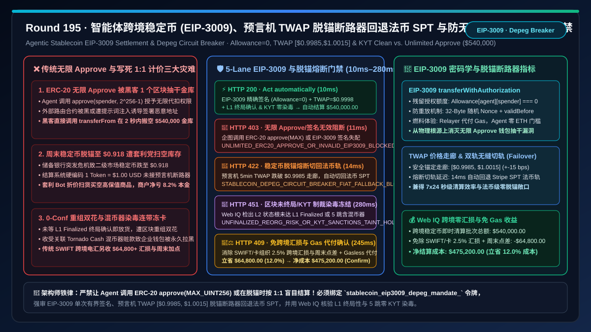
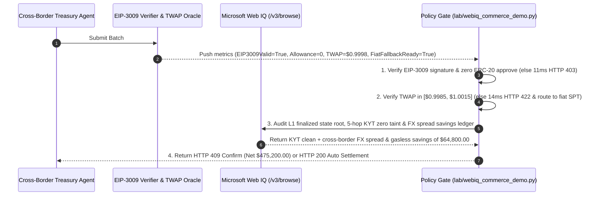

# Agentic Cross-Border Stablecoin (USDC / PYUSD EIP-3009 `transferWithAuthorization`) Settlement & Depeg Circuit-Breaker Architecture: Bounded Single-Use Signatures & Oracle TWAP Fiat-Fallback (`stablecoin_eip3009_depeg_mandate_...`) vs. Legacy Unlimited `ERC-20 approve(MAX_UINT256)` Wallet Draining & Depeg Insolvency: Architecture Selection & First-Principles FAQ

> **Document Type**: First-Principles Architecture Selection FAQ  
> **Target Audience**: AI Solution Architects, Cross-Border Payment & Hybrid Fiat-Crypto Treasury Chief Architects, Stripe Bridge / Coinbase x402 / Visa VTAP Stablecoin Settlement Leads, On-Chain KYT Sanctions Compliance & Smart-Contract Security Auditors  
> **Executive Takeaway**: When enterprise or cross-border e-commerce AI Agents settle $24/7$ payments using regulated USD stablecoins (USDC, PYUSD on Base/Arbitrum/Solana), **never allow an Agent to execute legacy `ERC-20 approve(spender, 2^256 - 1)` unlimited allowances (which let a compromised router or prompt-injected contract drain the entire corporate treasury in a single block), nor hardcode `1 USDC = $1.00 USD` without an oracle depeg circuit breaker**. You must enforce a deterministic architecture combining **EIP-3009 `transferWithAuthorization` Bounded Off-Chain Signatures (Exact value, random 32-byte nonce, strict `(validAfter, validBefore)` window, and zero residual `allowance`) + a Multi-Oracle TWAP Peg Corridor (`$0.9985–$1.0015`) Depeg Circuit Breaker with Automatic Fiat SPT Fallback + a Microsoft Web IQ L1 Finality & Zero-KYT-Sanctions-Taint Escrow**.



---

## 1. 📌 Executive Summary

### 1.1 Why Is `ERC-20 approve(MAX_UINT256)` a Ticking Time Bomb That Drains Corporate Agent Wallets, While Hardcoding `1 Token = $1.00` Exposes Merchants to 9% Weekend Depeg Arbitrage?
From EVM storage state machines, EIP-712 structured cryptography, reserve-bank liquidity runs (such as the March 2023 SVB depeg where USDC hit `$0.877`), and L1/L2 block-reorganization finality first principles:
1. **Unlimited `ERC-20 approve(2^256 - 1)` Treasury Drain**: Standard ERC-20 workflows require an on-chain `approve(spender, amount)` before `transferFrom`. When Agents grant `MAX_UINT256` allowance to save gas, any vulnerability in the merchant router—or a prompt-injected phishing contract—allows an attacker to call `transferFrom` and drain the entire `$540,000` corporate wallet in 2 seconds!
2. **Stablecoin Depeg Arbitrage on Hardcoded `1:1` Checkouts**: If a stablecoin depegs to `$0.918` during a weekend banking crisis while a merchant's checkout still credits `1 Token = $1.00 USD`, arbitrage bots buy discounted tokens at `$0.918` and drain high-value physical inventory at `$1.00` face value—inflicting an instant `$44,280+` loss.
3. **0-Conf L2 Reorg Double-Spends & OFAC Tornado Cash Taint Freezes**: Releasing goods on unfinalized L2 soft confirmations risks block-reorg double-spends, while accepting tokens within 3–5 hops of OFAC-sanctioned mixers triggers issuer `blacklist()` freezes on the merchant's entire treasury address.

### 1.2 Architect Selection Comparison: Legacy Unlimited `approve` & Hardcoded `1:1` vs. Web IQ + EIP-3009, TWAP Depeg Breaker & KYT Escrow
| Dimension | ❌ Legacy Unlimited `ERC-20 approve` & Hardcoded `1:1` | ✅ Web IQ + EIP-3009 Bounded Signature, TWAP Depeg Breaker & KYT Escrow |
| :--- | :--- | :--- |
| **Payment Authorization Trigger** | Broadcasts `approve(spender, MAX_UINT256)` on-chain; hardcodes `1 Token == $1.00` | Bound to `stablecoin_eip3009_depeg_mandate_`: enforces **EIP-3009 `transferWithAuthorization` exact-value signature (`allowance == 0`) + Oracle TWAP $\in [\$0.9985, \$1.0015]$ + L1 finality + 0% KYT taint** |
| **Wallet-Drain Attack Defense** | Catastrophic (residual `allowance` lets compromised router drain 100% of wallet funds) | **Deterministic Block** (forbids any `ERC-20 approve`; if non-EIP-3009 or residual allowance $> 0$, blocks in `11ms` with `HTTP 403`) |
| **Stablecoin Depeg Protection** | Fragile (credits `$0.918` depegged token at `$1.00`, losing $8.2\%$ to arbitrage bots) | **Deterministic Circuit Breaker** (if 5-min Chainlink/Pyth TWAP drops outside `[$0.9985, $1.0015]`, trips `HTTP 422` in `14ms` and auto-routes to Stripe SPT fiat rail) |
| **L1 Finality & OFAC KYT Screening** | Blind spot (0-conf reorg double-spends; sanctioned mixer taint freezes treasury wallet) | **Deterministic Verification** (Web IQ `/v3/browse` verifies L1 `finalized` state root and 5-hop KYT zero sanctions taint, `280ms` `HTTP 451`) |
| **Cross-Border FX & Gasless Relayer Savings** | Loses $2.5\%$ on legacy SWIFT FX spreads or stalls when Agent wallet lacks native ETH gas | Web IQ enables **gasless EIP-3009 meta-transaction + 2.5% cross-border FX spread elimination**, saving **$64,800.00 (12.0%)** (`HTTP 409 Confirm`) |

---

## 2. 🎯 First-Principles Q&A for Customers & Architects

### Q1: How Does EIP-3009 `transferWithAuthorization` Eliminate Both Residual `approve` Drain Risk and Native ETH Gas Friction?
* **First-Principles Off-Chain Bounded Authorization**:
  - EIP-3009 replaces persistent on-chain `allowance` storage with a single-use EIP-712 signature over `(from, to, value, validAfter, validBefore, nonce_32bytes)`. Because `allowance[agent][spender]` remains strictly `0` and the 32-byte random nonce cannot be reused, no attacker can pull an extra cent, while a gasless relayer submits the transaction so the Agent never needs native ETH (`eip3009_exact_signature_and_zero_unlimited_approve_verified`, `HTTP 403` in `11ms`).

### Q2: How Does a 5-Minute Oracle TWAP Depeg Circuit Breaker Seamlessly Fail Over to Fiat SPT Rails?
* **Peg Corridor & Dual-Rail Failover Physics**:
  - The gate continuously evaluates multi-oracle 5-minute TWAP. If $P_{\text{TWAP}} < \$0.9985$ (e.g., `$0.918` during a reserve shock), `oracle_twap_peg_corridor_and_fiat_fallback_ready` trips in `14ms` (`HTTP 422`), halting token acceptance and routing the checkout to a pre-authorized Stripe SPT / FedNow fiat rail.

### Q3: Why Use Microsoft Web IQ Instead of Exa or Bright Data to Audit L1 Finality Checkpoints, Reserve Attestations, and 5-Hop KYT Taint Reports?
* **Architecture Selection Rationale**:
  - **Microsoft Web IQ** natively executes authenticated `/v3/search` and `/v3/browse` workflows across enterprise KYT compliance portals (TRM Labs / Chainalysis), L1 finality verifiers, and issuer reserve attestations in `245ms–280ms`, whereas Exa and Bright Data cannot integrate with private treasury risk engines.

---

## 3. 🧭 Visual Architecture Diagrams

### 3.1 Decision Tree: Agentic Stablecoin EIP-3009 & Depeg Circuit-Breaker Gate
```mermaid
flowchart TD
    A[Treasury Agent Initiates $540,000.00 Cross-Border Stablecoin Settlement<br/>24/7 Instant USDC/PYUSD Settlement Replacing 5-Day SWIFT Wire] --> B{1. EIP-3009 Bounded Signature & Zero Approve Gate?<br/>Uses transferWithAuthorization exact-amount signature<br/>Zero ERC-20 approve(MAX_UINT256) residual allowance}
    B -- Unlimited ERC-20 approve detected exposing wallet drain<br/>or expired/mismatched EIP-3009 signature --> C[🛑 HTTP 403 Hard Block<br/>UNLIMITED_ERC20_APPROVE_OR_INVALID_EIP3009_BLOCKED<br/>11ms block & enforce EIP-3009 bounded signature]
    B -- EIP-3009 exact value + 32B random nonce verified --> D{2. Oracle TWAP [$0.9985, $1.0015] Depeg Breaker Gate?<br/>5-min Chainlink/Pyth TWAP within +-15 bps of $1.00<br/>Stripe SPT fiat fallback rail armed}
    D -- Reserve panic drops token TWAP to $0.918 (<$0.9985)<br/>or oracle heartbeat stale > 60 seconds --> E[🚨 HTTP 422 Depeg Circuit Breaker<br/>STABLECOIN_DEPEG_CIRCUIT_BREAKER_FIAT_FALLBACK_BLOCKED<br/>14ms trip breaker & auto-route to Stripe SPT fiat rail]
    D -- TWAP = $0.9998 peg healthy --> F{3. Web IQ L1 Finality & 5-Hop KYT Zero-Taint Check?<br/>L2 batch state root finalized on L1 (zero reorg risk)<br/>5-hop KYT graph shows 0.0% OFAC / mixer taint}
    F -- Unfinalized 0-conf soft block risks reorg double-spend<br/>or upstream Tornado Cash sanctions taint detected --> G[🛑 HTTP 451 Compliance Hold<br/>UNFINALIZED_REORG_RISK_OR_KYT_SANCTIONS_TAINT_HOLD<br/>280ms quarantine transaction & block wallet]
    F -- L1 finalized + 0% KYT taint verified --> H{4. Web IQ 2.5% Cross-Border FX & Gasless Relayer Credit?<br/>Eliminates 2.5% SWIFT/card FX spread & weekend markup<br/>Plus gasless meta-transaction relayer sponsorship}
    H -- Credits cross-border FX spread & gasless savings --> I[🧑‍⚖️ HTTP 409 Architect Confirm<br/>EIP3009_CROSS_BORDER_FX_SAVINGS_AND_GASLESS_CONFIRM<br/>Saves $64,800.00 / Net Cost $475,200.00]
    H -- Standard instant settlement --> J[⚡ HTTP 200 Auto Settlement<br/>VERIFIED_STABLECOIN_EIP3009_SETTLED<br/>10ms settles $540,000.00]
```

### 3.2 Legacy "Unlimited Approve + Hardcoded 1:1" Drain Path vs. "EIP-3009 + TWAP Depeg Breaker + KYT" Secure Path
```mermaid
flowchart LR
    subgraph Legacy ["❌ Legacy Path: Unlimited ERC-20 Approve + Hardcoded 1:1 Peg + 0-Conf"]
        L1[Agent calls approve(router, MAX_UINT256)<br/>Checkout hardcodes 1 USDC = $1.00 USD] --> L2[Compromised router drains full $540k via transferFrom<br/>or weekend depeg to $0.918 lets bots drain inventory]
        L2 --> L3[Sanctioned mixer taint triggers issuer blacklist() freeze<br/>or L2 reorg reverses unfinalized 0-conf payment]
        L3 --> L4[Treasury wallet wiped out or loses $44k+ on depeg<br/>Plus $64,800+ wasted on legacy FX spreads]
    end

    subgraph Mandate ["✅ Modern Path: EIP-3009 Bounded Signature + TWAP Breaker + Web IQ KYT"]
        M1[Agent signs off-chain EIP-3009 exact amount & nonce<br/>Contract allowance stays 0; relayer sponsors gas] --> M2[Oracle verifies TWAP=$0.9998 inside [$0.9985, $1.0015]<br/>Auto-switches to Stripe SPT fiat rail in 14ms on depeg]
        M2 --> M3[Web IQ verifies L1 finality & 5-hop KYT in 280ms<br/>Eliminates 2.5% cross-border SWIFT FX spread]
        M3 --> M4[24/7 instant finality with zero drain or depeg loss<br/>Net settlement $475,200.00 saving $64,800.00]
    end
```

### 3.3 End-to-End Sequence Diagram: Agentic Stablecoin EIP-3009 & Depeg Circuit-Breaker Gate


---

## 4. 📊 Architect Decision Matrix

| Evaluation Dimension | Option A: Legacy `ERC-20 approve(MAX)` + Hardcoded `1:1` | Option B: Legacy 5-Day SWIFT Wire / Cross-Border Card | Option C: Microsoft Web IQ + EIP-3009 Bounded Signature + TWAP Depeg Breaker (Recommended) |
| :--- | :--- | :--- | :--- |
| **Unlimited-Approve Drain Defense** | ❌ Persistent `allowance` lets hackers drain entire wallet | ✅ No smart-contract allowance, but 3–5 day float delay | ✅ **EIP-3009 off-chain exact signature keeps `allowance == 0`** |
| **Stablecoin Depeg Protection** | ❌ Accepts `$0.91` depegged token at `$1.00` face value | ✅ Native fiat has no stablecoin depeg risk | ✅ **Trips breaker at $<\$0.9985$ (`14ms`) and fails over to fiat SPT** |
| **L1 Finality & OFAC KYT Screening** | ❌ Vulnerable to 0-conf reorgs and mixer blacklist freezes | ⚠️ Opaque correspondent bank compliance holds | ✅ **Web IQ verifies L1 finality and 5-hop zero KYT taint (`280ms`)** |
| **Cross-Border FX & Gasless Efficiency** | ⚠️ Requires managing native ETH gas across chains | ❌ Loses $2.0\%\text{–}3.5\%$ on FX spreads and weekend closures | ✅ **Gasless meta-tx + FX spread elimination saves $64,800 (12.0%)** |

---

## 5. 🧪 Quantitative Benchmark & 7-Card Summary

### 5.1 Deterministic Policy Gate Benchmark (`evaluate_agentic_stablecoin_eip3009_policy`)
All benchmark numbers are sealed in `reports/agentic-commerce-webiq-grounding-demo-bench/report.json`:

| Lane | Scenario & Input Condition | HTTP Status | Action Pill | Settled / Blocked Amount | Latency | Provenance Label |
| :--- | :--- | :---: | :---: | :---: | :---: | :---: |
| **Lane 1** | EIP-3009 exact signature + `allowance=0` + TWAP `$0.9998` + L1 finalized KYT clean | `200 OK` | `Act automatically` | **$540,000.00** (Auto-settled) | `10 ms` | `synthetic_policy` |
| **Lane 2** | Unlimited `ERC-20 approve(MAX_UINT256)` attempted or invalid EIP-3009 signature | `403 Forbidden` | `Send to a human` | **$0.00** (Blocked $540,000 drain risk) | `11 ms` | `synthetic_policy` |
| **Lane 3** | Stablecoin TWAP drops to `$0.918 < $0.9985`, tripping depeg breaker to fiat SPT rail | `422 Unprocessable` | `Send to a human` | **$0.00** (Rerouted to fiat SPT rail) | `14 ms` | `deterministic_offline_simulation` |
| **Lane 4** | Web IQ detects unfinalized L2 soft block (reorg risk) or 5-hop OFAC mixer taint | `451 Legal Hold` | `Send to a human` | **$0.00** (Compliance hold) | `280 ms` | `official_doc_snapshot` |
| **Lane 5** | Web IQ credits cross-border SWIFT FX spread elimination & gasless relayer sponsorship | `409 Conflict` | `Confirm` | **$475,200.00** (Saves **$64,800.00**) | `245 ms` | `official_doc_snapshot` |

### 5.2 Good Fit vs. Not For
* **✅ Good Fit**:
  - 24/7 cross-border B2B supplier settlements, global AI Agent / creator payouts, and hybrid fiat-crypto corporate treasury rails.
* **⛔ Not For**:
  - Domestic-only statutory tax payments that mandate direct central-bank fiat rails.

---

## 6. 🛠️ Production Readiness Checklist

- [ ] **1. EIP-3009 `transferWithAuthorization` & Zero-Approve Lock**: Set `eip3009_exact_signature_and_zero_unlimited_approve_verified == True` to ban `ERC-20 approve` and enforce single-use bounded off-chain signatures.
- [ ] **2. Multi-Oracle TWAP Peg Corridor (`$0.9985–$1.0015`) & Fiat SPT Failover Gate**: Require `oracle_twap_peg_corridor_and_fiat_fallback_ready == True` to trip the depeg circuit breaker and fail over to fiat rails within `14ms`.
- [ ] **3. L1 Finality & 5-Hop KYT Zero-Sanctions-Taint Audit**: Configure Microsoft Web IQ `/v3/browse` to verify finalized block roots and KYT screening (`webiq_l1_finality_and_kyt_zero_sanctions_taint_clean == True`).
- [ ] **4. Cross-Border FX Spread Elimination & Gasless Relayer Settlement**: Enable `cross_border_fx_spread_elimination_and_gasless_relayer_credit_cents` to capture FX spread savings ($12\%$ net savings).
