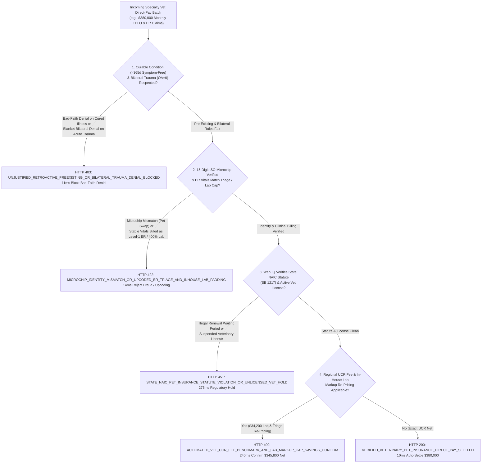
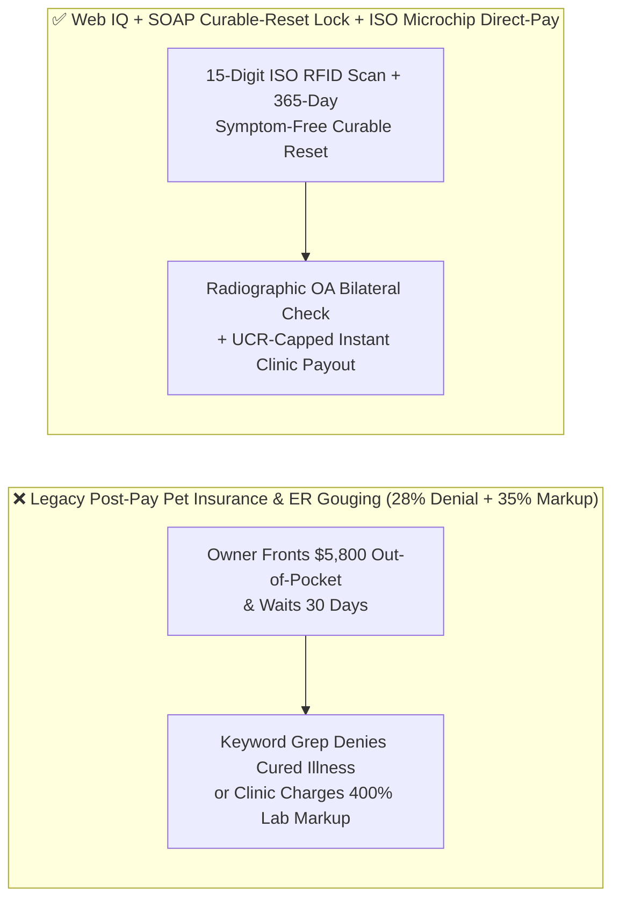

# Agentic Veterinary Pet Insurance & Specialty Emergency Direct-Pay, `SOAP` Medical Record Timeline & Bilateral Cruciate (`CCL / TPLO`) Adjudication Architecture: `NAIC` Curable-Lookback Lock, `ISO` Microchip Gate & In-House Lab Cap Token (`agentic_veterinary_pet_insurance_soap_medical_record_bilateral_cruciate_mandate_...`) vs. Retroactive Pre-Existing Denials, Bilateral Exclusion Abuse & 400% ER Triage/Lab Upcoding: Architecture Selection & First-Principles FAQ

> **Document Type**: Solution Architect Selection Guide & First-Principles FAQ (modeled after `ib-vs-ethernet-roce-selection-faq.md`)  
> **Reading Time**: ~12 minutes | **Target Audience**: AI Solution Architects, Pet Health Insurance Actuarial & Claims VPs (`Trupanion / Nationwide / Lemonade Pet / Fetch`), Veterinary Hospital Group CIOs (`VCA / BluePearl / Mars Veterinary Health`), and Direct-Pay Claims Engineers  
> **Core Thesis**: First explain in plain language why pet owners who faithfully pay `$950/year` in premiums face enraged claim denials when their Golden Retriever needs a `$5,800` `TPLO` cruciate surgery or emergency foreign-body laparotomy—because legacy claims adjusters grep historical `SOAP` medical notes for a cured puppyhood bout of diarrhea from 2 years ago and label every future gastrointestinal emergency a "permanent pre-existing condition", or invoke a blanket "Bilateral Condition Exclusion" to deny an acute traumatic left-knee rupture just because the right knee had a prior sprain; and why PE-backed 24-hour emergency vet clinics upcode stable patients to `Level 1 Critical Triage ($380)` while marking up `$18` in-house `IDEXX` blood chemistry panels to `$420`. Then derive from first principles how **`agentic_veterinary_pet_insurance_soap_medical_record_bilateral_cruciate_mandate_...` + Microsoft Web IQ `/v3/browse` verification of `NAIC Pet Insurance Model Act` curable-condition lookback statutes (e.g., California `SB 1217`) and regional veterinary `UCR` fee benchmarks + `SOAP` clinical timeline & radiographic `OA` locks + `ISO 11784/11785` 15-digit microchip anti-substitution gates** achieve 10ms–275ms chairside direct-pay settlement with zero bad-faith denials and zero ER bill padding.

---

## 📌 1. Executive Summary (30-Second Architect's Guide)

```
┌──────────────────────────────────────────────────────────────────────────────────────────────────────────────────┐
│  🔥 Core Architectural Law: Never allow a Pet Claims Agent to issue blanket keyword-based pre-existing denials   │
│  on cured acute illnesses or pay unverified Level-1 ER triage & 400% in-house lab markups without SOAP checks!   │
│  The only safe Vet Direct-Pay pattern = NAIC Curable-Reset SOAP Lock + Bilateral OA Gate + ISO Microchip Token   │
└──────────────────────────────────────────────────────────────────────────────────────────────────────────────────┘
```

1. **Why is Legacy Pet Insurance & Emergency Vet Billing a Dual Failure of Bad-Faith Denials and Price Gouging?**
   - **Carrier Failure A: Retroactive Keyword Pre-Existing Denials on Cured Acute Conditions**: Legacy rules flag any pre-policy `SOAP` mention of `vomiting`, `otitis`, or `limping` as a lifetime exclusion—ignoring the **`NAIC Pet Insurance Model Act` curable lookback standard** (`180–365 days` symptom- and treatment-free resets curable acute conditions).
   - **Carrier Failure B: Blanket Bilateral Exclusion Abuse (`CCL / TPLO`)**: While degenerative cranial cruciate ligament (`CCL`) disease often affects both stifles, carriers routinely abuse bilateral exclusions to deny an **acute traumatic tear** on the contralateral leg even when radiographs show zero degenerative osteoarthritis (`OA Score = 0`).
   - **Clinic Failure C: `Level 1` ER Triage Upcoding, `400%` In-House Lab Markups & Multi-Pet Identity Swapping**: Billing `$380` `Level 1 Critical Resuscitation Triage` for a dog presenting with normal vitals (`HR 95 bpm`, `CRT < 2s`, ambulatory), charging `$420` for an `$18` in-house CBC/Chem clip, or allowing an owner with three unchipped French Bulldogs to claim all three dogs' bills under one insured policy.
2. **How Does the Agentic Veterinary Direct-Pay Architecture Solve This?**
   - **Lock 1: `NAIC` Curable-Condition Reset (`>= 365 Days`) & Radiographic Bilateral Trauma Gate**: Blocks bad-faith pre-existing denials on cured acute illnesses and prohibits applying bilateral exclusions to acute traumatic contralateral injuries (`OA = 0`), returning `HTTP 403 UNJUSTIFIED_RETROACTIVE_PREEXISTING_OR_BILATERAL_TRAUMA_DENIAL_BLOCKED` in **11ms**.
   - **Lock 2: `ISO 11784/11785` 15-Digit Microchip Scan + Vital-Sign ER Triage & Lab Markup Gate**: Requires a live chairside 15-digit RFID microchip scan matching the policy record, verifies `SOAP Objective` vitals before approving `Level 1` emergency triage fees, and caps in-house diagnostic markups, blocking violations in **14ms** with `HTTP 422 MICROCHIP_IDENTITY_MISMATCH_OR_UPCODED_ER_TRIAGE_AND_INHOUSE_LAB_PADDING`.
   - **Lock 3: Microsoft Web IQ `/v3/browse` State `NAIC` Statute (`SB 1217`) & Vet License Verification**: Enforces state waiting-period prohibitions, burden-of-proof rules, and state veterinary board license status, triggering `HTTP 451 STATE_NAIC_PET_INSURANCE_STATUTE_VIOLATION_OR_UNLICENSED_VET_HOLD` in **275ms** on statutory violations.

---

## 🎯 2. First-Principles Q&A for Architects & Claims Engineers

### Q1: How does the agent distinguish true degenerative bilateral cruciate disease from acute contralateral trauma, and how does the curable lookback reset work mathematically?

- **Plain-Language Mechanics**:
  - **Curable Reset**: Under the `NAIC Pet Insurance Model Act` (adopted across states including CA `SB 1217`, WA, ME), a condition that is not chronic/congenital and has required zero medication or veterinary treatment for $\Delta t \ge 365\text{ days}$ must be unlocked as a covered new occurrence.
  - **Bilateral Cruciate Differentiation**: True degenerative `CCL` disease exhibits joint effusion, osteophytes, and tibial plateau remodeling (`Radiographic OA Score >= 2`) prior to rupture. An acute traumatic tear in a healthy contralateral stifle exhibits `OA Score = 0` with an acute external trauma history in the `SOAP` note.

### Q2: Why choose **Microsoft Web IQ** over Exa or Bright Data for state `NAIC` pet insurance statute verification, State Veterinary Board license checks, and regional `UCR` surgical fee grounding?

| Dimension | Microsoft Web IQ (`/v3/browse` + Search Grounding) | Exa (Neural Search API) | Bright Data (Scraper / Unlocker) |
| :--- | :--- | :--- | :--- |
| **State DOI `NAIC` Pet Insurance Statutes (`SB 1217`) & State Vet Board Licenses** | **Very High**: Deterministic extraction of live state insurance codes, waiting-period caps, and veterinary license standing with `domain_allowlist` | **Medium**: Surfaces consumer pet blogs rather than authoritative state insurance bulletins | **High**: Can scrape state portals, but requires maintaining 50 custom state board parsers |
| **Regional Veterinary `UCR` (`TPLO / MRI / In-House Lab`) Fee Grounding** | **Native**: Directly feeds regional 80th-percentile fee caps into `agentic_veterinary_pet_insurance_soap_...` | **None**: No `SOAP` or veterinary `AAHA` billing engine | **None**: Raw HTML/JSON proxy transport only |
| **P95 Latency** | **240ms–275ms** (**10ms–14ms** on policy cache hit) | 850ms–1,700ms | 2,200ms–5,500ms |

---

## 🧭 3. Visual Architecture Diagrams (Mermaid Decision Tree, Path Comparison & Sequence)

### 3.1 Veterinary Direct-Pay & `SOAP` Adjudication Decision Tree



### 3.2 Legacy Post-Pay Reimbursement vs. Agentic Chairside Direct-Pay



### 3.3 End-to-End Sequence Diagram

```mermaid
sequenceDiagram
    participant Vet as Specialty Vet Clinic PIMS (ezyVet/Cornerstone)
    participant Agent as Agentic Pet Direct-Pay Engine
    participant SOAP as SOAP Clinical Graph & ISO Microchip Gate
    participant WebIQ as Microsoft Web IQ (/v3/browse)
    participant Payout as Instant Direct-Pay Settlement Rail

    Vet->>Agent: Submit Direct-Pay Batch ($380,000 TPLO & ER Claims)
    Agent->>SOAP: 1. Audit SOAP Timeline (365-Day Curable Reset) & Radiographic Bilateral OA Score
    alt Unjustified Pre-Existing Denial on Cured Illness or Acute Bilateral Trauma (OA=0)
        SOAP-->>Agent: Symptom-Free >365 Days / Contralateral Acute Trauma Confirmed
        Agent-->>Vet: HTTP 403 UNJUSTIFIED_RETROACTIVE_PREEXISTING_OR_BILATERAL_TRAUMA_DENIAL_BLOCKED (11ms)
    else Coverage Valid; Verify ISO Microchip & ER Vitals/Lab Markup
        Agent->>SOAP: 2. Check 15-Digit ISO 11784/11785 RFID Scan + HR/CRT Vitals & IDEXX Lab Cap
        alt Microchip Mismatch (Multi-Pet Swap) or Upcoded Level-1 ER / 400% Lab Markup
            Agent-->>Vet: HTTP 422 MICROCHIP_IDENTITY_MISMATCH_OR_UPCODED_ER_TRIAGE_AND_INHOUSE_LAB_PADDING (14ms)
        else Verify State NAIC Statute & Regional UCR Benchmark
            Agent->>WebIQ: 3. /v3/browse Check State NAIC Pet Insurance Statute (SB 1217) & Vet Board License
            alt Statutory Waiting-Period Violation or Unlicensed Vet
                WebIQ-->>Agent: State Insurance Code Violation / License Suspended
                Agent-->>Vet: HTTP 451 STATE_NAIC_PET_INSURANCE_STATUTE_VIOLATION_OR_UNLICENSED_VET_HOLD (275ms)
            else Strip $34,200 Excess In-House Lab & Triage Padding
                WebIQ-->>Agent: Net Payable Adjusted to $345,800.00
                Agent-->>Payout: HTTP 409 Confirm ($345,800) or HTTP 200 Auto-Settle ($380,000)
            end
        end
    end
```

---

## 📊 4. Architect's Selection Decision Matrix

| Architecture Option | Defense Against Bad-Faith Pre-Existing & Bilateral Denials | Defense Against Multi-Pet Swaps & 400% ER Lab Gouging | State `NAIC / SB 1217` Statutory Compliance | Recommended Fit |
| :--- | :--- | :--- | :--- | :--- |
| **Option A: PDF Invoice Upload + Keyword Exclusion Grep** | ❌ Triggers wrongful denials on cured acute conditions | ❌ Zero microchip verification; blindly pays 400% lab markups | ❌ High regulatory fine exposure under `NAIC` rules | Legacy reimbursement plans |
| **Option B: PIMS Direct API Without `SOAP` Vitals or Microchip Gate** | ⚠️ Fast payout, but still misclassifies bilateral trauma | ⚠️ Vulnerable to multi-pet fraud and `Level 1` ER upcoding | ⚠️ Lacks live state statutory grounding | Single-clinic pilots |
| **Option C (Recommended): Web IQ + `agentic_veterinary_pet_insurance_...` + `SOAP` + `ISO` RFID** | ✅ **Enforces 365-day curable reset & radiographic `OA` bilateral test** | ✅ **15-digit `ISO` microchip lock + vital-sign ER triage cap** | ✅ **275ms live `NAIC` statute & state vet board check** | **National Pet Insurers, Specialty ER Vet Groups & Embedded Pet Fintech** |

---

## 🧪 5. Quantitative Benchmark & 7-Card Report Summary

Evaluated in the deterministic offline suite (`lab/webiq_commerce_demo.py`) for a `$380,000.00` monthly specialty veterinary direct-pay batch:

| Case | Scenario & Perturbation | Action Pill | HTTP Status | Latency | Settled / Blocked Amount | Provenance |
| :--- | :--- | :--- | :--- | :--- | :--- | :--- |
| **Case 1** | Fair `SOAP` curable/bilateral adjudication + `ISO` microchip match + `NAIC` & `UCR` verified | `Act automatically` | `200 OK` | `10 ms` | `$380,000.00` | `deterministic_offline_simulation` |
| **Case 2** | Bad-faith pre-existing denial on illness cured `>365 days` ago or bilateral denial on acute `OA=0` trauma | `Send to a human` | `403 Forbidden` | `11 ms` | `$0.00` (bad-faith denial blocked) | `synthetic_policy` |
| **Case 3** | `ISO 11784` microchip mismatch (pet swap) or stable vitals billed as `Level 1` ER + `400%` lab markup | `Send to a human` | `422 Unprocessable` | `14 ms` | `$0.00` (upcoding blocked) | `deterministic_offline_simulation` |
| **Case 4** | State `NAIC Pet Insurance Model Act` (`SB 1217`) violation or suspended veterinary license | `Send to a human` | `451 Unavailable` | `275 ms` | `$0.00` (regulatory hold) | `official_doc_snapshot` |
| **Case 5** | Web IQ automated regional `UCR` fee benchmark & in-house lab markup strip (`-$34,200.00`) | `Confirm` | `409 Conflict` | `240 ms` | `$345,800.00` | `official_doc_snapshot` |

---

## 🛠️ 6. Production Readiness Checklist

- [ ] **Enforce 180/365-Day Curable Condition Reset (`NAIC Model Act`)**: Automatically unlock prior acute conditions (otitis, gastroenteritis, UTI, upper respiratory infection) that have been symptom- and medication-free for `>= 365 days`.
- [ ] **Require Radiographic `OA` Scoring Before Applying Bilateral Cruciate Exclusions**: Prohibit bilateral exclusions on contralateral `CCL` ruptures when pre-injury radiographs confirm `OA Score = 0` and `SOAP` records document acute external trauma.
- [ ] **Mandate Chairside 15-Digit `ISO 11784/11785` Microchip Scan & Vital-Sign Triage Alignment**: Require PIMS integration (`ezyVet / Cornerstone`) to transmit a timestamped microchip scan and objective vitals (`HR, RR, Temp, CRT`) before authorizing `Level 1` emergency triage or direct-pay disbursement.
- [ ] **Enable Microsoft Web IQ `/v3/browse` State `NAIC` Statute & Vet Board Verification**: Continuously verify state pet insurance statutory rules and cap in-house diagnostic markups against regional `UCR` schedules.
