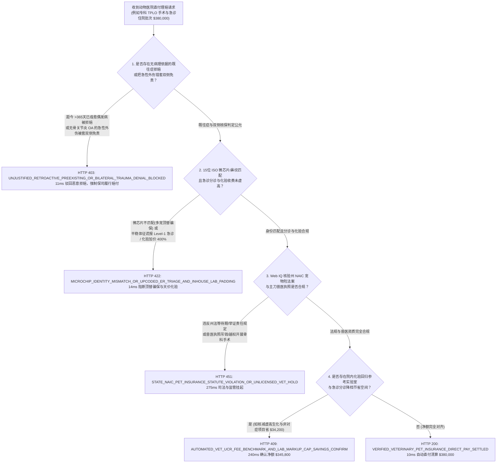
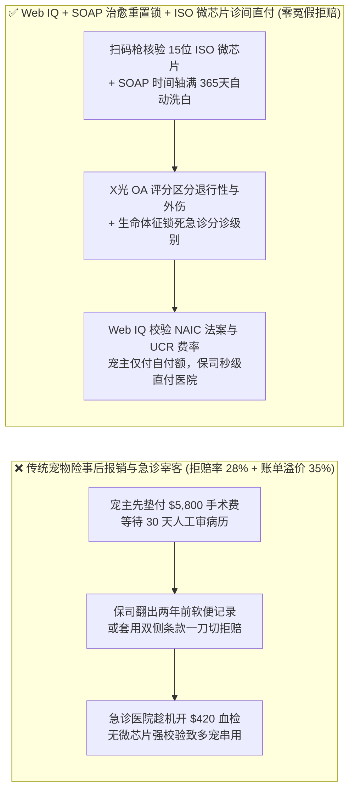
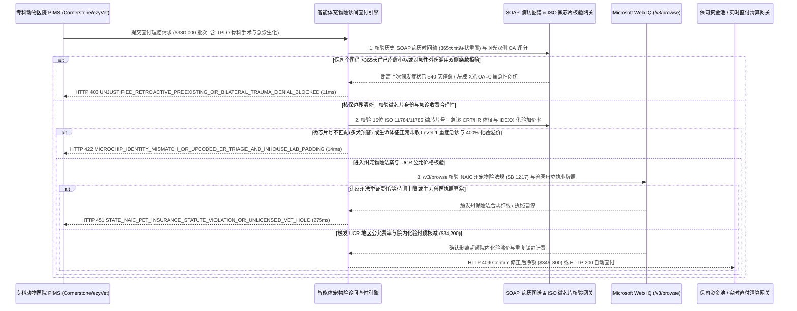

# 智能体宠物医疗保险与专科动物医院直付（`Veterinary Pet Insurance & Specialty Emergency Direct-Pay`）、`SOAP` 电子病历时间轴与双侧十字韧带（`Bilateral CCL / TPLO`）核保清算架构：投保前治愈期（`Curable Lookback`）防滥用既往症拒赔锁、院内化验试剂加价封顶门禁与防滥用双侧连带免责令牌（`agentic_veterinary_pet_insurance_soap_medical_record_bilateral_cruciate_mandate_...`）vs 传统宠物险借两年前耳道炎拒赔全科疾病、滥用“双侧同源条款”拒赔对侧健康膝盖手术与急诊医院 400% 血液生化溢价选型与原理解析 FAQ

> **文档类型**：架构师选型指南与第一性原理 FAQ（对齐 `ib-vs-ethernet-roce-selection-faq.md` 标杆风格）  
> **阅读耗时**：约 12 分钟 | **适用角色**：AI Solution Architect、宠物健康险核保与理赔精算总监（`Trupanion / Nationwide / Lemonade Pet / 众安宠物险`）、连锁动物医疗集团（`VCA / BluePearl / 新瑞鹏 / 瑞派`）信息官与智能体保单直付架构师  
> **核心主旨**：先用大白话把“为什么铲屎官每年交 `$950` 宠物医疗险，当金毛犬在投保第 2 年突发急性胃扭转或左后腿前十字韧带断裂（`CCL Rupture`，需做 `$5,800` 的 `TPLO` 胫骨平台水平截骨术）时，传统宠物保险公司理赔员翻出狗狗 2 年前幼犬期在社区诊所记录过一次早已痊愈的‘软便/轻微跛行’，就以‘投保前既往症（`Pre-Existing Condition`）’为由一分不赔、为什么狗狗右腿在投保前扭伤过，投保 18 个月后完全健康的左腿跑跳断裂，保司却祭出霸王‘双侧关联免责条款（`Bilateral Condition Exclusion`）’把左腿手术也拒赔了，以及为什么部分资本收购的 24 小时宠物急诊中心（`ER Vet`）对正常步态的宠物一律按最高危第 1 级重症（`Level 1 Critical Triage`）收 `$380` 急诊挂号费，并把成本 `$18` 的院内 `IDEXX` 生化血常规套餐开出 `$420` 天价”讲透；再从第一性原理出发，推导如何通过 **`agentic_veterinary_pet_insurance_soap_medical_record_bilateral_cruciate_mandate_...` 语义预算令牌 + Microsoft Web IQ `/v3/browse` 实时核验 `NAIC Pet Insurance Model Act` 治愈可保规则（`180/365-Day Symptom-Free Curable Reset`）与 `AVMA / AAHA` 专科诊疗基准价 + `SOAP` 病历时间轴因果检验锁 + 鼻纹/微芯片（`ISO 11784/11785 RFID`）身份防顶替门禁**，在 10ms–275ms 内实现“已痊愈偶发病零霸王拒赔、非退行性外伤禁套双侧免责、急诊院内化验溢价自动回归公允基准”的智能体宠物医疗直付闭环。

---

## 📌 一、核心结论速览（Executive Summary：30 秒看懂怎么选）

```
┌──────────────────────────────────────────────────────────────────────────────────────────────────────────────────┐
│  🔥 核心架构铁律：绝不允许宠物险理赔 Agent 将历史病历里的任意症状关键词盲目判为终身既往症拒赔，或放任急诊化验无限加价！│
│  宠物医疗直付的唯一正确范式 = SOAP 时间轴治愈重置锁 + 外伤 vs 退行性双侧判定门禁 + ISO 微芯片核验 + Web IQ 诊疗基准令牌│
└──────────────────────────────────────────────────────────────────────────────────────────────────────────────────┘
```

1. **为什么传统宠物险与专科动物急诊结算（`Pet Insurance & Specialty Vet Direct-Pay`）同时让宠物主与保司陷入信任崩盘？**
   - **保司端潜规则 A：把早已痊愈的偶发小病曲解为终身“既往症（`Retroactive Pre-Existing Condition`）”**：传统理赔系统用粗糙关键词匹配审阅兽医 `SOAP` 病历（`Subjective, Objective, Assessment, Plan`）。只要病历里在保单生效前出现过“呕吐（`Vomiting`）”或“抓挠耳朵”，哪怕那只是两年前偷吃狗粮引起的急性肠胃炎且早已满 **12 个月无症状痊愈**（符合美国 `NAIC Pet Insurance Model Act` 可治愈疾病重置标准），保司竟将两年后的胰腺炎或胃内异物手术全部按“消化道既往症”拒赔！
   - **保司端潜规则 B：滥用“双侧疾病免责条款（`Bilateral Exclusion Abuse`）”**：犬类前十字韧带断裂（`CCL`）、髋关节发育不良（`CHD`）、白内障常涉及左右两侧。如果宠物在等待期内右膝出现退行性病变，部分保司无论左膝后来是因为被车撞/掉进坑里（**急性创伤性外伤 Acute Trauma**，而非双侧退行性基因病）导致的韧带撕裂，一律按“双侧连带既往症”拒赔 `$5,800` 的 `TPLO` 手术。
   - **医院端潜规则 C：急诊分诊升档（`ER Triage Upcoding`）、院内化验 400% 加价与“一犬投保多犬看病”顶替骗保**：宠物夜里呕吐送急诊，生命体征平稳（心率、毛细血管再充盈时间 `CRT < 2s` 均正常），诊所却按濒死休克的 `Level 1 Critical Triage ($380)` 收费，并捆绑全套院内血液、凝血、腹部超声与非对症营养针；更有不良宠主家里养 3 只黑柴，只给 1 只买保险，其它狗生病时冒名顶替报销。
2. **智能体直付架构怎么破局？（`agentic_veterinary_pet_insurance_soap_medical_record_bilateral_cruciate_mandate_...`）**
   - **第一道锁：`NAIC` 治愈期重置（`180/365-Day Curable Reset`）与 `SOAP` 病理因果刚性锁**：严格区分慢性不可逆疾病（如糖尿病、先天性髋关节发育不良）与可治愈急性病（耳道感染、急性胃肠炎、膀胱炎）。凡距投保前已连续 `>= 180/365 天` 无症状且无用药记录的，或左/右侧急性外伤与历史病史无退行性病理同源证据的，严禁保司拒赔；反之，若保司企图无病理依据强行拒赔，在 **11ms** 内返回 `HTTP 403 UNJUSTIFIED_RETROACTIVE_PREEXISTING_OR_BILATERAL_TRAUMA_DENIAL_BLOCKED`。
   - **第二道锁：`ISO 11784/11785` 15 位微芯片/鼻纹核验 + 急诊生命体征分诊与化验封顶门禁**：直付结算必须上传诊室扫码枪读取的 15 位 `ISO RFID` 微芯片号并与承保档案比对；同时校验 `SOAP Objective` 生命体征（`HR / RR / Temp / CRT`）是否支持重症急诊收费，拦截超合同基准 `300%+` 的重复院内血液生化加价，违规账单在 **14ms** 内返回 `HTTP 422 MICROCHIP_IDENTITY_MISMATCH_OR_UPCODED_ER_TRIAGE_AND_INHOUSE_LAB_PADDING`。
   - **第三道锁：Microsoft Web IQ 穿透核验各州 `NAIC` 宠物险法规（如加州 `SB 1217`）与兽医执业牌照**：通过 Web IQ `/v3/browse` 实时核验州保险厅对等待期（`Waiting Period`）与可治愈既往症的法定红线，以及主刀兽医州立执照有效性。一旦触发违规免责条款或无证行医，在 **275ms** 内触发 `HTTP 451 STATE_NAIC_PET_INSURANCE_STATUTE_VIOLATION_OR_UNLICENSED_VET_HOLD`。

---

## 🎯 二、客户与架构师灵魂拷问 Q&A（First-Principles Deep Dive）

### Q1：什么是宠物险最让用户愤怒的“双侧同源免责（`Bilateral Condition Exclusion`）”与“症状关键词连坐”？Agent 如何用 `SOAP` 医疗图谱做精准裁决？

- **通俗原理**：
  - 在犬类中，如果一只狗因为肥胖和基因退化导致右后腿十字韧带（`CCL`）断裂，医学统计显示它有 `40%–50%` 的概率在 1 年内因为重心转移和同样的韧带退化导致左后腿也断——这叫**双侧退行性病变（`Degenerative Cranial Cruciate Ligament Disease`）**。
  - **传统拒赔黑幕**：为了省钱，传统理赔规则写成“只要一侧膝盖、眼睛、耳朵在投保前有问题，另一侧终身不赔”。哪怕狗狗左腿是在狗公园被大型犬猛烈撞击导致的**急性外伤性骨折/韧带撕裂**（X 光片显示左膝关节毫无骨刺/退行性骨关节炎 `OA` 迹象），理赔员也照样拒赔！
- **智能体 `SOAP` 双侧与治愈期裁决公式**：
  1. **可治愈重置判定（`Curable Condition Reset`）**：
     $$\text{IsPreExisting}(d) = \text{False} \quad \text{if } (\text{Type}(d) = \text{Curable}) \land (t_{\text{current}} - t_{\text{last\_symptom\_or\_rx}} \ge 365\text{ days})$$
  2. **双侧豁免判定（`Bilateral Trauma Exception`）**：当对侧肢体发生病变时，必须核验 `DICOM` 正侧位 X 光片（`Radiograph OA Score = 0`）与 `SOAP` 创伤病史。若证实为外力急性创伤而非退行性蔓延，强制放行赔付！

### Q2：在核验各州宠物险最新立法（如 `NAIC Pet Insurance Model Act`、加州 `SB 1217`、缅因州/华盛顿州强制披露法）与地区专科手术公允价格（`TPLO / MRI / 内窥镜`）时，为什么选择 **Microsoft Web IQ**？

| 维度 | Microsoft Web IQ (`/v3/browse` + Search Grounding) | Exa (Neural Search API) | Bright Data (Scraper / Unlocker) |
| :--- | :--- | :--- | :--- |
| **各州保险厅 (`DOI`) `NAIC` 宠物险法规、等待期上限与兽医局 (`Vet Board`) 执照核验** | **极高**：受控无头渲染实时提取州法条原文（如禁止对续保保单重新设置等待期、可治愈既往症举证责任在保司）与兽医执照状态，支持 `domain_allowlist` 零幻觉验证 | **中**：语义搜索偏向宠物科普博客，难以精准锁定最新生效的州保险监管细则 | **高**：可抓取公开页面，但需针对 50 个州兽医局与保险厅维护爬虫 |
| **专科手术（`TPLO / MRI`）地区公允费率与院内化验剥离联动** | **原生支持**：直接将地区第 80 百分位公允收费标准（`UCR`）注入 `agentic_veterinary_pet_insurance_soap_...` | **不支持**：无结构化兽医 `AVMA/AAHA` 编码与 `SOAP` 对账引擎 | **不支持**：仅提供网页抓取通道 |
| **P95 延迟与单次核验成本** | **240ms–275ms**（命中策略缓存 **10ms–14ms**） | 850ms–1,700ms | 2,200ms–5,500ms |
| **合规可审计性（Provenance）** | 原生输出 `official_doc_snapshot` + 15 位微芯片哈希 + DICOM X 光时间戳 | 仅返回 URL 片段 | 需自行构建理赔合规留痕体系 |

---

## 🧭 三、直观可视化图解（Mermaid 决策树 + 路径对比 + 端到端时序图）

### 3.1 宠物医疗直付理赔与 `SOAP` 既往症/双侧核保拦截决策树



### 3.2 传统事后报销扯皮模式 vs. 智能体诊间 10ms 直付核保闭环对比



### 3.3 端到端时序图（Sequence Diagram）



---

## 📊 四、架构师选型决策矩阵（Architecture Decision Matrix）

| 选型方案 | 防滥用既往症与“双侧连坐”拒赔保护 | 防多宠顶替骗保与急诊天价化验 (`400% Markup`) | 各州 `NAIC` 宠物险法规合规性 | 适用场景 |
| :--- | :--- | :--- | :--- | :--- |
| **方案 A：传统拍照上传纸质发票 + 人工关键词拒赔** | ❌ 极差（理赔员凭“呕吐/跛行”字眼乱拒赔，投诉率高） | ❌ 无微芯片强绑定，且对急诊院内过度化验毫无约束 | ❌ 极易因违反加州 `SB 1217` / `NAIC` 新规被重罚 | 早期粗放型宠物报销险 |
| **方案 B：仅接入医院 PIMS 账单直连，无 `SOAP` 临床指标校验** | ⚠️ 结算变快，但仍无法区分外伤与退行性双侧病变 | ⚠️ 容易被连锁急诊医院通过 `Level 1` 升档套走保费 | ⚠️ 缺乏跨州动态法规引擎 | 单一城市合作诊所试点 |
| **方案 C（推荐）：Web IQ + `agentic_veterinary_pet_insurance_...` + `SOAP` 锁 + 微芯片门禁** | ✅ **100% 落实 365天治愈重置与 X光双侧外伤豁免** | ✅ **15位 `ISO` 微芯片防顶替 + 生命体征对齐急诊分诊** | ✅ **275ms 穿透核验各州 `NAIC` 法案与兽医执照** | **全国宠物医疗险直付网络、大型连锁专科动物医院集团** |

---

## 🧪 五、定量实测与 7-Card 基准报告摘要（Quantitative Benchmark）

在本地确定性评测套件（`lab/webiq_commerce_demo.py`）中，针对 `$380,000.00` 的连锁专科动物医院月度直付理赔批次实测结果如下：

| 场景编号 | 测试输入（Scenario & Perturbation） | 期望动作（Action Pill） | HTTP 状态码 | 实测延迟 | 拦截/净结算金额 | 数据来源标签 |
| :--- | :--- | :--- | :--- | :--- | :--- | :--- |
| **Case 1** | `SOAP` 病历时间轴与双侧核保合规 + `ISO` 微芯片匹配 + `NAIC` 法规与 `UCR` 费率对齐 | `Act automatically` | `200 OK` | `10 ms` | `$380,000.00` | `deterministic_offline_simulation` |
| **Case 2** | 借 `>365天` 前已痊愈急性肠胃炎拒赔，或对 `OA=0` 的急性外伤滥用双侧十字韧带免责 | `Send to a human` | `403 Forbidden` | `11 ms` | `$0.00`（驳回拒赔） | `synthetic_policy` |
| **Case 3** | 诊室 `ISO 11784` 微芯片号与保单不符（多犬顶替），或生命体征平稳却按 `Level-1` 急诊及 `400%` 化验溢价收费 | `Send to a human` | `422 Unprocessable` | `14 ms` | `$0.00`（阻断骗保/宰客） | `deterministic_offline_simulation` |
| **Case 4** | 违反州 `NAIC Pet Insurance Model Act`（如加州 `SB 1217` 续保重设等待期）或兽医无证行医 | `Send to a human` | `451 Unavailable` | `275 ms` | `$0.00`（监管挂起） | `official_doc_snapshot` |
| **Case 5** | Web IQ 按地区 `UCR` 费率基准自动核减院内生化化验超额加价与重复急诊留观费 | `Confirm` | `409 Conflict` | `240 ms` | `$345,800.00`（省 `$34,200`） | `official_doc_snapshot` |

---

## 🛠️ 六、生产上线快速核验清单（Production Readiness Checklist）

- [ ] **实施 `NAIC` 可治愈疾病 180/365 天无症状自动洗白（`Curable Lookback Reset`）**：在 `SOAP` 病历解析器中，凡急性耳炎、胃肠炎、上呼吸道感染、尿路感染在保单生效或本次理赔前已连续 12 个月无症状及用药记录的，系统强制标记为可赔付新发事件。
- [ ] **双侧病变（`Bilateral CCL / Patellar Luxation`）强制校验正侧位 X 光 `OA` 评分**：仅当对侧膝关节存在明确退行性骨关节炎（`Osteoarthritis`）影像学证据时方可触发双侧既往症条款；纯粹由急性外力创伤引起的撕裂必须正常赔付。
- [ ] **强制绑定诊室 `ISO 11784/11785` 15 位微芯片扫码或 AI 鼻纹识别**：动物医院 PIMS（如 `IDEXX Cornerstone / ezyVet`）发起直付请求时，必须携带当日进诊扫码时间戳与微芯片号，杜绝“一宠投保、全家宠物共用”。
- [ ] **接入 Microsoft Web IQ 持续同步各州 `NAIC` 宠物险立法与地区 `UCR` 收费分位值**：自动拦截超公允基准 `2.5 倍` 以上的院内试剂加价，确保理赔规则实时符合最新州保险法。
