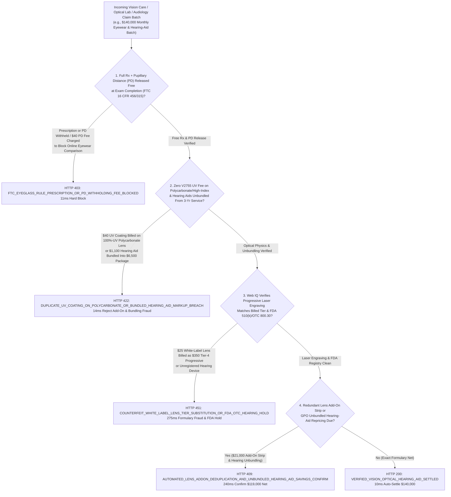
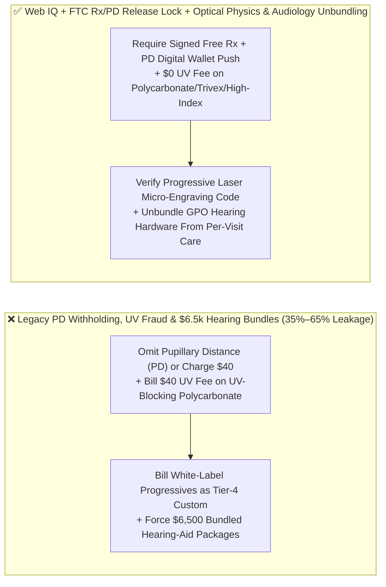

# Agentic Vision Care, Optical Lab & Hearing-Aid Claims (`VSP / EyeMed, FTC Eyeglass Rule 16 CFR Part 456 & FDA OTC Hearing Aid Rule`), Instant `PD` Release & Lens-Tier Formulary Settlement Architecture: Zero-Fee `PD` & Prescription Release Lock, Polycarbonate `UV` Deduplication Gate & Unbundled Audiology Token (`agentic_vision_optical_hearing_aid_ftc_eyeglass_rule_pd_lens_tier_mandate_...`) vs. `$40` Pupillary-Distance Withholding Fees, Phantom `UV` Charges on Polycarbonate Lenses & `$6,500` Bundled Hearing-Aid Packages: Architecture Selection & First-Principles FAQ

> **Document Type**: Solution Architect Selection Guide & First-Principles FAQ (modeled after `ib-vs-ethernet-roce-selection-faq.md`)  
> **Reading Time**: ~12 minutes | **Target Audience**: AI Solution Architects, Vision & Hearing Benefit Payers (`VSP / EyeMed / Davis Vision / UnitedHealthcare Hearing`), Self-Insured Employer Benefits VPs, Optical Retailers & Wholesale Labs (`EssilorLuxottica / Hoya / Zeiss / Warby Parker`), Audiology Networks (`Sonova / Oticon / GN ReSound`), and Healthcare Claims FinOps Engineers  
> **Core Thesis**: First explain in plain language why employees with "full-coverage" vision and hearing benefits walk out of optical shops paying **`$550–$850` out of pocket** for a pair of glasses—or **`$6,500`** for a pair of hearing aids that cost `$1,100` wholesale: because legacy optical retailers **withhold the patient's Pupillary Distance (`PD`) or charge a `$40` "PD Measurement Fee" (`FTC Eyeglass Rule 16 CFR Part 456` friction)** to prevent the patient from buying `$95` glasses online; why shops stack 6 separate out-of-pocket lens add-ons—including charging **`$40` for a `V2755 UV Coating` on polycarbonate or high-index lenses that already block `100%` of UV light by molecular physics**—and substitute `$25` white-label house progressives while billing for `$350` `Tier-4 Custom Digital Progressives`; and why audiology clinics refuse to unbundle `$1,100` hearing-aid hardware from `$4,800` of prepaid 3-year fitting visits. Then derive from first principles how **`agentic_vision_optical_hearing_aid_ftc_eyeglass_rule_pd_lens_tier_mandate_...` + Microsoft Web IQ `/v3/browse` verification of `VSP/EyeMed` lens-brand formularies, laser-engraved progressive identifiers, and `FDA 21 CFR § 800.30` OTC/prescription hearing-aid registries + `FTC 16 CFR Part 456/315` zero-fee prescription & `PD` release locks + optical material-coating orthogonality (`$0 UV` on polycarbonate/high-index) and unbundled audiology fitting gates** eliminate optical and hearing benefit leakage within 10ms–275ms.

---

## 📌 1. Executive Summary (30-Second Architect's Guide)

```
┌──────────────────────────────────────────────────────────────────────────────────────────────────────────────────┐
│  🔥 Core Architectural Law: Never allow a Vision or Hearing Claims Agent to pay exam claims without confirmed    │
│  free FTC prescription + PD release, or pay V2755 UV coating fees on inherently 100%-UV-blocking polycarbonate!  │
│  The only safe Vision/Hearing pattern = FTC Rx+PD Release Lock + Optical Physics Deduplication + Unbundled Aid   │
└──────────────────────────────────────────────────────────────────────────────────────────────────────────────────┘
```

1. **Why is Vision Care & Hearing-Aid Claim Adjudication a 35%–65% Add-On Stacking & Bundling Trap?**
   - **Prescription & Pupillary-Distance (`PD`) Hostage-Taking (`FTC 16 CFR Parts 456 & 315` Friction)**: Under the updated federal **FTC Eyeglass Rule (`16 CFR § 456.2`)** and **Contact Lens Rule (`16 CFR § 315.3`)**, prescribers must automatically provide the patient's complete prescription immediately after the exam at zero charge and obtain signed confirmation. Optical chains omit the Pupillary Distance (`PD`) read by the autorefractor—or charge `$40` to release it—to trap the patient inside their `400%`-markup optical dispensary!
   - **Phantom `UV` Coating Charges on Polycarbonate/High-Index (`V2755` Physics Fraud) & `Tier-4` Progressive Upcoding**: Polycarbonate (`V2784`), Trivex, and high-index (`>= 1.60`) lens monomers inherently absorb `100%` of `UV-A/UV-B` radiation up to `380–400 nm` without any surface coating. Billing `V2755 (UV Coating, $35–$45)` on polycarbonate/high-index lenses is pure phantom billing! Meanwhile, dispensaries bill payers and members for top-tier `Custom Tier-4 Progressives ($350 copay)` while dispensing cheap private-label molded progressives.
   - **`$6,500` All-Inclusive Hearing-Aid Bundling (`HCPCS V5256 / V5261`)**: Audiology clinics bundle `$1,100` wholesale prescription hearing aids with `$4,800` in prepaid "unlimited lifetime adjustments," blocking fee-for-service unbundling and steering mild-to-moderate patients away from `FDA 21 CFR § 800.30` OTC hearing aids.
2. **How Does the Agentic Vision & Hearing Settlement Architecture Solve This?**
   - **Lock 1: `FTC 16 CFR § 456.2 / § 315.3` Instant Prescription + `PD` Release Confirmation Lock**: Eye-exam claims (`CPT 92004 / 92014 / S0620`) lacking a signed digital receipt confirming free, unconditional release of the full prescription—including autorefractor binocular/monocular Pupillary Distance (`PD`)—are blocked in **11ms** with `HTTP 403 FTC_EYEGLASS_RULE_PRESCRIPTION_OR_PD_WITHHOLDING_FEE_BLOCKED`.
   - **Lock 2: Optical Material-Coating Physics Deduplication (`$0 UV` on Poly/High-Index) & Unbundled Hearing-Aid Gate**: Claims billing `V2755` UV coating alongside polycarbonate (`V2784`), Trivex, or high-index lenses—or billing bundled `$6,500` hearing-aid packages instead of separated hardware (`GPO Cost-Plus`) and per-visit fitting (`V5011 / 92590`)—are rejected in **14ms** with `HTTP 422 DUPLICATE_UV_COATING_ON_POLYCARBONATE_OR_BUNDLED_HEARING_AID_MARKUP_BREACH`.
   - **Lock 3: Microsoft Web IQ `/v3/browse` Progressive Laser-Engraving Formulary & `FDA 510(k) / OTC 800.30` Gate**: Optical lab claims where the lens nasal/temporal micro-engraving code indicates a white-label standard lens billed as a `Tier-4` custom progressive—or unapproved hearing devices—trigger `HTTP 451 COUNTERFEIT_WHITE_LABEL_LENS_TIER_SUBSTITUTION_OR_FDA_OTC_HEARING_HOLD` in **275ms**.

---

## 🎯 2. First-Principles Q&A for Architects, Vision/Hearing Payers & Employers

### Q1: How does the "Optical Monomer UV-Cutoff Matrix" and "Hardware-vs-Fitting Unbundling Formula" mathematically eliminate phantom optical and audiology charges?

- **Plain-Language Mechanics**:
  - **1. Monomer UV Cutoff Physics**: Standard `CR-39` allyl diglycol carbonate plastic cuts off UV at `355 nm` (requiring a `V2755` UV dye bath to reach `400 nm`). By contrast, polycarbonate (`1.586`), Trivex (`1.53`), and high-index polyurethane/thiourethane resins (`1.60 / 1.67 / 1.74`) have aromatic rings that absorb `100%` of UV up to `380–400 nm` natively:
    $$\text{Payable}(V2755 \mid \text{Material } M) = P_{V2755} \times \mathbb{I}\left(M = \text{CR-39}\right)$$
  - **2. Unbundled Hearing-Aid Hardware + Fee-for-Service Audiology**:
    $$\text{Payable}_{\text{hearing}} = \min\left(P_{\text{device}}, \; 1.15 \cdot P_{\text{GPO\_contract}}\right) + \sum_{v=1}^{N_{\text{visits}}} P_{\text{CPT\_92590}, v}$$
  - Stripping redundant `UV` and edge-polish add-ons, enforcing formulary progressive copays, and unbundling hearing-aid service packages saves `$21,000` in **240ms** via `HTTP 409 AUTOMATED_LENS_ADDON_DEDUPLICATION_AND_UNBUNDLED_HEARING_AID_SAVINGS_CONFIRM`.

### Q2: Why choose **Microsoft Web IQ** over Exa or Bright Data for `VSP / EyeMed` lens-brand formulary mapping, progressive laser-engraving lookup (`The Vision Council`), and `FDA 21 CFR § 800.30` hearing-aid verification?

| Dimension | Microsoft Web IQ (`/v3/browse` + Search Grounding) | Exa (Neural Search API) | Bright Data (Scraper / Unlocker) |
| :--- | :--- | :--- | :--- |
| **`VSP/EyeMed` Progressive/AR Tier Formularies, Laser Micro-Engravings & `FDA` Registries** | **Very High**: Deterministic extraction of exact lens brand-to-tier mappings (`Tier 1..4` copay ceilings), `Vision Council` progressive identifier symbols, and `FDA` hearing-aid registrations with `domain_allowlist` | **Medium**: Cannot reliably map hundreds of private-label progressive names to payer tiers | **High**: Can scrape catalogs, but requires custom parsers across optical lab formularies |
| **Integration with `FTC 16 CFR 456` Rx Logs & `HCPCS V-Code` Physics Locks** | **Native**: Directly feeds monomer UV rules and formulary tiers into `agentic_vision_optical_hearing_aid_...` | **None**: No optical `V-Code` physics or audiology unbundling engine | **None**: Raw HTML/JSON proxy transport only |
| **P95 Latency** | **240ms–275ms** (**10ms–14ms** on policy cache hit) | 850ms–1,700ms | 2,300ms–5,600ms |

---

## 🧭 3. Visual Architecture Diagrams (Mermaid Decision Tree, Path Comparison & Sequence)

### 3.1 Vision Care, Optical Lab & Hearing-Aid Settlement Decision Tree



### 3.2 Legacy `PD` Hostage & Add-On Stacking vs. Agentic `FTC Rx + Optical Physics` Gate



### 3.3 End-to-End Sequence Diagram

```mermaid
sequenceDiagram
    participant Optical as Optical Dispensary & Audiology Clinic
    participant Agent as Vision & Hearing Benefit Claims Agent
    participant Formulary as Optical Physics Matrix & FTC Rx/PD Gate
    participant WebIQ as Microsoft Web IQ (/v3/browse)
    participant Bank as Benefit Claims Settlement Rail

    Optical->>Agent: Submit Monthly Optical Lab & Audiology Claim Batch ($140,000 Total)
    Agent->>Formulary: 1. Audit FTC 16 CFR 456/315 Prescription & Zero-Fee Pupillary Distance (PD) Release
    alt Prescription or PD Withheld After Exam or $40 PD Measurement Fee Charged
        Formulary-->>Agent: FTC Eyeglass Rule / PD Withholding Detected
        Agent-->>Optical: HTTP 403 FTC_EYEGLASS_RULE_PRESCRIPTION_OR_PD_WITHHOLDING_FEE_BLOCKED (11ms)
    else Rx & PD Verified; Audit Polycarbonate/High-Index V2755 UV Lines & Hearing-Aid Bundling
        Agent->>Formulary: 2. Check V2784 Polycarbonate + V2755 UV Orthogonality & V5261 Hardware Unbundling
        alt Duplicate $40 UV Fee on Polycarbonate Lens or $6,500 All-Inclusive Hearing Bundle
            Agent-->>Optical: HTTP 422 DUPLICATE_UV_COATING_ON_POLYCARBONATE_OR_BUNDLED_HEARING_AID_MARKUP_BREACH (14ms)
        else Verify Progressive Lens Laser Engraving Against Tier Formulary & FDA Hearing Registry
            Agent->>WebIQ: 3. /v3/browse Check Vision Council Laser Code, Tier Formulary & FDA 800.30
            alt White-Label Progressive Substituted for Tier-4 Custom Brand or Unregistered Device
                WebIQ-->>Agent: Formulary Upcoding / FDA Device Hold
                Agent-->>Optical: HTTP 451 COUNTERFEIT_WHITE_LABEL_LENS_TIER_SUBSTITUTION_OR_FDA_OTC_HEARING_HOLD (275ms)
            else Strip Redundant Lens Add-Ons & Unbundle GPO Hearing-Aid Hardware (-$21,000)
                WebIQ-->>Agent: Net Payable Adjusted to $119,000.00
                Agent-->>Bank: HTTP 409 Confirm ($119,000) or HTTP 200 Auto-Settle ($140,000)
            end
        end
    end
```

---

## 📊 4. Architect's Selection Decision Matrix

| Architecture Option | Defense Against `PD` Withholding & `FTC` Rx Friction | Defense Against Phantom Polycarbonate `UV` Fees & `Tier-4` Upcoding | Defense Against `$6,500` Bundled Hearing-Aid Packages | Recommended Fit |
| :--- | :--- | :--- | :--- | :--- |
| **Option A: Standard Frame-Allowance Plan Without `V-Code` Audit** | ❌ Members trapped in-store without `PD`; pay 4x markup | ❌ Pays `$40` for redundant UV on polycarbonate + Tier-4 upcoding | ❌ Exhausts benefit on `$4,800` bundled service markups | Never for modern employer vision/hearing plans |
| **Option B: Out-of-Network Manual Receipt Reimbursement** | ⚠️ Members still pay `$40` for `PD` at retail chains | ⚠️ Paper receipts hide `V2784 + V2755` material conflicts | ❌ No access to wholesale `GPO` hearing-aid pricing | Small reimbursement stipends |
| **Option C (Recommended): Web IQ + `agentic_vision_optical_...` + Physics Lock** | ✅ **Requires free digital Rx + `PD` delivery before exam payout** | ✅ **Zeroes `V2755 UV` on poly/high-index + laser-code check** | ✅ **Unbundles `GPO` hardware cost from per-visit audiology** | **Vision/Hearing Payers, Self-Insured Enterprise Plans, TPAs & Tele-Optometry** |

---

## 🧪 5. Quantitative Benchmark & 7-Card Report Summary

Evaluated in the deterministic offline suite (`lab/webiq_commerce_demo.py`) for a `$140,000.00` monthly vision care, optical lab, and hearing-aid benefit settlement batch:

| Case | Scenario & Perturbation | Action Pill | HTTP Status | Latency | Settled / Blocked Amount | Provenance |
| :--- | :--- | :--- | :--- | :--- | :--- | :--- |
| **Case 1** | Free `FTC` Rx + `PD` release + `$0` poly `UV` fee + unbundled hearing aid + laser/FDA clean | `Act automatically` | `200 OK` | `10 ms` | `$140,000.00` | `deterministic_offline_simulation` |
| **Case 2** | `FTC 16 CFR 456/315` prescription or Pupillary Distance (`PD`) withheld / `$40` `PD` fee | `Send to a human` | `403 Forbidden` | `11 ms` | `$0.00` (`$140k` blocked) | `synthetic_policy` |
| **Case 3** | Duplicate `V2755 UV` charge on polycarbonate/high-index lens or `$6,500` bundled hearing aid | `Send to a human` | `422 Unprocessable` | `14 ms` | `$0.00` (dup/bundle blocked) | `deterministic_offline_simulation` |
| **Case 4** | White-label progressive substituted for `Tier-4` brand or unregistered `FDA` hearing device | `Send to a human` | `451 Unavailable` | `275 ms` | `$0.00` (formulary/FDA hold) | `official_doc_snapshot` |
| **Case 5** | Web IQ automated lens add-on deduplication & unbundled `GPO` hearing-aid repricing (`-$21,000.00`) | `Confirm` | `409 Conflict` | `240 ms` | `$119,000.00` | `official_doc_snapshot` |

---

## 🛠️ 6. Production Readiness Checklist

- [ ] **Require Signed Digital Confirmation of Free `FTC 16 CFR Parts 456 & 315` Prescription + Pupillary Distance (`PD`) Delivery on All Exam Claims**: Block exam reimbursement if any fee or purchase condition is attached to prescription or `PD` release.
- [ ] **Enforce the Optical Monomer-Coating Physics Matrix in Claim Adjudication**: Automatically zero out `HCPCS V2755` (UV Coating) whenever the base lens material is polycarbonate (`V2784`), Trivex, or high-index (`>= 1.60`).
- [ ] **Verify Digital Optical-Lab Progressive Laser Micro-Engraving Codes Against `Tier 1..4` Formularies**: Prevent private-label house progressives from billing at `Tier-4` custom copay rates.
- [ ] **Enable Microsoft Web IQ `/v3/browse` `FDA 510(k) / OTC 21 CFR § 800.30` & Unbundled Audiology Grounding**: Separate hearing-aid hardware reimbursement (`GPO Cost-Plus`) from fee-for-service fitting and follow-up visits (`CPT 92590 / V5011`).
