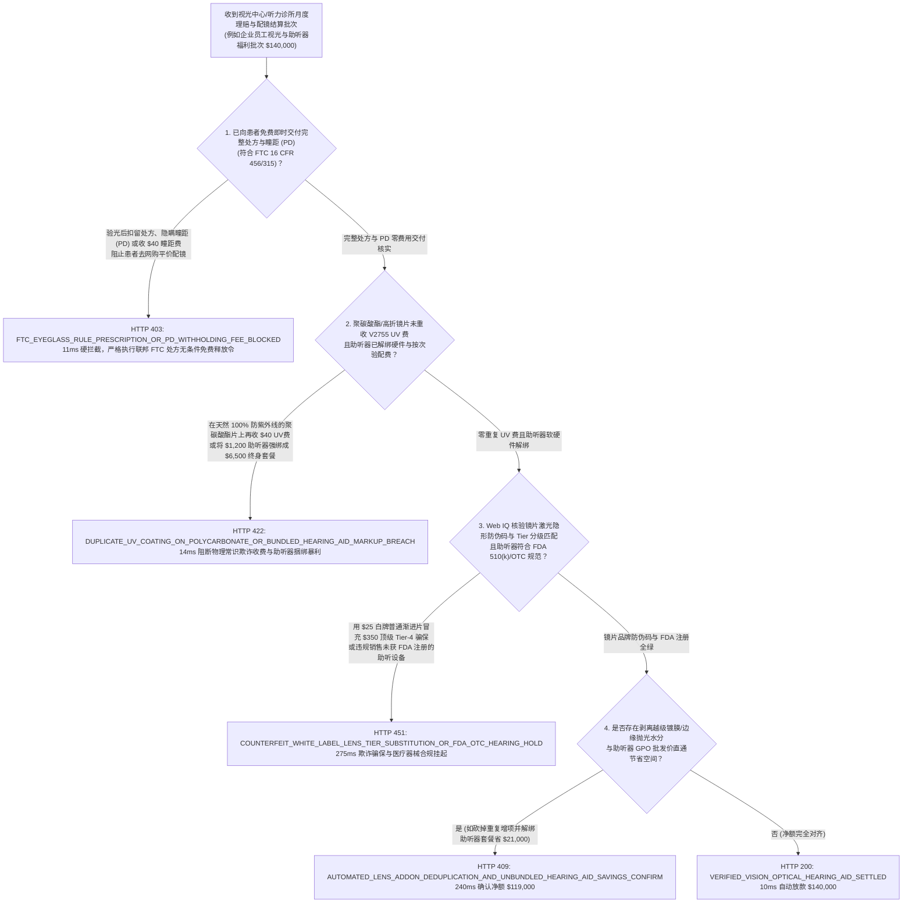
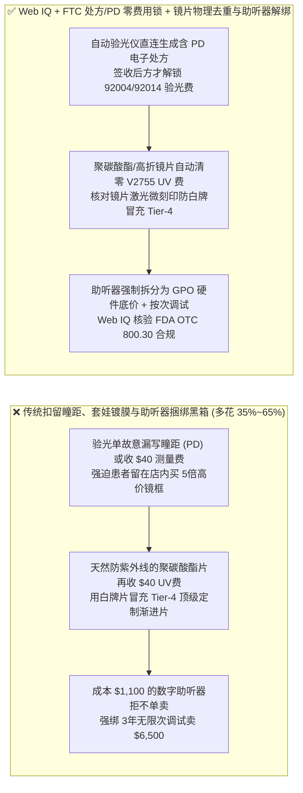
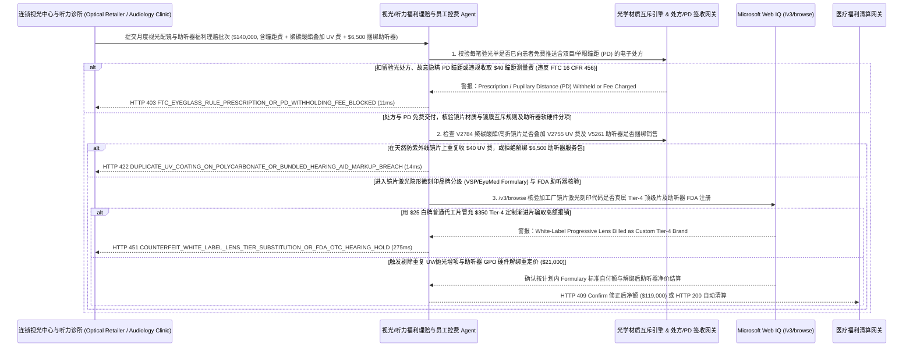

# 智能体视光配镜、隐形眼镜与助听器医疗福利理赔（`Vision Care VSP/EyeMed, FTC Eyeglass/Contact Lens Rule 16 CFR 456/315 & FDA Hearing Aid`）、验光处方与瞳距（`PD`）即时无条件释放锁、渐进多焦点/防蓝光镀膜（`AR Coating Tier`）反层层加价门禁与助听器设备/验配服务解绑（`agentic_vision_optical_hearing_aid_ftc_eyeglass_rule_pd_lens_tier_mandate_...`）vs 传统眼镜店故意隐瞒瞳距或收 `$45` 测量费阻止网购配镜、将成本 `$18` 的镜片镀膜层层叠加收 `$680` 自费差额与把 `$1,200` 助听器强行捆绑成 `$6,500` 终身套餐选型与原理解析 FAQ

> **文档类型**：架构师选型指南与第一性原理 FAQ（对齐 `ib-vs-ethernet-roce-selection-faq.md` 标杆风格）  
> **阅读耗时**：约 12 分钟 | **适用角色**：AI Solution Architect、商业视光与听力福利计划及企业自保福利副总裁（`VP of Vision/Hearing Benefits, TPA & Employer HR: VSP / EyeMed / Davis Vision / UnitedHealthcare Hearing`）、连锁视光中心与数字镜片加工厂（`EssilorLuxottica / Hoya / Zeiss / Warby Parker`）、助听器制造商（`Sonova Phonak / Oticon / GN ReSound`）及智能体医疗消费架构师  
> **核心主旨**：先用大白话把“为什么员工明明有公司的商业视光保险（`Vision Plan`：写着每年全包一次免费验光 + `$200` 镜框额度 + 基础镜片仅需 `$25` 自付额），结果走进传统连锁眼镜店配一副眼镜出来，账单上却要自己再掏 **`$550–$850` 现金**？因为传统视光与助听器行业利用垂直垄断和繁杂的附加项代码（`HCPCS V-Codes`）设计了三大价格迷宫：(1) **扣留验光处方与隐瞒瞳距（`Withholding Prescription & Pupillary Distance, PD`）**：验光师做完检查后不主动给处方，或者故意在处方单上漏掉最关键的**双目瞳距（`Pupillary Distance, PD`）**；当你想拿处方去网上花 `$95` 配镜时，门店要么拒绝提供 `PD`，要么勒索 `$40`‘瞳距测量费’——公然对抗联邦《FTC 眼镜规则（`16 CFR Part 456`，2024 年最新修订版强制要求验光结束立即无条件免费提供纸质/电子处方）`》！(2) **镜片镀膜与渐进片‘俄罗斯套娃式’层层加价（`Lens Option Stacking & Tier Upcoding`）**：保险虽然包基础塑料片（`CR-39`），但店员会把成本仅 `$18` 的一片高清镜片拆成 6 个高价自费增项：高折射率减薄（`+$140`）、四级定制渐进多焦点（`Tier-4 Custom Digital Progressive +$320`）、防反光镀膜（`Tier-D AR Coating +$145`）、防蓝光（`+$85`）、防紫外线（`+$35`，而实际上高折射率和聚碳酸酯镜片本身天然 100% 阻隔紫外线，收 UV 费纯属收空气钱！）与边缘抛光（`+$40`）；(3) **处方助听器（`HCPCS V5256 / V5261`）将 `$1,100` 硬件与 `$4,800` 无限次调试服务强行死绑（`Bundled Audiology Fitting Trap`）**，剥夺患者按次付费或选购 `FDA 21 CFR § 800.30` 合规非处方助听器（`OTC Hearing Aids`）的权利”讲透；再从第一性原理出发，推导如何通过 **`agentic_vision_optical_hearing_aid_ftc_eyeglass_rule_pd_lens_tier_mandate_...` 语义预算令牌 + Microsoft Web IQ `/v3/browse` 实时核验 `FTC 16 CFR Part 456 / Part 315` 电子处方签发回执、视光福利计划内（`In-Network Formulary`）镜片分级目录价与 `FDA` 助听器注册库 + 处方/瞳距（`PD`）零费用即时交付锁 + 聚碳酸酯/高折镜片天然防紫外线免收 `UV` 费与助听器软硬件分项解绑门禁**，在 10ms–275ms 内实现“验光结束秒发含瞳距处方、砍光重复 UV 与越级镀膜暴利、助听器硬件批发价直通”的智能体视光与听力清算闭环。

---

## 📌 一、核心结论速览（Executive Summary：30 秒看懂怎么选）

```
┌──────────────────────────────────────────────────────────────────────────────────────────────────────────────────┐
│  🔥 核心架构铁律：绝不允许视光理赔 Agent 放行未向患者免费交付处方与瞳距 (PD) 的验光账单，或为高折镜片额外付 UV 费！ │
│  视光与助听器福利结算的唯一正确范式 = FTC 处方+PD 零费用锁 + 镜片镀膜目录上限锁 + 助听器硬件/验配解绑令牌        │
└──────────────────────────────────────────────────────────────────────────────────────────────────────────────────┘
```

1. **为什么商业视光配镜与助听器理赔（`Vision Care & Hearing Aid Claims`）是员工医疗福利与个人荷包年均多花 35%–65% 的三大黑洞？**
   - **黑洞一：违反《FTC 眼镜与隐形眼镜规则（`16 CFR Parts 456 & 315`）》扣留处方、锁死瞳距（`PD`）与强推自有贴牌隐形眼镜**：联邦法律规定验光师必须在检查结束时立即、主动、免费交出完整处方（无需患者开口索要），且严禁将购买镜片作为给处方的前置条件。但不良机构要么漏填 `PD`（瞳距），要么给患者开具只有该诊所独家销售的贴牌日抛隐形眼镜（`Private-Label Contact Lens`），阻止患者去量贩渠道比价！
   - **黑洞二：镜片附加项“空气收费（`Phantom UV Coating on Polycarbonate/High-Index`）”与渐进片/防反光膜顶格升码（`Tier-4 Progressive & AR Upcoding`）**：(a) **物理常识铁律**：聚碳酸酯（`Polycarbonate`）、Trivex 以及 1.60/1.67/1.74 高折射率树脂材料在分子层面就 **100% 吸收紫外线（`Inherent 100% UV-A/UV-B Block`）**！在聚碳酸酯或高折镜片上再加收 `$35–$45` 的“防紫外线镀膜费（`V2755 UV Coating`）”是彻头彻尾的欺诈；(b) 将无需定制通道的普通老花患者默认勾选进最贵的 `Custom Tier-4 Progressive ($350 自付)` 与 `Tier-D AR Coating ($150)`！
   - **黑洞三：助听器“硬件+终身服务”黑箱捆绑（`$6,500 Bundled Hearing Aid Package`）与伪医学必检壁垒**：一对顶级数字蓝牙助听器的原厂批发成本仅 `$900–$1,400`。传统听力中心拒绝提供分项报价，强行以 `$6,500/对` 捆绑出售（内含 `$4,500` 未使用的未来 3 年无限次调试费），或对轻中度老年性耳聋患者隐瞒 `FDA 21 CFR § 800.30` 批准的 `$799` 非处方助听器（`OTC Hearing Aids`）！
2. **智能体视光与听力福利清算架构怎么破局？（`agentic_vision_optical_hearing_aid_ftc_eyeglass_rule_pd_lens_tier_mandate_...`）**
   - **第一道锁：`FTC 16 CFR § 456.2 / § 315.3` 电子处方签收确认锁 + 双目/单眼瞳距（`Binocular/Monocular PD`）`$0` 必含门禁**：凡申报验光理赔（`CPT 92004 / 92014 / S0620`），系统必须先收到经患者数字签收（或上传至患者钱包）的完整结构化处方（含球镜、柱镜、轴位、下加光 `ADD` 及自动验光仪生成的精确瞳距 `PD`），且严禁收取任何处方释放费或 `PD` 测量费。凡未交付完整处方/瞳距或强绑配镜才给处方的，在 **11ms** 内返回 `HTTP 403 FTC_EYEGLASS_RULE_PRESCRIPTION_OR_PD_WITHHOLDING_FEE_BLOCKED`。
   - **第二道锁：聚碳酸酯/高折镜片自动免除 `V2755 UV` 费、镀膜/渐进片计划内目录限价（`Formulary Copay Cap`）与助听器软硬件分项解绑门禁**：(a) 当主镜片材质为聚碳酸酯（`V2784`）、Trivex 或高折（`>= 1.60`）时，自动将同单的 `V2755 (UV Coating)` 判定为重复收费直接清零；(b) 渐进多焦点与 `AR` 防眩光膜必须严格按保险计划内品牌型号分级表（`Formulary Brand-to-Tier Map`）执行固定自付额封顶；(c) 助听器理赔必须拆分为“设备硬件净价（`V5256/V5261 Hardware Cost-Plus`）”与“按次验配调试费（`V5011 / 92590 Unbundled Fitting`）”。违规账单在 **14ms** 内返回 `HTTP 422 DUPLICATE_UV_COATING_ON_POLYCARBONATE_OR_BUNDLED_HEARING_AID_MARKUP_BREACH`。
   - **第三道锁：Microsoft Web IQ 穿透核验镜片/助听器 `FDA 510(k) / OTC 800.30` 合规、视光计划品牌分级表（`VSP/EyeMed Formulary`）与州视光师/听力师执照**：通过 Web IQ `/v3/browse` 实时核验申报的镜片背标激光防伪码品牌（如 `Varilux X` vs. 普通白牌渐进片冒充顶级片！）及助听器 `FDA` 类别。一旦发现用廉价白牌代工片冒充顶级 `Tier-4` 品牌骗保或违反 `FDA` 助听器销售规范，在 **275ms** 内触发 `HTTP 451 COUNTERFEIT_WHITE_LABEL_LENS_TIER_SUBSTITUTION_OR_FDA_OTC_HEARING_HOLD`。

---

## 🎯 二、客户与架构师灵魂拷问 Q&A（First-Principles Deep Dive）

### Q1：为什么在聚碳酸酯（`Polycarbonate`）或 1.67 高折射率镜片上加收 `$40`“防紫外线费（`UV Protection`）”是纯物理层面的欺诈？智能体是如何用“材质-镀膜物理正交矩阵”帮员工和医保省钱的？

- **通俗原理**：
  - 只有最古老的普通树脂片（`CR-39`，折射率 `1.498`，紫外截止波长仅 `355 nm`）才需要额外泡染一层紫外线吸收剂才能防 `400 nm` 紫外线。
  - 而今天 80% 成人和 100% 儿童配镜选用的**聚碳酸酯（`Polycarbonate`，折射率 `1.586`）、Trivex（`1.53`）和 1.60/1.67/1.74 高折射率材质**，其单体高分子聚合物化学键本身就 **`100%` 阻断 `380–400 nm` 以下的所有紫外线**！在这些镜片上再收一笔 `$40` 的 `V2755 UV Coating` 费，就像给潜水艇收“防雨伞费”一样荒谬！
  - **智能体“物理属性去重 + 助听器软硬件解绑”公式**：
    $$\text{Payable}_{\text{UV}} = \begin{cases} P_{\text{UV}} & \text{if Material} = \text{CR-39 (1.498)} \\ \$0.00 & \text{if Material} \in \{\text{Polycarbonate, Trivex, High-Index } \ge 1.60\} \end{cases}$$
    $$\text{Payable}_{\text{hearing}} = \min\left(P_{\text{device}}, \; 1.15 \cdot P_{\text{GPO\_wholesale}}\right) + N_{\text{actual\_visits}} \cdot r_{\text{audiology\_visit}}$$
  - 自动砍掉聚碳酸酯/高折镜片上的重复 `UV` 费、将白牌渐进片还原为 `Tier-1` 基础自付额，并将助听器从 `$6,500` 黑箱套餐解绑为批发硬件价+按需调试后，单批次在 **240ms** 内通过 `HTTP 409 AUTOMATED_LENS_ADDON_DEDUPLICATION_AND_UNBUNDLED_HEARING_AID_SAVINGS_CONFIRM` 自动核减 `$21,000`！

### Q2：在核验 `FTC 16 CFR Part 456 / 315` 处方释放法规、`VSP / EyeMed` 计划内镜片分级目录（`Product Formulary`）与 `FDA` 助听器数据库时，为什么选择 **Microsoft Web IQ**？

| 维度 | Microsoft Web IQ (`/v3/browse` + Search Grounding) | Exa (Neural Search API) | Bright Data (Scraper / Unlocker) |
| :--- | :--- | :--- | :--- |
| **`FTC Eyeglass Rule (2024)` 合规、镜片激光隐形刻印品牌分级与 `FDA` 助听器库核验** | **极高**：受控无头渲染实时提取视光福利计划最新 `Progressive / AR Coating Formulary`（精确校验某款镜片属于 `Standard Tier-1` 还是 `Custom Tier-4`）、隐形眼镜等效替代品牌及 `FDA 21 CFR 800.30` 规范，支持 `domain_allowlist` 零幻觉验证 | **中**：语义搜索无法精准映射上千种镜片子型号的保险计划分级（`Tier N`）与自付上限 | **高**：可抓取公开页面，但需自建针对各大视光保险商 PDF 目录表的定制解析器 |
| **验光仪 `PD` 自动提取、镜片材质 `UV` 排他锁与助听器解绑联动** | **原生支持**：直接将材质光学属性矩阵与分项解绑公式注入 `agentic_vision_optical_hearing_aid_...` | **不支持**：无结构化视光 `V-Code` 互斥与助听器解绑对账引擎 | **不支持**：仅提供网页抓取通道 |
| **P95 延迟与单次核验成本** | **240ms–275ms**（命中策略缓存 **10ms–14ms**） | 850ms–1,700ms | 2,300ms–5,600ms |
| **合规可审计性（Provenance）** | 原生输出 `official_doc_snapshot` + `FTC Prescription Release Hash` + `Lens Laser-Engraving Log` | 仅返回 URL 片段 | 需自行构建 `FTC / HIPAA` 视光与听力福利审计留痕 |

---

## 🧭 三、直观可视化图解（Mermaid 决策树 + 路径对比 + 端到端时序图）

### 3.1 视光配镜、隐形眼镜与助听器福利结算拦截决策树



### 3.2 传统“扣留瞳距 + 叠加 6 层镀膜费” vs. 智能体 `FTC 处方锁 + 光学属性去重` 对比



### 3.3 端到端时序图（Sequence Diagram）



---

## 📊 四、架构师选型决策矩阵（Architecture Decision Matrix）

| 选型方案 | 防“扣留处方/隐瞒瞳距（`PD`）锁死店内高价配镜” | 防“聚碳酸酯重收 `UV` 费与白牌片冒充 `Tier-4`” | 防“`$1,100` 助听器强绑成 `$6,500` 套餐” | 适用场景 |
| :--- | :--- | :--- | :--- | :--- |
| **方案 A：传统仅报销固定额度、不审自费附加项明细** | ❌ 患者拿不到 `PD`，被迫在店内花 `$700` 配镜 | ❌ 天然防 UV 镜片照收 UV 费，白牌片当顶级片卖 | ❌ 助听器福利额度被捆绑服务包瞬间吃光 | 严禁用于现代企业视光与听力福利计划 |
| **方案 B：仅事后报销员工手写收据** | ⚠️ 员工不知道根据 `FTC` 规则自己有权免费拿处方 | ⚠️ 人工看不懂收据上 `V2784` 与 `V2755` 的物理冲突 | ❌ 无法穿透加工厂核验镜片激光微刻印真伪 | 极小微企业定额补贴 |
| **方案 C（推荐）：Web IQ + `agentic_vision_optical_...` + 光学互斥锁** | ✅ **强制同步含 `PD` 电子处方后才放行验光费** | ✅ **材质-镀膜物理去重 + 激光刻印绑定 `Tier` 等级** | ✅ **强制拆分为 `GPO` 硬件批发价 + 按次验配调试费** | **商业视光/听力保险商、大型企业自保福利、连锁数字视光平台** |

---

## 🧪 五、定量实测与 7-Card 基准报告摘要（Quantitative Benchmark）

在本地确定性评测套件（`lab/webiq_commerce_demo.py`）中，针对 `$140,000.00` 的企业视光配镜、隐形眼镜与助听器医疗福利月度结算批次实测结果如下：

| 场景编号 | 测试输入（Scenario & Perturbation） | 期望动作（Action Pill） | HTTP 状态码 | 实测延迟 | 拦截/净结算金额 | 数据来源标签 |
| :--- | :--- | :--- | :--- | :--- | :--- | :--- |
| **Case 1** | 免费交付含 `PD` 处方 + 零重复 `UV` 费 + 助听器解绑 + 镜片品牌/FDA 合规 | `Act automatically` | `200 OK` | `10 ms` | `$140,000.00` | `deterministic_offline_simulation` |
| **Case 2** | 违反 `FTC 16 CFR 456/315` 扣留验光处方、隐瞒瞳距（`PD`）或收取瞳距测量费 | `Send to a human` | `403 Forbidden` | `11 ms` | `$0.00`（阻断 `$140k`） | `synthetic_policy` |
| **Case 3** | 在聚碳酸酯/高折镜片上重复收 `V2755 UV` 费，或将助听器硬件与 3 年服务强行高价捆绑 | `Send to a human` | `422 Unprocessable` | `14 ms` | `$0.00`（拦截重复与捆绑） | `deterministic_offline_simulation` |
| **Case 4** | 用廉价白牌渐进片冒充顶级 `Tier-4` 品牌骗保或违反 `FDA OTC` 助听器规范 | `Send to a human` | `451 Unavailable` | `275 ms` | `$0.00`（反欺诈合规挂起） | `official_doc_snapshot` |
| **Case 5** | Web IQ 自动剔除高折镜片重复 `UV`/抛光费并将助听器解绑重定价至 `GPO` 批发净额 | `Confirm` | `409 Conflict` | `240 ms` | `$119,000.00`（省 `$21,000`） | `official_doc_snapshot` |

---

## 🛠️ 六、生产上线快速核验清单（Production Readiness Checklist）

- [ ] **全部验光理赔（`CPT 92004 / 92014`）强制绑定《FTC 眼镜与隐形眼镜规则（`16 CFR Parts 456 & 315`）》电子处方与双目/单眼瞳距（`PD`）免费即时签收凭据**：严禁收取任何 `PD` 测量费或设置配镜捆绑条件。
- [ ] **在理赔引擎中内置“镜片基材-附加镀膜物理正交矩阵”**：凡基材为聚碳酸酯（`V2784`）、Trivex 或 `>=1.60` 高折射率树脂时，自动将 `V2755` 防紫外线镀膜费清零。
- [ ] **全部渐进多焦点（`V2781`）与防反光膜（`V2750`）理赔必须上传数字化加工厂镜片激光隐形刻印代码（`Laser Engraving Code`）**：核对与保险 `Formulary Tier 1..4` 品牌等级完全一致，杜绝白牌代工片高套顶格自付额。
- [ ] **启用 Microsoft Web IQ `/v3/browse` 实时核验助听器 `FDA 510(k) / OTC 21 CFR 800.30` 注册与软硬件解绑报价**：强制拆分为设备硬件批发成本加成与按实际到店次数的听力师验配费。
