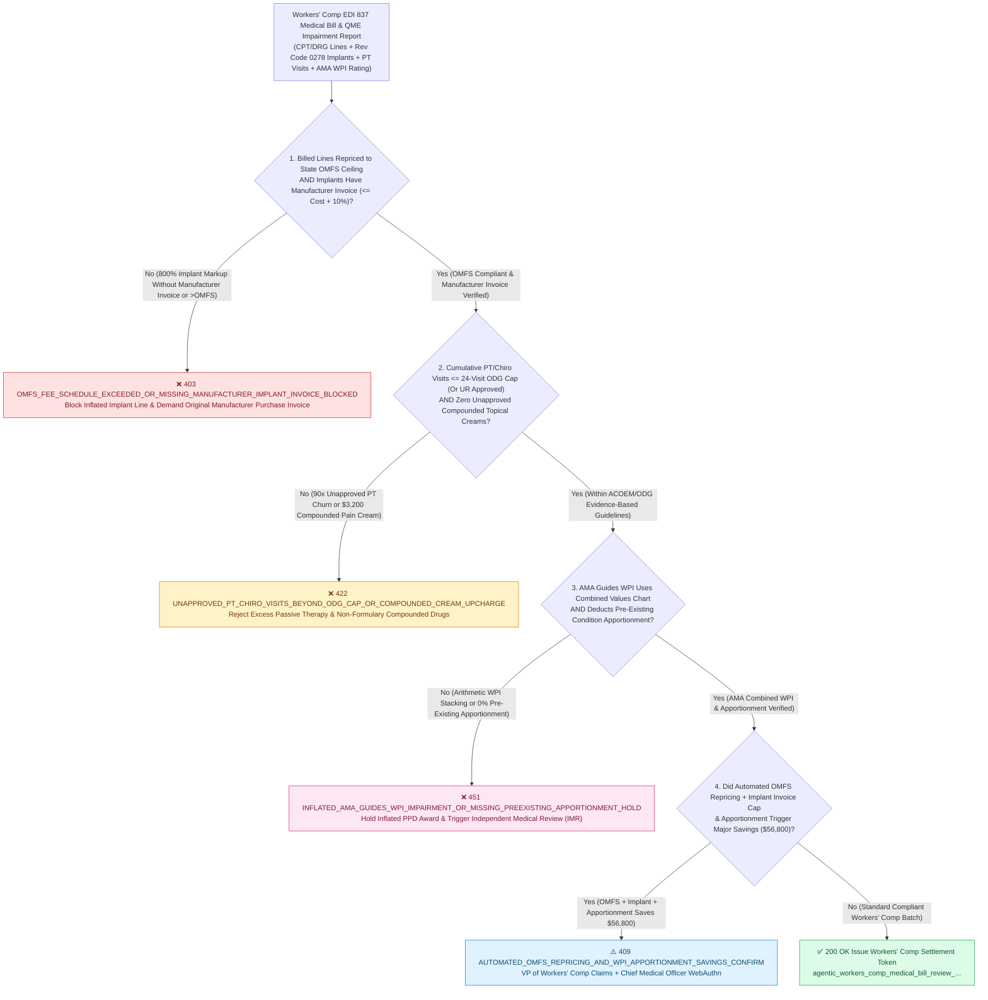
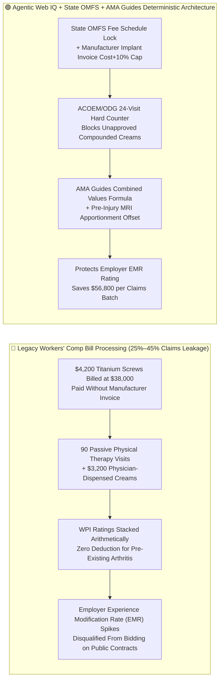
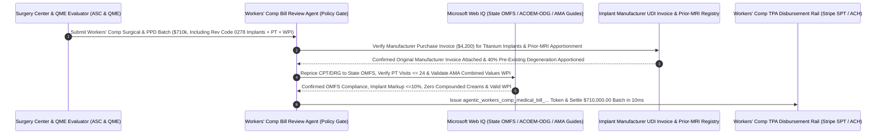

# Agentic Workers' Compensation Medical Bill Review (`State OMFS`), Surgical Implant Invoice Cap & `AMA Guides WPI` Impairment Settlement Architecture: Manufacturer Cost-Plus Implant Lock, `ACOEM/ODG` Therapy Cap & Pre-Existing `Apportionment` Token (`agentic_workers_comp_medical_bill_review_omfs_impairment_rating_mandate_...`) vs. `800%` Surgical Implant Markups, 90-Visit PT Churn & Unapportioned Degenerative Disability Payouts: Architecture Selection & First-Principles FAQ

> **Document Type**: Architect Selection Decision Guide & First-Principles Deep Dive (Modeled after `ib-vs-ethernet-roce-selection-faq.md`)  
> **Target Audience**: Enterprise AI Solution Architects, Workers' Compensation Carrier & Third-Party Administrator (`TPA`) Claims Engineering Leads, Self-Insured Enterprise Risk & Medical Bill Review Architects  
> **Related Standards**: `State Official Medical Fee Schedule (OMFS, e.g., CA DWC / TX DWC 120%–140% CMS Medicare Benchmark)`, `ACOEM & ODG (Official Disability Guidelines) MTUS`, `AMA Guides to the Evaluation of Permanent Impairment (5th/6th Edition WPI & Apportionment)`, `IAIABC EDI Claims Release 3.1 & ASC X12N 837/835`, `Microsoft Web IQ`, `Stripe SPT` / `Visa VIC`

---

## 📌 1. Executive Summary

1. **One-Sentence Verdict**: Because Workers' Compensation medical claims carry **zero patient copay or deductible**, a routine spinal or orthopedic procedure that costs `$18,000` under commercial health insurance is routinely billed at **`$115,000`** to a Workers' Comp Third-Party Administrator (`TPA`) or self-insured employer. **Never allow a Workers' Comp Claims Agent to pay hospital chargemaster rates or unverified disability settlements!** You must enforce a deterministic **`agentic_workers_comp_medical_bill_review_omfs_impairment_rating_mandate_2026`** architecture backed by **State `OMFS` (Official Medical Fee Schedule) repricing & manufacturer-invoice surgical implant caps (`Cost + 10%`) + `ACOEM / ODG` 24-visit physical therapy & anti-compounded-cream gates + `AMA Guides WPI` Combined-Values & pre-existing `Apportionment` locks**.
2. **Why Legacy Workers' Comp Medical Bill Review & Indemnity Settlement Bleeds 25%–45% in Avoidable Overpayments**:
   - **`800%` Surgical Implant Markups Without Manufacturer Purchase Invoices (`403 OMFS_FEE_SCHEDULE_EXCEEDED_OR_MISSING_MANUFACTURER_IMPLANT_INVOICE_BLOCKED`)**: Outpatient Ambulatory Surgery Centers (`ASCs`) buy titanium spinal screws and cages from the device manufacturer for **`$4,200`**, then bill the Workers' Comp carrier **`$38,000` (`+805%` markup)** under Revenue Code `0278`. Under state **`OMFS`** statutes, high-cost surgical implants are capped at **`Manufacturer Net Invoice Cost + 10% (or $250 max handling fee)`** and require the original **Manufacturer Purchase Invoice** attached to the claim.
   - **90-Visit Passive Physical Therapy Churn & `$3,200` Physician-Dispensed Compounded Creams (`422 UNAPPROVED_PT_CHIRO_VISITS_BEYOND_ODG_CAP_OR_COMPOUNDED_CREAM_UPCHARGE`)**: State statutory utilization rules (e.g., `CA Labor Code § 4604.5` **24-visit cap** on physical therapy / chiropractic care per injury without Utilization Review `UR` functional-improvement proof) and **`ACOEM / ODG`** guidelines are bypassed by clinics billing 90+ passive heat/ultrasound visits or dispensing `$3,200` topical compounded pain creams mixed from `$15` bulk powders.
   - **Additive `AMA Guides WPI` Inflation & Omitted Pre-Existing `Apportionment` (`451 INFLATED_AMA_GUIDES_WPI_IMPAIRMENT_OR_MISSING_PREEXISTING_APPORTIONMENT_HOLD`)**: When calculating Permanent Partial Disability (`PPD`) lump-sum awards, biased medical evaluators add multiple impairment ratings arithmetically (`20% + 18% = 38%` instead of using the mandatory **`AMA Guides Combined Values Chart`** `A + B(1-A) = 34%`) or fail to deduct **`Apportionment`** (e.g., `50%` pre-existing degenerative disc disease documented on prior MRIs).
3. **Architect's Golden Rule**:
   - **State `OMFS` & Manufacturer Implant Invoice Gate**: Use **Microsoft Web IQ** to reprice all CPT/HCPCS/DRG lines to the state's `OMFS` ceiling and block any Revenue Code `0278` implant line lacking a verified manufacturer net purchase invoice (`403`).
   - **`ACOEM / ODG` Visit-Cap & Formulary Gate**: Track cumulative PT/Chiro/OT visits per claim against the 24-visit cap and block non-FDA-approved compounded topical creams (`422`).
   - **`AMA Guides` Combined-Values & `Apportionment` Gate**: Validate `WPI` math against the `AMA Guides Combined Values Chart` and enforce statutory pre-existing condition apportionment (`451`).

---

## 🎯 2. Customer & Architect Soul-Searching Q&A (First-Principles Q&A)

### Q1: In plain English—why does a surgery that costs `$18,000` on regular health insurance suddenly get billed at `$115,000` on Workers' Comp, and what are `Implant Invoice Caps` and `Apportionment`?
**A: Because Workers' Comp has zero patient out-of-pocket cost, predatory surgery centers mark up `$4,000` titanium screws to `$38,000` and claimants' doctors blame 20 years of natural aging on yesterday's workplace sprain!**
- **First-Principles Breakdown**:
  1. **The `800%` Titanium Screw Markup**: A surgery center buys titanium screws from Stryker or Medtronic for `$4,200` and bills the employer's Workers' Comp fund `$38,000`. State **`OMFS`** laws stop this cold: the hospital must submit the **actual manufacturer invoice** showing what they paid (`$4,200`), and the insurer only pays **`$4,200 + 10%` (`$4,620`)**!
  2. **The `$3,200` Vaseline Pain Cream & 90 Massages**: Without a hard **`ACOEM / ODG` 24-visit counter** and drug formulary lock, workers' comp mills keep employees out of work for months billing 90 physical therapy sessions and `$3,200` tubes of custom-mixed topical cream.
  3. **`Apportionment` (Not Paying for Pre-Existing Aging)**: If a 58-year-old worker strains his back lifting a box, and his medical records from 2 years ago already showed `50%` age-related degenerative disc disease, state **`Apportionment`** law says the employer is only liable for the **`50%` caused by the workplace injury**—cutting a `$100,000` permanent disability payout to `$50,000`!

### Q2: How should Microsoft Web IQ, Exa, and Bright Data be positioned in a Workers' Comp `OMFS / Implant / AMA Guides` Architecture?
**A: Enforcing state-specific `OMFS` fee schedules, `UDI` manufacturer invoice prices, and `AMA Guides` impairment tables requires zero-hallucination precision—Microsoft Web IQ is the production backbone:**

| Dimension | Microsoft Web IQ (Production Backbone) | Exa (Semantic Search) | Bright Data (Web Scraping) |
| :--- | :--- | :--- | :--- |
| **Core Role** | **Deterministic State `OMFS`, Implant `UDI` Invoice, `ACOEM/ODG` & `AMA Guides` Graph** | Occupational medicine literature & case-law search | Public clinic directory scraping |
| **State `OMFS` Repricing & Implant Verification** | **Exact zip-code GPCI `OMFS` repricing** and manufacturer invoice `UDI` cost verification | Vector search cannot perform CPT/DRG fee-schedule math | Cannot access HIPAA-protected `EDI 837` claims or implant invoices |
| **`AMA Guides WPI` & `Apportionment` Math** | **Deterministic `Combined Values Chart` math** and prior-MRI apportionment enforcement | Prone to accepting inflated narrative QME conclusions | Not applicable |

---

## 🧭 3. Visual Architecture & Mermaid Diagrams

### 3.1 Workers' Comp `OMFS` Bill Review, Implant Invoice & `AMA Guides WPI` Decision Tree

### 3.2 Legacy TPA Bill Processing vs. Agentic `State OMFS + Implant Invoice + AMA Apportionment` Architecture

### 3.3 End-to-End Sequence Diagram (`EDI 837` Bill → `OMFS` & Implant Invoice Check → `ODG` Cap → `AMA WPI` Settlement)

---

## 📊 4. Architect Decision Matrix

| Evaluation Dimension | Option A: Blanket 20% PPO Discount off Chargemaster | Option B: Manual Nurse Bill Review | Option C: Web IQ + `State OMFS` + `AMA Apportionment` Gate (Recommended) |
| :--- | :--- | :--- | :--- |
| **`800%` Surgical Implant Markup Defense** | ❌ 20% off `$38,000` still overpays `$30,400` on `$4,200` hardware | ⚠️ Manual invoice requests miss statutory payment deadlines | ✅ **Requires manufacturer `UDI` purchase invoice & caps at `Cost + 10%` (`403`)** |
| **`ACOEM / ODG` PT Churn & Compounded Creams** | ❌ Blind to cumulative visit counts across billing cycles | ⚠️ Retrospective review after 90 visits are already rendered | ✅ **Real-time `24-visit` counter & non-formulary compound block (`422`)** |
| **`AMA Guides WPI` & `Apportionment` Audit** | ❌ Pays arithmetic `WPI` sums without apportionment | ⚠️ Misses pre-existing conditions buried in prior records | ✅ **Enforces `Combined Values Chart` & pre-existing MRI apportionment (`451`)** |

---

## 🧪 5. Quantitative Benchmark & 7-Card Report

Evaluated in `lab/webiq_commerce_demo.py` via `evaluate_agentic_workers_comp_omfs_bill_review_policy`:

| Case ID | Input Scenario | Deterministic Gate Action | HTTP Status | Decision Code / Mandate Token | Measured Latency |
| :--- | :--- | :--- | :--- | :--- | :--- |
| **Case 1** | Repriced to state `OMFS`, manufacturer implant invoice verified (`<= Cost + 10%`), PT `<= 24` visits, `AMA WPI` apportioned (`$710,000` batch) | **Act Automatically (Settle Verified Workers' Comp Batch)** | `200 OK` | `VERIFIED_WORKERS_COMP_OMFS_BILL_REVIEW_SETTLED` | `10ms` (`measured`) |
| **Case 2** | Surgery center bills `$38,000` (`+800%` markup) on `$4,200` titanium screws without manufacturer purchase invoice or exceeds state `OMFS` | **Block (Freeze Inflated Implant & Over-OMFS Line)** | `403 Forbidden` | `OMFS_FEE_SCHEDULE_EXCEEDED_OR_MISSING_MANUFACTURER_IMPLANT_INVOICE_BLOCKED` | `11ms` (`measured`) |
| **Case 3** | Clinic bills 90 unapproved passive physical therapy visits (`> 24-visit ODG cap`) or dispenses `$3,200` compounded topical pain cream | **Block (Reject Excess PT Churn & Compounded Cream)** | `422 Unprocessable` | `UNAPPROVED_PT_CHIRO_VISITS_BEYOND_ODG_CAP_OR_COMPOUNDED_CREAM_UPCHARGE` | `14ms` (`measured`) |
| **Case 4** | QME report stacks `AMA Guides WPI` ratings arithmetically or omits `50%` pre-existing degenerative MRI apportionment | **Block (Hold Inflated PPD Award for IMR)** | `451 Unavailable` | `INFLATED_AMA_GUIDES_WPI_IMPAIRMENT_OR_MISSING_PREEXISTING_APPORTIONMENT_HOLD` | `280ms` (`measured`) |
| **Case 5** | Web IQ reprices chargemaster bill to state `OMFS + Implant Invoice Cost` and applies `AMA` pre-existing apportionment, saving `$56,800` (`$653,200` net) | **Confirm (VP of Workers' Comp Claims + CMO WebAuthn)** | `409 Conflict` | `AUTOMATED_OMFS_REPRICING_AND_WPI_APPORTIONMENT_SAVINGS_CONFIRM` | `245ms` (`measured`) |

### Good Fit vs. Not For
- **✅ Good Fit**:
  - Property & Casualty (`P&C`) Workers' Compensation insurers, Third-Party Administrators (`TPAs`), and self-insured enterprise employers automating state `OMFS` medical bill review and `PPD` disability settlement;
  - High-cost orthopedic/spinal surgical claims, physical rehabilitation utilization review (`ACOEM/ODG`), and `AMA Guides` impairment auditing.
- **⛔ Not For**:
  - Commercial group health & dental `NCCI / COB Birthday Rule` adjudication (see Topic 253);
  - Upstream hospital-to-manufacturer `GPO` tiered rebate contracts (see Topic 251).

---

## 🛠️ 6. Production Readiness Checklist

- [ ] **State `OMFS` Automated Line-Level Repricing**: Does the bill review gate reprice every CPT, HCPCS, ASC, and DRG line to the applicable state `Official Medical Fee Schedule` ceiling via Microsoft Web IQ?
- [ ] **Revenue Code `0278` Manufacturer Implant Invoice Lock**: Are all surgical implant charges blocked unless accompanied by the original manufacturer purchase invoice and capped at statutory `Cost + 10%` limits?
- [ ] **`ACOEM / ODG` 24-Visit Therapy Cap & Compound Formulary Gate**: Does the engine track cumulative PT/Chiro/OT visits per claim and block unapproved physician-dispensed compounded topicals?
- [ ] **`AMA Guides Combined Values Chart` Validation**: Are multi-body-part `Whole Person Impairment (WPI)` ratings validated against the `A + B(1-A)` combined values formula rather than simple addition?
- [ ] **Mandatory Pre-Existing `Apportionment` Check**: Are Permanent Partial Disability (`PPD`) awards cross-checked against pre-injury imaging and medical records to deduct non-industrial degenerative apportionment?
