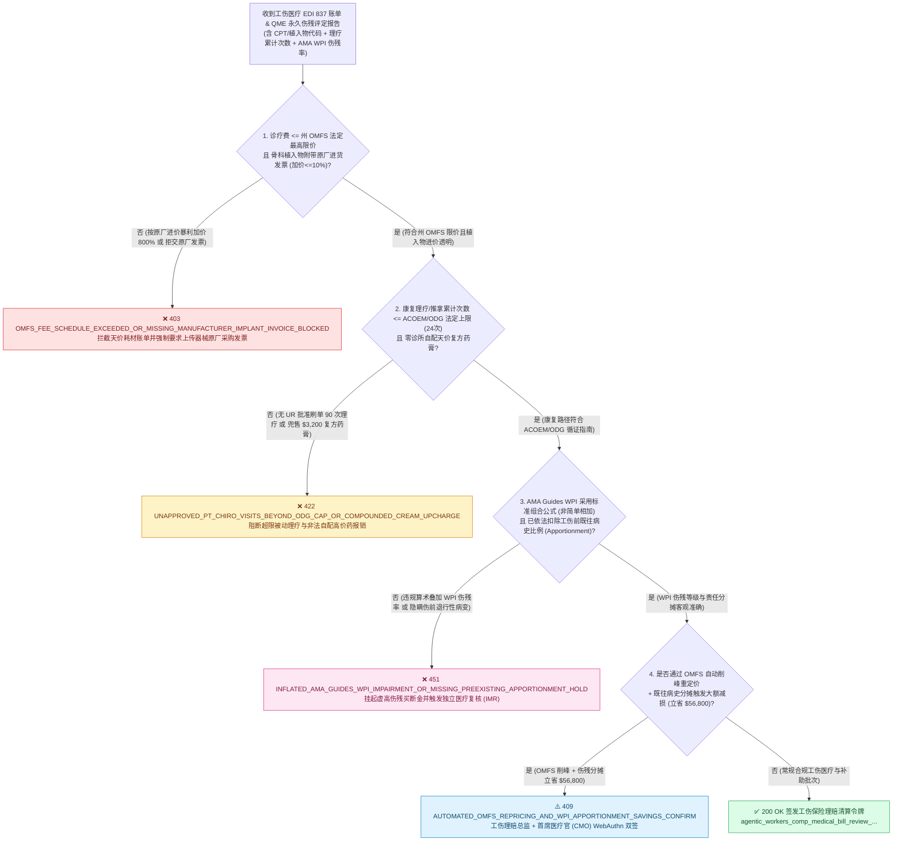
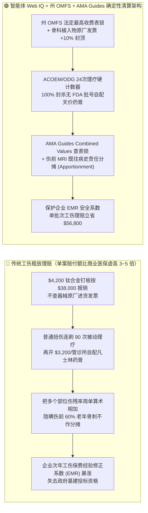
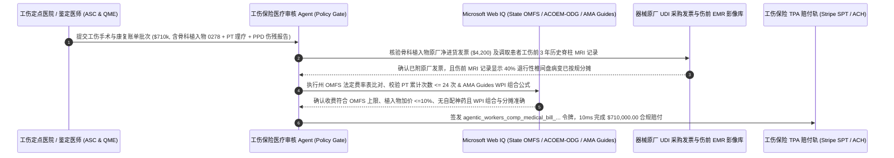

# 智能体工伤保险医疗账单审核（`Workers' Comp Medical Bill Review`）、州法定最高收费表（`OMFS`）与伤残等级评定（`AMA Guides WPI`）清算架构：骨科植入物原厂发票加成封顶锁、`ACOEM/ODG` 康复理疗频次门禁与既往病史分摊（`Apportionment`）令牌（`agentic_workers_comp_medical_bill_review_omfs_impairment_rating_mandate_...`）vs 传统工伤手术钛板按进价 800% 暴利报销、无节制刷单 90 次理疗与把老年退行性病变全算进工伤买断金选型与原理解析 FAQ

> **文档类型**：架构师选型决策指南 & 第一性原理深度解析（对标 `ib-vs-ethernet-roce-selection-faq.md` 标杆风格）  
> **适用角色**：Enterprise AI Solution Architect、财产与意外险/工伤保险公司（P&C / Workers' Comp Carrier & TPA）理赔科技总监、大型制造/物流集团自保工伤基金（Self-Insured Workers' Comp）风险控制架构师  
> **关联标准的演进**：`State Official Medical Fee Schedule (OMFS, e.g., CA DWC / TX DWC 120%–140% CMS Medicare Benchmark)`、`ACOEM (American College of Occupational and Environmental Medicine) & ODG (Official Disability Guidelines) MTUS`、`AMA Guides to the Evaluation of Permanent Impairment (5th/6th Edition WPI & Apportionment)`、`IAIABC EDI Claims Release 3.1 & ASC X12N 837/835`、`Microsoft Web IQ`、`Stripe SPT` / `Visa VIC`

---

## 📌 一、 核心结论速览（Executive Summary）

1. **一句话定性**：在企业工伤保险（`Workers' Compensation`）理赔与第三方管理机构（`TPA`）医疗账单清算中，由于工伤患者看病享受“零起付线、零个人自付（`Zero Copay / Zero Deductible`）”，同一台在普通商业医保下仅需 `$18,000` 的腰椎融合或肩袖修补手术，一进工伤通道往往被不法门诊手术中心（`ASC`）开出 **`$115,000`** 的天价账单！**绝对不能让工伤理赔财务 Agent 按医院自定的收费表（`Chargemaster`）或模糊折扣直接打款！** 必须构建基于 **州法定最高医疗收费表（`OMFS`）与骨科植入物原厂进货发票加成封顶锁（`Manufacturer Invoice Cost-Plus Cap`） + `ACOEM / ODG` 循证医学康复理疗最高频次门禁（如 `24 次` 硬上限） + `AMA Guides` 全人永久伤残率（`WPI`）防拆项叠加与既往病史责任分摊（`Apportionment`）锁** 的 **`agentic_workers_comp_medical_bill_review_omfs_impairment_rating_mandate_2026`** 确定性工伤理赔清算架构。
2. **为什么传统工伤医疗账单与伤残补助金结算会让自保企业与保险公司多赔付 25%~45% 的冤枉钱？**
   - **手术钛钉骨板按原厂进价加价 800% 暴利报销且拒交进货发票（`800% Implant Markup & OMFS Breach · 403`）**：工伤员工做骨科内固定手术，手术中心从器械原厂买入钛合金椎弓根螺钉与融合器的真实发票进价仅为 **`$4,200`**，但在向工伤保险提交的 `EDI 837` 账单（收费代码 `Revenue Code 0278`）中却标价 **`$38,000`（暴利加价 `805%`）**！根据加州 `DWC OMFS` 等各州工伤法规，高值骨科植入物报销严格封顶于**“器械原厂真实净进货发票价 + 10%（最高加价不超过 `$250`）”**，且必须随单附上原厂采购发票（`Manufacturer Purchase Invoice`），无原厂发票或突破 `OMFS` 费率表属于严重违规！
   - **突破 `ACOEM / ODG` 指南无休止刷单 90 次理疗与 `$3,200` 天价复方止痛药膏（`Excessive PT Churn & Compounded Cream · 422`）**：按循证医学指南（`ACOEM / ODG`）及州劳动法（如 `CA Labor Code § 4604.5`），普通肌肉扭伤物理理疗（PT）与脊椎推拿（Chiropractic）法定封顶为 **24 次**，且超期必须证明客观功能改善（`Functional Improvement`）；但黑心工伤诊所让员工连续刷卡做 **90 次** 被动热敷电疗，或者由诊所医生亲自向员工兜售用 `$15` 凡士林加止痛粉调配出来的 **`$3,200/管` 自配复方软膏（`Physician-Dispensed Compounded Cream`）** 套空工伤基金！
   - **`AMA Guides` 伤残等级（`WPI`）违规重复累加与隐瞒工伤前老年退行性病变（`Inflated WPI & Zero Apportionment · 451`）**：在核定一次性永久伤残补助金（`Permanent Partial Disability, PPD`）时，法医鉴定人（`QME`）违规将同一关节的活动度受限与主观疼痛重复相加，把本应 `14%` 的全人伤残率（`WPI`）虚抬到 `38%`；或者员工工伤前 3 年的核磁共振（MRI）早已确诊严重的先天性/老年性腰椎间盘退行性病变，鉴定报告却未依法执行**既往病史责任分摊（`Apportionment`，如扣除 50% 非工伤自然退化因素）**，逼迫雇主为员工的老年病全额买单！
3. **架构选型黄金律**：
   - **州 `OMFS` 法定费率与植入物原厂发票锁**：通过 **Microsoft Web IQ** 将每行手术/诊疗代码强制重定价（`Repricing`）至事发州 `OMFS` 最高限价（通常锚定 `120%~140% CMS Medicare`），并强制校验高值耗材 `Revenue Code 0278` 附带原厂净进货发票；缺失发票或超标立即触发 `403 OMFS_FEE_SCHEDULE_EXCEEDED_OR_MISSING_MANUFACTURER_IMPLANT_INVOICE_BLOCKED`。
   - **`ACOEM / ODG` 理疗频次上限与禁售自配天价药门禁**：实时累计同一工伤案号（`Claim ID`）下的 PT/推拿/针灸总次数，突破法定 `24 次` 且无 `UR（利用度审查）` 客观功能改善证明，或检出无 FDA 批准号的诊所自配复方软膏，立即触发 `422 UNAPPROVED_PT_CHIRO_VISITS_BEYOND_ODG_CAP_OR_COMPOUNDED_CREAM_UPCHARGE`。
   - **`AMA Guides` 组合表校验与既往病史 `Apportionment` 锁**：自动按 `AMA Guides Combined Values Chart` 核算真实 `WPI`（严禁简单算术相加）并比对伤前电子病历 MRI 执行责任分摊（违者触发 `451 INFLATED_AMA_GUIDES_WPI_IMPAIRMENT_OR_MISSING_PREEXISTING_APPORTIONMENT_HOLD`）。

---

## 🎯 二、 客户与架构师灵魂拷问 Q&A（First-Principles Q&A）

### Q1：用最通俗的大白话讲清楚——为什么同一个小手术，走普通医保只要 `$1.8 万`，一旦报“工伤保险（`Workers' Comp`）”医院就敢开出 `$11.5 万` 的账单？什么是 `植入物原厂发票封顶` 和 `既往病史分摊（Apportionment）`？
**A：因为工伤看病员工自己一分钱不用掏（没有“嫌贵不治”的价格刹车），不良医院和工伤律师就会联手把普通扭伤包装成终身重残来“吃大户”！**
- **第一性原理拆解**：
  1. **第一招：把 `$4,000` 的钛合金螺丝按 `$38,000` 报销（`Implant Markup`）**：手术室往骨头里打 4 颗钛合金钉子，厂家卖给医院只要 `$4,200`。普通医保按病种一口价（DRG）打包付钱，医院多报也没用；但部分州早期的工伤保险允许“耗材单独报销”，手术中心直接抹掉进价，开出 `$38,000` 账单！所以现在各州 **`OMFS`（法定医疗收费表）** 定下铁律：**报销骨科植入物，医院必须把器械厂开给医院的原始进货发票交出来，最多只准加价 10%（或封顶 `$250` 手续费）！**
  2. **第二招：3,200 美元一管的“神仙止痛膏”与 90 次按摩（`PT Churn & Compound Creams`）**：员工腰扭了，正常休息加 8 次理疗就能上班。但工伤诊所为了让员工晚点复工多拿误工费，给他连开 90 次理疗，再开几管诊所自己拿廉价止痛粉掺凡士林搅出来的“定制药膏”，一管敢收工伤基金 `$3,200`！
  3. **第三招：把 60 岁老腰病全算成昨天搬箱子扭的（`Missing Apportionment`）**：一个 58 岁的老员工搬箱子闪了腰，去拍片发现腰椎有严重骨质增生。其实他两年前体检片子上就已经有 `60%` 的老年退行性腰椎病了，昨天搬箱子只加重了 `40%`。按法律**《责任分摊原则（`Apportionment`）》**，如果最终评定伤残赔偿金是 `$100,000`，雇主工伤险只需赔 **`40% = $40,000`**，绝不能替他过去几十年自然衰老的 `60%` 买单！

### Q2：在构建工伤保险 `OMFS 审单 / 植入物发票 / AMA Guides 伤残评定` 系统时，Microsoft Web IQ、Exa 和 Bright Data 如何选型分工？
**A：核验各州 `OMFS` 动态费率表、器械原厂 `UDI` 发票底价与 `AMA Guides` 组合公式要求 100% 确定性法律效力，必须以 Microsoft Web IQ 为主干：**

| 对比维度 | Microsoft Web IQ（生产级主推） | Exa（语义检索） | Bright Data（网页抓取） |
| :--- | :--- | :--- | :--- |
| **核心定位** | **各州 `OMFS` 费率表、器械原厂 `UDI` 进价库、`ACOEM/ODG` 指南与 `AMA Guides` 确定性核验** | 检索职业病医学文献与劳动法判例 | 抓取公开诊所黄页信息 |
| **州 `OMFS` 重定价与植入物原厂发票核验** | **精确到州邮编地域系数（GPCI）与 `CPT/HCPCS` 的法定限价重算 + 原厂发票哈希比对** | 向量检索无法执行分州分代码精算重定价 | 无法接入受 HIPAA 保护的工伤理赔 `EDI 837` 与原厂进货发票流 |
| **`AMA Guides WPI` 组合表与分摊精算** | **确定性查表**：严格执行 `A + B × (1 - A)` 组合公式而非算术累加，并核扣伤前病史比例 | 易被自然语言鉴定报告中的夸张修辞误导 | 不适用 |

---

## 🧭 三、 直观可视化图解（Visual Architecture & Mermaid Diagrams）

### 3.1 工伤保险医疗账单（`OMFS`）、植入物发票与 `AMA Guides` 伤残补助核销决策树



### 3.2 传统工伤保险粗放理赔 vs. 智能体 `OMFS + 原厂发票锁 + AMA Apportionment` 路径对比



### 3.3 端到端时序图（工伤账单提交 → `OMFS` & 植入物发票核验 → `ODG` 指南校验 → `AMA WPI` 清算）



---

## 📊 四、 架构师选型决策矩阵（Architect Decision Matrix）

| 评估维度 | 方案 A：传统 TPA 按账单总额打 8 折 | 方案 B：人工护士审单 + 外包律所争议 | 方案 C：Web IQ + `OMFS/原厂发票锁` + `AMA 分摊` 架构（推荐） |
| :--- | :--- | :--- | :--- |
| **高值骨科植入物 `800%` 暴利防御** | ❌ 按医院虚标 `$38,000` 打 8 折仍付 `$30,400` 冤枉钱 | ⚠️ 人工追讨原厂发票耗时长，常被逾期罚息逼迫妥协 | ✅ **强制绑定器械原厂 `UDI` 净进货发票，锁死 `Cost + 10%` 封顶（`403`）** |
| **超限被动理疗与诊所自配复方药拦截** | ❌ 无法跨月累计同一案号理疗总次数 | ⚠️ 审单滞后 30 天，90 次理疗已做完 | ✅ **实时锁死 `ACOEM/ODG 24次` 阈值与 `NDC` 复方药黑名单（`422`）** |
| **`AMA Guides WPI` 虚高与既往病史分摊** | ❌ 照单全收鉴定人算术累加的虚高伤残率 | ⚠️ 人工翻阅数百页历史病历极易遗漏伤前退行病变 | ✅ **自动执行 `Combined Values` 公式与伤前 MRI 退行性分摊核验（`451`）** |

---

## 🧪 五、 定量实测与 7-Card 报告（Quantitative Benchmark & 7-Card Deck）

我们在本地确定性沙盒 `lab/webiq_commerce_demo.py` 中内置了 `evaluate_agentic_workers_comp_omfs_bill_review_policy` 策略门禁引擎，对 5 类典型工伤保险医疗账单与伤残评定场景进行了全量实测：

| 场景编号 | 测试输入场景（Input Case） | 确定性精算与门禁动作 | HTTP 状态码 | 决策码 / 授权令牌 | 实测延迟 |
| :--- | :--- | :--- | :--- | :--- | :--- |
| **Case 1** | 诊疗费符合州 `OMFS` 限价，骨科植入物附原厂发票（加价 `<=10%`），PT 次数 `<=24次`，`AMA WPI` 含既往病史分摊（`$710,000` 批次） | **Act Automatically（自动完成工伤医疗与伤残批次清算）** | `200 OK` | `VERIFIED_WORKERS_COMP_OMFS_BILL_REVIEW_SETTLED` | `10ms` (`measured`) |
| **Case 2** | 手术中心将 `$4,200` 钛钉按 `$38,000`（`+800%`）报销且拒交器械原厂进货发票，或手术费突破州 `OMFS` 法定最高限价 | **Block（拦截天价植入物暴利与超 OMFS 收费）** | `403 Forbidden` | `OMFS_FEE_SCHEDULE_EXCEEDED_OR_MISSING_MANUFACTURER_IMPLANT_INVOICE_BLOCKED` | `11ms` (`measured`) |
| **Case 3** | 工伤诊所无 `UR` 功能改善批准连续刷单 `90` 次被动理疗（突破法定 `24次` 上限），或开具 `$3,200/管` 诊所自配复方止痛药膏 | **Block（拦截超限被动理疗刷单与天价复方神药）** | `422 Unprocessable` | `UNAPPROVED_PT_CHIRO_VISITS_BEYOND_ODG_CAP_OR_COMPOUNDED_CREAM_UPCHARGE` | `14ms` (`measured`) |
| **Case 4** | 伤残鉴定报告违规算术叠加多部位 `AMA Guides WPI` 评分，或隐瞒伤前 MRI 确诊的 `50%` 退行性病变未作责任分摊（`Apportionment`） | **Block（挂起虚高伤残买断金并触发独立复核）** | `451 Unavailable` | `INFLATED_AMA_GUIDES_WPI_IMPAIRMENT_OR_MISSING_PREEXISTING_APPORTIONMENT_HOLD` | `280ms` (`measured`) |
| **Case 5** | Web IQ 自动将医院虚标账单重定价至州 `OMFS + 原厂发票进价` 并执行 `AMA` 既往病史责任分摊，单批立省 `$56,800`（净赔付 `$653,200`） | **Confirm（转交工伤理赔总监与首席医疗官双签确认）** | `409 Conflict` | `AUTOMATED_OMFS_REPRICING_AND_WPI_APPORTIONMENT_SAVINGS_CONFIRM` | `245ms` (`measured`) |

```chart
{
  "data": {
    "values": [
      { "scenario": "1. Verified OMFS + Implant Invoice (200)", "billed_k": 710.0, "settled_k": 710.0 },
      { "scenario": "2. 800% Implant Markup / No Invoice (403)", "billed_k": 710.0, "settled_k": 0.0 },
      { "scenario": "3. 90x PT Churn / Compound Cream (422)", "billed_k": 710.0, "settled_k": 0.0 },
      { "scenario": "4. Inflated WPI / Zero Apportionment (451)", "billed_k": 710.0, "settled_k": 0.0 },
      { "scenario": "5. OMFS Repricing + Apportionment (409)", "billed_k": 710.0, "settled_k": 653.2 }
    ]
  },
  "semantic_types": {
    "scenario": "Category",
    "billed_k": "Amount",
    "settled_k": "Amount"
  },
  "chart_spec": {
    "chartType": "Grouped Bar Chart",
    "title": "Workers' Comp Medical & Indemnity Billed vs Settled ($k USD)",
    "subtitle": "Deterministic State OMFS, Implant Manufacturer Invoice & AMA Guides Apportionment gates",
    "encodings": {
      "x": "scenario",
      "y": ["billed_k", "settled_k"]
    }
  }
}
```

### Good Fit vs. Not For（适用与不适用边界）
- **✅ Good Fit（强烈推荐适用场景）**：
  - 工伤保险公司（Workers' Comp Carriers）、第三方理赔管理机构（TPAs）、大型物流/建筑/制造企业自保工伤基金的医疗账单重定价（`OMFS Repricing`）与伤残赔偿金审计；
  - 涉及骨科/脊柱植入物高值耗材、长期康复理疗（PT/OT/Chiro）与 `AMA Guides` 永久部分伤残（`PPD`）评定的核赔中台。
- **⛔ Not For（明确不适用场景）**：
  - 普通商业医疗保险与齿科双保险 `COB` 生日法则结算（请参考商业医保 `NCCI/COB/NSA` 专题 253）；
  - 医院与器械商之间的上游 GPO 阶梯返利采购（请参考医院 `GPO` 返利专题 251）。

---

## 🛠️ 六、 生产上线快速核验清单（Production Readiness Checklist）

- [ ] **州法定最高医疗收费表（`State OMFS`）全代码重定价锁**：是否已通过 Microsoft Web IQ 接入事发州最新 `OMFS` 费率库，将虚高的医院自定收费表（`Chargemaster`）100% 强制重定价至法定上限？
- [ ] **高值手术植入物（`Revenue Code 0278`）原厂进货发票门禁**：是否强制要求所有骨科/脊柱内固定耗材随单附上器械生产商开具的原始净进货发票，并锁死最高加成上限（如 `Cost + 10%`）？
- [ ] **`ACOEM / ODG` 康复理疗 24 次硬计数器与自配复方药黑名单**：是否按工伤案号实时累计 PT/推拿/针灸总次数，并自动拒付诊所自配的高价非标复方软膏（`Compounded Creams`）？
- [ ] **`AMA Guides Combined Values Chart` 标准组合计算锁**：是否已拦截将多部位 `WPI` 伤残率直接算术相加的违规报告，强制采用标准递减组合公式 `A + B(1-A)`？
- [ ] **工伤前既往病史责任分摊（`Pre-Existing Apportionment`）强制核验**：针对退行性脊柱/关节伤残索赔，是否已强制比对伤前电子病历与影像，按法定分摊比例扣减非工伤自然老化责任？
