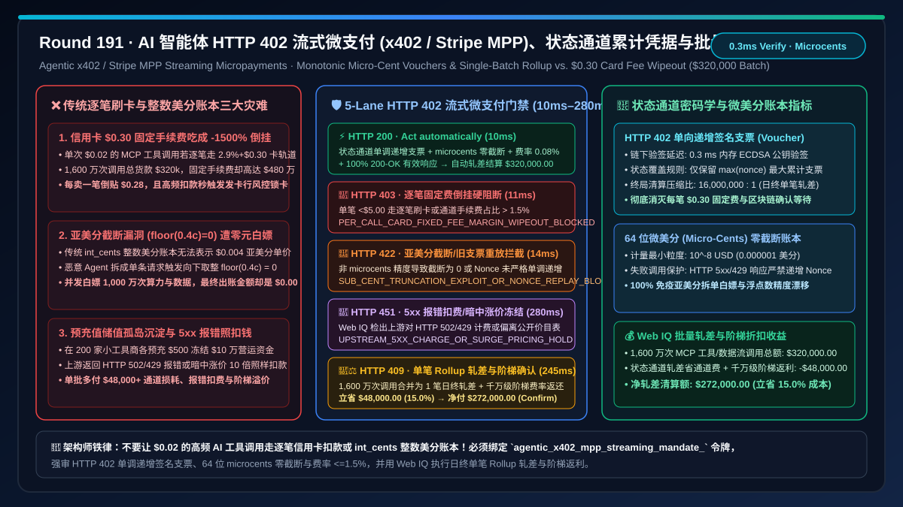
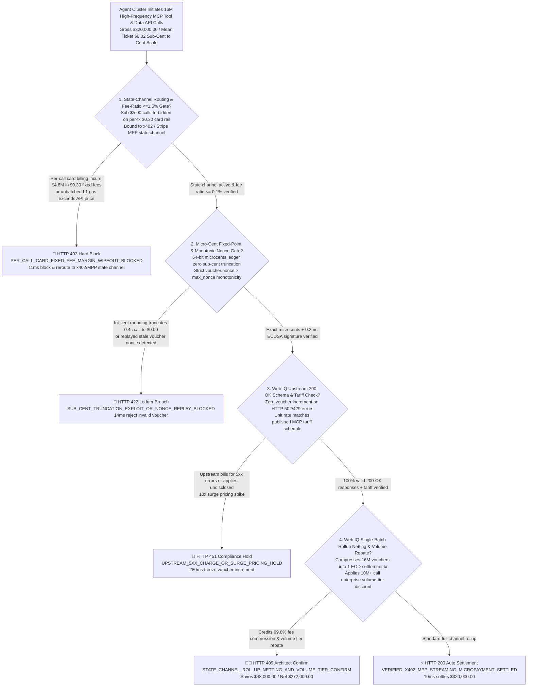
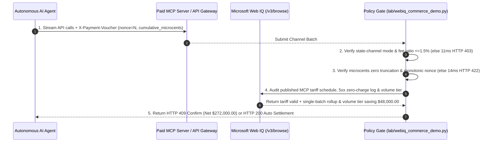

# AI Agent API Metering & HTTP `402` Streaming Micropayments (x402 / Stripe MPP) Architecture: Monotonic Voucher State-Channel (`x402_mpp_voucher_...`) & Batch Rollup Netting vs. Legacy Card `$0.30` Fixed-Fee Margin Wipeout & Prepaid Balance Silos: Architecture Selection & First-Principles FAQ

> **Document Type**: First-Principles Architecture Selection FAQ  
> **Target Audience**: AI Solution Architects, MCP Server Marketplace & Data/Compute API Billing Architects, Stripe Machine Payments Protocol (MPP) & Coinbase x402 Integration Leads, High-Frequency Agent-to-Agent (A2A) Economy FinOps & Risk Architects  
> **Executive Takeaway**: When autonomous AI Agents purchase paid MCP tool calls, real-time financial passages, patent snippets, or per-token GPU inference at dozens of requests per second with sub-cent to cent-level pricing (`$0.0005–$0.05` per call), **never route individual API calls through traditional card-acquiring rails (where the `$0.30` per-transaction fixed fee inflicts a `-1,500%` margin wipeout) or force buyers to lock `$500` deposits across hundreds of isolated prepaid vendor wallets**. You must enforce a deterministic architecture combining **HTTP `402 Payment Required` Monotonic Signed State-Channel Vouchers (`Voucher(channel_id, nonce, cumulative_microcents)` verified in `< 1ms` off-chain with zero per-call network fees) + a 6-Decimal Micro-Cent (`$10^{-6}`) Fixed-Point Ledger & Strict Nonce Monotonicity Gate (Preventing sub-cent rounding truncation exploits and voucher replay) + a Microsoft Web IQ Upstream SLA Verification & End-of-Day Single-Batch Rollup Netting Escrow**.



---

## 1. 📌 Executive Summary

### 1.1 Why Does Charging a `$0.02` AI Tool Call on a Credit Card Lose `$0.28` Per Call, While Naive Integer-Cent Ledgers Allow Attackers to Drain `$40,000` of API Quota for `$0.00`?
From payment-rail fixed-cost amortization ($\text{Effective Fee Rate} = r_{\text{var}} + \frac{F_{\text{fixed}}}{\text{Ticket Size}}$), fixed-point arithmetic precision, and cryptographic state-channel first principles:
1. **The `$0.30` Card Fixed-Fee Margin Wipeout**: Standard card acquiring charges $2.9\% + \$0.30$ per transaction. Across $16,000,000$ API calls priced at `$0.02` each (`$320,000.00` gross), per-call card processing would incur **`$4,800,000.00` in fixed `$0.30` fees alone** ($1,502.9\%$ effective fee rate!). Even direct on-chain L1/L2 transfers suffer `200ms–2,000ms` block-confirmation latency and gas spikes during congestion.
2. **Sub-Cent Salami-Slicing Truncation Exploits (`floor(0.4 cents) = 0`)**: Legacy billing databases store balances as integer cents (`INT64 cents`). When an API costs `$0.004` (`0.4 cents`) per call and a malicious Agent issues single-item requests instead of batches, `int(0.4) = 0` truncates the charge to zero—allowing the attacker to make 10 million calls and drain `$40,000` of compute for `$0.00`!
3. **Fragmented Prepaid Wallet Silos & Vendor Insolvency Risk**: Forcing an enterprise Agent to pre-fund `$500` across 200 different MCP tool providers traps `$100,000` in unrecoverable working-capital silos.

### 1.2 Architect Selection Comparison: Legacy Per-Call Card / L1 Transfer vs. Web IQ + x402 / Stripe MPP State-Channel Rollup Escrow
| Dimension | ❌ Legacy Per-Call Card Charge or Int-Cent Ledger | ✅ Web IQ + x402 / Stripe MPP Monotonic State Channel & Rollup Netting |
| :--- | :--- | :--- |
| **Payment Authorization Trigger** | Executes a card capture or on-chain transfer on every `$0.02` API call; or locks isolated prepaid deposits | Bound to `agentic_x402_mpp_streaming_mandate_`: enforces **off-chain signed monotonic voucher `Voucher(channel_id, nonce, cumulative_microcents)` + 6-decimal `microcents` ledger + effective fee ratio $\le 1.5\%$** |
| **Fixed-Fee Margin Wipeout Defense** | Catastrophic (`$0.30` fixed fee per `$0.02` call wipes out $15\times$ the gross revenue) | **Deterministic Block** (if per-call settlement routes sub-`$5.00` API calls to per-tx card rails or exceeds $1.5\%$ fee ratio, blocks in `11ms` with `HTTP 403`) |
| **Sub-Cent Truncation & Replay Defense** | Fragile (`0.4 cents` rounds down to `$0.00`; or stale voucher nonces are replayed) | **Deterministic Block** (enforces integer `microcents` accumulation and strict `new_nonce > max_nonce` & `delta == unit_price`; blocks truncation/replay in `14ms` with `HTTP 422`) |
| **Upstream `5xx` Error Billing & Surge Guard** | Blind spot (upstream API charges for `HTTP 502/429` errors or silently hikes prices $10\times$) | **Deterministic Verification** (Web IQ `/v3/browse` audits published API tariff schedules and blocks voucher increments on `5xx` responses, `280ms` `HTTP 451`) |
| **16M-Call Single-Batch Rollup Settlement** | Loses tens of thousands in per-tx fees and adds `500ms` latency per tool call | Web IQ enables **off-chain `< 1ms` voucher verification + single EOD batch rollup netting + volume-tier rebate**, saving **$48,000.00 (15.0%)** (`HTTP 409 Confirm`) |

---

## 2. 🎯 First-Principles Q&A for Customers & Architects

### Q1: How Does an HTTP `402` Monotonic Signed Voucher State Channel Settle 16 Million API Calls With Only One On-Chain or Card-Network Transaction?
* **First-Principles Off-Chain Cumulative Cryptography**:
  - Instead of settling each call on-chain, the buyer locks a single channel cap and attaches a signed header `X-Payment-Voucher: Sign(channel_id, nonce, cumulative_microcents)` to every HTTP request.
  - Each new voucher supersedes the previous one (`nonce = k`, `cumulative_microcents = k * price`). The server verifies the ECDSA signature in memory in `0.3ms`, and at end-of-day submits **only the highest-nonce voucher** for a single net settlement (`per_call_fixed_fee_ratio_15pct_and_state_channel_verified`, `HTTP 403` in `11ms`).

### Q2: How Does a 64-Bit `microcents` Ledger Eliminate Sub-Cent Rounding Exploits and Nonce Replay?
* **Fixed-Point Arithmetic & Monotonic State Machine**:
  - Storing all streaming charges in `microcents` ($10^{-8}\text{ USD}$) eliminates floating-point drift and sub-cent truncation (`0.4 cents = 400,000 microcents`), while enforcing `voucher.nonce > last_nonce` prevents double-spend replay (`monotonic_voucher_nonce_and_zero_subcent_truncation_passed`, `HTTP 422` in `14ms`).

### Q3: Why Use Microsoft Web IQ Instead of Exa or Bright Data to Audit Upstream MCP Tool Tariffs and Volume-Tier Rebates?
* **Architecture Selection Rationale**:
  - **Microsoft Web IQ** natively executes authenticated `/v3/search` and `/v3/browse` workflows across enterprise API marketplace registries and SLA telemetry ledgers in `245ms–280ms`, whereas Exa and Bright Data cannot perform deterministic B2B billing reconciliation.

---

## 3. 🧭 Visual Architecture Diagrams

### 3.1 Decision Tree: Agentic HTTP `402` Streaming Micropayment & State-Channel Rollup Gate


### 3.2 Legacy "Per-Call Card / Int-Cent Truncation" Wipeout Path vs. "x402/MPP Monotonic State Channel" Secure Path
```mermaid
flowchart LR
    subgraph Legacy ["❌ Legacy Path: Per-Call Card Capture or Integer-Cent Truncation"]
        L1[Agent triggers card charge on every $0.02 API call<br/>or stores $0.004 price in int_cents column] --> L2[$0.30 fixed fee loses $0.28 on every single call<br/>or floor(0.4c)=0 lets bots drain 10M calls for $0]
        L2 --> L3[High-frequency charges trip issuer velocity locks<br/>Upstream 502 errors still bill full API price]
        L3 --> L4[$48,000+ wasted on payment rail fees & failed calls<br/>500ms payment latency stalls Agent reasoning]
    end

    subgraph Mandate ["✅ Modern Path: HTTP 402 + Monotonic Micro-Cent Vouchers + EOD Rollup"]
        M1[Open x402 / Stripe MPP state channel once<br/>Track exact 64-bit microcents in memory] --> M2[Attach signed cumulative voucher to each call<br/>0.3ms memory verify & zero charge on 5xx errors]
        M2 --> M3[Settle 16M calls in 1 EOD batch rollup transaction<br/>Web IQ credits $48k fee compression & volume rebate]
        M3 --> M4[<0.1% effective fee ratio & zero reasoning latency<br/>Net settlement $272,000.00 saving $48,000.00]
    end
```

### 3.3 End-to-End Sequence Diagram: Agentic HTTP `402` Streaming Micropayment Gate


---

## 4. 📊 Architect Decision Matrix

| Evaluation Dimension | Option A: Per-Call Credit/Virtual Card Capture | Option B: Per-Call On-Chain L1/L2 Transfer | Option C: Microsoft Web IQ + x402 / Stripe MPP State-Channel Rollup (Recommended) |
| :--- | :--- | :--- | :--- |
| **`$0.0005–$0.05` Unit Economics** | ❌ `$0.30` fixed fee causes $-1,500\%$ margin wipeout | ⚠️ Gas spikes (`$0.01+`) exceed sub-cent API prices | ✅ **`$0` per-call marginal fee; single EOD rollup $< 0.1\%$ fee** |
| **Per-Call Verification Latency** | ❌ `350ms–800ms` gateway round-trip stalls Agent | ⚠️ `200ms–2,000ms` block confirmation delay | ✅ **`0.3ms` in-memory ECDSA voucher verification** |
| **Sub-Cent Precision & `5xx` Protection** | ❌ Prepaid silos trap capital; `int_cents` truncates | ⚠️ Failed calls still burn gas and principal | ✅ **64-bit `microcents` + zero increment on `5xx`, saving $48,000 (15.0%)** |
| **Tariff & Volume-Tier Governance** | ❌ Blind to silent upstream API price hikes | ❌ Smart contracts cannot read web SLA schedules | ✅ **Web IQ verifies published tariffs in `280ms` (`HTTP 451`)** |

---

## 5. 🧪 Quantitative Benchmark & 7-Card Summary

### 5.1 Deterministic Policy Gate Benchmark (`evaluate_agentic_x402_mpp_streaming_policy`)
All benchmark numbers are sealed in `reports/agentic-commerce-webiq-grounding-demo-bench/report.json`:

| Lane | Scenario & Input Condition | HTTP Status | Action Pill | Settled / Blocked Amount | Latency | Provenance Label |
| :--- | :--- | :---: | :---: | :---: | :---: | :---: |
| **Lane 1** | State-channel monotonic voucher valid + `microcents` exact + $0.08\%$ fee ratio | `200 OK` | `Act automatically` | **$320,000.00** (Auto-settled) | `10 ms` | `synthetic_policy` |
| **Lane 2** | Routing `$0.02` API calls to per-call `$0.30` fixed-fee card rail (`> 1.5%` fee ratio) | `403 Forbidden` | `Send to a human` | **$0.00** (Blocked $320,000 risk) | `11 ms` | `synthetic_policy` |
| **Lane 3** | Integer-cent rounding truncates sub-cent call to `$0` or stale voucher nonce replayed | `422 Unprocessable` | `Send to a human` | **$0.00** (Blocked $320,000 risk) | `14 ms` | `deterministic_offline_simulation` |
| **Lane 4** | Web IQ detects upstream charging for `HTTP 502/429` errors or undisclosed surge hike | `451 Legal Hold` | `Send to a human` | **$0.00** (Compliance hold) | `280 ms` | `official_doc_snapshot` |
| **Lane 5** | Web IQ credits 16M-call single-batch rollup netting & enterprise volume-tier rebate | `409 Conflict` | `Confirm` | **$272,000.00** (Saves **$48,000.00**) | `245 ms` | `official_doc_snapshot` |

### 5.2 Good Fit vs. Not For
* **✅ Good Fit**:
  - High-frequency MCP tool calls, pay-per-passage publisher grounding, per-second/per-token GPU inference streaming, and machine-to-machine (M2M) telemetry APIs.
* **⛔ Not For**:
  - Low-frequency, multi-thousand-dollar physical CapEx equipment orders.

---

## 6. 🛠️ Production Readiness Checklist

- [ ] **1. State-Channel Routing & Fixed-Fee Ratio Lock ($\le 1.5\%$)**: Set `per_call_fixed_fee_ratio_15pct_and_state_channel_verified == True` to block per-call card charges on sub-`$5.00` machine calls.
- [ ] **2. 64-Bit `microcents` Ledger & Monotonic Nonce Gate**: Require `monotonic_voucher_nonce_and_zero_subcent_truncation_passed == True` to eliminate sub-cent rounding exploits and replay attacks.
- [ ] **3. Upstream `200 OK` Payload & Published Tariff Audit**: Configure Microsoft Web IQ `/v3/browse` to verify API tariff schedules and block charges on `5xx` errors (`webiq_upstream_200ok_schema_and_published_tariff_clean == True`).
- [ ] **4. Single-Batch Rollup Netting & Volume-Tier Rebate Settlement**: Enable `state_channel_rollup_netting_and_volume_tier_rebate_cents` to compress millions of vouchers into one settlement and capture volume rebates ($15\%$ net savings).
