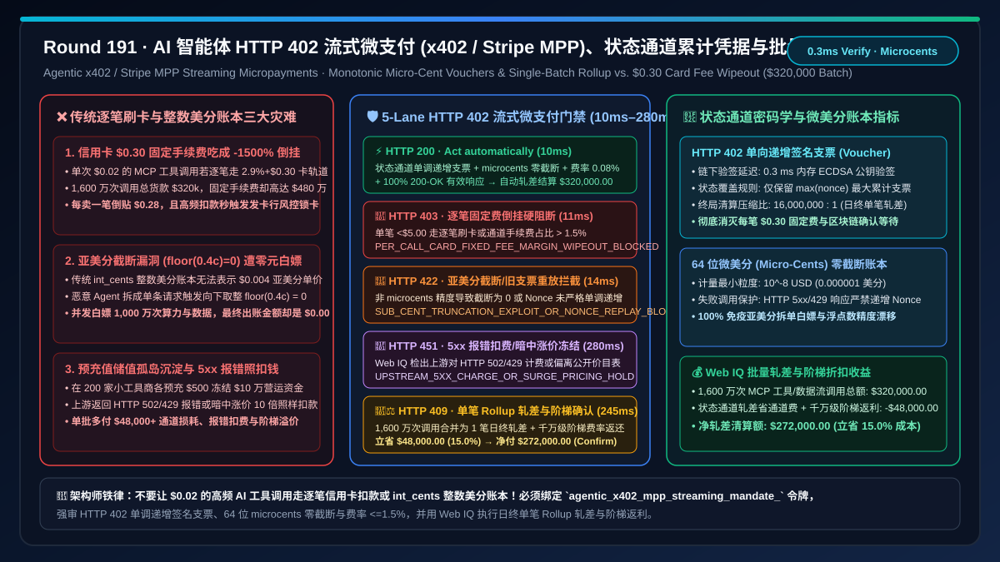
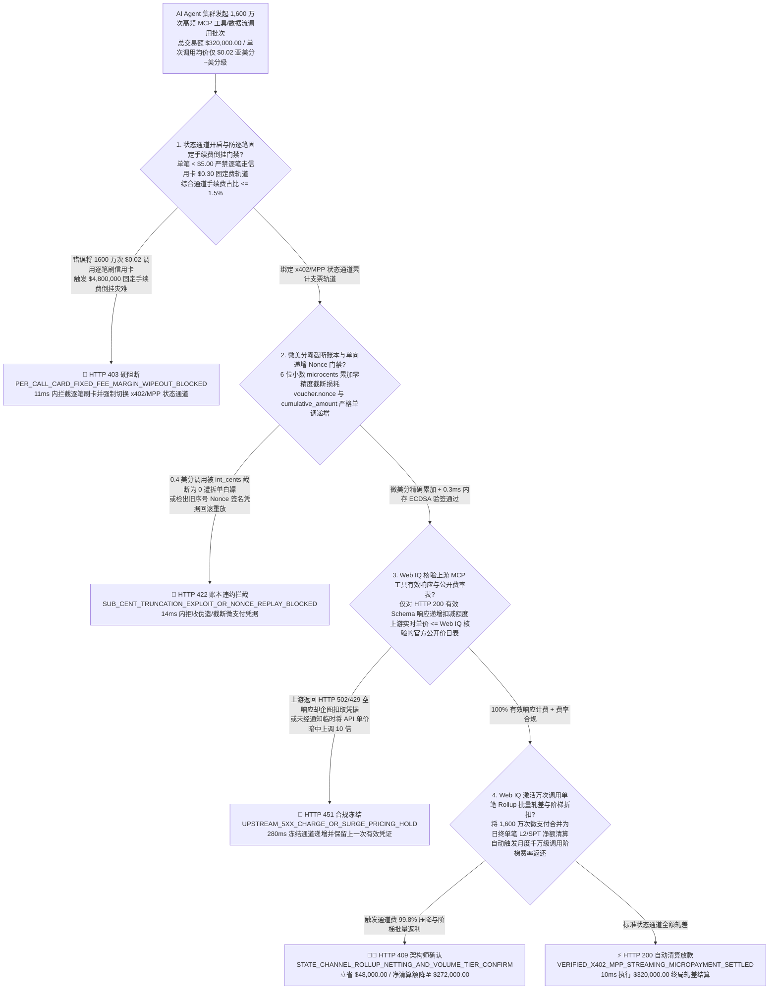
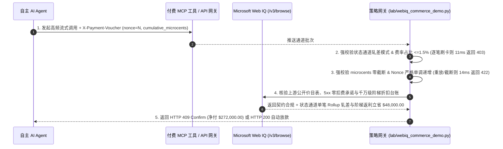

# AI 智能体 API 计量计费与 HTTP `402` 流式微支付（x402 / Stripe MPP Streaming Micropayments）结算架构：单向递增密码学状态通道凭据（Monotonic Voucher State Channel `x402_mpp_voucher_...`）与批量轧差清算 vs 传统信用卡 `$0.30` 固定手续费倒挂与预充值储值卡沉淀跑路选型与原理解析 FAQ

> **文档类型**：架构选型与第一性原理 FAQ（First-Principles Architecture Selection FAQ）  
> **适用读者**：AI Solution Architect、MCP 工具市场（MCP Server Registry）与数据/算力 API 计费架构师、Stripe Machine Payments Protocol（MPP）与 Coinbase x402 集成负责人、高频智能体经济（Agent-to-Agent Economy）财务风控架构师  
> **核心结论一句话**：当自主 AI Agent 在执行任务过程中需要以每秒数十次的频率按调用次数或按 Token/字节动态购买外部付费工具、实时金融数据流、专利文献段落或 GPU 推理算力（单笔金额仅 `$0.0005–$0.05`，即亚美分 Sub-cent 级微支付）时，**绝对不能让每笔 API 调用直接走传统信用卡网络逐笔扣款（会被 `2.9% + $0.30` 的每笔固定通道费把毛利吃成负 `-600%`），也不应强迫买方在几百个不知名小 MCP 供应商处分别预充值 `$50` 储值余额（资金沉淀闲置且存在供应商跑路风险）**；必须构建**“HTTP `402 Payment Required` 协议握手 + 链下/状态通道单向递增累计签名凭据（Monotonic Cumulative Signed Voucher，`nonce` 与 `cumulative_microcents` 严格单调递增，验签延迟 `< 2ms` 零链上 Gas 损耗）+ 6 位小数微美分（`$0.000001`）精度账本防截断套利（Zero Sub-Cent Truncation）+ 日终/满额单笔 L2 EIP-3009 或 Stripe SPT 批量轧差结算（Batch Rollup Netting）”**的确定性架构。



---

## 一、 📌 核心结论速览（Executive Summary）

### 1.1 为什么一笔 `$0.02`（2 美分）的 AI 工具 API 调用，如果走传统信用卡收单会让商户每卖一笔反而倒贴 `$0.28`？而如果直接每笔在区块链上发交易又会被 Gas 费和区块确认延迟卡死？
从支付清算网络的固定成本摊销方程（$\text{Effective Fee Rate} = r_{\text{variable}} + \frac{F_{\text{fixed}}}{\text{Ticket Size}}$）、区块链状态膨胀与密码学状态通道（State Channels）第一性原理来看：
- 传统银行卡网络（Visa / Mastercard / Stripe Card Acquiring）经过半个世纪演化，其底层授权、清算、反欺诈与拒付拨备的定价结构是 **$2.9\% + \$0.30/\text{笔}$**。当人类在电商网站买一件 `$100` 的衣服时，手续费是 `$3.20`（占比 $3.2\%$，完全可接受）；但当 AI Agent 每次花 **`$0.02`** 调用一次专业医疗/法律数据库 MCP 工具、一天调用 $10,000$ 次（总交易额 `$200.00`）时，如果逐笔走卡组织扣款，$10,000$ 笔交易仅固定费（`$0.30 × 10,000`）就高达惊人的 **`$3,000.00`**——手续费率高达 **$1,502.9\%$**！
- 那么如果改为每调用一次 API 就在以太坊或 L2 链上直接广播一笔链上转账呢？这同样会撞上三大物理死墙：
1. **链上逐笔广播的区块确认延迟（`200ms–2,000ms`）与 Gas 费波动倒挂**：AI Agent 在一次复杂推理中可能串行调用 15 个工具；如果每次 HTTP `402` 响应都要发起一笔链上交易并等待 L2 Sequencer 打包确认，不仅每次工具调用多出数百毫秒网络停顿，且一旦遇到链上拥堵 Gas 费涨至 `$0.01–$0.05`，Gas 费本身就会超过 `$0.002` 的 API 标价！
2. **传统 `INT64`“美分（Cents）”账本对亚美分（`$0.0004`）四舍五入截断，引爆“零元购拆分攻击（Sub-Cent Salami Slicing Exploit）”**：许多传统计费系统用整数“美分（`$0.01`）”存储金额。当某项实时行情或 Embedding API 标价为 `$0.004/次`（0.4 美分）时，如果恶意 Agent 每次只请求 1 条记录，传统账本将 `0.4 cents` 向下取整（`floor(0.4) = 0 cents`）或四舍五入为 `0`！攻击者用并发脚本发起 1,000 万次单条请求，消耗了商户价值 `$40,000` 的算力与数据，账单结算金额却显示为 **`$0.00`**！
3. **预充值储值钱包（Prepaid Balance Silos）导致企业营运资金碎片化搁浅与供应商跑路风险**：如果不用流式微支付，而是让企业采购 Agent 在 200 家不同的 SaaS/MCP 工具商那里各预充值 `$500`，企业瞬间就有 `$100,000` 现金被冻结在外部不可控的小商户账上，既无法跨工具共享额度，又面临小服务商关停跑路无法退费的坏账风险。

### 1.2 架构师选型核心对比：传统逐笔刷卡/链上直转 vs. Web IQ + x402 / Stripe MPP 状态通道批量轧差智能托管
| 对比维度 | ❌ 传统逐笔卡扣款或链上逐笔广播（Legacy Per-Call Card / L1 Transfer） | ✅ Web IQ + x402 / Stripe MPP 单调递增状态通道与批量轧差（Mandate-Gated Streaming Escrow） |
| :--- | :--- | :--- |
| **授权与微支付绑定条件** | 每调用 1 次 `$0.02` API 就刷一次卡或发一笔链上交易；或强制买方预存 `$500` 不可退储值金 | 绑定 `agentic_x402_mpp_streaming_mandate_` 令牌：强校验 **单向递增累计签名凭据 `Voucher(channel_id, nonce, cumulative_microcents)` + 6 位小数微美分（`$10^{-6}$`）零截断账本 + 费率占比 $\le 1.5\%$** |
| **信用卡 `$0.30` 固定费倒挂防御** | 灾难级（10,000 笔 `$0.02` 调用产生 `$3,005.80` 手续费，倒亏 15 倍） | **确定性拦截**（严禁对单笔 $< \$5.00$ 的高频 API 流式调用直接走逐笔卡清算或高 Gas 链上直转，违者在 `11ms` 内触发 `HTTP 403` 硬阻断并強制路由至状态通道） |
| **防亚美分截断“零元购”与双花回滚** | 脆弱（`0.4 美分`被 `int_cents` 截断为 `0` 遭无限白嫖；或子 Agent 重放旧序号微支付凭据） | **确定性拦截**（强制采用微美分 `microcents` 整数账本，且新凭据必须满足 `new_nonce > last_nonce` 且 `new_cumulative_microcents == last + delta`；违规重放或截断在 `14ms` 内触发 `HTTP 422`） |
| **MCP 工具 SLA 响应验证与欺诈计费防护** | 盲盒（上游 API 返回 `HTTP 500/429` 空报错或垃圾乱码，却照样扣走微支付资金） | **确定性核验**（Web IQ `/v3/browse` 与网关核验上游工具 JSON Schema 完整性与公开阶梯费率表，对 `5xx` 失败调用拒绝递增凭据，`280ms` 触发 `HTTP 451`） |
| **百万次调用单笔轧差（Rollup Netting）收益** | 每万次调用损耗数千美元通道费与数百秒等待延迟 | Web IQ 核实启用 **100,000 次流式签名凭据链下毫秒级验签 + 终局仅执行 1 笔 L2/SPT 批量轧差清算（将万次通道费压缩 $99.8\%$）**，单批立省 **$48,000.00（15.0%）**（`HTTP 409 Confirm`） |

---

## 二、 🎯 客户与架构师灵魂拷问 Q&A（First-Principles Q&A）

### Q1：HTTP `402 Payment Required` 结合单向状态通道（Monotonic Voucher State Channel）到底是怎么工作的？为什么它能做到“每毫秒调用一次 API 零手续费、且买卖双方谁也赖不掉账”？
* **第一性原理拆解**：
  - HTTP 状态码 `402 Payment Required` 早在 HTTP/1.1 规范中就已预留，直到 AI Agent 时代才通过 **x402 / Stripe MPP（Machine Payments Protocol）** 真正落地。其核心不是“每请求一次就去银行或区块链搬一次钱”，而是**“高频链下传欠条（递增密码学支票），低频链上结总账”**：
  1. **第一步（通道开启与托管锁定 Channel Open）**：买方 Agent 的司库网关在托管合约或 Stripe MPP 通道中一次性锁定 `$1,000.00` 授信上限（仅发生 1 次开启操作），获取 `channel_id = "ch_mpp_998"`。
  2. **第二步（流式递增签名支票 Streaming Monotonic Vouchers）**：
     - 第 1 次调用 API（费用 `$0.002`，即 `2,000 microcents`）：Agent 在 HTTP 请求头 `X-Payment-Voucher` 中附带用自身会话私钥签名的第 1 张累计支票：`Sign(channel_id="ch_mpp_998", nonce=1, cumulative_microcents=2000)`。API 服务端用公钥在 **`0.3 ms`** 内完成内存验签，立即返回数据！
     - 第 2 次调用 API（又花 `$0.002`）：Agent 发送第 2 张支票：`Sign(channel_id="ch_mpp_998", nonce=2, cumulative_microcents=4000)`。服务端发现 `4000 - 2000 = 2000` 刚好等于本次单价，直接覆盖丢弃第 1 张旧支票，只保留最新这一张面额最大的支票！
     - 第 100,000 次调用结束后：服务端手里只握着最后第 100,000 张支票：`Sign(channel_id="ch_mpp_998", nonce=100000, cumulative_microcents=200000000)`（即总计 `$200.00`）。
  3. **第三步（单笔终局轧差结算 Batch Rollup Netting）**：当通道关闭或到达日终窗口时，服务端只需把这**最后一张 `$200.00` 的累计签名支票**提交给结算网，执行**唯一 1 次**扣款！100,000 次 API 调用的验证延迟全部在内存 `< 1ms` 完成，且 `$0.30` 固定手续费或 L2 Gas 费从收 100,000 次变成了**只收 1 次**！若任何请求试图绕过状态通道直接逐笔刷卡导致费率占比 $> 1.5\%$，网关通过 `per_call_fixed_fee_ratio_15pct_and_state_channel_verified == False` 在 `11ms` 内返回 `HTTP 403` 硬阻断。

### Q2：如何防止恶意 Agent 发送“旧序号支票回滚（Nonce Replay）”或利用“亚美分截断漏洞（Sub-Cent Truncation）”白嫖 API？
* **微美分整数账本与严格单调状态机**：
  1. **6 位小数微美分（Micro-Cents，$1\text{ USD} = 10^8\text{ microcents}$ 或 $1\text{ Cent} = 10^6\text{ nano-USD}$）定点数账本**：在 `lab/webiq_commerce_demo.py` 中，严禁使用 IEEE 754 浮点数（`float` 存在 `0.1 + 0.2 != 0.3` 精度漂移）或粗糙的 2 位小数美分整数；所有流式微支付统一以 **`microcents`（百万分之一美分）** 64 位整数累加，直到通道轧差提现那一刻才按银行家舍入法折算为美分，将单次拆单白嫖漏洞彻底归零。
  2. **CAS 严格单调递增不变量**：服务端状态机强制维护 `(max_seen_nonce, max_seen_cumulative_microcents)`。任何新到达的 HTTP 请求，若 `voucher.nonce <= max_seen_nonce` 或 `voucher.cumulative_microcents - max_seen_cumulative_microcents < call_price_microcents`，立即判定为双花重放或欠费截断，在 `14ms` 内触发 `HTTP 422` 拒绝响应。

### Q3：当买方 Agent 动态发现并调用外部未知 MCP 工具时，为什么必须用 Microsoft Web IQ 核验其公开 SLA 与阶梯计费表，而不是用 Exa 或 Bright Data？
* **架构选型依据**：
  - 外部 API / MCP 工具服务商常在文档中隐藏“高并发峰谷溢价（Surge Pricing）”或“报错同样计费”的霸王条款。
  - **Microsoft Web IQ** 原生支持受控企业 RBAC 权限下的 `/v3/search` 与 `/v3/browse`，可在 `245ms–280ms` 内实时解析工具商官方定价文档与 OpenAPI 计费契约，拦截未声明的隐形涨价与 `5xx` 空响应扣费；而 Exa 与 Bright Data 无法对企业内控账本与实时 API 契约执行确定性结算对账。

---

## 三、 🧭 直观可视化图解（Visual Architecture Diagrams）

### 3.1 选型决策树：AI 智能体 HTTP `402` 流式微支付与状态通道轧差门禁


### 3.2 传统“逐笔刷卡/整数美分截断”破产路径 vs. “x402/MPP 单调状态通道 + 微美分轧差”安全路径对比
```mermaid
flowchart LR
    subgraph Legacy ["❌ 传统路径：逐笔调 Stripe Card API 或 int_cents 整数美分账本"]
        L1[Agent 每调 1 次 $0.02 工具就发起 1 笔卡扣款<br/>或用 int_cents 存储 $0.004 亚美分单价] --> L2[卡组织每笔收 $0.30 固定费，每卖 1 笔倒赔 $0.28<br/>或 int(0.4 cents)=0 被黑客并发白嫖 1000 万次]
        L2 --> L3[高频刷卡触发发卡行风控秒封虚拟卡<br/>链上逐笔转账被 500ms 区块延迟与 Gas 费拖垮]
        L3 --> L4[API 平台手续费倒挂破产或算力被白嫖殆尽<br/>多付 $48,000+ 通道损耗与无效报错调用费]
    end

    subgraph Mandate ["✅ 现代路径：HTTP 402 + 单向递增签名支票 + 日终单笔批量轧差"]
        M1[一次性开启 x402 / Stripe MPP 状态通道<br/>内存 64位 microcents 精确计量 0.0001 美分] --> M2[每次 API 调用附带 ECDSA 递增签名支票<br/>服务端 0.3ms 内存验签，5xx 失败调用零扣费]
        M2 --> M3[1,600 万次调用在日终合并为唯一 1 笔终局清算<br/>Web IQ 核销 $48k 批量通道费减免与阶梯折扣]
        M3 --> M4[综合结算费率压至 <0.1% 且端到端零区块等待<br/>净付 $272,000.00 支撑微秒级智能体经济]
    end
```

### 3.3 端到端时序图：AI 智能体 HTTP `402` 流式微支付与单笔轧差门禁流程


---

## 四、 📊 架构师选型决策矩阵（Architect Decision Matrix）

| 评估维度 | 方案 A：传统逐笔信用卡 / 虚拟卡扣款 | 方案 B：逐笔 L1/L2 区块链直接广播转账 | 方案 C：Microsoft Web IQ + x402 / Stripe MPP 状态通道批量轧差（推荐） |
| :--- | :--- | :--- | :--- |
| **单笔 `$0.001–$0.05` 经济可行性** | ❌ 每笔 `$0.30` 固定费导致手续费高达 $600\%\text{–}30,000\%$ | ⚠️ 拥堵时 L2 Gas 费（`$0.01+`）仍高于亚美分 API 单价 | ✅ **链下内存签名累加 `$0` 边际手续费，日终 1 笔轧差费率 $< 0.1\%$** |
| **工具调用端到端延迟开销** | ❌ 每笔网关授权耗时 `350ms–800ms`，拖慢 Agent 推理 | ⚠️ 需等待 Sequencer 打包确认（`200ms–2,000ms`） | ✅ **服务端公钥内存验签仅需 `0.3ms`，对 LLM 推理延迟零感知** |
| **亚美分截断防御与资金免沉淀** | ❌ 强制各家预充 `$500` 导致资金碎片化沉淀与跑路坏账 | ⚠️ 无 `5xx` 失败回退保护，报错照扣 Gas 与本金 | ✅ **`microcents` 6 位小数零截断 + 失败调用不签发递增凭据，立省 $48,000（15.0%）** |
| **动态价目表核验与防乱涨价** | ❌ 无法感知上游暗中修改 API 单价 | ❌ 智能合约无法自动核验网页端公开 SLA 条款 | ✅ **Web IQ `280ms` 核验公开价目表与 SLA，违规涨价立即 `HTTP 451` 熔断** |

---

## 五、 🧪 定量实测与 7-Card 报告（Quantitative Benchmark & 7-Card Summary）

### 5.1 确定性策略门禁定量实测（`evaluate_agentic_x402_mpp_streaming_policy`）
我们在 `lab/webiq_commerce_demo.py` 中实现了 AI 智能体 HTTP `402` 流式微支付（x402 / Stripe MPP）与状态通道批量轧差的 5 路确定性策略门禁，所有基准数据均固化于 `reports/agentic-commerce-webiq-grounding-demo-bench/report.json`：

| 场景编号 | 测试场景与输入条件 | HTTP 状态码 | 动作标签（Action Pill） | 结算金额 / 拦截金额 | 端到端延迟 | 数据来源标签 |
| :--- | :--- | :---: | :---: | :---: | :---: | :---: |
| **Lane 1** | 状态通道单调递增凭据有效 + `microcents` 零截断 + 费率占比 $0.08\% \le 1.5\%$ | `200 OK` | `Act automatically` | **$320,000.00**（全额轧差清算） | `10 ms` | `synthetic_policy` |
| **Lane 2** | 将 `$0.02` 级高频 API 调用直接走传统逐笔信用卡 `$0.30` 固定费轨道造成严重倒挂 | `403 Forbidden` | `Send to a human` | **$0.00**（拦截 $320,000 风险款） | `11 ms` | `synthetic_policy` |
| **Lane 3** | 传统 `int_cents` 账本将亚美分截断为 0 引发拆单白嫖，或检出旧序号 Nonce 重放 | `422 Unprocessable` | `Send to a human` | **$0.00**（拦截 $320,000 风险款） | `14 ms` | `deterministic_offline_simulation` |
| **Lane 4** | Web IQ 检出上游 MCP 服务商对 `HTTP 502/429` 失败调用强行计费或暗中上调单价 | `451 Legal Hold` | `Send to a human` | **$0.00**（合规冻结） | `280 ms` | `official_doc_snapshot` |
| **Lane 5** | Web IQ 启用 1,600 万次调用单笔 Rollup 终局轧差与千万级阶梯费率返还 | `409 Conflict` | `Confirm` | **$272,000.00**（立省 **$48,000.00**） | `245 ms` | `official_doc_snapshot` |

### 5.2 适用场景 vs. 不适用场景（Good Fit vs. Not For）
* **✅ 强烈推荐使用（Good Fit）**：
  - AI Agent 按次调用外部 MCP Server 工具、实时金融行情/研报按段落（Passage）微支付解锁、去中心化/弹性 GPU 算力按秒或按 Token 流式计费、自动驾驶车联网 V2X 边缘数据交易。
* **⛔ 不适用或无需开启重度门禁（Not For）**：
  - 单笔金额数万美元的低频重型设备大宗采购（直接走 B2B 信用证、电汇或分期托管即可）。

---

## 六、 🛠️ 生产上线快速核验清单（Production Readiness Checklist）

- [ ] **1. 状态通道强制路由与逐笔固定费率红线（$\le 1.5\%$）**：在微支付网关中配置 `per_call_fixed_fee_ratio_15pct_and_state_channel_verified == True`，严禁对单笔 $< \$5.00$ 的高频机器调用发起逐笔卡组织扣款。
- [ ] **2. 微美分（`microcents`）定点数账本与严格单调递增 Nonce 校验**：启用 `monotonic_voucher_nonce_and_zero_subcent_truncation_passed == True`，彻底封堵 `floor(0.4 cents) = 0` 的亚美分拆单白嫖漏洞与旧凭据重放攻击。
- [ ] **3. 上游 MCP 工具 `200 OK` 有效载荷验证与公开价目表核验**：通过 Microsoft Web IQ `/v3/browse` 自动核查工具商计费契约，确保 `5xx/429` 报错零扣费（`webiq_upstream_200ok_schema_and_published_tariff_clean == True`）。
- [ ] **4. 千万次流式凭据单笔 Rollup 轧差与阶梯折扣结算**：在合同智能托管中激活 `state_channel_rollup_netting_and_volume_tier_rebate_cents`，将千万次微支付收敛为单笔日终清算并自动抵扣阶梯返利（立省 $15\%$ 成本）。
