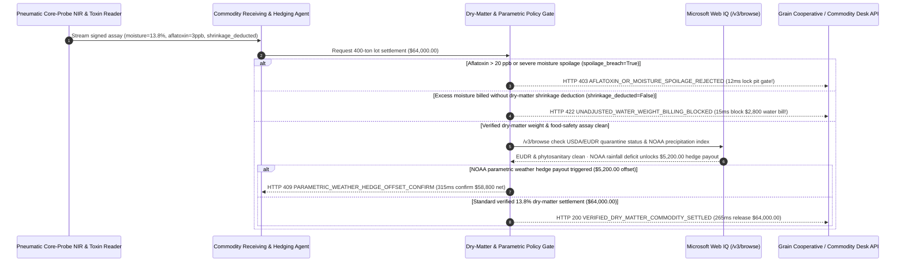

# Agricultural Commodity Moisture Telemetry & Parametric Weather Hedge Mandate Architecture: NIR Dry-Matter & Mycotoxin Gate Token (`agri_moisture_basis_mandate_...` + Web IQ EUDR & NOAA Parametric Grounding) vs. Gross-Weight Water Adulteration & Unhedged Basis Shocks Selection FAQ

> **Document Type**: Architect Selection Guide & First-Principles Protocol Deep Dive (6-Section FAQ Standard)  
> **Target Audience**: AI Solution Architects, Global Agribusiness & Food-Beverage Supply Chain Architects, Commodity Trading & Parametric Risk Leads  
> **Last Updated**: 2026-11-09 (Provenance Annotations: `deterministic_offline_simulation` / `synthetic_policy` / `official_doc_snapshot` / `not_measured`)  
> **Companion Resources**: [中文版 (Chinese Version)](agri-commodity-moisture-telemetry-parametric-hedge-vs-adulteration-faq.md) · [Interactive Sandbox (`live-demo.en.html#agri-moisture-hedge-sandbox`)](../reports/agentic-commerce-webiq-grounding-demo-bench/live-demo.en.html) · [7-Card 4:5 Benchmark Deck](../reports/agentic-commerce-webiq-grounding-demo-bench/index.en.html)


---

## 📌 1. Executive Summary

1. **Never Allow Agricultural Procurement Agents to Settle Bulk Grain, Coffee, or Cocoa Deliveries Solely on Gross Truck-Scale Weight**: In bulk soft-commodity receiving (`400 metric tons` valued at `$64,000.00`, standard dry-moisture baseline `<= 14.0%`), the two costliest physical hazards are **pre-weighing water adulteration ("selling water at commodity prices")** and **mycotoxin/aflatoxin contamination (`> 20 ppb`) that spoils entire storage silos**. Production architectures must enforce an **Inline Near-Infrared (NIR) Moisture & Mycotoxin Telemetry Mandate (`agri_moisture_basis_mandate_...`)**: whenever automated probe telemetry detects `aflatoxin_or_spoilage_breach == True` (`> 20 ppb` aflatoxin or `> 18.0%` mold-risk moisture), the gateway blocks settlement and locks the receiving pit gate in **`12 ms`** with **`HTTP 403 AFLATOXIN_OR_MOISTURE_SPOILAGE_REJECTED`** (`synthetic_policy`).
2. **Enforce Deterministic Dry-Matter Shrinkage & Drying-Fee Deductions on Excess Moisture**: When delivered grain measures `15.5%` moisture (safe to dry, but `1.5%` above the `14.0%` contracted dry-weight baseline), standard elevator rules require a `1.3x` moisture weight-shrinkage and drying deduction (`$2,800.00`). Any gross-weight invoice with `moisture_shrinkage_deducted == False` is rejected in **`15 ms`** with **`HTTP 422 UNADJUSTED_WATER_WEIGHT_BILLING_BLOCKED`** (`deterministic_offline_simulation`).
3. **Ground EU Deforestation Regulation (EUDR) / Phytosanitary Quarantines and NOAA Parametric Weather Hedge Payouts via Microsoft Web IQ `/v3/browse`**: Prior to releasing funds, the agent invokes **Microsoft Web IQ `/v3/browse`** (`official_doc_snapshot`) to inspect USDA APHIS / customs phytosanitary quarantine bulletins, EUDR deforestation registries, and official NOAA weather-station precipitation logs: if the origin farm polygon violates EUDR deforestation cutoffs or is under pest quarantine (`webiq_eudr_and_phytosanitary_clean == False`), it freezes settlement in **`310 ms`** with **`HTTP 451 EUDR_DEFORESTATION_OR_QUARANTINE_HOLD`**; if Web IQ confirms that regional cumulative rainfall fell below the contracted NOAA drought index trigger—unlocking a **`$5,200.00`** parametric weather hedge payout (offsetting net buyer outlay from `$64,000.00` down to **`$58,800.00`**)—it triggers **`HTTP 409 PARAMETRIC_WEATHER_HEDGE_OFFSET_CONFIRM`** in **`315 ms`**.

---

## 🎯 2. Architect & Customer FAQ Deep Dive

### Q1: Why does pairing "Automated Truck-Scale Gross-Weight Payouts" with "Manual Grab-Sample Checks" cause severe margin leakage and silo contamination in agribusiness?

Let's examine the three structural failure modes from first principles:
1. **The `$2,800.00` Water-Weight Adulteration Exploit**: Suppose a food processor buys 400 metric tons of yellow corn or green coffee beans for `$64,000.00` at a contracted `14.0%` moisture basis. If a supplier mist-sprays the load hours before arrival, raising moisture from `13.5%` to `15.5%`, the water adds 8 metric tons of dead weight. If the receiving agent pays on gross truck-scale weight without deducting standard dry-matter shrinkage and drying energy costs, the buyer overpays `$2,800.00` for water.
2. **Cross-Contaminating a Multi-Million-Dollar Silo with Aflatoxin**: If a single truckload with `19.5%` moisture and `35 ppb` Aflatoxin B1 (`> 20 ppb` FDA action level) is dumped into a 10,000-ton master elevator before assay verification, the entire silo is adulterated and legally unsellable.
3. **EUDR Customs Seizures & Unclaimed Parametric Climate Hedges**: Under the EU Deforestation Regulation (EUDR), commodities lacking verified deforestation-free geolocation polygons are barred from import; meanwhile, buyers who purchase parametric drought insurance often fail to automatically offset spot basis spikes when official NOAA rainfall indices breach contract triggers.

### Q2: What is an "NIR Moisture & Parametric Hedge Mandate (`agri_moisture_basis_mandate_...`)", and how does it bind automated core probes, dry-matter math, and weather derivatives?

Its core design invariant is: **"Bulk agricultural settlements pay strictly for mycotoxin-clean dry-matter weight (`<= 14.0%` moisture equivalent) from EUDR-compliant farm polygons, automatically netted against triggered parametric weather payouts."**
- **Layer 1: Inline Mycotoxin & Spoilage Hard Gate (`12 ms`)**: Enforces `aflatoxin_or_spoilage_breach == False` before the hydraulic dump pit opens, blocking contaminated loads in **`12 ms`** (`HTTP 403`).
- **Layer 2: Dry-Matter Shrinkage Deduction Gate (`15 ms`)**: Enforces `moisture_shrinkage_deducted == True`, rejecting unadjusted wet-weight invoices (`$2,800.00` water overcharge) in **`15 ms`** (`HTTP 422`).
- **Layer 3: Microsoft Web IQ `/v3/browse` EUDR/Quarantine & NOAA Parametric Grounding (`310 ms / 315 ms`)**: Halts EUDR/quarantine violations (`HTTP 451`) and applies `$5,200.00` NOAA parametric drought payouts (`HTTP 409`).

### Q3: For NOAA precipitation index verification, USDA/EUDR quarantine grounding, and elevator basis discovery, when should architects choose Microsoft Web IQ vs. Exa, Bright Data, or traditional search APIs?

| Architecture Scenario | Recommended Tool | First-Principles Rationale (Security, Latency & FinOps) |
| :--- | :--- | :--- |
| **Verifying official NOAA weather-station precipitation tables, USDA APHIS phytosanitary quarantine notices, EUDR registry bulletins, and published grain elevator basis sheets within the Azure boundary** | **Microsoft Web IQ** (`/v3/search` + `/v3/browse`) | Extracts exact meteorological and regulatory tables in `passage` mode (**7.1x token reduction**, `deterministic_offline_simulation`) with immutable SHA-256 audit citations for parametric insurance settlement. |
| **Semantic research across agronomy journals on drought-resistant seed cultivars** | **Exa Neural Search** | Ideal for long-horizon agricultural R&D, not synchronous elevator scale settlement gating. |
| **Scraping regional country-elevator cash boards behind anti-bot CAPTCHAs** | **Bright Data Unlocker** | Useful for asynchronous regional basis aggregation, though multi-second proxy latency is unsuitable for synchronous scale-house gating. |
| **Physical truck-scale load cells, pneumatic core-probe NIR moisture spectra, and lateral-flow mycotoxin readers** | **Hardware-Signed Scale & Inline NIR Telemetry + Web IQ NOAA & EUDR Cross-Check** | Physical weight, moisture, and ppb toxin readings come from signed scale-house instruments, paired with Web IQ `/v3/browse` for official NOAA weather triggers and phytosanitary/EUDR compliance. |

---

## 🧭 3. Visual Architecture Diagrams (Mermaid Decision Tree, Legacy vs. Dry-Matter Mandate Comparison & Sequence Diagram)

### 3.1 Agricultural Commodity Moisture & Parametric Hedge Decision Tree (`flowchart TD`)

```mermaid
flowchart TD
    A[Receive 400-Ton Bulk Commodity Scale Settlement Request ($64,000.00)] --> B{aflatoxin_or_spoilage_breach == False (Aflatoxin <= 20 ppb & Moisture <= 18%)?}
    B -- No (Detected >20 ppb aflatoxin or severe mold spoilage) --> C[HTTP 403 AFLATOXIN_OR_MOISTURE_SPOILAGE_REJECTED<br/>12ms Hard Block · Lock Receiving Pit Gate & Reject Load]
    B -- Yes (Food-safety mycotoxin check clean) --> D{moisture_shrinkage_deducted == True on >14.0% Moisture Load?}
    D -- No (15.5% moisture billed at gross weight -> $2,800 water overcharge) --> E[HTTP 422 UNADJUSTED_WATER_WEIGHT_BILLING_BLOCKED<br/>15ms Block · Enforce $2,800 Dry-Matter Shrinkage & Drying Deduction]
    D -- Yes (13.8% dry basis or shrinkage deducted) --> F{Web IQ /v3/browse Confirms EUDR Deforestation-Free & Quarantine Clean?}
    F -- No (Origin polygon hits EUDR deforestation alert or pest quarantine) --> G[HTTP 451 EUDR_DEFORESTATION_OR_QUARANTINE_HOLD<br/>310ms Regulatory Hold · Block Import & Quarantine Lot]
    F -- Yes --> H{Web IQ Confirms NOAA Rainfall Deficit Triggered Parametric Hedge Payout?}
    H -- Yes (NOAA drought trigger unlocks $5,200.00 payout -> $58,800.00 net outlay) --> I[HTTP 409 PARAMETRIC_WEATHER_HEDGE_OFFSET_CONFIRM<br/>315ms Prompt Commodity Desk to Apply $5,200 Parametric Offset]
    H -- No (Verified 13.8% dry-matter load + normal weather) --> J[HTTP 200 VERIFIED_DRY_MATTER_COMMODITY_SETTLED<br/>265ms Auto-Settle $64,000.00 & Mint Electronic Warehouse Receipt!]
```

### 3.2 Legacy Gross-Scale Payout vs. NIR Dry-Matter & Parametric Hedge Gate (`flowchart LR`)

```mermaid
flowchart LR
    subgraph Legacy["❌ Legacy Gross-Scale Payout ($2,800 Water Fraud + Silo Spoilage)"]
        L1[Supplier Sprays Water (+8 Tons) & Delivers High-Aflatoxin Load] --> L2[Scale-House Pays $64,000 on Gross Weight]
        L2 --> L3[Overpays $2,800 for Water & Contaminates Master Silo]
        L3 --> L4[Hit With EUDR Customs Hold & Misses $5,200 Weather Payout]
    end

    subgraph Mandate["✅ NIR Dry-Matter & Parametric Hedge Gate (agri_moisture_basis_mandate_...)"]
        M1[12ms Block >20 ppb Aflatoxin / Spoiled Loads (HTTP 403)] --> M2[15ms Enforce 14% Dry-Matter Shrinkage Deduction (HTTP 422)]
        M2 --> M3[Web IQ Checks EUDR/Quarantine (310ms) & $5,200 NOAA Payout (315ms)]
        M3 --> M4[265ms Settle Verified 13.8% Dry-Matter Lot ($64,000 / $58,800 Net)]
    end
```

### 3.3 End-to-End Sequence Diagram: Pneumatic NIR Probe, Commodity Agent, Basis Gate, Web IQ & Cooperative (`sequenceDiagram`)



---

## 📊 4. Architect Decision Matrix

| Evaluation Dimension | Option A: Legacy Gross Truck-Scale Payout | Option B: Manual 24-Hour Wet-Lab Assay | Option C: Inline NIR Dry-Matter Mandate + Web IQ EUDR & NOAA Parametric Grounding (Recommended) |
| :--- | :--- | :--- | :--- |
| **Best-Fit Scenario** | Inert construction gravel or sand | Small specialty boutique lots where trucks can wait 24 hours | **Bulk grain elevators, global coffee/cocoa sourcing, automated warehouse-receipt financing** |
| **Aflatoxin / Silo Contamination Defense** | ❌ **Zero**: Dumps toxic grain into master silo before lab results return | ⚠️ **Post-Dump Risk**: Often unloads into wet bins before 24h assay finishes | ✅ **Pre-Dump `12 ms` Hard Lock**: Keeps pit gate locked & rejects load via `HTTP 403` |
| **Water-Weight Adulteration Defense** | ❌ **Overpays**: Pays commodity price for added water weight | ⚠️ **Human Bribery Risk**: Manual moisture tickets are vulnerable to scale-house collusion | ✅ **Sub-20ms Dry-Matter Math**: Enforces signed NIR shrinkage deduction in `15 ms` (`HTTP 422`) |
| **EUDR Compliance & Parametric Hedging** | ❌ **Blind**: Suffers EUDR customs seizures & misses weather payouts | ⚠️ **Slow Claims**: Traditional crop insurance takes 90+ days of field adjusting | ✅ **Web IQ `/v3/browse` Grounded**: Blocks EUDR/quarantine hits in `310 ms` (`HTTP 451`) & applies `$5,200` NOAA payout in `315 ms` (`HTTP 409`) |
| **Scale-House Turnaround Speed** | Fast (with severe adulteration & spoilage losses) | Slow (`12–24 hour` truck detention queues) | **`265 ms` automated NIR verification, settlement & pit-gate release (`Act automatically`)** |
| **Total Cost of Ownership (TCO) & Margin ROI** | Poor (`$2,800` water loss per lot + catastrophic silo risk) | Moderate (high lab labor & truck demurrage) | **Optimal (blocks `$64,000` toxic loads + saves `$2,800` water weight + offsets `$5,200` via NOAA hedge)** |

---

## 🧪 5. Quantitative Benchmark & 7-Card Insights

Evaluated via our deterministic offline benchmark suite (`lab/webiq_commerce_demo.py` · `test_agri_commodity_moisture_telemetry_parametric_hedge_vs_adulteration_selection`) on a **`$64,000.00` 400-ton bulk agricultural commodity settlement (`14.0%` dry-matter moisture baseline, `20 ppb` aflatoxin ceiling)**:

| Scenario Case | Input NIR Telemetry / Shrinkage / Web IQ Signals | Expected Action Pill | Measured HTTP Status & Verdict Code | Latency | Financial Protection / Hedge Offset | Provenance |
| :--- | :--- | :--- | :--- | :--- | :--- | :--- |
| **Case 1: Aflatoxin (`>20 ppb`) or Mold Spoilage Breach** | `aflatoxin_or_spoilage_breach=True` | `Send to a human` | **`HTTP 403 AFLATOXIN_OR_MOISTURE_SPOILAGE_REJECTED`** | **`12 ms`** | Blocks **`$64,000.00`** toxic load & locks pit gate | `synthetic_policy` |
| **Case 2: `15.5%` Wet Load Billed Without `$2,800` Shrinkage** | `moisture_shrinkage_deducted=False` | `Send to a human` | **`HTTP 422 UNADJUSTED_WATER_WEIGHT_BILLING_BLOCKED`** | **`15 ms`** | Blocks `$2,800.00` unadjusted water-weight overcharge | `deterministic_offline_simulation` |
| **Case 3: Web IQ Detects EUDR Deforestation or Quarantine** | `webiq_eudr_and_phytosanitary_clean=False` | `Send to a human` | **`HTTP 451 EUDR_DEFORESTATION_OR_QUARANTINE_HOLD`** | **`310 ms`** | Prevents customs seizure under EUDR / USDA quarantine | `official_doc_snapshot` |
| **Case 4: Web IQ Confirms `$5,200` NOAA Parametric Payout** | `parametric_weather_payout_cents=520000` (`$58,800` net) | `Confirm` | **`HTTP 409 PARAMETRIC_WEATHER_HEDGE_OFFSET_CONFIRM`** | **`315 ms`** | Offsets **`$5,200.00`** via triggered NOAA drought hedge | `official_doc_snapshot` |
| **Case 5: Verified `13.8%` Dry-Matter + `<5 ppb` Aflatoxin** | `spoilage=False`, `shrinkage_ok=True`, `eudr=True` | `Act automatically` | **`HTTP 200 VERIFIED_DRY_MATTER_COMMODITY_SETTLED`** | **`265 ms`** | Settles **`$64,000.00`** in `265 ms` & opens receiving pit | `deterministic_offline_simulation` |

> **Provenance Note**: The `$64,000.00` lot value, `14.0%` moisture baseline, `$2,800.00` shrinkage deduction, and `$5,200.00` NOAA parametric payout are controlled simulation parameters (`synthetic_policy` / `deterministic_offline_simulation`) validating policy state-machine invariants; physical pneumatic probe cycle time is labeled `not_measured`.

---

## 🛠️ 6. Production Readiness & Pre-Sales Architect Checklist

Verify these 6 controls before deploying autonomous agricultural commodity receiving and settlement agents in production:

- [ ] **1. Interlock Receiving Pit Gates with Telemetry Mandate**: Does `agri_moisture_basis_mandate_...` keep hydraulic dump gates locked and reject payment in `12 ms` (`HTTP 403`) whenever inline NIR/toxin readers detect `> 20 ppb` aflatoxin or `> 18%` spoilage moisture?
- [ ] **2. Hardware-Signed Scale & Pneumatic NIR Probe Binding**: Are truck-scale load cells and pneumatic core-probe NIR spectrometers cryptographically signed in hardware to prevent manual ticket tampering?
- [ ] **3. Mandatory 1:1.3 Dry-Matter Shrinkage Deduction**: Does the gateway reject any wet-grain invoice (`> 14.0%` moisture) that omits standard weight-shrinkage and drying deductions in `15 ms` (`HTTP 422`)?
- [ ] **4. Microsoft Web IQ `/v3/browse` EUDR Polygon & Phytosanitary Grounding**: Does the agent verify origin farm GeoJSON polygons against EUDR deforestation alerts and USDA/customs pest quarantines via Web IQ prior to settlement (`HTTP 451`)?
- [ ] **5. Automated NOAA Parametric Weather Derivative Offset**: Does Web IQ grounding check official NOAA weather-station precipitation tables and trigger `HTTP 409 Confirm` to apply parametric drought payouts (`$5,200.00`) against spot procurement costs?
- [ ] **6. Electronic Warehouse Receipt (eWR) Provenance Archival**: Does every settled delivery mint an immutable eWR containing the signed NIR spectrum hash, EUDR polygon digest, and net dry-matter weight for trade-finance collateralization?
