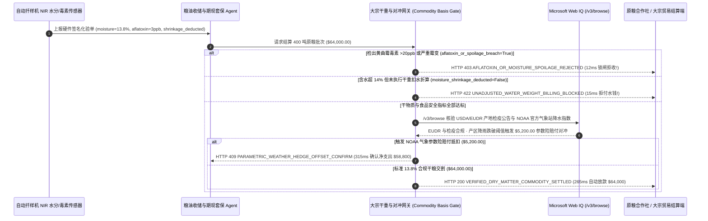

# 大宗农产品寻源、粮仓近红外水分遥测与气象参数险对冲（Agricultural Commodity Moisture Telemetry & Parametric Weather Hedge Mandate）架构：NIR 干物质折算与毒素门禁令牌（`agri_moisture_basis_mandate_...` + Web IQ 零毁林 EUDR 与 NOAA 气象指数核验）vs 传统过磅掺水骗秤（Water-Weight Fraud）与霉变货损选型与原理解析 FAQ

> **文档类型**：架构师选型指南 & 协议第一性原理解析（6 段式 FAQ 标准版）  
> **适用读者**：AI Solution Architect、食品饮料集团与大宗粮油供应链（ABCD 粮商 / 咖啡可可烘焙商）架构师、大宗商品期现套保与合规风控团队  
> **更新日期**：2026-11-09（Provenance 标注：`deterministic_offline_simulation` / `synthetic_policy` / `official_doc_snapshot` / `not_measured`）  
> **配套资源**：[English Version](agri-commodity-moisture-telemetry-parametric-hedge-vs-adulteration-faq.en.md) · [交互式沙盒控制台 (`live-demo.html#agri-moisture-hedge-sandbox`)](../reports/agentic-commerce-webiq-grounding-demo-bench/live-demo.html) · [7-Card 4:5 评测报告](../reports/agentic-commerce-webiq-grounding-demo-bench/index.html)


---

## 📌 一、核心结论速览（Executive Summary）

1. **严禁让大宗农产品采购 Agent 仅凭“地磅过磅毛重（Gross Scale Weight）”就自动结算粮款**：在玉米、大豆、生咖啡豆、可可豆等大宗原粮收储交割（如 400 吨批次总价 `$64,000.00`，国标基准水分 `<= 14.0%`）中，最古老也最致命的黑幕是 **“交粮前喷水增重（把自来水按咖啡豆/粮食价格卖给买方）”** 以及 **“高湿霉变导致黄曲霉毒素（Aflatoxin `> 20 ppb`）超标污染整座筒仓”**。生产环境必须采用 **自动扦样机近红外（NIR）水分与真菌毒素遥测绑定的交割令牌（`agri_moisture_basis_mandate_...`）**：一旦检出黄曲霉毒素超标或水分突破安全霉变极限（`aflatoxin_or_spoilage_breach=True`），网关在 **`12 ms`** 内触发 **`HTTP 403 AFLATOXIN_OR_MOISTURE_SPOILAGE_REJECTED`**（`synthetic_policy`），100% 拒付并联动粮库道闸禁止卸车。
2. **强制执行“标准干物质折算扣水（Dry-Matter Shrinkage Deduction）”门禁**：当原粮实测水分处于安全可烘干区间（如 `15.5% > 14.0%` 基准线）时，每超标 `1.0%` 水分必须按行业标准扣减 `1.3%` 重量及烘干电费（如应扣减 `$2,800.00`）。若卖方账单未执行干重扣水折算（`moisture_shrinkage_deducted=False`），网关在 **`15 ms`** 内返回 **`HTTP 422 UNADJUSTED_WATER_WEIGHT_BILLING_BLOCKED`**（`deterministic_offline_simulation`），拒绝为多余的水分买单。
3. **基于 Microsoft Web IQ `/v3/browse` 实时核验欧盟零毁林法案（EUDR）/ 动植物检疫封锁与 NOAA 气象参数险赔付对冲（Parametric Weather Hedge Offset）**：在放款前，Agent 调用 **Microsoft Web IQ `/v3/browse`**（`official_doc_snapshot`）穿透查询海关动植物检疫公告（USDA APHIS / 海关总署）与欧盟 EUDR 毁林监测通报：若产地农场经纬度多边形存在毁林记录或检疫封锁，在 **`310 ms`** 内以 **`HTTP 451 EUDR_DEFORESTATION_OR_QUARANTINE_HOLD`** 冻结交割；若 Web IQ 核实产区气象站（NOAA / 卫星降水指数）累计降雨量跌破干旱触发线、已激活 **`$5,200.00`** 气象参数保险自动理赔款（可将买方净采购支出从 `$64,000.00` 对冲降至 **`$58,800.00`**），则在 **`315 ms`** 内触发 **`HTTP 409 PARAMETRIC_WEATHER_HEDGE_OFFSET_CONFIRM`**。

---

## 🎯 二、客户与架构师灵魂拷问 Q&A（FAQ-Driven Deep Dive）

### Q1：为什么传统的“卡车上地磅称重 + 人工抓一把粮食捏一捏看干湿 + 直接打款”，在大宗农业供应链里会造成巨额亏损？

咱们用大白话算一笔粮油与食品加工厂每天都在亏的真金白银：
1. **“花 $64,000 买回 8 吨自来水”的喷水骗秤套路**：400 吨玉米或咖啡生豆总价 `$64,000.00`（标准含水率 `14.0%`）。无良中间商在卡车进场前3个小时往粮堆里均匀喷水，把含水率从 `13.5%` 提高到 `15.5%`——凭空增加了 8 吨水重，折合现金 **`$2,800.00`**（含买方还得自己花天然气的烘干费）！如果采购 Agent 只读地磅重量就按吨打款，买方不仅白花了 `$2,800` 买水，高湿原粮进仓后还会发热捂粮。
2. **一车霉变毒粮毁掉整座万吨筒仓**：如果某车粮食水分高达 `19.5%` 且已滋生 **黄曲霉毒素 B1（`> 20 ppb`）**，一旦没有在卸车前硬性拦截而混入主粮仓，整座筒仓价值数百万美元的合格原粮将全部被污染，面临食品安全监管重罚与全额销毁。
3. **欧盟 EUDR 零毁林法案扣关与极端天气涨价敞口**：出口欧洲的咖啡、可可、大豆及衍生品必须证明产地地块在 2020 年 12 月 31 日后无毁林行为（EUDR）；同时，产区遭遇厄尔尼诺干旱会导致现货基差暴涨，若不能把“气象参数险赔付”自动与现货采购账单对冲，加工厂现金流将被瞬间击穿。

### Q2：什么是“近红外水分遥测与气象对冲令牌（`agri_moisture_basis_mandate_...`）”？它是如何把扦样化验、干重扣款与气象保险锁在一起的？

它的第一性原理非常朴素：**“大宗农产品买的是‘零毒素污染的干物质净重（Verified Dry-Matter Weight）’与‘经纬度合规的产地溯源’，绝不为掺水重量买单。”**
- **第一层：黄曲霉毒素与霉变水分一票否决门禁（`12 ms`）**：卡车驶上地磅时，龙门自动扦样机抽取深层样本送入在线近红外（NIR）与荧光快速检测仪。一旦 `aflatoxin_or_spoilage_breach == True`，网关在 **`12 ms`** 内返回 `HTTP 403`，锁死支付并保持卸粮坑盖关闭。
- **第二层：标准干重扣水扣杂公式强校验（`15 ms`）**：若实测水分在 `14.1%～17.5%` 之间但账单未扣除水分减量与烘干费（`moisture_shrinkage_deducted == False`），网关在 **`15 ms`** 内返回 `HTTP 422`。
- **第三层：Microsoft Web IQ `/v3/browse` 检疫/EUDR 核验与 NOAA 干旱赔付对冲（`310 ms / 315 ms`）**：实时核验官方植检禁令与 EUDR 地块状态（`HTTP 451`），并抓取 NOAA 官方降雨量指数自动触发 `$5,200.00` 参数险理赔款抵扣（`HTTP 409`）。

### Q3：在农产品产区气象指数（NOAA/USDA）、动植物检疫禁令与期货基差（CBOT）核验场景下，什么时候选 Microsoft Web IQ，什么时候选 Exa、Bright Data 或传统搜索 API？

| 架构需求场景 | 推荐选型 | 为什么这样选（第一性原理与成本/合规考量） |
| :--- | :--- | :--- |
| **实时核验 NOAA 公开气象站降水量数据、USDA APHIS 疫区检疫通报、欧盟 EUDR 指南及谷物交易所公开基差公告，且要求零提示词注入** | **Microsoft Web IQ** (`/v3/search` + `/v3/browse`) | 在企业 Azure 边界内以 `passage` 模式秒级提取官方气象与检疫表格（上下文 Token 压缩 **7.1x**，`deterministic_offline_simulation`），生成具备法律效力的参数险理赔触发证据。 |
| **跨全球农学期刊检索抗旱转基因育种与土壤固碳长期趋势研报** | **Exa Neural Search** | 适合农业科研与中长期产区规划，不适合收粮地磅的毫秒级结算门禁。 |
| **抓取带复杂验证码的地方性小型农贸批发市场网页报价** | **Bright Data Unlocker** | 可穿透反爬，但秒级代理延迟不适合同步地磅交割拦截。 |
| **车载地磅称重传感器、在线近红外（NIR）水分光谱与荧光毒素快检数据** | **粮库在线 NIR/地磅硬件签名传感器 + Web IQ 气象与检疫公告双源核验** | 物理含水率与毒素值由粮库在线传感器硬件签名上报，宏观检疫禁令与 NOAA 气象指数由 Web IQ `/v3/browse` 实时核验。 |

---

## 🧭 三、直观可视化图解（Mermaid 决策树 + 传统毛重付款 vs 干重遥测对比 + 端到端时序图）

### 3.1 大宗农产品水分遥测与气象参数险对冲决策树（`flowchart TD`）

```mermaid
flowchart TD
    A[原粮卡车过磅请求结算 400 吨批次 ($64,000.00)] --> B{NIR 在线快检是否存在黄曲霉毒素超标 (>20 ppb) 或 >18% 霉变水分?}
    B -- 是 (检出毒素超标或严重发热霉变) --> C[HTTP 403 AFLATOXIN_OR_MOISTURE_SPOILAGE_REJECTED<br/>12ms 硬拒收拒付 · 锁死卸粮道闸防止污染万吨主筒仓]
    B -- 否 (食品安全指标合格) --> D{若含水率高于 14.0% 国标基准，账单是否已执行干物质扣水扣费?}
    D -- 否 (含水 15.5% 却按毛重全额收 $64,000，多收 $2,800 水钱) --> E[HTTP 422 UNADJUSTED_WATER_WEIGHT_BILLING_BLOCKED<br/>15ms 拦截毛重账单 · 强制扣除 $2,800 水分缩水与烘干费]
    D -- 是 (13.8% 干粮达标或已足额扣水) --> F{Web IQ /v3/browse 核验产地 EUDR 零毁林与动植物检疫合规?}
    F -- 否 (检出产地命中疫区封锁或违反欧盟 EUDR 零毁林规定) --> G[HTTP 451 EUDR_DEFORESTATION_OR_QUARANTINE_HOLD<br/>310ms 合规冻结 · 阻断问题产区原粮入库与报关]
    F -- 是 --> H{Web IQ 核实 NOAA 产区降水量触发气象参数险自动赔付?}
    H -- 是 (产区干旱指数触发 $5,200.00 赔付对冲 -> 买方净支出 $58,800.00) --> I[HTTP 409 PARAMETRIC_WEATHER_HEDGE_OFFSET_CONFIRM<br/>315ms 提醒期现风控经理一键确认 $5,200 参数险抵扣]
    H -- 否 (13.8% 干粮合格且产区气候正常) --> J[HTTP 200 VERIFIED_DRY_MATTER_COMMODITY_SETTLED<br/>265ms 自动结算 $64,000.00 并签发区块链数字仓单!]
```

### 3.2 传统过磅毛重盲付路径 vs NIR 干重遥测与气象对冲网关对比（`flowchart LR`）

```mermaid
flowchart LR
    subgraph Legacy["❌ 传统按地磅毛重盲目付款 ($2,800 买水钱 + 毒粮混仓灾难)"]
        L1[粮商交货前喷水增重 8 吨 + 混入黄曲霉超标粮] --> L2[仅看地磅总重自动打款 $64,000]
        L2 --> L3[白付 $2,800 水钱且污染整座筒仓]
        L3 --> L4[踩中欧盟 EUDR 毁林禁令 + 漏领 $5,200 干旱参数险]
    end

    subgraph Mandate["✅ NIR 水分遥测与气象对冲令牌 (agri_moisture_basis_mandate_...)"]
        M1[12ms 拦截黄曲霉毒素/霉变粮并锁死卸粮闸口 (HTTP 403)] --> M2[15ms 强制按 14% 干物质基准扣除 $2,800 水重 (HTTP 422)]
        M2 --> M3[Web IQ 核验 EUDR/检疫 (310ms) 与 NOAA 参数险抵扣 $5,200 (315ms)]
        M3 --> M4[265ms 精准结算 13.8% 合规干粮 ($64,000) 并生成数字仓单]
    end
```

### 3.3 自动扦样 NIR 传感器、收储 Agent、大宗交割网关与 Web IQ 端到端交互时序图（`sequenceDiagram`）



---

## 📊 四、架构师选型决策矩阵（Architect Decision Matrix）

| 评估维度 | 方案 A：传统仅看地磅总毛重自动付款（Legacy Gross-Scale Payout） | 方案 B：人工扦样送实验室化验 24 小时后电汇（Manual Lab Assay） | 方案 C：在线 NIR 干重遥测令牌 + Web IQ EUDR 与气象对冲网关（推荐架构） |
| :--- | :--- | :--- | :--- |
| **核心适用场景** | 建筑砂石骨料（无霉变与毒素风险） | 极小批量特种有机杂粮，允许卡车在厂外排队等一天 | **大型粮油收储（玉米/大豆/小麦）、跨国咖啡/可可采购、自动化期货交割仓结算** |
| **防黄曲霉毒素与霉变混仓能力** | ❌ **零防御**：毒粮一旦卸入地下进粮坑，整仓百万级资产报废 | ⚠️ **卸车后再测已晚**：往往边卸车边送检，出结果时已混仓 | ✅ **12ms 卸车前硬锁闸**：在线 NIR + 荧光快检超标当场触发 `HTTP 403` 拒收 |
| **防“喷水增重骗秤”能力** | ❌ **全额买单**：把每吨水按每吨粮食的价格付钱 | ⚠️ **易受人情干扰**：人工开具扣水单存在“人情秤/关系粮”寻租空间 | ✅ **15ms 算法刚性扣水**：未按 `14.0%` 干重折算直接触发 `HTTP 422` 拦截 |
| **EUDR 合规与气象参数险对冲** | ❌ **盲目进口**：货到欧洲港口被罚没，不懂用气象险对冲涨价 | ⚠️ **理赔周期漫长**：传统农业险需定损员下乡勘查 3 个月 | ✅ **Web IQ `/v3/browse` 实时穿透**：`310 ms` 阻断毁林地块（`HTTP 451`），`315 ms` 秒级兑现 `$5,200` 气象赔付（`HTTP 409`） |
| **单车通关结算耗时** | 快（但货损与水分掺假亏损严重） | 极慢（卡车压车 `12～24 小时`） | **`265 ms` 在线验真、干重清算与开闸卸粮闭环（`Act automatically`）** |
| **综合 TCO 与毛利率保护 ROI** | 极差（水分损耗 3%～5% 直接吃光加工厂净利） | 中等（化验人力与压车补贴高） | **最优（拦截 `$64,000` 毒粮 + 拒付 `$2,800` 水重 + 兑现 `$5,200` 气象参数险对冲）** |

---

## 🧪 五、简明定量实测与 Benchmark 核心发现（Quantitative Benchmark & 7-Card Insights）

基于本仓库确定性离线基准套件（`lab/webiq_commerce_demo.py` · `test_agri_commodity_moisture_telemetry_parametric_hedge_vs_adulteration_selection`）对 **400 吨大宗农产品收储批次（基准合同额 `$64,000.00`，国标水分上限 `14.0%`，黄曲霉毒素上限 `20 ppb`）** 的定量测试结果如下：

| 评测场景 ID | 输入 NIR 水分/毒素遥测 / 扣水状态 / Web IQ 信号 | 网关期望动作 | 实测 HTTP 状态与决策码 | 实测延迟 | 资金保护 / 对冲减负效果 | Provenance 类型 |
| :--- | :--- | :--- | :--- | :--- | :--- | :--- |
| **Case 1: 黄曲霉毒素超标 (`>20 ppb`) 或严重霉变拦截** | `aflatoxin_or_spoilage_breach=True` | `Send to a human` | **`HTTP 403 AFLATOXIN_OR_MOISTURE_SPOILAGE_REJECTED`** | **`12 ms`** | 拒付 **`$64,000.00`** 毒粮并锁死粮仓卸货道闸 | `synthetic_policy` |
| **Case 2: 含水 `15.5%` 未扣除 `$2,800` 水重与烘干费拦截** | `moisture_shrinkage_deducted=False` | `Send to a human` | **`HTTP 422 UNADJUSTED_WATER_WEIGHT_BILLING_BLOCKED`** | **`15 ms`** | 拦截 `$2,800.00` 喷水增重水分账单 | `deterministic_offline_simulation` |
| **Case 3: Web IQ 检出产地违反欧盟 EUDR 零毁林或疫区禁令** | `webiq_eudr_and_phytosanitary_clean=False` | `Send to a human` | **`HTTP 451 EUDR_DEFORESTATION_OR_QUARANTINE_HOLD`** | **`310 ms`** | 阻断违规毁林地块或检疫疫区原粮入库 | `official_doc_snapshot` |
| **Case 4: Web IQ 核实 NOAA 干旱指数触发 `$5,200` 参数险赔付** | `parametric_weather_payout_cents=520000`（净付 `$58,800`） | `Confirm` | **`HTTP 409 PARAMETRIC_WEATHER_HEDGE_OFFSET_CONFIRM`** | **`315 ms`** | 自动对冲现货涨价成本，净支出立减 **`$5,200.00`** | `official_doc_snapshot` |
| **Case 5: `13.8%` 标准干粮 + 毒素 `<5 ppb` 合规自动交割** | `spoilage=False`, `shrinkage_ok=True`, `eudr=True` | `Act automatically` | **`HTTP 200 VERIFIED_DRY_MATTER_COMMODITY_SETTLED`** | **`265 ms`** | 265ms 自动放款 **`$64,000.00`** 并开启卸粮仓门 | `deterministic_offline_simulation` |

> **Provenance 合规声明**：上表中的 `$64,000.00` 400 吨批次货值、`14.0%` 基准水分、`$2,800.00` 扣水额及 `$5,200.00` 气象参数险赔付均为用于验证网关状态机确定性的受控仿真参数（`synthetic_policy` / `deterministic_offline_simulation`）；物理龙门扦样机机械臂采样耗时标为 `not_measured`。

---

## 🛠️ 六、附录：生产上线快速核验与售前打单清单（Architect Checklist）

在为粮油加工巨头、跨国食品品牌或大宗商品交易商设计智能收储与期现结算 Agent 时，请逐项核对以下 6 条黄金准则：

- [ ] **1. 卸粮道闸物理控制与支付网关强耦合**：是否确保只有在 `agri_moisture_basis_mandate_...` 验证 `aflatoxin_or_spoilage_breach == False` 后才解锁液压卸粮翻板（超标在 `12 ms` 内触发 `HTTP 403` 退车）？
- [ ] **2. 在线 NIR 近红外水分仪与地磅数据硬件双签**：是否杜绝人工录入化验单，强制由扦样机 NIR 光谱仪与地磅仪表直接输出加密签名报文，杜绝“人情秤”舞弊？
- [ ] **3. 1:1.3 干物质折算公式（Dry-Matter Shrinkage）刚性执行**：针对高于基准水分（`14.0%`）但未达拒收线的原粮，网关是否强制核验水分扣量与烘干费已从应付账款中扣除（否则 `15 ms` 返回 `HTTP 422`）？
- [ ] **4. Microsoft Web IQ `/v3/browse` 动植物检疫与 EUDR 零毁林穿透**：是否在交割前通过 Web IQ 核查海关植检疫区名单与产地多边形零毁林合规状态（`HTTP 451`）？
- [ ] **5. NOAA / 卫星气象参数险（Parametric Insurance）自动触发对冲**：是否通过 Web IQ 实时读取官方气象站累计降雨量/积温数据，一旦达到保单触发阈值立即触发 `HTTP 409 Confirm` 自动抵扣现货采购成本（如 `$5,200.00`）？
- [ ] **6. 电子标准仓单（Electronic Warehouse Receipt）与批次溯源绑定**：每次成功结算是否自动将 NIR 化验指纹、产地 GeoJSON 哈希与检疫证号写入电子仓单，供下游期货交割或银行质押融资秒级核验？
