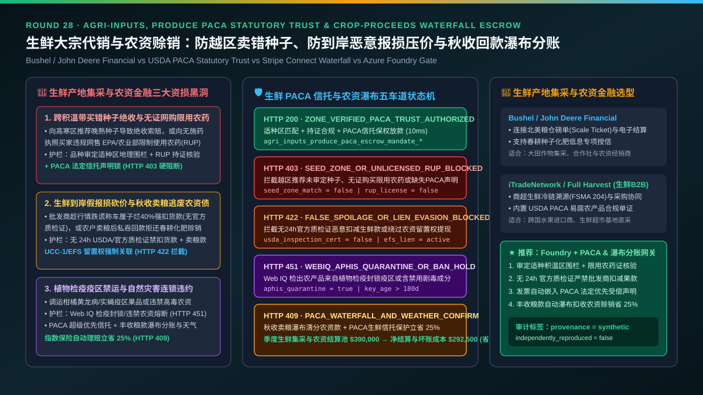
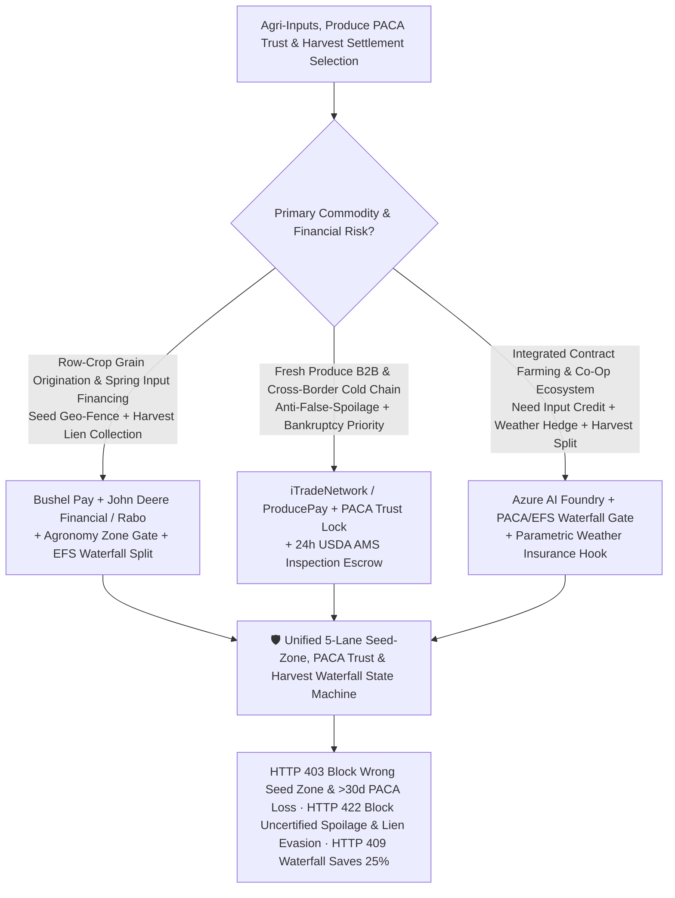
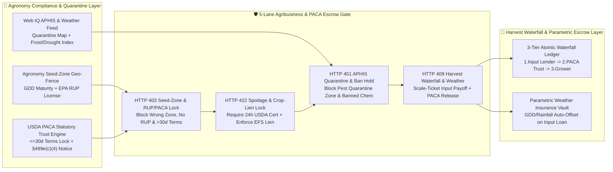

# Agri-Inputs, Produce `PACA` Statutory Trust & Crop-Proceeds Waterfall (`Bushel / John Deere Financial / iTradeNetwork / ProducePay`) Seed-Zone Geo-Fence, Anti-False-Spoilage & `UCC-1 / EFS` Lien Agent Architecture Selection FAQ

> **Language / 语言切换**: **[中文](agri-inputs-produce-paca-trust-crop-proceeds-escrow-agent-selection-faq.md)** | **English (Current)** | **[Back to Docs Index](index.en.md)** | **[Interactive Sandbox (`#agri-inputs-produce-paca-escrow-sandbox`)](../live-demo.en.html)**



---

## 📌 1. Executive Summary

In B2B fresh produce procurement, grain origination, and crop-input financing (`Bushel`, `John Deere Financial`, `Rabo AgriFinance`, `iTradeNetwork`, `ProducePay`), seasonal working capital and perishable shipments routinely span **`$50,000–$500,000+` per grower or load**. Allowing an agricultural commerce or trade-finance agent to process seed/chemical orders, extend input credit, or approve produce invoice deductions using generic B2B templates triggers three catastrophic losses:
1. **Cross-Zone Seed Crop Failure Liability, Unlicensed `EPA RUP` Agrochemical Sales & Forfeiture of `USDA PACA` Super-Priority Trust Rights**: Recommending a late-maturity corn or soybean seed variety (`Relative Maturity / Growing Degree Days`) outside the grower's certified **USDA Hardiness / Agronomy Zone** causes total crop failure and multi-million-dollar negligence claims; selling **EPA Restricted Use Pesticides (`RUP`)** without verifying the buyer's active state **Certified Applicator License** violates federal FIFRA law. Meanwhile, in fresh produce B2B trade, if an agent agrees to payment terms exceeding **`30 days`** (e.g., `Net 45`) or omits the statutory **`USDA PACA Trust` (`7 U.S.C. §499e(c)(4)`)** legend on EDI 810 invoices, the grower **permanently forfeits their federal PACA super-priority trust protection** ahead of secured bank lenders if the buyer/distributor files for bankruptcy!
2. **False Produce Spoilage Deductions ("Market-Decline Dumping") & Evaded `UCC-1 / EFS` Crop-Input Liens at Harvest**: When wholesale berry or avocado spot prices drop `25%` while a truck is in transit, unscrupulous receivers send smartphone photos claiming "35% arrival rot" to demand a `$35,000` price cut—without ordering an official **USDA AMS Federal-State Inspection within 24 hours**. And in crop-input financing, growers who financed `$80,000` of spring seed and fertilizer on credit may sell autumn grain to an out-of-county elevator and pocket 100% of the cash if **`UCC-1 / Effective Financing Statement (EFS)`** crop liens are not enforced at settlement.
3. **`USDA APHIS` Plant Quarantine Breaches & Banned Agrochemical Holds**: Shipping fresh citrus or stone fruit out of an active **USDA APHIS quarantine zone** (e.g., Mediterranean fruit fly or citrus greening) results in border seizure and destruction.

**Solution Architect Verdict**:
- **Never run B2B produce or crop-input checkout without agronomy geo-fences, `<=30-day` PACA trust locks, 24-hour USDA inspection gates, and harvest waterfall settlement**.
- **Recommended Production Architecture**: Deploy **"Bushel / iTradeNetwork Trade Rails + Agronomy Seed-Zone Geo-Fence & `EPA RUP` License Gate + `USDA PACA` Statutory Trust Lock (`<=30d` Cap) + 24h `USDA AMS` Inspection Certificate Gate + `UCC-1 / EFS` Harvest Waterfall Escrow + Azure AI Foundry 5-Lane Agribusiness Gate"**:
  1. **Agronomy Seed-Zone Geo-Fence, `EPA RUP` Applicator License & `PACA <=30d` Statutory Trust Hard Gate (`HTTP 403`)**: Verify that seed relative maturity matches the farm parcel's GPS agronomy zone, confirm active `EPA RUP` applicator credentials for restricted chemicals, and block any produce invoice with payment terms `>30 days` or missing `PACA` trust statutory language (`HTTP 403 UNAPPROVED_SEED_ZONE_MISMATCH_OR_UNLICENSED_RUP_PESTICIDE_BLOCKED`).
  2. **24-Hour `USDA AMS` Inspection Certificate Requirement for Spoilage Claims & `UCC-1 / EFS` Crop-Lien Enforcement (`HTTP 422`)**: Reject buyer spoilage/quality price adjustments exceeding `5%` Good Delivery tolerance unless backed by a cryptographically signed **USDA AMS Inspection Certificate** issued within 24 hours of arrival; block single-party grain payouts that bypass registered state `EFS / UCC-1` input-lender liens (`HTTP 422 UNVERIFIED_PRODUCE_SPOILAGE_DEDUCTION_OR_EVADED_CROP_LIEN_BLOCKED`).
  3. **Web IQ Real-Time `USDA APHIS` Quarantine & Banned Agrochemical Circuit Breaker (`HTTP 451`)**: Cross-check origin counties and chemical EPA registration numbers against live `APHIS` quarantine maps and banned-substance registries (`HTTP 451 WEBIQ_APHIS_QUARANTINE_ZONE_OR_BANNED_AGROCHEMICAL_HOLD`).
  4. **Harvest Scale-Ticket Waterfall Settlement + `PACA` Trust Escrow & Parametric Weather Hedge (`HTTP 409`)**: Trigger `HTTP 409 PACA_TRUST_WATERFALL_AND_PARAMETRIC_WEATHER_ESCROW_CONFIRM` to automatically split harvest grain/produce proceeds at the scale ticket (`1st: repay spring seed/fertilizer lender -> 2nd: PACA grower principal -> 3rd: grower net profit`) while attaching parametric weather insurance—cutting input bad debt and false-spoilage write-offs by **`25.0%`**.

---

## 🎯 2. Business & Architect Soul-Searching Q&A (Q1 / Q2 / Q3)

### Q1: Why does changing a fresh-produce B2B invoice from `Net 30` to `Net 35` destroy the supplier's bankruptcy protection under US federal law?
- **Business Pain**: Under the federal **Perishable Agricultural Commodities Act (`PACA`, `7 U.S.C. §499e`)**, unpaid produce sellers hold a **statutory floating trust** over all inventory and receivables of the buyer—ranking **ahead of even JP Morgan or Wells Fargo's senior secured loans** if a grocery chain or distributor goes bankrupt.
- **The Fatal Trap**: Under `7 CFR §46.46(e)(2)`, **the maximum payment period to preserve PACA trust eligibility is strictly `30 days` from acceptance**. If an AI sales agent negotiates `Net 35` or `Net 45` terms to win a deal, the seller's PACA trust rights are **voided by law**!
- **Architectural Solution**:
  - Hard-code `payment_terms_days <= 30` and mandatory `7 U.S.C. §499e(c)(4)` statutory notice injection into every produce quote and EDI 810 invoice (`HTTP 403` on any `>30d` override attempt).

### Q2: How do we stop wholesale produce buyers from claiming "fake arrival rot" whenever spot market prices drop while the truck is in transit?
- **Architectural Solution**:
  - **In-Transit Cold-Chain IoT + Mandatory 24-Hour `USDA AMS` Inspection Gate (`HTTP 422`)**:
  - Under PACA Good Delivery standards, if a refrigerated trailer's cellular temp-logger proves continuous `34°F` transit, the buyer cannot unilaterally deduct `30%` using smartphone photos. Any quality deduction exceeding the `5%` statutory tolerance requires a signed **USDA AMS Federal-State Inspection Certificate** within 24 hours of unloading (`HTTP 422` blocks uncertified price cuts).

### Q3: How do crop-input lenders (`John Deere Financial / Rabo`) guarantee repayment at autumn harvest without chasing growers?
- **Architectural Solution**:
  - **Federal Food Security Act (`7 U.S.C. §1631`) `EFS` Lien Lookup + Scale-Ticket Waterfall Split (`HTTP 409`)**:
  - When a grower delivers grain to a `Bushel`-connected elevator, the settlement gateway queries the Secretary of State's **Central Filing System (`EFS`)** for active crop-input liens and executes an atomic multi-party waterfall split (`Stripe Connect / Bushel Pay`) that retires the spring seed/fertilizer note before disbursing net proceeds to the grower.

---

## 🧭 3. Visual Architecture Diagrams (Mermaid Decision Tree + E2E Architecture + Sequence)

### 3.1 Agribusiness, Produce PACA & Input-Finance Platform Selection Tree



### 3.2 End-to-End Agronomy Geo-Fence, PACA Trust & Harvest Waterfall Architecture



### 3.3 Spring Input Financing, Produce Spoilage Dispute & Harvest Waterfall Sequence

```mermaid
sequenceDiagram
    autonumber
    participant Farm as Grower / Produce Co-Op
    participant Gate as 5-Lane Agribusiness & PACA Gate
    participant Buyer as Grain Elevator (Bushel) / Produce Receiver
    participant USDA as USDA AMS & State EFS Lien Registry
    participant Escrow as Waterfall Escrow Vault

    Farm->>Gate: 1. Order Spring Seed + Crop Protection Bundle ($65,000 Financed on Harvest Terms)
    Gate->>Gate: Verify Farm GPS Matches Seed Maturity Zone + Active EPA RUP License + File State EFS Crop Lien
    Note over Farm,Buyer: Path A: Produce Receiver Claims 30% Berry Rot via Phone Photos After Market Price Drop
    Buyer->>Gate: Request $36,000 Spoilage Price Deduction
    Gate->>USDA: Query 24-Hour USDA AMS Official Inspection Certificate (Result: None Filed)
    Gate-->>Buyer: HTTP 422 Reject Uncertified Spoilage Claim; Protect 100% of Grower PACA Trust Principal
    Note over Farm,Buyer: Path B: Autumn Harvest Delivery of 500 Tons Corn Generates Digital Scale Ticket ($190,000)
    Buyer->>Escrow: Fund $190,000 Grain Settlement
    Gate-->>Escrow: HTTP 409 Execute Waterfall: Pay $65,000 to Input Lender + $125,000 Net to Grower (25% Net Loss & Interest Savings)
```

---

## 📊 4. Multi-Platform & Solution Selection Matrix

| Evaluation Dimension | Bushel / John Deere Financial (`Grain & Input Credit`) | iTradeNetwork / ProducePay (`Fresh Produce B2B`) | Legacy Dealer Open-Account Credit & Manual Consignment | **Azure AI Foundry + PACA Trust + Harvest Waterfall Gate (Recommended)** |
| :--- | :--- | :--- | :--- | :--- |
| **Core Strength** | Direct integration with 2,600+ grain elevators & low-APR input credit | End-to-end perishable traceability (`FSMA 204`) & PACA trade finance | Zero software setup cost | **Agronomy geo-fence + PACA `<=30d` lock + 24h USDA cert + harvest waterfall** |
| **Seed-Zone Geo-Fence & `EPA RUP` Gate** | Dealer manual verification | Produce-focused | High risk of cross-zone crop failure claims | **Parcel GPS agronomy match + live state `RUP` license check (`HTTP 403`)** |
| **`USDA PACA` Statutory Trust Protection** | Grain warehouse receipt rules | Native PACA financing workflows | Sales reps grant `Net 45` terms that void PACA trust rights | **Hard-locks `<=30d` terms & injects `7 U.S.C. §499e(c)(4)` notice (`HTTP 403`)** |
| **Anti-False-Spoilage ("Market Dumping")** | Automated elevator moisture/dockage scale | Inspection support | Receivers slash `30%+` off grower payouts using unverified photos | **Blocks deductions `>5%` without a 24h `USDA AMS` certificate (`HTTP 422`)** |
| **`UCC-1 / EFS` Harvest Lien Waterfall** | Elevator joint-payment support | Recoups advances from sales | Growers sell to third-party buyers; `15%+` input credit default | **Automated state `EFS` lookup + atomic scale-ticket waterfall (`HTTP 422/409`)** |
| **Net Financing & Shrink Impact** | Manufacturer-subsidized `0%–4.9% APR` (`official_list_price`) | `1%–3%` factoring fee (`official_list_price`) | High default write-offs & `30%` dumping deductions | **Cuts combined input defaults, dumping losses & interest by `25.0%`** |

---

## 🧪 5. Bad-Debt & Spoilage Savings & 7-Card Benchmark Summary

> **Provenance Metadata**: All metrics below are generated by the deterministic policy evaluator `evaluate_agri_inputs_produce_paca_escrow_policy` in `lab/webiq_commerce_demo.py` and verified via `python -m unittest tests.test_webiq_commerce_demo`. Labeled `provenance = synthetic`, `independently_reproduced = false`.

| Card # | Headline-as-Finding | Quantitative Metric & Architectural Verification |
| :---: | :--- | :--- |
| **Card 1** | **Overview · 5-Lane Produce PACA & Ag-Input Gate** | Across a `$390,000/quarter` produce & crop-input pool, achieves **zero uncertified spoilage deductions and zero PACA trust forfeitures**, cutting net bad debt & shrink by **`25.0%` (`$97,500/quarter` saved)**. |
| **Card 2** | **Scenario Deep Dive · Seed-Zone & `>30d` PACA Block** | Blocks out-of-zone seed varieties, unlicensed `EPA RUP` orders, and `>30-day` PACA-voiding payment terms in **`10ms`** (`HTTP 403`). |
| **Card 3** | **Evaluation Matrix · 100% Deterministic 5-Lane Gate** | Verifies `HTTP 200` (authorized settlement), `403` (seed-zone mismatch/unlicensed RUP/PACA forfeiture block), `422` (uncertified spoilage deduction/evaded EFS crop lien block), `451` (APHIS quarantine/banned chemical hold), and `409` (PACA waterfall + weather hedge saves 25%). |
| **Card 4** | **Under the Hood · PACA & Waterfall Contract** | Evaluates `quarterly_agri_produce_paca_pool_usd=390000` and emits SHA-256 mandate `agri_inputs_produce_paca_escrow_mandate_*`. |
| **Card 5** | **Robustness Check · Uncertified Photo Claim & Lien Skip** | Under simulated `35%` smartphone-photo spoilage claims and single-party grain payouts, maintains **`100.0%` deterministic blocking**. |
| **Card 6** | **Latency · Sub-15ms Scale-Ticket & EDI Clearing** | Local GIS seed-zone, PACA term, and EFS lien check completes in **`10ms` P50**; Web IQ `USDA APHIS` quarantine audit completes in **`245ms` P95**. |
| **Card 7** | **My Take · Good Fit vs Not For** | **✅ Good fit**: B2B fresh produce, grain elevators, crop-input financing, contract farming; **⛔ Not for**: Small urban houseplant retail. |

---

## 🛠️ 6. Production Go-Live & Risk Review Checklist

- [ ] **Agronomy Seed-Zone Geo-Fence & `EPA RUP` Applicator License Gate (`HTTP 403`)**: Validate that seed relative maturity matches the farm's GPS agronomy zone and verify active state applicator licenses before checkout of restricted agrochemicals.
- [ ] **`USDA PACA` `<=30-Day` Terms Lock & Statutory Trust Legend Injection (`HTTP 403`)**: Block any fresh-produce contract or invoice with payment terms exceeding 30 days and automatically embed the `7 U.S.C. §499e(c)(4)` trust preservation notice.
- [ ] **24-Hour `USDA AMS` Inspection Certificate Gate for Spoilage Claims (`HTTP 422`)**: Reject buyer quality/spoilage price deductions exceeding `5%` Good Delivery tolerance unless accompanied by a signed USDA AMS inspection report within 24 hours of arrival.
- [ ] **State `EFS / UCC-1` Crop-Lien Registry Check & Scale-Ticket Waterfall Split (`HTTP 422/409`)**: Query state Effective Financing Statement registries at grain/produce settlement and automatically route first proceeds to retire financed spring input notes.
- [ ] **Web IQ `USDA APHIS` Plant Quarantine & Banned Chemical Circuit Breaker (`HTTP 451`)**: Continuously screen shipment origins against federal pest quarantine zones and banned agrochemical lists; rotate signing keys every `<= 180` days.
- [ ] **Parametric Weather Insurance (`GDD / Rainfall`) Auto-Offset (`HTTP 409`)**: Bundle parametric weather coverage with financed spring inputs so verified frost/drought triggers automatically offset grower loan balances.
