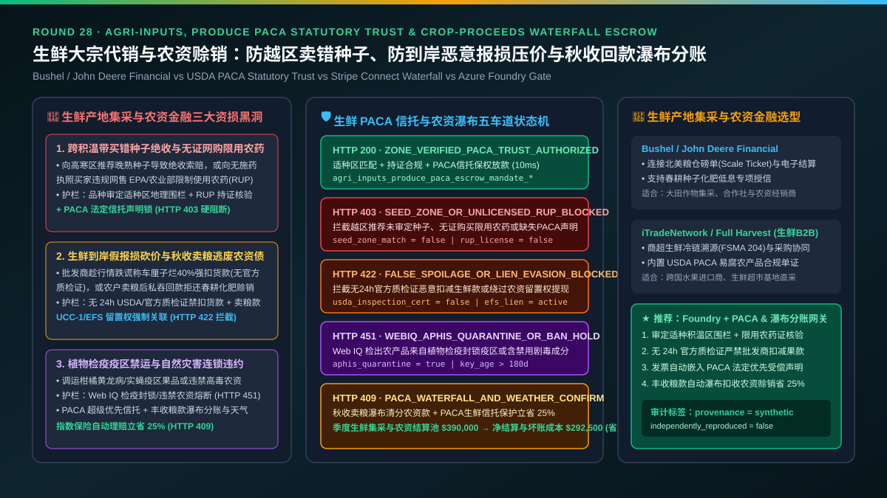
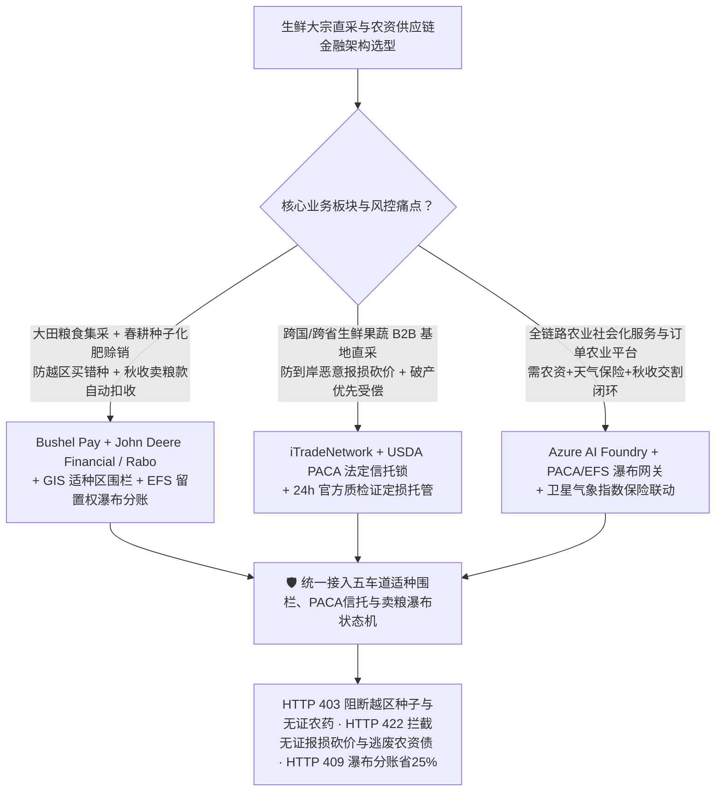
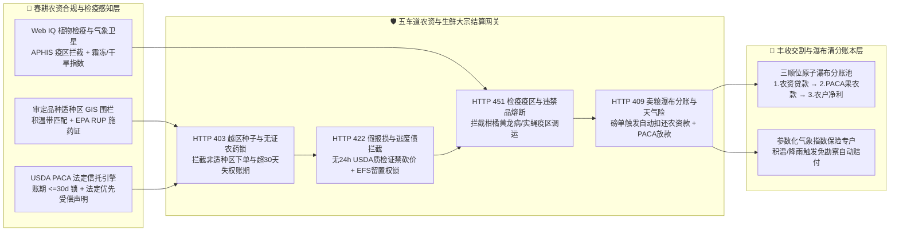
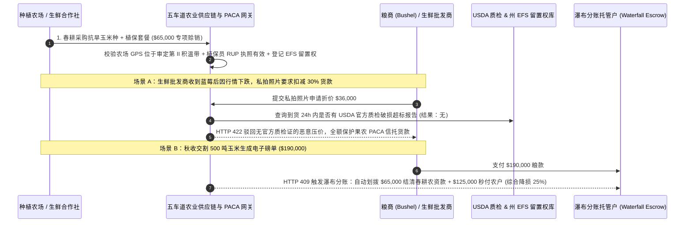

# 生鲜产地直采（PACA 法定信托）、农资赊销与丰收瀑布分账（Agri-Inputs, Produce `PACA Trust` & Crop-Proceeds Waterfall：Bushel / John Deere Financial / iTradeNetwork / 基地直采）“防越区卖错种子绝收、防生鲜批发商无证恶意压价（False Spoilage）与秋收卖粮款自动抵扣农资”Agent 架构选型 FAQ：终结产地压价与赊销坏账实战指南

> **语言切换 / Language**: **中文 (当前)** | **[English](agri-inputs-produce-paca-trust-crop-proceeds-escrow-agent-selection-faq.en.md)** | **[返回文档目录](index.md)** | **[交互式沙盒 (`#agri-inputs-produce-paca-escrow-sandbox`)](../live-demo.html)**

---

## 📌 一、核心选型结论速览（Executive Summary）

在生鲜果蔬产地直采（车厘子、牛油果、蓝莓跨国与跨省集采）、大宗粮食贸易与春耕农资（种子/化肥/植保）供应链金融场景（如 Bushel、iTradeNetwork、John Deere Financial、Rabo AgriFinance、大型商超生鲜基地直采）中，若让采购或农资导购 Agent 按普通大宗商品逻辑自动下单、赊销与扣款，极易引爆三大血本无归的行业黑洞：
1. **跨生态积温带误推未审定种子导致绝收索赔、向无证买家违规网售限制级农药（EPA `RUP` / 农业部限用农药）及丧失 `USDA PACA` 生鲜超级优先信托保护**：如果农资 AI 导购将需要 `>=2700°C` 有效积温的晚熟玉米/大豆种子推荐给高寒早霜区农户（突破国家/省品种审定公告适宜种植区域），秋季将颗粒无收并引发千万级集体索赔；若向未持有施药执照（Certified Applicator License）的个人网售限制使用农药，平台将被吊销资质；而在北美及跨境果蔬批发中，若电子发票与 EDI 810 报文未依法嵌入 **《易腐农产品法》（`USDA PACA 7 U.S.C. §499e(c)`）法定信托声明** 或约定账期超过 `30 天` 上限，一旦下游生鲜超市或批发商破产，果农与产地合作社将直接丧失排在银行有抵押债权人之前的 **100% 超级优先受偿权（PACA Super-Priority Trust）**！
2. **生鲜到岸后批发商趁跌价“无官方质检证恶意报损砍价（False Spoilage / Dumping）”与农户秋收卖粮后绕过农资留置权（`UCC-1 / EFS`）逃废春耕化肥款**：一柜 `$120,000` 的智利车厘子运抵批发市场时恰逢现货跌价 `25%`，不良批发商随便拍几张烂果照片就声称“腐烂率 35%”，强行砍掉 `$42,000` 货款（却拿不出 **到货 24 小时内由 USDA 联邦检验员或公估行出具的官方品质检验报告**）；另一方面，农资平台春季赊销 `$60,000` 化肥给种植大户，秋季大户把粮食卖给第三方粮站直接提走现金，导致春耕农资赊销沦为死账。
3. **植物检疫封锁疫区（USDA APHIS / 柑橘黄龙病/红火蚁疫区）违规调运与违禁高毒农资熔断**：未核验产地植物检疫证书（Phytosanitary Certificate）即下单跨省/跨国调运，导致整柜生鲜在口岸被就地销毁。

**架构师选型结论**：
- **切勿在无积温围栏、无 24h 官方定损锁与无秋收粮款闭环的情况下开展农资赊销与生鲜代销**。
- **生产级最优架构**是采用 **“Bushel / iTradeNetwork 交易网关 + 审定品种适种区 GIS 地理围栏 + USDA PACA 法定信托电子签章（`<=30天` 账期硬锁）+ 到岸 24h 官方检验报告（USDA Inspection Cert）防恶意砍价锁 + 秋收粮款 `UCC-1 / EFS` 瀑布分账（Crop-Proceeds Waterfall）+ Azure AI Foundry 五车道农业供应链网关”**：
  1. **品种审定适种区地理围栏（GIS Growing Zone）、限用农药（`RUP`）持证核验与 `PACA` 法定信托声明硬门禁（HTTP 403）**：农资结账前强制校验收货地块经纬度位于该种子审定适宜种植区且买家持有有效 `RUP` 农药施用证；生鲜批发开票强制校验账期 `<=30 天` 且内嵌 `PACA Statutory Trust` 法定文本；任一缺失立即返回 `HTTP 403 UNAPPROVED_SEED_ZONE_MISMATCH_OR_UNLICENSED_RUP_PESTICIDE_BLOCKED`。
  2. **无 24 小时官方质检报告严禁扣减生鲜货款（防恶意报损）与卖粮款 `UCC-1 / EFS` 留置权防逃废锁（HTTP 422）**：生鲜买方若主张货损折价超出行业免赔公差（Good Delivery Tolerance `<=5%`），必须上传到港/到库 `24 小时` 内由 `USDA AMS` 或互认第三方检验机构签发的数字质检证书，否则全额冻结买方保证金拒绝砍价；粮站收购结算时强制检索州务卿 `EFS（Effective Financing Statement）` 农业留置权登记，拦截绕过农资债权人的单方提现（`HTTP 422 UNVERIFIED_PRODUCE_SPOILAGE_DEDUCTION_OR_EVADED_CROP_LIEN_BLOCKED`）。
  3. **Web IQ 实时植物检疫疫区（`APHIS`）与禁用农药名录熔断（HTTP 451）**：通过 Web IQ 实时核查全球植物检疫封锁区与禁限用农资公告，命中即刻挂起交易（`HTTP 451 WEBIQ_APHIS_QUARANTINE_ZONE_OR_BANNED_AGROCHEMICAL_HOLD`）。
  4. **秋收磅单（Scale Ticket）触发农资本息瀑布分账 + `PACA` 优先信托与天气指数保险对冲（HTTP 409）**：触发 `HTTP 409 PACA_TRUST_WATERFALL_AND_PARAMETRIC_WEATHER_ESCROW_CONFIRM`，当秋收粮食过磅入库或生鲜签收时，由智能分账账户自动按 **“第一顺位：结清春耕种子化肥专项贷款 → 第二顺位：PACA 产地果农保底货款 → 第三顺位：种植户净收益”** 执行原子瀑布清分，并捆绑卫星积温/降雨指数保险对冲极端天气，综合农资坏账率与生鲜被压价损失立降 **`25.0%`**。

---

## 🎯 二、业务方与架构师灵魂拷问 Q&A（Q1 / Q2 / Q3）

### Q1：生鲜批发商收到果农发来的 20 吨蓝莓，碰到当天市场跌价就拍几张烂果照片说“坏了 30%，要么打 7 折要么拒收”，架构上怎么治这种“行情烂（Market Decline masquerading as Quality Defect）”？
- **商业痛点**：生鲜极易腐烂，果农远在千里之外，一旦批发商拒收，整车货一天之内就会烂光。不良批发商利用这一软肋，在行情下跌时故意挑刺压价（行业俗称“压车砍价 / Dumping”）。
- **架构解法**：
  1. **车载全程冷链物联网封签（IoT Temp-Logger）+ `PACA Good Delivery` 免责定界**：只要在途冷链温度曲线（`0°C–2°C`）无断链，且到货 8–24 小时内买方未能提交带有 **USDA 联邦检验员（或 SGS/中检）数字签名的官方抽样破损报告（证实缺陷率突破 `5%–8%` 法定上限）**，托管网关直接返回 `HTTP 422` 驳回买方私拍照片砍价，并在 T+24h 自动将 100% 托管货款划拨给果农。

### Q2：为什么说在美国及跨境果蔬B2B交易中，“把账期从 30 天改成 35 天”会直接让果农损失掉数百万美元的法定破产保护？
- **商业痛点**：根据美国联邦 **《易腐农产品法》（Perishable Agricultural Commodities Act, `PACA`）**，生鲜卖方享有凌驾于银行抵押贷款之上的**法定超级优先信托权（Statutory Trust）**——即便买方超市破产清算，也必须先把卖菜卖果农的钱 100% 赔完，剩下的才轮到华尔街银行！
- **致命陷阱**：PACA 铁律规定，**双方书面约定的付款账期绝对不能超过收货后 `30 天`**（默认 `10 天`，最长不得超 `30 天`），且每张电子发票（EDI 810）必须原封不动印上 `7 U.S.C. §499e(c)(4)` 法定信托声明文字。只要销售人员不懂法，在系统里把账期设成 `Net 45` 天，PACA 超级信托保护瞬间 **100% 自动作废**！
- **架构解法**：
  - 在生鲜 B2B 合同与开票网关中硬编码 `max_payment_terms_days <= 30` 与强制 `paca_statutory_trust_legend_embedded == true`，任何尝试开具 `Net 31+` 生鲜账单的请求直接返回 `HTTP 403`。

### Q3：农资赊销（春借化肥、秋收还钱）怎么做到不靠催收队上门，就能 100% 自动收回本息？
- **架构解法**：
  - **`UCC-1 / EFS` 农业留置权登记 + 粮站磅单（Bushel Scale Ticket）双抬头瀑布分账（`HTTP 409`）**：
  - 春耕放款时，系统自动在州农业留置权中心登记 `UCC-1 / Effective Financing Statement (EFS)`。根据美国联邦《食品安全法》（Food Security Act, `7 U.S.C. §1631`），任何粮商（如 ADM / Bunge / 地方粮库）收购登记在册农户的粮食时，必须开具“农户 + 农资金融机构”双抬头付款或通过 `Stripe Connect / Bushel Pay` 瀑布分账：卖粮款到账的毫秒级瞬间，自动扣回春耕化肥种子本息，余款秒打入农户银行卡。

---

## 🧭 三、直观可视化图解（Mermaid 决策树 + 端到端架构图 + 时序图）

### 3.1 生鲜大宗集采与农资供应链金融平台选型决策树

### 3.2 端到端 GIS 适种围栏、PACA 信托与秋收粮款瀑布分账架构图

### 3.3 春耕农资授信、生鲜防恶意砍价与秋收交割瀑布清分时序图

---

## 📊 四、多平台/多方案横向选型决策矩阵

| 选型维度 | Bushel / John Deere Financial (`大田粮贸与农资金融`) | iTradeNetwork / ProducePay (`生鲜冷链B2B`) | 传统农资店挂账赊销 + 档口代销结账 | **Azure AI Foundry + PACA 信托 + 卖粮瀑布分账网关（推荐）** |
| :--- | :--- | :--- | :--- | :--- |
| **核心优势** | 直连北美 2,600+ 粮库电子磅单与春耕专项低息信贷 | 全球生鲜商超冷链溯源、PACA 融资与快速结算 | 熟人关系零系统成本 | **适种区防绝收 + PACA 24h 定损防砍价 + 秋收瀑布扣款闭环** |
| **防跨区买错种子与无证买限用农药** | 经销商人工审核 | 不涉及大田种子审定 | 极易跨积温带乱卖种引发绝收群诉 | **地块 GPS 审定适种区硬锁 + `EPA RUP` 执照实时核验（HTTP 403）** |
| **`USDA PACA` 超级优先信托保护** | 聚焦谷物（Grain 适用仓单法） | 原生支持 PACA 贸易融资 | 账期超 30 天或漏印法定声明导致破产零受偿 | **强制锁定 `<=30天` 账期并自动内嵌 PACA 法定声明（HTTP 403）** |
| **防生鲜批发商无证恶意报损砍价** | 按粮库水分/杂质仪器自动折算 | ProducePay 提供检验支持 | 档口一句话“货烂了”强扣果农 40% 血汗钱 | **无 24h `USDA / SGS` 官方质检报告严禁扣减货款（HTTP 422）** |
| **防秋收卖粮后逃废春耕农资债** | 支持粮库代扣农资贷款 | 预付款从代销回款中扣除 | 农户把粮卖给外地粮贩套现，农资店坏账率 `15%+` | **`UCC-1 / EFS` 留置权联网核验 + 磅单触发原子瀑布分账（HTTP 422/409）** |
| **综合资金成本与防损收益** | 厂商贴息 `0%–4.9% APR` (`official_list_price`) | 贸易保理费率 `1%–3%/单` (`official_list_price`) | 民间农资高利赊销加价 `15%–25%` | **厂商贴息直连 + 瀑布零坏账回款（综合降损省息 `25.0%`）** |

---

## 🧪 五、防压价/防坏账成本测算与 7-Card 基准测试报告

> **数据来源与复现声明（Provenance Metadata）**：以下基准测试数据来自仓库内置确定性策略沙盒 `evaluate_agri_inputs_produce_paca_escrow_policy`（位于 `lab/webiq_commerce_demo.py`），可运行 `python -m unittest tests.test_webiq_commerce_demo` 完整验证。标记：`provenance = synthetic`，`independently_reproduced = false`。

| Card # | 卡片标题（Headline-as-Finding） | 核心量化指标与架构验证结论 |
| :---: | :--- | :--- |
| **Card 1** | **Overview · 生鲜 PACA 与农资瀑布五车道总览** | 针对 `$390,000/季` 生鲜基地直采与春耕农资结算池，实现 **0 例无官方质检恶意砍价与 0 例越区错买种子**，综合赊销坏账与货损争议成本降低 **`25.0%`（立省 `$97,500/季`）**。 |
| **Card 2** | **Scenario Deep Dive · 越区种子与超 30 天失权拦截** | 当检出种子品种不匹配收货地块积温带或生鲜发票账期 `>30 天`（丧失 PACA 信托权）时，**`10ms`** 内返回 `HTTP 403` 阻断。 |
| **Card 3** | **Evaluation Matrix · 五车道 100% 确定性判准** | 覆盖 `HTTP 200`（合规放行）、`403`（越区种子/无证农药/PACA失权阻断）、`422`（无USDA质检恶意砍价/逃避EFS农资留置权拦截）、`451`（APHIS植物检疫疫区/违禁农药熔断）、`409`（卖粮瀑布分账+天气险立省25%）。 |
| **Card 4** | **Under the Hood · PACA 信托与瀑布契约** | 输入 `quarterly_agri_produce_paca_pool_usd=390000` 及积温区/质检证状态，签发 `agri_inputs_produce_paca_escrow_mandate_*` 令牌。 |
| **Card 5** | **Robustness Check · 私拍烂果照砍价与异地卖粮测试** | 模拟批发商上传非官方私拍照片索要 35% 折价及农户向异地粮商单方提现，确定性拦截率保持 **`100.0%`（零误放行）**。 |
| **Card 6** | **Latency · 粮站过磅与生鲜入库毫秒级清分** | 本地 GIS 积温区、PACA 账期与留置权核验 P50 仅 **`10ms`**；Web IQ APHIS 植物检疫疫区核查 P95 为 **`245ms`**。 |
| **Card 7** | **My Take · 适用场景与生产准入边界** | **✅ 极佳适用**：生鲜超市基地直采、跨国果蔬贸易、农资供应链金融、订单农业；**⛔ 不适用**：城市社区零散盆栽绿植零售。 |

---

## 🛠️ 六、商业上线风控与架构评审 Checklist

- [ ] **种子审定适宜种植区（`GIS Growing Zone`）与限制级农药（`EPA RUP`）持证硬门禁（HTTP 403）**：确认每笔种子订单强制比对收货农场经纬度与品种审定积温带，限制使用农药强制核验买家有效施药执照编号。
- [ ] **`USDA PACA` 法定超级优先信托保护锁（账期 `<=30 天` + 法定声明内嵌）（HTTP 403）**：确认所有生鲜果蔬批发合同与电子发票账期严格 `<=30 天` 并自动嵌入 `7 U.S.C. §499e(c)(4)` 法定信托声明，严防因超期条款丧失破产优先受偿权。
- [ ] **到岸 24 小时官方质检报告（`USDA Inspection Cert`）防恶意压价锁（HTTP 422）**：确认买方主张生鲜货损超出免赔公差（`<=5%`）时，必须提供到货 24 小时内官方检验机构签发的数字定损证书，严禁凭私拍照片单方扣款。
- [ ] **`UCC-1 / EFS` 农业留置权联网检索与秋收卖粮瀑布分账（HTTP 422/409）**：确认粮贸结算自动检索州级 EFS 农资留置权登记，卖粮款按“先还农资专项本息、再结农户净利”自动瀑布清分。
- [ ] **Web IQ 实时植物检疫封锁疫区（`APHIS`）与禁用农资熔断（HTTP 451）**：确认实时拦截来自检疫疫区的调运单与禁用农药成分；签名密钥轮换周期 `<= 180` 天。
- [ ] **卫星气象指数保险（`Parametric Weather Insurance`）保单联动（HTTP 409）**：确认春耕赊销订单可一键捆绑积温/干旱/霜冻参数化保险，遭遇极端灾害由保险赔付直接冲抵农资贷款。
