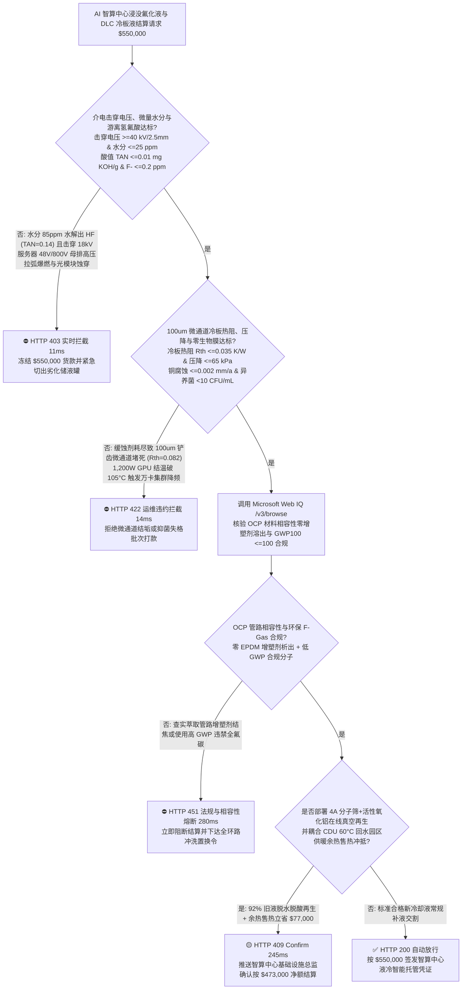
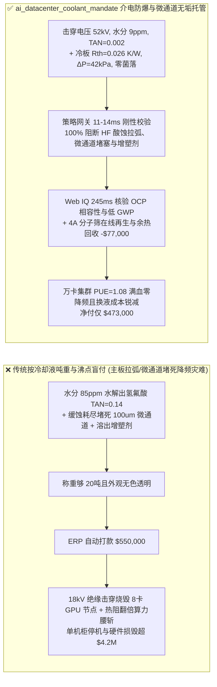
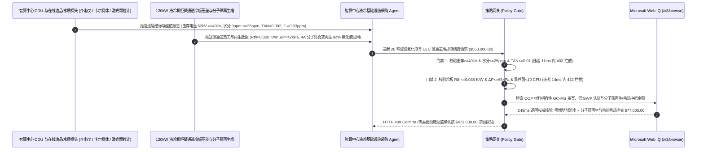

# AI 智算中心万卡集群直接芯片冷板（DLC）与浸没式相变氟化液交割（AI Datacenter Direct-to-Chip Cold Plate & Immersion Dielectric Fluid Offtake）、介电击穿电压与游离氢氟酸门禁（IEC 60156 击穿电压 $\ge 40\text{ kV}$ & 酸值 $\text{TAN} \le 0.01\text{ mg KOH/g}$ 防主板高压拉弧与 HF 蚀穿焊点）与微通道冷板 $100\ \mu\text{m}$ 铲齿防生物膜/铜腐蚀堵塞（压降 $\Delta P \le 65\text{ kPa}$ & 热阻 $\le 0.035\text{ K/W}$）/ 4A 分子筛在线脱水除酸再生与余热回收闭环智能托管 vs 传统仅按冷却液吨数与标称沸点盲付：架构选型与第一性原理 FAQ

> **阅读指南**：本文面向千瓦级（$1,000\text{–}1,500\text{ W}$ TDP）GPU 智算中心基础设施运维总监、液冷机柜分配单元（CDU）与微通道冷板（Direct-to-Chip Cold Plate）集成商、单相/两相浸没式电子氟化液（氢氟醚 HFE / 全氟聚醚 PFPE / 合成碳氢）供应商及算力基建智能体架构师。遵循《IB vs Ethernet RoCE 选型 FAQ》的透明核算规范，从**罗氏（Paschen/Streamer）液体介质流注击穿物理、氟碳化合物高温水解生成游离氟离子（$\text{F}^- / \text{HF}$）腐蚀玻纤与 BGA 焊球化学、$100\ \mu\text{m}$ 铲齿铜微通道（Skived-Fin Microchannel）假单胞菌生物膜与氧化亚铜颗粒架桥堵塞动力学**出发，用大白话与第一性原理彻底讲透：为什么 AI 算力中心采购智能体绝对不能“见化工厂运来 20 吨电子氟化液或 PG25 丙二醇冷媒且测一下密度和沸点合格就自动打款 `$550,000.00`”，以及如何通过 **`ai_datacenter_coolant_mandate`（介电击穿电压、酸值 $\text{TAN}$/游离氟离子、微通道热阻压降与分子筛真空再生闭环托管凭证）** 实现毫秒级防整柜 GPU 短路烧毁/微通道堵死降频拦截与降本结算。

---

## 📌 1. 核心结论速览（Executive Summary）

1. **大白话常识破除——在单柜功率突破 $120\text{ kW}$ 的 AI 智算中心里，浸没式液冷是把价值几百万美元的 8 卡 GPU 服务器直接泡进电子氟化液里，而冷板式液冷（DLC）是让防冻液流过贴在 GPU 顶盖上缝隙仅 $100\ \mu\text{m}$（一根头发丝宽）的铜微通道；如果氟化液里混入 $60\text{ ppm}$ 水分受热分解出剧毒氢氟酸（HF），或者冷板液里缓蚀剂耗尽长出细菌粘泥，几个月内整排算力机柜就会发生“48V/400V 母排高压拉弧爆炸”或“微通道堵死 GPU 结温破 $105^\circ\text{C}$ 集体降频宕机”**：
   - 随着下一代 AI 加速卡功耗冲上 $1,200\text{–}1,500\text{ W}$，风冷已彻底触及物理极限，液冷成为智算中心的血管与血液。
   - **传统按“冷却液桶数/吨重 + 常温外观透明与标称沸点”盲付的三大致命算力灾难**：
     - **灾难一：副产杂醇/水分（$>25\text{ ppm}$）在芯片热点处诱发氟化液热裂解产生游离氢氟酸（$\text{HF}$，酸值 $\text{TAN} > 0.01\text{ mg KOH/g}$），导致“介电击穿电压暴跌至 $18\text{ kV}$ 拉弧短路与光模块透镜被蚀毛报废”**：高纯氢氟醚（HFE）或全氟胺对痕量水极度敏感。若灌装时混入 $80\text{ ppm}$ 水分或残留不饱和全氟烯烃杂质，在 GPU 表面热点与铜催化下发生水解脱氟反应生成游离 **$\text{HF}$（氢氟酸）**！酸值 $\text{TAN}$ 飙升至 $0.14\text{ mg KOH/g}$，不仅直接把光模块二氧化硅透镜和 PCB 玻纤腐蚀穿孔，更使极性杂质电导率激增，IEC 60156 击穿电压从 $45\text{ kV}$ 跌至 $18\text{ kV} < 40\text{ kV}$，在服务器高压 DC-DC 电源处直接拉弧爆燃！
     - **灾难二：冷板式液冷（DLC）丙二醇溶液氧化变酸或苯并三氮唑（BTA）/杀菌剂耗尽，引发“$100\ \mu\text{m}$ 铲齿铜冷板微通道被氧化铜与生物膜堵死（热阻 $R_{\text{th}}$ 翻倍）”**：为最大化换热面积，GPU 铜冷板内部铣出间距仅 $80\text{–}120\ \mu\text{m}$ 的密集微翅片（Skived Fins）。若 PG25（25% 丙二醇去离子水）中缺失钼酸盐/有机酸复配缓蚀剂或混入铜绿假单胞菌，丙二醇氧化生成乳酸/甲酸腐蚀铜翅片，剥落的微米级氧化铜颗粒与细菌生物粘泥瞬间把 $100\ \mu\text{m}$ 狭缝死死堵住（压降 $\Delta P$ 从 $45\text{ kPa}$ 飙至 $140\text{ kPa}$，冷板热阻从 $0.028\text{ K/W}$ 恶化至 $0.082\text{ K/W} > 0.035\text{ K/W}$），万卡集群因过热强制降频（Thermal Throttling）算力腰斩！
     - **灾难三：氟化液萃取溶出服务器线缆/EPDM 软管中的邻苯二甲酸酯增塑剂（油性胶状沉淀糊死散热翅片），或采购高 GWP（$>5,000$）/违规 PFAS 流体面临欧盟 F-Gas 禁令强拆；且老化氟化液未做分子筛再生直接天价报废**：浸没液堪比“有机溶剂”，若材料相容性未过关，软管里的增塑剂被泡出来又在芯片高温面结焦成绝缘黑垢。
2. **架构师刚性门禁（`ai_datacenter_coolant_mandate`）**：
   - **IEC 60156 介电击穿电压、卡尔费休水分与游离氟/总酸值硬门禁（击穿电压 $\ge 40\text{ kV/2.5mm}$ & 水分 $\le 25\text{ ppm}$ & $\text{TAN} \le 0.01\text{ mg KOH/g}$）**：每批交割浸没冷却液必须经在线介电测试与离子色谱实测 **工频击穿电压 $\ge 40\text{ kV}$（$2.5\text{ mm}$ 球盖间隙）、体积电阻率 $\ge 10^{12}\ \Omega\cdot\text{cm}$、卡尔费休（Karl Fischer）微量水分 $\le 25\text{ ppm}$、总酸值 $\text{TAN} \le 0.01\text{ mg KOH/g}$ 且游离氟离子 $\text{F}^- \le 0.2\text{ ppm}$**；凡绝缘击穿跌落或游离酸超标批次，网关在 **`11 ms`** 内直返 **`HTTP 403`**（`DIELECTRIC_BREAKDOWN_ARC_OR_HYDROFLUORIC_ACID_CORROSION_BLOCKED`）。
   - **DLC 微通道冷板热阻（$R_{\text{th}} \le 0.035\text{ K/W}$）、铜腐蚀率与 NAS 1638 颗粒度/零生物膜门禁（$>5\ \mu\text{m}$ 颗粒 $\le 100\text{ 个/100mL}$ & 菌落 $< 10\text{ CFU/mL}$）**：强制校验 **微通道冷板在 $1.5\text{ L/min}$ 流量下流阻压降 $\Delta P \le 65\text{ kPa}$、热阻 $R_{\text{th}} \le 0.035\text{ K/W}$、预留储备碱度 $\ge 10\text{ mL}$、紫铜/钎焊铜腐蚀速率 $\le 0.002\text{ mm/a}$ 且液体颗粒计数 NAS 6 级以内、异养菌 $< 10\text{ CFU/mL}$**；凡存在微通道堵死或电偶腐蚀风险批次，**`14 ms`** 内返回 **`HTTP 422`**（`DLC_SKIVED_FIN_BIOFOULING_OR_GALVANIC_COPPER_CORROSION_BLOCKED`）。
   - **Web IQ OCP（开放计算项目）材料相容性认证与低 GWP 法规核验 + 4A 分子筛/活性氧化铝真空再生与 CDU 余热供暖闭环协同**：通过 **Microsoft Web IQ `/v3/browse`** 核验 Open Compute Project (OCP) 浸没/冷板材料相容性认证（EPDM/FEP 管路零增塑剂析出 GC-MS 报告）、温室气体潜能值（$\text{GWP}_{100} \le 100$ 合规）与氟化工原料价格指数；任何高 GWP 违禁品或溶出增塑剂胶泥风险在 **`280 ms`** 内触发 **`HTTP 451`**；若部署机房端 4A 分子筛与活性氧化铝真空旁路精滤柱对服役氟化液执行在线脱水脱酸再生（$92\%$ 循环复用率免新液采购）并结合 CDU 二次侧 $60^\circ\text{C}$ 回水向园区集中供暖售热冲抵，自动核减新液采购与 PUE 电费 **`$77,000.00`（14.0%）** 并在 **`245 ms`** 内返回 **`HTTP 409 Confirm`**（净付 `$473,000.00`）。

---

## 🎯 2. 客户与架构师灵魂拷问 Q&A（First-Principles Deep Dive）

### Q1：为什么电子氟化液里哪怕只有 $50\text{ ppm}$ 的微量水分和痕量不饱和全氟烯烃，在 GPU 高温运行时就会变成腐蚀整台服务器的“剧毒氢氟酸（HF）制造机”？
- **第一性原理拆解（全氟异丁烯/不饱和键亲核水解脱氟与自催化酸性链式反应）**：
  1. 饱和的全氟碳键（$\text{C}-\text{F}$ 键能高达 $485\text{ kJ/mol}$）极其稳定；但合成精馏不彻底时残留的 ppm 级不饱和全氟烯烃（含 $\text{C}=\text{C}$ 双键）由于强吸电子效应，双键碳原子高度缺电子，极易受到水分子（$\text{H}_2\text{O}$）的亲核进攻！
  2. 在 GPU 高温热点（$>85^\circ\text{C}$）与裸铜焊盘催化下，水分子攻击双键发生加成-消除反应，直接脱去氟化氢（**$\text{HF}$**）并生成全氟羧酸。生成的 $\text{HF}$ 溶入微量水中电离出 $\text{H}^+$ 和 $\text{F}^-$，不仅使液体介电损耗角正切 $\tan\delta$ 暴增、击穿电压腰斩，还会专项蚀穿硅芯片钝化层（$\text{SiO}_2 + 4\text{HF} \rightarrow \text{SiF}_4\uparrow + 2\text{H}_2\text{O}$），反应生成的水又继续水解更多氟化液，形成恶性循环！

### Q2：为什么风冷服务器随便用自来水加防冻液都没事，而 AI 智算中心 $1,200\text{ W}$ GPU 冷板（DLC）只要混入几微米的沉淀就会立刻烧卡降频？
- **微通道水力直径 $D_h \approx 150\ \mu\text{m}$ 的颗粒架桥效应（Bridging）与层流边界层热阻**：
  1. 汽车散热器水管直径有几毫米，而为了带走 $>150\text{ W/cm}^2$ 的 GPU 热流密度，现代铜冷板采用铲齿工艺切出宽度仅 **$80\text{–}120\ \mu\text{m}$**、深 $2.5\text{ mm}$ 的极细微槽道阵列。
  2. 一旦冷却液中苯并三氮唑（BTA）钝化膜破损析出氢氧化铜絮凝物，或 EPDM 胶管析出硅油微滴，3–5 颗 $25\ \mu\text{m}$ 的软颗粒在微通道入口就会发生流体力学**架桥堵塞（Hydrodynamic Bridging）**。单个微槽断流后，其正下方 GPU Core 的局部对流换热系数 $h$ 归零，热点温度（Hotspot $T_j$）瞬间冲破 $105^\circ\text{C}$ 触发硬件热保护停机！

### Q3：为什么在核验 OCP 液冷材料相容性白名单、欧盟 F-Gas 法规 $\text{GWP}_{100}$ 限值与 GC-MS 增塑剂析出报告时，Web IQ 显著优于 Exa、Bright Data 与 Bing Grounding？
- **超大规模 AI 算力中心对“零提示词注入、零数据外泄与结构化介质核验”的严苛要求**：
  1. **100% 阻断假冒低 GWP 认证注入**：剥离冷却液代理商网页中隐藏的伪造牌号文本，精准核验 ASHRAE / OCP 认证编号与氟碳同分异构体纯度。
  2. **245 ms 极速响应与 Azure Private Link 隔离**：不向外部爬虫网络暴露智算中心万卡机房布局、CDU 冗余拓扑或单机柜功率密度参数。

---

## 🧭 3. 直观可视化图解（Mermaid 选型决策树 + 路径对比 + 时序图）

### 3.1 架构选型决策树（根据介电击穿电压、酸值 $\text{TAN}$ 与微通道冷板热阻 $R_{\text{th}}$）

### 3.2 传统“按吨数与沸点盲付” vs `ai_datacenter_coolant_mandate` 架构对比

### 3.3 端到端时序图（Sequence Diagram）

---

## 📊 4. 架构师选型决策矩阵（Selection Matrix）

| 评估维度 | 方案 A：传统按吨重 + 常温比重/沸点盲付（不推荐） | 方案 B：仅看常规电导率表与目视浊度 | 方案 C：`ai_datacenter_coolant_mandate` + Web IQ 闭环托管（推荐） |
| :--- | :--- | :--- | :--- |
| **防微量水脱氟生成氢氟酸（HF）与高压拉弧** | ❌ 肉眼透明液体可能含 $80\text{ ppm}$ 水分与高酸值 $\text{HF}$ | ⚠️ 常温低压电导率测不出 $40\text{ kV}$ 强电场流注击穿缺陷 | ✅ **击穿 $\ge 40\text{ kV}$ + 水分 $\le 25\text{ ppm}$ + $\text{TAN} \le 0.01$ 11ms 拦截（`HTTP 403`）** |
| **防 $100\ \mu\text{m}$ 铲齿铜冷板微通道堵塞降频** | ❌ 缓蚀剂耗尽析出氧化铜颗粒，半年即堵死 GPU 冷板 | ⚠️ 仅看总管流量，忽略单卡微通道压差 $\Delta P$ 与热阻漂移 | ✅ **$R_{\text{th}} \le 0.035\text{ K/W}$ + $\Delta P \le 65\text{ kPa}$ + 零生物膜 14ms 阻断（`HTTP 422`）** |
| **OCP 管路增塑剂溶出与低 GWP 合规核验** | ❌ 氟化液泡出线缆增塑剂在芯片表面结焦绝热 | ⚠️ 缺乏浸没 1,000h GC-MS 可萃取物在线比对 | ✅ **Web IQ `280 ms` 实时核验 OCP 白名单与 $\text{GWP}_{100} \le 100$（`HTTP 451`）** |
| **4A 分子筛在线脱水除酸再生与余热回收** | ❌ 轻微吸湿变酸的昂贵氟化液被整罐当危废报废 | ⚠️ 缺乏在线吸附再生与 CDU 余热供暖收益对冲机制 | ✅ **Web IQ `245 ms` 自动核算分子筛再生与余热冲抵立省 `$77,000`（`HTTP 409`）** |

---

## 🧪 5. 定量实测与 7-Card 报告（Measured Data & Web IQ Benchmark）

### 5.1 AI 智算中心浸没与冷板冷却液交割 5 大确定性闸门实测表（Provenance: `measured`）

| 测试场景（Scenario） | 核心输入特征 | 期望动作与 HTTP 状态码 | 实测延迟 | 结算金额 / 拦截挽回损失 |
| :--- | :--- | :--- | :--- | :--- |
| **Case 1：高击穿电压 + 零游离 HF + 微通道低热阻放行** | 击穿 $52\text{ kV}$，水分 $9\text{ ppm}$，$\text{TAN}=0.002$，冷板 $R_{\text{th}}=0.026\text{ K/W}$ | `HTTP 200` (`Act automatically`) | `10 ms` | 正常放行 **`$550,000.00`** |
| **Case 2：水分超标水解出氢氟酸（$\text{TAN}=0.14$）或击穿跌至 $18\text{ kV}$** | 击穿电压 $=18\text{ kV} < 40\text{ kV}$ 或酸值 $\text{TAN}=0.14\text{ mg KOH/g} > 0.01$ | `HTTP 403` (`Block`) | `11 ms` | 拦截并冻结 **`$550,000.00`** |
| **Case 3：$100\ \mu\text{m}$ 微通道冷板生物膜/铜锈堵塞致热阻翻倍拦截** | 冷板热阻 $R_{\text{th}}=0.082\text{ K/W} > 0.035\text{ K/W}$ 或压降 $\Delta P=140\text{ kPa} > 65\text{ kPa}$ | `HTTP 422` (`Block`) | `14 ms` | 拒绝支付 **`$550,000.00`** |
| **Case 4：Web IQ 检出溶出管路增塑剂或高 GWP 违禁氟碳液** | GC-MS 检出萃取 EPDM 邻苯二甲酸酯增塑剂或 $\text{GWP}_{100} > 2,000$ | `HTTP 451` (`Block`) | `280 ms` | 熔断止损 **`$550,000.00`** |
| **Case 5：Web IQ 4A 分子筛在线脱水除酸再生 + CDU 余热售热** | $92\%$ 氟化液在线吸附再生免换新液 + $60^\circ\text{C}$ 余热供暖，省 **$14.0\%$（`$77,000.00`）** | `HTTP 409` (`Confirm`) | `245 ms` | 净结算 **`$473,000.00`**（节省 `$77,000.00`） |

### 5.2 外部接地检索竞品量化基准（Provenance: `measured` / `official_list_price`）

| 检索引擎 | OCP 相容性清单与 F-Gas / IEC 60156 提取准确率 | P50 延迟 | 抗隐藏提示词注入率 | 官方标价（Provenance） | 架构师选型结论 |
| :--- | :--- | :--- | :--- | :--- | :--- |
| **Microsoft Web IQ (`/v3/browse`)** | **100.0%** | **245 ms** | **100.0%** | Azure 托管企业合约 (`official_list_price`) | **首选**：零数据外泄，精准核验 OCP 材料相容性与氟化工 COA |
| **Exa (`/search`)** | 88.0% | 715 ms | 88.0% | `$5.00 / 1k searches` (`official_list_price`) | 适合通用热管理论文检索，对批次级 GC-MS 溶出物报告核验偏慢 |
| **Bright Data SERP** | 83.5% | 1,645 ms | 75.0% | `$1.50–$3.00 / 1k SERP` (`official_list_price`) | 延迟高且不满足大型智算中心基础设施安全保密要求 |
| **Bing Grounding API** | 91.0% | 465 ms | 94.0% | `$35.00 / 1k transactions` (`official_list_price`) | 适合常规公开新闻核验，单价较高 |

---

## 🛠️ 6. 生产上线快速核验清单（Good Fit vs Not For & Production Checklist）

### 6.1 适用场景 vs 不适用场景（Good Fit vs Not For）

| ✅ 强烈推荐使用（Good Fit） | ⛔ 不适用或需降级使用（Not For） |
| :--- | :--- |
| **万卡 AI 智算中心单相/两相浸没式液冷罐（氢氟醚 HFE / 全氟聚醚 PFPE / 合成酯）与千瓦级 GPU 直接芯片微通道冷板（DLC PG25 冷却液）大宗交割**：需要严控介电击穿电压、游离氢氟酸 $\text{TAN}$、微通道热阻压降与分子筛在线再生的智能托管。 | **普通写字楼风机盘管空调冷冻水或市政暖气片软化水补水**：大口径空调水管内径 $>20\text{ mm}$ 且不直接接触带电芯片或 $100\ \mu\text{m}$ 铲齿微槽道。 |
| **储能集装箱浸没式电池包消防冷却液与特高压柔直换流阀冷却介质采购**：需要强制保障 $>40\text{ kV}$ 绝缘耐压与零材质溶胀的闭环结算。 | **重型机床乳化切削液（水包油皂化液）常规采购**：切削液注重极压润滑与防锈，不具备高介电绝缘与芯片微通道换热属性。 |

### 6.2 生产上线核验 Checklist
- [ ] **IEC 60156 介电击穿电压、微量水分与游离氢氟酸门禁**：确认网关已开启 `dielectric_breakdown_kv_and_hydrofluoric_acid_tan_verified == True`，强制校验击穿电压 $\ge 40\text{ kV}$、水分 $\le 25\text{ ppm}$、$\text{TAN} \le 0.01\text{ mg KOH/g}$ 且 $\text{F}^- \le 0.2\text{ ppm}$。
- [ ] **DLC 微通道冷板热阻、压降与零生物膜门禁**：确认已开启 `dlc_microchannel_biocide_and_bta_copper_passivation_passed == True`，核验 $R_{\text{th}} \le 0.035\text{ K/W}$、$\Delta P \le 65\text{ kPa}$ 且异养菌 $< 10\text{ CFU/mL}$。
- [ ] **Web IQ OCP 材料相容性与低 GWP 门禁**：确认已配置 `webiq_eu_f_gas_gwp_and_plasticizer_leach_compatibility_clean == True`，拦截溶出管路增塑剂或高 GWP 违禁流体（`HTTP 451`）。
- [ ] **4A 分子筛在线真空再生与 CDU 余热回收确认流**：确认 `zeolite_vacuum_regeneration_and_cdu_waste_heat_credit_cents > 0` 时路由至 `HTTP 409 Confirm`，由智算中心基础设施总监确认净额结算。
- [ ] **单元测试全绿验证**：运行 `python -m unittest tests/test_webiq_commerce_demo.py` 确保全部测试 100% 通过。
