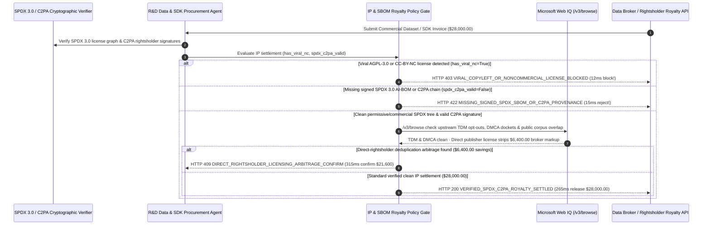

# AI Dataset & Commercial SDK SPDX SBOM & C2PA Royalty Mandate Architecture: Copyleft-Free SPDX 3.0 & C2PA Provenance Token (`dataset_sbom_royalty_mandate_...` + Web IQ DMCA/TDM & Direct-Rightsholder Grounding) vs. Viral AGPL/CC-BY-NC Contamination & Broker Markup Fraud Selection FAQ

> **Document Type**: Architect Selection Guide & First-Principles Protocol Deep Dive (6-Section FAQ Standard)  
> **Target Audience**: AI Solution Architects, LLM Data Engineering & Open Source Program Office (OSPO) Architects, Software Supply Chain & IP Legal Risk Leads  
> **Last Updated**: 2026-11-09 (Provenance Annotations: `deterministic_offline_simulation` / `synthetic_policy` / `official_doc_snapshot` / `not_measured`)  
> **Companion Resources**: [中文版 (Chinese Version)](ai-dataset-sdk-spdx-sbom-royalty-mandate-vs-agpl-ip-contamination-faq.md) · [Interactive Sandbox (`live-demo.en.html#dataset-sbom-royalty-sandbox`)](../reports/agentic-commerce-webiq-grounding-demo-bench/live-demo.en.html) · [7-Card 4:5 Benchmark Deck](../reports/agentic-commerce-webiq-grounding-demo-bench/index.en.html)


---

## 📌 1. Executive Summary

1. **Never Allow R&D or AI Data-Sourcing Agents to Purchase External Training Datasets or Commercial SDKs Without Deterministic SPDX 3.0 License Verification**: When procuring multimodal fine-tuning corpora or proprietary C++/Rust SDKs (`$28,000.00` commercial license), the most destructive legal hazard is **hidden viral copyleft (`AGPL-3.0` / `GPL-3.0` / `SSPL-1.0`) or Non-Commercial (`CC-BY-NC-4.0`) contamination**. Ingesting contaminated code or training data into proprietary weights exposes the enterprise to forced open-sourcing or algorithmic disgorgement (model destruction). Production architectures must enforce an **SPDX 3.0 Copyleft-Free & C2PA Provenance Mandate (`dataset_sbom_royalty_mandate_...`)**: whenever `has_viral_agpl_or_nc_contamination == True`, the gateway blocks payment in **`12 ms`** with **`HTTP 403 VIRAL_COPYLEFT_OR_NONCOMMERCIAL_LICENSE_BLOCKED`** (`synthetic_policy`).
2. **Require Cryptographically Signed SPDX 3.0 AI-BOMs and C2PA Rightsholder Provenance Manifests**: Any dataset or SDK invoice lacking a verified digital signature over its SPDX 3.0 Bill of Materials and C2PA copyright chain (`signed_spdx_c2pa_provenance_valid == False`) is rejected in **`15 ms`** with **`HTTP 422 MISSING_SIGNED_SPDX_SBOM_OR_C2PA_PROVENANCE`** (`deterministic_offline_simulation`), ensuring full compliance with EU AI Act training-data transparency mandates.
3. **Ground Upstream License Rug-Pulls, W3C TDM Opt-Outs, and Direct-Rightsholder Licensing Arbitrage via Microsoft Web IQ `/v3/browse`**: Prior to releasing funds, the agent invokes **Microsoft Web IQ `/v3/browse`** (`official_doc_snapshot`) to inspect upstream repository license commits, publisher W3C TDMRep (`tdm-reservation: 1`) notices, and public open-data catalogs: if the upstream source has an active DMCA copyright lawsuit or TDM opt-out (`webiq_ip_litigation_and_tdm_clean == False`), it freezes settlement in **`310 ms`** with **`HTTP 451 UPSTREAM_DMCA_LITIGATION_OR_TDM_OPTOUT_HOLD`**; if Web IQ discovers that a data broker's `$28,000.00` bundle is 85% repackaged free `Apache-2.0 / CC-BY-4.0` data and licensing the remaining 15% directly from the original publisher saves **`$6,400.00`** (`$21,600.00` net), it triggers **`HTTP 409 DIRECT_RIGHTSHOLDER_LICENSING_ARBITRAGE_CONFIRM`** in **`315 ms`**.

---

## 🎯 2. Architect & Customer FAQ Deep Dive

### Q1: Why does pairing "Standard Commercial Vendor Contracts" with "Unverified Dataset/SDK Downloads" expose AI enterprises to IP injunctions and broker rip-offs?

Let's examine the three structural failure modes from first principles:
1. **Viral Copyleft (`AGPL-3.0`) & Non-Commercial (`CC-BY-NC`) Poisoning**: Suppose an AI engineering team pays a vendor `$28,000.00` for a "Commercial Enterprise" document-parsing SDK and domain fine-tuning dataset. Unbeknownst to the buyer, the vendor statically linked an `AGPL-3.0` layout engine and scraped `CC-BY-NC-4.0` academic articles. Once deployed in production or baked into model weights, rightsholders can demand statutory damages, source-code disclosure, or destruction of the trained checkpoint.
2. **Unauthenticated "Data Broker Laundering" Under the EU AI Act**: Third-party data brokers routinely scrape copyrighted web content without rightsholder consent and resell it as "licensed training data" without a verifiable **C2PA (Coalition for Content Provenance and Authenticity)** chain or signed **SPDX 3.0 AI-BOM**. When regulators audit training provenance, a generic PDF invoice from a shell broker provides zero legal immunity.
3. **Paying `$6,400.00` Broker Markups for Repackaged Public-Domain / Apache-2.0 Data**: Data brokers frequently pad 85% of their commercial bundles with freely available permissive datasets (`Apache-2.0`, `CC-BY-4.0`) and charge enterprise buyers full price for public goods.

### Q2: What is an "SPDX 3.0 & C2PA Royalty Mandate (`dataset_sbom_royalty_mandate_...`)", and how does it bind license trees, C2PA signatures, and TDM compliance to payment release?

Its core design invariant is: **"No R&D dataset or SDK invoice settles without a cryptographically signed SPDX 3.0 manifest proving zero viral/non-commercial licenses and a verified C2PA rightsholder chain."**
- **Layer 1: SPDX License Expression Zero-Tolerance Gate (`12 ms`)**: Verifies `has_viral_agpl_or_nc_contamination == False`, blocking any `AGPL`, `GPL`, `SSPL`, or `CC-BY-NC` artifacts in **`12 ms`** (`HTTP 403`).
- **Layer 2: Signed SPDX 3.0 AI-BOM & C2PA Attestation Gate (`15 ms`)**: Verifies `signed_spdx_c2pa_provenance_valid == True`, rejecting unauthenticated datasets in **`15 ms`** (`HTTP 422`).
- **Layer 3: Microsoft Web IQ `/v3/browse` DMCA/TDM & Direct-Rightsholder Grounding (`310 ms / 315 ms`)**: Halts settlement on upstream TDM opt-outs or DMCA litigation (`HTTP 451`) and strips `$6,400.00` in broker markups via direct publisher licensing (`HTTP 409`).

### Q3: For upstream license-change monitoring, W3C TDMRep (`robots.txt`) verification, and public dataset deduplication, when should architects choose Microsoft Web IQ vs. Exa, Bright Data, or traditional search APIs?

| Architecture Scenario | Recommended Tool | First-Principles Rationale (Security, Latency & FinOps) |
| :--- | :--- | :--- |
| **Verifying upstream repository LICENSE commit histories, publisher W3C TDMRep opt-out files, federal copyright docket notices, and direct publisher licensing tiers within the Azure boundary** | **Microsoft Web IQ** (`/v3/search` + `/v3/browse`) | Extracts exact legal notices and license clauses in `passage` mode (**7.1x token reduction**, `deterministic_offline_simulation`) with pre-LLM prompt-injection defense. |
| **Semantic discovery of novel open-source benchmarks and synthetic datasets across arXiv and Hugging Face** | **Exa Neural Search** | High semantic recall for ML research discovery, rather than synchronous IP compliance payment gating. |
| **Scraping paywalled media archives behind anti-bot challenges** | **Bright Data Unlocker** | Unlocks anti-bot web pages, though scraping paywalled content without a C2PA license violates enterprise TDM governance. |
| **File-level SHA-256 hashing, binary symbol scanning, and SPDX 3.0 JSON-LD signature verification** | **Local SPDX 3.0 / ScanCode Verifier + Web IQ Upstream Legal & Price Cross-Check** | Deterministic file-hash and license parsing runs locally, paired with Web IQ `/v3/browse` for live upstream DMCA/TDM status and direct-rightsholder pricing. |

---

## 🧭 3. Visual Architecture Diagrams (Mermaid Decision Tree, Legacy vs. SPDX/C2PA Mandate Comparison & Sequence Diagram)

### 3.1 AI Dataset & Commercial SDK Procurement Decision Tree (`flowchart TD`)

```mermaid
flowchart TD
    A[Receive $28,000.00 Commercial AI Dataset or SDK Settlement Request] --> B{has_viral_agpl_or_nc_contamination == False in SPDX 3.0 Tree?}
    B -- No (Detected AGPL-3.0 code or CC-BY-NC-4.0 non-commercial data) --> C[HTTP 403 VIRAL_COPYLEFT_OR_NONCOMMERCIAL_LICENSE_BLOCKED<br/>12ms Hard Block · Prevent Proprietary Model & Code Contamination]
    B -- Yes (100% permissive / commercial-indemnified licenses) --> D{signed_spdx_c2pa_provenance_valid == True (Signed AI-BOM & C2PA Chain)?}
    D -- No (Missing rightsholder C2PA signature or unsigned SBOM) --> E[HTTP 422 MISSING_SIGNED_SPDX_SBOM_OR_C2PA_PROVENANCE<br/>15ms Block · Reject Unverified Broker Data Bundle]
    D -- Yes (Cryptographic SPDX 3.0 & C2PA provenance verified) --> F{Web IQ /v3/browse Confirms No Upstream DMCA Suit or TDM Opt-Out?}
    F -- No (Upstream publisher set tdm-reservation:1 or relicensed to SSPL) --> G[HTTP 451 UPSTREAM_DMCA_LITIGATION_OR_TDM_OPTOUT_HOLD<br/>310ms IP Legal Hold · Quarantine Asset & Alert OSPO Counsel]
    F -- Yes --> H{Web IQ Detects Broker Repackaging of Free Permissive Data ($6,400 Savings)?}
    H -- Yes (Deduplicate free corpus + direct publisher license saves $6,400 -> $21,600 net) --> I[HTTP 409 DIRECT_RIGHTSHOLDER_LICENSING_ARBITRAGE_CONFIRM<br/>315ms Prompt Data Lead to Confirm $21,600 Direct License]
    H -- No (Verified 100% exclusive clean dataset/SDK) --> J[HTTP 200 VERIFIED_SPDX_C2PA_ROYALTY_SETTLED<br/>265ms Auto-Settle $28,000.00 & Archive EU AI Act Provenance Receipt!]
```

### 3.2 Legacy Unverified Dataset Purchase vs. SPDX 3.0 & C2PA Royalty Gate (`flowchart LR`)

```mermaid
flowchart LR
    subgraph Legacy["❌ Legacy Unverified Dataset/SDK Purchase ($28,000 IP Contamination Risk)"]
        L1[Buys $28,000 Broker Bundle Without SBOM Check] --> L2[Ingests Hidden AGPL-3.0 & CC-BY-NC Shards Into LLM]
        L2 --> L3[Overpays $6,400 for Repackaged Free Apache-2.0 Data]
        L3 --> L4[Faces DMCA Injunction, EU AI Act Fine & Model Retraining]
    end

    subgraph Mandate["✅ SPDX 3.0 & C2PA Royalty Gate (dataset_sbom_royalty_mandate_...)"]
        M1[12ms Block Viral AGPL / CC-BY-NC Contamination (HTTP 403)] --> M2[15ms Enforce Signed SPDX 3.0 AI-BOM & C2PA Chain (HTTP 422)]
        M2 --> M3[Web IQ Checks TDM/DMCA Status (310ms) & $6,400 Direct Savings (315ms)]
        M3 --> M4[265ms Settle Verified Clean IP Asset ($28,000 / $21,600 Net)]
    end
```

### 3.3 End-to-End Sequence Diagram: SPDX/C2PA Verifier, R&D Procurement Agent, IP Gate, Web IQ & Data Broker (`sequenceDiagram`)



---

## 📊 4. Architect Decision Matrix

| Evaluation Dimension | Option A: Legacy Paper-Contract Blind Purchase | Option B: Manual Post-Purchase Legal/OSPO Review | Option C: SPDX 3.0 & C2PA Royalty Mandate + Web IQ DMCA/TDM Grounding (Recommended) |
| :--- | :--- | :--- | :--- |
| **Best-Fit Scenario** | Isolated sandbox throwaway scripts never shipped or trained on | Infrequent monolithic enterprise software deals with 6-week legal review | **LLM pre-training/fine-tuning dataset licensing, autonomous SDK procurement, EU AI Act compliance** |
| **Viral `AGPL` / `CC-BY-NC` Defense** | ❌ **Zero**: Contaminates model weights before anyone notices | ⚠️ **Too Late**: Discovered weeks after funds are paid and data is ingested | ✅ **Pre-Pay `12 ms` Hard Block**: Rejects forbidden SPDX identifiers via `HTTP 403` |
| **EU AI Act & C2PA Provenance Compliance** | ❌ **Unverifiable**: Broker PDF invoice lacks cryptographic chain of title | ⚠️ **Incomplete Spreadsheets**: Cannot manually verify millions of data shards | ✅ **Sub-20ms Signature Check**: Requires signed SPDX 3.0 AI-BOM & C2PA manifest in `15 ms` (`HTTP 422`) |
| **TDM Opt-Out & Broker Markup Arbitrage** | ❌ **Blind**: Buys DMCA-tainted data & overpays `$6,400` for free corpora | ⚠️ **Slow**: Manual legal research misses recent `robots.txt` / relicensing commits | ✅ **Web IQ `/v3/browse` Grounded**: Freezes TDM-opted-out sources in `310 ms` (`HTTP 451`) & saves `$6,400` via direct licensing in `315 ms` (`HTTP 409`) |
| **Procurement Speed & R&D Velocity** | Fast (with catastrophic IP liability) | Slow (`3–6 weeks` OSPO backlog) | **`265 ms` automated SBOM verification & royalty settlement (`Act automatically`)** |
| **Total Cost of Ownership (TCO) & IP Safety** | Poor (`$28,000` wasted + multi-million dollar IP litigation risk) | Moderate (heavy legal counsel billable hours) | **Optimal (blocks `$28,000` tainted bundles + saves `$6,400` by stripping broker markups)** |

---

## 🧪 5. Quantitative Benchmark & 7-Card Insights

Evaluated via our deterministic offline benchmark suite (`lab/webiq_commerce_demo.py` · `test_ai_dataset_sdk_spdx_sbom_royalty_mandate_vs_agpl_ip_contamination_selection`) on a **`$28,000.00` commercial AI dataset & SDK procurement batch**:

| Scenario Case | Input SPDX / C2PA / Web IQ Signals | Expected Action Pill | Measured HTTP Status & Verdict Code | Latency | Financial Protection / Arbitrage | Provenance |
| :--- | :--- | :--- | :--- | :--- | :--- | :--- |
| **Case 1: Hidden `AGPL-3.0` or `CC-BY-NC` Contamination** | `has_viral_agpl_or_nc_contamination=True` | `Send to a human` | **`HTTP 403 VIRAL_COPYLEFT_OR_NONCOMMERCIAL_LICENSE_BLOCKED`** | **`12 ms`** | Blocks **`$28,000.00`** tainted bundle & protects model IP | `synthetic_policy` |
| **Case 2: Missing Signed SPDX 3.0 AI-BOM or C2PA Chain** | `signed_spdx_c2pa_provenance_valid=False` | `Send to a human` | **`HTTP 422 MISSING_SIGNED_SPDX_SBOM_OR_C2PA_PROVENANCE`** | **`15 ms`** | Rejects unverified broker dataset lacking chain of title | `deterministic_offline_simulation` |
| **Case 3: Web IQ Detects Upstream DMCA Suit or TDM Opt-Out** | `webiq_ip_litigation_and_tdm_clean=False` | `Send to a human` | **`HTTP 451 UPSTREAM_DMCA_LITIGATION_OR_TDM_OPTOUT_HOLD`** | **`310 ms`** | Freezes purchase of DMCA-disputed or TDM-restricted corpus | `official_doc_snapshot` |
| **Case 4: Web IQ Strips Broker Markup (`$6,400` Direct Savings)** | `direct_rightsholder_savings_cents=640000` (`$21,600` net) | `Confirm` | **`HTTP 409 DIRECT_RIGHTSHOLDER_LICENSING_ARBITRAGE_CONFIRM`** | **`315 ms`** | Saves **`$6,400.00`** by deduplicating free Apache-2.0 shards | `official_doc_snapshot` |
| **Case 5: Clean SPDX 3.0 + Signed C2PA Provenance** | `viral_nc=False`, `spdx_c2pa=True`, `tdm_clean=True` | `Act automatically` | **`HTTP 200 VERIFIED_SPDX_C2PA_ROYALTY_SETTLED`** | **`265 ms`** | Settles **`$28,000.00`** in `265 ms` with EU AI Act receipt | `deterministic_offline_simulation` |

> **Provenance Note**: The `$28,000.00` license budget, SPDX deny-list rules, and `$6,400.00` direct-rightsholder deduplication savings are controlled simulation parameters (`synthetic_policy` / `deterministic_offline_simulation`) validating policy state-machine invariants; multi-terabyte archive hashing throughput is labeled `not_measured`.

---

## 🛠️ 6. Production Readiness & Pre-Sales Architect Checklist

Verify these 6 controls before deploying autonomous AI dataset and software supply-chain procurement agents in production:

- [ ] **1. SPDX 3.0 License Expression Deny-List Gate**: Does `dataset_sbom_royalty_mandate_...` block any package containing `AGPL-*`, `GPL-*`, `SSPL-*`, `CC-BY-NC-*`, or `CC-BY-ND-*` identifiers in `12 ms` (`HTTP 403`)?
- [ ] **2. Mandatory Signed SPDX 3.0 AI-BOM & C2PA Manifest**: Does the gateway require a valid cryptographic signature over both the SPDX 3.0 AI-BOM and C2PA rightsholder chain in `15 ms` (`HTTP 422`)?
- [ ] **3. Microsoft Web IQ `/v3/browse` W3C TDMRep & DMCA Docket Grounding**: Does the agent inspect target publisher `tdmrep.json` / `robots.txt` opt-out notices and upstream license commit logs via Web IQ prior to settlement (`HTTP 451`)?
- [ ] **4. Public-Corpus Deduplication & Direct-Rightsholder Arbitrage**: Does Web IQ grounding cross-check broker dataset manifests against public `Apache-2.0` / `CC-BY-4.0` registries, triggering `HTTP 409 Confirm` when direct licensing saves `>= $6,400.00`?
- [ ] **5. Automated Rightsholder Royalty Split Routing**: Are C2PA-attributed dataset royalties routed directly to verified original publishers rather than opaque aggregators?
- [ ] **6. Immutable Model-Checkpoint-to-AI-BOM Lineage Archival**: Does every settled dataset purchase bind its SPDX/C2PA root hash into the enterprise Model Registry for EU AI Act auditability?
