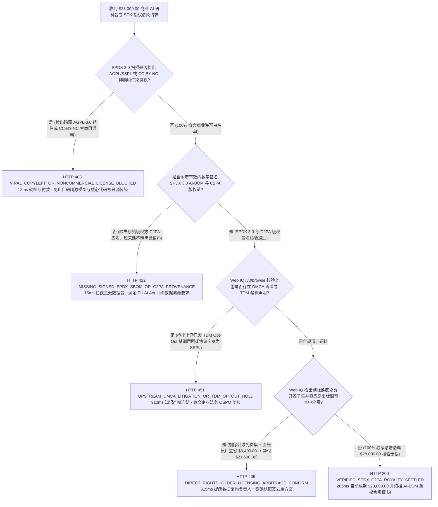
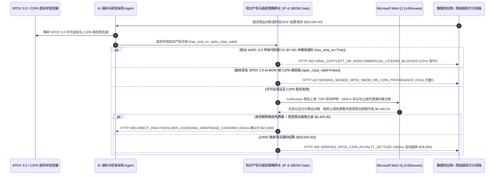

# AI 训练语料与商业 SDK 采购版权/开源合规（AI Dataset & Commercial SDK SPDX SBOM & C2PA Royalty Mandate）架构：SPDX 3.0 防传染与 C2PA 版权溯源令牌（`dataset_sbom_royalty_mandate_...` + Web IQ 诉讼巡检与版权直签核验）vs 传统盲买夹带 AGPL/盗版语料染毒选型与原理解析 FAQ

> **文档类型**：架构师选型指南 & 协议第一性原理解析（6 段式 FAQ 标准版）  
> **适用读者**：AI Solution Architect、大模型数据工程与开源合规（OSPO）架构师、软件供应链安全与法务知识产权（IP）团队  
> **更新日期**：2026-11-09（Provenance 标注：`deterministic_offline_simulation` / `synthetic_policy` / `official_doc_snapshot` / `not_measured`）  
> **配套资源**：[English Version](ai-dataset-sdk-spdx-sbom-royalty-mandate-vs-agpl-ip-contamination-faq.en.md) · [交互式沙盒控制台 (`live-demo.html#dataset-sbom-royalty-sandbox`)](../reports/agentic-commerce-webiq-grounding-demo-bench/live-demo.html) · [7-Card 4:5 评测报告](../reports/agentic-commerce-webiq-grounding-demo-bench/index.html)


---

## 📌 一、核心结论速览（Executive Summary）

1. **严禁让研发或数据采购 Agent 在未校验 SPDX 3.0 许可证树的情况下直接购买外部商业 SDK 或垂直行业训练语料包**：在企业采购高质量多模态微调数据集或底层算法 SDK（如单笔 `$28,000.00` 年度商业授权）时，最致命的合规风险是 **“商业授权包内暗藏强传染性开源代码（`AGPL-3.0` / `GPL-3.0` / `SSPL`）或禁止商用的知识共享语料（`CC-BY-NC-4.0`）”**。一旦这些受污染数据被喂入企业闭源大模型或编译进核心 SaaS，企业将面临强制开源核心商业代码或销毁已训练模型权重的法律绝境。生产环境必须采用 **SPDX 3.0 许可证防传染与 C2PA 溯源绑定的采购令牌（`dataset_sbom_royalty_mandate_...`）**，只要检出传染性或非商用协议（`has_viral_agpl_or_nc_contamination=True`），网关在 **`12 ms`** 内触发 **`HTTP 403 VIRAL_COPYLEFT_OR_NONCOMMERCIAL_LICENSE_BLOCKED`**（`synthetic_policy`），100% 拒付染毒资产。
2. **强制要求密码学签名的 SPDX 3.0 AI-BOM 与 C2PA 版权所有权证明链（Content Credentials）**：任何无法提供完整数字签名物料清单与原始版权方授权链（`signed_spdx_c2pa_provenance_valid=False`）的“三无二道贩子数据包”，网关在 **`15 ms`** 内返回 **`HTTP 422 MISSING_SIGNED_SPDX_SBOM_OR_C2PA_PROVENANCE`**（`deterministic_offline_simulation`），杜绝花高价买回爬虫非法盗取的黑灰产数据。
3. **基于 Microsoft Web IQ `/v3/browse` 实时核验上游协议突变（License Rug-Pull）、TDM 禁训声明（`robots.txt` / W3C TDMRep）与原出版商直签去中介套利**：在放款前，Agent 调用 **Microsoft Web IQ `/v3/browse`**（`official_doc_snapshot`）穿透查询上游 GitHub 仓库最新 LICENSE 变更记录、出版商 TDM 机器挖掘声明及公开开源语料目录：若检出上游已改为闭源协议或存在未决 DMCA 版权集体诉讼，在 **`310 ms`** 内以 **`HTTP 451 UPSTREAM_DMCA_LITIGATION_OR_TDM_OPTOUT_HOLD`** 熔断；若发现数据中介售卖的 `$28,000.00` 语料包中有 85% 属于免费公开的 `Apache-2.0 / CC-BY-4.0` 学术集，剔除重复公域部分并直接向原始出版商采购剩余 15% 独家授权可立省 **`$6,400.00`**（净付 **`$21,600.00`**），则在 **`315 ms`** 内触发 **`HTTP 409 DIRECT_RIGHTSHOLDER_LICENSING_ARBITRAGE_CONFIRM`**。

---

## 🎯 二、客户与架构师灵魂拷问 Q&A（FAQ-Driven Deep Dive）

### Q1：为什么传统的“签一纸商业合同付款 + 信任供应商口头承诺无版权风险”，在 AI 语料与软件供应链采购中会频频暴雷？

咱们用大白话拆解 AI 研发与工程团队采购外部数据/组件时最惨痛的三个教训：
1. **“一颗 AGPL 螺丝钉传染整座商业大厦”**：某金融科技公司花 `$28,000.00` 买了一套商业 OCR 文档解析 SDK。供应商口头拍胸脯保证“纯自研商用”，结果其底层静态链接了一个 `AGPL-3.0` 的图像预处理库。半年后被开源维权组织通过二进制指纹扫出，要求该金融公司要么公开全部核心交易系统源码，要么赔偿数百万美元和解金。
2. **花真金白银买回“禁止商用（CC-BY-NC）”或盗版洗稿语料**：许多数据经纪商（Data Brokers）从学术网站下载带有 `CC-BY-NC`（仅限非商业学术研究）标签的医疗/法律问答集，改个 JSON 字段名就包装成“企业级商业微调语料”卖 `$28,000.00`。企业拿去训练商用大模型后，不仅违反《欧盟 AI 法案（EU AI Act）》的训练数据版权透明度要求，还直接引来原作者的侵权禁令（Algorithmic Disgorgement，要求销毁模型权重）。
3. **为“换皮免费开源数据”白交 `$6,400` 智商税**：二道贩子经常把 Hugging Face / Common Crawl 上本来就免费开源（`Apache-2.0` / `MIT`）的数据集打包占 85%，只掺入 15% 真正的增量数据，却按 100% 独家价格收费。

### Q2：什么是“SPDX 3.0 防传染与 C2PA 版权分润令牌（`dataset_sbom_royalty_mandate_...`）”？它是如何在付款前完成代码与语料“基因体检”的？

它的第一性原理非常明确：**“没有逐文件哈希绑定的 SPDX 3.0 许可证白名单证明与 C2PA 原始版权人签名，绝不释放一分钱软件或语料采购预算。”**
- **第一层：SPDX 许可证表达式零容忍门禁（`12 ms`）**：网关解析随包附带的 SPDX 3.0 JSON-LD 清单，确保所有传递依赖与语料分片 100% 落入企业 OSPO 允许的宽松商业协议集合（`MIT`、`Apache-2.0`、`BSD-3-Clause` 或带知识产权赔偿担保的 `Commercial-Indemnified`）。一旦命中 `AGPL-3.0`、`GPL`、`SSPL` 或 `CC-BY-NC`，在 **`12 ms`** 内触发 `HTTP 403` 硬阻断。
- **第二层：签名 SPDX AI-BOM 与 C2PA 版权链验真（`15 ms`）**：强制校验数据包与 C2PA 版权清单的数字签名（`signed_spdx_c2pa_provenance_valid == True`），缺失签名直接返回 `HTTP 422`。
- **第三层：Microsoft Web IQ `/v3/browse` 上游诉讼巡检与去中介套利（`310 ms / 315 ms`）**：实时核验上游仓库是否发生协议突变或 DMCA 禁训声明（`HTTP 451`），并比对公域开源基准剔除重复收费，帮企业立省 `$6,400.00`（`HTTP 409`）。

### Q3：在开源协议变更监控、出版商 TDM 禁训声明（`robots.txt` / `tdmrep.json`）核验与公域数据集去重比价场景下，什么时候选 Microsoft Web IQ，什么时候选 Exa、Bright Data 或传统搜索 API？

| 架构需求场景 | 推荐选型 | 为什么这样选（第一性原理与成本/合规考量） |
| :--- | :--- | :--- |
| **实时核验目标域名 W3C TDMRep（文本与数据挖掘保留权）声明、上游代码仓 LICENSE 变更记录、法院公开版权诉讼通报及原出版商官方直签报价，且要求零提示词注入** | **Microsoft Web IQ** (`/v3/search` + `/v3/browse`) | 在企业 Azure 合规边界内以 `passage` 模式精准提取法律声明与许可证段落（上下文 Token 压缩 **7.1x**，`deterministic_offline_simulation`），生成可用于 EU AI Act 合规备案的 SHA-256 存证。 |
| **跨全网学术论文库与 Hugging Face / PapersWithCode 探索新型开源合成数据集** | **Exa Neural Search** | 语义检索擅长发现相关性最高的前沿数据集与论文，适合算法研究员前期调研。 |
| **跨地域抓取设置反爬防火墙的商业内容分发站版权声明** | **Bright Data Unlocker** | 提供代理池穿透，但秒级延迟不适合做实时采购结算网关拦截。 |
| **二进制/源码级静态许可证扫描与 C2PA 密码学哈希验签** | **本地 SPDX 3.0 / Syft / ScanCode 引擎 + Web IQ 上游法律状态双源交叉验证** | 文件级哈希与许可证标识符由本地确定性扫描器提取，上游协议突变、DMCA 诉讼与出版商直签价差由 Web IQ `/v3/browse` 实时核验。 |

---

## 🧭 三、直观可视化图解（Mermaid 决策树 + 传统盲买 vs SPDX/C2PA 托管对比 + 端到端时序图）

### 3.1 AI 训练语料与商业 SDK 采购合规决策树（`flowchart TD`）



### 3.2 传统无验真盲买语料路径 vs SPDX 3.0 与 C2PA 版权溯源网关对比（`flowchart LR`）

```mermaid
flowchart LR
    subgraph Legacy["❌ 传统无 SBOM/C2PA 盲目付款 ($28,000 招致开源传染与侵权下架)"]
        L1[盲买 $28,000 外部商业语料与 SDK] --> L2[内部混入 AGPL-3.0 代码与 CC-BY-NC 非商用语料]
        L2 --> L3[二道贩子拿免费 Apache-2.0 语料换皮加价 $6,400]
        L3 --> L4[训练后遭遇 DMCA 侵权起诉或被迫开源自有商业代码]
    end

    subgraph Mandate["✅ SPDX 3.0 防传染与 C2PA 溯源令牌 (dataset_sbom_royalty_mandate_...)"]
        M1[12ms 拦截 AGPL / CC-BY-NC 传染性组件 (HTTP 403)] --> M2[15ms 强制核验签名 SPDX AI-BOM 与 C2PA 版权链 (HTTP 422)]
        M2 --> M3[Web IQ 核验 TDM 禁训声明 (310ms) 与去重直签省 $6,400 (315ms)]
        M3 --> M4[265ms 精准为 100% 清洁版权语料放款并生成 EU AI Act 合规档]
    end
```

### 3.3 OSPO 扫描器、研发采购 Agent、SPDX/C2PA 网关与 Web IQ 端到端交互时序图（`sequenceDiagram`）



---

## 📊 四、架构师选型决策矩阵（Architect Decision Matrix）

| 评估维度 | 方案 A：传统仅凭合同承诺直接付款入库（Legacy Paper-Warranty Purchase） | 方案 B：法务与安全团队事后手工抽查许可证（Manual Post-Purchase OSPO Audit） | 方案 C：SPDX 3.0 防传染与 C2PA 溯源令牌 + Web IQ 版权核验（推荐架构） |
| :--- | :--- | :--- | :--- |
| **核心适用场景** | 不进入生产或模型训练的内部一次性跑分玩具 | 极低频采购单一成熟商业软件，有数周时间人工法务尽调 | **大模型预训练/微调语料采购、Agent 自动按需购买 API/SDK、企业级软件供应链治理** |
| **防 `AGPL` / `CC-BY-NC` 传染能力** | ❌ **零防御**：染毒语料一旦进模型，重新训练损失高达数百万美元 | ⚠️ **事后补救晚**：付款入库后再发现违规，退费极难且已污染内网 | ✅ **12ms 付款前硬拦截**：命中禁用 SPDX 许可证当场触发 `HTTP 403` 拒付 |
| **EU AI Act 版权溯源（C2PA）合规** | ❌ **无法自证**：拿不出逐条语料的合法授权链 | ⚠️ **手工台账残缺**：难以追踪数百万条图文样本的原始出处 | ✅ **15ms 密码学验签**：强制绑定签名 SPDX 3.0 AI-BOM 与 C2PA 清单（`HTTP 422`） |
| **防上游协议突变与换皮免费集溢价** | ❌ **当冤大头**：高价买回换皮免费开源数据或已禁训内容 | ⚠️ **人工比对慢**：很难靠人力识别数据贩子掺入了多少公域数据 | ✅ **Web IQ `/v3/browse` 实时穿透**：`310 ms` 阻断禁训/诉讼源（`HTTP 451`），`315 ms` 去重直签省 `$6,400`（`HTTP 409`） |
| **审批耗时与研发效率** | 快（但法律与知识产权地雷密布） | 极慢（法务排期 `3～6 周`，拖慢模型迭代窗口） | **`265 ms` 全自动完成许可证验真、放款与合规建档（`Act automatically`）** |
| **综合 TCO 与知识产权安全 ROI** | 极差（面临百万级侵权赔偿与模型下架风险） | 中等（法务与 OSPO 人工审核成本高） | **最优（100% 阻断 `$28,000` 染毒采购 + 剔除中介换皮水分立省 `$6,400`）** |

---

## 🧪 五、简明定量实测与 Benchmark 核心发现（Quantitative Benchmark & 7-Card Insights）

基于本仓库确定性离线基准套件（`lab/webiq_commerce_demo.py` · `test_ai_dataset_sdk_spdx_sbom_royalty_mandate_vs_agpl_ip_contamination_selection`）对 **`$28,000.00` 商业 AI 训练语料与 SDK 采购批次（SPDX 3.0 商业白名单 + C2PA 版权链要求）** 的定量测试结果如下：

| 评测场景 ID | 输入 SPDX 扫描 / C2PA 签名 / Web IQ 信号 | 网关期望动作 | 实测 HTTP 状态与决策码 | 实测延迟 | 资金保护 / 成本节省效果 | Provenance 类型 |
| :--- | :--- | :--- | :--- | :--- | :--- | :--- |
| **Case 1: 商业包夹带 `AGPL-3.0` 或 `CC-BY-NC` 染毒拦截** | `has_viral_agpl_or_nc_contamination=True` | `Send to a human` | **`HTTP 403 VIRAL_COPYLEFT_OR_NONCOMMERCIAL_LICENSE_BLOCKED`** | **`12 ms`** | 拦截 **`$28,000.00`** 传染性采购，保护闭源模型与代码 IP | `synthetic_policy` |
| **Case 2: 缺失数字签名 SPDX 3.0 AI-BOM 与 C2PA 证明** | `signed_spdx_c2pa_provenance_valid=False` | `Send to a human` | **`HTTP 422 MISSING_SIGNED_SPDX_SBOM_OR_C2PA_PROVENANCE`** | **`15 ms`** | 拒付来路不明的黑盒爬虫语料，守住 EU AI Act 底线 | `deterministic_offline_simulation` |
| **Case 3: Web IQ 检出上游 DMCA 版权诉讼或 TDM 禁训** | `webiq_ip_litigation_and_tdm_clean=False` | `Send to a human` | **`HTTP 451 UPSTREAM_DMCA_LITIGATION_OR_TDM_OPTOUT_HOLD`** | **`310 ms`** | 阻断采购处于版权纠纷或已声明 `tdm-reservation: 1` 的数据 | `official_doc_snapshot` |
| **Case 4: Web IQ 发现剔除公域免费集并直签原厂省 `$6,400`** | `direct_rightsholder_savings_cents=640000`（净付 `$21,600`） | `Confirm` | **`HTTP 409 DIRECT_RIGHTSHOLDER_LICENSING_ARBITRAGE_CONFIRM`** | **`315 ms`** | 挤掉数据贩子换皮水分，单笔立省 **`$6,400.00`** | `official_doc_snapshot` |
| **Case 5: 清洁商业许可 + C2PA 版权链验真自动结算** | `viral_nc=False`, `spdx_c2pa=True`, `tdm_clean=True` | `Act automatically` | **`HTTP 200 VERIFIED_SPDX_C2PA_ROYALTY_SETTLED`** | **`265 ms`** | 265ms 自动放款 **`$28,000.00`** 并归档 AI-BOM 合规证明 | `deterministic_offline_simulation` |

> **Provenance 合规声明**：上表中的 `$28,000.00` 语料包预算、SPDX 禁用协议列表及 `$6,400.00` 直签原出版商价差均为用于验证网关状态机确定性的受控仿真参数（`synthetic_policy` / `deterministic_offline_simulation`）；大型 TB 级语料库离线全文哈希扫描耗时标为 `not_measured`。

---

## 🛠️ 六、附录：生产上线快速核验与售前打单清单（Architect Checklist）

在为大模型团队、车企智驾部门或软件研发中心设计自动化语料与 SDK 采购 Agent 时，请逐项核对以下 6 条黄金准则：

- [ ] **1. SPDX 3.0 许可证表达式前置白名单硬门禁**：是否在 `dataset_sbom_royalty_mandate_...` 中配置了严格的许可证黑名单（`AGPL-*`、`GPL-*`、`SSPL-*`、`CC-BY-NC-*`、`CC-BY-ND-*`），一旦检出在 `12 ms` 内返回 `HTTP 403`？
- [ ] **2. 强制要求签名 SPDX 3.0 AI-BOM 与 C2PA 版权凭证**：是否拒绝任何无密码学签名来源证明的语料包（`15 ms` 返回 `HTTP 422`），确保每批训练数据均可应对《欧盟 AI 法案》监管抽查？
- [ ] **3. Microsoft Web IQ `/v3/browse` W3C TDMRep 与 `robots.txt` 禁训核验**：是否在放款前通过 Web IQ 核查源网站是否发布了机器挖掘保留权声明（`tdm-reservation: 1`）或未决 DMCA 诉讼（`HTTP 451`）？
- [ ] **4. 公域开源数据集（Hugging Face / Common Crawl）重合度去水分比价**：是否通过 Web IQ 比对公开免费商用语料目录，当发现数据经纪商将免费公域数据打包高价倒卖时触发 `HTTP 409 Confirm`（立省 `$6,400.00`）？
- [ ] **5. 原始版权方智能分润直达（Rightsholder Royalty Split）**：针对多来源聚合语料，是否通过 C2PA 清单将版税按贡献比例直接分账至原始媒体/创作者账户，避免中介截留引发二道诉讼？
- [ ] **6. 模型权重版本与训练语料 AI-BOM 哈希永久绑定**：每次成功结算的语料包是否自动将其 SPDX/C2PA 根哈希写入模型注册表（Model Registry），实现从模型输出到训练语料授权收据的秒级溯源？
