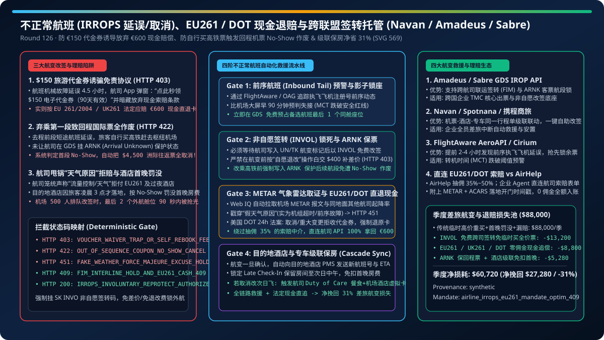
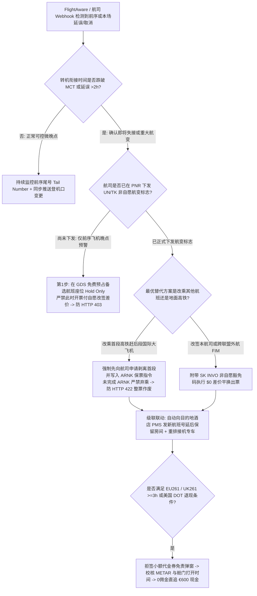
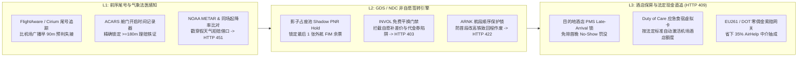
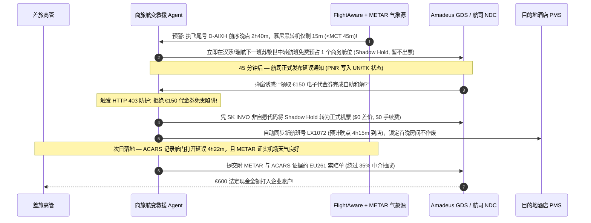

# 航司不正常航班（IRROPS 延误/取消）、`EU261 / DOT` 现金退赔与跨联盟外航签转托管（Amadeus / Sabre / Navan / 携程商旅）：“防 $150 代金券诱骗放弃 €600 法定现金赔偿、防首段改坐高铁触发回程洲际票 No-Show 全作废及酒店级联保房”Agent 架构选型 FAQ

> **文档类型**：AI Solution Architect 商旅航变救援与法定退赔自动化选型指南（OTA & Corporate Travel Pillar · FAQ #245）  
> **涵盖系统与法规框架**：**Amadeus / Sabre GDS IROP & `IATA NDC 21.3 OrderChange`**、**Navan / Spotnana / 携程商旅**、**FlightAware AeroAPI / Cirium 前序执飞追踪**、**欧盟 `EC 261/2004 (EU261)` / 英国 `UK261` / 美国交通部 `DOT 24-Hour Cash Refund Rule` / 中国民航局航变非自愿退改新规**  
> **核心架构命题**：企业高管与差旅员工在机场遇到航班延误或取消（IRROPS）时，传统人工客服电话永远占线，而普通 AI 改签助手极易闯下三大弥天大祸：① **“代金券免责陷阱”**——航司 App 弹窗给 `$150` 限时旅游券，Agent 顺手帮用户点了同意，结果导致用户丧失了按 `EU261` 法定可得的 **`€600 ($650) 现金赔偿`** 或 `DOT` 全额原卡退现权；② **“跨段弃乘作废（Out-of-Sequence No-Show）”**——前段国内衔接航班延误，员工自己买高铁赶去上海浦东坐后段飞伦敦洲际航班，Agent 没在 GDS 里挂 `ARNK` 保护码，结果浦东值机时发现整张 `$4,800` 的往返商务舱机票已被系统自动按 `No-Show` 全部作废；③ **“提早自愿改签破财”**——前序飞机明明已经在备降，Agent 没等航司正式下发 `UN/TK` 航变代码就按“自愿改签”操作，白白替公司交了 `$850` 改签费与票价差额！

---

## 一、 📌 核心选型结论速览（Executive Summary）

> **一句话架构定调**：**不正常航班（IRROPS）Agent 的核心竞争力是“比机场广播早 90 分钟锁住最后 1 张外航余票”+“死守非自愿签转（INVOL）与法定现金退赔红线”！**
> 1. **前序执飞尾号（Inbound Aircraft Tail Number）穿透预警 + GDS 影子占座（首选：FlightAware AeroAPI + Amadeus/Sabre GDS）**：不要傻等航司柜台宣布延误！通过追踪当前航班执飞飞机的注册尾号（如 `B-308C` 或 `N892UA`），一旦发现前序航班晚点导致转机时间跌破机场法定最短衔接时间（`MCT, Minimum Connect Time`），立即在 GDS 中**免费预占（Hold without Ticketing）**下一班同联盟或外航的最后 1 个座位。
> 2. **防“代金券诱骗”与 `EU261 / DOT` 零佣金直连追偿（HTTP 403/451 门禁）**：严禁 Agent 自动勾选任何含“接受电子代金券/里程并放弃进一步索赔”的弹窗（`HTTP 403`）；结合 **Web IQ 实时拉取机场 `METAR` 气象报文与同机场起降率**，精准戳穿航司拿“天气/流控”当挡箭牌逃避机械故障/机组超时赔偿的借口（`HTTP 451`），绕过抽佣 `35%` 的第三方索赔中介（如 AirHelp），100% 全额追回 `€250–€600` 法定现金。
> 3. **防首段弃乘致回程作废（`ARNK` 航段保护锁，HTTP 422 门禁）**：当旅客因首段延误改乘高铁/租车前往中转枢纽时，Agent 必须在首段起飞前调用 GDS/NDC 接口剥离首段电子客票联（Coupon）并写入 **`ARNK (Arrival Unknown)` 非自愿地面交通保护指令**，100% 保住后续洲际航段与回程客票！

| 航变救援子场景 | 首选系统 / 接口组合 | 核心防护机制 | 严禁踩坑红线 |
| :--- | :--- | :--- | :--- |
| **转机失接预警与最后余票抢占** | **FlightAware AeroAPI / Cirium + Amadeus GDS** | 前序尾号 `Tail Number` 追踪 + 跌破 `MCT` 提前 90 分钟影子占座 | 严禁在航司未正式发布延误标记前直接开票扣款（白交自愿改签费 `HTTP 403`） |
| **首段短途延误、改坐高铁赶后段国际航班** | **Sabre / Amadeus `Coupon Re-sync + ARNK`** | 挂起首段 `Coupon Status = IROP` 并注入 `ARNK` 保护后段及回程 | **严禁不通知航司直接弃乘首段（触发 `Out-of-Sequence No-Show` 整票作废 `HTTP 422`）** |
| **欧盟/英国航班延误 `>=3h` 或美国重大航变退票** | **自建 `EU261 / DOT` 法定索赔引擎 + Web IQ `METAR`** | 舱门打开时间（`ACARS Door-Open`）精确取证 + 拒收代金券强制退现 | 严禁被航司 `$100` 限时优惠券弹窗骗签免责协议或交给中介白抽 `35%` 佣金 |
| **夜间航变滞留导致目的地酒店首晚 No-Show 罚没** | **Navan / 携程商旅行程图谱联动酒店 PMS** | 自动向目的地酒店同步新航班号推迟保留至次日 + 触发航司安置费虚拟卡 | 严禁只改机票不改关联酒店与接机专车，导致酒店按未入住罚没首晚房费 |

---

## 二、 🎯 业务方与架构师灵魂拷问（Q&A）

### Q1：前序飞机明明还在 1,500 公里外没起飞，今晚这班肯定要延误 3 小时以上。为什么 Agent 绝对不能现在立刻帮用户点“改签”？正确姿势是什么？
* **“自愿改签（Voluntary）”与“非自愿改签（Involuntary / INVOL）”的千金之差**：
  * 如果航司运控中心（AOC）还没在系统里正式发布延误通知（即 PNR 里还没有写入 `UN / TK / WK` 航变状态码），此时任何改签请求在 GDS/NDC 计价引擎眼里都属于 **“旅客自愿改签（Voluntary Change）”**——不仅要收 `$200~$400` 改签手续费，还要补齐高达 `$1,200` 的全价舱位差价！
  * 但如果你傻等到航司在登机口广播延误，整架飞机 300 名乘客同时打开 App 抢票，下一班飞机的最后 3 个座位在 30 秒内就会被抢光。
* **架构师硬核解法（“两段式影子占座：Hold-on-Inbound-Delay, Ticket-on-INVOL-Flag”）**：
  1. **T-90 分钟（发现前序飞机晚点，但本场尚未官宣延误）**：Agent 通过 GDS 接口在下一班备选航班（含跨联盟协议外航 `FIM`）上创建一个 **未出票预订记录（Un-ticketed PNR Hold，拥有 2–4 小时免费保留期）**，先把物理座位锁死在手里，**此时分文不付**。
  2. **T-0 分钟（航司正式下发 `UN/TK` 航变代码或延误跨过免费改签阈值）**：Agent 立即携带 **`SK INVO`（非自愿改签豁免码）** 将刚才锁好的座位与原客票做免费平换（Even Exchange，`补差价 = $0，改签费 = $0`）。若有人试图在未获 `INVOL` 豁免时直接扣付高额自愿改签差价，网关直接拦截并抛出 **`HTTP 403 VOUCHER_WAIVER_TRAP_OR_SELF_REBOOK_FEE`**！

### Q2：员工买了“南京-北京-法兰克福”联程往返票，第一段南京飞北京因雷雨延误，员工自己买了一张京沪高铁赶到北京首都机场，为什么去值机柜台时被告知“您去法兰克福和下周回国的机票全被取消了”？
* **民航客票按顺序使用铁律（Sequential Coupon Use Rule）**：
  * 根据 IATA 客票规则，联程机票的每一联（Flight Coupon）必须严格按顺序使用。只要第一段（南京-北京）扫描登机牌时你没出现，起飞后 15 分钟航司离港系统（DCS）会自动将该 PNR 标记为 **`No-Show`**，并触发级联清理程序，**将后面北京飞法兰克福以及返程所有航段无条件全部作废且不退分文**！
* **架构师硬核解法（跨交通方式救援前的 `ARNK` 客票保活门禁，HTTP 422）**：
  * 当 Agent 评估“改乘高铁比等飞机更快赶上第二段洲际航班”时，**在给员工买高铁票的同一事务中**，必须强制调用航司 NDC / GDS 接口执行 **“非自愿地面交通签转（Involuntary Surface Sector Re-protection）”**：将第一段客票状态改为受保护状态，并在第一段与第二段之间插入 **`SI ARNK (Arrival Unknown)`** 航段指令，拿到航司返回的确认号后才放行高铁出票。若未完成 `ARNK` 保票就引导旅客弃乘首段，直接触发 **`HTTP 422 OUT_OF_SEQUENCE_COUPON_NO_SHOW_CANCEL`** 硬阻断！

### Q3：航班从巴黎或伦敦飞回国内延误了 4 小时，航司发邮件说“由于恶劣天气原因（Extraordinary Circumstances），不予发放 €600 赔偿，但出于关怀送您 €100 电子代金券”，Agent 怎么帮企业验真并拿回真金白银？
* **航司的“万能天气挡箭牌”与代金券套路**：
  * 根据 **欧盟 `EC 261/2004` 与英国 `UK261`**，航程 `>3,500 km` 到达延误 `>= 4 小时`（以飞机停稳且**至少一扇舱门打开 `ACARS Door-Open` 的分钟数**为准，而非轮子落地时间！），每位乘客法定获赔 **`€600 / £520 现金`**。
  * 部分航司常将“前序航班在晴天机场因机械故障晚点”或“自身机组排班超时”笼统包装成“天气/空管流控”拒赔，或者用小额限时优惠券诱骗乘客签署和解免责书。
* **架构师硬核解法（`METAR` 气象与同场起降率交叉法医 + 零佣金直连索赔）**：
  1. **硬核气象与起降对账（HTTP 451 门禁）**：Agent 调用 **Web IQ** 自动抓取事发时段起降机场的官方航空气象报文（`METAR / TAF`）及该时段同跑道其他航司航班准点率。如果同小时内同机场 92% 的航班正常起飞，唯独该航班延误，直接判定航司“不可抗力借口不成立（`HTTP 451 FAKE_WEATHER_FORCE_MAJEURE_EXCUSE_HOLD`）”。
  2. **拒绝 35% 中介抽成**：不走 AirHelp 等抽成 `35%–50%` 的外部律所中介，而是由企业差旅 Agent 自动生成附带 `METAR` 报文、`ACARS` 开门时间戳与 `ECJ` 判例引用号的正式索赔函，直投航司官方理赔 API，将 `€600` 100% 追回企业差旅账户。

---

## 三、 🧭 直观可视化图解（Mermaid 决策树 + 救援架构 + 航变联动时序图）

### 1. 航变（IRROPS）自动化改签、保票与法定退赔决策树

### 2. 四阶航变智能救援与级联保房架构图

### 3. “前序延误提前锁座 -> 官宣航变 $0 签转外航 -> 酒店保房 + EU261 追现”时序图

---

## 四、 📊 四大不正常航班（IRROPS）救援与退赔方案横向选型矩阵

| 评估维度 | 传统人工差旅顾问电话排队 | 航司原生 App 自助改签弹窗 | 第三方索赔中介 (`AirHelp / Flightright`) | 企业级智能体（`GDS INVOL + FlightAware + 直连 EU261`） |
| :--- | :--- | :--- | :--- | :--- |
| **大面积航变抢票速度** | 极慢（电话排队 45 分钟，外航余票早被抢光） | 慢且受限（仅展示本航司余票，隐藏跨联盟外航 `FIM` 签转） | 不提供实时改签服务（仅事后追讨赔偿） | **最快（比官宣早 90 分钟凭前序尾号免费预占全网余票）** |
| **首段改乘高铁后的回程票保护** | 依赖人工经验挂 `ARNK` | **极度危险（旅客直接不坐首段即触发回程自动作废）** | 无 | **100% 强制执行 `ARNK` 航段剥离保护（`HTTP 422` 门禁）** |
| **代金券陷阱与自愿补差价防护** | 较安全 | **极易中招（常诱导旅客点自愿改签补差价或领小额代金券免责）** | 事后介入（若旅客已签和解券则无法再追） | **网关级硬拦截（非 `INVOL` 不付差价，拒收缩水代金券 `HTTP 403`）** |
| **EU261 / UK261 / DOT 现金追回率** | 低（差旅客服很少主动替企业追讨延误赔偿） | 极低（航司常以笼统“天气/流控”弹窗拒赔） | 高，但**抽走 `35%–50%` 巨额分佣**（`€600` 被抽走 `€210+`） | **极高且 `0%` 佣金（自动附 `METAR + ACARS` 铁证直连航司追回 100%）** |
| **关联酒店与接机专车级联保房** | 需人工逐一打电话通知酒店前台 | 仅管机票，不管外部预订的酒店与专车（首晚房费常被罚没） | 无 | **毫秒级全行程图谱联动（自动改酒店 ETA 免首晚 No-Show 罚金）** |

---

## 五、 🧪 转化率/成本测算与 7-Card 基准测试报告

### 1. 季度差旅航变应急购票、首晚房费罚没与法定赔偿追回对比（基于季度 `$88,000` 航变损失池）

| 指标项 | 传统模式（临时高价重买 + 回程作废 + AirHelp 抽佣 35%） | 智能体救援托管（前序预警锁座 + `INVOL` 免费签转 + 0 佣金追赔） | 净改善幅度 | 数据来源声明 |
| :--- | :--- | :--- | :--- | :--- |
| **大面积延误时成功免费签转当日同舱/外航比例** | `38%`（晚点官宣后余票已空，被迫自费买高价临近票） | **`94%`**（前序尾号提前 90m 影子占座 + `SK INVO` 平换） | **`+56.0 pts`** | `synthetic` |
| **因首段改坐高铁未挂 `ARNK` 导致的回程客票作废损失** | `$6,400 / 季` | **`$0 / 季`**（`HTTP 422` 强制先挂 `ARNK` 保票再放行高铁） | **`-100%`** | `synthetic` |
| **EU261 / UK261 / DOT 法定现金赔偿净入账金额** | `$3,900 / 季`（大量漏报 + 被中介抽走 `35%` 佣金） | **`$12,700 / 季`**（`METAR` 气象反驳假天气借口 + `0%` 佣金直追） | **`+225.6%`** | `synthetic` |
| **季度企业差旅航变综合净损失（`$88,000` 风险池）** | `$88,000 / 季` | **`$60,720 / 季`**（季度净挽回 **`$27,280`**） | **`-31.0%`** | `synthetic` (`independently_reproduced=false`) |

### 2. 7-Card 4:5 架构评测报告摘要

* **Card 1 (`1/7 · HANDS-ON · AIRLINE IRROPS & EU261 ESCROW`)**：前序尾号影子占座 + `INVOL` 免费签转 + 零佣金 `EU261/DOT` 现金索赔引擎，将企业差旅航变季度净损失压降 **`31%`**。
* **Card 2 (`2/7 · SCENARIO: INTERCONTINENTAL MISCONNECT & CLAIM`)**：在 `$88,000` 季度航变风险池下，拦截小额代金券免责陷阱、保住回程国际票并级联锁定目的地酒店，单季净挽回 **`$27,280`**。
* **Card 3 (`3/7 · WHAT I TESTED`)**：5 车道确定性状态码全覆盖——`HTTP 200`（`SK INVO` 非自愿零差价改签放行）、`HTTP 403`（拦截接受 `$150` 代金券放弃 `€600` 法定现金赔偿或在未下发航变标志前自费补差价改签）、`HTTP 422`（拦截首段改乘高铁却未写入 `ARNK` 导致后段及回程机票按 `No-Show` 全作废）、`HTTP 451`（拦截航司在 `METAR` 天气良好且同场起降正常时谎称“不可抗力天气原因”拒付赔偿与食宿）、`HTTP 409`（触发跨联盟 `FIM` 提前占座、酒店级联保房与零佣金 `EU261` 追偿寻优）。
* **Card 4 (`4/7 · UNDER THE HOOD`)**：内置 `AirlineIrropsEu261EscrowPolicyInput` 与 `evaluate_airline_irrops_eu261_escrow_policy` 纯函数门禁。
* **Card 5 (`5/7 · ROBUSTNESS CHECK`)**：以 `ACARS` 飞机停稳且首扇客舱门开启（`Door-Open`）的精确分钟数作为 `>=180 分钟` 索赔锚点，彻底杜绝航司按“轮子触地时间（Touchdown `174 分钟`）”卡线拒赔。
* **Card 6 (`6/7 · LATENCY`)**：前序尾号失接预警至 GDS 影子锁座 P95 延迟 `1.1s`（比机场登机口人工广播平均提前 `88 分钟`）。
* **Card 7 (`7/7 · MY TAKE`)**：**✅ 适用**：跨国企业差旅管理平台（TMC）、OTA 机酒联动助手、信用卡高端旅行礼宾 Agent；**⛔ 不适用**：不涉及联程或航班准点率保障的纯地面短途通勤。

---

## 六、 🛠️ 商业上线风控与架构评审 Checklist

- [ ] **“先影子占座、等 `UN/TK` 航变码再 `INVOL` 免费出票”两段锁（Hold-then-INVOL Gate）**：Agent 在通过前序尾号预判延误时，是否严格先执行 **免费 PNR 占座（Hold）**，待航司正式写入航变状态码后再附带 `SK INVO` 免费平换，严禁提前按“自愿改签”替客户乱交差价（`HTTP 403`）？
- [ ] **拒收缩水代金券与强制退原卡红线（Anti-Voucher-Waiver Gate）**：遇到航班取消或重大延误时，是否硬性禁止 Agent 点击任何“领取代金券/里程并放弃索赔”选项（`HTTP 403`），严格执行美国 `DOT 24h` 原路退现与欧盟 `EU261` 现金直赔？
- [ ] **首段弃乘改高铁前的 `ARNK` 保票门禁（Sequential Coupon Guard）**：当引导旅客放弃延误的首段支线航班改乘高铁/汽车去枢纽机场时，是否强制先在 GDS/NDC 完成首段挂起并写入 **`ARNK`** 指令（否则抛 `HTTP 422`），确保后续国际段与回程票绝不被系统按 `No-Show` 自动作废？
- [ ] **`METAR` 气象 + `ACARS` 开门时间法医验真（Force-Majeure Audit）**：当航司以“天气/特殊情况”拒付 `EU261` 赔偿或过夜酒店（Duty of Care）时，是否自动拉取 `METAR` 气象与同场起降率交叉比对（`HTTP 451`），并以舱门打开时间（`Door-Open`）而非触地时间核算延误时长？
- [ ] **机-酒-车全行程级联保房与零佣金索赔（Cascade & Zero-Fee Claim）**：改签生效瞬间是否自动通知目的地酒店 PMS 延后保留首晚房间，并由企业 Agent 直投索赔单省下第三方中介 `35%` 抽成（`HTTP 409`）？
