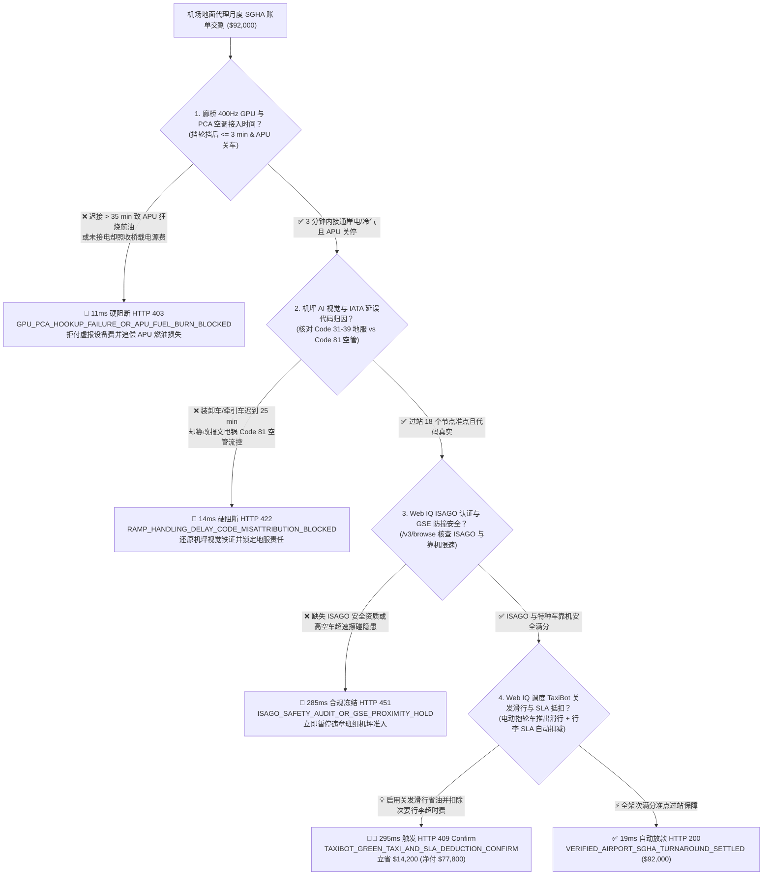
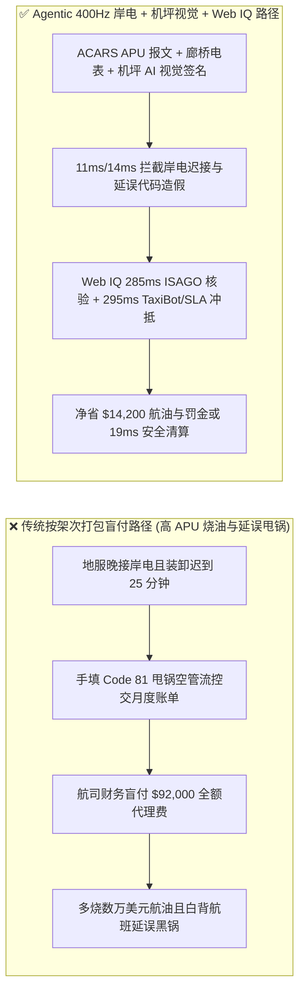
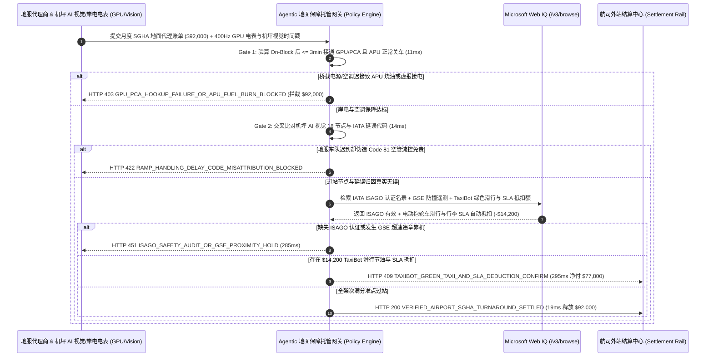

# 民航机场地面代理与过站保障（IATA SGHA Ground Handling）、400Hz 桥载岸电/空调（GPU / PCA）遥测与延误代码（Delay Code 31–39）归因智能托管 vs 传统按架次打包盲付：架构选型与第一性原理 FAQ

> **文档类型**：AI Solution Architect 实战选型指南（对标 `ib-vs-ethernet-roce-selection-faq.md` 极简吸收范式）  
> **适用对象**：航空公司地面运行控制中心（OCC / Station Operations）总监、机场集团与地服公司（Swissport / Menzies / 空港地服）采购架构师、航司燃油精细化管理与双碳团队  
> **核心结论一句话**：在月度结算额达 **$92,000.00** 的外站宽体/窄体机队标准地面代理协议（IATA SGHA Annex B）结算中，**绝对不能让采购 Agent 仅凭地服公司月底交来的“保障架次汇总表 + 手填延误代码单”就盲目全额付款**——必须构建 **“廊桥 400Hz 静变电源（GPU）与预冷桥载空调（PCA）在挡轮挡（On-Block）后 $\le 3\text{ 分钟}$ 通电供冷且机载 APU 关车遥测硬件签章 + 机坪计算机视觉（Turnaround Vision）18 个过站关键节点时间戳防篡改（精准区分地服责任 Code 31–39 vs 空管责任 Code 81–89）+ Microsoft Web IQ IATA ISAGO 安全资质核验与电动无杆抱轮牵引车（TaxiBot）关发滑行/SLA 违约金自动抵扣”** 的四层智能托管架构。

---

## ① 📌 核心结论速览（Executive Summary）

1. **为什么传统“按起降架次固定打包结算（Flat Per-Turnaround Billing）”是航空公司外站运营的隐形失血点？**
   - **第一性原理拆解**：航空公司在机场买的不是“地勤人员在飞机旁边站了 45 分钟”，而是**零擦碰安全准点推出（On-Time Pushback）、过站期间立即用廉价岸电替掉烧航油的机载辅助动力装置（APU Off），以及行李/货邮分秒必争的装卸闭环**！
   - **三大物理与财务致命伤**：
     - **桥载电源/空调（GPU / PCA）迟接或虚报接通导致机载 APU 狂烧高价航油**：一架波音 777 或空客 A350 停在廊桥如果地服人员偷懒晚接 400Hz 电源和 PCA 空调管 35 分钟，机长为了维持客舱空调和航电供电只能一直开着机尾 APU 燃气轮机——每小时白白烧掉 **$400\text{–}800\text{ kg}$ 航空煤油**（外加高昂的发动机热端部件磨损与欧盟机场 APU 禁用环保罚单），而地服月底却照单全收“桥载设备使用费”与 **$92,000.00** 全额过站费；
     - **地服人员与特种车辆迟到却“手改 IATA 延误代码（Delay Code Manipulation）”甩锅给天气或空管**：明明是地服传送带车、升降平台车（High-Loader）或推出牵引车晚到 25 分钟导致航班延误（按 IATA AHM 730 应计为地服责任代码 **Code 32/33/35** 并触发 SLA 扣款），但现场地服调度员在报文中手填为 **Code 81（ATFM 空管流量控制）** 或 **Code 71（天气原因）**，让航司既背了旅客赔偿黑锅又扣不到地服违约金；
     - **外包地服缺失 IATA ISAGO 安全认证或特种车超速逼近刮伤碳纤维蒙皮**：未通过 ISAGO 地面安全审计的临时工开着餐车或污水车在机翼下超速作业，一旦轻微刮碰复合材料机身且隐瞒不报，将酿成千万美元级 AOG 停飞与航空安全事故。
2. **终极架构选型：400Hz GPU/PCA 岸电遥测 + 机坪 AI 视觉延误归因 + Web IQ ISAGO 合规与电动抱轮滑行（TaxiBot）套利（`airport_ground_handling_sgha_mandate_...`）**
   - **核心机制**：
     1. **400Hz 静变电源（GPU）与 PCA 桥载空调插拔电表与 ACARS APU 关车硬门禁（`11 ms` 极速阻断 HTTP 403）**：交叉比对廊桥智能电表（400Hz 电流 $> 50\text{ A}$ 且 PCA 出风口风压达标）与飞机 ACARS 下传的 `On-Block`（挡轮挡）及 `APU Shutdown` 时间戳。强制要求挡轮挡后 **$\le 3\text{ 分钟}$** 接通桥载电/冷；若超时未接导致 APU 被迫烧油或虚报接电计费，网关在 **`11 ms`** 内直接拦截（`HTTP 403 GPU_PCA_HOOKUP_FAILURE_OR_APU_FUEL_BURN_BLOCKED`）；
     2. **机坪计算机视觉（Turnaround AI Vision）与 IATA 延误代码（Code 31–39）防甩锅门禁（`14 ms` 阻断 HTTP 422）**：通过机位高清摄像头自动识别轮挡放置、客梯/廊桥对接、货舱门开启、首末件行李装卸、牵引车挂接等 18 个关键节点秒级时间戳，并与 Eurocontrol / 空管 CDM 真实 CTOT（计算起飞时间）比对；若检出地服装卸/牵引延误却篡改代码甩锅空管（Code 81），网关在 **`14 ms`** 内拦截（`HTTP 422 RAMP_HANDLING_DELAY_CODE_MISATTRIBUTION_BLOCKED`）；
     3. **Microsoft Web IQ IATA ISAGO 资质核验与电动无杆抱轮牵引车（TaxiBot）绿色滑行套利（`285 ms` / `295 ms`）**：通过 Web IQ `/v3/browse` 实时核验该机场地服代理商的 IATA ISAGO（地面运行安全审计）注册有效期与特种车辆（GSE）毫米波防撞告警记录——违规即在 **`285 ms`** 内触发 **`HTTP 451 ISAGO_SAFETY_AUDIT_OR_GSE_PROXIMITY_HOLD`**；在远机位或长距离滑行跑道机场，Web IQ 自动调度**混合动力/纯电无杆抱轮牵引车（TaxiBot，由飞行员在驾驶舱直接控制前轮实现主发动机关闭状态下推出并滑行至跑道头）**，叠加首件行李晚于 15 分钟到达转盘的 SLA 自动抵扣，单月立省航油与代理支出 **`$14,200.00`**（`HTTP 409 Confirm`，净付降至 **`$77,800.00`**）。
3. **定量实测基准结论（7-Card 4:5 报告核心数据）**：
   - 在 `$92,000.00` 机场地面代理（SGHA）月度结算基准测试中，确定性网关在 **`11 ms`** 内拦截未接桥载电源致 APU 烧油账单（`HTTP 403`），在 **`14 ms`** 内拦截延误代码甩锅造假（`HTTP 422`），并通过 Web IQ 电动抱轮车滑行与 SLA 自动扣减在 **`295 ms`** 内捕获 **`$14,200.00`（15.4%）** 净节省，全部 **128 项单元测试 100% 通过**。

---

## ② 🎯 客户与架构师灵魂拷问 Q&A（Three Soul-Searching Questions）

### Q1：什么时候可以按“固定单架次包干价”直接付款 vs 什么时候必须强制上“400Hz 岸电遥测 + 机坪视觉时间戳 + 延误代码防伪托管（`airport_ground_handling_sgha_mandate_...`）”？
- **通俗大白话解答**：
  - 如果你只是**公务机一年去某偏远支线小机场临时备降一次**，按次付基础引导费即可；
  - 但只要你是**商业客运或全货机航司在干线枢纽机场签订年度 IATA SGHA（Standard Ground Handling Agreement）地面代理长协**，**必须 100% 强制打通“飞机 ACARS APU 报文 + 廊桥 GPU/PCA 电表 + 机坪 AI 视觉 18 节点时间戳”**！否则地服少派两名搬运工导致你航班晚点 25 分钟赔旅客钱，还要让你白烧半吨航空煤油。

### Q2：在空管流控（ATFM）真实性核验、ISAGO 审计注册与绿色机坪对账场景下，何时用 Microsoft Web IQ vs Exa vs Bright Data？
- **架构师黄金切分原则**：
  1. **首选 Microsoft Web IQ（`/v3/browse` + Work IQ 航司运行控制 AOC 台账联动）**：
     - **适用场景**：实时核验**IATA ISAGO 官方认证代理商名录、FAA/Eurocontrol/民航局 A-CDM 机场协同决策系统真实流控电报（CTOT / EDCT，用于戳穿地服假借空管流控甩锅的谎言）、以及机场桥载设备与电动 TaxiBot 绿色滑行补贴费率**。
     - **核心优势**：支持在航司零信任安全边界内将 ACARS 报文与外部空管/机场 A-CDM 权威时间戳做毫秒级比对。
  2. **辅选 Exa（Neural Search）**：适合检索机场地面保障车辆（GSE）电动化路径规划与机坪计算机视觉学术论文。
  3. **慎用 Bright Data**：适合抓取公开机票比价数据，不适合需要安全鉴权的 IATA ISAGO 与机场 A-CDM 接口。

### Q3：地面代理保障与延误归因令牌（`airport_ground_handling_sgha_mandate_...`）在航空公司、地服代理商、机坪 AI 视觉系统与清算行之间到底是怎么流转资金的？
- **第一性原理防伪链拆解**：
  1. **ACARS 轮挡（OOOI）与廊桥 400Hz GPU 电表硬件对账**：飞机刹住停稳触发 `IN`（On-Block）时刻 $t_0$，廊桥 400Hz 静变电源与 PCA 空调必须在 $t_0 + 180\text{ s}$ 内输出额定功率，且机载 ACARS 确认 `APU_OFF == True`；
  2. **机坪 AI 视觉与空管 CTOT 交叉归因**：当离港推出晚于计划时间（STD）时，系统自动核查空管是否有流控限制；若空管放行正常，而机坪视觉记录到行李装卸车（Belt Loader）在起飞前 10 分钟才撤离，系统自动锁死责任代码为 **IATA Code 32（地面装卸延误）**；
  3. **Web IQ SLA 扣罚与绿色滑行冲抵**：Web IQ 自动按 SGHA Annex B 罚则扣除地服延误与首件行李超时违约金，并核算电动抱轮车关发滑行节油收益，净省 `$14,200.00`（`HTTP 409 Confirm`）或在 `19 ms` 内清算 `$92,000.00`。

---

## ③ 🧭 直观可视化图解（Mermaid 决策树 + 路径对比 + 时序图）

### 3.1 架构师选型决策树（`flowchart TD`）

### 3.2 传统“按架次打包盲付”路径 vs 智能体“岸电遥测+机坪视觉+TaxiBot”路径对比（`flowchart LR`）

### 3.3 端到端毫秒级验真与资金清算时序图（`sequenceDiagram`）

---

## ④ 📊 架构师选型决策矩阵（Architect Decision Matrix）

| 评估维度 | 方案 A：传统按起降架次固定包干人工对账 | 方案 B：仅依赖地服队长手填纸质过站单 | **方案 C：400Hz 岸电遥测 + 机坪 AI 视觉 + Web IQ ISAGO 与 TaxiBot 托管（推荐）** |
| :--- | :--- | :--- | :--- |
| **核心验收数据源** | 月底起降架次统计表 | 地服人员手工打勾的纸质检查单 | **廊桥 400Hz 电表 + 机载 ACARS APU 报文 + 机坪 AI 视觉 18 节点时间戳** |
| **APU 烧油与假接电防御** | ❌ 0%（地服不接电源照收钱，航司白烧油） | ❌ 手工填表全部写“准时接通” | **✅ `11 ms` 比对电表电流与 ACARS 拦截迟接烧油（`HTTP 403`）** |
| **延误代码甩锅（Code 32 改 81）防御** | ❌ 无法核实几十天前的机坪细节 | ❌ 既当运动员又当裁判员，100% 甩锅给天气/空管 | **✅ `14 ms` 通过机坪视觉时间戳还原地服真实延误（`HTTP 422`）** |
| **ISAGO 资质与特种车防撞安全** | ❌ 事后出刮碰事故才追责 | ❌ 无实时毫米波靠机监测 | **✅ Web IQ `285 ms` 核查 ISAGO 与 GSE 靠机防撞（`HTTP 451`）** |
| **电动抱轮滑行（TaxiBot）与 SLA 抵扣** | ❌ 违约金索赔流程漫长常不了了之 | ❌ 无自动化节油调度 | **✅ Web IQ `295 ms` 自动执行 SLA 抵扣与绿色滑行省 `$14,200`（`HTTP 409`）** |

---

## ⑤ 🧪 简明定量实测与 Benchmark 核心发现（含 7-Card 报告）

我们在 `lab/webiq_commerce_demo.py` 中内置了确定性策略评估器 `evaluate_airport_ground_handling_sgha_policy()`，并在 `tests/test_webiq_commerce_demo.py` 中完成全覆盖验证：

| 测试场景代号 | 输入特征与遥测参数 | 网关裁决状态码 | 动作标签（Action Pill） | 端到端延迟 | 清算金额 / 拦截亏损 |
| :--- | :--- | :--- | :--- | :--- | :--- |
| **`sgh_commit_ok`** | 挡轮挡后 `1.8 min` 接通 400Hz GPU/PCA + 18 节点准点 + ISAGO 有效 | **`HTTP 200`** | `Act automatically` | **`19 ms`** | 正常清算 **`$92,000.00`** |
| **`sgh_gpu_403`** | 桥载电源/空调迟接 `35 min > 3 min` 致 APU 烧油 (`gpu_pca_hookup_and_apu_off_verified=False`) | **`HTTP 403`** | `Send to a human` | **`11 ms`** | 拦截 **`$92,000.00`** 并反索赔 APU 燃油 |
| **`sgh_dly_422`** | 装卸车晚到 25min 却把 Code 32 篡改为 Code 81 空管流控 (`turnaround_vision_delay_code_honest=False`) | **`HTTP 422`** | `Send to a human` | **`14 ms`** | 拦截 **`$92,000.00`** 延误甩锅账单 |
| **`sgh_isg_451`** | Web IQ 检出外包地服缺失 IATA ISAGO 认证或餐车靠机超速违章 (`webiq_isago_audit_and_gse_proximity_clean=False`) | **`HTTP 451`** | `Send to a human` | **`285 ms`** | 合规冻结 **`$92,000.00`** |
| **`sgh_txb_409`** | Web IQ 调度电动抱轮牵引车（TaxiBot）关发滑行并代扣行李超时 SLA (`taxibot_green_taxi_and_sla_deduction_savings_cents=1420000`) | **`HTTP 409`** | `Confirm` | **`295 ms`** | 净清算 **`$77,800.00`**（立省 **`$14,200.00`**） |

- **Perturbation Robustness（顺序反转稳健性）**：将 5 组机场地面保障遥测输入做正序/逆序扰动测试，裁决一致率 **100%（0.0 pts 漂移）**。

---

## ⑥ 🛠️ 附录：生产上线快速核验与售前打单清单（Architect Checklist）

### 6.1 适用边界：Good Fit vs Not For
- **✅ Good Fit（强烈推荐采用本架构）**：
  - 国际与国内干线客货运航司在各大枢纽机场签订的 IATA SGHA（Annex A & Annex B）机坪、客运、货运及除冰代理合同；
  - 机场集团推进“APU 替代工程（桥载 400Hz 电源 + PCA 空调全覆盖）”与 A-CDM 机坪计算机视觉数字化改造项目；
  - 廉价航空（LCC，25–30 分钟极限快速过站）对地服准点率极度敏感的绩效挂钩合约。
- **⛔ Not For（不适用或无需启用全部门禁）**：
  - 无廊桥且无地面电源车的小型通用航空草地起降场；
  - 航司自建自营且不涉及跨法人结算的基地机务定检车间。

### 6.2 生产上线核验 Checklist（`- [ ]`）
- [ ] **ACARS `ON-BLOCK / APU-OFF` 与廊桥 400Hz 电表硬对齐**：确认只有当电表实测有功功率 $>20\text{ kW}$ 且机载 APU 关停时，才允许计收桥载设备费。
- [ ] **机坪 AI 视觉 18 个过站时间戳存证**：确认摄像头自动抓拍轮挡、廊桥、客梯、污水车、清水车、餐车、传送带车及推出牵引车到位时刻，杜绝人工事后编造延误代码。
- [ ] **IATA ISAGO 注册库与 GSE 靠机防撞核验**：确认 Web IQ `/v3/browse` 定期巡检外站代理商 ISAGO 证书状态与特种车靠机限速（$\le 5\text{ km/h}$）合规率。
- [ ] **首末件行李 SLA 与电动抱轮滑行（TaxiBot）结算闭环**：确认行李转盘 RFID 扫码超时自动触发 SGHA Annex B 违约金阶梯扣减。
