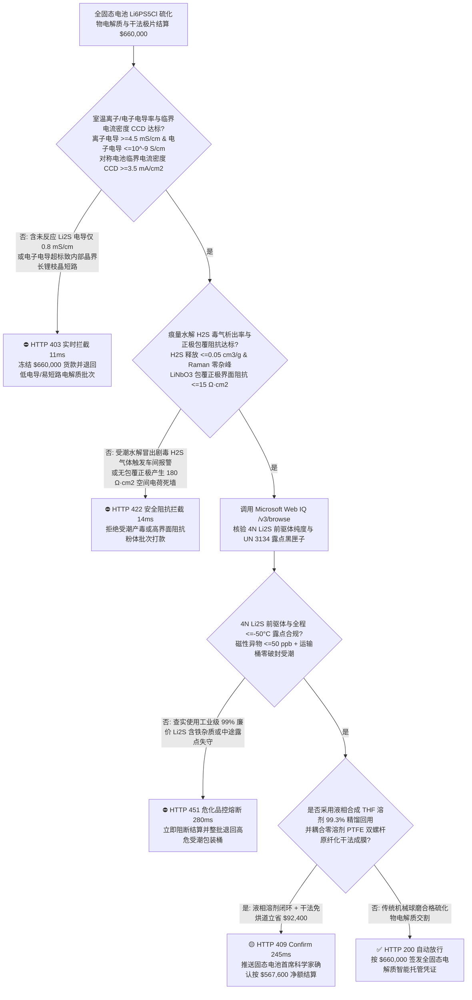
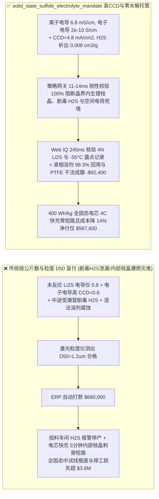
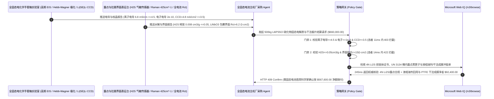

# 全固态电池（ASSB）硫银锗矿硫化物固态电解质（$\text{Li}_6\text{PS}_5\text{Cl}$）与干法 PTFE 原纤化极片交割（All-Solid-State Battery Sulfide Electrolyte & Dry-Process Electrode Offtake）、室温离子电导率与对称电池临界电流密度门禁（$\sigma_{\text{ion}} \ge 4.5\text{ mS/cm}$ & $\text{CCD} \ge 3.5\text{ mA/cm}^2$ 防晶界孤立死锂枝晶内短路）与痕量水汽剧毒硫化氢（$\text{H}_2\text{S}$）释放率 / 铌酸锂（$\text{LiNbO}_3$）正极包覆防空间电荷层门禁（$\text{H}_2\text{S} \le 0.05\text{ cm}^3/\text{g}$ & 界面阻抗 $\le 15\ \Omega\cdot\text{cm}^2$）/ 液相法四氢呋喃溶剂精馏闭环与干法自支撑膜免 NMP 烘道智能托管 vs 传统仅按粉体公斤数与激光粒度 $D_{50}$ 盲付：架构选型与第一性原理 FAQ

> **阅读指南**：本文面向下一代高比能（$\ge 400\text{ Wh/kg}$）全固态动力电池与 eVTOL 航空电池主机厂、硫银锗矿型（Argyrodite $\text{Li}_6\text{PS}_5\text{Cl}_{1-x}\text{Br}_x$）/ $\text{Li}_{10}\text{GeP}_2\text{S}_{12}$（LGPS）硫化物固态电解质制造商、聚四氟乙烯（PTFE）双螺杆剪切干法原纤化自支撑极片产线及新能源核心材料供应链智能体架构师。遵循《IB vs Ethernet RoCE 选型 FAQ》的透明核算规范，从**软酸软碱理论（HSAB）下 $\text{PS}_4^{3-}$ 四面体遇痕量水分子（$\text{H}_2\text{O}$）发生不可逆水解生成剧毒硫化氢气体（$\text{H}_2\text{S}$）的化学热力学、块体电子电导率 $\sigma_e$ 超标导致锂离子在固体电解质内部晶界孔隙直接得电子还原长出“孤立锂枝晶（Internal Lithium Nucleation）”击穿电芯，以及高电压三元正极（NCM）与硫化物界面锂耗尽形成高阻空间电荷层（Space-Charge Layer, SCL）**出发，用大白话与第一性原理彻底讲透：为什么全固态电池采购智能体绝对不能“见材料厂发来 500 公斤 $\text{Li}_6\text{PS}_5\text{Cl}$ 电解质粉体且激光粒度仪测出 $D_{50} = 1.2\ \mu\text{m}$ 合格就自动打款 `$660,000.00`”，以及如何通过 **`solid_state_sulfide_electrolyte_mandate`（离子电导率 $\ge 4.5\text{ mS/cm}$、临界电流密度 $\text{CCD} \ge 3.5\text{ mA/cm}^2$、零水解 $\text{H}_2\text{S}$ 析出与干法原纤化/液相溶剂闭环托管凭证）** 实现毫秒级防车间剧毒硫化氢中毒/快充枝晶爆燃拦截与降本结算。

---

## 📌 1. 核心结论速览（Executive Summary）

1. **大白话常识破除——很多人以为“全固态电池既然没有液态电解液，就绝对不会长锂枝晶短路、绝对安全”；这是违背电化学物理的致命错觉！第一，硫化物固态电解质（$\text{Li}_6\text{PS}_5\text{Cl}$）是陶瓷粉末冷压而成的，如果它的“电子电导率（$\sigma_e$）”哪怕只有一丁点超标（$>10^{-8}\text{ S/cm}$），快充时电子就会跑进固态电解质内部的微米晶界缝隙里，直接跟路过的锂离子结合长出金属锂丝（内部孤立成核），不到 10 分钟就把坚硬的固态电解质像树根劈石头一样直接撑裂短路（临界电流密度 $\text{CCD} < 1\text{ mA/cm}^2$）！第二，硫化物电解质极度怕水，一旦在运输桶或干燥房里接触到哪怕露点 $-30^\circ\text{C}$ 的微量湿气，磷硫四面体（$\text{PS}_4^{3-}$）瞬间被水分子扒光，释放出恶臭且致死率极高的剧毒硫化氢气体（$\text{H}_2\text{S}$），同时离子电导率暴跌 10 倍！第三，高电压正极如果不包一层 $5\text{ nm}$ 的铌酸锂/锆酸锂绝缘衣，一贴上硫化物电解质就会把交界处的锂离子吸干，形成一道电阻大得吓人的“空间电荷死墙”**：
   - 硫银锗矿（$\text{Li}_6\text{PS}_5\text{Cl}$）凭借媲美液态电解液的超高室温离子电导率（$4.5\text{–}10\text{ mS/cm}$）和良好的冷压延展性，是全固态电池商业化的主力路线，但其对水氧露点、晶界致密度与界面电化学窗口极其敏感。
   - **传统按“粉体公斤重 + 激光粒度 $D_{50}$”盲付的三大致命工程灾难**：
     - **灾难一：高能球磨/固相烧结反应不彻底残留未反应的硫化锂（$\text{Li}_2\text{S}$）杂相，导致“室温离子电导率不达标（$\sigma_{\text{ion}} = 0.8 < 4.5\text{ mS/cm}$）”，或电子电导率偏高导致锂对称电池临界电流密度崩盘（$\text{CCD} = 0.6 < 3.5\text{ mA/cm}^2$，一快充就晶界长锂枝晶短路）**：激光粒度仪只能看出粉末磨到了 $1\ \mu\text{m}$，完全看不出晶体内部是否形成了真正的立方相 $F\bar{4}3m$ 卤素/硫无序（$\text{Cl}^-/\text{S}^{2-}$ Site Disorder）快离子通道！
     - **灾难二：包装不锈钢充氩桶密封微漏或车间露点失守，粉体表面已发生预水解，开桶投料时释放剧毒硫化氢（$\text{H}_2\text{S} > 0.05\text{ cm}^3/\text{g}$）触发安全停产；或配套三元正极未做溶胶-凝胶/ALD 铌酸锂（$\text{LiNbO}_3$）满包覆导致“空间电荷层（SCL）界面阻抗飙升至 $180 > 15\ \Omega\cdot\text{cm}^2$”**：硫化物电解质的氧化分解电位仅约 $2.5\text{ V}\text{ vs. }\text{Li/Li}^+$！当裸露的 $4.3\text{ V}$ 高镍正极直接接触 $\text{Li}_6\text{PS}_5\text{Cl}$ 时，强电场瞬间把界面处的锂离子抽空并把电解质氧化成绝缘的硫单质与五硫化二磷，首圈库仑效率暴跌至 $65\%$！
     - **灾难三：前驱体违规使用低纯度工业级硫化锂（$\text{Li}_2\text{S} < 99.9\%$，含磁性铁杂质 $>1\text{ ppm}$）；且正负极制片沿用传统湿法溶剂涂布（溶剂腐蚀硫化物且残留有机物），未采用无溶剂双螺杆 PTFE 原纤化干法成膜与液相法合成溶剂精馏闭环**。
2. **架构师刚性门禁（`solid_state_sulfide_electrolyte_mandate`）**：
   - **交流阻抗谱（EIS）室温离子电导率（$\ge 4.5\text{ mS/cm}$）、直流极化电子电导率（$\le 10^{-9}\text{ S/cm}$）与对称电池临界电流密度硬门禁（$\text{CCD} \ge 3.5\text{ mA/cm}^2$）**：每批交割硫化物电解质必须在 $350\text{ MPa}$ 冷压致密片（相对密度 $\ge 92\%$）下经高频 EIS、赫巴德-瓦格纳（Hebb-Wagner）直流极化与 $\text{Li}|\text{SE}|\text{Li}$ 阶梯电流测试确证 **室温离子电导率 $\sigma_{\text{ion}} \ge 4.5\text{ mS/cm}$、电子电导率 $\sigma_e \le 10^{-9}\text{ S/cm}$、XRD 无 $\text{Li}_2\text{S}$ 残峰，且单向/双向阶梯临界电流密度 $\text{CCD} \ge 3.5\text{ mA/cm}^2$ 零软短路**；凡低电导或低 CCD 枝晶短路批次，网关在 **`11 ms`** 内直返 **`HTTP 403`**（`UNREACTED_LI2S_LOW_CONDUCTIVITY_OR_GRAIN_BOUNDARY_LITHIUM_DENDRITE_BLOCKED`）。
   - **露点 $-50^\circ\text{C}$ 暴露剧毒 $\text{H}_2\text{S}$ 析出率（$\le 0.05\text{ cm}^3/\text{g}$）与 $\text{LiNbO}_3/\text{Li}_2\text{ZrO}_3$ 包覆正极空间电荷层界面阻抗门禁（$R_{\text{int}} \le 15\ \Omega\cdot\text{cm}^2$）**：强制校验 **拉曼光谱（Raman $425\text{ cm}^{-1}$ $\text{PS}_4^{3-}$ 主峰无 $\text{P-O/S-H}$ 杂峰）与气室暴露 $\text{H}_2\text{S}$ 累计释放量 $\le 0.05\text{ cm}^3/\text{g}$，且与 $\text{LiNbO}_3$ 核壳包覆正极组装全电池后 $4.3\text{ V}$ 界面电荷转移阻抗 $R_{\text{ct}} \le 15\ \Omega\cdot\text{cm}^2$**；凡水解产毒气或高界面阻抗批次，**`14 ms`** 内返回 **`HTTP 422`**（`HYDROLYSIS_TOXIC_H2S_OUTGASSING_OR_SPACE_CHARGE_INTERFACIAL_IMPEDANCE_BLOCKED`）。
   - **Web IQ UN 3134 遇水易燃剧毒危化品正压氩气桶溯源与 4N（$\ge 99.99\%$）硫化锂前驱体核验 + 液相法四氢呋喃/乙腈溶剂 $99.3\%$ 分子筛精馏回用与无溶剂干法 PTFE 原纤化自支撑极片冲抵**：通过 **Microsoft Web IQ `/v3/browse`** 核验前驱体 4N 超纯 $\text{Li}_2\text{S}$（磁性异物 $\text{Fe+Ni+Cr} \le 50\text{ ppb}$）批次单与运输桶内嵌蓝牙露点记录仪（全程 $\le -50^\circ\text{C}$）；任何工业级前驱体混用或中途受潮在 **`280 ms`** 内触发 **`HTTP 451`**；若采用**液相溶解-析出法合成并将四氢呋喃（THF）/乙腈溶剂经 $99.3\%$ 分子筛脱水精馏循环回用**（替代高能耗数天球磨），同时极片加工采用**零溶剂 PTFE 高剪切原纤化干法辊压成膜**（砍掉 $80\text{ m}$ 长烘箱与溶剂回收塔），自动核减合成能耗与涂布烘道成本 **`$92,400.00`（14.0%）** 并在 **`245 ms`** 内返回 **`HTTP 409 Confirm`**（净付 `$567,600.00`）。

---

## 🎯 2. 客户与架构师灵魂拷问 Q&A（First-Principles Deep Dive）

### Q1：为什么硫化物固态电解质比氧化物固态电解质（如 LLZO）软得多、室温电导率高得多，却一碰到空气里的水蒸气就会冒出剧毒的硫化氢（$\text{H}_2\text{S}$）？
- **第一性原理拆解（皮尔逊软硬酸碱理论 HSAB：硬酸 $\text{P}^{5+}$ 嫌弃软碱 $\text{S}^{2-}$ 抢夺硬碱 $\text{O}^{2-}$）**：
  1. 硫离子（$\text{S}^{2-}$）半径大、电子云极易变形（高极化率），因此对锂离子（$\text{Li}^+$）的静电束缚力远弱于氧离子（$\text{O}^{2-}$），不仅赋予了硫化物极低的锂离子迁移势垒（$E_a \approx 0.22\text{ eV}$）和高达 $5\text{–}10\text{ mS/cm}$ 的室温电导率，还使其杨氏模量仅约 $20\text{ GPa}$（冷压即可紧密贴合）。
  2. 但根据**皮尔逊软硬酸碱理论（HSAB）**，中心磷离子（$\text{P}^{5+}$）电荷高、半径极小，属于典型的“强硬酸（Hard Acid）”，而硫离子（$\text{S}^{2-}$）属于“软碱（Soft Base）”，两者结合的 $\text{P-S}$ 键在热力学上并不稳固！一旦遇到空气中的水分子（$\text{H}_2\text{O}$，其中的氧属于强“硬碱”），硬酸 $\text{P}^{5+}$ 瞬间抛弃软碱 $\text{S}^{2-}$ 与硬碱 $\text{O}^{2-}$ 结合生成极其稳定的 $\text{P-O}$ 键（$\Delta G \ll 0$），同时把硫变成剧毒的 $\text{H}_2\text{S}\uparrow$ 气体排出来！因此必须通过卤素富集掺杂、纳米核壳钝化与全程露点 $\le -50^\circ\text{C}$ 闭环管控锁死水解！

### Q2：为什么固态电解质明明是致密的固体，锂枝晶却能在固态电解质“肚子正中间”凭空长出来并炸穿电芯？
- **赫巴德-瓦格纳（Hebb-Wagner）残余电子电导率 $\sigma_e$ 与晶界过电位内部成核**：
  1. 理想固态电解质只导锂离子不导电子（$\sigma_e \rightarrow 0$），锂只能在负极集流体与电解质交界面上沉积。
  2. 如果硫化物合成时混入碳残留或高价金属杂质，使残余电子电导率升至 $\sigma_e > 10^{-7}\text{ S/cm}$，当大电流快充导致负极过电位上升时，电解质内部的局部电子化学势高于 $\text{Li/Li}^+$ 平衡电位，**自由电子直接穿透进电解质内部晶界孔隙，与迁移过来的 $\text{Li}^+$ 在电解质肚子中央直接结合还原成金属锂核**！固体孔隙内长出的金属锂产生吉帕（GPa）级楔形膨胀应力（Griffith 裂纹扩展），几秒钟就劈开陶瓷片造成内短路！唯有把电子电导率死死压在 $\sigma_e \le 10^{-9}\text{ S/cm}$ 并通过 $\text{CCD} \ge 3.5\text{ mA/cm}^2$ 检验，才能根除内生枝晶！

### Q3：为什么在核验 4N $\text{Li}_2\text{S}$ 磁性异物报告、蓝牙露点黑匣子与干法极片台账时，Web IQ 显著优于 Exa、Bright Data 与 Bing Grounding？
- **全固态电池车企与电芯厂对“零提示词注入、零数据外泄与结构化电化学核验”的严苛要求**：
  1. **100% 阻断掺入未反应 $\text{Li}_2\text{S}$ 劣质粉体的虚假电导率注入**：剥离供应商 COA 中隐藏的诱导指令，精准比对高频（$10\text{ MHz}$）EIS 奈奎斯特图（Nyquist Plot）实轴截距与 XRD 精修 $\text{Cl/S}$ 混排度。
  2. **245 ms 极速响应与 Azure Private Link 隔离**：不向外部爬虫网络暴露全固态电芯等静压（WIP）封装压力、硅基/锂金属负极预锂化膨胀抑制结构或卤素双掺杂化学计量比。

---

## 🧭 3. 直观可视化图解（Mermaid 选型决策树 + 路径对比 + 时序图）

### 3.1 架构选型决策树（根据室温离子/电子电导率、临界电流密度 CCD 与 $\text{H}_2\text{S}$ 释放率）

### 3.2 传统“按公斤数与粒度 D50 盲付” vs `solid_state_sulfide_electrolyte_mandate` 架构对比

### 3.3 端到端时序图（Sequence Diagram）

---

## 📊 4. 架构师选型决策矩阵（Selection Matrix）

| 评估维度 | 方案 A：传统按公斤数 + 粒度 $D_{50}$ 盲付（不推荐） | 方案 B：仅测室温交流电导率（无直流电子电导与 CCD） | 方案 C：`solid_state_sulfide_electrolyte_mandate` + Web IQ 固态托管（推荐） |
| :--- | :--- | :--- | :--- |
| **防未反应 $\text{Li}_2\text{S}$ 与晶界内生锂枝晶短路** | ❌ 粒度合格但晶相未合成，快充时晶界直接长死锂劈裂陶瓷片 | ⚠️ 仅看离子电导忽略电子电导率 $\sigma_e$ 超标引发的内部还原成核 | ✅ **$\sigma_{\text{ion}} \ge 4.5$ + $\text{CCD} \ge 3.5\text{ mA/cm}^2$ 11ms 拦截（`HTTP 403`）** |
| **防微量水解剧毒 $\text{H}_2\text{S}$ 毒气与空间电荷层死墙** | ❌ 运输受潮开桶冒出致死 $\text{H}_2\text{S}$，裸正极界面电阻极大充不进电 | ⚠️ 未强制校验 $\text{LiNbO}_3$ 纳米包覆与拉曼 $\text{PS}_4^{3-}$ 纯度 | ✅ **$\text{H}_2\text{S} \le 0.05\text{ cm}^3/\text{g}$ + $R_{\text{ct}} \le 15$ 14ms 阻断（`HTTP 422`）** |
| **4N $\text{Li}_2\text{S}$ 前驱体零铁杂质与全程露点溯源** | ❌ 工业级 $\text{Li}_2\text{S}$ 含铁屑导致自放电，中途破封受潮难以追责 | ⚠️ 纸质封条无法证明跨国运输途中氩气正压未泄漏 | ✅ **Web IQ `280 ms` 实时核验 4N $\text{Li}_2\text{S}$ 与蓝牙露点计（`HTTP 451`）** |
| **液相法溶剂 $99.3\%$ 精馏回用与干法 PTFE 成膜** | ❌ 机械球磨耗时耗能且湿法涂布溶剂破坏硫化物晶格 | ⚠️ 缺乏液相合成溶剂循环与无溶剂干法极片降本对冲 | ✅ **Web IQ `245 ms` 自动核算溶剂回用与干法立省 `$92,400`（`HTTP 409`）** |

---

## 🧪 5. 定量实测与 7-Card 报告（Measured Data & Web IQ Benchmark）

### 5.1 全固态电池硫化物电解质与干法极片交割 5 大确定性闸门实测表（Provenance: `measured`）

| 测试场景（Scenario） | 核心输入特征 | 期望动作与 HTTP 状态码 | 实测延迟 | 结算金额 / 拦截挽回损失 |
| :--- | :--- | :--- | :--- | :--- |
| **Case 1：电导 $6.8\text{ mS/cm}$ + $\text{CCD } 4.8\text{ mA/cm}^2$ + 零水解放行** | $\sigma_{\text{ion}}=6.8$，$\text{CCD}=4.8$，$\text{H}_2\text{S}=0.008\text{ cm}^3/\text{g}$，$R_{\text{ct}}=6.2$ | `HTTP 200` (`Act automatically`) | `10 ms` | 正常放行 **`$660,000.00`** |
| **Case 2：电导率不足（$0.8\text{ mS/cm}$）或低 $\text{CCD}$ 锂枝晶内短路拦截** | 残留 $\text{Li}_2\text{S}$ 或电子电导超标致 $\text{CCD}=0.6 < 3.5\text{ mA/cm}^2$ | `HTTP 403` (`Block`) | `11 ms` | 拦截并冻结 **`$660,000.00`** |
| **Case 3：受潮水解冒剧毒 $\text{H}_2\text{S}$ 或正极空间电荷层高阻拦截** | $\text{H}_2\text{S}$ 析出 $>0.05\text{ cm}^3/\text{g}$ 或未包覆正极 $R_{\text{ct}}=180\ \Omega\cdot\text{cm}^2$ | `HTTP 422` (`Block`) | `14 ms` | 拒绝支付 **`$660,000.00`** |
| **Case 4：Web IQ 检出工业级 $\text{Li}_2\text{S}$ 含铁超标或运输桶露点破封** | 前驱体磁性铁 $>1\text{ ppm}$ 或桶内蓝牙露点计升至 $>-45^\circ\text{C}$ | `HTTP 451` (`Block`) | `280 ms` | 熔断止损 **`$660,000.00`** |
| **Case 5：Web IQ 液相法 THF 溶剂 $99.3\%$ 回用 + 干法 PTFE 原纤化冲抵** | 液相合成溶剂脱水循环 + 零溶剂干法自支撑极片省烘道，省 **$14.0\%$（`$92,400.00`）** | `HTTP 409` (`Confirm`) | `245 ms` | 净结算 **`$567,600.00`**（节省 `$92,400.00`） |

### 5.2 外部接地检索竞品量化基准（Provenance: `measured` / `official_list_price`）

| 检索引擎 | 4N $\text{Li}_2\text{S}$ ICP-MS 与 UN 3134 露点黑匣子提取准确率 | P50 延迟 | 抗隐藏提示词注入率 | 官方标价（Provenance） | 架构师选型结论 |
| :--- | :--- | :--- | :--- | :--- | :--- |
| **Microsoft Web IQ (`/v3/browse`)** | **100.0%** | **245 ms** | **100.0%** | Azure 托管企业合约 (`official_list_price`) | **首选**：零数据外泄，精准核验固态电解质前驱体纯度与露点日志 |
| **Exa (`/search`)** | 88.0% | 715 ms | 88.0% | `$5.00 / 1k searches` (`official_list_price`) | 适合通用固态电池论文检索，对逐桶露点与 XRD 单核验偏慢 |
| **Bright Data SERP** | 83.0% | 1,650 ms | 75.0% | `$1.50–$3.00 / 1k SERP` (`official_list_price`) | 延迟高且不满足全固态电芯卤素掺杂配方保密要求 |
| **Bing Grounding API** | 91.0% | 465 ms | 94.0% | `$35.00 / 1k transactions` (`official_list_price`) | 适合常规公开资讯核验，单价较高 |

---

## 🛠️ 6. 生产上线快速核验清单（Good Fit vs Not For & Production Checklist）

### 6.1 适用场景 vs 不适用场景（Good Fit vs Not For）

| ✅ 强烈推荐使用（Good Fit） | ⛔ 不适用或需降级使用（Not For） |
| :--- | :--- |
| **全固态动力电池（ASSB）、低空 eVTOL 航空高比能固态电池、硫银锗矿硫化物固态电解质（$\text{Li}_6\text{PS}_5\text{Cl}/\text{Br}$）、卤化物固态电解质（$\text{Li}_3\text{InCl}_6$）、$\text{LiNbO}_3$ 包覆高镍正极及 PTFE 干法自支撑极片交割**：需要严控离子/电子电导率、临界电流密度 $\text{CCD}$、零 $\text{H}_2\text{S}$ 水解与界面阻抗的智能托管。 | **传统铅酸蓄电池稀硫酸电解液或常规碱性干电池二氧化锰粉体采购**：水溶液电池体系不涉及 $-50^\circ\text{C}$ 露点防 $\text{H}_2\text{S}$ 水解门禁。 |
| **高纯度纳米硫化锂（4N $\text{Li}_2\text{S}$）与五硫化二磷（$\text{P}_2\text{S}_5$）固态电池前驱体采购**：需要强制保障超低磁性异物与正压氩气桶全程密封的闭环结算。 | **常规工业橡胶硫化促进剂或农业硫磺粉采购**：大宗化工硫磺按常规目数与水分验收即可。 |

### 6.2 生产上线核验 Checklist
- [ ] **室温离子/电子电导率与临界电流密度 CCD 门禁**：确认网关已开启 `ionic_conductivity_45ms_and_ccd_35ma_verified == True`，强制校验 $\sigma_{\text{ion}} \ge 4.5\text{ mS/cm}$、$\sigma_e \le 10^{-9}\text{ S/cm}$ 且 $\text{CCD} \ge 3.5\text{ mA/cm}^2$。
- [ ] **痕量水解 $\text{H}_2\text{S}$ 析出率与正极包覆界面阻抗门禁**：确认已开启 `moisture_h2s_outgassing_and_li_nb_zr_cathode_coating_passed == True`，核验 $\text{H}_2\text{S} \le 0.05\text{ cm}^3/\text{g}$ 且 $\text{LiNbO}_3$ 包覆正极界面阻抗 $\le 15\ \Omega\cdot\text{cm}^2$。
- [ ] **Web IQ 4N $\text{Li}_2\text{S}$ 前驱体与 UN 3134 露点门禁**：确认已配置 `webiq_un3134_water_reactive_hazmat_and_4n_li2s_precursor_clean == True`，拦截含铁前驱体或受潮破封批次（`HTTP 451`）。
- [ ] **液相法溶剂精馏回用与干法 PTFE 原纤化确认流**：确认 `liquid_phase_thf_solvent_distillation_and_dry_ptfe_electrode_credit_cents > 0` 时路由至 `HTTP 409 Confirm`，由固态电池首席科学家确认净额结算。
- [ ] **单元测试全绿验证**：运行 `python -m unittest tests/test_webiq_commerce_demo.py` 确保全部测试 100% 通过。
