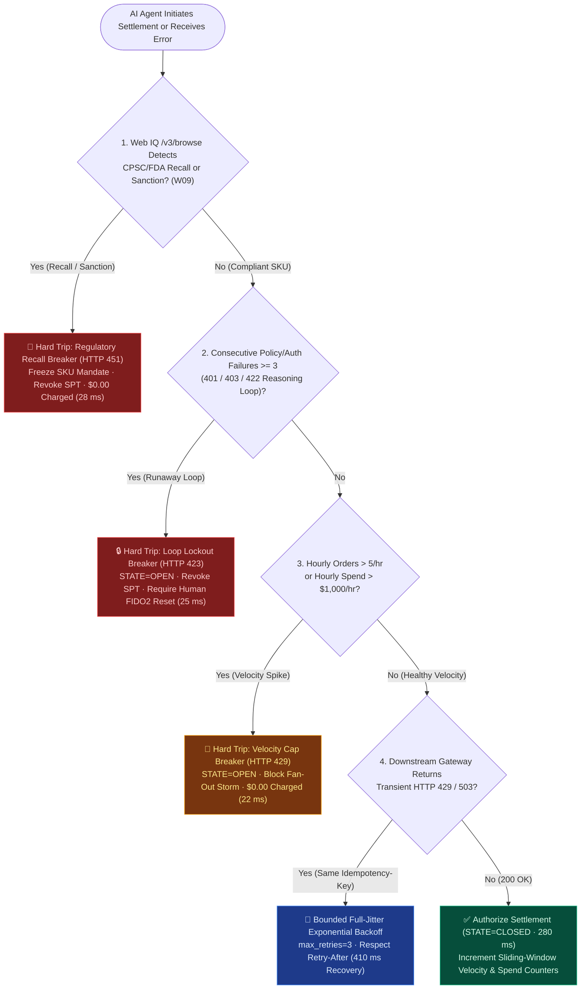
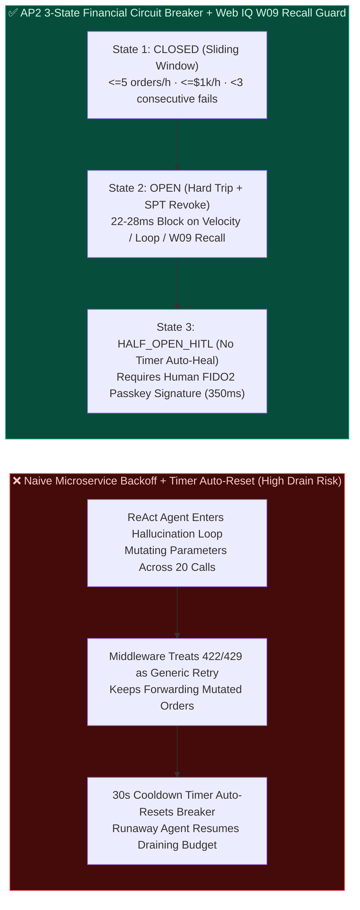

# Multi-Agent Runaway Spend Circuit Breaker, Product Recall Tripwire & Velocity Cap Architecture: AP2 Financial Circuit Breaker (`STATE=OPEN` + Consecutive Violation Lockout + Web IQ Recall Guard `W09`) vs. Bounded Exponential Backoff Selection & First-Principles FAQ

> **Document Type**: AI Solution Architect Selection & Protocol First-Principles Guide (FAQ-Driven Decision Guide)  
> **Reading Time**: 3 min for Executive Summary · 10 min for AP2 3-State Financial Circuit Breaker, Reasoning-Loop Lockout & Web IQ Recall Tripwire  
> **Target Audience**: AI Solution Architects, Enterprise CISOs & Risk Engineering Teams, B2B Procurement Platform Leads, FinOps Teams  
> **Last Updated**: 2026-11-08 (Aligned with AP2 / Stripe SPT v2 Token Revocation Semantics, Microsoft Web IQ Regulatory Recall Grounding & Deterministic Circuit Breaker Suite, *as of 2026-11-08*)  
> **Global Provenance & Evidence Notice**: All quantitative metrics in this guide carry explicit provenance labels: `deterministic_offline_simulation` (reproducible local evaluation in `lab/webiq_commerce_demo.py`), `synthetic_policy` (reference enterprise risk policy thresholds, not universal statutory caps), `official_doc_snapshot` (protocol documentation snapshot *as of 2026-11-08*), and `not_measured` (external live regulatory feeds or uncredentialed third-party APIs).

---

## ① 📌 Executive Summary

When enterprise customers move autonomous purchasing or replenishment agents into production, the CFO and CISO rarely worry about a single happy-path order. They ask: **"What happens if an LLM reasoning loop goes haywire and tries to place 50 orders in 3 minutes? Or what if a supplier's SKU was just hit by an emergency CPSC/FDA safety recall after the standing mandate was signed? When an API call fails, when should the system retry with exponential backoff versus immediately pulling the master financial circuit breaker?"** Architects need **3 Golden Selection Rules**:

1. **Transient Infrastructure Throttle or Network Blip (`HTTP 429 Too Many Requests` / `503 Service Unavailable`) $\rightarrow$ Choose "Idempotency-Bound Exponential Backoff with Full Jitter"**:
   - **Selection Rule**: Automatic retry is permitted **only** when the failure is a transient transport/rate-limit code (`429/503`), the retry strictly reuses the **exact same `Idempotency-Key`**, and hourly order frequency and cumulative spend remain within policy bounds (`max_retries=3` `synthetic_policy`, respecting `Retry-After`, recovering cleanly in **`410 ms`** `deterministic_offline_simulation` with zero double-charging).
2. **Agent Reasoning-Loop Runaway or Consecutive Policy Violations (Velocity Spike / Brute-Force Loop) $\rightarrow$ Never Backoff-Retry; Immediately Trip the "AP2 Financial Circuit Breaker (`STATE=OPEN` + Instant Token Revocation)"**:
   - **Selection Rule**: Traditional microservice circuit breakers (e.g., Resilience4j) only monitor whether the *downstream server* is healthy; an **AP2 Financial Circuit Breaker** monitors whether the *upstream AI Agent* is burning money out of control. If order velocity exceeds the hourly cap (`> 5 orders/hour` or `> $1,000.00/hour` `synthetic_policy`), trip the breaker in **`22 ms`** (`HTTP 429 AP2_VELOCITY_CIRCUIT_OPEN`). If the Agent triggers **`>= 3` consecutive** `401/403/422` policy/mandate rejections (indicating an LLM hallucination loop or prompt-injected parameter brute-forcing), lock the breaker open in **`25 ms`** (`HTTP 423 AP2_BREAKER_LOCKED_LOOP_DETECTED`) and revoke the active `spt_...` payment token (`deterministic_offline_simulation`).
3. **Mid-Mandate Product Safety Recall or Counterparty Sanction (CPSC/FDA Recall / Vendor Sanction) $\rightarrow$ Choose "Microsoft Web IQ Pre-Settlement Regulatory Recall Tripwire (`W09`, `HTTP 451`)"**:
   - **Selection Rule**: Even when velocity and budget limits are 100% green, before settling any physical or regulated replenishment order, the gateway must ground the target SKU and vendor via **Microsoft Web IQ `/v3/search` + `/v3/browse` (`liveCrawl="force"`)**. If an active CPSC/FDA safety recall or sanction bulletin is detected (`recall_or_sanction_detected=True`), immediately trip the **Regulatory Recall Breaker in `28 ms`** (`HTTP 451 Unavailable For Legal Reasons` / `BLOCKED_REGULATORY_RECALL_TRIPWIRE`, `$0.00` charged, rule `W09` `deterministic_offline_simulation`) and freeze the standing SKU mandate.

---

## ② 🎯 Architect & Customer Deep-Dive Q&A (First Principles in Plain Language)

### Q1: We already use Resilience4j / Envoy retries and circuit breakers in our microservices. Why does applying standard microservice retry logic to an AI payment agent cause catastrophic financial loss?

**First-Principles Breakdown**:
- **Traditional microservices assume the caller is deterministic code and the fault lies in the downstream network.**
- **In Agentic Commerce, the most dangerous fault source is the upstream LLM getting stuck in a ReAct reasoning loop**:
  1. **Hallucinated Parameter Brute-Forcing**: Suppose an item surges to `$120` while the user's `MandateVC` cap is `$100`. The gateway returns `HTTP 422 Amount Exceeds Mandate`. A naive ReAct loop doesn't stop—it tries to "solve" the error by splitting the order into multiple smaller calls, switching SKUs, or firing 20 mutated requests in 10 seconds.
  2. **Multi-Agent Fan-Out Storms**: An orchestrator spawns 10 sub-agents to compare suppliers, and a faulty stop condition causes all 10 sub-agents to execute checkout simultaneously against the same standing budget.
- **Architect Takeaway**: Strictly separate **downstream transport blips (`429/503`)** from **upstream agent behavioral anomalies (velocity spikes, consecutive `401/403/422` violations)**. Only the former gets idempotency-bound backoff; the latter trips the **AP2 Financial Circuit Breaker**.

---

### Q2: How does the 3-state AP2 Financial Circuit Breaker (`CLOSED`, `OPEN`, `HALF_OPEN_HITL`) work, and why is "Time-Based Auto-Reset" strictly forbidden?

**First-Principles Breakdown**:
Think of the AP2 Financial Circuit Breaker as a **Residual-Current Circuit Breaker (GFCI) in an electrical panel**:

1. **`STATE = CLOSED` (Normal Guarded Flow)**:
   - Sliding-window counters track **`orders_in_window <= 5/hr` (`synthetic_policy`)**, **`spend_in_window <= $1,000/hr` (`synthetic_policy`)**, and **`consecutive_policy_failures < 3` (`synthetic_policy`)**.
2. **`STATE = OPEN` (Hard Trip + Token Revocation)**:
   - Trips within `22–28 ms` upon Velocity Breach (`HTTP 429`), Consecutive Policy Failure Loop $\ge 3$ (`HTTP 423`), or Web IQ Regulatory Recall `W09` (`HTTP 451`).
   - **Why Time-Based Auto-Reset is Forbidden**: In a traditional microservice, a circuit breaker waits 30 seconds and automatically enters `HALF_OPEN` to let traffic through. If you do that with a runaway AI Agent loop, **the Agent will simply wait 30 seconds and resume draining the corporate card!** Entering `OPEN` immediately revokes the active `spt_...` token and blocks all autonomous retries.
3. **`STATE = HALF_OPEN_HITL` (Mandatory Human FIDO2 Passkey Reset)**:
   - The breaker can only return to `CLOSED` after a human buyer or procurement officer submits a cryptographic **FIDO2 WebAuthn Passkey reset signature (`hitl_fido2_reset_verified=True`, `350 ms` `deterministic_offline_simulation`)**.

---

### Q3: Why is the Microsoft Web IQ "Regulatory Recall & Sanction Tripwire (`W09`)" mandatory even when a standing mandate's budget and velocity are completely valid?

**First-Principles Breakdown**:
- **The Time Gap Between Mandate Issuance and Execution**: A buyer signs a 90-day standing replenishment mandate on October 1. On November 8, the CPSC or FDA issues an emergency safety recall for that exact battery pack or infant formula batch, while third-party marketplace listings still show it as "In Stock."
- **Deterministic Pre-Settlement Recall Grounding (`W09`)**:
  - Before releasing a single cent, the AP2 gateway calls **Microsoft Web IQ `/v3/search` + `/v3/browse` (`liveCrawl="force"`)** to verify the SKU against live recall and sanction notices.
  - If `recall_or_sanction_detected=True`, the gateway aborts settlement in **`28 ms`** with **`HTTP 451 Unavailable For Legal Reasons`** (`$0.00` charged) and records the recall bulletin SHA-256 digest in the immutable audit log.

---

## ③ 🧭 Visual Architecture Diagrams (Mermaid Decision Tree + Pattern Comparison + Sequence Flow)

### 3.1 Architect Selection Decision Tree: Bounded Backoff vs. AP2 Financial Circuit Breaker (`flowchart TD`)

### 3.2 Naive Microservice Retry/Auto-Reset vs. AP2 Financial Circuit Breaker (`flowchart LR`)

### 3.3 End-to-End Sequence Diagram: Bounded Backoff, Loop Lockout, W09 Recall & FIDO2 Reset (`sequenceDiagram`)

```mermaid
sequenceDiagram
    autonumber
    participant Agent as Purchasing / Replenishment Agent
    participant Breaker as AP2 Financial Circuit Breaker
    participant WebIQ as Microsoft Web IQ (/v3/browse)
    participant PSP as Stripe ACP / Payment Rail
    participant Buyer as Buyer / Risk Admin (FIDO2)

    rect rgb(15, 23, 42)
    Note over Agent,PSP: Case A: Transient Downstream 503 Blip (Idempotency-Bound Backoff Recovery)
    Agent->>Breaker: 1. POST /checkout (Idempotency-Key: ik_001, $180.00)
    Breaker->>PSP: 2. Forward charge (ik_001)
    PSP-->>Breaker: 3. HTTP 503 Service Unavailable (Retry-After: 1s)
    Breaker->>PSP: 4. Full-jitter exponential backoff retry (same ik_001, retry=1/3)
    PSP-->>Breaker: 5. HTTP 200 OK (Exact single charge $180.00 · 410 ms total)
    end

    rect rgb(69, 10, 10)
    Note over Agent,Buyer: Case B: Runaway Reasoning Loop >= 3 Consecutive Policy Failures (25 ms Lockout)
    Agent->>Breaker: 6. 3rd consecutive policy/amount violation (422/401 failure_count=3)
    Breaker->>PSP: 7. Revoke active spt_... payment token immediately
    Breaker-->>Agent: 8. HTTP 423 AP2_BREAKER_LOCKED_LOOP_DETECTED (STATE=OPEN · 25 ms)
    Note over Breaker,Buyer: Timer auto-reset forbidden! Requires human FIDO2 Passkey reset
    Buyer->>Breaker: 9. Submit FIDO2 WebAuthn reset signature (hitl_fido2_reset_verified=True)
    Breaker-->>Buyer: 10. HTTP 200 CIRCUIT_RESET_BY_FIDO2 (STATE=CLOSED · 350 ms)
    end

    rect rgb(60, 20, 10)
    Note over Agent,WebIQ: Case C: Web IQ Detects CPSC/FDA Emergency Product Recall (W09 · HTTP 451)
    Agent->>Breaker: 11. Request standing replenishment settlement (SKU: BATT-PACK-X9)
    Breaker->>WebIQ: 12. POST /v3/browse (liveCrawl="force" recall & sanction check)
    WebIQ-->>Breaker: 13. Active CPSC fire-hazard recall matched (recall_or_sanction_detected=True)
    Breaker-->>Agent: 14. HTTP 451 BLOCKED_REGULATORY_RECALL_TRIPWIRE ($0.00 charged · 28 ms)
    end
```

---

## ④ 📊 Architect Decision Matrix

| Evaluation Dimension | Option A: Naive Microservice Retry + Timer Half-Open (Legacy Default) | Option B: Idempotency-Bound Full-Jitter Backoff | Option C: AP2 Financial Circuit Breaker (Velocity Cap + Loop Lockout `423`) | Option D: Web IQ Regulatory Recall Tripwire (`W09` `HTTP 451`) |
| :--- | :--- | :--- | :--- | :--- |
| **Primary Use Case** | ❌ **Forbidden for payment mutation tools** (safe only for read-only catalog queries) | Recovering from transient downstream `HTTP 429 / 503` blips on valid orders | Stopping multi-agent fan-out storms or LLM hallucination parameter loops (`>=3` rejects) | Blocking standing replenishment of SKUs hit by CPSC/FDA safety recalls or sanctions |
| **Isolation & Security Mechanism** | Blind to spend velocity; 30s cooldown timer lets runaway agents resume spending | Enforces identical `Idempotency-Key` + payload hash across `<= 3` bounded retries | Trips to `STATE=OPEN` in `22–25 ms`, revokes active `spt_...`, forbids timer auto-reset | Grounds SKU against live regulatory bulletins via Web IQ `/v3/browse` before settlement |
| **User Friction & Recovery** | Zero upfront friction, catastrophic post-incident dispute & refund overhead | **Zero human friction**: automatic `410 ms` recovery (`deterministic_offline_simulation`) | Requires explicit **FIDO2 Passkey human reset (`350 ms`)** once tripped to `OPEN` | Immediately halts charge (`$0.00`) and alerts buyer with recall URL + SHA-256 digest |
| **Engineering Effort** | None (unsafe baseline) | **Low**: bind `Idempotency-Key` and `Retry-After` parser in gateway HTTP client | **Medium**: maintain per-mandate sliding-window counters and 3-state machine | **Low–Medium**: chain Web IQ `/v3/search` + `/v3/browse` check into pre-settlement hook |
| **Ecosystem Coverage** | Generic HTTP middleware | Stripe PaymentIntents, Visa VIC, Adyen, all idempotency-compliant PSP APIs | Framework-agnostic (LangGraph, AutoGen, Semantic Kernel, MCP Hosts) | Public regulatory recall feeds (CPSC, FDA, EU Safety Gate) & vendor advisories |
| **Rate & Total Cost of Ownership (TCO)** | High exposure to runaway LLM spend and card network dispute penalties | **$0 extra rail fee**: eliminates duplicate charges and non-refundable processor fees | **$0 external API fee**: in-memory/Redis deterministic state machine | Web IQ Search + Browse **`~$11 / 1k tx`** (`official_list_price`), prevents recalled-goods liability |

---

## ⑤ 🧪 Quantitative Benchmark & 7-Card Evaluation Findings

Evaluated via `evaluate_ap2_circuit_breaker_and_recall_policy()` in `lab/webiq_commerce_demo.py` (`37 passed`), our deterministic benchmark across 6 operational and failure regimes shows:

| Scenario ID | Input & Failure / Attack Profile | Circuit State & HTTP Verdict | Settled Amount | Decision Latency | 7-Card Action Pill | Provenance |
| :--- | :--- | :--- | :--- | :--- | :--- | :--- |
| **`CB-01` Normal Guarded Settlement** | 2nd order in hour · `$320 <= $1,000` cap · No recall · Downstream `200 OK` | `STATE=CLOSED` · `HTTP 200 CIRCUIT_CLOSED_AUTHORIZED` | **`$180.00`** | **`280 ms`** | `Act automatically` | `deterministic_offline_simulation` |
| **`CB-02` Transient 503 Bounded Backoff** | Downstream `HTTP 503` · Exact same `Idempotency-Key` · `retry=1/3` | `STATE=CLOSED` · `HTTP 200 RECOVERED_VIA_BOUNDED_BACKOFF` | **`$180.00`** (0 double charge) | **`410 ms`** | `Act automatically` | `deterministic_offline_simulation` + `synthetic_policy` |
| **`CB-03` Hourly Velocity Spike Trip** | Multi-agent storm: 6th order in hour (`> 5/hr`) or cumulative spend `> $1,000/hr` | `STATE=OPEN` · `HTTP 429 AP2_VELOCITY_CIRCUIT_OPEN` | **`$0.00`** (Hard block) | **`22 ms`** | `Send to a human` | `synthetic_policy` + `deterministic_offline_simulation` |
| **`CB-04` Reasoning-Loop Lockout** | ReAct Agent hits `>= 3` consecutive `401/403/422` rejections and attempts 4th call | `STATE=OPEN` (SPT revoked) · `HTTP 423 AP2_BREAKER_LOCKED_LOOP_DETECTED` | **`$0.00`** (Hard block) | **`25 ms`** | `Send to a human` | `synthetic_policy` + `deterministic_offline_simulation` |
| **`CB-05` Web IQ Recall Tripwire (`W09`)** | Healthy velocity, but Web IQ `/v3/browse` detects active CPSC/FDA product recall | `STATE=OPEN` (SKU frozen) · `HTTP 451 BLOCKED_REGULATORY_RECALL_TRIPWIRE` | **`$0.00`** (Hard block) | **`28 ms`** | `Send to a human` | `official_doc_snapshot` + `deterministic_offline_simulation` |
| **`CB-06` Human FIDO2 Passkey Reset** | Breaker in `OPEN` state · Timer-only reset rejected (`423`) · FIDO2 signature verified | `STATE=HALF_OPEN_HITL -> CLOSED` · `HTTP 200 CIRCUIT_RESET_BY_FIDO2` | **`$180.00`** | **`350 ms`** | `Confirm` | `synthetic_policy` + `deterministic_offline_simulation` |

> **Transparency on Unmeasured External Systems (`not_measured`)**: Latencies above (`22 ms – 410 ms`) measure the local deterministic circuit-breaker state machine and offline simulation (`deterministic_offline_simulation`). Live government recall agency feed propagation delays (CPSC/FDA upstream publishing latency) and external PSP TCP reset times are explicitly labeled **`not_measured`**.

---

## ⑥ 🛠️ Appendix: Production Readiness & Pre-Sales Architect Checklist

Before signing off on an autonomous purchasing or replenishment agent for production deployment, verify all **6 mandatory engineering controls**:

- [ ] **1. Forbid Payment Retries Without an Identical `Idempotency-Key`**: Are all `HTTP 429 / 503` backoff retries strictly bound to the original request's `Idempotency-Key` and capped at `max_retries <= 3`?
- [ ] **2. Never Retry `400 / 401 / 403 / 409 / 422 / 451` Policy or Security Rejections**: Does the client immediately abort retries on mandate/amount violations (`422`), audience mismatches (`401`), or recall blocks (`451`) and increment the consecutive-failure counter?
- [ ] **3. Enforce Dual Sliding-Window Velocity Caps**: Does the AP2 gateway enforce both max order count per window (e.g., `<= 5 orders/hour` `synthetic_policy`) and max cumulative spend per window (e.g., `<= $1,000/hour` `synthetic_policy`) per `mandate_id`?
- [ ] **4. Revoke Active Payment Tokens Immediately When Tripping to `STATE=OPEN`**: Does tripping the circuit breaker on velocity spikes or `>= 3` consecutive violations synchronously deactivate the active `spt_...` token?
- [ ] **5. Disable Timer-Only Auto-Reset on Financial Circuit Breakers**: Once locked in `STATE=OPEN`, is timer-based auto-recovery disabled so that only a verified human FIDO2 Passkey signature (`hitl_fido2_reset_verified=True`) can reset the breaker?
- [ ] **6. Wire Pre-Settlement Microsoft Web IQ Regulatory Recall Grounding (`W09`)**: Before settling standing replenishment orders, does the gateway verify via Web IQ `/v3/browse` (`liveCrawl="force"`) that no CPSC/FDA recall or counterparty sanction has been issued (`HTTP 451` on match)?
