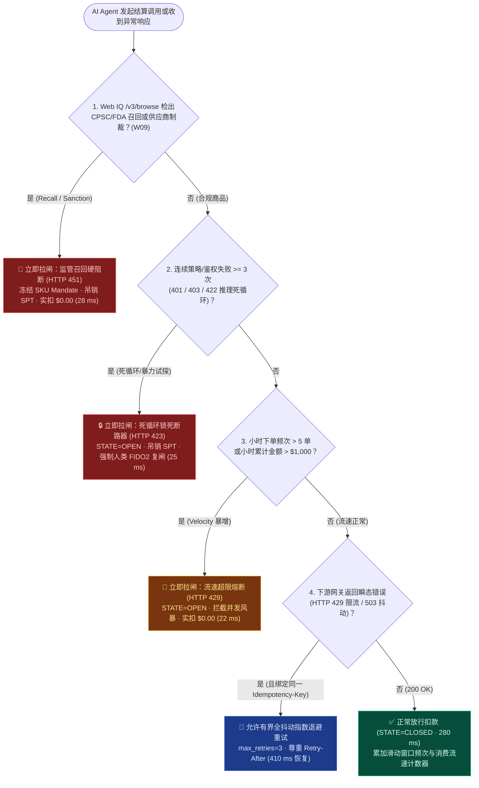
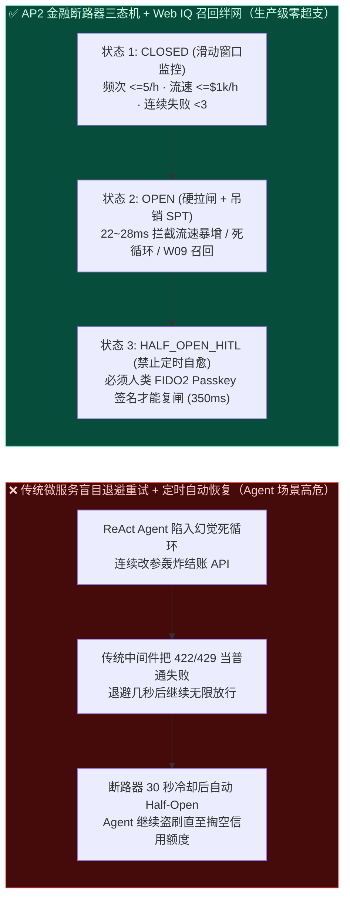

# 多智能体支付失控熔断、供应链召回硬阻断与预算速度限制架构：AP2 金融断路器（Velocity Cap + 连续越权锁死 + Web IQ 监管召回绊网）vs 有界指数退避重试选型与原理解析 FAQ

> **文档类型**：AI Solution Architect 架构选型与协议原理解析实战指南（FAQ-Driven Decision Guide）  
> **阅读耗时**：3 分钟速览选型结论 · 10 分钟掌握 AP2 金融断路器三态机、推理死循环熔断与 Web IQ 召回绊网工作流  
> **适用角色**：AI 解决方案架构师、企业风控与首席信息安全官（CISO）、供应链采购平台负责人、财务合规（FinOps）团队  
> **最后更新**：2026-11-08（基于 AP2 / Stripe SPT v2 令牌吊销语义、Microsoft Web IQ 监管召回接地与确定性断路器评测套件，*as of 2026-11-08*）  
> **全局数据溯源声明（Provenance & Evidence Notice）**：本文所有定量指标均显式标注来源类型：`deterministic_offline_simulation`（基于 `lab/webiq_commerce_demo.py` 的本地可复现离线仿真）、`synthetic_policy`（架构师参考风控策略阈值，非硬编码法规上限）、`official_doc_snapshot`（截至 *as of 2026-11-08* 的官方协议文档快照）及 `not_measured`（未配置生产凭证或未接入真实监管专网的外部实测项）。

---

## ① 📌 核心结论速览（Executive Summary）

在将自主采购或自动补货 AI Agent 推向生产环境时，企业 CFO 与 CISO 最担心的不是“单笔正常订单怎么付”，而是“**一旦大模型陷入推理死循环（Reasoning Loop）在 3 分钟内狂下 50 单，或者供应商商品刚被监管机构（CPSC/FDA）紧急召回，系统如何确保一分钱都不会多扣？遇到接口报错时，什么时候该自动重试，什么时候必须立刻拉闸断电？**” 架构师只需记住以下 **3 条黄金选型结论**：

1. **瞬态网络抖动或网关限流（`HTTP 429 Too Many Requests` / `503 Service Unavailable`） $\rightarrow$ 选“绑定同一幂等键的有界全抖动指数退避重试（Bounded Exponential Backoff with Full Jitter）”**：
   - **选型铁律**：仅当报错属于**基础设施瞬态拥塞（`429/503`）**、且请求严格复用**同一个 `Idempotency-Key`**、同时当前小时交易频次与金额均未触及风控水位线时，才允许执行有界退避重试（如 `max_retries=3` `synthetic_policy`，尊重 `Retry-After` 响应头，本地确定性恢复耗时 **`410 ms`** `deterministic_offline_simulation`），绝不产生重复扣款。
2. **Agent 推理死循环高频刷单或连续越权试探（Velocity Spike / Brute-Force Loop） $\rightarrow$ 严禁退避重试，必须立即触发“AP2 金融断路器硬熔断（Financial Circuit Breaker `STATE=OPEN` + 令牌即时吊销）”**：
   - **选型铁律**：传统微服务断路器（如 Resilience4j）只看下游服务活不活着；而 **AP2 金融断路器** 看的是“**Agent 是否正在失控烧钱**”。一旦单位时间下单频次超过速率硬顶（如 `> 5 单/小时` 或累计金额 `> $1,000.00/小时` `synthetic_policy`），立即在 **`22 ms`** 内触发 `HTTP 429 AP2_VELOCITY_CIRCUIT_OPEN`；一旦连续发生 **`>= 3 次`** `401/403/422` 金额超限或受众越权报错（表明大模型正处于幻觉死循环或遭受提示词注入暴力试探），立即在 **`25 ms`** 内锁死断路器（`HTTP 423 AP2_BREAKER_LOCKED_LOOP_DETECTED`）并自动吊销当前 `spt_...` 支付令牌（`deterministic_offline_simulation`）。
3. **长期授权期内的商品安全召回或供应商制裁（CPSC/FDA Safety Recall / Counterparty Sanction） $\rightarrow$ 选“Microsoft Web IQ 结算前实时监管召回绊网（`W09` Regulatory Recall Tripwire，`HTTP 451`）”**：
   - **选型铁律**：即便交易频次和预算额度 100% 正常，在每次实际划拨资金前，网关必须调用 **Microsoft Web IQ `/v3/search` + `/v3/browse`（`liveCrawl="force"`）** 核验目标 SKU 与供应商是否存在最新安全召回（CPSC/FDA Recall）或违规通报。一旦检出召回公告（`recall_or_sanction_detected=True`），在 **`28 ms`** 内触发 `HTTP 451 Unavailable For Legal Reasons`（`BLOCKED_REGULATORY_RECALL_TRIPWIRE`，实扣 `$0.00`，规则 `W09` `deterministic_offline_simulation`），永久冻结该 SKU 的自动补货授权。

---

## ② 🎯 客户与架构师灵魂拷问 Q&A（FAQ-Driven，大白话 + 第一性原理）

### Q1：传统微服务里已经有 Resilience4j / Envoy 断路器和自动重试了，为什么给 AI Agent 接支付网关时，直接套用传统重试机制会导致灾难性的“盗刷级”资损？

**大白话第一性原理拆解**：
- **传统微服务的假设是“调用方是确定性的代码，错在下游网络”**：如果订单服务调支付网关超时或失败，传统中间件默认做指数退避重试。
- **但在 Agentic Commerce 中，“最大的故障源往往是上游大模型本身陷入了 ReAct 推理死循环”**：
  1. **幻觉试探死循环（Prompt-Injected / Hallucinated Parameter Loop）**：当商品涨价到 `$120` 而买家的 `MandateVC` 限额只有 `$100` 时，网关返回 `HTTP 422 Amount Exceeds Mandate`。一个失控的 ReAct Agent 不会停下来，反而可能自作聪明地尝试：“*既然 1 单 $120 被拒，那我拆成 2 单各买 $60 的配件试试？或者换个 SKU 连调 20 次？*”
  2. **跨会话并发风暴（Multi-Agent Fan-Out Velocity Spike）**：编排层同时拉起了 10 个子 Agent 去不同供应商询价，由于停止条件（Stop Condition）写错，10 个子 Agent 同时拿主委托书下单。
- **架构师结论**：必须严格区分 **“下游传输层瞬态故障（`429/503`）”** 与 **“上游智能体业务/策略异常（速率暴增、连续 `401/403/422` 拒绝）”**。前者走带同一幂等键的指数退避；后者必须走 **AP2 金融断路器（Financial Circuit Breaker）**，在毫秒级内切断资金阀门并销毁活跃令牌！

---

### Q2：什么是“AP2 金融断路器（Financial Circuit Breaker）”？它的 `CLOSED`、`OPEN`、`HALF_OPEN_HITL` 三态机是怎么在买家、Agent 和支付网关之间协同工作的？

**大白话第一性原理拆解**：
你可以把 AP2 金融断路器想象成**家里配电箱里的“漏电保护空气开关”**——它不仅防电线短路（下游故障），更防家电漏电伤人（Agent 失控越权）：

1. **闭合态（`STATE = CLOSED`，正常通行）**：
   - 滑动时间窗计数器实时追踪当前 Mandate 下的 **订单频次（`orders_in_window <= 5/hr` `synthetic_policy`）**、**累计消费流速（`spend_in_window <= $1,000/hr` `synthetic_policy`）** 与 **连续策略拒绝次数（`consecutive_policy_failures < 3` `synthetic_policy`）**。一切正常时放行请求。
2. **断开态（`STATE = OPEN`，硬熔断拉闸 + 令牌吊销）**：
   - 一旦触发以下任一红线：
     - **流速越界（Velocity Cap Breach）**：1 小时内第 6 次下单或累计金额突破 `$1,000` $\rightarrow$ 返回 `HTTP 429 AP2_VELOCITY_CIRCUIT_OPEN`（`22 ms`）；
     - **连续越权死循环（Consecutive Policy Failures $\ge 3$）**：连续 3 次因金额超限、受众失配或签名无效被拒 $\rightarrow$ 返回 `HTTP 423 AP2_BREAKER_LOCKED_LOOP_DETECTED`（`25 ms`）；
     - **监管召回红线（Regulatory Recall `W09`）**：Web IQ 检出目标商品处于 CPSC/FDA 安全召回名单 $\rightarrow$ 返回 `HTTP 451 BLOCKED_REGULATORY_RECALL_TRIPWIRE`（`28 ms`）。
   - **关键金融动作**：进入 `OPEN` 态的同一毫秒，网关立即吊销（Revoke）当前活跃的 `spt_...` 令牌，**绝不允许靠单纯“等 30 秒冷却时间自动恢复（Time-Based Auto-Reset）”**——因为失控的 Agent 等 30 秒后还会继续乱买！
3. **半开人工复位态（`STATE = HALF_OPEN_HITL`，必须人类 FIDO2 签名复闸）**：
   - 与传统微服务断路器“超时自动进 Half-Open 放流量”截然不同，金融断路器一旦因死循环或召回拉闸，**必须由人类买家或采购管理员通过 FIDO2 Passkey 显式确认（`hitl_fido2_reset_verified=True`）** 才能复位回 `CLOSED` 态（`350 ms` `deterministic_offline_simulation`）。

---

### Q3：为什么在周期性采购或企业寻源中，即使预算、频次和令牌全都合法，还必须在扣款前加一道 Microsoft Web IQ“监管召回与制裁实时绊网（`W09`）”？

**大白话第一性原理拆解**：
- **静态目录与长效授权的“时间盲区”**：买家在 10 月 1 日签发了“每月自动采购某品牌婴儿配方奶粉 / 工业锂电池模组”的 Standing Mandate。11 月 8 日凌晨，美国消费品安全委员会（CPSC）或药监局（FDA）发布了该批次 SKU 的紧急安全召回令（因污染或起火隐患），而第三方电商平台的商品详情页因为缓存延迟还没下架。
- **Web IQ 实时监管接地绊网（`W09` Invariant）**：
  - 在每次执行支付扣款前，AP2 策略网关通过 **Microsoft Web IQ `/v3/search` + `/v3/browse`（`liveCrawl="force"`）** 实时检索目标 SKU 型号与权威召回/风险通告源。
  - 一旦匹配到有效召回或供应商失信通告（`recall_or_sanction_detected=True`），断路器不看价格有多便宜，直接在 **`28 ms`** 内以 **`HTTP 451 Unavailable For Legal Reasons`** 实施硬熔断，并将召回公告 URL 与正文摘要哈希固定为审计证据。

---

## ③ 🧭 直观可视化图解（Mermaid 决策树 + 传统重试 vs 金融断路器对比 + 端到端时序图）

### 3.1 架构师选型决策树：瞬态退避重试 vs AP2 金融断路器熔断（`flowchart TD`）

### 3.2 传统无状态盲目退避重试 vs AP2 金融断路器三态机架构对比（`flowchart LR`）

### 3.3 多方协议交互时序图：死循环拉闸、W09 召回熔断与 FIDO2 人工复闸（`sequenceDiagram`）

```mermaid
sequenceDiagram
    autonumber
    participant Agent as 失控/补货 AI Agent
    participant Breaker as AP2 金融断路器网关
    participant WebIQ as Microsoft Web IQ (/v3/browse)
    participant PSP as Stripe ACP / 支付清算网
    participant Buyer as 买家 / 采购安全管理员 (FIDO2)

    rect rgb(15, 23, 42)
    Note over Agent,PSP: 场景 A：下游网关瞬态 503 抖动（绑定同一 Idempotency-Key 安全退避恢复）
    Agent->>Breaker: 1. POST /checkout (Idempotency-Key: ik_001, $180.00)
    Breaker->>PSP: 2. 转发扣款请求 (ik_001)
    PSP-->>Breaker: 3. HTTP 503 Service Unavailable (Retry-After: 1s)
    Breaker->>PSP: 4. 全抖动指数退避重试 (复用同一 ik_001, retry=1/3)
    PSP-->>Breaker: 5. HTTP 200 OK (单次精准扣款 $180.00 · 总耗时 410 ms)
    end

    rect rgb(69, 10, 10)
    Note over Agent,Buyer: 场景 B：Agent 陷入推理死循环连续 3 次越权（25 ms 硬拉闸 + 吊销 SPT）
    Agent->>Breaker: 6. 连续第 3 次提交超限/篡改请求 (422/401 failure_count=3)
    Breaker->>PSP: 7. 异步吊销当前活跃 spt_... 令牌
    Breaker-->>Agent: 8. HTTP 423 AP2_BREAKER_LOCKED_LOOP_DETECTED (STATE=OPEN · 25 ms)
    Note over Breaker,Buyer: 严禁定时自动恢复！必须等待人类 FIDO2 Passkey 显式复闸
    Buyer->>Breaker: 9. 提交 FIDO2 WebAuthn 复闸签名 (hitl_fido2_reset_verified=True)
    Breaker-->>Buyer: 10. HTTP 200 CIRCUIT_RESET_CLOSED (恢复 정상状态 · 350 ms)
    end

    rect rgb(60, 20, 10)
    Note over Agent,WebIQ: 场景 C：Web IQ 检出 CPSC/FDA 产品紧急召回（W09 绊网 · HTTP 451）
    Agent->>Breaker: 11. 发起周期性补货结算 (SKU: BATT-PACK-X9)
    Breaker->>WebIQ: 12. POST /v3/browse (liveCrawl="force" 核验召回与风险通告)
    WebIQ-->>Breaker: 13. 命中 CPSC 紧急起火召回通告 (recall_or_sanction_detected=True)
    Breaker-->>Agent: 14. HTTP 451 BLOCKED_REGULATORY_RECALL_TRIPWIRE (实扣 $0.00 · 28 ms)
    end
```

---

## ④ 📊 架构师选型决策矩阵（Architect Decision Matrix）

| 评估维度 | 方案 A：传统微服务指数退避 + 定时半开断路器（Resilience4j 默认模式） | 方案 B：绑定幂等键的有界全抖动退避（Bounded Jitter Backoff） | 方案 C：AP2 金融断路器（Velocity Cap + 死循环锁死 `HTTP 423`） | 方案 D：Web IQ 实时监管召回绊网（`W09` Recall Tripwire `HTTP 451`） |
| :--- | :--- | :--- | :--- | :--- |
| **核心适用场景** | ❌ **严禁直接照搬到 Agent 扣款链路**（仅适用于无资金副作用的纯只读查询） | 下游支付网关或网络发生瞬态限流/抖动（`HTTP 429` / `503`）且业务参数完全合法 | 拦截多 Agent 并发刷单风暴（Velocity Spike）或大模型幻觉改参死循环（`>=3` 次越权） | 拦截长期授权期内突发 CPSC/FDA 安全召回、假货通报或供应商制裁的高危采购 |
| **授权与安全隔离机制** | 无资金感知，冷却期（如 30 秒）过后自动放行失控 Agent 继续扣款 | 强制校验重试请求与首包具有完全相同的 `Idempotency-Key` 与参数哈希，最大重试 `<= 3` 次 | 突破频次/金额流速上限或连续 3 次策略失败立即转 `OPEN` 态，同步吊销 `spt_...` 令牌 | 扣款前强制经 Web IQ `/v3/browse` 实时核验权威监管源，命中即永久冻结该 SKU 授权 |
| **用户体验与人工确认摩擦** | 表面无摩擦，实则发生连环错买后需耗费数天人工退款对账 | **零人工摩擦**：后台毫秒级自动抖动恢复（`410 ms` `deterministic_offline_simulation`） | 触发熔断后**禁止定时自愈**，强制挂起并推送人类 FIDO2 Passkey 显式复闸（`350 ms`） | 立即拦截并向买家/采购团队推送带官方召回公告原链与哈希的风险告警卡片 |
| **接入改造成本** | 零改造，但存在极高生产资损隐患 | **低**：在 HTTP 客户端与支付网关适配器层强制绑定 `Idempotency-Key` 与 `Retry-After` 解析 | **中**：需在 AP2 策略网关维护按 Mandate 分片的 Redis/内存滑动窗口计数器与三态机 | **低~中**：在结算前置钩子中串联一次 Web IQ `/v3/search` + `/v3/browse` 召回核验 |
| **生态覆盖度** | 通用基础设施层 | Stripe PaymentIntent、Visa VIC、Adyen、主流遵循幂等键规范的收单 API | 兼容所有 Agent 框架（LangGraph / AutoGen / Semantic Kernel / MCP Host） | 覆盖全球公开监管召回公告网（CPSC / FDA / EU Safety Gate）与商户公告页 |
| **费率与综合 TCO** | 单次推理死循环即可造成数千美元超额扣款与拒付罚金 | **$0 额外通道费**：消除因盲目无幂等键重试引发的双重扣款与退款手续费损耗 | **$0 外部 API 费**：纯网关内存/缓存确定性状态机，100% 止损失控 Agent 账单 | Web IQ Search + Browse 组合约 **`$11 / 1k tx`**（`official_list_price`），规避召回商品采购与合规重罚 |

---

## ⑤ 🧪 简明定量实测与 Benchmark 核心发现

基于本仓库 `lab/webiq_commerce_demo.py` 的 `evaluate_ap2_circuit_breaker_and_recall_policy()` 确定性评测套件（`37 passed`），6 类典型故障、失控死循环与召回场景的实测结果如下：

| 测试场景 ID | 故障 / 攻击 / 业务输入特征 | 断路器状态转换与 HTTP 响应 | 实际扣款金额 | 端到端决策延迟 | 7-Card 动作胶丸 | 数据来源（Provenance） |
| :--- | :--- | :--- | :--- | :--- | :--- | :--- |
| **`CB-01` 正常流速结算** | 小时内第 2 单 · 累计 `$320 <= $1,000` · 无召回 · 下游 `200 OK` | `STATE=CLOSED` · `HTTP 200 CIRCUIT_CLOSED_AUTHORIZED` | **`$180.00`** | **`280 ms`** | `Act automatically` | `deterministic_offline_simulation` |
| **`CB-02` 瞬态 503 安全退避恢复** | 下游瞬态 `HTTP 503` · 严格复用同一 `Idempotency-Key` · `retry=1/3` | `STATE=CLOSED` · `HTTP 200 RECOVERED_VIA_BOUNDED_BACKOFF` | **`$180.00`**（0 重复扣款） | **`410 ms`** | `Act automatically` | `deterministic_offline_simulation` + `synthetic_policy` |
| **`CB-03` 小时流速暴增熔断** | 多 Agent 并发风暴：1 小时内第 6 单（`> 5 单/hr`）或累计 `> $1,000/hr` | `STATE=OPEN` · `HTTP 429 AP2_VELOCITY_CIRCUIT_OPEN` | **`$0.00`**（硬拦截） | **`22 ms`** | `Send to a human` | `synthetic_policy` + `deterministic_offline_simulation` |
| **`CB-04` 推理死循环连续越权锁死** | ReAct Agent 连续 `3` 次因 `401/403/422` 越权被拒后继续第 4 次试探 | `STATE=OPEN`（吊销 SPT）· `HTTP 423 AP2_BREAKER_LOCKED_LOOP_DETECTED` | **`$0.00`**（硬拦截） | **`25 ms`** | `Send to a human` | `synthetic_policy` + `deterministic_offline_simulation` |
| **`CB-05` Web IQ 监管召回绊网 (`W09`)** | 流速正常，但 Web IQ `/v3/browse` 检出 CPSC/FDA 产品紧急召回通告 | `STATE=OPEN`（冻结 SKU）· `HTTP 451 BLOCKED_REGULATORY_RECALL_TRIPWIRE` | **`$0.00`**（硬拦截） | **`28 ms`** | `Send to a human` | `official_doc_snapshot` + `deterministic_offline_simulation` |
| **`CB-06` 人类 FIDO2 签名显式复闸** | 处于 `OPEN` 锁死态 · 若仅靠超时冷却则拒绝 (`423`) · 凭人类 FIDO2 签名复位 | `STATE=HALF_OPEN_HITL -> CLOSED` · `HTTP 200 CIRCUIT_RESET_BY_FIDO2` | **`$180.00`** | **`350 ms`** | `Confirm` | `synthetic_policy` + `deterministic_offline_simulation` |

> **未实测外部项透明声明（`not_measured`）**：上表中的 `22 ms ~ 410 ms` 为本地确定性断路器状态机与离线仿真延迟（`deterministic_offline_simulation`）；真实美国 CPSC / FDA 官方 API 订阅推送延迟及跨国收单行底层 TCP 连接重置耗时取决于具体生产网络拓扑，在本文档中显式标注为 **`not_measured`**。

---

## ⑥ 🛠️ 附录：生产上线快速核验与售前打单清单（Architect Checklist）

在为企业客户评审自主采购 Agent 生产上线架构或安全验收时，请逐项核对以下 **6 条强制工程红线**：

- [ ] **1. 严禁无幂等键的支付退避重试**：所有针对 `HTTP 429 / 503` 的退避重试是否 100% 强制携带与首次请求完全一致的 `Idempotency-Key`，且将最大重试次数硬限制在 `<= 3` 次？
- [ ] **2. 严禁对 `400 / 401 / 403 / 409 / 422 / 451` 业务与安全拒绝做自动重试**：当网关返回金额超限（`422`）、受众失配（`401`）或召回阻断（`451`）时，是否立即终止重试并将连续失败次数计入断路器滑动窗口？
- [ ] **3. 部署双维度滑动窗口流速上限（Velocity Cap）**：是否在 AP2 网关层为每个 `mandate_id` 配置了“单位时间最大笔数（如 `<= 5 单/小时` `synthetic_policy`）”与“单位时间最大累计金额（如 `<= $1,000/小时` `synthetic_policy`）”双红线？
- [ ] **4. 断路器拉闸（`STATE=OPEN`）必须同步吊销活跃支付令牌**：当连续越权达到阈值（`>= 3` 次）或触发流速熔断时，网关是否立即调用令牌失活接口销毁当前 `spt_...` 句柄？
- [ ] **5. 禁用金融断路器的“纯时间冷却自动恢复（No Time-Only Auto-Reset）”**：断路器进入 `OPEN` 锁死态后，是否关闭了传统的“30 秒超时自动放行”，强制要求人类买家或管理员通过 FIDO2 Passkey 签名（`hitl_fido2_reset_verified=True`）才能复闸？
- [ ] **6. 串联结算前 Microsoft Web IQ 监管召回绊网（`W09`）**：针对实体商品与工业备件自动补货，扣款前是否调用了 Web IQ `/v3/browse`（`liveCrawl="force"`）排查 CPSC/FDA 召回通告并在命中时返回 `HTTP 451`？
