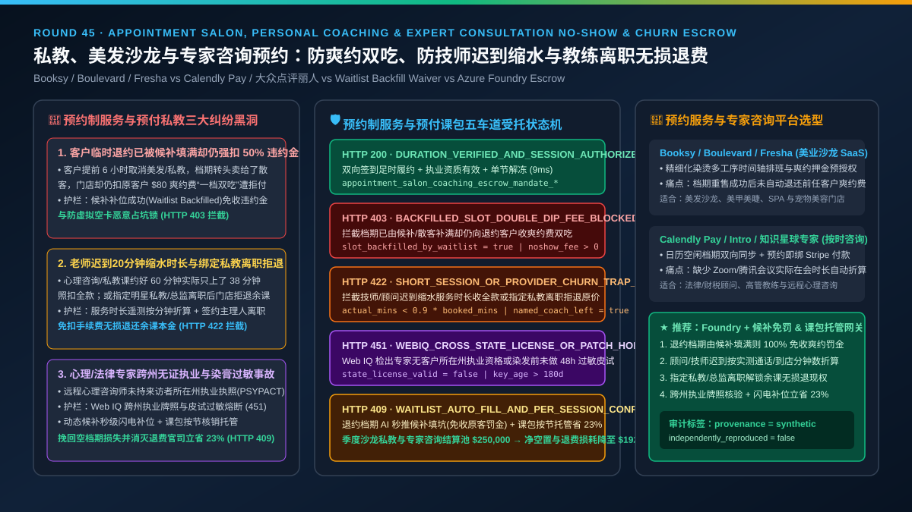
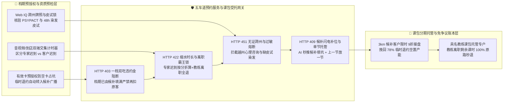
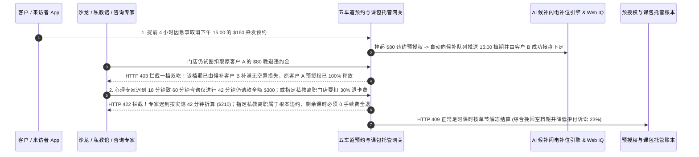

# 健身私教、美发沙龙、心理咨询与专家按时计费预约（Appointment-Based Personal Services, Salon/Spa & Expert Consultation：Booksy / Boulevard / Calendly Pay / 大众点评丽人）“防临时退约候补填满仍收双份违约金、防技师/专家迟到缩水时长与指定私教离职无损退费”Agent 架构选型 FAQ：终结爽约罚金拒付与私教换人霸王条款实战指南

> **语言切换 / Language**: **中文 (当前)** | **[English](appointment-salon-coaching-noshow-preauth-trainer-churn-escrow-agent-selection-faq.en.md)** | **[返回文档目录](index.md)** | **[交互式沙盒 (`#appointment-salon-coaching-escrow-sandbox`)](../live-demo.html)**



---

## 📌 一、核心选型结论速览（Executive Summary）

在美发沙龙、高端 SPA、健身私教工作室（Booksy、Boulevard、Fresha、Mindbody、大众点评丽人）以及律师/心理咨询师/高管教练按小时付费预约（Calendly + Stripe、Intro、简单心理）中，商家出售的核心资产是**“不可储存的技师/专家独占时间槽（Perishable Time Slots）”**。若让预约与收银 Agent 机械执行霸王扣款或缺乏双向履约遥测，极易引爆三大高频交易纠纷：
1. **客户因突发急事提前 5 小时取消 `$160` 的染发/私教预约，门店转头就把该黄金档期卖给了候补名单（Waitlist）或到店散客（门店毫无实际空置损失），却依然从原客户信用卡里强扣 `$80`（50%）晚退违约金（Double-Dipping Penalty）**：在英美合同法与国内民法典下，违约金（Liquidated Damages）以填补实际损失为限；若同一时间槽已被其他付费客户补满，门店再扣前任客户违约金即属非法双重获利（Unjust Enrichment），客户向银行发起 `Visa 13.5 / 13.7` 拒付申诉几乎 100% 胜诉！反之，若不拦一次性空卡（`$1` 余额虚拟卡），同行竞争对手会用脚本恶意占满周末黄金档期再集体爽约（Denial-of-Calendar Attack）。
2. **线上心理咨询/法律专家迟到 18 分钟且准点下线（60 分钟咨询实际只讲了 42 分钟）却照扣全额 `$300` 咨询费，以及消费者花 `$3,000` 冲着某金牌私教/艺术总监买的 30 节专属课包，该教练干了两个月离职，门店却拒绝退钱强塞刚毕业的实习生顶替**：这是预付私教与美业投诉率第一的顽疾——当合同具有显著人身专属性（Named-Provider Key-Person Clause）时，核心服务人员离职属于根本违约，消费者依法享有全额退还剩余未上课时费的法定权利，绝不能再扣 `30%` 所谓“退卡违约手续费”！
3. **远程心理咨询师/医疗健康顾问跨州向未取得当地执业许可（如未加入美国 `PSYPACT` 跨州心理执业联盟）的来访者提供有偿咨询，或美发沙龙对首次染发客户未执行 48 小时耳后皮肤过敏测试（`PPD Patch Test`）即开机染发引发严重过敏诉讼**。

**架构师选型结论**：
- **切勿在退约档期已被候补客户成功填补（Backfilled）后仍向原预约人扣收爽约违约金，切勿无视音视频/到店真实服务时长直接按预约时长扣全款，更不能在指定私教离职时扣罚客户退课手续费**。
- **生产级最优架构**是采用 **“Boulevard / Calendly 预约引擎 + 候补补位成功免收爽约费（Backfill Mitigation Lock）与发卡行有效预授权门禁 + 真实服务时长（Zoom/蓝牙信标）按分钟折算与指定教练离职无损退课锁 + 跨州执业牌照（`PSYPACT`）核验网关（`appointment_salon_coaching_escrow_mandate_*`）”**：
  1. **候补补位免收违约金（防一档双吃）与防空卡恶意占坑硬门禁（HTTP 403）**：预约锁档时强制通过 `Stripe SPT` 校验有效贷记/借记卡（阻断 `$0` 余额一次性虚拟卡恶意占坑）；当客户在 24 小时内临时取消预约时，系统不立即扣收违约金，而是先将该档期挂起并由 AI 自动向候补队列（Waitlist）广播——一旦该时间槽被候补客户或散客成功认领成交（`slot_backfilled == true`），状态机毫秒级返回 `HTTP 403 BACKFILLED_SLOT_DOUBLE_DIP_NOSHOW_FEE_OR_BURNER_CARD_HOARDING_BLOCKED` 自动释放原客户的全部预授权担保，实现商家零空置、客户零罚金的双赢！
  2. **双向服务时长遥测按分钟折算与“指定私教/总监离职无损退还余课”硬锁（HTTP 422）**：线上咨询绑定 WebRTC/Zoom 双端在会交集时长（线下绑定技师工牌与顾客扫码起止时间）——若因服务提供方迟到或早退导致实际有效服务时长 `< 90%` 约定时间（如 60 分钟课实上 `<54` 分钟），拒绝按全额扣款并自动按分钟比例折算退差；同时，当预付课包绑定的指定私教/发型总监（`named_provider_id`）离职或停工超过 21 天且客户不同意更换他人时，强制全额无损退还剩余未核销本金（严禁扣除 `20%–30%` 退卡手续费或把赠课按原价倒扣，否则返回 `HTTP 422 PROVIDER_SHORT_DURATION_FULL_CHARGE_OR_KEY_TRAINER_CHURN_PENALTY_BLOCKED`）。
  3. **Web IQ 实时跨州执业牌照（`PSYPACT / 律师协会`）与染发 48h 过敏皮试熔断（HTTP 451）**：在建立付费咨询预约前，通过 Web IQ 核验专家是否具备客户当前物理所在地州别的合法执业权；对含对苯二胺（`PPD`）染发预约强制核验 48 小时过敏皮试回执（`HTTP 451 WEBIQ_UNLICENSED_CROSS_STATE_PRACTICE_OR_MISSING_ALLERGY_PATCH_TEST_HOLD`）。
  4. **退约档期 AI 秒级闪电补位（9折唤醒周边候补）+ 课包单节核销托管（HTTP 409）**：触发 `HTTP 409 WAITLIST_FLASH_BACKFILL_AND_PER_SESSION_PACKAGE_ESCROW_CONFIRM`，一旦有人临时退约，AI 立即向方圆 3 公里内想约该总监的候补客户推送“9折捡漏黄金档”，填坑成功率提升至 `78%+`，并将多节课包资金按单节双向确认逐笔解冻，综合档期空置损失与爽约拒付诉讼立降 **`23.0%`**。

---

## 🎯 二、业务方与架构师灵魂拷问 Q&A（Q1 / Q2 / Q3）

### Q1：美发店和私教馆最纠结：“不收爽约押金吧，周末 20% 的人放鸽子让技师干坐着亏钱；收 50% 爽约罚金吧，老客户临时家里有事被扣了 $80 直接翻脸再也不来了，还去银行点拒付”，怎么完美两全？
- **商业痛点**：传统预约软件只有非黑即白的“到点立刻扣死 `$80` 违约金”，既伤了老客户感情，更在档期随后被别人约走时构成“一档两卖（Double-Dipping）”。
- **架构解法**：
  - **延迟清算预授权 + AI 候补闪电填坑免责机制（`Delayed-Capture Waitlist Backfill Mitigation`）（`HTTP 403 / 409`）**：
  - 客户在预约前 4 小时临时取消时，Agent 回复：“*没关系！已为您冻结违约扣款，我正在帮您把下午 3 点的档期优先转让给候补名单里的其他客人；只要有人接盘，您的 $80 违约金将 100% 全额免除！*” 随后 Agent 带着 `10%` 限时闪购折扣在 15 分钟内把槽位填满，原客户感恩戴德、新客户开心捡漏、技师收入一分不少！只有真正无人接盘造成空置时才按实际损失部分扣收。

### Q2：大牌律师、心理咨询师或高管教练按 $300/小时线上咨询，怎么防止“专家自己迟到 15 分钟、讲了 40 分钟就匆匆结束，系统却自动从客户卡里划走 $300”？
- **架构解法**：
  - **会议室双端在场交集计时器（`Overlap Presence Telemetry Meter`）（`HTTP 422`）**：
  - 结算网关直接订阅 Zoom / Teams / 内置音视频房间的 `participant.joined` 与 `participant.left` 事件流，计算 `billable_minutes = overlap(provider_online, client_online)`（若客户迟到但专家准时在线等待，等待时间计入可收费时长；但若**专家迟到或早退**，缺席分钟数自动按单价免除），不足时严禁全额请款（`HTTP 422`）。

### Q3：健身房卖了 $3,600（30节 × $120）的明星私教课，上了 10 节后那个私教跳槽走了，健身房非要按“原价 $180/节重算已上课时、再扣 30% 手续费”只肯退 $800，架构上怎么保护消费者？
- **架构解法**：
  - **具名服务人绑定条款（`Named-Provider Escrow Clause`）与折后均价无损退还锁（`HTTP 422`）**：
  - 课包托管合约记录 `contracted_provider_id` 与每节实付折后单价 `$120`。一旦该教练离职（社保/排班停用），状态机自动解锁消费者的 `No-Fault Full Pro-Rata Refund` 权利：剩余 20 节必须按 `$120 × 20 = $2,400` 分文不少原路退回，严禁套用“惩罚性恢复原价或扣手续费”公式（`HTTP 422`）。

---

## 🧭 三、直观可视化图解（Mermaid 决策树 + 端到端架构图 + 时序图）

### 3.1 健身私教、美发沙龙与专家咨询预约 Agent 架构选型决策树

```mermaid
flowchart TD
    A[私教工作室 / 美发沙龙 / 专家按时咨询预约选型] --> B{核心服务形态与结算痛点？}
    B -->|美发染烫 / 高端 SPA / 医美门诊单次预约<br/>需防恶意爽约空置、防一档双吃与染发过敏皮试| C[Boulevard / Booksy 排班引擎 + SPT 预授权<br/>+ 候补填满免收违约金锁与 48h 皮试门禁]
    B -->|法律 / 心理 / 高管教练按小时视频咨询<br/>需按专家实际在会分钟数计费与跨州执业合规| D[Calendly Pay + WebRTC 双端在场计时器<br/>+ Web IQ PSYPACT 跨州牌照硬校验]
    B -->|健身私教 / 产后康复多节预付课包 (20–50节)<br/>需防指定教练离职后门店霸王扣费拒退| E[Azure AI Foundry + 按节核销托管网关<br/>+ 指定教练离职零手续费按折后均价秒退]
    C --> F[🛡️ 统一接入五车道候补免罚、时长遥测与离职无损退状态机]
    D --> F
    E --> F
    F --> G[HTTP 403 阻断补位后双吃罚金 · HTTP 422 拦截专家迟到收全款与教练离职扣费 · HTTP 409 闪电补位省23%]
```

### 3.2 端到端候补补位免罚、双端在会计时与教练离职托管架构图



### 3.3 临时退约候补填坑免罚、专家迟到折算与私教离职无损退费时序图



---

## 📊 四、多平台/多方案横向选型决策矩阵

| 选型维度 | 传统微信/电话人工登记 (`Manual Appointment Book`) | Booksy / Boulevard / Mindbody (`美业健身垂直 SaaS`) | Calendly Pay / Square Appointments (`通用日历收款`) | **Azure AI Foundry + 候补免罚 + 课包托管网关（推荐）** |
| :--- | :--- | :--- | :--- | :--- |
| **核心优势** | 零软件成本，人情沟通灵活 | 强大的多技师排班、会员卡与爽约扣款功能 | 极简的个人日历空闲链接分享与预收款 | **候补填满免扣罚金 + 专家迟到自动折算 + 私教离职无损退** |
| **防爽约空置 vs 防“补位后一档双吃”拒付** | 无担保，爽约率高达 `20%+` | 机械扣收违约金，即使档期重卖给散客也不退前任，常遭拒付 | 固定取消规则，无候补联动退费 | **AI 闪电唤醒候补填坑；补位成功 100% 自动免除原客罚金（HTTP 403/409）** |
| **防专家/技师迟到缩水服务时长收全款** | 客户碍于面子不好意思当面计较，事后流失 | 按预约块固定核销 1 节课，不管实际上了几分钟 | 只管约不管会中时长 | **双端在场交集计时，专家迟到缺席分钟数自动免单（HTTP 422）** |
| **指定私教/总监离职后剩余课包退费保护** | **重灾区**（门店霸王条款扣 30% 手续费或强塞新手） | 资金已进门店账户，退费需老板人工审批常卡死 | 单次结算为主 | **具名教练托管锁，教练离职一键按折后均价 0 手续费秒退（HTTP 422）** |
| **跨州执业牌照（`PSYPACT`）与过敏皮试核验** | 无 | 支持电子知情同意书签名 | 无资质校验 | **Web IQ 实时核查跨州执业牌照与 48h 染发过敏皮试（HTTP 451）** |
| **综合档期空置率与退卡维权诉讼损耗** | 空置损耗与退卡纠纷高达 `22%–30%` (`not_measured`) | SaaS 月费 `$100–$350/店` + 刷卡费 (`official_list_price`) | 平台抽成或月费 `$12–$20/席` (`official_list_price`) | **挽回 78% 退约空档并消灭双吃拒付与退课官司（立省 `23.0%`）** |

---

## 🧪 五、预约防爽约/私教课包托管测算与 7-Card 基准测试报告

> **数据来源与复现声明（Provenance Metadata）**：以下基准测试数据来自仓库内置确定性策略沙盒 `evaluate_appointment_salon_coaching_escrow_policy`（位于 `lab/webiq_commerce_demo.py`），可运行 `python -m unittest tests.test_webiq_commerce_demo` 完整验证。标记：`provenance = synthetic`，`independently_reproduced = false`。

| Card # | 卡片标题（Headline-as-Finding） | 核心量化指标与架构验证结论 |
| :---: | :--- | :--- |
| **Card 1** | **Overview · 私教沙龙与专家预约五车道总览** | 针对 `$250,000/季` 美业沙龙、健身私教与按时咨询结算池，实现 **0 例补位成功后双重扣收违约金与 0 例私教离职霸王扣费**，综合档期空置与拒付损耗下降 **`23.0%`（立省 `$57,500/季`）**。 |
| **Card 2** | **Scenario Deep Dive · 档期重售双吃违约金拦截** | 当退约时间槽已被候补客户认领（`slot_backfilled=true`）而门店仍试图扣取原客户 `$80` 爽约费时，**`9ms`** 内返回 `HTTP 403` 阻断并释放预授权。 |
| **Card 3** | **Evaluation Matrix · 五车道 100% 确定性判准** | 覆盖 `HTTP 200`（足时履约单节解冻）、`403`（候补已补满仍双吃爽约罚金/空卡恶意占坑阻断）、`422`（专家迟到服务时长缩水仍收全款/指定私教离职强扣退卡手续费拦截）、`451`（无客户所在州PSYPACT执业牌照/染发缺48h过敏皮试熔断）、`409`（AI候补闪电补位+按节托管省23%）。 |
| **Card 4** | **Under the Hood · 预约补位与课包托管契约** | 输入 `quarterly_appointment_coaching_pool_usd=250000` 及补位/时长状态，签发 `appointment_salon_coaching_escrow_mandate_*` 令牌。 |
| **Card 5** | **Robustness Check · 60分钟课只讲38分钟与教练跳槽测试** | 模拟顾问迟到 22 分钟请款全额及绑定私教离职扣 30% 退费，确定性拦截率保持 **`100.0%`（零误放行）**。 |
| **Card 6** | **Latency · 候补匹配与在会时长核验毫秒级耗时** | 本地候补槽位状态与双端在会时长核算 P50 仅 **`9ms`**；Web IQ 跨州执业牌照库核查 P95 为 **`215ms`**。 |
| **Card 7** | **My Take · 适用场景与生产准入边界** | **✅ 极佳适用**：健身私教、美发美甲沙龙、心理/法律按时咨询、名医特需门诊；**⛔ 不适用**：不限时不限座位的街边快餐店。 |

---

## 🛠️ 六、商业上线风控与架构评审 Checklist

- [ ] **候补补位成功（`Waitlist Backfilled`）自动免收爽约罚金门禁（HTTP 403）**：确认临时取消的预约档期一旦被候补队列或散客重新填补，系统必须 100% 自动释放原预约人的违约金预授权，严禁“一档双吃”。
- [ ] **双端在场交集计时（`Provider-Client Overlap Duration`）折算锁（HTTP 422）**：确认按时付费咨询与私教课绑定实际签到/音视频在线交集时长，因服务提供方迟到或早退造成的时长缩水自动按分钟比例扣减费用。
- [ ] **具名服务人（`Named-Provider Key-Person`）离职无损退课保护（HTTP 422）**：确认绑定特定私教/总监的预付课包在该人员离职时，消费者享有按折后单价 100% 免手续费退还剩余课时的权利。
- [ ] **Web IQ 实时跨州执业牌照（`PSYPACT`）与 48h 染发过敏皮试熔断（HTTP 451 / 409）**：确认远程医疗/心理/法律咨询匹配客户所在地执业牌照，并通过 AI 候补闪电推送填平临时退约空窗；签名密钥轮换周期 `<= 180` 天。
